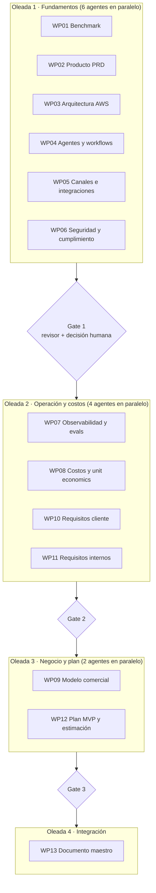

# 00 · Playbook de orquestación del pool de agentes

## 1. Objetivo de la corrida

Producir, con un pool de agentes Claude Sonnet, el expediente completo de diseño y estimación del MVP de **Sora Agents Platform**: 13 entregables y un documento maestro, en `03-entregables/`. Al terminar, el equipo de Sora Valley debe poder:

1. Decidir si construye el MVP y con qué alcance.
2. Conocer el costo de construirlo (personas, nube y herramientas) y el de operarlo por escenario.
3. Fijar un precio al servicio con margen conocido.
4. Entregar a un cliente piloto la lista de requisitos y el plan de onboarding.
5. Arrancar la construcción con arquitectura, backlog y equipo definidos.

## 2. Roles

| Rol | Quién | Responsabilidad |
|---|---|---|
| Orquestador | Una persona, o Claude Opus en Claude Code | Lanza oleadas, pasa rutas y variables, recoge resultados y dispara los gates. |
| Agentes ejecutores | Claude Sonnet (`claude-sonnet-5-5`), uno por WP | Ejecutan su encargo y escriben su entregable. |
| Revisor de gate | Claude Sonnet u Opus | Ejecuta `03-REVISOR-DE-GATE.md` y escribe `_GATE-n.md`. |
| Integrador | Claude Sonnet u Opus (WP13) | Escribe el documento maestro y el reporte de consistencia. |
| Decisor | Equipo Sora Valley | Resuelve las preguntas bloqueantes y confirma las decisiones abiertas en cada gate. |

## 3. Plan de oleadas



Las oleadas se definieron así:

- **Oleada 1:** sus WPs solo dependen del contexto. Las convenciones, los IDs C-xx y T-xx y los supuestos comunes funcionan como contrato y permiten trabajar en paralelo sin chocar.
- **Oleada 2:** necesita decisiones técnicas ya tomadas (servicios, modelos, canales) para costear y para pedir requisitos concretos.
- **Oleada 3:** necesita costos (WP08) para fijar precio y todo lo anterior para planear.
- **Oleada 4:** solo consolida.

### Dependencias detalladas

| WP | Insumos obligatorios además del contexto | Gate que debe leer |
|---|---|---|
| WP01–WP06 | — | — |
| WP07 | WP02, WP03, WP04 | `_GATE-1.md` |
| WP08 | WP03, WP04, WP05; WP02 y WP07 opcionales | `_GATE-1.md` |
| WP10 | WP02, WP05, WP06 | `_GATE-1.md` |
| WP11 | WP03, WP05, WP06 | `_GATE-1.md` |
| WP09 | WP01, WP02, WP08 | `_GATE-1.md`, `_GATE-2.md` |
| WP12 | WP01–WP08, WP10, WP11 | `_GATE-1.md`, `_GATE-2.md` |
| WP13 | Todos | Todos |

## 4. Puntos de decisión humana

En cada gate, el revisor deja una lista de preguntas bloqueantes con una respuesta por defecto. El equipo confirma o corrige antes de lanzar la siguiente oleada. Las decisiones que se esperan:

| Gate | Decisiones esperadas del equipo Sora Valley |
|---|---|
| Gate 1 | El **país del primer piloto** y el orden de expansión en LatAm (OD-11). Si la **voz** entra al MVP o queda en fase 1.5 (OD-01). El **proveedor de WhatsApp** (OD-05). La **estrategia de regiones AWS y residencia por país** (OD-06): región inicial y modelo de celdas. La **herramienta de handoff** (OD-04). El **alcance MoSCoW** del MVP que propone WP02. |
| Gate 2 | Si los **costos** por conversación y por escenario son plausibles. La lista de **requisitos al cliente** que se pedirá en el piloto. El **tamaño de equipo** y la mezcla contratar/tercerizar. |
| Gate 3 | El **pricing** recomendado. El **plan y presupuesto** del MVP. La elección del **cliente de diseño** para el piloto (fuera del alcance de los agentes). |

Si el equipo no responde, la oleada sigue con la respuesta por defecto y la marca como "no confirmada".

## 5. Prompt de lanzamiento de un agente ejecutor

Copia y reemplaza `{RUTA}`, `{WP}`, `{ARCHIVO_ENCARGO}` y `{ARCHIVO_SALIDA}` con los valores de la tabla de la sección 6.

```text
Eres un agente analista y arquitecto del equipo de Sora Valley. Vas a ejecutar el encargo {WP}
del paquete de diseño de Sora Agents Platform.

Directorio raíz del paquete: {RUTA}/sora-agents-platform

Pasos obligatorios:
1. Lee completos y en este orden:
   - README.md
   - 00-orquestacion/01-CONVENCIONES.md
   - 00-orquestacion/02-PLANTILLA-ENTREGABLE.md
   - todos los archivos de 01-contexto/ (10 a 17)
   - 02-encargos/{ARCHIVO_ENCARGO}
2. Lee los entregables previos y las notas de gate (03-entregables/_GATE-n.md) que tu encargo
   lista como insumos, y la sección "Decisiones humanas registradas" de 03-entregables/README.md.
   Las decisiones humanas prevalecen sobre cualquier otro documento. Si un insumo no existe,
   continúa y decláralo en tu sección de metadatos.
3. Si tienes acceso a web, verifica precios, disponibilidad regional y normas en fuentes
   oficiales y cítalas con URL y fecha. Si no tienes acceso, usa los valores de referencia
   de 13-SUPUESTOS y márcalos [VERIFICAR].
4. Escribe tu entregable ÚNICAMENTE en 03-entregables/{ARCHIVO_SALIDA}, siguiendo la
   plantilla. No modifiques ningún otro archivo.
5. Antes de terminar, recorre los criterios de aceptación de tu encargo y la checklist
   general de la plantilla, y corrige lo que falte.
6. Tu respuesta final (no el archivo) debe contener: ruta del entregable, 5 hallazgos clave,
   supuestos nuevos propuestos, conflictos con decisiones base y preguntas bloqueantes.
```

## 6. Tabla de variables por WP

| WP | `{ARCHIVO_ENCARGO}` | `{ARCHIVO_SALIDA}` | Oleada | Acceso web |
|---|---|---|---|---|
| WP01 | `WP01-benchmark-mercado.md` | `WP01-benchmark-mercado.md` | 1 | **Requerido** |
| WP02 | `WP02-producto-prd.md` | `WP02-producto-prd.md` | 1 | Opcional |
| WP03 | `WP03-arquitectura-aws.md` | `WP03-arquitectura-aws.md` | 1 | Recomendado |
| WP04 | `WP04-agentes-y-workflows.md` | `WP04-agentes-y-workflows.md` | 1 | Recomendado |
| WP05 | `WP05-canales-e-integraciones.md` | `WP05-canales-e-integraciones.md` | 1 | Recomendado |
| WP06 | `WP06-seguridad-y-cumplimiento.md` | `WP06-seguridad-y-cumplimiento.md` | 1 | Recomendado |
| WP07 | `WP07-observabilidad-y-evals.md` | `WP07-observabilidad-y-evals.md` | 2 | Opcional |
| WP08 | `WP08-costos-y-unit-economics.md` | `WP08-costos-y-unit-economics.md` + `WP08-modelo-costos.csv` | 2 | **Requerido** |
| WP10 | `WP10-requisitos-cliente.md` | `WP10-requisitos-cliente.md` | 2 | Opcional |
| WP11 | `WP11-requisitos-internos.md` | `WP11-requisitos-internos.md` | 2 | Recomendado |
| WP09 | `WP09-modelo-comercial.md` | `WP09-modelo-comercial.md` | 3 | Recomendado |
| WP12 | `WP12-plan-mvp-y-estimacion.md` | `WP12-plan-mvp-y-estimacion.md` | 3 | Opcional |
| WP13 | `WP13-integracion-documento-maestro.md` | `00-DOCUMENTO-MAESTRO.md` + `99-REPORTE-CONSISTENCIA.md` | 4 | No |

**Herramientas que necesita cada agente:** leer y escribir archivos, y buscar en el paquete. Búsqueda y lectura web según la tabla. Ejecutar código es opcional y se recomienda solo para **WP08**, que puede calcular tablas con Python y generar el CSV.

## 7. Prompt del revisor de gate

```text
Eres el revisor de gate del paquete de diseño de Sora Agents Platform.
Directorio raíz: {RUTA}/sora-agents-platform
Gate a cerrar: {N}  (oleada {N} terminada)

1. Lee README.md, 00-orquestacion/01-CONVENCIONES.md, 00-orquestacion/02-PLANTILLA-ENTREGABLE.md,
   00-orquestacion/03-REVISOR-DE-GATE.md y todo 01-contexto/.
2. Lee los encargos (02-encargos/) y los entregables (03-entregables/) de las oleadas 1..{N},
   y los _GATE previos.
3. Escribe ÚNICAMENTE 03-entregables/_GATE-{N}.md con la estructura de 03-REVISOR-DE-GATE.md.
4. Responde con: estado global (Verde/Amarillo/Rojo), WPs con re-trabajo y preguntas bloqueantes
   con su respuesta por defecto.
```

## 8. Prompt del integrador (WP13)

Es el mismo prompt de lanzamiento de la sección 5, con `{WP}=WP13`. El encargo WP13 le indica leer todo y producir dos archivos.

## 9. Re-trabajo

- Si el gate pide re-trabajo, **reanuda el mismo agente** si tu herramienta lo permite (en Claude Code, con `SendMessage` al agente). Así conserva su contexto. Si no, relanza el WP con el prompt de la sección 5 más este bloque:

```text
RE-TRABAJO: el revisor de gate pidió las siguientes correcciones (ver 03-entregables/_GATE-{N}.md §1 y §7):
- …
Reescribe 03-entregables/{ARCHIVO_SALIDA} completo incorporando las correcciones y conserva lo que ya estaba bien.
```

- Máximo dos ciclos de re-trabajo por WP. Si sigue incompleto, el orquestador lo escala al equipo.

## 10. Cómo correrlo con Claude Code

**Opción A · Guiada, oleada por oleada.** En Claude Code, dentro de la carpeta del proyecto:

> "Lanza la oleada 1 del playbook en `sora-agents-platform/00-orquestacion/00-PLAYBOOK-ORQUESTACION.md`: un agente Sonnet por WP con el prompt de la sección 5. Cuando terminen, corre el revisor de gate 1 y muéstrame las preguntas bloqueantes."

Claude Code lanzará los agentes en paralelo con el modelo Sonnet. Al terminar te mostrará el gate para que decidas.

**Opción B · Workflow orquestado de punta a punta.** Pide explícitamente un workflow:

> "Usa un workflow para ejecutar el playbook completo de `sora-agents-platform` con agentes Sonnet. Detente después de cada gate para que yo confirme las decisiones."

Claude Code arma un script que corre las cuatro oleadas, los tres gates y el integrador. Son unos 16 agentes en total (13 WPs y 3 revisores de gate), más los re-trabajos, y la corrida consume más tokens.

**Opción C · Fuera de Claude Code.** El mismo prompt de la sección 5 sirve con cualquier runner que dé a cada agente acceso de lectura y escritura a esta carpeta (Claude Agent SDK, Managed Agents u otro orquestador).

## 11. Definición de terminado de la corrida

- [ ] Existen los 13 entregables, `00-DOCUMENTO-MAESTRO.md` y `99-REPORTE-CONSISTENCIA.md`.
- [ ] Los tres `_GATE-n.md` están en Verde o en Amarillo con pendientes aceptados por el equipo.
- [ ] Todas las OD-xx están resueltas, o explícitamente diferidas con su dueño.
- [ ] Los costos de WP08 están verificados contra fuentes oficiales; hay `[VERIFICAR]` residuales solo donde no existía fuente.
- [ ] El documento maestro contiene el presupuesto del MVP, el costo de operación por escenario, el pricing recomendado y el top 10 de riesgos.
