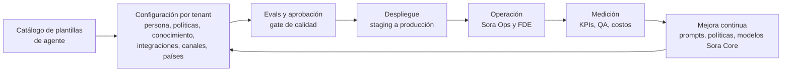

# 11 · Visión: Sora Agents como Agents-as-a-Service (AaaS)

## 1. Tesis

**Sora Agents deja de ser una característica del plan Scale y pasa a ser una línea de negocio propia.** Ofrece agentes de IA verticalizados para fintechs de crédito en Latinoamérica, que Sora Valley **despliega, opera y mejora**, y que se cobran por uso o por resultado.

El cliente no compra "un chatbot". Compra **un equipo de operaciones digital** que atiende, cobra y produce contenido 24/7, en el idioma y el canal de sus usuarios. Ese equipo está conectado a sus sistemas y a los modelos de riesgo de Sora Core.

> "Wonderful conversa. Sora conversa **y decide con modelos de riesgo propios**."

## 2. Referencia: Wonderful

> Información pública consultada el 13-nov-2026 en fuentes secundarias. WP01 debe verificarla y profundizarla.

| Aspecto | Lo que se sabe de Wonderful |
|---|---|
| Qué es | Plataforma enterprise de agentes de IA de cara al cliente, enfocada en **customer service**. Opera por **voz, chat y email**, en **múltiples idiomas**. |
| Arquitectura | **Capa de orquestación** que se conecta a los sistemas del cliente (CRM, ERP, bases de políticas). **Agnóstica al modelo de IA**. |
| Modelo operativo | Plataforma más **equipos de despliegue locales embebidos** con el cliente (forward-deployed). Su diferenciador declarado es la **localización profunda en mercados no angloparlantes**, frente a Sierra o Decagon, que son más "English-first". |
| Producto reciente | **Agent Builder** (enero de 2026): un agente que construye, prueba y refina otros agentes. |
| Escala | Presencia reportada en **más de 30 mercados**. Series B de USD 150 M (marzo de 2026, Insight Partners). Hay reportes no confirmados de una Serie C de USD 550 M con valuación de USD 5 B (septiembre de 2026) `[VERIFICAR]`. |
| Resultados que reclama | Contención superior al 80% y hasta 60% menos de tiempo de gestión. Son afirmaciones del proveedor, no verificadas. |

### Qué tomamos de Wonderful

1. **Agentes de cara al cliente multicanal** (WhatsApp, voz, web y, más adelante, email), nativos en el idioma y la cultura locales.
2. **Capa de orquestación** que conecta el agente con los sistemas del cliente mediante herramientas seguras y auditables.
3. **Modelo de servicio con ingenieros desplegados (FDE)**: Sora implementa y opera, y el cliente no tiene que construir nada.
4. **Builder y plantillas de agente** para que cada nuevo cliente salga en semanas, no en meses.
5. **Guardrails, observabilidad y evals de nivel enterprise** como parte del producto, no como extra.

### Qué hacemos distinto

| Dimensión | Wonderful (horizontal) | Sora Agents (vertical crédito LatAm) |
|---|---|---|
| Vertical | Customer service genérico, varias industrias | **Crédito de consumo: BNPL y microcrédito.** Ciclo completo de atención, cartera y cobranza, y crecimiento. |
| Decisiones | Las reglas o políticas del cliente las configura cada agente | **Decisiones de riesgo con modelos propios (Sora Core):** a quién cobrar, cuándo, con qué oferta, qué línea dar. El agente ejecuta. |
| Aprendizaje | Mejora del agente | **Ciclo cerrado:** cada interacción reentrena los modelos de Sora Core (Collect, Pulse, Audience). |
| Región | Global, más de 30 mercados | **LatAm profundo:** WhatsApp-first; español regional y portugués; medios de pago locales (SPEI, PIX, PSE, Yape, etc.); regulación de cobranza y datos de cada país. |
| Cliente | Enterprise grande | **Fintechs pequeñas y medianas** con equipos chicos. Precio y time-to-value acordes. |
| Nube | Agnóstica | **AWS-nativa**, con Amazon Bedrock y AgentCore. |
| Contenido | No es su foco | **Agente de contenido** para marketing de la fintech, conectado a la segmentación de Sora Audience. |

## 3. Propuesta de valor por actor

| Actor | Dolor | Qué le da Sora Agents |
|---|---|---|
| CEO / COO de la fintech | Escalar la operación sin escalar la plantilla. Margen presionado. | Operación 24/7 con costo variable y predecible. Puesta en producción en semanas. |
| Head de Cobranza | Recuperación baja, contactabilidad baja, quejas por hostigamiento, costo de los despachos | Cobranza conversacional que ejecuta la estrategia de Sora Collect, respeta la regulación de cada país y registra cada gestión |
| Head de CX / Atención | Colas largas en WhatsApp, rotación de agentes humanos, poco tiempo para casos complejos | Contención de consultas repetitivas, escalamiento con contexto, menor tiempo de primera respuesta |
| Head de Marketing / Growth | Producir contenido constante cumpliendo la publicidad financiera y la marca | Calendario y piezas generadas, revisadas por cumplimiento y aprobadas por una persona antes de publicar |
| Compliance / Legal | Riesgo regulatorio por el trato al deudor, la protección de datos y la publicidad | Políticas deterministas, trazabilidad total, bitácora auditable y controles por país |
| Usuario final (deudor o cliente) | Esperar, repetir su caso, recibir cobros agresivos | Respuesta inmediata en su canal y en su idioma, trato digno y opciones claras de pago |

## 4. Principios de diseño del producto (no negociables)

1. **El LLM conversa; el sistema decide.** Montos, descuentos, planes de pago, cambios de línea y elegibilidad salen de servicios deterministas o de modelos de Sora Core. El LLM nunca calcula ni inventa ofertas (`[ADR-04]`).
2. **Humano en el loop, configurable.** Cada tenant define qué se escala, cuándo y a quién. El escalamiento lleva todo el contexto.
3. **Trazabilidad total.** Cada mensaje, herramienta, decisión y versión de prompt queda registrada y es auditable por el cliente.
4. **Multi-tenant y multi-país desde el día 1.** Hay aislamiento de datos por tenant. Regulación, idioma, horarios, moneda y medios de pago se configuran por país.
5. **Configurar antes que programar.** Un tenant nuevo sale a partir de plantillas de agente y configuración (persona, políticas, conocimiento, integraciones), sin código nuevo en el caso estándar.
6. **Medible.** Cada agente tiene KPIs de negocio, evals automatizadas y gates de calidad antes de cada cambio.
7. **Costo por conversación conocido y controlado.** Hay presupuestos por conversación, ruteo entre modelos y prompt caching desde el diseño.
8. **Cumplimiento por diseño.** Las reglas de protección de datos, cobranza y publicidad de cada país viven en políticas deterministas, no en el prompt.
9. **Transparencia con el usuario final.** El usuario sabe que habla con un asistente de IA, puede pedir una persona y ve las acciones que el agente ejecutó, como en la demo de la landing.

## 5. Modelo de servicio

El ciclo funciona así: de una plantilla del catálogo se pasa a una configuración por tenant. La configuración pasa un gate de evals antes de desplegarse. Después se opera, se mide y se mejora, y cada mejora vuelve a la configuración. El equipo de FDE y Sora Ops es parte del producto, igual que en Wonderful.

## 6. Hipótesis de empaquetado

> Hipótesis para que WP09 la valide o la reemplace.

| Nivel | Contenido de agentes | Mapeo con los planes de la landing |
|---|---|---|
| Agents Starter | 1 agente (atención o cobranza), canal WhatsApp, 1 país, plantillas estándar | Producto de entrada independiente o add-on de Starter |
| Agents Growth | 2–3 agentes (atención + cobranza + contenido), WhatsApp + web, varios países, integraciones con Sora Collect y Pulse | Growth |
| Agents Scale | Catálogo completo con voz, SLA alto, FDE dedicado, opción de despliegue aislado (silo) | Scale |

Líneas de ingreso posibles: (1) **setup u onboarding**, (2) **suscripción de plataforma por agente**, (3) **uso** (por conversación, resolución, minuto o pieza), (4) **fee por éxito** en cobranza (% de lo recuperado incremental). WP09 elige la combinación.

**Hipótesis estratégica:** los agentes pueden ser el **producto de entrada (wedge)** de Sora Valley, porque su time-to-value es menor que el de un modelo de riesgo. Una vez dentro, el cliente se expande a Collect, Pulse y Origin. WP01 y WP09 la evalúan.

## 7. Alcance del MVP

### Dentro del MVP (fase 1)

| Bloque | Contenido |
|---|---|
| **AG-RTR** Router | Puerta de entrada única por número de WhatsApp. Identifica tenant, operación de país y cliente, detecta el intent y rutea a AG-ATC o AG-COB. Detecta urgencias y vulnerabilidad. |
| **AG-ATC** Atención 24/7 | WhatsApp y web chat. FAQs con RAG; consultas de cuenta; links de pago; aclaraciones y quejas con escalamiento. |
| **AG-COB** Cartera y cobranza | Gestión de la cartera desde el preventivo hasta la mora temprana y media. Ejecuta la siguiente mejor acción de Sora Collect por WhatsApp; promesas de pago, planes dentro de política, disputas, opt-out. Cumple las reglas de cobranza del país del deudor. |
| **AG-CON** Contenido para redes | Calendario editorial, copys y piezas gráficas, revisión de cumplimiento publicitario y de marca, aprobación humana y publicación en Instagram y Facebook. Copys de campañas por segmento de Sora Audience. |
| **Plataforma** | Multi-tenant y multi-país; consola Sora Console (configuración, aprobaciones, analytics, auditoría); handoff a humanos; observabilidad y evals; medición de uso para facturar; seguridad base. |
| **Voz** (decisión `[OD-01]`) | Se diseña y se costea. Entra al MVP como **fase 1.5** (piloto acotado de AG-COB por voz, salida y entrada) o queda para la fase 2, según se decida en el Gate 1. |
| **Idiomas** | Español, con variantes locales configurables por país. El portugués (pt-BR) se diseña desde el MVP y su activación depende del primer país con tenant brasileño `[OD-11]`. |

### Fuera del MVP

| Elemento | Fase |
|---|---|
| **AG-KYC**: verificación documental, selfie, prueba de vida, listas de PLD/AML por país | Fase 2. La arquitectura deja los ganchos. |
| **AG-COP**: copiloto de riesgo interno que explica decisiones de Origin, Limit y Pulse | Fase 2 |
| Builder no-code de autoservicio para el cliente (al estilo del Agent Builder de Wonderful) | Fase 3. En el MVP la configuración la hace Sora vía consola interna. |
| Email como canal conversacional; SMS conversacional | Fase 2. SMS solo como respaldo de notificaciones. |
| TikTok, LinkedIn y X para contenido; community management (responder comentarios y DMs) | Fase 2 |
| Mora tardía (más de 90 días), cobranza judicial, venta de cartera | Fuera de alcance. Se deriva al proceso del cliente. |
| Despliegue en la cuenta AWS del cliente (BYOC) | Fase 3. Opción premium. |

## 8. Métricas norte del negocio AaaS

| Métrica | Definición preliminar (WP02 y WP07 la formalizan) |
|---|---|
| Resoluciones autónomas | Conversaciones cerradas sin intervención humana y sin reapertura en 72 h |
| Recuperación incremental | Monto recuperado por AG-COB por encima del grupo de control (holdout) |
| CSAT del usuario final | Encuesta posterior a la conversación |
| Costo por resolución | Costo total variable (LLM, canal e infraestructura) / resoluciones |
| Margen bruto por tenant | (Ingreso − costo variable − costo de operación asignado) / ingreso |
| Time-to-live por tenant | Días desde la firma hasta la primera conversación en producción |
| Incidentes de cumplimiento | Quejas regulatorias o violaciones de política por cada 10,000 conversaciones |
