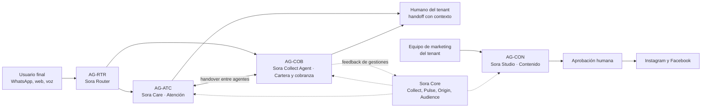
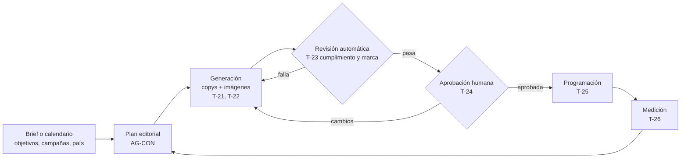

# 12 · Catálogo de agentes del MVP

Este documento define **qué hace cada agente**. Lo que el agente decide y lo que delega a sistemas deterministas está en `14-DECISIONES-BASE [ADR-04]`. Los nombres comerciales son tentativos.

> **Interpretación de "chatbots que manejen carteras":** en crédito de consumo, *cartera* es el portafolio de créditos del cliente. El agente de cartera (AG-COB) gestiona el ciclo de servicio y cobranza de cada cuenta, desde el recordatorio preventivo hasta la mora media. **No** se refiere a billeteras digitales ni a gestión de inversiones. Si el equipo quiso decir otra cosa, debe aclararlo en el Gate 1 `[PREGUNTA-ABIERTA]`.

---

## 1. Mapa general

El usuario final siempre entra por **un solo punto por tenant y país** (por ejemplo, un número de WhatsApp). AG-RTR decide qué agente atiende. AG-ATC y AG-COB pueden pasarse la conversación sin que el usuario lo note: alguien que pregunta su saldo y está en mora pasa a la lógica de cobranza. AG-CON no habla con usuarios finales; trabaja con el equipo de marketing del tenant.

---

## 2. Niveles de autenticación del usuario final

| Nivel | Cómo se alcanza | Qué permite |
|---|---|---|
| **L0** Anónimo | Cualquier contacto | Información pública: productos, requisitos, FAQs, cómo pagar, horarios. **Nunca** confirma si la persona es cliente ni si tiene deuda. |
| **L1** Canal verificado | El número de WhatsApp o teléfono coincide con el registrado **y** la persona responde correctamente un dato de conocimiento que define el tenant (por ejemplo, fecha de nacimiento o últimos dígitos del documento) | Consultas de cuenta (saldo, cuotas, pagos), link de pago, promesa de pago, abrir casos, preferencias de contacto |
| **L2** Verificación fuerte | L1 más un OTP (plantilla de autenticación de WhatsApp, SMS o email) **o** confirmación dentro de la app del tenant (deep link) | Planes de pago y reestructuras, explicación de decisiones de crédito, cambios de datos personales, reportes de fraude con bloqueo |

**Reglas:**
- El nivel caduca a los 30 minutos de inactividad (configurable por tenant).
- **Los números de teléfono se reciclan** y existe el SIM swap. Por eso L1 nunca se basa solo en el número.
- Si el número pertenece a un tercero ("número equivocado"), el agente **no revela nada** sobre la deuda o la cuenta. Esto es crítico por la regulación de cobranza de cada país `[LEGAL]`.

---

## 3. Catálogo de herramientas (T-xx)

Clase de riesgo: **R** = lectura · **W-bajo** = escritura reversible o de bajo impacto · **W-alto** = escritura con impacto financiero, legal o público. Toda W-alto requiere **validación determinista de política (C-13)** y, según el caso, confirmación explícita del usuario o aprobación humana.

| ID | Herramienta | Descripción | Clase | Auth mínima | Agentes | Sistema destino |
|---|---|---|---|---|---|---|
| T-01 | `identify_customer` | Busca al cliente por número o canal y operación de país; devuelve el id interno y los datos de verificación disponibles (sin exponerlos al LLM) | R | L0 | RTR, ATC, COB | Core del tenant |
| T-02 | `verify_identity` | Valida un dato de conocimiento (L1) o envía y valida un OTP (L2) | Acción | L0 → L1/L2 | ATC, COB | Core del tenant / Sora |
| T-03 | `get_account_summary` | Saldo, línea, estatus, días de atraso (DPD), producto | R | L1 | ATC, COB | Core del tenant |
| T-04 | `get_installments` | Cuotas próximas y vencidas, con montos y fechas | R | L1 | ATC, COB | Core del tenant |
| T-05 | `get_payment_history` | Pagos recientes y su estatus | R | L1 | ATC, COB | Core del tenant |
| T-06 | `create_payment_link` | Genera un link o una referencia de pago (por país: transferencia inmediata, efectivo, billetera) por un monto **validado por política** | W-alto | L1 | ATC, COB | PSP del tenant (C-21) |
| T-07 | `get_payment_plan_options` | Opciones de plan o reestructura **calculadas por el motor de políticas** según DPD, saldo, país y reglas del tenant | R | L2 | COB | Motor de políticas (C-13) / Core |
| T-08 | `accept_payment_plan` | Formaliza el plan que eligió el usuario, previa confirmación explícita | W-alto | L2 | COB | Core del tenant |
| T-09 | `register_promise_to_pay` | Registra una promesa (fecha y monto dentro de los rangos permitidos) | W-bajo | L1 | COB, ATC | Core del tenant + Sora |
| T-10 | `get_next_best_action` | Consulta a **Sora Collect**: canal, hora, tono, oferta y probabilidad de pago | R | Sistema | COB, workflows | Sora Core |
| T-11 | `get_line_evaluation` | Consulta a **Sora Pulse**: elegibilidad para aumento y razones | R | L1 | ATC | Sora Core |
| T-12 | `get_decision_reasons` | Consulta a **Sora Origin**: razones de una aprobación o un rechazo, en lenguaje apto para el usuario | R | L2 | ATC | Sora Core |
| T-13 | `search_knowledge` | RAG sobre la base de conocimiento del tenant y su país (FAQs, términos, tasas publicadas, políticas) con citas | R | L0 | ATC, COB, CON | C-14 |
| T-14 | `open_case` | Abre una aclaración, queja, disputa o solicitud en el sistema del tenant y devuelve el folio | W-bajo | L1 (L0 para quejas anónimas) | ATC, COB | Helpdesk / core del tenant |
| T-15 | `handoff_to_human` | Transfiere a una persona con un resumen estructurado y la prioridad | Acción | L0 | RTR, ATC, COB | C-22 |
| T-16 | `update_contact_preferences` | Opt-out por canal, horario preferido, "no contactar" | W-bajo | L1 | ATC, COB | Sora (C-17) + tenant |
| T-17 | `schedule_callback` | Agenda un recontacto en una ventana permitida | W-bajo | L1 | COB, ATC | C-17 |
| T-18 | `update_customer_data` | Actualiza email o dirección. En el MVP **no** cambia el teléfono. | W-alto | L2 | ATC | Core del tenant |
| T-19 | `report_fraud_or_loss` | Reporta fraude, robo de identidad o cargo no reconocido; pide el bloqueo al tenant y escala con urgencia | W-alto | L1 + escalamiento inmediato | ATC, COB | Core del tenant + C-22 |
| T-20 | `get_brand_kit` | Manual de marca, tono, paleta, logos, leyendas obligatorias por país | R | Operador | CON | Config del tenant |
| T-21 | `draft_copy` | Genera copys por red, formato y segmento (una sub-llamada a un LLM con la plantilla de marca) | Generación | Operador | CON | C-15 |
| T-22 | `generate_image` | Genera o adapta una imagen con un modelo de imagen y plantillas de marca | Generación | Operador | CON | C-15 |
| T-23 | `compliance_check_ad` | Valida la pieza contra las reglas de publicidad financiera del país (por ejemplo, costo total del crédito, leyendas obligatorias, claims prohibidos) y contra la marca | R / validación | Operador | CON | C-13 + reglas por país |
| T-24 | `request_approval` | Crea una tarea de aprobación humana (de 1 o 2 niveles) en la consola | Acción | Operador | CON | C-16 / C-23 |
| T-25 | `schedule_publication` | Programa o publica en Instagram o Facebook **solo si la pieza está aprobada** | W-alto | Aprobación humana previa | CON | C-05 |
| T-26 | `get_social_insights` | Métricas de las publicaciones (alcance, interacción) | R | Operador | CON | C-05 |
| T-27 | `get_audience_segments` | Consulta a **Sora Audience**: segmentos e incentivo recomendado para una campaña | R | Operador | CON | Sora Core |
| T-28 | `send_template_message` | Envía una plantilla aprobada (por ejemplo, de WhatsApp). **Solo la invocan workflows**, nunca el LLM con texto libre. | W-alto | Sistema | Workflows W-01, W-02 | C-01 |
| T-29 | `log_contact_attempt` | Registra la gestión de cobranza (canal, resultado, timestamp) para auditoría y para Sora Core | W-bajo | Sistema | COB, workflows | C-24 / C-27 |

---

## 4. AG-RTR · Sora Router

| Campo | Definición |
|---|---|
| Objetivo | Recibir cada mensaje entrante, resolver tenant, operación de país, cliente y conversación activa, clasificar el intent y entregar el control al agente correcto, con la mínima latencia y el mínimo costo |
| Modelo | Liviano (Haiku), más reglas `[ADR-02]` |
| Entradas | Mensaje normalizado (C-06), metadata del canal, estado de la conversación |
| Salidas | Agente destino, intent, nivel de urgencia, banderas (vulnerabilidad, queja regulatoria, fraude, posible tercero) |
| Reglas clave | (1) Si la conversación tiene dueño activo, el mensaje va a ese agente salvo que el intent cambie de dominio. (2) Las urgencias (fraude, robo, amenaza, crisis personal) se escalan a una persona sin pasar por el agente especialista. (3) Las palabras de opt-out ("STOP", "baja", "no me escriban" y sus equivalentes en pt-BR) se ejecutan de forma determinista. |
| Vulnerabilidad | Detecta señales de crisis emocional, enfermedad, duelo, pérdida de empleo o desastre. Aplica el **protocolo de cliente vulnerable** del tenant: tono, pausa de cobranza y derivación a una persona. Estas señales nunca se usan para presionar el cobro. |
| KPIs | Precisión de ruteo (≥ 95% en el eval set), latencia p90 ≤ 800 ms, costo por mensaje |

---

## 5. AG-ATC · Sora Care (atención 24/7)

| Campo | Definición |
|---|---|
| Objetivo | Resolver de punta a punta las consultas y gestiones de clientes y prospectos de la fintech, con acceso seguro a la cuenta, y escalar con contexto lo que no puede resolver |
| Canales | WhatsApp (MVP), web chat (MVP), voz de entrada (fase 1.5 o 2 según `[OD-01]`) |
| Disparadores | Inbound del usuario; handover desde AG-COB |
| Usuarios | Clientes del tenant y prospectos |

### 5.1 Intents (base para el PRD de WP02, que debe completarlos y priorizarlos)

| Grupo | Intents | Auth | Herramientas |
|---|---|---|---|
| Información general | Qué es el producto · requisitos · cómo funciona el BNPL o el crédito · tasas y costo total publicados · comercios afiliados · cómo y dónde pagar · horarios y canales | L0 | T-13 |
| Solicitud | Estatus de mi solicitud · por qué me rechazaron (razones de Origin, con lenguaje cuidado) · documentos faltantes | L1 / L2 | T-03, T-12, T-13 |
| Cuenta | Saldo · próxima cuota · historial de pagos · línea disponible · estado de cuenta | L1 | T-03, T-04, T-05 |
| Pagos | Pagar o adelantar · liquidar · cómo pagar en mi país · pago no reflejado | L1 | T-06, T-05, T-14 |
| Línea | ¿Me pueden aumentar la línea? (Pulse) | L1 | T-11 |
| Datos | Actualizar email o dirección | L2 | T-18 |
| Problemas | Cargo no reconocido · fraude o robo de identidad · devolución o cancelación de una compra · problema con la app | L1 | T-19, T-14, T-15 |
| Formal | Queja formal (ruta regulatoria del país) · derechos sobre datos personales (acceso, rectificación, cancelación u oposición) · baja de cuenta | L1 | T-14, T-15 |
| Meta | Hablar con una persona · repetir · terminar | L0 | T-15 |

### 5.2 Políticas clave
- Se presenta como **asistente de IA del tenant** desde el primer mensaje.
- Las cifras (saldos, montos, fechas) salen **siempre** de una herramienta en ese turno. El agente nunca usa memoria ni estimaciones para darlas.
- No da asesoría financiera personalizada fuera de lo que define el tenant.
- Cada respuesta con datos de la cuenta indica qué acción ejecutó, siguiendo el patrón de la demo de la landing.

### 5.3 Escalamiento
Se escala en estos casos: lo pide el usuario; el agente no logra entender tras 2 intentos; fraude o cargo no reconocido; queja formal; cliente vulnerable; enojo alto sostenido; fallo de la integración. **Payload:** resumen, intent, nivel de autenticación, acciones hechas, datos clave y sentimiento (el esquema lo define WP04).

### 5.4 KPIs
Resolución sin humano · tiempo de primera respuesta · tiempo de resolución · CSAT · % escalado (por motivo) · reaperturas a 72 h · costo por conversación.

---

## 6. AG-COB · Sora Collect Agent (cartera y cobranza)

| Campo | Definición |
|---|---|
| Objetivo | Gestionar la cartera desde el preventivo hasta la mora media, ejecutando la **siguiente mejor acción de Sora Collect**. Busca maximizar la recuperación y las promesas cumplidas con **trato digno** y cumpliendo la regulación de cobranza del país del deudor. |
| Canales | WhatsApp (MVP), voz de salida y entrada (`[OD-01]`), SMS solo como respaldo de notificaciones |
| Disparadores | (a) Workflow programado (W-01) que envía una plantilla según next-action; (b) respuesta del usuario a esa plantilla; (c) inbound de un usuario en mora (handover desde ATC); (d) eventos: pago recibido, promesa vencida, cambio de DPD |
| Decide | **Sora Collect** decide canal, hora, tono y oferta. El **motor de políticas (C-13)** calcula montos, planes y límites. **El agente conversa, explica, negocia dentro de las opciones dadas y registra.** |

### 6.1 Etapas de la cartera

| Etapa | Rango (configurable) | Qué hace el sistema | Qué hace el agente |
|---|---|---|---|
| Preventiva | D-5 a D0 | El workflow envía un recordatorio con plantilla, sin LLM | Atiende respuestas: dudas, pago, "ya pagué" |
| Mora temprana | D+1 a D+30 | La cadencia de next-action envía plantillas y agenda contactos | Conversa: link de pago, promesa, plan corto, disputa |
| Mora media | D+31 a D+90 | Cadencia más intensa dentro de los límites legales; voz si está habilitada | Planes y reestructuras **dentro de política**, con verificación L2 |
| Mora tardía | > D+90 | Fuera del MVP: se deriva al proceso del tenant o a un despacho | Solo informa y deriva |

### 6.2 Intents

| Intent | Comportamiento esperado | Herramientas |
|---|---|---|
| Confirmar identidad | Antes de hablar de la deuda, verifica L1. **Si no es el titular, no revela nada.** | T-01, T-02 |
| ¿Cuánto debo? | Saldo vencido, cuotas y cargos con su desglose | T-03, T-04 |
| Pagar ahora | Link o referencia por el monto vencido o uno parcial permitido | T-06 |
| Promesa de pago | Fecha y monto dentro de los rangos de política; confirmación y recordatorio | T-09, T-17 |
| Plan de pagos | Presenta **solo** las opciones de T-07, explica condiciones y formaliza con confirmación explícita | T-07, T-08 |
| Pedir descuento o quita | Solo si la política lo permite y con las opciones que da el motor. Si no, explica las alternativas. | T-07 |
| "Ya pagué" | Verifica el pago; si no aparece, pide el comprobante y abre un caso; pausa la cadencia | T-05, T-14 |
| "No reconozco la deuda" | Abre una disputa, pausa la cobranza y escala | T-14, T-15, T-16 |
| "Número equivocado / no soy esa persona" | Se disculpa, **no revela datos**, marca el número como erróneo y lo saca de la cadencia | T-16, T-29 |
| "No me contacten" / opt-out | Ejecuta el opt-out por canal según la ley y la política; confirma | T-16 |
| Dificultad económica o vulnerabilidad | Protocolo de vulnerable: empatía, opciones de plan si aplican, pausa o derivación | T-07, T-15 |
| "Llámame después" | Agenda dentro de la ventana permitida del país | T-17 |
| Hablar con una persona | Handoff con contexto | T-15 |
| Queja por hostigamiento | Registra la queja formal, pausa y escala con prioridad | T-14, T-15 |

### 6.3 Políticas de cumplimiento (por país, en el motor de políticas, nunca solo en el prompt)

- **Ventanas horarias y días permitidos de contacto** por país, en la zona horaria del deudor.
- **Frecuencia máxima de contactos** por día, semana y canal, según el país.
- **Identificación obligatoria** del acreedor o despacho; prohibición de amenazas, de lenguaje ofensivo y de simular autoridades.
- **No contactar a terceros** ni revelar la deuda a terceros. Las referencias, solo según la ley del país.
- **Listas de exclusión** y registros de "no llamar" donde existan.
- Cada gestión se registra (T-29) para auditoría y como evidencia ante la autoridad.
- Detalle por país: `16-REGULATORIO-Y-RIESGOS-LATAM.md` `[LEGAL]`.

### 6.4 KPIs
Tasa de recuperación (contra holdout) · roll rate por tramo · contactabilidad · tasa de respuesta · promesas generadas y cumplidas · costo por unidad de moneda recuperada · quejas por cada 10,000 contactos · opt-outs.

---

## 7. AG-CON · Sora Studio (contenido para redes)

| Campo | Definición |
|---|---|
| Objetivo | Producir el contenido orgánico y de campañas de la fintech (redes sociales y copys para campañas por segmento), alineado a la marca y a la regulación de publicidad financiera de cada país, con aprobación humana antes de publicar |
| Usuarios | Equipo de marketing del tenant (B2B). **No interactúa con usuarios finales.** |
| Canal de trabajo | Sora Console (módulo Studio). Publica en Instagram y Facebook vía Graph API (MVP). |

### 7.1 Flujo principal (W-04)

El brief se convierte en un plan editorial. Cada pieza se genera, pasa una revisión automática de cumplimiento y marca, y luego una aprobación humana. Solo las piezas aprobadas se programan. Las métricas de desempeño alimentan el siguiente plan.

### 7.2 Capacidades

| Capacidad | MVP | Notas |
|---|---|---|
| Calendario editorial mensual a partir de objetivos, fechas clave del país y campañas | Sí | |
| Copys por red y formato (post, carrusel, guion de reel, story) con variantes A/B | Sí | En el idioma y la variante del país |
| Imágenes generadas o adaptadas sobre plantillas de marca | Sí | El modelo de imagen lo define WP04/WP05 `[VERIFICAR]` |
| Copys de campañas por segmento de Sora Audience (plantillas de marketing de WhatsApp, push, email) | Sí | Usa T-27. Las plantillas de WhatsApp pasan además por la aprobación de Meta. |
| Revisión de publicidad financiera por país y de marca | Sí | Las reglas deterministas viven en C-13; el LLM solo apoya. |
| Aprobación de 1 o 2 niveles con historial | Sí | |
| Publicación y programación en Instagram y Facebook | Sí | |
| Reporte mensual de desempeño con recomendaciones | Sí | |
| TikTok, LinkedIn, X; video generativo; community management | No | Fase 2 |

### 7.3 Riesgos específicos
Afirmaciones engañosas sobre el crédito; omitir el costo total o las leyendas obligatorias; uso de imágenes de personas reales o de marcas de terceros; contenido sesgado o discriminatorio; publicar sin aprobación. **Mitigación central:** T-25 está bloqueada técnicamente sin una aprobación registrada.

### 7.4 KPIs
Piezas por mes · tiempo de brief a publicación · tasa de aprobación al primer intento · rechazos por cumplimiento · engagement contra la línea base · costo por pieza.

---

## 8. Agentes de fase 2 (solo para dejar ganchos en la arquitectura)

| Agente | Qué hará | Ganchos necesarios desde el MVP |
|---|---|---|
| **AG-KYC** Sora Verify | Captura de documentos y selfie, OCR o extracción, prueba de vida, validación contra fuentes oficiales por país (vía proveedores), listas de PLD/AML; la decisión final la toma un motor de reglas | Almacenamiento de datos **biométricos y sensibles** aislado; flujos de carga de archivos; clasificación de datos sensibles en WP06 |
| **AG-COP** Copiloto de riesgo | Uso interno del tenant: explica en lenguaje natural las decisiones de Origin, Limit y Pulse; responde preguntas sobre la cartera | Acceso a la API de razones y métricas de Sora Core; RBAC de operadores |

---

## 9. KPIs de plataforma (todas las variantes)

| KPI | Meta del MVP (hipótesis; ver `[S-37]`, `[S-38]`, `[S-66]`) |
|---|---|
| Disponibilidad | ≥ 99.5% mensual |
| Latencia de la primera respuesta por WhatsApp (p90) | ≤ 6 s |
| Precisión de ruteo | ≥ 95% |
| Violaciones de política detectadas en producción | 0 de severidad alta |
| Fugas de datos entre tenants | 0 (requisito absoluto) |
| Costo variable por conversación (ATC) | Dentro de la meta de WP08 |
