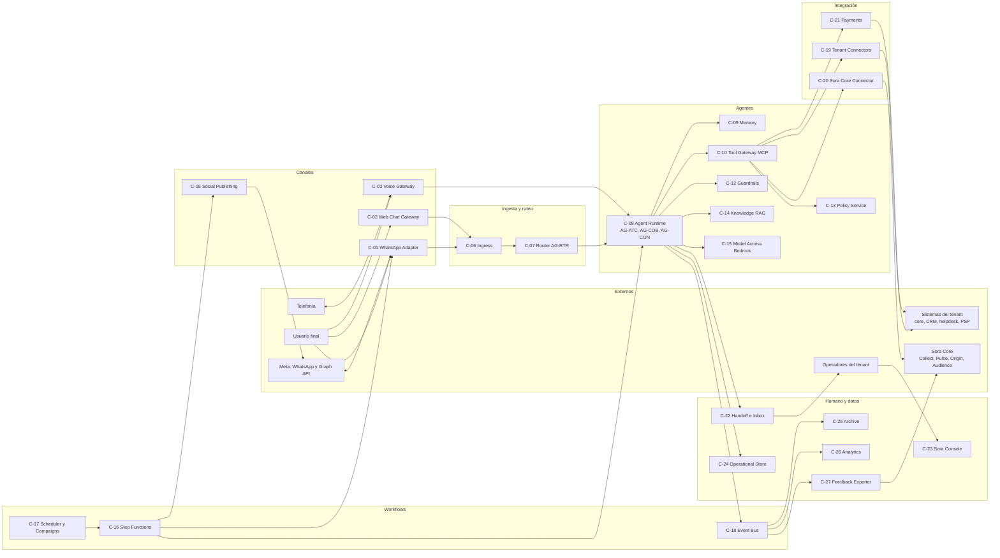
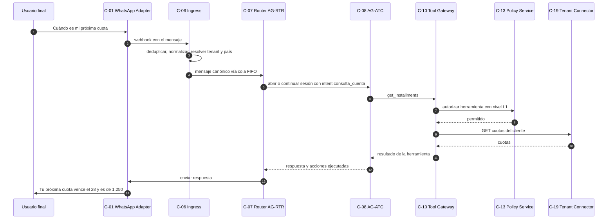
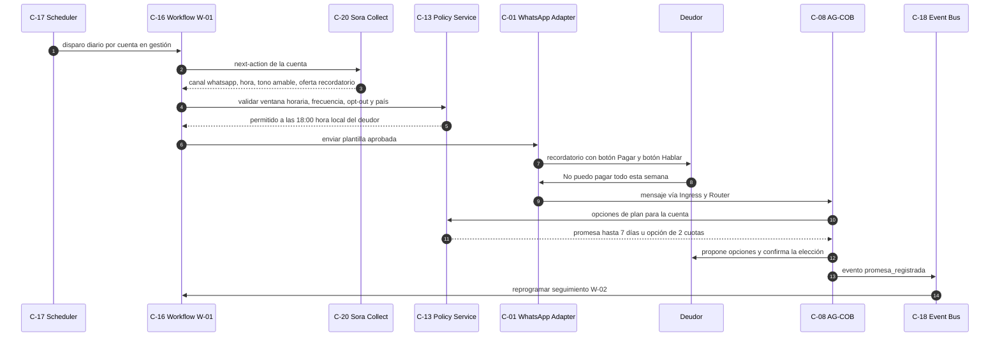
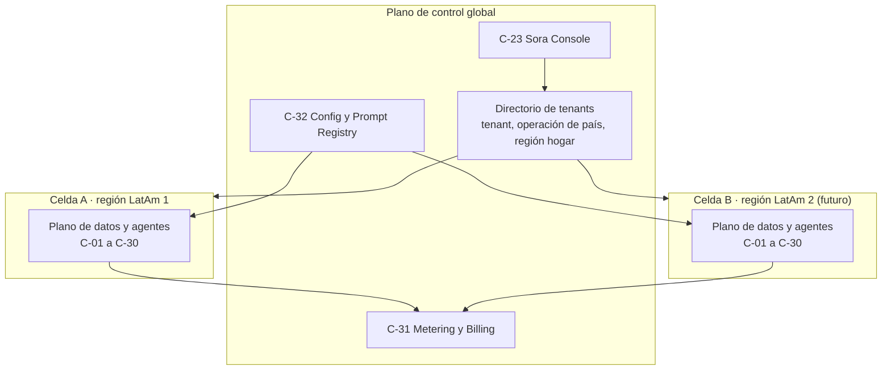

# 15 · Arquitectura de referencia (borrador para alinear vocabulario)

> **Estado: BORRADOR.** Este documento existe para que todos los WPs usen **los mismos nombres e IDs de componentes**. WP03 (infraestructura) y WP04 (agentes y workflows) lo refinan y pueden proponer cambios. Los servicios AWS listados son la **opción por defecto**, no una decisión final, salvo donde una ADR lo fija.

---

## 1. Planos de la plataforma

| Plano | Para qué existe |
|---|---|
| Canales | Hablar con el mundo exterior: WhatsApp, web, voz y redes |
| Ingesta y ruteo | Normalizar, deduplicar, ordenar e identificar tenant, país, cliente y agente |
| Agentes | Razonar, conversar y usar herramientas con memoria, conocimiento y guardrails |
| Workflows | Procesos deterministas largos o programados |
| Integración | Conectar con los sistemas del tenant, con Sora Core y con los pagos |
| Humano | Handoff, aprobaciones y consola |
| Datos | Estado operativo, archivo y analítica |
| Confianza (transversal) | Observabilidad, evals, seguridad, medición de uso para facturar y configuración |

## 2. Catálogo de componentes

| ID | Componente | Responsabilidad | Servicio AWS por defecto | WP dueño |
|---|---|---|---|---|
| C-01 | WhatsApp Adapter | Recibir y enviar mensajes de WhatsApp por cada operación de país; manejar estados de entrega y plantillas | AWS End User Messaging Social + SNS + Lambda | WP05 |
| C-02 | Web Chat Gateway | Widget embebible y conexión en tiempo real con streaming | API Gateway WebSocket + Lambda; widget en CloudFront | WP05 |
| C-03 | Voice Gateway | Llamadas entrantes y salientes, motor de voz, grabación | Amazon Connect (+ motor `[OD-01]`) | WP05 |
| C-04 | SMS / Email Adapter | Notificaciones de respaldo (MVP); canal conversacional (fase 2) | End User Messaging SMS / Amazon SES | WP05 |
| C-05 | Social Publishing Adapter | Publicar, programar y leer métricas en redes | Lambda + Meta Graph API | WP05 |
| C-06 | Ingress y normalización | Formato canónico de mensaje, idempotencia, orden por conversación, detección de opt-out por palabra clave | Lambda + SQS FIFO (grupo = conversación) + DynamoDB (deduplicación) | WP03 |
| C-07 | Tenant Resolver y Router (AG-RTR) | Resolver tenant, operación de país, cliente y conversación; clasificar intent; rutear; detectar urgencias | Lambda + Haiku vía C-15 | WP04 |
| C-08 | Agent Runtime | Ejecutar AG-ATC, AG-COB y AG-CON con aislamiento por sesión | Bedrock AgentCore Runtime | WP04 / WP03 |
| C-09 | Agent Memory | Memoria de corto plazo (sesión) y largo plazo (preferencias, resúmenes) por tenant y cliente | AgentCore Memory | WP04 |
| C-10 | Tool Gateway | Exponer herramientas T-xx como MCP, con autenticación y autorización por tenant | AgentCore Gateway + targets Lambda u OpenAPI | WP04 / WP05 |
| C-11 | Identity y credenciales | Credenciales de salida hacia los sistemas del tenant; identidad de operadores | AgentCore Identity + Secrets Manager + Cognito | WP06 |
| C-12 | Guardrails | Filtrar entrada y salida (temas denegados, PII, toxicidad, grounding) | Amazon Bedrock Guardrails + validadores propios | WP04 / WP06 |
| C-13 | Policy and Decision Service | Reglas deterministas por tenant y país: montos, planes, ventanas, frecuencias, publicidad; autorización de herramientas | AgentCore Policy (Cedar) + servicio de reglas (Lambda) | WP04 |
| C-14 | Knowledge Service (RAG) | Ingesta, indexación y búsqueda por tenant y país, con citas | Bedrock Knowledge Bases + vector store `[OD-02]` + S3 | WP04 / WP03 |
| C-15 | Model Access Layer | Acceso a modelos, perfiles de inferencia y cross-region, ruteo por paso, fallbacks, presupuestos de tokens | Amazon Bedrock | WP03 / WP04 |
| C-16 | Workflow Orchestrator | Workflows W-01 a W-08 | AWS Step Functions | WP04 |
| C-17 | Scheduler y Campaign Engine | Programar contactos respetando ventanas, frecuencias, opt-outs y listas de exclusión por país | EventBridge Scheduler + Lambda + DynamoDB | WP04 |
| C-18 | Event Bus | Eventos de dominio (mensaje, gestión, promesa, pago, handoff, uso) | Amazon EventBridge | WP03 |
| C-19 | Tenant Connectors | Adaptadores hacia el core, el CRM y el helpdesk del tenant | Targets del Gateway + Lambda; NAT con IP fija para allowlisting | WP05 |
| C-20 | Sora Core Connector | Consumir Collect, Pulse, Origin y Audience | API privada (PrivateLink o mTLS) | WP05 |
| C-21 | Payments Connector | Links y referencias de pago vía el PSP del tenant, por país | Lambda | WP05 |
| C-22 | Handoff e Inbox | Transferencia a humanos y retorno | `[OD-04]` | WP05 |
| C-23 | Sora Console | Configuración, conocimiento, políticas, aprobaciones, analytics, auditoría, usuarios | Web app (`[OD-07]`) + Cognito | WP02 / WP03 |
| C-24 | Operational Store | Tenants, operaciones de país, configuraciones, conversaciones, sesiones, gestiones, promesas, piezas, aprobaciones | DynamoDB | WP03 |
| C-25 | Conversation Archive | Transcripciones, grabaciones y bitácora inmutable | S3 (+ Object Lock para la auditoría) | WP03 / WP06 |
| C-26 | Analytics Lake | KPIs, analítica conversacional, costos | S3 + Glue + Athena + QuickSight | WP07 |
| C-27 | Sora Core Feedback Exporter | Devolver gestiones y resultados a Sora Core para reentrenar | EventBridge → Firehose → S3 → Sora Core | WP05 |
| C-28 | Observability | Trazas, métricas, logs y alertas | AgentCore Observability + CloudWatch + X-Ray/OTEL | WP07 |
| C-29 | Evaluation Service | Evals offline (gates) y en línea (muestreo) | AgentCore Evaluations + harness propio | WP07 |
| C-30 | Security Baseline | KMS, WAF, CloudTrail, GuardDuty, Security Hub, Macie, Config | Servicios de seguridad de AWS | WP06 |
| C-31 | Metering y Billing | Eventos de uso por tenant (conversaciones, minutos, piezas, tokens) para facturar y medir el margen | EventBridge + DynamoDB + S3; facturación electrónica por país vía proveedor `[VERIFICAR]` | WP08 / WP11 |
| C-32 | Config y Prompt Registry | Configuraciones de agente, prompts, políticas y plantillas versionadas, con promoción entre entornos | DynamoDB + S3 versionado + AWS AppConfig | WP04 |

## 3. Vista lógica de alto nivel

**Lectura:** los mensajes entrantes pasan por Ingress (C-06) y por el Router (C-07) antes de llegar al agente (C-08). El agente solo actúa sobre el mundo a través del Tool Gateway (C-10), que consulta al Policy Service (C-13) antes de cada acción. Los contactos salientes nacen en el Scheduler (C-17) y en los workflows (C-16), nunca en el LLM. Todo evento va al Event Bus (C-18), que alimenta el archivo, la analítica y el retorno a Sora Core. El plano de confianza (C-28 a C-32) es transversal y no se dibuja para no saturar el diagrama.

## 4. Flujo semilla: mensaje entrante de WhatsApp (camino feliz)

## 5. Flujo semilla: cadencia de cobranza outbound (W-01)

## 6. Modelo de celdas regionales (multi-país)

**Lectura:** cada operación de país de un tenant queda anclada a una celda (su región hogar), y sus datos personales en reposo no salen de ella, salvo por la inferencia cross-region que defina `[ADR-08]` / `[OD-06]`. El plano de control global solo maneja configuración, directorio y métricas de uso sin datos personales. **El MVP despliega una sola celda.** WP03 debe validar este modelo y definir qué cruza entre planos.

## 7. Estructura de cuentas AWS (borrador)

| OU / cuenta | Propósito |
|---|---|
| Management | AWS Organizations, facturación consolidada |
| Security / Log Archive | CloudTrail de toda la organización, logs centralizados, Security Hub |
| Shared Services | CI/CD, repositorios de artefactos, DNS |
| Sora-Agents-Dev / Staging / Prod | Plataforma por entorno (una celda por región en Prod) |
| Silo-<tenant> (fase 3) | Tenants premium aislados |

WP03 lo finaliza: SCPs, Control Tower y relación con las cuentas de Sora Core.
