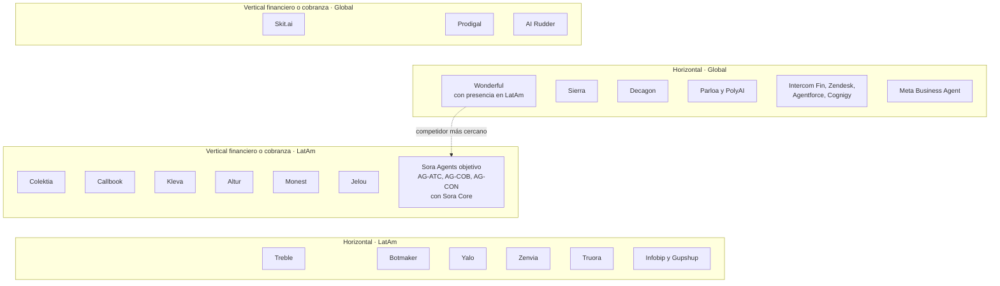

# WP01 · Benchmark competitivo: Wonderful y comparables

| Campo | Valor |
|---|---|
| Encargo | 02-encargos/WP01-benchmark-mercado.md |
| Autor | Agente Claude Sonnet 5.5 · corrida 2026-11-16 |
| Versión | 1.0 |
| Insumos leídos | `README.md`; `00-orquestacion/01-CONVENCIONES.md`; `00-orquestacion/02-PLANTILLA-ENTREGABLE.md`; `01-contexto/10` a `17` (completos); `02-encargos/WP01-benchmark-mercado.md`; `03-entregables/README.md` (sección "Decisiones humanas registradas"). **No existen** `_GATE-n.md` ni entregables previos (WP01 está en la oleada 1 y no tiene insumos de otros WPs). La tabla de decisiones humanas está **vacía**: no hay decisiones humanas que prevalezcan sobre el contexto. |
| Acceso web en esta corrida | **Sí** (búsqueda y lectura de páginas, consultadas el 2026-11-16). Limitaciones: varias páginas oficiales no publican precios; algunas cifras vienen de prensa especializada o agregadores y se marcan como tal; las tarifas de WhatsApp de Perú, Chile y Argentina solo se obtuvieron de fuentes secundarias `[VERIFICAR]`. |
| Estado | Completo con pendientes: (1) tarifas Meta de PE, CL y AR en el rate card oficial; (2) precios de Canva y de varios jugadores LatAm que solo cotizan bajo demanda; (3) cifras de ingresos de Wonderful (no divulgadas por la empresa); (4) validación de cliente de diseño y red de contactos de Sora Valley (decide el equipo, `[OD-11]`). |

**Convención de lectura de este documento.** *Hecho verificado* = leído en página oficial o en nota de prensa con fecha. *Declarado por el proveedor* = cifra de marketing o de caso de éxito sin auditoría independiente. *Secundario* = prensa, blogs o agregadores. *Estimación* y *recomendación* son del autor. "n/d" = no verificado en esta corrida (no equivale a "No").

---

## 0. Resumen ejecutivo

- **Wonderful ya compite en el mismo terreno que Sora, y más rápido de lo supuesto en `11-VISION`.** Series B de USD 150 M (12-mar-2026) y Serie C de USD 550 M a valuación de USD 5 B (2-sep-2026, lidera Insight Partners; Salesforce participa). **La Serie C está verificada `[V]` en el comunicado primario de Wonderful, leído el 2026-11-16 [F3]**; el comunicado informa más de 35 mercados y 650 empleados. Quedan confirmados los datos que `11-VISION` marcaba `[VERIFICAR]` (sigue `[VERIFICAR]` el acumulado superior a USD 800 M y los ingresos, que no están en el comunicado).
- **Wonderful ya hace cobranza con IA en LatAm.** Para Banco Caja Social (Colombia, 2.5 M de clientes según el caso publicado por Wonderful [F5]) puso en producción un agente de **voz de cobranza preventiva y temprana en 19 días**: 43,658 llamadas en 3 semanas y 65% de contactos directos con promesa de pago frente a 45% de la línea base humana (cifras del proveedor). Tiene ~20 clientes en LatAm (incluye Mercado Libre México y bancos colombianos), seis clientes y 30 proyectos en Brasil, y anunció una inversión de USD 10 M en Brasil en 2026 y USD 20 M en 2027.
- **El espacio en blanco no es "un agente de cobranza por WhatsApp".** Ese terreno ya lo ocupan especialistas latinoamericanos (Colektia, Callbook, Kleva, Altur, Monest, Mozart, hiSofi) y horizontales con FDE (Wonderful). Lo que **nadie combina** según lo verificado es: agentes de atención y cartera para **fintechs de crédito pequeñas y medianas**, **gobernados por decisiones de un modelo de riesgo propio** (siguiente mejor acción, motor de políticas por país) y con **medición de uplift contra holdout**. Esa combinación es la tesis `[ADR-04]` y el único diferenciador defendible.
- **Recomendación de posicionamiento:** narrativa de *plataforma vertical con Sora Core* (opción C) y *puerta de entrada comercial* de cobranza temprana más atención (opción A). Eslogan de trabajo: "Wonderful conversa; Sora conversa y decide con modelos de riesgo propios". AG-CON entra como expansión, no como cuña (§2.8, §2.9).
- **Hipótesis de wedge: parcialmente validada.** Los agentes tienen time-to-value menor (Wonderful: 19 días a 10 semanas; el objetivo `[S-45]` de ≤ 4 semanas en ESC-L es competitivo, y ≤ 2 semanas en ESC-E es más agresivo que el mejor caso público). Pero la cuña solo es diferencial si el piloto demuestra uplift contra holdout `[S-67]` y la integración con Sora Collect; sin Sora Core, un agente de cobranza es commodity.
- **Precios: el mercado converge a unidad de resultado o de conversación.** Referencias públicas: Intercom Fin desde USD 0.99 por resolución; Zendesk USD 1.50 (comprometida) y 2.00 (pago por uso) por resolución automatizada; Salesforce Agentforce USD 2 por conversación. En cobranza, Altur ofrece tarifa por minuto con mínimo mensual **o** cuota de plataforma más comisión por éxito sobre lo cobrado. **Hipótesis para WP09:** modelo híbrido (cuota de plataforma por operación de país + uso por conversación o resolución en AG-ATC + comisión por recuperación incremental contra holdout en AG-COB). No existe benchmark público del porcentaje de comisión: se declara n/d.
- **Cambio de reglas de WhatsApp que afecta los costos de `13-SUPUESTOS`.** Meta cobra desde el 1-oct-2026 los mensajes utility dentro de la ventana de servicio y los mensajes de servicio después de 1,000 gratuitos por número al mes. Esto contradice la nota de `P-10` ("las utility dentro de la ventana no tienen cargo"). **Supuesto no verificado:** la tarifa de servicio se igualó a la de utility (S-G1-02 `[_GATE-1 §4.6]`, no confirmada); en México son ≈723 de los ≈1,063 USD al mes de ESC-P, por lo que la sensibilidad (×0.5 y ×1.5) es relevante. Además, desde el 3-jun-2026 Meta ofrece su propio *Business Agent* en WhatsApp, con cobro por tokens (USD 2 por millón; el sitio de Meta estima 4 a 5 centavos por mensaje). Es competidor y riesgo de plataforma `[RIESGO R-09]`.
- **Ranking de países (óptica de mercado, scorecard con criterios y pesos explícitos): MX 3.70 · BR 3.65 · CO 3.60 · AR 3.40 · PE 3.10 · CL 2.95.** Los tres primeros están en empate técnico. **Recomendación para `[OD-11]` (parte mercado): piloto en MX o CO (español), con Brasil como ola 2 cuando pt-BR esté listo, porque ahí hay mayor tamaño pero también mayor competencia (Wonderful invierte allí) y exige portugués.** La decisión final depende del cliente de diseño disponible y de la óptica regulatoria de WP06.
- **Estado del mercado de crédito (señales de demanda de cobranza):** Brasil registra 84.2 M de personas negativadas (Serasa, sep-2026, récord); Argentina tiene mora bancaria de hogares de 12.9% (récord en más de 20 años) y fintechs con mora cercana a 27–30%; México tiene IMORA de tarjetas de 13.7%; Colombia, Perú y Chile están más estables. El dolor de cobranza es mayor en BR y AR, pero en AR el riesgo cambiario y de contraparte pesa `[RIESGO R-18]`.

---

## 1. Alcance

**Cubre:** ficha de Wonderful; 30 fichas de comparables verificados (globales horizontales, LatAm conversacional, cobranza con IA, contenido y plataformas nativas de Meta y AWS); matriz de capacidades; modelos de precio observados; modelo operativo y time-to-value; mercado por país núcleo `[S-04]` con ranking para el piloto; table stakes, diferenciales y capacidades futuras; posicionamiento; implicaciones para el MVP (must-haves para WP02, hipótesis de pricing para WP09, evaluación del wedge).

**No cubre y quién lo cubre:**

| Tema | WP |
|---|---|
| Análisis legal y regulatorio por país (las normas se mencionan solo como contexto de mercado y llevan `[LEGAL]`) | WP06 |
| Costos de infraestructura, LLM y unit economics (aquí solo se citan tarifas de canal como insumo) | WP08 |
| Pricing final, planes y paquetes | WP09 |
| Selección de proveedor de WhatsApp (`[OD-05]`) y de voz (`[OD-01]`) | WP05 |
| Diseño de producto y PRD | WP02 |
| Contacto con prospectos: las fintechs nombradas son **ejemplos de posibles clientes**, no se contactó a ninguna |  — |

---

## 2. Contenido principal

### 2.1 Ficha detallada de Wonderful

Fecha de consulta de todas las fuentes: 2026-11-16. Marcas: `[V]` verificado en fuente oficial o nota de prensa; `[P]` declarado por el proveedor; `[S]` secundario.

| Dimensión | Hallazgo | Tipo y fuente |
|---|---|---|
| Qué es | "Unified operating layer for the AI-native enterprise": un sistema operativo de IA empresarial. Módulos listados en el sitio: Data, Alerts, Permissions, Skills, Orchestrator, CLI, Evals, Guardrails, Workspaces, Knowledge; además Wonderful Agents, Wonderful Systems y AI Gateway. Empresa Israelí-neerlandesa (Wonderful AI B.V.; comunicados con dateline Ámsterdam), fundada en 2025. | `[V]` [F1][F2] |
| Producto y canales | Agentes de cara al cliente por **voz, chat, email e in-app**, más agentes para solicitudes de empleados y trabajo de back-office. **WhatsApp confirmado** en producción en México (Mercado Libre Vehículos). El agente de cobranza de Caja Social opera por **llamadas salientes**; el de servicio, por llamadas entrantes sobre Genesys Cloud. | `[V]` [F1]; `[S]` [F3][F7]; `[P]` [F5] |
| Idiomas y localización | Declara servir "every market and every language". Equipos locales "ajustan los agentes al idioma, la regulación y el contexto operativo de cada país". En Caja Social el agente se entrenó con jerga regional (costeña) y usa un clasificador de género para ajustar el lenguaje. No publica lista de idiomas ni de variantes. | `[P]` [F2][F5] |
| Arquitectura | **Capa de orquestación** sobre sistemas de registro vía API o MCP; **agnóstica al modelo** (compara y elige modelo por caso de uso); evaluación basada en harness y diseño "self-healing"; guardrails que definen lo que el agente puede y no puede hacer; trazas completas de razonamiento por acción para auditoría; paneles de uso, eficiencia y resultados. Despliegue en nube u on-premise según prensa secundaria. | `[P]` [F2]; `[S]` [F3][F7] |
| Agent Builder | Lanzado el 23-ene-2026. Es un agente autónomo que **construye, prueba y refina otros agentes** a partir de documentos de políticas, bases de conocimiento y grabaciones de llamadas. Corre sobre Claude (Anthropic es socio en el anuncio). Reclama hasta 50% menos de tiempo a producción y 20% menos de incidencias tempranas, sobre la base de 60+ despliegues enterprise a esa fecha. Equipos no técnicos pueden mejorar agentes con retroalimentación guiada; una interfaz de chat está en la hoja de ruta. | `[V]` comunicado [F4]; cifras `[P]` |
| Integraciones | Sistemas de registro por API o MCP; en Caja Social, una API co-construida con el banco, escritura de resultados en la plataforma de cobranza del banco en tiempo real y etiquetas de resultado por llamada. | `[P]` [F3][F5] |
| Guardrails y gobierno | Módulos Guardrails y Permissions; en Caja Social, un modelo "AI-as-a-judge" valida decisiones sensibles antes de ejecutarlas. Trust Center y programa de bug bounty enlazados. No cita normas específicas. | `[V]` [F1]; `[P]` [F5] |
| Analítica y mejora | Paneles en vivo; en Caja Social, de la versión 1 a la 34 en 6 semanas con 91 mejoras desplegadas. | `[P]` [F3][F5] |
| Modelo operativo | **Forward-deployed engineers (FDE)** embebidos con el cliente, que son dueños del resultado técnico y luego transfieren el control. Por caso de uso trabaja una **dupla consultor + FDE**. En Brasil, **el cliente no paga implementación, setup ni discovery: el cobro empieza cuando el proyecto entra en producción**; política "no lock-in" (el código y la propiedad intelectual son del cliente y pueden exportarse); contratos en dólares. | `[V]` [F2]; `[S]` [F3][F6] |
| Verticales | Banca, telecomunicaciones, salud, retail, servicios públicos, seguros y aerolíneas (sitio); en comunicados: servicios financieros, manufactura. | `[V]` [F1][F2] |
| Clientes públicos | Banco Caja Social (Colombia, cobranza y servicio); Telefónica (91.5% de contención declarada); OTE (Grecia); Petrol Ofisi; PPC Energie; ELTA Hellenic Post (≈4× el volumen en 2 meses, 86% de éxito declarado); Mercado Libre Vehículos (México); FC Bayern como socio de IA empresarial. En Brasil: seis clientes y 30 proyectos en curso, sin nombres. | `[V]` [F1]; `[P]` [F3][F5][F6][F7] |
| Pricing | **No es público.** Dato observable: sin cobro de implementación hasta producción (Brasil) y contratos en USD. | `[S]` [F6] |
| Financiamiento y valuación | Semilla ≈ USD 34 M y una ronda de USD 100 M a USD 700 M de valuación (reportes secundarios). **Serie B: USD 150 M, 12-mar-2026**, lidera Insight Partners con Index, IVP, Bessemer y Vine; acumulado USD 286 M según el comunicado; valuación no divulgada en el comunicado (reportes secundarios: USD 2 B). Extensión de USD 15 M de Kaszek vinculada a Brasil. **Serie C: USD 550 M a USD 5 B, anunciada el 2-sep-2026**, lidera Insight Partners; Salesforce participa (que sea su primera inversión es dato de prensa secundaria); participan Index, IVP, Vine, Bessemer y 9Yards. El comunicado no divulga acumulado, clientes ni ingresos; el acumulado superior a USD 800 M es `[S]` (Bloomberg Línea [F6]). **`[VERIFICAR]`** las cifras de ingresos: no las divulga la empresa; hay reportes de ≈USD 70 M de ingreso anual recurrente con meta de USD 100 M a fin de año y otro de ≈USD 100 M; son secundarios y discrepan. | `[V]` Serie B [F2]; `[V]` Serie C [F3] (comunicado primario; PR Newswire lo reproduce con fecha 4-sep-2026); `[S]` acumulado e ingresos |
| Escala | 650 empleados y más de 35 mercados (`[V]`, comunicado de la Serie C [F3]); 350 empleados en marzo (`[P]` [F2]); otro medio: ≈200 clientes en 40 mercados, con 400 personas en I+D en Israel); 70% de los clientes que empiezan con un caso de uso expanden en 3 meses (declarado). | `[V]` [F3]; `[S]` [F6]; `[P]` [F2] |
| Presencia en LatAm | **Brasil:** oficina en São Paulo y contratación de ≈50 personas; inversión anunciada de USD 10 M (2026) y USD 20 M (2027); meta declarada de USD 1,000 M de ingresos locales en dos años (aspiración, no ingreso actual); responsable: Rui Brandão. **México:** director país Phil Sebok (ex Salesforce México) y CTO Guillermo Güemez (ex Banorte); primer despliegue público con Mercado Libre Vehículos sobre WhatsApp: 99% de conversaciones sin humano, 4,500+ conversaciones, 2,200 cotizaciones, **diez semanas** hasta producción completa (cifras declaradas). **Colombia:** Banco Caja Social y "grandes bancos". Total LatAm: ≈20 clientes. | `[S]` [F3][F6][F7]; `[P]` |
| Resultados que reclama | Contención > 80%; hasta 60% menos de tiempo de gestión (Serie B). Caja Social: 65% de contactos directos terminan en promesa de pago (línea base humana 45%); tiempo medio de llamada −33%; conversión a pago de promesas de 31% a 37%; 6,000 llamadas diarias a régimen. | `[P]` [F2][F5] |

**Correcciones a `11-VISION §2` derivadas de esta verificación:**

1. La Serie C de USD 550 M a USD 5 B **ya no es un rumor**: está verificada en el comunicado primario de Wonderful (2-sep-2026, leído el 2026-11-16 [F3]) y la reportan múltiples medios. Un solo tipo de verificación en todo el documento: `[V]` para monto, valuación, inversionistas, mercados y empleados; `[S]` para acumulado e ingresos.
2. Wonderful **sí opera WhatsApp**, no solo voz, chat y email.
3. Wonderful **no es "enterprise grande" exclusivamente**: Caja Social es un banco mediano de clientes de ingresos medios y bajos. Aun así su modelo (FDE más dupla consultor) está pensado para cuentas grandes; el segmento de fintechs de 50k a 500k cuentas `[S-01]` no aparece en sus casos públicos `[PREGUNTA-ABIERTA]` (sin evidencia, no se afirma que no los atienda).
4. La escala de mercados cambió: más de 30 en marzo, 35 a 40 en septiembre.

**Lecciones para Sora**

| # | Lección | Acción para el diseño |
|---|---|---|
| L1 | Los líderes sacan agentes a producción en **semanas** (19 días en Caja Social; 7 semanas en una telco; 10 semanas en Mercado Libre) y no cobran setup. El objetivo `[S-45]` de ≤ 4 semanas (ESC-L) es competitivo; ≤ 2 semanas (ESC-E) es más agresivo que el mejor caso público. | WP09: no apoyar el modelo en cuotas de implementación altas; WP12: plantillas y un Builder interno son críticos. |
| L2 | Cobranza preventiva y temprana, **primero por voz** y luego servicio entrante, es el patrón de entrada en banca colombiana. | WP05: la decisión de voz `[OD-01]` pesa más de lo previsto; la voz de salida en cobranza es un caso probado en LatAm. |
| L3 | La prueba de valor es una **cifra comparada con línea base humana** (65% vs 45% de promesas). | WP02 y WP07: holdout y línea base desde el día 1 `[S-67]`. |
| L4 | Un juez de IA valida decisiones sensibles antes de ejecutarlas. | Sora ya lo resuelve con C-13 determinista `[ADR-04]`; es mejor argumento que un juez LLM. Se puede usar ambos. |
| L5 | "No lock-in" (código y propiedad intelectual exportables) es un argumento de venta de Wonderful. | WP09 y WP10: definir de antemano qué es propiedad del cliente (configuración, conocimiento, prompts) y qué de Sora. |
| L6 | Wonderful usa Claude en su Agent Builder; su capa es agnóstica al modelo. | Valida `[ADR-02]`: Claude más capa de acceso agnóstica. |
| L7 | El Agent Builder de Wonderful reduce el costo de cada nuevo agente y lo expone a equipos no técnicos. | Builder no-code de cliente es fase 3 en `11-VISION §7`. Mantener, pero el **Builder interno para FDE** debe ser MVP (ver §2.9). |
| L8 | Wonderful llega a Brasil con equipo local y USD 10 M en 2026: la ventana de ventaja competitiva de Sora en Brasil es corta. | `[OD-11]`: Brasil como ola 2 exige decidir pronto si se compite o se hace partnership. |

### 2.2 Fichas de comparables (30, verificados)

Conteo: 9 globales horizontales, 7 LatAm conversacionales, 6 de cobranza LatAm, 3 de cobranza global, 4 de contenido y 1 plataforma nativa de Meta; en total **12 jugadores con origen LatAm** (6 conversacionales: Jelou, Treble, Truora, Botmaker, Yalo y Zenvia; 6 de cobranza: Colektia, Callbook, Kleva, Altur, Monest y Belvo; Infobip y Gupshup son BSP globales con operación en LatAm y no se cuentan; la ficha 16 agrupa dos jugadores, por lo que son 30 fichas y 31 jugadores) y 9 con cobranza como foco o caso de uso. Los datos de ingresos y de tracción son los que cada empresa o la prensa informan; ninguno fue auditado. Consulta: 2026-11-16.

**A. Globales horizontales**

| # | Jugador | Qué hace y canales | Foco | Modelo de precio | Diferenciador | Relevancia para Sora | Fuente |
|---|---|---|---|---|---|---|---|
| 1 | **Sierra** | Agentes de CX: un agente en chat, SMS, WhatsApp, email, voz y ChatGPT; Agent Studio (con o sin ingeniería) y Ghostwriter para construir agentes; experimentos A/B y observabilidad. Idiomas: el sitio ofrece, entre otros, español. Logos de servicios financieros: Santander, SoFi, Vanguard, Fiserv, Rocket Mortgage. | Enterprise global, EE. UU. primero | **Basado en resultados** (conversación resuelta, venta, retención); sin cargo por casos escalados "en la mayoría de los casos"; precios no públicos. Serie E de USD 950 M a ~USD 15–15.8 B (may-2026); ingresos recurrentes > USD 150 M a feb-2026 (secundario). | Precio por resultado; muy alta capitalización | Referente de pricing por resultado; no es competidor directo en fintech pequeña LatAm. | [F8] |
| 2 | **Decagon** | Agentes de soporte en voz, chat y email bajo una capa de inteligencia; **AOP** (procedimientos operativos en lenguaje natural); simulaciones a escala y QA permanente (Watchtower). WhatsApp y SMS no aparecen en el sitio. | Enterprise, atención al cliente | **Por conversación** (la gran mayoría de clientes) o **por resolución**, sin precios de lista; Decagon indica descuentos por volumen comprometido. Estimaciones de terceros (no confirmadas): ≈USD 0.99 por conversación, ≈USD 0.50 por resolución y cuota de plataforma ≈USD 50,000 al año. Serie D de USD 250 M a USD 4.5 B (ene-2026). | Testing y QA como producto | Referente de evals y de AOP; sin foco LatAm verificado. | [F9] |
| 3 | **Parloa** | Plataforma de agentes de IA para atención al cliente, nacida en la UE (el sitio no detalla los canales en esta consulta); Agent Builder low-code, módulos de gestión del ciclo de vida y Performance Lab. Certificaciones declaradas: ISO 27001, SOC 2 Tipo II, PCI DSS, DORA. | Enterprise europeo, seguros y banca | n/d (no público). Serie D de USD 350 M a USD 3 B (15-ene-2026); ingresos > USD 50 M (secundario). | Cumplimiento europeo, voz | Referente de postura de seguridad para banca; sin presencia LatAm verificada. | [F10] |
| 4 | **PolyAI** | Agentes de voz y mensajería (voz, SMS, WhatsApp, web, email, app); Agent Studio no-code a código; residencia de datos EE. UU., Reino Unido, UE y APAC sin transferencia entre regiones. Español confirmado en un caso (emergencias en inglés y español); portugués n/d. | Enterprise, voz | n/d. Serie D USD 86 M (dic-2025); total > USD 200 M. | Voz natural y residencia de datos | Referente para la opción de voz de `[OD-01]`; sin LatAm verificado. | [F11] |
| 5 | **Cognigy (NiCE)** | Plataforma de agentes de IA para centros de contacto, ahora dentro de NiCE CXone Mpower y como producto independiente; más de 100 idiomas según prensa; adquisición por unos USD 955 M, anunciada en jul-2025 y cerrada. | Enterprise, contact center | n/d (licencias dentro de NiCE). | Cobertura de idiomas y base instalada de contact center | Competidor en grandes bancos de la región; Sora no apunta a ese segmento. | [F12] |
| 6 | **Intercom Fin** | Agente de IA de soporte en email, chat, teléfono y otros; WhatsApp y SMS se cobran por mensaje; "Procedures" para flujos. | SaaS de soporte, de pyme a enterprise | **USD 0.99 por resolución ("outcome")**, sin asientos ni cuotas de setup; mínimo mensual de compromiso (ejemplo: 50 resultados); la resolución se cuenta cuando el cliente confirma o no pide más ayuda. | Precio por resolución más transparente del mercado | Ancla pública para la unidad "resolución". | [F13] |
| 7 | **Zendesk AI agents** | Agentes de IA sobre Zendesk (mensajería, voz y QA son add-ons). | Mid-market y enterprise | **USD 1.50 por resolución automatizada comprometida; USD 2.00 pago por uso**; incluye 5 a 10 resoluciones por agente humano al mes según el plan (Suite Team USD 55 a 69; Professional USD 115 a 149). | Base instalada de helpdesk | Ancla de precio y posible helpdesk del tenant `[OD-04]`. | [F14] |
| 8 | **Salesforce Agentforce** | Agentes sobre la plataforma Salesforce; Agentforce Voice. | Enterprise con Salesforce | **USD 2 por conversación**; o créditos Flex (USD 500 por 100 mil créditos; acción estándar 20 créditos ≈ USD 0.10; voz 30); o por usuario (USD 5 la licencia; USD 125 a 550 los complementos y la edición Max). | Tres métricas de cobro en paralelo | Muestra la tendencia a cobros híbridos. Salesforce es inversionista de Wonderful. | [F15] |
| 9 | **Amazon Connect (con agentes de IA)** | Contact center nativo de AWS; lista de precios actual: chat USD 0.010 por mensaje, voz USD 0.038 por minuto más telefonía, email USD 0.080 y SMS o mensajería de terceros USD 0.014. Precios de agentes de IA, Nova Sonic y campañas salientes **no figuran en esa página**. | Contact center | Por uso (infraestructura). | Nativo de AWS | Es el canal de voz de `[ADR-07]`. **El precio de voz de lista (USD 0.038 por minuto) difiere de `P-13` (≈ USD 0.018):** ver §4.2 y WP05/WP08. | [F16] |

**B. LatAm conversacional**

| # | Jugador | Qué hace y canales | Foco | Modelo de precio | Diferenciador | Relevancia para Sora | Fuente |
|---|---|---|---|---|---|---|---|
| 10 | **Jelou** (Ecuador, 2017) | "Brain": agentes que **ejecutan** transacciones dentro de WhatsApp (pagos, verificación de identidad, apertura de cuentas, firma electrónica, créditos). Agent 2.0 (sep-2026). Serie A de USD 10 M (ene-2026; lidera Wellington Access Ventures, con Krealo/Credicorp). Más de 650 empresas y 13 países según la empresa; procesó más de USD 100 M en pagos, colocaciones y cobranzas (declarado). Cliente destacado: Mibanco (Perú). | Banca y retail LatAm | n/d | Operaciones financieras sin salir de WhatsApp; la empresa cita ~30% de abandono cuando se redirige a un enlace externo (declarado) | **Competidor y referente más cercano en UX transaccional por WhatsApp.** Muestra que el "link de pago" (T-06) tiene una alternativa en el chat. | [F17] |
| 11 | **Treble** (Colombia) | Plataforma de WhatsApp Business API con builder, campañas segmentadas, traspaso a humanos, CRM (HubSpot, Salesforce) y funciones de IA (FAQ con base de conocimiento, resúmenes, asistentes). **BSP oficial de Meta**. Español, portugués e inglés. Clientes: Addi, Rappi, Platzi, Renault, Xiaomi, entre otros. Serie A de USD 15 M (2022, Tiger Global). Voz y cobranza no aparecen en el sitio. | Comercio y servicio en LatAm | n/d (demo) | BSP con experiencia y marca local | Candidato a proveedor de WhatsApp (`[OD-05]`) y competidor parcial. Addi (BNPL) aparece como cliente. | [F18] |
| 12 | **Truora** (Colombia) | Verificación de identidad, verificación de antecedentes y automatización conversacional por WhatsApp (TruConnect). Opera en MX, CO, BR, CL, PE, CR y SV. Clientes citados: Bancolombia, Rappi, Clara, Didi. Serie A de USD 15 M (2022, Propel/BBVA). | Identidad y onboarding | n/d | Identidad más conversación | Referente para **AG-KYC (fase 2)**: socio potencial más que competidor en el MVP. | [F19] |
| 13 | **Botmaker** (Argentina) | Agentes de IA de chat, email y **voz**; canales WhatsApp, Instagram, Messenger, Mercado Libre, webchat y otros; voz entrante y saliente para ventas, cobranza o soporte; clientes: Movistar, Mercado Libre, Santander, MetLife, Naranja X. "Más de 40 países". Reconocido por Meta en mercados prioritarios (AR, CL, PE, CO). | Enterprise LatAm | Cotización; el sitio ofrece cuenta gratuita y referencias secundarias hablan de pesos y mínimos altos `[VERIFICAR]`. | Cobertura de canales y base instalada | Competidor directo en atención y cobranza multicanal en el Cono Sur. | [F20] |
| 14 | **Yalo** (México) | Comercio conversacional por WhatsApp (Unilever, Nestlé, Coca-Cola FEMSA, Walmart); Oris: agente de ventas por voz, texto y WhatsApp. Serie C de USD 50 M (2021) más extensión de USD 20 M (2023). | Retail y consumo masivo | Cotización | Comercio por WhatsApp a escala | No es vertical financiero; muestra el modelo enterprise por proyecto. | [F21] |
| 15 | **Zenvia** (Brasil) | Customer Cloud con agentes de IA en WhatsApp; **BizAI**, ecosistema agéntico dentro de WhatsApp; socio de los pilotos de Meta Business Agent (jun-2026); más de 960 clientes en campañas de WhatsApp (declarado). Sitio en portugués y español. | Brasil y LatAm, comercio y servicio | Plan antiguo de IA generativa con 10 usuarios y 500 interacciones `[VERIFICAR]`; sin precio vigente | Presencia local en Brasil y relación con Meta | Competidor en Brasil (ola 2); posible canal o socio. | [F23] |
| 16 | **Infobip y Gupshup** (BSP con IA) | BSP globales: Infobip AgentOS (15+ canales; cuota de plataforma desde ≈USD 530 al mes más uso, según fuente secundaria) y Gupshup (cargo de plataforma de USD 0.001 por mensaje en el API autoservicio; voz entrante y saliente para LatAm lanzada). Infobip colabora con QuiteJá en cobranza en Brasil. | Mensajería global con IA | Cuota de plataforma más uso `[VERIFICAR]`; precios de agentes no públicos | Cobertura de canales y operadores | Opciones de BSP `[OD-05]`; intermediarios de costo bajo sobre la tarifa de Meta. | [F22] |

**C. Cobranza con IA en LatAm**

*Nota post-Gate 1: que varios de estos jugadores operen cobranza por WhatsApp muestra que se practica, no que esté permitido; ver la política de Meta del 23-sep-2026 en `[_GATE-1 §4.1]`.*

| # | Jugador | Qué hace y canales | Foco | Modelo de precio | Diferenciador | Relevancia para Sora | Fuente |
|---|---|---|---|---|---|---|---|
| 17 | **Colektia** (Chile; oficinas en Santiago y Ciudad de México) | "Primera agencia de cobranza basada en IA de América Latina" (según su ficha). Scoring con IA, flujos de mora temprana, WhatsApp, SMS, email, push y voz interactiva, con escalamiento a humanos. Páginas por país: España, MX, CO, PE, CL y Costa Rica; la sección enterprise cita 6 países más. Clientes que lista: Nu, Banamex, Santander, Banco Falabella, Caja Los Andes, RapiCredit, **Cashea**, izzi, LendSwap, entre otros. Resultados declarados: LendSwap −54% de costos operativos; Santander 78% de curación en mora temprana. ISO 9001, ISO 27001 y reportes SOC declarados. Rondas: reportes de USD 4.2 M (Serie A) y USD 9 M (2025), `[VERIFICAR]`. | Fintech y banca, mora temprana | n/d (cotización) | Opera como **agencia de cobranza** con IA; clientes BNPL y fintech | **Competidor directo más cercano al ICP.** Su condición de "agencia" ilustra el riesgo `[RIESGO R-12]`. | [F24] |
| 18 | **Callbook** (Colombia; entró a Y Combinator, oct-2026) | Agentes conversacionales de cobranza por voz, WhatsApp, SMS y email para bancos y fintechs; opera en CO, CL, PE, PA, HN y EC, con México como prioridad y entrada a EE. UU. prevista. Más de 20 clientes por país y más de USD 300 M en carteras gestionadas en 2026 (declarado); hasta +30% de recuperación en algunos clientes (declarado). Fundadores: ex Trebol. | Cobranza LatAm | n/d | Foco 100% cobranza y equipo con experiencia en WhatsApp | **Competidor directo.** | [F25] |
| 19 | **Kleva** (origen Argentina; operación en México) | Cobranza "100% con IA" en primera línea: llamadas, SMS, email y WhatsApp; acceso a datos de burós (Círculo de Crédito); ajuste de acento por región. Semilla de USD 1.55 M (reporte secundario; invierte Wollef Ventures). Declara costos 70 a 80% menores que un call center y recuperación 10 a 20% sobre indicadores tradicionales. ISO 27001 en proceso. Clientes de integración mencionados (sin confirmar): bancos y retail grandes de México. | Cobranza México | n/d (los clientes fijan descuentos máximos, plazos y reglas de negociación) | Reglas de negociación fijadas por el cliente | **Competidor directo**; el patrón "el cliente define los límites, la IA negocia" es el mismo que `[ADR-04]`. | [F26] |
| 20 | **Altur** (Ciudad de México; Y Combinator S25) | Agentes de voz de cobranza para bancos, con seguimiento automático por WhatsApp en la misma conversación. Más de USD 6 M cobrados solo con agentes de IA en 6 meses en México (declarado). Equipo de 9 personas. | Bancos y fintechs de crédito, México y EE. UU. | **Por minuto con mínimo mensual, o cuota de plataforma más comisión por éxito sobre lo cobrado** (único dato público de este tipo). | Comisión por éxito explícita | **Dato clave para WP09:** valida el esquema híbrido y la comisión por resultado. | [F27] |
| 21 | **Monest** (Curitiba, Brasil) | Agente "Mia" de negociación de deudas por WhatsApp y teléfono (Mia Voz desde ago-2025). Anuario 2025: más de 6 M de conversaciones y ≈R$ 500 M negociados desde 2024; 700,000 acuerdos; en algunas operaciones 92% de las conversaciones resueltas sin humano; **costo medio de R$ 15.95 por acuerdo** (≈USD 2.90 con `[S-02]`); prueba de voz: recuperación 7.6% mayor que humanos sobre 70,000 llamadas. Todas las cifras son declaradas. Prevé oferta white-label para bancos y fintechs. | Cobranza Brasil | n/d. El costo por acuerdo es un costo, no un precio. | Datos de volumen reales y publicados | Referente de benchmark de costo por acuerdo; competidor en Brasil. | [F28] |
| 22 | **Belvo** (Open Finance; LatAm) | Agente de cobranza que usa Open Finance para elegir el momento de contacto, con voz y continuación por WhatsApp. Declara +30% de contacto asertivo, +20% de recuperación y −60% de costo por deuda recuperada. **Fuente secundaria única** `[VERIFICAR]`. | Cobranza con datos de Open Finance | n/d | Datos alternativos para elegir el momento | Referente de "siguiente mejor acción" con datos externos; coincide con la lógica de Sora Collect. | [F29] |

Otros jugadores de cobranza detectados, **sin ficha por falta de datos verificables**: Mozart (Uruguay, llegó a México), hiSofi (Uruguay; 2025: 44 M de deudas gestionadas y USD 61 M recuperados en seis países, según prensa secundaria), Neofin (Brasil; captó R$ 35 M), Chain (México), Cora "Cobrança Fácil" (Brasil, en pruebas) y el caso de Banco do Brasil con AWS y BRQ (secundario `[VERIFICAR]`: 306% más de conversiones y ≈50% de negociaciones sin intervención humana) [F50].

**D. Cobranza global**

| # | Jugador | Qué hace y canales | Foco | Modelo de precio | Diferenciador | Relevancia para Sora | Fuente |
|---|---|---|---|---|---|---|---|
| 23 | **Skit.ai** | Voz y omnicanal para cobranza; cumplimiento de Reg F y TCPA (EE. UU.); español listado; opera sobre todo en EE. UU. e India; recaudó unos USD 50 M. Sin despliegue LatAm verificado. | Agencias y acreedores en EE. UU. | n/d | Cumplimiento estadounidense | Referente de producto; no es competidor en LatAm hoy. | [F31] |
| 24 | **Prodigal** | Agentes de IA para cobranza y servicing de préstamos (motor PIE de inteligencia); Serie A de USD 12 M (fechas discrepantes); contrata FDE en 2026. Casos en EE. UU. | Servicing y cobranza en EE. UU. | n/d | Capa de inteligencia propia para cobranza | Referente de modelo FDE en cobranza. | [F31] |
| 25 | **AI Rudder** (agentes de voz; caso Banco Azteca, nov-2026) | Agentes de voz de IA para recordatorios, confirmaciones, verificación y campañas de cobro masivas; miles de llamadas por día; sin métricas precisas publicadas. | Cobranza por voz, banca | n/d | Voz a gran escala en un banco mexicano | Competidor de voz en México (fase 1.5 o 2 de Sora). | [F30] |

**E. Contenido y marketing con IA**

| # | Jugador | Qué hace y precio | Fortaleza | Debilidad en sector regulado | Relevancia para Sora | Fuente |
|---|---|---|---|---|---|---|
| 26 | **Jasper** | Contenido de marca con Brand Voice, 30+ idiomas; **Pro USD 59 al mes por asiento (anual) o USD 69 (mensual)**; Business a medida. SOC 2 Tipo II y datos en EE. UU. | Voz de marca | Sin validación de publicidad financiera por país en lo verificado; datos alojados en EE. UU. | AG-CON compite en generación, no en cumplimiento por país. | [F32] |
| 27 | **Copy.ai** | Pivote a flujos de ventas y marketing con créditos: **Chat USD 29 al mes; Growth USD 1,000; Expansion USD 2,000; Scale USD 3,000 al mes**; Enterprise a medida. | Automatización GTM | Sin funciones de cumplimiento para sectores regulados en lo verificado | Referencia de precios de plataforma. | [F33] |
| 28 | **Canva (Magic Studio)** | Diseño con IA, kit de marca y flujo de aprobación; precios reportados por fuentes secundarias: Pro ≈USD 18 al mes, Business ≈USD 25 por asiento al mes `[VERIFICAR]` (la página oficial devolvió 403). | Diseño visual | Sin revisión regulatoria de leyendas por país | Competidor en piezas gráficas. | [F35] |
| 29 | **Hootsuite** | Gestión de redes con IA: **Standard USD 99, Professional USD 199, Advanced hasta USD 399 por usuario al mes (anual)**; flujos de aprobación solo en Advanced; compliance solo en Enterprise. | Publicación y programación | Aprobación y compliance caros y genéricos | Referente de aprobación humana y programación (T-24, T-25). | [F34] |

**F. Plataforma nativa de Meta**

| # | Jugador | Qué hace y precio | Relevancia para Sora | Fuente |
|---|---|---|---|---|
| 30 | **Meta Business Agent** | Agente de IA de Meta para negocios en WhatsApp, Instagram y Messenger; **disponible globalmente desde el 3-jun-2026** tras pilotos en India, México y Brasil (más de un millón de negocios inscritos, según reportes secundarios). Responde preguntas, recomienda, agenda, califica leads y escala a humanos. Hay una versión para pymes y una "Platform" para grandes organizaciones conectada a CRM y comercio. **Cobro por tokens a USD 2.00 por millón; el sitio de Meta estima 4 a 5 centavos por mensaje.** Nueva categoría de mensaje desde el 1-jul-2026. | **Riesgo de plataforma y competidor de gama baja.** Desplaza a chatbots genéricos pero no a agentes que ejecutan acciones financieras con políticas por país. Ver `[RIESGO R-09]`. | [F36][F39] |

### 2.3 Matriz de capacidades

**Lectura.** Valores: *Sí* (evidencia en fuente oficial o de prensa, ver §2.2), *Parcial* (evidencia limitada o equivalente), *No* (el producto es explícitamente de otro tipo) y *n/d* (no verificado en esta corrida; **no** significa que no exista). La mayor parte de los "n/d" corresponde a que el sitio oficial no detalla la capacidad. La última fila, **Sora Agents (MVP objetivo)**, es el diseño propuesto en `11-VISION`/`12-CATALOGO`, no un producto existente. Esta matriz se divide en dos tablas por ancho: canales e idioma (A) y plataforma, vertical y modelo (B).

**Tabla A. Canales e idioma**

| Jugador | WhatsApp | Voz | Web chat | Email | Español nativo con variantes | Portugués |
|---|---|---|---|---|---|---|
| Wonderful | Sí | Sí | Sí | Sí | Parcial | n/d |
| Sierra | Sí | Sí | Sí | Sí | Parcial | n/d |
| Decagon | n/d | Sí | Sí | Sí | n/d | n/d |
| Parloa | n/d | n/d | n/d | n/d | n/d | n/d |
| PolyAI | Sí | Sí | Sí | Sí | Parcial | n/d |
| Cognigy (NiCE) | n/d | n/d | Sí | n/d | Parcial | Parcial |
| Intercom Fin | Sí | Sí | Sí | Sí | n/d | n/d |
| Zendesk AI agents | n/d | Sí | Sí | n/d | n/d | n/d |
| Salesforce Agentforce | n/d | Sí | n/d | n/d | n/d | n/d |
| Amazon Connect | Parcial | Sí | Sí | Sí | n/d | n/d |
| Jelou | Sí | n/d | n/d | n/d | Parcial | n/d |
| Treble | Sí | n/d | n/d | n/d | Parcial | Sí |
| Truora | Sí | n/d | n/d | n/d | Parcial | Parcial |
| Botmaker | Sí | Sí | Sí | Sí | Parcial | n/d |
| Yalo | Sí | Sí | n/d | n/d | Parcial | n/d |
| Zenvia | Sí | n/d | n/d | n/d | Parcial | Sí |
| Infobip y Gupshup | Sí | Parcial | n/d | n/d | n/d | n/d |
| Colektia | Sí | Parcial | n/d | Sí | Parcial | n/d |
| Callbook | Sí | Sí | n/d | Sí | Parcial | n/d |
| Kleva | Sí | Sí | n/d | Sí | Sí | n/d |
| Altur | Sí | Sí | n/d | n/d | Parcial | n/d |
| Monest | Sí | Sí | n/d | n/d | n/d | Sí |
| Belvo (cobranza) | Sí | Sí | n/d | n/d | n/d | Sí |
| Skit.ai | n/d | Sí | Sí | Sí | Parcial | n/d |
| Prodigal | n/d | Sí | n/d | n/d | n/d | n/d |
| AI Rudder | n/d | Sí | n/d | n/d | n/d | n/d |
| Meta Business Agent | Sí | n/d | n/d | n/d | n/d | n/d |
| **Sora Agents (MVP objetivo)** | **Sí** | **Parcial** (fase 1.5 o 2, `[OD-01]`) | **Sí** | **No** (fase 2) | **Sí** (`[ADR-14]`) | **Parcial** (diseñado; activación según `[OD-11]`) |

**Tabla B. Plataforma, vertical y modelo de servicio**

| Jugador | Builder no-code | Integración con core o CRM | Guardrails y políticas deterministas | Evals y QA | Analítica | Despliegue | Vertical financiero | Cobranza | Humano en el loop | Modelo de servicio | Unidad de precio |
|---|---|---|---|---|---|---|---|---|---|---|---|
| Wonderful | Sí | Sí | Sí | Sí | Sí | SaaS u on-prem (secundario) | Parcial | Sí | Parcial | FDE | n/d (cobro tras producción) |
| Sierra | Sí | n/d | Parcial | Parcial | Sí | n/d | Parcial | n/d | n/d | n/d | Resultado |
| Decagon | Sí | n/d | Parcial | Sí | Sí | n/d | Parcial | n/d | n/d | n/d | Conversación o resolución |
| Parloa | Sí | n/d | n/d | Parcial | n/d | SaaS (UE) | Parcial | n/d | n/d | n/d | n/d |
| PolyAI | Sí | Sí | Parcial | Parcial | Parcial | SaaS con residencia por región | Parcial | n/d | n/d | n/d | n/d |
| Cognigy (NiCE) | n/d | n/d | n/d | n/d | n/d | SaaS (NiCE) | n/d | n/d | n/d | n/d | n/d |
| Intercom Fin | Parcial | n/d | Parcial | n/d | n/d | SaaS | No | No | Sí | Self-serve | Resolución |
| Zendesk AI agents | n/d | Sí | n/d | Parcial | n/d | SaaS | No | No | n/d | Self-serve y ventas | Resolución |
| Salesforce Agentforce | n/d | Sí | n/d | n/d | n/d | SaaS | Parcial | n/d | n/d | Ventas | Conversación, créditos o usuario |
| Amazon Connect | n/d | Sí | n/d | n/d | n/d | SaaS (AWS) | No | n/d | n/d | Self-serve | Mensaje y minuto |
| Jelou | Sí | Sí | n/d | n/d | Sí | SaaS | Sí | Parcial | n/d | Proyecto más plataforma | n/d |
| Treble | Sí | Sí | n/d | n/d | n/d | SaaS | No | No | Sí | Self-serve y demo | n/d |
| Truora | n/d | Sí | n/d | n/d | n/d | SaaS | Sí | No | n/d | n/d | n/d |
| Botmaker | Sí | Sí | n/d | n/d | n/d | SaaS | Parcial | Sí | Sí | Self-serve y enterprise | Cotización |
| Yalo | n/d | n/d | n/d | n/d | n/d | SaaS | No | No | n/d | Proyecto enterprise | Cotización |
| Zenvia | Sí | Sí | n/d | n/d | n/d | SaaS | No | No | Sí | n/d | Plan e interacciones |
| Infobip y Gupshup | Parcial | Sí | n/d | n/d | n/d | SaaS | No | Parcial | n/d | Self-serve y enterprise | Plataforma más uso |
| Colektia | n/d | Sí | n/d | n/d | Sí | SaaS | Sí | Sí | Sí | Servicio gestionado | n/d |
| Callbook | n/d | n/d | n/d | n/d | n/d | SaaS | Sí | Sí | n/d | n/d | n/d |
| Kleva | n/d | Sí | Sí (límites fijados por el cliente) | n/d | n/d | SaaS | Sí | Sí | Sí | Servicio | n/d |
| Altur | n/d | n/d | Parcial (reglas declaradas) | n/d | n/d | SaaS | Sí | Sí | n/d | Servicio | Minuto o plataforma más comisión |
| Monest | n/d | n/d | n/d | n/d | Sí | SaaS (white-label previsto) | Sí | Sí | Parcial | Servicio | Costo por acuerdo (costo) |
| Belvo (cobranza) | n/d | Sí | n/d | n/d | n/d | SaaS | Sí | Sí | n/d | n/d | n/d |
| Skit.ai | n/d | n/d | Parcial (Reg F y TCPA) | n/d | Sí | SaaS | Parcial | Sí | n/d | n/d | n/d |
| Prodigal | n/d | n/d | n/d | n/d | n/d | SaaS | Parcial | Sí | n/d | FDE | n/d |
| AI Rudder | n/d | Sí | n/d | n/d | Sí | SaaS | Sí | Sí | n/d | n/d | n/d |
| Meta Business Agent | Sí | Parcial | n/d | n/d | n/d | SaaS (Meta) | No | No | Sí | Self-serve | Tokens |
| **Sora Agents (MVP objetivo)** | **Parcial** (interno; cliente en fase 3) | **Sí** | **Sí** (C-13, `[ADR-04]`) | **Sí** (WP07) | **Sí** | **SaaS multi-tenant** (silo o BYOC en fase 3) | **Sí** | **Sí** | **Sí** | **FDE más Sora Ops** | **Híbrido** (hipótesis para WP09) |

**Matriz de contenido (AG-CON)**

| Jugador | Copys y calendario con IA | Imágenes con IA | Aprobación humana | Publicación en Instagram y Facebook | Validación de publicidad financiera por país | Español LatAm | Precio de entrada |
|---|---|---|---|---|---|---|---|
| Jasper | Sí | n/d | n/d | n/d | No (no verificado) | Parcial (30+ idiomas) | USD 59 a 69 por asiento al mes |
| Copy.ai | Sí | n/d | n/d | n/d | No (no verificado) | n/d | USD 29 (Chat) a USD 3,000 al mes |
| Canva (Magic Studio) | Parcial | Sí | Parcial | Parcial | No (no verificado) | n/d | ≈USD 18 al mes `[VERIFICAR]` |
| Hootsuite | Sí | Sí | Sí (plan Advanced) | Sí | Parcial (solo Enterprise) | n/d | USD 99 por usuario al mes |
| **Sora AG-CON (MVP)** | **Sí** | **Sí** | **Sí** (1 o 2 niveles) | **Sí** (T-25 bloqueada sin aprobación) | **Sí** (T-23 y C-13, por país) | **Sí** | Parte del paquete (WP09) |

**Qué muestra la matriz.**

1. **Ningún jugador verificado combina** WhatsApp nativo, español con variantes, motor de políticas determinista por país, vertical financiero y cobranza **con un modelo de riesgo propio**. Los más cercanos son los especialistas de cobranza (Colektia, Callbook, Kleva, Altur, Monest), que son fuertes en el caso de uso pero n/d en builder, evals y plataforma de atención.
2. Los horizontales globales (Sierra, Decagon, Parloa, PolyAI, Intercom, Zendesk, Agentforce) tienen la mejor plataforma, evals y builder, pero **no muestran evidencia de operación en cobranza LatAm ni de reglas regulatorias por país**. Wonderful es la excepción: combina plataforma, FDE y un caso de cobranza en Colombia.
3. En contenido, **ninguna herramienta valida publicidad financiera por país en lo verificado**; es un espacio real pero **pequeño como wedge** (ver §2.9).

### 2.4 Modelos de pricing observados

| Jugador | Unidad de cobro | Precio público o rango | Mínimos o plataforma | Fuente y fecha |
|---|---|---|---|---|
| Wonderful | n/d (no público); contratos en USD | n/d | Sin cobro de implementación, setup ni discovery; el cobro empieza en producción (Brasil) | [F6] 2026 (Bloomberg Línea); consulta 2026-11-16 |
| Sierra | Resultado (conversación resuelta, venta, retención); consumo por conversación en saludos y ruteo; mezcla si hace falta | n/d | Sin cargo en casos escalados "en la mayoría de los casos" | [F8] sitio de Sierra; consulta 2026-11-16 |
| Decagon | Por conversación (mayoría de clientes) o por resolución | n/d en el sitio. Estimaciones de terceros, no confirmadas: ≈USD 0.99 por conversación; ≈USD 0.50 por resolución | Cuota anual de plataforma ≈USD 50,000 (estimación de terceros) `[VERIFICAR]` | [F9] blog de Decagon (dic-2024); consulta 2026-11-16 |
| Intercom Fin | Por resolución ("outcome") | **Desde USD 0.99**; WhatsApp y SMS se cobran por mensaje; teléfono por uso | Mínimo mensual (ejemplo: 50 resultados); sin asientos ni cuotas | [F13] intercom.com/pricing; 2026-11-16 |
| Zendesk AI agents | Por resolución automatizada | **USD 1.50 (comprometida); USD 2.00 (pago por uso)** | Cada asiento humano incluye 5 a 10 resoluciones al mes; mensajería y voz son add-ons | [F14] zendesk.com/pricing; 2026-11-16 |
| Salesforce Agentforce | Por conversación; por acción (créditos Flex); por usuario | **USD 2 por conversación**; USD 500 por 100 mil créditos (≈USD 0.10 por acción estándar); USD 5 por usuario al mes (licencia), USD 125 a 550 (add-ons y Max) | No se pueden usar conversaciones y créditos Flex en la misma organización | [F15] salesforce.com/agentforce/pricing; 2026-11-16 |
| Amazon Connect | Mensaje y minuto (infraestructura) | Chat USD 0.010 por mensaje; **voz USD 0.038 por minuto** más telefonía; email USD 0.080; SMS o mensajería de terceros USD 0.014 | Precio de agentes de IA, Nova Sonic y campañas: no figura | [F16] aws.amazon.com/connect/pricing; 2026-11-16 |
| Meta Business Agent | Tokens | USD 2.00 por millón de tokens; estimado 4 a 5 centavos por mensaje (según Meta) | Además, las tarifas de mensajería de Meta | [F36] developers.facebook.com; 2026-11-16 |
| Altur (cobranza, México) | Por minuto, o plataforma más comisión por éxito | n/d en cifras; el esquema sí es público | Mínimo mensual (modelo por minuto) o cuota de plataforma (modelo por resultado) | [F27] ycombinator.com/companies/altur; 2026-11-16 |
| Monest (cobranza, Brasil) | Costo (no precio) por acuerdo | R$ 15.95 por acuerdo (≈USD 2.90 `[S-02]`) | n/d | [F28] Canaltech, 4-nov-2025 |
| Infobip | Cuota de plataforma más uso | Desde ≈USD 530 al mes más uso (fuente secundaria) `[VERIFICAR]` | AgentOS | [F22] comparativos 2026 |
| Gupshup | Cargo por mensaje sobre la tarifa de Meta | USD 0.001 por mensaje en API autoservicio (fuente secundaria) `[VERIFICAR]`; precio de agentes n/d | n/d | [F22] |
| Jelou, Treble, Botmaker, Yalo, Colektia, Callbook, Kleva | Cotización; no publican precios | n/d | Botmaker: cuenta gratuita con 300 conversaciones iniciales | [F17][F18][F20][F21][F24][F25][F26] |
| Jasper | Por asiento | USD 59 (anual) a 69 (mensual) al mes en Pro; Business a medida | 12 meses en Business | [F32] jasper.ai/pricing; 2026-11-16 |
| Copy.ai | Plataforma más créditos | USD 29 (Chat) · 1,000 · 2,000 · 3,000 al mes (Growth, Expansion, Scale) | 5 a 200 asientos | [F33] copy.ai/prices; 2026-11-16 |
| Hootsuite | Por usuario | USD 99 · 199 · hasta 399 al mes (anual) | Aprobaciones solo en Advanced | [F34] hootsuite.com/plans; 2026-11-16 |
| Canva | Por asiento | ≈USD 18 al mes (Pro) y ≈USD 25 por asiento (Business); AI Pass aparte | n/d | [F35] fuentes secundarias `[VERIFICAR]` |

**Contexto de mercado (secundario).** Un análisis de Bain señala que, entre las empresas de software que añaden un medidor de IA, solo alrededor de 10% usa medidores basados en resultados; el patrón común es un híbrido de suscripción más resultado. Procurement suele pedir compromisos mínimos porque el gasto anual se desconoce al firmar (resumen de [F54]).

**Análisis: ¿qué unidad alinea mejor los incentivos con una fintech de crédito?**

| Unidad | Alineación con la fintech | Riesgos | Veredicto |
|---|---|---|---|
| Por conversación | Predecible, fácil de presupuestar; Decagon dice que la mayoría de sus clientes la elige. Pero la fintech paga también por conversaciones que no resuelven nada. | Incentiva volumen, no resultado; el costo crece con picos de pago (`[S-36]`). | Aceptable como base de **AG-ATC** con tope y mínimo. |
| Por resolución | Paga solo lo que se resuelve (Intercom, Zendesk). | Disputas sobre qué es "resolver"; incentiva rechazar el escalamiento (riesgo de trato digno). Definir la resolución como "sin humano y sin reapertura en 72 h" (`11-VISION §8`). | **Mejor unidad para AG-ATC.** |
| Por minuto | Natural en voz (Altur, Connect). | La fintech paga por llamadas improductivas; castiga conversaciones más largas aunque cierren la promesa. | Solo para voz y siempre con mínimo; preferible combinar con resultado. |
| Por resultado en cobranza (comisión sobre recuperación incremental contra holdout) | **La más alineada:** Sora cobra solo si recupera más que el grupo de control; coincide con `[S-67]`. | Atribución y medición (se resuelve con holdout); puede asimilarse a la remuneración de un despacho de cobranza y acercar a Sora a la figura regulada `[LEGAL]` `[RIESGO R-12]`; volatilidad del ingreso. | **Mejor unidad para AG-COB**, siempre dentro de un híbrido con cuota base. |
| Por asiento | Poca relación con agentes que reemplazan trabajo humano. | Desalineada (la fintech quiere menos asientos). | Descartada, salvo para usuarios de consola. |
| Plataforma (cuota fija por operación de país) | Cubre costos fijos de Sora (FDE, soporte, cumplimiento por país). | Barrera de entrada para fintechs pequeñas; competidores sin setup. | **Necesaria como mínimo** (pequeña). |

**Conclusión de §2.4:** el modelo mejor alineado es un **híbrido**: cuota de plataforma por operación de país (cubre el costo fijo) + resolución o conversación (AG-ATC) + comisión por recuperación incremental (AG-COB) + paquete de piezas (AG-CON). No existe evidencia pública del porcentaje de comisión por éxito; se declara **n/d** y se deja a WP09 y al piloto (§2.9).

### 2.5 Modelo operativo y time-to-value

| Jugador | Modelo de despliegue | Tiempos reportados a producción | Tamaño típico del equipo | Fuente |
|---|---|---|---|---|
| Wonderful | FDE embebidos y **equipos locales**; dupla consultor más FDE por caso de uso; transferencia gradual al cliente; sin cobro hasta producción | **19 días** (agente de cobranza de voz de Caja Social); **7 semanas** (telco, cambio de domicilio); **10 semanas** (Mercado Libre México); "días o semanas" (declaración general) | 2 personas por caso de uso (dupla); empresa de 650 empleados con plan de 900 a fin de 2026 | [F2][F3][F5][F6][F7] |
| Prodigal | FDE (contratación en 2026) | n/d | n/d | [F31] |
| Colektia | Servicio gestionado de cobranza | Mejoras medibles entre las semanas 4 y 8 (declarado) | n/d | [F24] |
| Altur | Servicio; equipo de 9 personas | n/d | 9 personas en total | [F27] |
| Intercom Fin, Zendesk, Treble, Botmaker | Self-serve más ventas | n/d (self-serve); Intercom sin cuotas de setup | n/d | [F13][F14][F18][F20] |
| Meta Business Agent | Autoservicio por el dueño del negocio | Minutos u horas (autoconfiguración, según prensa) | 1 persona | [F39] |

**Implicaciones para el equipo de Sora (insumo de WP11 y WP12):**

1. **El FDE es parte del producto**, no un costo accesorio (coincide con `11-VISION §2`). Para cumplir `[S-45]` (≤ 4 semanas en ESC-L) se necesita al menos una dupla **FDE + diseñador conversacional** por onboarding simultáneo. Costo cargado de la dupla: `S-54 + S-55 = 6,500 + 4,500 = USD 11,000 por mes`. Si el onboarding dura un mes, el costo interno por tenant y país es ≈USD 11,000 (**un piso, no el costo total** `[_GATE-1 §5, S-G1-38]`) **sin cobrar setup** (norma de Wonderful y de Intercom). Si se amortiza en 12 meses: `11,000 / 12 ≈ USD 917 por mes por operación de país`. WP09 debe decidir si lo recupera en la cuota de plataforma.
2. **Los líderes sacan casos de uso en semanas porque tienen plantillas y un builder**; Sora necesita el **builder interno** y las plantillas de agente en el MVP (WP02, WP04), aunque el builder de autoservicio del cliente quede en fase 3.
3. **Equipos locales:** Wonderful abrió responsables locales en México y Brasil. Sora debe decidir si cubre países con diseñadores conversacionales locales `[RIESGO R-14]`; propuesta: un diseñador conversacional por variante (es-MX/es-CO, es-AR, pt-BR) con `S-55` como referencia.
4. **Soporte 24/7 en Sev-1 desde ESC-L** (`[S-41]`): Wonderful y Sierra venden desde el primer día "operación continua"; no se encontró evidencia pública de sus SLA.

### 2.6 Mercado por país núcleo

**Advertencias de método.** (1) Los tamaños de mercado BNPL provienen de informes de firmas de investigación de pago, que difieren entre sí; se usan solo como **señal direccional**. (2) No existe en las fuentes consultadas un conteo público de fintechs en el rango de `[S-01]` (50k a 500k cuentas) por país; el criterio C6 es **juicio del autor**. (3) Las menciones regulatorias son contexto de mercado y requieren validación de WP06 `[LEGAL]`. (4) Las fintechs nombradas son ejemplos de posibles clientes o referentes; **no se contactó a ninguna**.

**Señal regional (secundario).** Estimaciones de BNPL en LatAm para 2026: ≈USD 17.8 a 18.5 mil millones, con crecimiento anual compuesto de 15.6% a 18.3% hasta 2031 según firmas distintas; reparto por país citado en una fuente: Brasil ≈42%, México ≈24%, Colombia ≈12% [F40]. Son cifras de informes comerciales `[VERIFICAR]`. **Conciliación del BNPL de México:** 24% × USD 17.8 a 18.5 mil millones = **≈USD 4.3 a 4.4 mil millones**; el informe específico de México da ≈USD 5.1 mil millones, es decir, 14% a 19% más. La diferencia proviene de firmas y definiciones distintas y **no se pudo conciliar con las fuentes leídas**; se usa el rango ≈USD 4.3 a 5.1 mil millones como señal direccional. El puntaje C1 de México (4) no depende de cuál valor sea el correcto.

**Tabla 1. Señales de mercado por país**

| Dimensión | **MX** | **CO** | **BR** | **PE** | **CL** | **AR** |
|---|---|---|---|---|---|---|
| Tamaño o crecimiento de BNPL y microcrédito | BNPL ≈USD 4.3 a 5.1 mil millones en 2026 (24% del regional = ≈4.3 a 4.4; informe específico de México = 5.1, +27.6% anual; no conciliados, ver arriba); mercado de préstamos en línea y BNPL ≈USD 5.5 mil millones (otra firma) [F40] | ≈12% del BNPL regional; Addi supera los 2.7 a 3 millones de clientes y 33 a 39 mil comercios; deuda de fintechs +68% real anual a mar-2026; microcrédito +11% anual a abr-2026 [F42][F48] | ≈42% del BNPL regional; mayor base de usuarios de WhatsApp de la región [F40][F41] | 318 empresas fintech (61 de crédito) según el Mapa Fintech 2026; el BCRP contaba 232 a sep-2025 (fuentes y fechas distintas); BNPL y microcréditos digitales en expansión; el crédito informal "gota a gota" se estima en más de S/ 4,000 millones [F52][F45] | BNPL de Mercado Pago superó 2.5 millones de créditos en su primer año (declarado); 7.5 millones de tarjetas activas para ≈16 millones de adultos [F51] | Fintechs y entidades no financieras concentran ≈15% de los préstamos [F46] |
| Fintechs de crédito (ejemplos de posibles clientes) | Kueski, Aplazo, Atrato, Nelo, Mercado Pago, Creditea [F53] | Addi, Sistecrédito, Credinet, Effi, Nequi (BNPL) | Cora, Neofin, Mercado Pago, PicPay y Nubank (referentes de servicio); BNPL ligado a Pix | Prestamype, Prex (entidad 100% digital autorizada jun-2026), billeteras Yape, Plin y Ligo; cajas municipales | Mercado Pago (BNPL) y fintechs bajo la Ley 21.521 `[LEGAL]` | Mercado Pago, Ualá, Naranja X y otras fintechs |
| Penetración de WhatsApp | 78 millones de usuarios (Meta, Q4-2025, vía Searchlab); 75% de penetración (Infobip); un gremio de cobranza afirma que 98% de los clientes de bancos digitales y fintechs lo usan [F41][F49] | 75% de la población (Infobip citado por Portafolio) [F41] | 169 millones de usuarios; 85% de penetración [F41] | n/d (sin dato reciente en esta corrida) `[VERIFICAR]` | 80% (cifra antigua, año no claro) `[VERIFICAR]` [F41] | 41 millones de usuarios; 80% de penetración [F41] |
| Intensidad de mora y cobranza | IMOR total 2.32% (may-2026; 2.08% un año antes); IMORA de tarjetas 13.7% (máximo desde dic-2021); consumo 11.3% (jun-2026); castigos de consumo ≈8% (Moody's, may-2026); consumo bancario 3.4% (ene-2026) [F43][F49] | Cartera vencida total 4.4% (may-2026); consumo 5.0%; microcrédito 6.5%, ambos a la baja casi dos años [F48] | **84.2 millones de personas negativadas (récord, sep-2026)**, deuda R$ 597.4 mil millones; mora > 90 días en personas físicas 5.24%, el mayor nivel desde 2012; interés medio del crédito libre 62.4% anual; rotativo de tarjeta 436.2% anual (jul-2026) [F44] | Mora de cajas municipales 5.66% y cajas rurales 6.31% (abr-2026); microempresa 6.9% (mar-2026); consumo bancario 2.46% [F45] | Mora bancaria > 90 días 2.36% (sep-2026); consumo 90 días o más al alza [F47] | **Mora bancaria de hogares 12.9% (jul-2026, récord en más de 20 años)**; préstamos personales 16.7% (BCRA, jul) o 15.9% (may) según la fuente; cartera de Mercado Pago de 5.5% (ene-2025) a 14.7% (ene-2026); entidades no financieras ≈27 a 30% [F46] |
| Complejidad percibida de la cobranza (mercado, no legal) | Alta: la mora crece, la cobranza migra a WhatsApp, SMS y email; prensa del gremio cita aumento de despachos que incumplen la norma; Gen Z cambia de número con frecuencia [F49] | Media: mora estable a la baja; fintechs no supervisadas crecen rápido; ventanas de contacto restringidas por ley `[LEGAL]` | Muy alta: volumen de morosos y tasas de interés extremas; la renegociación con IA en WhatsApp ya es práctica corriente [F28][F44] | Media: segmento microfinanciero y crédito informal | Baja a media: mora baja pero al alza en consumo | Muy alta: mora récord; riesgo cambiario y de contraparte del propio cliente |
| Competencia local de agentes de IA | **Alta:** Wonderful (Mercado Libre), Altur, Kleva, AI Rudder (Banco Azteca), Colektia, Treble, Yalo, Jelou, Meta Business Agent (piloto) | **Alta:** Wonderful (Caja Social y bancos), Callbook, Treble, Truora, Jelou, Colektia | **Muy alta:** Monest, Belvo, Zenvia, Infobip, Gupshup, Neofin, BBTS; Wonderful con equipo local e inversión de USD 10 M en 2026 | **Media:** Jelou (Mibanco), Truora, Callbook, Colektia, Botmaker | **Media:** Colektia (origen chileno), Callbook, Botmaker, Truora | **Media:** Botmaker (origen argentino), Kleva (origen argentino), Treble, Jelou |
| Idioma | es-MX | es-CO | pt-BR (exige activar `[ADR-14]`) | es-PE | es-CL | es-AR con voseo |

**Tabla 2. Costo del canal por país (tarifa de Meta vigente desde el 1-oct-2026)**

Fórmula: `Costo mensual de plantillas salientes ESC-P (USD) = plantillas utility por mes [S-13] × tarifa por mensaje utility (USD)`, con `S-13 = 40,000`. El costo de los mensajes de servicio en la ventana se estima como `(mensajes del agente en la ventana − 1,000 gratuitos por número) × tarifa de servicio`, donde `mensajes del agente = AG-ATC: 10,000 conversaciones [S-10] × 5 mensajes del agente [S-43] = 50,000` más `AG-COB: 6,000 conversaciones [S-14] × 6 mensajes del agente (11 de [S-43] menos 5 del usuario de [S-20]) = 36,000`, total 86,000, y **se supone que la tarifa de servicio es la de utility** (fuente secundaria `[VERIFICAR]`).

| País | Utility, authentication y servicio (USD por mensaje) | Marketing (USD por mensaje) | Plantillas utility ESC-P (USD por mes) | Si se clasificaran como marketing (USD por mes) | Mensajes de servicio ESC-P (USD por mes) | Calidad de la fuente |
|---|---|---|---|---|---|---|
| MX | 0.0085 | 0.0397 (subió ≈30% desde 0.0305) | 40,000 × 0.0085 = **340** | 40,000 × 0.0397 = 1,588 | 85,000 × 0.0085 ≈ **723** | Tres fuentes secundarias coinciden; Meta confirma el aumento de marketing en México |
| CO | 0.0008 | 0.0125 | 40,000 × 0.0008 = **32** | 40,000 × 0.0125 = 500 | 85,000 × 0.0008 = **68** | Tres fuentes secundarias coinciden |
| BR | 0.0068 | 0.0625 | 40,000 × 0.0068 = **272** | 40,000 × 0.0625 = 2,500 | 85,000 × 0.0068 = **578** | Meta cita ≈0.68 centavos para utility y authentication en Brasil (oficial); el resto es secundario |
| PE | 0.0300 | 0.0703 | 40,000 × 0.0300 = 1,200 | 40,000 × 0.0703 = 2,812 | n/d `[VERIFICAR]` | **Una sola fuente secundaria; verificar en el rate card oficial** |
| CL | 0.0200 | 0.0889 | 40,000 × 0.0200 = 800 | 40,000 × 0.0889 = 3,556 | n/d `[VERIFICAR]` | **Una sola fuente secundaria; verificar** |
| AR | 0.0260 | 0.0618 | 40,000 × 0.0260 = 1,040 | 40,000 × 0.0618 = 2,472 | n/d `[VERIFICAR]` | **Una sola fuente secundaria; verificar** |

Fuentes: [F36][F37]. **Nota post-Gate 1:** la Tabla 2 corresponde al escenario A (WhatsApp permitido para cobranza); en el caso base B del gate el componente de AG-COB baja con `p_prev = 40%` y la mora migra a SMS y voz `[_GATE-1 §4.1]`. Lectura: (a) el costo de Meta por plantilla utility es **≈10 veces menor en Colombia que en México** (0.0085 / 0.0008 ≈ 10.6) y 25 a 38 veces menor que en PE, CL y AR (según una sola fuente secundaria); (b) **la clasificación de la plantilla (utility o marketing) multiplica el costo entre 2 y 16 veces** (MX 4.7; CO 15.6; BR 9.2; PE 2.3; CL 4.4; AR 2.4): un recordatorio de pago debe poder defenderse como utility, mientras que un mensaje de persuasión o de oferta podría clasificarse como marketing `[VERIFICAR]` por WP05; (c) **Meta ya no regala los mensajes de la ventana de servicio**: desde el 1-oct-2026 cobra los de servicio tras 1,000 gratuitos por número y cobra de nuevo los utility enviados dentro de la ventana. Esto contradice la nota de `P-10` y debe corregirse en WP05 y WP08 (§3 y §4.2). Además, los mensajes del Meta Business Agent se cobran por token [F36].

**Tabla 3. Scorecard de países para el piloto (óptica de mercado)**

Escala 1 (peor) a 5 (mejor) para el piloto de Sora. Fórmula: `Puntaje = Σ (peso del criterio × puntaje del criterio)`. **Los pesos y los puntajes son recomendación del autor** (`[S-NUEVO-6]`); las razones están en la tabla. La óptica regulatoria la aporta WP06 y no entra aquí.

| Criterio | Peso | MX | CO | BR | PE | CL | AR | Razón del puntaje |
|---|---|---|---|---|---|---|---|---|
| C1 Tamaño y crecimiento de BNPL y microcrédito | 20% | 4 | 3 | 5 | 2 | 3 | 3 | BR ≈42% y MX ≈24% del BNPL regional; CO ≈12%; PE y CL menores; AR con fintechs ≈15% de los préstamos |
| C2 Intensidad de la mora y del dolor de cobranza | 20% | 4 | 3 | 5 | 3 | 2 | 5 | Récords en BR y AR; IMORA de tarjetas de MX en 13.7%; CO a la baja; CL baja |
| C3 Economía de WhatsApp (penetración y costo de Meta) | 15% | 3 | 5 | 4 | 2 | 2 | 2 | Utility: CO 0.0008; BR 0.0068; MX 0.0085; PE, CL y AR 0.020 a 0.030 `[VERIFICAR]`; penetración 75% a 85% |
| C4 Ajuste de idioma con el MVP (español primero, `[ADR-14]`) | 15% | 5 | 5 | 2 | 5 | 5 | 4 | BR exige pt-BR; AR exige voseo |
| C5 Espacio competitivo (menos competencia directa = más puntaje) | 15% | 2 | 2 | 1 | 4 | 3 | 3 | BR: Wonderful invierte allí y hay especialistas locales; MX y CO con varios especialistas y Wonderful |
| C6 Densidad de fintechs afines al ICP, alcanzables (juicio) | 15% | 4 | 4 | 4 | 3 | 3 | 3 | Sin conteo público por rango de `[S-01]`; ver advertencias |
| **Puntaje base** | 100% | **3.70** | **3.60** | **3.65** | **3.10** | **2.95** | **3.40** | Ver los cálculos abajo |

Cálculos del puntaje base: MX = 0.20×4 + 0.20×4 + 0.15×3 + 0.15×5 + 0.15×2 + 0.15×4 = 0.80 + 0.80 + 0.45 + 0.75 + 0.30 + 0.60 = **3.70**. CO = 0.60 + 0.60 + 0.75 + 0.75 + 0.30 + 0.60 = **3.60**. BR = 1.00 + 1.00 + 0.60 + 0.30 + 0.15 + 0.60 = **3.65**. AR = 0.60 + 1.00 + 0.30 + 0.60 + 0.45 + 0.45 = **3.40**. PE = 0.40 + 0.60 + 0.30 + 0.75 + 0.60 + 0.45 = **3.10**. CL = 0.60 + 0.40 + 0.30 + 0.75 + 0.45 + 0.45 = **2.95**.

**Sensibilidad.**

| Escenario de pesos | MX | CO | BR | PE | CL | AR |
|---|---|---|---|---|---|---|
| Base (C1 20, C2 20, C3 15, C4 15, C5 15, C6 15) | 3.70 | 3.60 | 3.65 | 3.10 | 2.95 | 3.40 |
| B: más peso a la competencia (C1 10, C5 25) | 3.50 | 3.50 | 3.25 | 3.30 | 2.95 | 3.40 |
| C: el idioma no restringe y el tamaño pesa más (C1 30, C4 5, C5 15) | 3.60 | 3.40 | **3.95** | 2.80 | 2.75 | 3.30 |

Con los pesos base, **MX, BR y CO quedan dentro de 0.10 puntos (empate técnico)**; con más peso a la competencia, MX y CO empatan; solo cuando el idioma deja de ser restricción Brasil lidera. Los puntajes **no distinguen** entre MX y CO: la decisión real depende de factores que no están en las fuentes públicas (el cliente de diseño disponible y la red de contactos de Sora Valley, `[PREGUNTA-ABIERTA]`), y de la óptica regulatoria de WP06 (por ejemplo, la restricción de horarios y frecuencia de contacto en Colombia y la figura de despacho de cobranza en México `[LEGAL]`).

**Ranking recomendado de países para el piloto (óptica de mercado; el equipo decide, `[OD-11]`)**

| Orden | País | Rol propuesto | Condición o razón |
|---|---|---|---|
| 1 | **MX** | Piloto (opción A) | Puntaje base más alto; mayor BNPL hispanohablante; consistente con la landing ("empezando por México"); costo de canal ≈10 veces el de Colombia, pero absoluto bajo (≈USD 1,060 al mes en ESC-P entre plantillas y servicio) |
| 1 (empate) | **CO** | Piloto (opción B) | Canal más barato (≈USD 100 al mes en ESC-P), mora estable, Addi y varias fintechs, español; Wonderful y Callbook ya operan. Preferible si el cliente de diseño es colombiano |
| 3 | **BR** | Ola 2 (con pt-BR) | Mayor tamaño y mayor mora, pero mayor competencia y exige portugués y equipo local; `[S-09]` prevé ≈25% del volumen en ESC-E. Decidir pronto: Wonderful invierte USD 10 M en 2026 |
| 4 | **AR** | Ola 3, condicionada | Mora récord, pero riesgo cambiario y de contraparte (fintechs con mora de 27 a 30%): cotizar en USD `[RIESGO R-18]`; costo de canal alto |
| 5 | **PE** | Ola 3 | Menos competencia visible, pero canal caro (según una fuente) y menor tamaño |
| 6 | **CL** | Ola 3 | Mora baja, menor dolor y canal caro (según una fuente); Colektia es chileno |

**Recomendación explícita para `[OD-11]` (parte de mercado):** *piloto en MX o CO (español), según el cliente de diseño; Brasil como ola 2 con pt-BR; AR, PE y CL después.* Para el cálculo de `ESC-P` de WP08 se puede mantener "país hispanohablante genérico" `[S-05]` y mostrar la variación por país con la Tabla 2.

### 2.7 Table stakes, diferenciales y capacidades futuras

**A. Table stakes en 2026** (todos o casi todos los jugadores serios las tienen; sin ellas Sora no compite)

| # | Capacidad | Justificación |
|---|---|---|
| TS-1 | WhatsApp nativo con plantillas, ventana de 24 h y traspaso a humano con contexto | Sierra, Intercom, PolyAI, Botmaker, Treble, Jelou, Callbook, Kleva y Altur lo ofrecen; en MX el gremio de cobranza dice que WhatsApp, SMS y email son los canales principales [F49] |
| TS-2 | Español nativo con variantes locales | Jelou, Treble, Botmaker, Kleva (acento regional) y Wonderful (jerga costeña) lo muestran; es parte de la propuesta de Wonderful |
| TS-3 | Integración por API o MCP con el core o CRM del cliente, y escritura de resultados en tiempo real | Wonderful (API co-construida con Caja Social), Kleva (datos de emisores y burós), Jelou (más de 3,000 integraciones; cifra declarada, reportada vía Yahoo Finance en [F17]) |
| TS-4 | Guardrails y permisos por herramienta | Módulos de Wonderful; Sierra y PolyAI; Kleva con límites definidos por el cliente |
| TS-5 | Trazabilidad por acción (traza de razonamiento) y paneles | Wonderful, Sierra (observabilidad), Decagon (Watchtower) |
| TS-6 | Evals o simulaciones antes de desplegar y QA continua | Decagon (simulaciones a escala), Wonderful (variantes lado a lado), Parloa (Performance Lab) |
| TS-7 | Línea base y medición contra control | Wonderful (65% vs 45% de promesas), Colektia (grupo de control), Monest |
| TS-8 | Seguridad verificable: ISO 27001 o SOC 2, residencia de datos, cifrado | Colektia (ISO 9001 y 27001, SOC), Kleva (ISO 27001), Jasper (SOC 2), Parloa, PolyAI (residencia por región) |
| TS-9 | Puesta en producción en semanas y sin cuota de setup alta | Wonderful (19 días a 10 semanas, sin cobro hasta producción); Intercom (sin setup) |
| TS-10 | Cobro por uso o por resultado, no por asiento | Intercom, Zendesk, Agentforce, Sierra, Decagon, Altur |

**B. Diferenciales (lo que ya diferencia, y donde Sora puede ganar)**

| # | Capacidad | Justificación y estado |
|---|---|---|
| DF-1 | **Decisiones de riesgo con modelo propio (siguiente mejor acción: canal, hora, tono, oferta)**, que el agente ejecuta | Belvo lo aproxima con Open Finance; ningún jugador verificado lo tiene con un motor de riesgo propio. Es el centro de `[ADR-04]` y de Sora Core |
| DF-2 | **Motor de políticas determinista por país** (ventanas, frecuencias, opt-out, listas de exclusión, publicidad), por encima del LLM | Wonderful usa un juez de IA; Altur declara cumplir reglas; ninguno muestra un motor determinista por país |
| DF-3 | **Ciclo cerrado:** cada gestión reentrena a Sora Core, por tenant `[ADR-12]` | No se encontró un jugador con modelos de crédito propios |
| DF-4 | **Uplift medido contra holdout** como parte del contrato | Wonderful y Colektia muestran cifras de comparación, pero no un holdout contractual |
| DF-5 | **Pagos locales dentro de la conversación** (PIX, PSE, SPEI, Yape) con montos validados | Jelou ejecuta pagos en WhatsApp y cita ~30% de abandono en enlaces externos; Sora usa link o referencia del PSP del tenant (T-06) por diseño `[OD-08]` |
| DF-6 | **Transparencia de acciones ejecutadas** ("Consultó tu cuenta") y trato a clientes vulnerables | No aparece como característica en los competidores revisados; refuerza `[ADR-13]` |
| DF-7 | **Multi-país por configuración** (idioma, moneda, reglas, plantillas) con celdas regionales `[ADR-08]` | Colektia lista varios países; Callbook opera en 6; la configuración por operación de país es un patrón de Sora `[ADR-14]` |
| DF-8 | **Contenido financiero con validación de publicidad por país** y aprobación humana | Ninguna herramienta de contenido revisada lo ofrece (solo Hootsuite Enterprise con compliance genérico) |
| DF-9 | **Precio y modelo operativo para fintechs pequeñas** | Wonderful y Cognigy apuntan a empresas grandes; Callbook y Kleva sí atienden fintechs, por lo que no es exclusivo |

**C. Capacidades futuras (no table stakes todavía)**

| # | Capacidad | Justificación |
|---|---|---|
| F-1 | Builder autónomo de agentes (tipo Agent Builder) y builder de autoservicio para el cliente | Wonderful lo lanzó en ene-2026; es fase 3 en `11-VISION` |
| F-2 | Voz speech-to-speech de baja latencia, con interrupción (barge-in) | Caja Social, Banco Azteca (AI Rudder), Altur y Monest ya usan voz de cobranza; sube a table stake en banca |
| F-3 | Pagos y transacciones dentro de WhatsApp (Flows, botones, firma electrónica) | Jelou; ver DF-5 |
| F-4 | Integración con el Meta Business Agent Platform como front de WhatsApp | Meta lo lanzó el 3-jun-2026; aún sin evidencia de adopción por fintech regulada |
| F-5 | Open Finance como señal de contactabilidad | Belvo (secundario); depende del país |
| F-6 | AG-KYC y copiloto de riesgo (AG-COP) | Truora y los horizontales; fase 2 en `11-VISION` |
| F-7 | Despliegue en la nube del cliente (BYOC) | Wonderful declara on-premise; Sora lo tiene como fase 3 `[ADR-06]` |
| F-8 | Agentes de back-office y análisis de cartera | Wonderful ya vende back-office (reconciliación) y trabajo de empleados |

### 2.8 Posicionamiento recomendado

#### Diagrama 1. Mapa de posicionamiento (eje horizontal vs. vertical financiero, y eje global vs. LatAm)

`quadrantChart` no está permitido; se usa un `flowchart` con cuatro cuadrantes. Fila superior = vertical financiero o de cobranza; fila inferior = horizontal. Columna izquierda = global; columna derecha = LatAm.

Lectura: el cuadrante **vertical y LatAm** concentra a los especialistas de cobranza y a Jelou; todos son pequeños o medianos y ninguno muestra un modelo de riesgo propio. **Wonderful** ocupa el cuadrante horizontal global, pero ya entra en cobranza en LatAm con FDE. Sora se ubica en el cuadrante vertical y LatAm, con la diferencia de ejecutar decisiones de Sora Core. El cuadrante horizontal y LatAm lo ocupan los BSP y plataformas de WhatsApp (Treble, Botmaker, Zenvia, Infobip, Gupshup), que son también **proveedores potenciales** de canal (`[OD-05]`). El mapa es cualitativo, construido con las fichas de §2.2.

#### Opciones de posicionamiento

| | **A. "Agentes de cobranza para fintech LatAm"** | **B. "Equipo de operaciones IA para crédito"** | **C. "Plataforma vertical con Sora Core"** |
|---|---|---|---|
| Promesa | Cobra más, molestando menos, por WhatsApp (y voz) | Un equipo de operaciones que nunca duerme: atiende, cobra y comunica | "Wonderful conversa; Sora conversa y decide con modelos de riesgo propios": agentes que ejecutan la siguiente mejor acción del modelo de riesgo |
| Pros | Caso de uso nítido y medible (holdout); dolor creciente (BR, AR, MX); ROI rápido; el mercado ya entiende la categoría | Coincide con la visión (`11-VISION`); aprovecha atención y contenido; mayor ingreso por cliente | Diferencial único y defendible (DF-1 a DF-4); alinea los agentes con el negocio de modelos de Sora; encaja con ciclo cerrado y con el wedge |
| Contras | **Categoría saturada** (Colektia, Callbook, Kleva, Altur, Monest, Wonderful); presión de precio; riesgo de ser clasificado como "agencia de cobranza" `[LEGAL]` `[RIESGO R-12]` | Mensaje difuso; compite contra horizontales con mucho capital (Sierra, Decagon, Wonderful); el contenido es débil como cuña (§2.9) | Exige que el cliente use o adopte Sora Core para ver el diferencial; sin Sora Core, el agente de cobranza es commodity; la prueba de uplift debe existir antes de vender el argumento |
| Cliente al que habla | Head de Cobranza | CEO o COO | CEO, Head de Riesgo y Head de Cobranza |
| Riesgo comercial | Guerra de precio por minuto o por mensaje | Ciclos de venta largos | Pocas referencias iniciales |

**Recomendación: narrativa C, con entrada comercial A y expansión B.**

1. **Narrativa (C):** Sora es la plataforma de agentes *vertical*, gobernada por modelos de riesgo propios y por un motor de políticas por país.
2. **Entrada (A):** el primer producto que se vende es **cobranza temprana y preventiva más atención** (AG-COB y AG-ATC con WhatsApp), porque tiene la métrica más clara (recuperación incremental contra holdout) y el time-to-value más corto. Ver §2.9.
3. **Expansión (B):** AG-CON y los agentes de fase 2 (AG-KYC, AG-COP) se venden después como "equipo de operaciones", y la expansión a Collect, Pulse y Origin cierra el ciclo.

**Mensajes clave (para validar con clientes de diseño; no son cifras de Sora):**

| # | Mensaje | Respaldo |
|---|---|---|
| M1 | "El agente conversa; el sistema decide. Ningún monto, descuento o plan lo inventa un LLM." | `[ADR-04]`; ningún competidor verificado muestra un motor de políticas determinista por país |
| M2 | "Cobranza con trato digno, por país: ventanas, frecuencias y opt-out viven en políticas, no en el prompt." | DF-2; cada gestión queda registrada (T-29) |
| M3 | "Medimos lo que recuperamos de más: grupo de control desde el día 1." | DF-4; Wonderful y Colektia muestran comparación con línea base |
| M4 | "En producción en semanas, con equipo que implementa contigo." | Wonderful: 19 días a 10 semanas; objetivo `[S-45]` |
| M5 | "Hecho para fintechs de crédito de LatAm: WhatsApp, medios de pago locales y variantes del español (y portugués)." | TS-1, TS-2, DF-5, DF-7 |
| M6 | "Sabes qué hizo el agente en cada cuenta: acciones visibles y trazabilidad auditable." | DF-6; TS-5 |

**Objeciones esperadas y respuestas**

| # | Objeción | Respuesta recomendada | Prueba o dependencia |
|---|---|---|---|
| O1 | "Wonderful, Sierra o Decagon ya hacen esto." | Son plataformas horizontales con FDE; Sora es vertical de crédito y ejecuta decisiones de un modelo de riesgo propio por país. Para fintechs de 50k a 500k cuentas el precio y el tiempo son distintos. | Hay que mostrar el piloto con uplift; **no hay evidencia pública de que Wonderful atienda fintechs de ese tamaño** (`[PREGUNTA-ABIERTA]`, no afirmar lo contrario) |
| O2 | "Mi BSP o Meta ya me dan un agente de IA." | Un agente de FAQ no cobra ni negocia dentro de política ni registra la gestión para auditoría; Meta Business Agent está pensado para atención y ventas de negocios, y cobra por token. | Meta Business Agent: [F39]; verificar capacidad de ejecutar herramientas financieras con control determinista `[VERIFICAR]` |
| O3 | "¿Un LLM no inventará montos u ofertas?" | Las cifras salen de herramientas en ese turno y las ofertas del motor de políticas; el LLM no calcula (`[ADR-04]`). | WP04 y WP07: evals de grounding |
| O4 | "¿Cumple la regulación de cobranza de mi país?" | La plataforma incorpora controles configurables por país y bitácora auditable; **la validación legal es del tenant y de su asesor** `[LEGAL]`. Nunca prometer cumplimiento. | WP06 |
| O5 | "Me da miedo el hostigamiento y el daño reputacional." | Tope de frecuencia, ventanas y opt-out deterministas, protocolo de cliente vulnerable, escalamiento a una persona. | Quejas por 10,000 contactos como KPI (`12-CATALOGO §6.4`) |
| O6 | "¿Quién es dueño de los prompts, el conocimiento y los datos? ¿Hay lock-in?" | Los datos de cada tenant son solo de ese tenant (`[ADR-12]`); definir qué configuración es exportable (Wonderful ofrece "no lock-in"). | WP09 y WP10 `[PREGUNTA-ABIERTA]` |
| O7 | "No tengo core con API ni equipo técnico." | Contrato Mínimo de Integración y conectores por lotes como plan B; un FDE los implementa. | `[RIESGO R-11]`, WP05 y WP10 |
| O8 | "Otros no cobran setup; ¿por qué usted sí?" | El esquema es híbrido con cuota de plataforma baja y pago por resultado; el setup se amortiza en la cuota. | §2.5 y §2.9; WP09 |
| O9 | "Los resultados que muestran son del proveedor." | Por eso se contrata con grupo de control y se publican las cifras del propio piloto. | `[S-67]`; WP07 |
| O10 | "No uso Sora Core." | Se puede iniciar con reglas configurables de cadencia (siguiente mejor acción básica) y migrar a Sora Collect; **sin Sora Core el diferencial es menor**: debe decirse con franqueza. | WP02 y WP09 |

### 2.9 Implicaciones para el MVP

#### A. Capacidades *must-have* para WP02 (con justificación competitiva)

| ID propuesto | Capacidad must-have | Justificación competitiva | Referencia |
|---|---|---|---|
| MH-01 | WhatsApp con plantillas, ventana de 24 h, opt-in y opt-out determinista | TS-1; es el canal dominante de los jugadores LatAm; el gremio de cobranza de México lo señala como principal canal | C-01, C-06 |
| MH-02 | Handoff a humano con resumen y contexto, con retorno al agente | TS-1; Treble, Botmaker, Zenvia y Colektia lo incluyen | T-15, W-05 |
| MH-03 | AG-ATC con niveles L0 a L2 y herramientas de cuenta y pago | TS-3; casos de Jelou [F17] y de Caja Social, donde "Gloria" es un agente de **voz entrante** sobre Genesys Cloud con 190 documentos de conocimiento (no un agente de chat) [F5] | T-01 a T-06 |
| MH-04 | AG-COB de preventivo a mora temprana con la siguiente mejor acción de Sora Collect | DF-1; es el caso de entrada de Wonderful, Callbook, Kleva, Altur y Monest | T-10, W-01 |
| MH-05 | Motor de políticas por país (ventanas, frecuencia, opt-out, listas de exclusión) por encima del LLM | DF-2; ningún competidor lo muestra | C-13, `[ADR-04]` |
| MH-06 | Acciones ejecutadas visibles al usuario y traza por conversación, turno y herramienta | DF-6, TS-5; Wonderful registra la traza de razonamiento | `[ADR-11]`, `[ADR-13]` |
| MH-07 | Evals offline como gate de despliegue y evals en línea por muestreo | TS-6; Decagon y Wonderful lo tienen como producto | C-29, WP07 |
| MH-08 | **Holdout y línea base** por tenant y tablero de uplift | DF-4, TS-7; es la prueba de valor de Wonderful (65% vs 45%) | `[S-67]`, WP07 |
| MH-09 | **Builder interno y plantillas de agente** para que el FDE configure sin código nuevo | TS-9, L1 y L7; sin ellas no se cumple `[S-45]` | C-32, WP04 |
| MH-10 | Contrato Mínimo de Integración y conectores por lotes (plan B) | TS-3; Kleva y Wonderful dependen de datos del emisor; mitiga `[RIESGO R-11]` | C-19, WP05 y WP10 |
| MH-11 | Medición de uso por tenant para el cobro híbrido (conversaciones, resoluciones, minutos, piezas, recuperación incremental) | TS-10; todos los líderes cobran por uso o resultado | C-31 |
| MH-12 | Multi-país por configuración: variantes del español, monedas, plantillas y reglas; pt-BR diseñado | TS-2, DF-7 | `[ADR-14]` |
| MH-13 | Seguridad verificable (ISO 27001 o SOC 2 como hoja de ruta) y aislamiento por tenant | TS-8; Colektia y Kleva la usan como argumento comercial | C-30, WP06 |
| MH-14 | **Voz de salida de AG-COB: diseño y costeo; entrada como fase 1.5** | Evidencia de mercado a favor: Caja Social, Banco Azteca (AI Rudder), Altur y Monest operan voz de cobranza. La decisión es de WP05 (`[OD-01]`); aquí solo se aporta la evidencia. **Nota post-Gate 1: MH-14 queda sujeta a `[_GATE-1 §4.1]`:** la política de Meta del 23-sep-2026 (no revisada por WP01) prohíbe la cobranza de deudas por WhatsApp y no aclara el servicing a clientes propios; el caso base de costeo es el escenario B (preventiva informativa por WhatsApp; mora por SMS, voz y email) y la voz con IA es fase 1.5, sujeta a Legal. La evidencia de mercado de voz no cambia, pero la voz pasa a ser el canal conversacional de mora en el escenario B | C-03 |
| MH-15 | AG-CON centrado en **revisión de cumplimiento por país (T-23), aprobación (T-24) y publicación controlada (T-25)** | DF-8; es lo que las herramientas de contenido no ofrecen. La generación de imagen (T-22) es commodity (Canva, Hootsuite) | T-23 a T-25 |

**Recomendación de prioridad (para WP02):** MH-01 a MH-13 y MH-15 son *must-have* del MVP. **T-22 (generación de imágenes) debe bajar a *should-have*:** hay herramientas maduras y baratas, y no diferencia. Esto es recomendación y no cambia el alcance de `12-CATALOGO`.

**Should-have y más adelante:** pagos y transacciones dentro de WhatsApp (F-3), integración con Meta Business Agent Platform (F-4), Open Finance (F-5), BYOC (F-7).

#### B. Hipótesis de pricing para WP09 (unidad y rangos de partida)

Son **hipótesis de pricing para WP09, no contrastadas con el costo ni con el margen objetivo `[S-65]`** (WP08 aún no entrega el costo variable); no son precios finales ni insumos de costeo. Los rangos de precio por resolución (USD 0.50 a 1.50) y de cuota por operación de país (USD 1,000 a 3,000 al mes) se derivan de las anclas públicas de §2.4 y se declaran como `[S-NUEVO-n]`, consolidados en `S-G1-43` `[_GATE-1 §5]` ("Ajustar: hipótesis de pricing para WP09, no para costeo; contrastar con S-65").

| Línea de ingreso | Unidad propuesta | Rango o ancla | Ancla pública | Confianza |
|---|---|---|---|---|
| Plataforma por operación de país | Cuota mensual fija por operación de país (cubre soporte, cumplimiento y onboarding amortizado) | **USD 1,000 a 3,000 al mes** `[S-NUEVO-7]` (hipótesis sin contraste con costo; `S-G1-43`) | Infobip desde ≈USD 530 (secundario); Copy.ai USD 1,000 a 3,000; Decagon ≈USD 4,200 al mes (≈USD 50,000 al año, estimación de terceros). Piso técnico: amortización del onboarding ≈USD 917 al mes (§2.5) | Media-baja |
| AG-ATC | **Por resolución** (sin humano y sin reapertura en 72 h), con mínimo mensual | **USD 0.50 a 1.50 por resolución** `[S-NUEVO-1]` (hipótesis sin contraste con costo; `S-G1-43`) | Intercom USD 0.99; Zendesk USD 1.50 a 2.00; Agentforce USD 2 por conversación; Decagon ≈USD 0.50 (no confirmado) | Media |
| AG-COB (chat) | **Comisión sobre recuperación incremental contra holdout**, dentro de un híbrido con cuota base; alternativa: precio por acuerdo o promesa cumplida | Porcentaje: **n/d** (no hay benchmark público; Altur confirma el esquema pero no publica el porcentaje). Como piso de costo, Monest reporta R$ 15.95 (≈USD 2.90) por acuerdo | Altur; Monest; Kleva (reclama 10 a 20% de recuperación sobre lo tradicional) | Baja. Definir con WP08 y el margen `[S-65]` |
| AG-COB (voz) | Por minuto, con mínimo | n/d; lista de Amazon Connect USD 0.038 por minuto más telefonía (infraestructura, no precio de agente) | Altur; Connect | Baja |
| AG-CON | Paquete mensual por marca activa con piezas incluidas | n/d; anclas: USD 59 a 69 por asiento (Jasper), USD 99 a 399 por usuario (Hootsuite), USD 1,000 a 3,000 al mes (Copy.ai) | Jasper, Hootsuite, Copy.ai | Baja |
| Setup | Sin cobro o cobro simbólico; se amortiza en la cuota | 0 a bajo | Wonderful (sin cobro hasta producción); Intercom (sin setup) | Media |
| Contrato | Compromiso mínimo mensual y precios en USD, con cláusula de ajuste para ARS | Los contratos de Wonderful son en USD | Wonderful [F6]; `[RIESGO R-18]` | Media |

**Nota sobre el riesgo regulatorio de la comisión por éxito:** un porcentaje sobre lo recuperado podría parecerse a la forma en que se remunera a los despachos de cobranza. **Es una inferencia del autor: en esta corrida no se pudo leer la fuente que respaldaba que CONDUSEF lo describa así (un PDF de gob.mx sin texto extraíble), por lo que se retira esa atribución** `[VERIFICAR]`. Si se confirma, podría acercar a Sora a la figura de despacho en algunos países `[LEGAL]` `[RIESGO R-12]`. WP06 debe opinar antes de que WP09 cierre el esquema.

#### C. Evaluación de la hipótesis "agentes como producto de entrada (wedge)" (`11-VISION §6`)

| Criterio | Evidencia a favor | Evidencia en contra o límite | Valoración |
|---|---|---|---|
| Time-to-value menor que un modelo de riesgo | Wonderful: 19 días (cobranza de voz), 7 y 10 semanas en otros casos; Colektia declara mejoras medibles entre las semanas 4 y 8; `[S-45]` ≤ 4 semanas | Los tiempos son declarados; depende de la calidad de la API del cliente `[RIESGO R-11]` | A favor |
| Expansión posterior a otros productos | Wonderful declara que más de 70% de los clientes que empiezan con un caso de uso expanden en 3 meses (declarado); Callbook y Kleva comenzaron por agentes | No hay evidencia pública de expansión a **modelos de riesgo**; la venta cruzada a Collect, Pulse y Origin es hipótesis de Sora | Parcial |
| Mercado dispuesto a pagar | Dolor de mora creciente (BR, AR, MX); varios especialistas con tracción declarada (Callbook: más de USD 300 M en carteras gestionadas; Monest: ≈R$ 500 M negociados) | Competencia numerosa y presión de precio; sin cuotas de setup | A favor, con competencia alta |
| Diferenciación del wedge | DF-1 a DF-4 son únicos | **Sin Sora Core el agente es commodity** (O10) | Condicional |
| AG-CON como cuña | El nicho de cumplimiento publicitario está desatendido | Mercado de herramientas de contenido barato y maduro (USD 29 a 399 al mes); no está conectado al dolor principal (mora) | **No recomendado como cuña**; sí como expansión (B) |

**Veredicto:** la hipótesis es **parcialmente validada.** Los agentes **sí** pueden ser el producto de entrada cuando el primer agente es **AG-COB (preventiva y mora temprana) más AG-ATC**, la métrica es recuperación incremental contra holdout y el piloto demuestra la integración con Sora Collect. **No** lo es AG-CON. Condiciones para sostenerla: (1) piloto con holdout y cifras publicables; (2) cuota de plataforma baja y sin setup alto; (3) una opción de arranque sin Sora Core, con reglas configurables; (4) concepto de expansión (Collect, Pulse, Origin) probado con el cliente de diseño.

---

## 3. Decisiones tomadas en este WP

| ID | Decisión | Opciones evaluadas | Elegida | Razón | Impacto en otros WPs |
|---|---|---|---|---|---|
| OD-11 (parte de mercado) | País del piloto y orden de expansión desde la óptica de mercado | MX · CO · BR · PE · CL · AR (scorecard de §2.6, con sensibilidad) | **Piloto en MX o CO (empate técnico, español); BR como ola 2 con pt-BR; AR, PE y CL después.** Orden: MX, CO, BR, AR, PE, CL | MX 3.70, BR 3.65, CO 3.60, AR 3.40, PE 3.10, CL 2.95; MX y CO empatan al dar más peso a la competencia; BR lidera solo si el idioma no restringe. La decisión final requiere cliente de diseño y óptica regulatoria de WP06. **El gate fija como canon provisional (no confirmada) piloto en MX, con CO como variación de costo y PE como alternativa regulatoria `[_GATE-1 §4.15]`; es compatible con este ranking (MX primero)** | WP06 aporta la matriz regulatoria; WP03 el análisis de región; WP08 usa la Tabla 2 para la variación por país; WP12 el plan de activación de pt-BR |
| D-WP01-01 | Posicionamiento | A cobranza · B equipo de operaciones IA · C plataforma vertical con Sora Core | **Narrativa C, entrada comercial A, expansión B** | C es el único diferencial defendible (DF-1 a DF-4); A tiene la métrica más clara; B amplía el ingreso después | WP02, WP09, WP13 |
| D-WP01-02 | Evaluación del wedge (`11-VISION §6`) | Validada · parcialmente validada · no validada | **Parcialmente validada**: la cuña es AG-COB (preventiva y temprana) más AG-ATC con holdout; AG-CON es expansión | §2.9.C | WP09 (empaquetado), WP12 (orden de entrega) |
| D-WP01-03 | Unidad de precio recomendada (insumo de `[OD-10]`, dueño WP09) | Por conversación · resolución · minuto · resultado · asiento · plataforma | **Híbrido:** cuota de plataforma por operación de país + resolución (AG-ATC) + comisión por recuperación incremental contra holdout (AG-COB) + paquete (AG-CON) | §2.4: mejor alineación de incentivos; las anclas públicas validan resolución y plataforma; la comisión por éxito se ve en Altur | WP09 decide; WP08 aporta los costos; WP06 opina sobre el riesgo de despacho `[LEGAL]` |
| D-WP01-04 | Prioridades de capacidades para el PRD | Lista MH-01 a MH-15 | **MH-01 a MH-13 y MH-15 son must-have; T-22 (imágenes) baja a should-have; voz de salida de AG-COB con evidencia a favor de fase 1.5** | §2.7 y §2.9.A | WP02, WP04, WP05 (`[OD-01]`) |
| D-WP01-05 | Corrección de supuestos de canal | Mantener `P-10` y `P-13` · corregir | **Corregir** (propuesta; los supuestos canónicos los fija el revisor de gate): `P-10` ya no es válido en su nota sobre mensajes dentro de la ventana, y `P-13` (voz de Connect) difiere de la lista actual | §2.6 y §2.4: Meta cobra desde el 1-oct-2026 los utility en ventana y el servicio tras 1,000 gratuitos; Connect lista USD 0.038 por minuto | WP05, WP08 |
| (sin ADR) | **No se propone ningún `[CAMBIO-ADR]`.** Las ADR se confirman: `[ADR-02]` (Wonderful usa Claude y es agnóstico al modelo), `[ADR-04]` (diferencial central), `[ADR-07]` (WhatsApp y Connect; ver riesgos de plataforma), `[ADR-14]` (pt-BR diseñado). | | | | |

---

## 4. Supuestos

### 4.1 Supuestos de 13-SUPUESTOS que usé

`[S-01]` (cliente tipo 50k a 500k cuentas), `[S-02]` (tipos de cambio: BRL 5.5 para convertir R$ 15.95 a ≈USD 2.90), `[S-04]` (países núcleo), `[S-05]` (país del piloto por decidir), `[S-09]` (ESC-E con ≈25% de Brasil), `[S-10]`, `[S-13]`, `[S-14]`, `[S-20]` y `[S-43]` (para el costo de mensajería por país en ESC-P), `[S-36]` (picos de pago), `[S-41]` (soporte), `[S-45]` (time-to-live ≤ 4 semanas en ESC-L y ≤ 2 en ESC-E), `[S-54]` y `[S-55]` (costo de la dupla FDE y diseñador), `[S-65]` (margen objetivo) y `[S-67]` (uplift de AG-COB contra holdout). Referencias de precio comparadas: `[P-10]`, `[P-11]` y `[P-13]`.

### 4.2 Supuestos nuevos propuestos

El revisor del Gate 1 canonizó estos supuestos como `S-G1-xx` (se indica en la columna ID). Los valores del gate son **"no confirmada"**: son la respuesta por defecto del gate, no decisiones humanas.

| ID | Supuesto | Valor | Justificación | Sensibilidad |
|---|---|---|---|---|
| S-NUEVO-1 → **S-G1-43 (Ajustar)** `[_GATE-1 §5]` | Rango de partida del precio por resolución de AG-ATC | USD 0.50 a 1.50 por resolución | Intercom USD 0.99; Zendesk USD 1.50 a 2.00; Agentforce USD 2 por conversación; Decagon ≈USD 0.50 (no confirmado) | Alta |
| S-NUEVO-2 → **S-G1-02 (Ajustar)** `[_GATE-1 §5]` | Cargos de Meta desde el 1-oct-2026: se cobran los mensajes **utility enviados dentro de la ventana de servicio**, y los **mensajes de servicio después de 1,000 gratuitos por número al mes**; la tarifa de servicio se supone igual a la utility `[VERIFICAR]` (sin verificar; sensibilidad ×0.5 y ×1.5 en `[_GATE-1 §4.6]`; el cargo de AWS End User Messaging Social es 0.005 por mensaje saliente y 0.001 por entrante, que corrige `P-12`). Mensajes del agente en ESC-P: AG-ATC 50,000 (10,000 × 5) y AG-COB 36,000 (6,000 × 6), total 86,000 | Ver la Tabla 2 de §2.6 (≈USD 723, 68 y 578 por mes en MX, CO y BR, ESC-P) | Meta [F36]; **corrige la nota de `P-10`** | Alta |
| S-NUEVO-3 → **S-G1-01 (Aceptar)** `[_GATE-1 §5]` | Tarifas de Meta vigentes desde el 1-oct-2026, en USD por mensaje (utility, authentication y servicio / marketing): MX 0.0085 / 0.0397 · CO 0.0008 / 0.0125 · BR 0.0068 / 0.0625 · PE 0.0300 / 0.0703 · CL 0.0200 / 0.0889 · AR 0.0260 / 0.0618 | Valores de la Tabla 2 | MX, CO y BR: tres fuentes secundarias coinciden y Meta confirma el valor de Brasil. **PE, CL y AR: una sola fuente secundaria `[VERIFICAR]` en el rate card oficial (CSV de Meta)** | Alta |
| S-NUEVO-4 → **S-G1-44 (Aceptar)** `[_GATE-1 §5]` | Costo del Meta Business Agent como referencia de competidor | USD 2.00 por millón de tokens; 4 a 5 centavos por mensaje (estimación de Meta) | [F36] | Media |
| S-NUEVO-5 → **S-G1-04 (Aceptar con [VERIFICAR])** `[_GATE-1 §5]` | Precio de lista de voz de Amazon Connect hasta verificar `P-13` | USD 0.038 por minuto más telefonía (en lugar de ≈USD 0.018) | [F16]; el precio de agentes de IA y de Nova Sonic no figura en esa página | Alta (en cualquier escenario con voz) |
| S-NUEVO-6 → **S-G1-45 (Aceptar)** `[_GATE-1 §5]` | Pesos y puntajes del scorecard de países | C1 20%, C2 20%, C3 15%, C4 15%, C5 15%, C6 15%; puntajes de §2.6 | Recomendación del autor, con sensibilidad; **no son datos de mercado** | Media |
| S-NUEVO-7 → **S-G1-43 (Ajustar)** `[_GATE-1 §5]` | Cuota de plataforma por operación de país (hipótesis) | USD 1,000 a 3,000 al mes | Anclas: Copy.ai USD 1,000 a 3,000; Infobip ≈USD 530; Decagon ≈USD 4,200 al mes (estimación de terceros); piso técnico ≈USD 917 al mes de onboarding amortizado | Alta |
| S-NUEVO-8 → **S-G1-38 (Ajustar)** `[_GATE-1 §5]` | Onboarding con una dupla FDE más diseñador conversacional dedicada durante 1 mes por operación de país | USD 11,000 por onboarding (`S-54 + S-55`, 1 mes); ≈USD 917 al mes si se amortiza en 12 meses | Wonderful trabaja con una dupla por caso de uso; consistente con `[S-45]` | Media |

---

## 5. Riesgos

| ID | Riesgo | Probabilidad | Impacto | Mitigación | Dueño sugerido |
|---|---|---|---|---|---|
| R-WP01-01 | Wonderful extiende su modelo (FDE, sin cobro hasta producción) a fintechs medianas de LatAm y compite por precio y velocidad | M | A | Vertical con Sora Core, políticas por país, time-to-live ≤ 4 semanas, cuota de plataforma baja, cliente de diseño temprano | Dirección comercial de Sora |
| R-WP01-02 | Saturación de la categoría "cobranza con IA" y guerra de precios (Colektia, Callbook, Kleva, Altur, Monest) | A | M | No competir por minuto o mensaje: vender recuperación incremental con holdout y plataforma | Producto y comercial |
| R-WP01-03 | Sin Sora Core el diferencial se diluye y el agente de cobranza es commodity durante el piloto | M | A | Cadencia configurable de arranque; integrar Sora Collect en el piloto; publicar el uplift | Producto (WP02) |
| R-WP01-04 | Meta modifica precios y reglas (ya cobra utility en ventana y servicio tras 1,000 mensajes) y erosiona el margen `[RIESGO R-09]` | A | M | Parámetros de costo por país actualizables; precio por uso con ajuste; seguimiento trimestral del rate card (1-ene, 1-abr, 1-jul, 1-oct) | WP05 y WP08 |
| R-WP01-05 | Plantillas de cobranza clasificadas como marketing en lugar de utility multiplican el costo de 2 a 16 veces `[VERIFICAR]` | M | A | Diseñar plantillas transaccionales; pruebas de categoría con Meta antes del piloto; monitoreo de recategorización | WP05 |
| R-WP01-06 | El Meta Business Agent (y las plataformas de BSP) canibalizan la atención básica de gama baja | M | M | Posicionar en ejecución financiera con control determinista, no en FAQ; evaluar integración con el Platform de Meta | Producto |
| R-WP01-07 | Decisiones basadas en cifras declaradas por proveedores o en fuente secundaria única (tarifas PE, CL y AR; cifras de resultados) | M | M | Marcadores `[VERIFICAR]`; WP05 y WP08 confirman antes de fijar precios; no repetir cifras ajenas en ventas | WP01 y revisor de gate |
| R-WP01-08 | Elegir el país del piloto sin cliente de diseño disponible | M | A | Dejar la decisión final al equipo con una red de contactos explícita; empate técnico MX y CO | Dirección de Sora |
| R-WP01-09 | La comisión por éxito se interpreta como remuneración de un despacho de cobranza `[RIESGO R-12]` `[LEGAL]` | M | A | Consulta legal temprana por país; cuota base más resultado; estructura contractual | WP06 y WP09 |
| R-WP01-10 | Riesgo cambiario y de contraparte en Argentina (fintechs con mora de 27 a 30%) `[RIESGO R-18]` | M | M | Cotizar en USD, cláusulas de ajuste, mínimo mensual, scoring comercial del cliente | WP09 |
| R-WP01-11 | La ventana para entrar a Brasil es corta (Wonderful invierte USD 10 M en 2026 y USD 20 M en 2027) | A | M | Decidir pronto entre competir y hacer partnership; preparar pt-BR | Dirección de Sora |
| R-WP01-12 | Cambios de política de Meta sobre asistentes de IA: desde el 15-ene-2026 se prohíben los asistentes de propósito general, aunque los de función de negocio específica siguen permitidos `[RIESGO R-09]` `[VERIFICAR]` | M | A | Mantener agentes acotados a funciones del tenant; revisar términos con WP05 [F38] | WP05 |

---

## 6. Preguntas abiertas

| # | Pregunta | Para quién | ¿Bloqueante? | Qué cambia según la respuesta |
|---|---|---|---|---|
| 1 | ¿Quién es el **cliente de diseño** y en qué país opera? ¿Qué fintechs del rango `[S-01]` tiene Sora Valley en su red por país? | Sora | **Sí** (cierra `[OD-11]` en el gate 1) | Desempata MX y CO; define el idioma y la celda del MVP |
| 2 | ¿Cobrar a nombre del tenant, y una comisión por éxito, convierte a Sora en despacho o agencia de cobranza en MX, CO y BR? | Legal | **Sí** para WP09 | Si sí, cambia el esquema de comisión (cuota base y resultado) y obliga a registros por país `[LEGAL]` |
| 3 | ¿Qué porcentaje de los prospectos del piloto usa o usará Sora Core? ¿Se vende el agente también a quienes no lo usan? | Sora | No (pero condiciona el posicionamiento) | Si la mayoría no usa Sora Core, el mensaje C pierde fuerza y A gana peso |
| 4 | ¿Cuáles son las tarifas oficiales de Meta (rate card CSV) para PE, CL y AR? | Sora (WP05) | No | Cambia la Tabla 2 y el orden de PE, CL y AR |
| 5 | ¿Cómo clasifica Meta los recordatorios de pago y los mensajes de cobranza (utility o marketing)? | Sora (WP05) con Meta | No | Multiplica el costo de plantillas hasta 16 veces (Tabla 2) |
| 6 | ¿Wonderful atiende (o atenderá) fintechs de 50k a 500k cuentas? ¿A qué precio? | Sora (inteligencia comercial) | No | Define si el argumento O1 se sostiene |
| 7 | ¿Compite Sora en Brasil o entra por partnership (por ejemplo, con un BSP)? ¿Cuándo? | Sora | No | Calendario de pt-BR en WP12; riesgo R-WP01-11 |
| 8 | ¿Qué es propiedad del cliente (prompts, conocimiento, configuración) y qué es de Sora? ¿Se ofrece "no lock-in"? | Sora y Legal | No | Contrato de WP09 y requisitos de WP10 |
| 9 | ¿Se acepta el rango de cuota de plataforma de USD 1,000 a 3,000 al mes por operación de país y el pago por resolución en el segmento objetivo? | Cliente (validar en el piloto) | No | Calibra `[S-NUEVO-1]` y `[S-NUEVO-7]` |
| 10 | ¿La voz de cobranza entra como fase 1.5 dado que es un caso probado en LatAm? | Sora (decide en el gate; dueño WP05, `[OD-01]`) | No | Alcance y costo del MVP |
| 11 | Confirmar las cifras de ingresos y el acumulado de Wonderful (el comunicado primario de la Serie C no los divulga) | Sora | No | Solo precisión del benchmark |

---

## 7. Interfaces con otros WPs

| WP | Qué le entrego | Qué necesito de él |
|---|---|---|
| WP02 | Lista de capacidades must-have MH-01 a MH-15 con justificación competitiva; table stakes, diferenciales y capacidades futuras; recomendación de bajar T-22; mensajes y objeciones para escenarios de producto | Confirmación de que los MH caben en el PRD; el modelo de KPIs (holdout, resoluciones) |
| WP03 | Evidencia de ciclo de despliegue de competidores (días a semanas) y residencia de datos (PolyAI, Parloa) como referencia; orden de países para la celda | Matriz de disponibilidad de servicios por región para cerrar `[OD-06]` con mi ranking de mercado |
| WP04 | Patrones competitivos: AOP (Decagon), juez de IA (Wonderful), límites fijados por el cliente (Kleva), agentes que ejecutan transacciones (Jelou); lista de DF-1 a DF-9 | Diseño del builder interno y de las plantillas (MH-09) |
| WP05 | Tarifas de Meta por país vigentes desde el 1-oct-2026; cambios de reglas (utility en ventana, servicio tras 1,000 gratuitos, Meta Business Agent, política de IA); BSPs candidatos (Treble, Botmaker, Zenvia, Infobip, Gupshup); evidencia de mercado de voz de cobranza | Decisión de `[OD-05]` y `[OD-01]`; verificación del rate card oficial para PE, CL y AR y de la clasificación de plantillas de cobranza |
| WP06 | Ranking de mercado por país; riesgo de que la comisión por éxito acerque a Sora a la figura de despacho de cobranza; señales regulatorias de prensa (por ejemplo, según Expansión [F49], en feb-2026 la SCJN de México validó reglas que permiten sancionar a las instituciones financieras que no reporten sus despachos de cobranza; dato de prensa, `[LEGAL]`) | Matriz regulatoria por país y respuesta a la pregunta 2 de §6 |
| WP07 | Prácticas de evals y QA de competidores (Decagon, Wonderful); requisito de holdout y línea base | Metodología de medición de uplift y de resoluciones |
| WP08 | Tarifas de canal por país (Tabla 2); ancla de voz de Connect (USD 0.038 por minuto); costo por acuerdo de Monest (≈USD 2.90) como benchmark | Costo variable por conversación y por escenario, para contrastar con las anclas de precio |
| WP09 | Tabla de pricing observado; análisis de incentivos; hipótesis de unidad y rangos (§2.9.B); evaluación del wedge | Esquema final de precios y paquetes; opinión legal sobre la comisión por éxito |
| WP10 | Objeciones y expectativas de clientes (O6, O7); "no lock-in" como práctica de mercado | Requisitos hacia el cliente (integración mínima, datos, accesos) |
| WP11 | Modelo operativo de Wonderful (dupla FDE más consultor); costo de la dupla (USD 11,000 por onboarding) y amortización | Plan de equipo y de soporte; fórmula de capacidad de onboarding |
| WP12 | Prioridad de capacidades; orden de países; plazos de referencia de competidores | Plan de entrega y calendario de pt-BR |
| WP13 | Hallazgos y correcciones a `11-VISION §2` y a `P-10` y `P-13` | Reporte de consistencia |

---

## 8. Checklist de autoverificación

- [x] Todas las secciones obligatorias del encargo están presentes (2.1 a 2.9) y el diagrama obligatorio.
- [x] Se cumplen los criterios de aceptación del encargo:
  - [x] **Ficha de Wonderful completa**, cada dato con fuente y fecha o con `[VERIFICAR]` (§2.1; ingresos y valuación de la Serie B marcados).
  - [x] **≥ 12 comparables verificados, con ≥ 4 latinoamericanos y ≥ 2 de cobranza:** 30 fichas (31 jugadores); 12 con origen LatAm; 9 con cobranza como foco o caso de uso (Colektia, Callbook, Kleva, Altur, Monest, Belvo, Skit.ai, Prodigal, AI Rudder).
  - [x] **Matriz de capacidades completa, sin celdas vacías** (Sí, Parcial, No o n/d, con la lectura de "n/d"); incluye la fila de Sora y una matriz de contenido.
  - [x] **Cada precio citado tiene fuente y fecha, o `[VERIFICAR]`** (§2.4; Canva, Infobip, Gupshup, tarifas de PE, CL y AR y estimaciones de Decagon están marcados).
  - [x] **Ranking de países con criterios explícitos** (§2.6: seis criterios, pesos, puntajes, fórmula y sensibilidad).
  - [x] **Recomendación de posicionamiento explícita** (§2.8: C como narrativa, A como entrada, B como expansión).
  - [x] **Listas accionables para WP02 y WP09** (§2.9.A y §2.9.B).
  - [x] **Sin métricas de mercado inventadas:** donde no hay dato se escribe n/d (por ejemplo, porcentaje de comisión por éxito, ingresos de Wonderful, penetración de WhatsApp en Perú).
- [x] Diagramas Mermaid: uno (mapa de posicionamiento, `flowchart` con cuatro subgrafos y IDs sin espacios ni acentos, etiquetas entre comillas, ` ` para saltos de línea). Lleva título, explicación y no usa tipos experimentales. Usa IDs `AG-ATC`, `AG-COB` y `AG-CON` en el nodo de Sora y no lleva `C-xx` ni `W-xx` porque representa jugadores externos.
- [x] Toda cifra tiene fórmula o fuente; todo precio sin fuente verificada lleva `[VERIFICAR]`.
- [x] Todo punto regulatorio lleva `[LEGAL]` (las referencias regulatorias de este WP son contexto de mercado; la matriz es de WP06).
- [x] No se contradicen decisiones base sin `[CAMBIO-ADR]`: no se propone ninguna; se proponen correcciones a **supuestos** (`P-10`, `P-13`).
- [x] Los supuestos nuevos están en 4.2 (S-NUEVO-1 a S-NUEVO-8).
- [ ] **Pendientes declarados:** tarifas oficiales de PE, CL y AR; precios de Canva; cifras de ingresos de Wonderful; verificación en fuente primaria de varias cifras de caso de éxito (todas declaradas por el proveedor); cliente de diseño de Sora.

---

## Anexo A · Fuentes

Todas consultadas el **2026-11-16** salvo indicación. "Oficial" = página o comunicado del propio proveedor; "Secundario" = prensa, blog o agregador. Varias fuentes secundarias llegaron como resultados de búsqueda con resumen y no como lectura completa de la página; se marca *(vía búsqueda)*.

**Wonderful**

[F1] Wonderful, sitio oficial. https://www.wonderful.ai
[F2] Wonderful, comunicado de la Serie B de USD 150 M (12-mar-2026). https://www.bolsamania.com/nota-de-prensa_amp/mercados/wonderful-raises-150m-series-b-to-accelerate-enterprise-ai-adoption-in-30-markets--22022060.html
[F3] Serie C de USD 550 M (2-sep-2026): **comunicado primario de Wonderful** https://www.wonderful.ai/blog-articles/wonderful-raises-550m-series-c (leído el 2026-11-16) · reproducción en PR Newswire https://www.prnewswire.com/apac/news-releases/wonderful-raises-550-million-series-c-to-scale-the-ai-operating-system-for-the-enterprise-302869920.html (fecha 4-sep-2026, vía búsqueda) · prensa secundaria: Yahoo Finance https://finance.yahoo.com/technology/ai/articles/wonderful-hits-5b-valuation-agentic-182812518.html · Reworked https://www.reworked.co/digital-workplace/enterprise-ai-agent-startup-wonderful-raises-550m-at-5b-valuation/ · TestingCatalog (contenido patrocinado) https://www.testingcatalog.com/wonderful-raises-550m-for-its-enterprise-ai-agent-platform.md · reportes de ingresos (secundarios) vía búsqueda.
[F4] Comunicado del Agent Builder (23-ene-2026). https://tools.prnewswire.com/en-us/live/20813/release/20260123EN69468
[F5] Wonderful, caso Banco Caja Social (oficial, vendor-reported). https://www.wonderful.ai/blog-articles/banco-caja-social
[F6] Bloomberg Línea Brasil, expansión de Wonderful en Brasil (sep-2026; la fecha completa no figura en la página). https://www.bloomberglinea.com.br/startups/startup-israelense-vai-investir-us-20-mi-para-fazer-do-brasil-seu-maior-mercado-global/
[F7] El Ecosistema Startup, Wonderful llega a México con Mercado Libre (4-sep-2026). https://ecosistemastartup.com/wonderful-unicornio-de-ia-llega-a-mexico-con-mercado-libre/

**Globales horizontales**

[F8] Sierra: sitio https://sierra.ai · blog de precios por resultado https://sierra.ai/blog/outcome-based-pricing-for-ai-agents · SiliconANGLE (4-may-2026) https://siliconangle.com/2026/05/04/ai-agent-startup-sierra-valued-15b-new-950m-funding-round · Sacra https://www.sacra.com/c/sierra (secundario)
[F9] Decagon: sitio https://decagon.ai · blog de precios https://decagon.ai/resources/pricing-ai-agents · Bloomberg (28-ene-2026) https://www.bloomberg.com/news/articles/2026-01-28/ai-customer-support-startup-decagon-valued-at-4-5-billion · estimaciones de precio de terceros https://featurebase.app/blog/decagon-pricing (secundario, `[VERIFICAR]`)
[F10] Parloa: sitio https://www.parloa.com · comunicado de la Serie D https://www.parloa.com/parloa-in-the-press/parloa-valued-at-3-billion-with-350m-series-d/ · ingresos (secundario) https://cfotech.news/story/parloa-tops-usd-50-million-arr-after-series-d-boost
[F11] PolyAI: sitio https://poly.ai · Serie D https://poly.ai/blog/polyai-raises-86-million-series-d · Georgian https://georgian.io/why-georgian-invested-in-polyai-again/
[F12] NiCE y Cognigy. https://dallasinnovates.com/nice-closes-955m-acquisition-of-cognigy-whose-u-s-hq-recently-relocated-to-plano/
[F13] Intercom, precios de Fin. https://www.intercom.com/pricing
[F14] Zendesk, precios. https://www.zendesk.com/pricing/
[F15] Salesforce, precios de Agentforce. https://www.salesforce.com/agentforce/pricing/
[F16] AWS, precios de Amazon Connect. https://aws.amazon.com/connect/pricing/

**LatAm conversacional**

[F17] Jelou: Agent 2.0 (18-sep-2026) https://ecosistemastartup.com/jelou-lanza-agent-2-0-agentes-ia-que-ejecutan-no-contestan/ · Serie A https://www.latamfintech.co/articles/fintech-ecuatoriana-jelou-levanta-us-10m-en-serie-a-para-impulsar-operaciones-financieras-con-ia-via-whatsapp · Forbes Colombia (17-feb-2026) https://forbes.co/2026/02/17/economia-y-finanzas/jelou-recauda-us-10-millones-para-integrar-pagos-y-creditos-en-whatsapp
[F18] Treble: sitio https://www.treble.ai · Serie A (2022) https://latamlist.com/colombian-startup-treble-ai-closes-15m-series-a-round/
[F19] Truora: sitio https://www.truora.com · Serie A (2022) https://techcrunch.com/2022/04/08/vcs-unicorn-founders-pump-15m-into-truora-a-colombian-startup-that-helps-companies-onboard-users-via-whatsapp
[F20] Botmaker, sitio. https://www.botmaker.com (precios de terceros vía búsqueda, `[VERIFICAR]`)
[F21] Yalo: Serie C https://yalo.ai/blog/yalo-raises-series-c-financing-to-strengthen-leadership-in-conversational-commerce-and-capitalize-on-whatsapps-2-billion-user-base · Oris https://dplnews.com/yalo-lanza-oris-primer-agente-de-ventas-ia-mexico-latam/ · extensión de 2023 https://www.contxto.com/en/mexico/yalo-gains-20m-for-ai-driven-retail-commerce/
[F22] BSP con IA (secundario, vía búsqueda): comparativo LatAm https://ezcontact.ai/es/blog/2026-07-05-mejores-bsp-whatsapp-latam-2026-mexico-colombia-argentina/ · Gupshup https://www.getmacha.com/blog/gupshup-ai-complete-guide y https://partner-docs.gupshup.io/changelog/december-2025 · Infobip y QuiteJá https://www.infobip.com/pt/blog/quiteja-e-infobip-a-cobranca-em-uma-experiencia-mais-simples-2
[F23] Zenvia: https://zenvia.com/casos-de-sucesso/le-creuset/ · https://www.baguete.com.br/noticias/agro-amazonia-automatiza-whatsapp-com-meta · plan antiguo https://zenvia.com/en/customer-cloud-generative-ai/

**Cobranza con IA**

[F24] Colektia: https://colektia.com/en/ai-fintech-collections · rondas (tabla de Fondeo) https://www.latamfintech.co/companies/colektia · Serie A (secundario) https://elreferente.es/inversiones/fintech-chileno-colektia-cierra-inversion-42m-expandirse-latinoamerica
[F25] Callbook (5-oct-2026). https://ecosistemastartup.com/callbook-automatiza-cobranza-con-ia-y-entra-a-y-combinator/
[F26] Kleva: https://ecosistemastartup.com/?p=103748 · https://emprendedor.com/kleva-cobranza-inteligencia-artificial-mexico/ (vía búsqueda)
[F27] Altur (Y Combinator S25). https://www.ycombinator.com/companies/altur
[F28] Monest, Anuario Cobrança com IA 2025 (Canaltech, 4-nov-2025). https://canaltech.com.br/mercado/ia-ja-renegociou-mais-de-r-500-milhoes-em-dividas-no-brasil/
[F29] Belvo, cobranza con IA (secundario único). https://www.letsmoney.com.br/noticias/belvo-cobranca-ia-whatsapp/ *(vía búsqueda)*
[F30] AI Rudder y Banco Azteca (6-nov-2026). https://mercado.com.ar/ruta-digital/banco-azteca-automatiza-la-cobranza-con-agentes-de-voz-con-ia-de-ai-rudder
[F31] Skit.ai https://skit.ai y comparativo https://ainora.lt/blog/skit-ai-alternatives-debt-collection-2026 (secundario) · Prodigal https://yourstory.com/2025/12/prodigal-ai-debt-collection-loan-servicing-platform-funding y https://www.retailbankerinternational.com/news/prodigal-rakes-in-12m-to-expand-product-offerings-and-boost-growth/ *(vía búsqueda)*

**Contenido**

[F32] Jasper, precios. https://www.jasper.ai/pricing
[F33] Copy.ai, precios. https://www.copy.ai/prices
[F34] Hootsuite, planes. https://www.hootsuite.com/plans
[F35] Canva: la página oficial https://www.canva.com/pricing/ devolvió HTTP 403; precios de fuentes secundarias https://piktochart.com/blog/canva-pricing-2026-costs-raised/ `[VERIFICAR]`

**WhatsApp y Meta**

[F36] Meta, precios de WhatsApp Business Platform y cambios de 2026 (incluye la tarifa en vigor desde el 1-oct-2026, la categoría Meta Business Agent y el cambio del 1-oct-2026). https://developers.facebook.com/docs/whatsapp/pricing · https://developers.facebook.com/docs/whatsapp/pricing/updates-to-pricing · https://whatsappbusiness.com/es-la/products/platform-pricing/ (la página interactiva no muestra tarifas por país en texto)
[F37] Tarifas por país (secundario, coinciden en MX, CO y BR; PE, CL y AR de una sola fuente): https://formbeep.com/whatsapp-api-pricing/ (actualizada el 29-oct-2026) · https://wasync.app/whatsapp-api-cost `[VERIFICAR]` en el CSV oficial de Meta
[F38] Política de Meta sobre asistentes de IA de propósito general (vigente desde el 15-ene-2026; secundario, no se leyó el texto de la política). https://techcrunch.com/2025/10/18/whatssapp-changes-its-terms-to-bar-general-purpose-chatbots-from-its-platform · https://respond.io/blog/whatsapp-general-purpose-chatbots-ban
[F39] Meta Business Agent (3-jun-2026): https://www.techcrunch.com/2026/06/03/metas-ai-agent-for-whatsapp-business-is-now-available-globally/ · https://dataconomy.com/2026/06/04/meta-ai-business-agents-whatsapp-instagram-messenger/ · https://www.milenio.com/tecnologia/que-es-meta-business-agent-whatsapp-ia-atiende-clientes-24-horas *(vía búsqueda)*

**Mercado por país**

[F40] BNPL LatAm y México (informes comerciales; direccional): https://www.globenewswire.com/news-release/2026/01/20/3221587/0/en/Latin-America-Buy-Now-Pay-Later-Business-Report-2026-2031-BNPL-Expands-Beyond-E-commerce-Into-In-store-and-Omnichannel-Financing.html · https://www.kenresearch.com/mexico-online-loan-bnpl-platforms-market
[F41] Uso de WhatsApp por país: https://searchlab.nl/en/statistics/whatsapp-business-statistics-2026 · https://www.infobip.com/es/blog/las-apps-de-mensajeria-mas-populares-por-pais · https://www.portafolio.co/tecnologia/whatsapp-mantiene-su-corona-entre-los-colombianos-y-ahora-se-abre-paso-en-el-mundo-empresarial-499183 (metodologías y años distintos)
[F42] Addi (Colombia): https://www.descubre.vc/noticia/addi-consolida-su-expansi-n-nacional-en-colombia-con-2-7-m-de-clientes-2026-01-30 · https://forbes.co/2026/02/12/negocios/addi-completa-cinco-trimestres-consecutivos-de-rentabilidad/
[F43] México, mora y cartera: https://www.xataka.com.mx/banca-digital/economia-familias-mexicanas-muestra-nueva-grieta-creditos-impagados-crecen-cuatro-veces-rapido-que-prestamos · https://elceo.com/negocios/banfeliz-openbank-y-uala-los-bancos-con-mas-morosos-en-mexico/ · https://www.milenio.com/negocios/moody-alerta-riesgo-credito-consumo-avance-fintech · https://expansion.mx/economia/2026/10/16/nu-mexico-debuta-como-banco-reporta-morosidad-de-6-79 *(vía búsqueda)*
[F44] Brasil, inadimplência: https://www.band.com.br/economia/macroeconomia/inadimplencia-atinge-recorde-de-842-milhoes-de-pessoas-no-brasil-diz-serasa · https://economicnewsbrasil.com.br/2026/04/09/inadimplencia-brasil-recorde-2026/ · https://www.letsmoney.com.br/noticias/inadimplencia-recorde-rotativo-436-bc-julho-2026/ *(vía búsqueda; Serasa y Banco Central de Brasil como fuentes originales)*
[F45] Perú: https://www.infobae.com/peru/2026/06/03/sbs-utilidad-del-sistema-financiero-alcanza-los-s17934-millones-y-la-morosidad-vuelve-a-niveles-prepandemia/ · https://www.infobae.com/peru/2026/04/19/morosidad-del-sistema-financiero-cae-en-febrero-pero-tendria-un-hipo-en-no-mas-de-6-meses/ · https://gestion.pe/tu-dinero/cajas-y-financieras-acechadas-por-gota-a-gota-y-el-crimen-que-pasara-con-los-empleos-noticia/ *(vía búsqueda; SBS como fuente original)*
[F46] Argentina: https://www.iprofesional.com/finanzas/464760-la-mora-de-las-familias-se-acerco-al-13-por-ciento-y-alcanzo-un-nuevo-record · https://www.iprofesional.com/index.php/finanzas/452012-la-morosidad-golpea-a-mercado-pago-se-triplico-en-ano-y-alcanza-15-por-ciento-de-su-cartera · https://www.iproup.com/finanzas/70184-la-mora-se-dispara-en-el-credito-argentino-bancos-fintech-y-el-35-que-el-sistema-no-ve.amp *(vía búsqueda; BCRA como fuente original)*
[F47] Chile, CMF (desempeño de bancos a sep-2026, publicado el 29-oct-2026). https://www.cmfchile.cl/portal/prensa/625/w4-article-114516.html
[F48] Colombia: Superfinanciera y Banco de la República (vía búsqueda): https://www.superfinanciera.gov.co/publicaciones/10116018/credito-en-colombia-perspectivas-y-retos-para-la-gestion-del-riesgo · https://www.banrep.gov.co/sites/default/files/publicaciones/archivos/presentacion-reporte-estabilidad-financiera-primer-semestre-2026.pdf
[F49] Expansión, "Los despachos de cobranza acuden a chatbots" (7-abr-2026). https://expansion.mx/economia/2026/04/07/los-despachos-de-cobranza-acuden-a-chatbots-para-cobrar-a-millennials-y-gen-z
[F50] Banco do Brasil (BBTS) con AWS y BRQ, renegociación en WhatsApp (secundario, vía búsqueda; la página devolvió 404 al abrirla). https://www.letsmoney.com.br/noticias/ia-banco-do-brasil-negocia-divida-whatsapp/ `[VERIFICAR]`
[F51] Mercado Pago BNPL en Chile (declarado por la empresa). https://chocale.cl/2026/06/bnpl-de-mercado-pago-en-chile-supero-los-25-millones-de-creditos/
[F52] Perú, fintech y BNPL: https://www.revistaeconomia.com/compra-ahora-paga-despues-bnpl-y-microcreditos-digitales-las-dos-caras-del-nuevo-credito-de-consumo-en-el-peru/ · https://forbes.pe/negocios/2026-05-07/asi-ha-evolucionado-el-mercado-fintech-en-peruano/ *(vía búsqueda)*
[F53] México, fintechs BNPL (Kueski, Aplazo, Atrato, Nelo): https://www.xataka.com.mx/otros-1/mexico-ama-compra-ahora-paga-despues-que-no-tener-credito-bancario-no-problema *(vía búsqueda)*
[F54] Bain, "AI pricing: a reality check on effort, usage and outcomes" (resumen vía búsqueda). https://www.bain.com/insights/ai-pricing-a-reality-check-on-effort-usage-and-outcomes/

---

## Registro de cambios post-Gate 1 (2026-11-16)

Cambios puntuales (ediciones, sin regenerar el archivo) pedidos por `_GATE-1.md` §1 (fila WP01), §2, §4.1, §4.6, §4.15, §5 y §7. Los valores del gate son "no confirmada"; no se presentan como decisiones humanas. Las líneas son aproximadas (post-edición).

| # | Corrección pedida | Qué cambié | Sección o línea | Estado |
|---|---|---|---|---|
| 1 | (a) Fuente o eliminar las 5 referencias huérfanas | **SCJN feb-2026:** cita a Expansión [F49] con el alcance exacto (reglas que permiten sancionar a instituciones que no reportan sus despachos) y `[LEGAL]`. **"Gloria":** cita [F5] y aclaro que es un agente de voz entrante, no de chat. **3,000 integraciones de Jelou:** cita [F17] como cifra declarada. **2.5 M de clientes de Caja Social:** cita [F5]. **CONDUSEF y la comisión sobre lo recuperado:** no pude verificarlo (PDF de gob.mx sin texto extraíble); **eliminé la atribución** y dejé la idea como inferencia del autor con `[VERIFICAR]` y `[LEGAL]`. | §0 (L19); §2.7 TS-3 (~L379); §2.9.A MH-03 (~L512); §2.9.B nota (~L544); §7 fila WP06 (~L640) | Hecho (4 con fuente; 1 eliminada por no verificable) |
| 2 | (b) Unificar la Serie C | Leí el comunicado primario de Wonderful (2026-11-16) y la tipifico `[V]` en todo el documento: monto, valuación, inversionistas, más de 35 mercados y 650 empleados. Quedan como `[S]` el acumulado superior a USD 800 M y los ingresos (el comunicado no los divulga). Corregí "Salesforce invierte por primera vez" a dato de prensa secundaria. Añadí el comunicado a [F3] y ajusté la pregunta abierta 11. | §0 (L18); §2.1 filas Financiamiento y Escala (~L67-L68), correcciones (~L74); §6 pregunta 11; Anexo [F3] | Hecho |
| 3 | (c) "13 con origen LatAm" debe decir 12 | Corregido a 12 (6 conversacionales y 6 de cobranza), con la razón (Infobip y Gupshup son BSP globales) y el conteo de 30 fichas y 31 jugadores. | §2.2 (~L94); §8 checklist (~L656) | Hecho |
| 4 | (d) Conciliar BNPL MX (5.1 mil M) con 24% × 18 mil M | Calculé 24% × 17.8 a 18.5 = ≈4.3 a 4.4 mil M frente a 5.1 mil M (+14% a +19%) y expliqué que proviene de firmas y definiciones distintas. Usé el rango ≈4.3 a 5.1 mil M como señal direccional y mostré que el puntaje C1 de MX no depende del valor. | §2.6 señal regional (~L303); Tabla 1 (~L309) | Parcial: documentada, no resuelta; las fuentes leídas no permiten conciliar las definiciones |
| 5 | (e) Marcar en el §0 la tarifa de servicio de Meta como supuesto no verificado | Añadí en el bullet de WhatsApp del §0 que la tarifa de servicio se igualó a utility, cita S-G1-02 `[_GATE-1 §4.6]` (≈723 de ≈1,063 USD/mes en MX, ESC-P) y la sensibilidad ×0.5 y ×1.5. | §0 (~L24); S-NUEVO-2 (~L585) | Hecho |
| 6 | (f) Nota de que MH-14 queda sujeta a `_GATE-1 §4.1` | Nota en la fila MH-14 (política de Meta del 23-sep-2026, escenario B como caso base y voz en fase 1.5 sujeta a Legal). Añadí además una nota en §2.2.C (operar por WhatsApp no implica estar permitido) y en la Tabla 2 (corresponde al escenario A; en B baja con `p_prev` 40%). WP01 no revisó la política del 23-sep-2026: lo declaro, no lo afirmo. | §2.9.A MH-14 (~L523); §2.2.C (~L122); §2.6 Tabla 2 (~L328) | Hecho (parcial en cuanto a la política de Meta: no se verificó en fuente primaria; es alcance de WP05) |
| 7 | (g) Rotular las hipótesis de pricing y citar S-G1-43 | Rotulé la sección 2.9.B como hipótesis de pricing para WP09 **no contrastadas con el costo ni con `[S-65]`**, citando `S-G1-43` `[_GATE-1 §5]`; mismo rótulo en las dos filas (USD 1,000 a 3,000 por operación y USD 0.50 a 1.50 por resolución). | §2.9.B (~L532-L542) | Hecho (el contraste real con el costo corresponde a WP08 y WP09) |
| 8 | Instrucción 4: S-G1-xx junto a cada S-NUEVO canonizado; citar la sección del gate | Mapeo en la columna ID: S-NUEVO-1 y 7 → S-G1-43; 2 → S-G1-02; 3 → S-G1-01; 4 → S-G1-44; 5 → S-G1-04; 6 → S-G1-45; 8 → S-G1-38 (el USD 11,000 es un piso, no el costo total; también en §2.5). Citas `[_GATE-1 §4.1]`, `§4.6`, `§4.15` y `§5` donde se usan valores del gate; añadí en S-NUEVO-2 el cargo AWS 0.005/0.001 que corrige `P-12`. | §4.2; §2.5 punto 1; §3 fila OD-11 | Hecho |
| 9 | Alinear OD-11 con `_GATE-1 §4.15` | Mantengo "MX o CO (empate técnico)" como recomendación de mercado y añadí que el canon provisional del gate (MX; CO como variación de costo; PE alternativa regulatoria, no confirmada) es compatible con mi ranking. | §3 fila OD-11 | Hecho |
| 10 | Resto del gate para WP01 (§1 puntos 6 y 8: `P-11` y matriz "n/d") | No aplicado: el gate dice "el resto se mantiene". `P-12` se corrige en S-NUEVO-2; `P-11` sigue válido como rango; la matriz queda con "n/d" por falta de evidencia verificada en sitios oficiales. | §2.3 | No aplicado (por indicación del gate) |
