# WP03 · Arquitectura AWS e infraestructura

| Campo | Valor |
|---|---|
| Encargo | 02-encargos/WP03-arquitectura-aws.md |
| Autor | Agente Claude Sonnet 5.5 · corrida 2026-11-16 |
| Versión | 1.1 (parche post-Gate 1, 2026-11-16; la 1.0 es la versión previa al gate. Ver el "Registro de cambios post-Gate 1" al final) |
| Insumos leídos | `README.md`; `00-orquestacion/01-CONVENCIONES.md`; `00-orquestacion/02-PLANTILLA-ENTREGABLE.md`; `01-contexto/10` a `17` (completos); `02-encargos/WP03-arquitectura-aws.md`; `03-entregables/README.md` (sección "Decisiones humanas registradas"). No leídos por no ser obligatorios: `00-PLAYBOOK-ORQUESTACION.md` y `03-REVISOR-DE-GATE.md`. **Para la versión 1.1:** `03-entregables/_GATE-1.md` (§1, §2, §4.2 a §4.5, §4.7, §4.12, §4.13, §4.16, §4.18, §5 y §7), más la documentación de AWS de las fuentes F35 a F37. |
| Entregables previos y gates | Ninguno. WP03 es de la oleada 1 y no tiene insumos de otros WPs. `03-entregables/` solo contiene su `README.md`, y la tabla "Decisiones humanas registradas" está vacía. Por tanto no hay decisiones humanas que prevalezcan sobre `14-DECISIONES-BASE`. **Versión 1.1:** el gate de la oleada 1 (`_GATE-1.md`, AMARILLO) fijó valores canónicos que siguen siendo **"no confirmada"**: son la respuesta por defecto del revisor, no decisiones humanas. Se citan como `[_GATE-1 §x]`. |
| Acceso web en esta corrida | Sí (consulta del 2026-11-16 a documentación oficial de AWS y de Meta; ver Anexo A). Todo lo que no pude confirmar se marca `[VERIFICAR]`. |
| Estado | Completo con pendientes: (1) la disponibilidad de varios servicios secundarios proviene de la lista regional de AWS con fecha 2025-11-13 (más de 12 meses) y debe reconfirmarse en consola (spike S0, sección 2.7.5); (2) no se pudieron obtener los RPM por defecto de los modelos Claude 5.5, el precio de Claude 5.5 en Bedrock ni las cuotas de Guardrails; (3) cuatro preguntas bloqueantes (sección 6); (4) los valores del gate aplicados en la versión 1.1 están "no confirmada" hasta que el equipo los confirme. |

## 0. Resumen ejecutivo

- **Celda del MVP (`[OD-06]`): `sa-east-1` (São Paulo), con un único plano de datos y de agentes.** Es la única región de LatAm donde hoy existen a la vez AgentCore (Runtime, Memory, Gateway, Identity, Policy, Evaluations y Observability), AWS End User Messaging Social (WhatsApp), Bedrock y S3 Vectors `[F1][F8][F15]`. `mx-central-1` **no tiene AgentCore** `[F1]` y la región de Chile está en acceso anticipado desde el 2026-11-11, con Bedrock "dentro del primer año" `[F28]`. La región de Chile y `mx-central-1` quedan como celdas futuras con disparadores explícitos (sección 2.7.4).
- **Hallazgo crítico sobre modelos: Claude Sonnet 5.5, Haiku 5.5 y Opus 5.5 no tienen inferencia "en región" en ninguna región de LatAm.** Desde `sa-east-1` y `mx-central-1` solo se pueden invocar con el perfil **global** (`global.anthropic.claude-sonnet-5-5`), que puede procesar en cualquier región comercial. No existe un perfil geográfico de LatAm. El único perfil geográfico que sirve a la región es el de EE.UU. (`us.`), invocable desde `us-east-1` y acotado a `us-east-1`, `us-east-2` y `us-west-2` `[F2][F3][F4][F6]`.
- **Decisión de inferencia (propuesta, sujeta a `[LEGAL]`):** los agentes corren en `sa-east-1` y llaman a Bedrock en `us-east-1` con el perfil geográfico `us.` por defecto. El destino queda acotado a tres regiones de EE.UU. y se puede documentar en un aviso de privacidad y en un DPA. El perfil `global.` (aprox. 10% más barato `[F6]`) queda como opción por operación de país y como fallback de capacidad. Antes de salir de la celda, **incluido el Router**, un **PII shield** reemplaza identificadores directos por alias `[_GATE-1 §4.2]`.
- **Voz e imágenes viven fuera de LatAm y los satélites guardan datos temporales.** Amazon Connect no está en `sa-east-1` ni en `mx-central-1` `[F10]`. Nova 2.5 Sonic y Nova 2 Sonic solo existen en `us-east-1`, `us-west-2`, `eu-north-1` y `ap-northeast-1`, sin perfiles cross-region, sin Guardrails y con 20 sesiones bidireccionales concurrentes por cuenta y región `[F11][F12]`. **Voz según `[_GATE-1 §4.5]`:** fase 1.5 (semanas 17 a 28), solo AG-COB saliente más retorno de llamada, 1 tenant y 1 país (MX); motor base **Connect + Transcribe streaming + Haiku 5.5 + Polly** en el satélite `us-east-1`; Nova Sonic S2S solo como reto del bake-off. El satélite de voz guarda **grabaciones y transcripciones temporales (hasta 24 h)** antes de copiarlas a la celda y borrarlas. **Imágenes según `[_GATE-1 §4.7]`:** Nova Canvas llegó a fin de vida el 2026-09-30 `[F13]`; camino base = composición determinista sobre plantillas de marca y, para fondos, Stable Image Core 1.0 en `us-west-2` `[F14]` (T-22 pasa a *Should*); ese satélite no recibe datos personales.
- **`[OD-02]` vector store: Amazon S3 Vectors**, un índice por operación de país, con Bedrock Knowledge Bases como ingesta gestionada y un plan B de ingesta propia. Disponible en `sa-east-1` y `mx-central-1` `[F15]`, sin costo base fijo y con un volumen de unos 20 MB por operación (sección 2.3.3). **`[OD-07]` consola:** SPA React en S3 + CloudFront, con API (HTTP API + Lambda en Python) desplegada **por celda** y Cognito. No se usa Amplify ni AppSync, que no aparecen en `mx-central-1` en la lista regional (snapshot 2025) `[F27]`.
- **Multi-tenancy (modelo pool con aislamiento fuerte):** un *Context Token* firmado con KMS viaja en todos los saltos (`tenant_id`, `country_op_id`); roles con etiquetas de sesión (ABAC) en cada Lambda que toca datos; un **AgentCore Gateway por operación de país**; **cifrado de sobre con contexto de cifrado del tenant** para **todos los atributos personales o financieros de todas las tablas** de DynamoDB (`conv`, `coll`, `content`, `ops` y `vault`; DynamoDB cifra por tabla, no por ítem, así que la ADR-06 "una clave KMS por tenant" se precisa con este patrón, no se cambia `[_GATE-1 §4.12]`); y **16 pruebas automáticas de aislamiento en CI** (sección 2.6.5).
- **Capacidad en ESC-E** (recalculada post-Gate 1 con la mezcla de modelos de `[_GATE-1 §4.4]` y la voz de `[_GATE-1 §4.5]`): con el pico de `[S-36]` (×5) hay **4.05 mensajes entrantes/s**, **556 microVMs** concurrentes de AgentCore frente a 2,500 `[F18]` y **28.9 llamadas de voz** concurrentes (0.58 en ESC-P y 4.6 en ESC-L); con el factor ×10 que solo se usa para solicitar cuotas: unos 591 RPM y **6.3 M TPM de Sonnet (conservador)** frente a 6 M por defecto `[F21]` (pedir 8 M) y 7.65 M TPM de Haiku frente a 10 M. La versión 1.0 daba 11.4 M TPM y 57.9 llamadas porque asumía todo en Sonnet y un pico único de 10×. La voz excede los valores por defecto de Connect (10 llamadas por instancia) y de Transcribe (25 streams) en ESC-E. Los pedidos de cuota y su calendario están en la sección 2.9.3.
- **Resiliencia:** SLO 99.5% (`[S-37]`) con Multi-AZ serverless y fallbacks en la ruta del LLM (Sonnet → Haiku, `us.` → `global.`). **Objetivos canónicos `[_GATE-1 §4.13]`: RPO ≤ 15 min; RTO ≤ 4 h por componente (falla de AZ, de componente o corrupción de datos) y ≤ 24 h si se pierde la celda completa.** La pérdida de una región queda **excluida** del SLO de 99.5%. DR del MVP = *backup and restore* con PITR y copias dentro de la región, más reaprovisionamiento de una celda en otra región (`us-east-1` sin WABA, o `mx-central-1` cuando exista la celda B); la historia solo se recupera si `[LEGAL]` autoriza copias cifradas a otro país (`S-G1-26`). La versión 1.0 prometía un RTO de 8 h con una celda vacía; el gate lo declaró no sustentado y se retiró.
- **Hallazgos que contradicen supuestos del paquete:** (1) **el procesamiento por lotes (batch) y los niveles Flex, Priority y Reserved no están soportados para Claude 5.5 en Bedrock** `[F2][F3][F4]`, lo que afecta la nota de ADR-02 y el precio P-06; (2) en Bedrock, la lectura de caché de Sonnet 5.5 baja 50% desde el 2026-10-07 `[F29]`, así que P-02 está desactualizado (el gate fija 0.05 USD/MTok de lectura de caché para Sonnet 5.5, `[_GATE-1 §4.3]`, `[VERIFICAR]`; la fecha puede coincidir con el lanzamiento de Haiku 5.5); (3) en Claude 5.5 los bloques de razonamiento están **ligados a la cuenta AWS** que los produjo `[F2]`, por lo que si se reparte la carga entre cuentas, cada conversación debe quedar fija a una cuenta.
- **IaC y entrega:** se confirma **AWS CDK (TypeScript)** (`[ADR-09]`). Hay cinco pipelines (infraestructura, servicios, agentes, configuración y prompts, bases de conocimiento) con gate de evals de WP07, canary por tenant mediante AppConfig y alias de endpoint de AgentCore, y rollback automático por alarmas (sección 2.11).
- **Cuatro preguntas bloquean el diseño final** (sección 6): dónde corre Sora Core (afecta C-20 y la red), el país del piloto y si el cliente exige residencia en el país (`[OD-11]`), si `[LEGAL]` acepta datos en reposo en Brasil e inferencia en EE.UU. para los demás países, y si el piloto incluye voz (`[OD-01]`).

## 1. Alcance

**Cubre:** arquitectura AWS de referencia del MVP y su camino a varias celdas: principios, vistas C4, servicios por plano con disponibilidad regional, cuentas y gobierno, red, multi-tenancy y multi-país, regiones y residencia, modelo de datos operativo, capacidad y cuotas por escenario, resiliencia, CI/CD, IaC y resumen de seguridad de infraestructura. Resuelve `[OD-02]`, `[OD-06]` y `[OD-07]`, y confirma `[ADR-09]`.

**No cubre (y quién lo cubre):**

| Tema | WP |
|---|---|
| Diseño interno de agentes, prompts, framework (`[OD-03]`), políticas de C-13 | WP04 |
| Protocolos de canales, proveedor de WhatsApp (`[OD-05]`), motor de voz (`[OD-01]`), handoff (`[OD-04]`), pagos (`[OD-08]`), publicación de contenido (`[OD-09]`), contratos de integración | WP05 |
| Análisis legal, matriz de cumplimiento, DPA, clasificación de datos, controles de seguridad al detalle | WP06 |
| Métricas, evals, umbrales de calidad | WP07 |
| Costos detallados y unit economics (aquí solo se identifican los *drivers*) | WP08 |
| Plan de construcción y estimación | WP12 |

**Convención de disponibilidad regional** (columnas "`sa-east-1`" y "`mx-central-1`" de las tablas):

- `Sí [Fn]`: confirmado en documentación oficial consultada el 2026-11-16.
- `Sí†` / `No†`: tomado de la lista regional de servicios de AWS con fecha **2025-11-13** `[F27]`, de más de 12 meses; puede haber cambiado. `[VERIFICAR]` antes de construir (spike S0).
- `n/d`: no aparece en ninguna fuente consultada. `[VERIFICAR]`.
- **Chile:** la región de Chile no tiene código publicado en las fuentes consultadas, está en acceso anticipado y no tiene Bedrock ni servicios de IA `[F28]`. Por eso no aparece como columna: para todo servicio de IA se considera "No" hasta nuevo aviso.

## 2. Contenido principal

### 2.1 Principios y drivers de arquitectura

Lista priorizada. Cuando dos principios chocan, gana el de la izquierda en la tabla.

| # | Driver | Qué implica en el diseño | Trade-off que se acepta |
|---|---|---|---|
| 1 | **Aislamiento de tenants** (fugas = 0, `[ADR-06]`, R-03) | Contexto firmado en cada salto, ABAC en IAM, cifrado de sobre por tenant, Gateway por operación, pruebas de aislamiento bloqueantes en CI | Más código transversal (librería `sora-tenant-context`) y más recursos (una KB, un Gateway y un recurso Memory por operación). Más latencia por firmar y validar tokens (decenas de ms). |
| 2 | **Residencia por país** (`[ADR-08]`, `[ADR-14]`) | Celdas regionales; región hogar por operación; el plano de control global no guarda datos personales de usuarios finales; PII shield antes de salir a inferencia | El MVP concentra todo en `sa-east-1`. Para MX, CO, PE, CL y AR el dato en reposo cruza a Brasil `[LEGAL]`. Más complejidad si luego se agrega una celda. |
| 3 | **Cumplimiento** (WP06) | Registros inmutables (S3 Object Lock), CloudTrail organizacional, SCPs, retención configurable por país | Costo de almacenamiento y de operación de auditoría; fricción en cambios de datos |
| 4 | **Serverless-first** | Lambda, Step Functions, DynamoDB, EventBridge, AgentCore Runtime y S3 Vectors: sin servidores propios que parchear y escalado a cero | Dependencia de límites por cuenta y región (ver 2.9). Cold starts. Menor control fino que ECS/EKS. Plan B documentado para AgentCore (ECS Fargate) |
| 5 | **Costo variable** (S-65: margen ≥ 65% en ESC-L) | Todo costo escala con el uso: sin motores con costo base fijo (por eso S3 Vectors y no OpenSearch Serverless). Pocos recursos con costo por hora (NAT, endpoints). | Los costos fijos que sí hay (NAT por AZ, interface endpoints, Connect) pesan más en ESC-P y se atribuyen al "costo de plataforma" |
| 6 | **Observabilidad desde el día 1** (`[ADR-11]`) | Trazas OTEL con `tenant_id` y `country_op_id` en cada span; logs particionados por tenant; redacción en origen | Costo de ingestión en CloudWatch (P-20) y riesgo de PII en logs si falla la redacción |
| 7 | **Time-to-market** (S-61: piloto en ≤ 16 semanas; S-45: tenant nuevo ≤ 4 semanas en ESC-L) | Servicios gestionados (AgentCore, EUM Social, Knowledge Bases), plantillas de CDK, un solo despliegue por celda | Menos portabilidad. Algunas decisiones difíciles de revertir (por ejemplo, la región hogar de un WABA). |

Decisiones derivadas de la tabla: **D-WP03-01** (una celda, `sa-east-1`), **D-WP03-03** (pool con cifrado de sobre) y **D-WP03-09** (DR acotado a la región). Ver sección 3.

### 2.2 Vistas C4

#### 2.2.1 Nivel 1: contexto del sistema

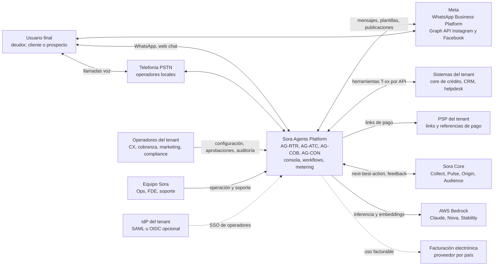

La plataforma se comunica con el usuario final por WhatsApp, web y voz, y con los operadores del tenant por la consola. Actúa sobre los sistemas del tenant solo a través de herramientas autenticadas, consume decisiones de Sora Core y devuelve cada gestión como retroalimentación. Bedrock se dibuja como sistema externo porque, para los modelos Claude 5.5, **su procesamiento ocurre fuera de LatAm** (sección 2.7.2). La ubicación de Sora Core (AWS u otra nube) es una pregunta abierta (sección 6, P-01).

#### 2.2.2 Nivel 2: contenedores (los 32 componentes C-xx por plano)

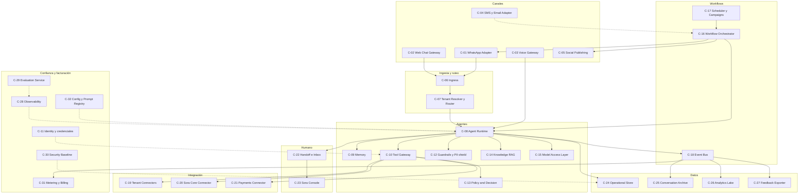

Los flujos son los del borrador `15-ARQUITECTURA-REFERENCIA-BORRADOR §3`, con dos cambios: (1) el Event Bus (C-18) alimenta también a Metering (C-31); (2) las relaciones del plano de confianza (C-11, C-28 a C-32) se dibujan con línea punteada porque son transversales. Se agregan dos componentes nuevos, justificados en la sección 2.3.10: `C-NUEVO-TenantContext` y `C-NUEVO-Directorio`.

### 2.3 Arquitectura AWS detallada por plano

Todas las filas de las tablas siguientes asumen la **celda `sa-east-1`** (sección 2.7.4) salvo donde se indique "satélite". Los precios unitarios no se repiten aquí: WP08 los calcula. Las columnas de disponibilidad siguen la convención de la sección 1.

#### 2.3.1 Plano de canales (C-01 a C-05)

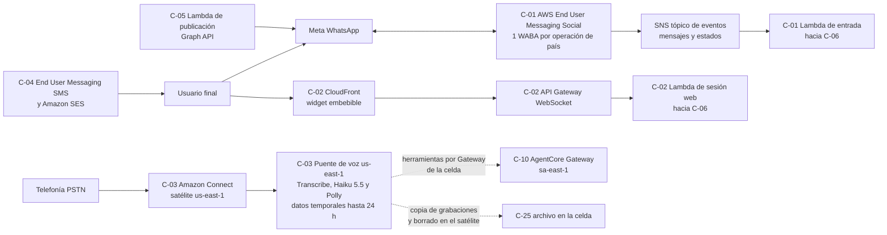

El canal WhatsApp usa End User Messaging Social con eventos a SNS: **no hay un webhook público que proteger** para WhatsApp. Web chat usa WebSocket detrás de CloudFront y WAF. La voz es un satélite en `us-east-1` porque ni Connect ni Nova Sonic existen en LatAm; las herramientas vuelven a la celda por el Gateway y las grabaciones y transcripciones se copian al archivo de la celda y se borran del satélite en ≤ 24 h (datos temporales, no "sin datos"). Es fase 1.5 y solo AG-COB saliente en MX `[_GATE-1 §4.5]`. Los detalles de protocolo son de WP05.

| C-xx | Servicio AWS | Función | Configuración clave del MVP | Alternativa considerada y por qué no | `sa-east-1` | `mx-central-1` | Driver de costo |
|---|---|---|---|---|---|---|---|
| C-01 | End User Messaging Social + SNS + Lambda | Recibir y enviar WhatsApp; estados de entrega; plantillas | 1 WABA por operación de país, bajo el portafolio de Meta del tenant (embedded signup); eventos a un tópico SNS por celda, filtrado por `phone_number_id`; medios a S3 con la clave del tenant; cola SQS estándar con DLQ para los estados | Cloud API de Meta directa o BSP (`[OD-05]`, la decide WP05): exige un endpoint público y más operación propia. Se mantiene la ADR-07 | Sí `[F8][F9]` (SNS Sí†, Lambda Sí `[F23]`) | Sí `[F8][F9]` (SNS Sí†, Lambda Sí `[F23]`) | Mensajes: tarifa de Meta por país (P-10, P-11) + cargo de AWS (P-12); estados de entrega (3 por mensaje saliente, `[S-NUEVO-4]` (`S-G1-36`)) |
| C-02 | API Gateway WebSocket + Lambda; widget en S3 + CloudFront; WAF | Widget embebible con streaming | WebSocket con JWT del widget (token de sesión de corta vida emitido por C-23); 1 API por celda; límite de 128 KB por mensaje y desconexión a los 10 min de inactividad `[F22]`; WAF con reglas gestionadas y límite de tasa por IP | AppSync (suscripciones): no está en `mx-central-1`† y agrega un modelo distinto. API Gateway REST con polling: peor primer token (S-38) | Sí `[F22]` (CloudFront Sí†) | Sí `[F22]`; techo de 2,500 RPS frente a 10,000 en `sa-east-1` `[F22]` | Conexiones y mensajes WebSocket; transferencia CloudFront; reglas de WAF |
| C-03 | Amazon Connect + Transcribe streaming + Haiku 5.5 + Polly (puente de voz) en **satélite `us-east-1`** | Llamadas entrantes y salientes, grabación | **Fase 1.5, solo AG-COB saliente (y retorno de llamada) en MX, 1 tenant** `[_GATE-1 §4.5]` y solo si el escenario B de cobranza se confirma y `[LEGAL]` levanta `COB-VOICE`. Motor base: **Connect + Transcribe streaming + Claude Haiku 5.5 + Polly** en `us-east-1` (Transcribe streaming también existe en `sa-east-1` y `mx-central-1` `[F35]`, pero el audio ya pasa por la instancia de Connect en EE.UU.), con validadores V-01 a V-10 sobre cada frase antes de hablar. **Datos temporales en el satélite:** grabaciones y transcripciones hasta 24 h, luego copia a la celda y borrado `[LEGAL]`. Campañas nativas de Connect solo a EE.UU., México y Brasil `[F10]`; para otros países, marcador propio vía la API de salida (C-17 y W-01). El Guardrail no aplica al audio: se valida el texto de cada frase | Connect en `sa-east-1` o `mx-central-1`: **no existe** `[F10]`. **Nova Sonic S2S como motor principal:** no soporta Guardrails `[F12]`, no opera en LatAm y limita a 20 sesiones; queda solo como **reto del bake-off de 2 semanas** (200 llamadas por motor y país) `[_GATE-1 §4.5]` | **No** `[F10]` (Nova 2.5 Sonic: No `[F12]`) | **No** `[F10]` (Nova 2.5 Sonic: No `[F12]`) | Por minuto: Connect 0.038 USD + telefonía por país + Transcribe + Polly + LLM (0.1205 USD en MX; tabla por país en `[_GATE-1 §4.5]`, `[VERIFICAR]`); P-13 (0.018) está obsoleto. Cuotas de voz en Q-19 a Q-21 |
| C-04 | End User Messaging SMS + SES | Notificaciones de respaldo (SMS) y email (fase 2) | SMS solo transaccional de respaldo, con listas de exclusión y opt-out; SES con dominio verificado por tenant (DKIM) | Pinpoint: fuera de alcance del MVP | Sí `[F9]` (SES Sí†) | Sí `[F9]` (SES Sí†) | Mensajes SMS por destino; volumen de email |
| C-05 | Lambda + Meta Graph API (Instagram y Facebook) | Publicar, programar y leer métricas | La función solo se invoca desde W-04 tras una aprobación registrada (T-25 bloqueada sin aprobación); tokens de página en Secrets Manager con la clave del tenant; app review de Meta (`[OD-09]`, WP05) | Herramientas de gestión de redes (`[OD-09]`): decisión de WP05 | Sí `[F23]` | Sí `[F23]` | Invocaciones y salida a Internet (NAT) |

#### 2.3.2 Plano de ingesta y ruteo (C-06, C-07)

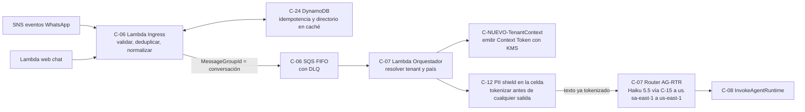

El Ingress valida la firma o el origen, descarta duplicados con una escritura condicional en DynamoDB, ejecuta la detección determinista de opt-out (palabras clave, regla 3 de AG-RTR en `12 §4`) y encola en SQS FIFO con el grupo igual a la conversación, para conservar el orden por conversación. El orquestador resuelve tenant y operación con el `phone_number_id` (directorio en caché), emite el Context Token y **pasa el texto por el PII shield (C-12) en la celda antes de llamar al Router**: el Router, que invoca a Haiku 5.5 en `us-east-1`, solo recibe texto ya tokenizado `[_GATE-1 §4.2, punto 5]`. En la versión 1.0 de este documento el Router recibía el texto sin tokenizar; se corrigió post-Gate 1 (ver el registro de cambios al final).

| C-xx | Servicio AWS | Función | Configuración clave del MVP | Alternativa considerada y por qué no | `sa-east-1` | `mx-central-1` | Driver de costo |
|---|---|---|---|---|---|---|---|
| C-06 | Lambda + SQS FIFO + DynamoDB (idempotencia) | Formato canónico, orden por conversación, opt-out por palabra clave | Una cola FIFO por celda y entorno, con DLQ y alarma de profundidad; `MessageGroupId = {country_op_id}#{conversation_id}`; ID de deduplicación = `wamid`; la tabla de idempotencia con TTL de 7 días; Lambda de entrada **fuera de la VPC** | Kinesis Data Streams (orden por partición): más capacidad de la necesaria y más costo base. SQS estándar: pierde el orden | Sí `[F23]` (SQS†, DDB†) | Sí `[F23]` (SQS†, DDB†) | Invocaciones de Lambda, solicitudes SQS, escrituras de DynamoDB. El pico del ESC-E es de unos 8 mensajes/s entrantes y 44 estados/s (sección 2.9.2): trivial frente a los límites |
| C-07 | Lambda (orquestador) + Haiku 5.5 vía C-15 | Resolver tenant, país, cliente y conversación; clasificar intent; rutear; detectar urgencias | Lambda con concurrencia reservada; **el orquestador tokeniza con el PII shield (C-12) antes de llamar al Router** `[_GATE-1 §4.2, §4.16]`; Router con Haiku 5.5, `effort` bajo y salida estructurada (sin `tool_choice` forzado: no soportado en Sonnet 5.5 ni Opus 5.5 `[F2][F4]`); Provisioned Concurrency solo en el orquestador si el cold start rompe el p90 de 0.8 s (S-38) | Router como agente en AgentCore Runtime: sesión y microVM por mensaje, más lento y más caro para una clasificación | Sí `[F23]`; Haiku 5.5 solo con perfil global `[F3]` | Sí `[F23]`; Haiku 5.5 solo con perfil global `[F3]` | Tokens de Haiku (1,500 de entrada, de los que unos 1,100 son prefijo cacheable, y 80 de salida por mensaje que pasa por el Router `[_GATE-1 §4.4]`; las plantillas y el opt-out determinista no pasan); duración de Lambda (espera del agente de 6 a 10 s) |

#### 2.3.3 Plano de agentes (C-08, C-09, C-10, C-12, C-13, C-14, C-15)

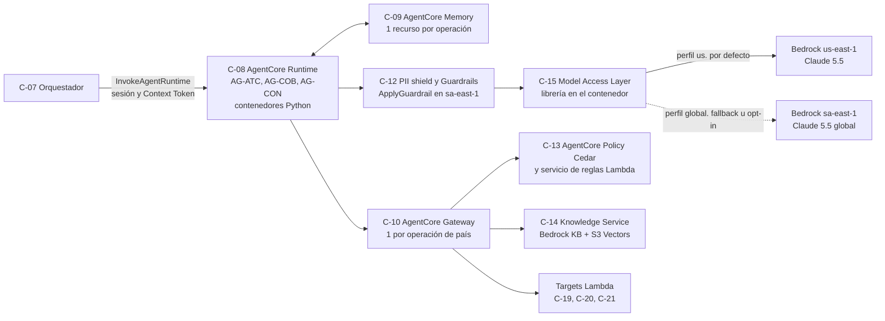

Cada sesión de agente corre en su propia microVM de AgentCore Runtime. Todo el acceso al mundo pasa por el Gateway, que valida el Context Token, consulta Cedar y el servicio de reglas (C-13) y solo entonces invoca el target. La **Model Access Layer (C-15)** es una librería dentro del contenedor, no un servicio, para no agregar un salto de red: elige región de endpoint, perfil de inferencia, modelo, presupuesto de tokens y fallback a partir de la configuración de la operación (`[ADR-14]`).

| C-xx | Servicio AWS | Función | Configuración clave del MVP | Alternativa considerada y por qué no | `sa-east-1` | `mx-central-1` | Driver de costo |
|---|---|---|---|---|---|---|---|
| C-08 | Bedrock AgentCore Runtime (microVMs, **plataforma V2**, modo VPC) | Ejecutar AG-ATC, AG-COB y AG-CON con aislamiento por sesión | 1 runtime por agente, entorno y celda; `runtimeSessionId = {country_op_id}:{conversation_id}` (≥ 33 caracteres); `idleRuntimeSessionTimeout` de 300 s (`S-G1-21`); estado conversacional fuera de la microVM (Memory y DynamoDB); versiones inmutables y endpoints (alias) `stable` y `canary`; subnets privadas en las 3 AZ soportadas (sae1-az1 a az3) `[F20]` | ECS Fargate con Strands o LangGraph propios (alternativa de `[ADR-03]`): más control y portabilidad a `mx-central-1`, pero más operación. Queda como **plan B documentado** si AgentCore falla en el spike S2 | **Sí** `[F1]` (microVMs; el tipo "Instances" no) | **No** `[F1]` | **V2 (canónica): 0.1276 USD por vCPU-hora y 0.0169 USD por GB-hora en consumo** `[F19][_GATE-1 §4.3]`; la tarifa **V1** (0.0895 y 0.00945 USD, que es la de P-08) **no aplica** a una plataforma V2; la tarifa V2 con compromiso de base (0.0997 y 0.0132 USD, anunciada "para octubre de 2026") se evalúa en WP08 `[VERIFICAR]`. V2 admite hasta 10 GB por imagen y sesiones de hasta 8 vCPU y 32 GB; en V2 también rige la AZ `use1-az6` `[F18][F20]`. Ocupación de microVM por conversación: 600 s (`S-G1-21`, antes `[S-NUEVO-2]`) |
| C-09 | AgentCore Memory | Memoria de sesión y largo plazo por tenant y cliente | **1 recurso Memory por operación de país**, con CMK del tenant `[VERIFICAR soporte de CMK]`; namespaces `/t/{tenant_id}/c/{country_op_id}/u/{customer_ref}/`; vencimiento de eventos entre 7 y 365 días `[F18]`: **30 días** `[_GATE-1 §4.13]`; **solo memoria de corto plazo en el MVP**; el largo plazo (12 meses) queda **apagado por defecto** (`memory.long_term.enabled = false`) y se activa por operación de país tras Legal y tras confirmar dónde corre la extracción `[VERIFICAR]`; C-24 es la fuente de verdad de promesas, planes y gestiones; nunca en memoria: saldos, DPD, OTP, documentos, si tiene deuda, salud ni terceros | Memoria propia en DynamoDB: más control de residencia, más código. Se usa para resúmenes y preferencias (C-24) | **Sí** `[F1]` | **No** `[F1]` | Ingestión (1.00 USD/GB), recuperación (0.20 USD/GB) y almacenamiento (0.10 USD/GB-mes) de memoria de corto plazo `[F19]`; extracción de largo plazo (0.75 USD por 1,000 registros) |
| C-10 | AgentCore Gateway (MCP) | Exponer las 29 herramientas T-xx con autenticación y autorización por tenant | **1 Gateway por operación de país** (aislamiento estructural: la lista de herramientas nunca incluye las de otro tenant; sin costo fijo `[F19]`); autorizador JWT con el emisor Sora (Context Token); targets Lambda compartidos (un código, ver 2.6.3); se pasa a "Gateway por tenant" si una operación supera 80 de 100 targets `[F18]` | Un Gateway compartido por celda con Cedar por `tenant_id`: menos recursos, pero el aislamiento depende solo de políticas. Se descarta por el requisito de fugas = 0 | **Sí** `[F1]` | **No** `[F1]` | 0.005 USD por 1,000 invocaciones; 0.025 USD por 1,000 búsquedas; indexación de herramientas `[F19]` |
| C-12 | Bedrock Guardrails (`ApplyGuardrail`, no ligado a un modelo) + PII shield propio | Filtrar entrada y salida (temas, PII, toxicidad, grounding) y anonimizar antes de salir a inferencia | `ApplyGuardrail` **en `sa-east-1`** sobre el texto, antes de llamar al modelo en EE.UU. (`ApplyGuardrail` funciona con cualquier modelo `[F33]`), con el nivel que exista en la celda: **Classic para es-xx y `off` con validadores propios V-01 a V-11 (V-11 como juez Haiku) para pt-BR**; **no se envía texto a Guardrails en otra región** `[_GATE-1 §4.2, punto 7]`; el PII shield se ejecuta **antes del Router y de cada llamada al modelo**; filtros de PII con regex propias por país (CURP, RFC, CPF, CNPJ, cédula, DNI, RUT) más tokenización reversible por tenant (bóveda en DynamoDB); un guardrail por operación (reglas por país, `[ADR-14]`) | Guardrails ligados a la llamada del modelo en `us-east-1`: el texto saldría sin anonimizar. El endpoint `bedrock-mantle` no admite Guardrails `[F2]`; Nova Sonic tampoco `[F12]` (por eso el motor de voz base no es S2S, 2.3.1) | Sí† (n/d en `[F33]`); `[VERIFICAR]` | `n/d` `[VERIFICAR]` | Unidades de texto: 0.15 USD por 1,000 por política (P-18, `[F29]`); S-29 da 2 evaluaciones por turno |
| C-13 | AgentCore Policy (Cedar) + servicio de reglas (Lambda + DynamoDB) | Reglas deterministas por tenant y país; autorización de herramientas | Tres capas `[_GATE-1 §4.16]`: Cedar en el borde para *quién puede llamar qué* (nivel L0 a L2, tenant y operación); el servicio de reglas (Lambda + DynamoDB) para montos, planes, ventanas y frecuencias (la versión de reglas viene de C-32); y el *Offer Engine*. Cada decisión devuelve un `policy_decision_id` firmado con KMS (clave asimétrica de firma por celda, `[_GATE-1 §4.11, §4.12]`); 0.000025 USD por autorización `[F19]` | Amazon Verified Permissions (Cedar gestionado, Sí† en ambas regiones): plan B para `mx-central-1`, donde AgentCore Policy no existe | **Sí** `[F1]` | **No** `[F1]` (Verified Permissions Sí†) | Autorizaciones de Policy; invocaciones de la Lambda de reglas |
| C-14 | Bedrock Knowledge Bases + **S3 Vectors** + S3 (ver `[OD-02]` abajo) | Ingesta, indexación y búsqueda por tenant y país, con citas | 1 KB por operación de país; 1 índice de S3 Vectors por KB (nombre `kb-{tenant}-{country_op}`), 1,024 dimensiones, métrica coseno; embeddings con Titan Text Embeddings V2 (en región en `sa-east-1` `[F17]`); metadatos filtrables solo para tipo de documento y vigencia, **nunca** para aislar tenants | OpenSearch Serverless: costo base fijo (P-19). Aurora pgvector: operación de una base. Ambos descartados por costo base y operación | KB: Sí† (endpoint `bedrock-agent` listado `[F32]`; `[VERIFICAR]` KB con S3 Vectors). **S3 Vectors: Sí `[F15]`** | KB: `n/d` (solo el plano de control de Bedrock aparece en `[F32]`). **S3 Vectors: Sí `[F15]`**. Titan V2: No `[F17]` | Almacenamiento y consultas de S3 Vectors `[VERIFICAR precio]`; embeddings de ingesta; recuperación de KB (1.00 USD por 1,000 llamadas `[F29]`) |
| C-15 | Amazon Bedrock (`bedrock-runtime`, Messages API o Converse) como librería en el contenedor | Acceso a modelos, perfiles, fallbacks, presupuestos | Endpoint por operación: `us-east-1` + perfil `us.anthropic.claude-sonnet-5-5` por defecto; `global.` como opt-in o fallback `[F2]`; autenticación **solo con IAM (SigV4)**: sin claves de API de Bedrock de larga duración (se bloquea por SCP, sección 2.4); **un perfil de inferencia de aplicación por tenant y agente** para atribuir costo `[F2]`; presupuestos de tokens por conversación y por tenant (sección 2.6.4); reintentos acotados con jitter; `stop_reason: refusal` → fallback de modelo (el crédito de refusal de Sonnet 5.5 solo admite Sonnet 5 como destino `[F2]`) | Capa de otro proveedor (LiteLLM, etc.): innecesaria; C-15 ya abstrae `[ADR-02]` | Sí† (endpoint `bedrock-runtime`); Claude solo vía `global.` `[F2][F3][F4]` | Plano de control de Bedrock `[F32]`; Claude solo vía `global.` según la tarjeta del modelo `[F2]`; `[VERIFICAR]` endpoint `bedrock-runtime` | Tokens de entrada, salida, caché (lectura y escritura) por modelo `[F29]`; el endpoint geográfico `us.` no tiene el ~10% de ahorro del global `[F6]`; sin batch ni Flex ni Priority ni Reserved para Claude 5.5 `[F2][F3][F4]` |

**`[OD-02]` · Resolución: Amazon S3 Vectors** (un índice por operación de país, dentro de un vector bucket por celda y entorno).

| Criterio | S3 Vectors | OpenSearch Serverless | Aurora PostgreSQL + pgvector |
|---|---|---|---|
| Costo base fijo | Ninguno (pago por almacenamiento y consulta) | Relevante por OCUs mínimas (P-19) `[VERIFICAR]` | ACU mínima de Serverless v2 más almacenamiento `[VERIFICAR]` |
| Aislamiento por tenant | Un índice por operación; IAM por ARN de índice (ABAC); hasta 10,000 índices por bucket `[F16]` | Colecciones o índices con políticas de datos: más superficie de configuración | Esquemas o *row-level security*: depende de disciplina de código |
| Latencia | Consultas de decenas a cientos de ms `[VERIFICAR p90]`; suficiente para 1.5 consultas RAG por conversación (S-27) | Menor (ms) | Menor (ms) |
| Operación | Cero | Baja (gestionado) | Media (base de datos, parches, parámetros) |
| Integración con Bedrock KB | Sí | Sí | Sí |
| Límites relevantes | 2,000 millones de vectores por índice; filtros de metadatos; hasta 40 KB de metadatos por vector `[F16]` | n/a | n/a |
| Disponible en `sa-east-1` y `mx-central-1` | Sí y Sí `[F15]` | `n/d` `[VERIFICAR]` | Aurora: Sí† y Sí† |

**Dimensionamiento:** `vectores × dimensiones × 4 bytes = 5,000 chunks (S-42) × 1,024 × 4 B = 20.5 MB` por operación. En ESC-E, con 14 operaciones, son unos 287 MB. Las consultas RAG en ESC-E son `(300,000 × 1.5 + 180,000 × 0.5) conversaciones al mes = 540,000/mes`, es decir, unas 0.21/s en promedio y unas 2/s en el pico de diseño. Cualquier opción cumple en rendimiento: el criterio que decide es el costo base fijo y la operación, y ahí gana S3 Vectors. **Trade-off:** latencia mayor que un motor en memoria; se acepta porque el RAG no es el camino crítico (el p90 de 6 s lo domina el LLM). **Plan B:** si las cuotas de Knowledge Bases por cuenta se agotan (`[VERIFICAR]` cuota de KB por cuenta), C-14 pasa a una ingesta propia (Step Functions W-06 + Lambda + embeddings + S3 Vectors) detrás de la misma interfaz de herramienta T-13. Esa misma interfaz permite operar en `mx-central-1`, donde KB no aparece.

#### 2.3.4 Plano de workflows (C-16, C-17, C-18)

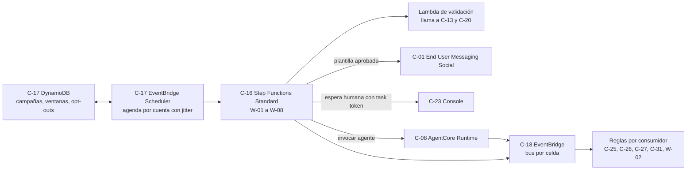

| C-xx | Servicio AWS | Función | Configuración clave del MVP | Alternativa considerada y por qué no | `sa-east-1` | `mx-central-1` | Driver de costo |
|---|---|---|---|---|---|---|---|
| C-16 | AWS Step Functions: **Standard** para esperas humanas (W-04, W-05) y promesas (W-02) y **Express** para la cadencia de cobranza (W-01) `[_GATE-1 §4.16]` | Workflows W-01 a W-08 | W-01 como ejecución Express por intento de contacto (hasta 5 min, transiciones sin límite y `StartExecution` de 6,000/s `[F24]`, sin el cuello de 150/s de Standard); las ejecuciones Standard (W-02, W-04, W-05) quedan muy por debajo de 25,000 eventos `[F24]` y con `StartExecution` de 800 de cubeta y 150/s de recarga fuera de `us-east-1`, así que la agenda se reparte con ventanas flexibles; espera humana con *task token* (W-04) | Solo Standard (versión 1.0 de este documento): más simple, pero con el límite de `StartExecution`. Lambda *durable functions*: reciente; no se adopta en el MVP `[VERIFICAR]` | Sí† | Sí† (mismos límites de "otras regiones" `[F24]`) | Transiciones de estado (12 por ejecución de W-01, `[S-NUEVO-7]` / `S-G1-36`) |
| C-17 | EventBridge Scheduler + Lambda + DynamoDB | Programar contactos respetando ventanas, frecuencias, opt-outs y listas de exclusión por país | Un *schedule* de un solo disparo por promesa y por contacto; ventanas de envío con *flexible time window* para evitar picos de `StartExecution`; la validación de ventana y frecuencia en C-13, en la zona horaria del usuario (`[S-06]`); **decide el canal por política con una cadena configurable por tenant y país** (WhatsApp, SMS por C-04, voz por C-03 según el escenario A o B de cobranza) `[_GATE-1 §4.16, §4.1]` | Cron en Lambda: menos fiable | Sí† (Scheduler n/d aparte en `[F27]`, `[VERIFICAR]`) | Sí† (idem) | Invocaciones de Scheduler; Lambda |
| C-18 | Amazon EventBridge | Eventos de dominio (mensaje, gestión, promesa, pago, handoff, uso) | 1 bus por celda y entorno; esquema con `tenant_id` y `country_op_id` obligatorios, validado en el productor; los eventos llevan identificadores y métricas, **no texto de mensajes** (patrón *claim-check*: puntero al ítem en DynamoDB o S3); reglas por consumidor | Kinesis: orden por partición innecesario aquí. SNS: sin filtrado por contenido tan rico | Sí† | Sí† | Eventos publicados y reglas |

#### 2.3.5 Plano de integración (C-19, C-20, C-21)

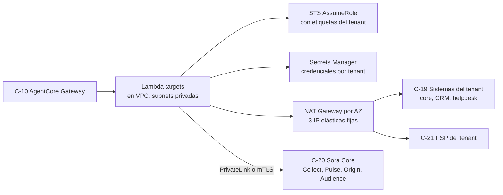

| C-xx | Servicio AWS | Función | Configuración clave del MVP | Alternativa considerada y por qué no | `sa-east-1` | `mx-central-1` | Driver de costo |
|---|---|---|---|---|---|---|---|
| C-19 | Targets Lambda del Gateway, en la VPC; NAT Gateway con IP elásticas; Secrets Manager | Adaptadores hacia core, CRM y helpdesk del tenant | Lambda en subnets privadas (egreso por NAT: **3 IP fijas por celda y entorno**, una por AZ); credenciales OAuth o API key por tenant en Secrets Manager (con CMK del tenant) y, cuando aplique, en proveedores de credenciales de AgentCore Identity (50 por tipo por defecto `[F18]`); circuit breaker y timeouts por herramienta; **no** se usan targets OpenAPI directos hacia Internet cuando el tenant exige IP fija, porque el egreso del Gateway no sale por nuestra NAT `[VERIFICAR]` | Targets OpenAPI directos del Gateway: más simple, sin IP fija garantizada | Sí `[F23]` | Sí `[F23]` | NAT (por hora y por GB), duración de Lambda, interface endpoints |
| C-20 | PrivateLink / VPC Lattice o mTLS sobre Internet, según dónde corra Sora Core | Consumir Collect, Pulse, Origin y Audience | Dos modos: (a) Sora Core en AWS: PrivateLink o VPC Lattice entre cuentas (o entre regiones, `[VERIFICAR]`); (b) Sora Core fuera de AWS: TLS mutuo con IP fija y, si se necesita, VPN. Se usa el modo (b) como supuesto hasta responder P-01. Resiliencia: caché de la última *next-best-action* por cuenta | Conexión directa sin PrivateLink: más exposición | PrivateLink Sí†; VPC Lattice Sí† | PrivateLink Sí†; VPC Lattice Sí† | Endpoints o Lattice por hora y por GB |
| C-21 | Lambda (conector de pagos) | Links y referencias de pago vía el PSP del tenant | El agente nunca recibe datos de tarjeta (PCI fuera de alcance, `16 §3.6`); idempotencia por (cuenta, monto, fecha); el monto lo valida C-13 (`[ADR-04]`) | Conectores propios por país (`[OD-08]`, WP05) | Sí `[F23]` | Sí `[F23]` | Invocaciones; transferencia de red |

#### 2.3.6 Plano humano (C-22, C-23)

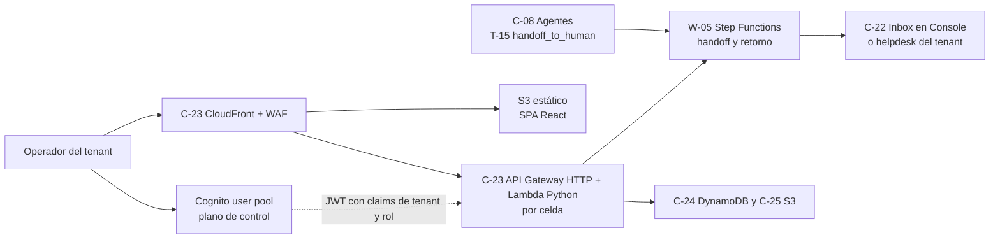

| C-xx | Servicio AWS | Función | Configuración clave del MVP | Alternativa considerada y por qué no | `sa-east-1` | `mx-central-1` | Driver de costo |
|---|---|---|---|---|---|---|---|
| C-22 | `[OD-04]` (WP05): inbox propia en C-23 o integración con el helpdesk del tenant; W-05 en Step Functions | Transferencia a humanos y retorno | Arquitectura neutral: el payload de handoff se publica en EventBridge y W-05 lo entrega al destino configurado. **Canónico del gate:** bandeja propia en C-23 más sincronización con el helpdesk del tenant (Zendesk en el MVP si lo usa el cliente de diseño) `[_GATE-1 §4.16]`. **El agent workspace de Amazon Connect queda descartado en las celdas LatAm** porque Connect no existe allí `[F10]` | Opción (c) de `[OD-04]` | n/a (Step Functions Sí†) | n/a (Step Functions Sí†) | Transiciones; usuarios activos de la inbox si se construye |
| C-23 | S3 + CloudFront + WAF (SPA React); API Gateway HTTP + Lambda (Python) **por celda**; Cognito | Configuración, conocimiento, políticas, aprobaciones, analytics, auditoría, usuarios | La SPA es global y estática; la **API de la consola vive en cada celda** (los datos de conversaciones nunca salen de la celda); Cognito en el plano de control con grupos por tenant y rol (RBAC), SAML y OIDC federados para IdPs del tenant, MFA obligatorio para operadores de Sora | Next.js en Amplify Hosting y AppSync (ver `[OD-07]`) | S3, CloudFront, API GW, Cognito Sí† (API GW Sí `[F22]`); Amplify Sí†; AppSync Sí† | S3, CloudFront, API GW, Cognito Sí† (API GW Sí `[F22]`, con techo de 2,500 RPS); Amplify No†; AppSync No† | Almacenamiento y transferencia estáticos; usuarios activos de Cognito; invocaciones |

**`[OD-07]` · Resolución: SPA React + CloudFront/S3, API HTTP + Lambda por celda y Cognito.**

| Criterio | Next.js en Amplify Hosting | **SPA en S3 + CloudFront + API Gateway** | AppSync |
|---|---|---|---|
| Velocidad de desarrollo | Alta | Media (se parte de una plantilla del equipo) | Media (esquema GraphQL y resolvers) |
| Encaje multi-celda | Malo: el SSR concentra datos en una región | **Bueno**: la API se despliega por celda y el estático es global | Medio |
| Autenticación | Cognito | Cognito | Cognito |
| Costo | Compute SSR | **Muy bajo** (estático + Lambda) | Por operaciones de GraphQL |
| Disponibilidad regional (snapshot 2025) | `sa-east-1` Sí†, `mx-central-1` No† | Sí† en ambas | `sa-east-1` Sí†, `mx-central-1` No† |
| Lenguaje | TypeScript | TypeScript (SPA) + Python (API, `[ADR-10]`) | TypeScript o VTL |

**Trade-off:** la consola no tiene SSR; no hace falta (es interna y autenticada). Más trabajo inicial de plantillas, pero sin dependencia de servicios ausentes en `mx-central-1`. Si luego se necesita SSR, se agrega Next.js sobre Lambda sin cambiar el modelo de celdas.

#### 2.3.7 Plano de datos (C-24 a C-27)

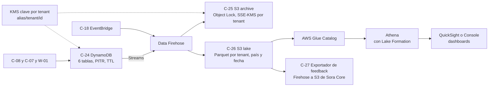

| C-xx | Servicio AWS | Función | Configuración clave del MVP | Alternativa considerada y por qué no | `sa-east-1` | `mx-central-1` | Driver de costo |
|---|---|---|---|---|---|---|---|
| C-24 | DynamoDB (on-demand) | Tenants, operaciones, configuraciones, conversaciones, sesiones, gestiones, promesas, piezas, aprobaciones | **6 tablas** (`ingress`, `conv`, `coll`, `content`, `ops`, `vault`; sección 2.8.3) `[_GATE-1 §4.16]`; PITR en todas; TTL por tabla; **cifrado de campo con claves de datos por tenant para todos los atributos personales o financieros de todas las tablas** (2.8.3) `[_GATE-1 §4.12]`; claves con prefijo `tenant_id#` para `dynamodb:LeadingKeys` | Aurora PostgreSQL: más flexible para consultas, pero con costo base y sin escalado a cero; el modelo de acceso es por clave | Sí† | Sí† | Unidades de escritura y lectura; almacenamiento; PITR |
| C-25 | S3 + Object Lock (modo gobierno para transcripciones, modo cumplimiento para auditoría) | Transcripciones, grabaciones, bitácora inmutable | Layout y retención en 2.8.4; versionado; SSE-KMS con la clave del tenant por objeto; réplica opcional dentro de la región | Glacier Vault Lock: sin consulta ágil | Sí† | Sí† | Almacenamiento por clase; solicitudes; KMS |
| C-26 | S3 + Glue + Athena + Lake Formation (+ QuickSight `[OD]` WP07) | KPIs, analítica conversacional, costos | Parquet particionado por `tenant_id`, `country_op_id` y fecha; permisos por fila o columna con Lake Formation; la analítica entre tenants solo con agregados sin identificadores | Redshift: costo base | Glue, Athena, Lake Formation: Sí†. QuickSight: `n/d` `[VERIFICAR]` | Glue, Athena, Lake Formation: Sí†. QuickSight: `n/d` `[VERIFICAR]` | Datos escaneados por Athena; ETL de Glue |
| C-27 | EventBridge → Data Firehose → S3 → Sora Core | Devolver gestiones y resultados a Sora Core (por tenant, `[ADR-12]`) | Lotes por tenant; solo campos acordados; sin texto libre salvo autorización contractual; **condicionado a que se resuelva LQ-01 de WP06 y con el atributo `training_use_allowed` en cada evento** `[_GATE-1 §4.16]`; cifrado en tránsito | API directa a Sora Core: acopla disponibilidad | Sí† | Sí† | Firehose por GB; transferencia |

#### 2.3.8 Plano de confianza (C-11, C-28, C-29, C-30, C-32)

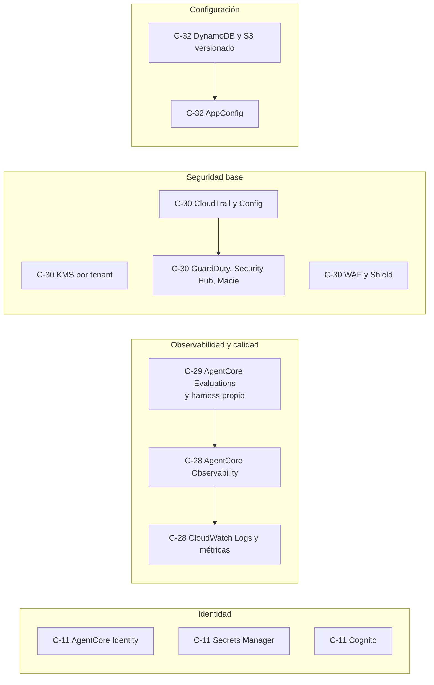

| C-xx | Servicio AWS | Función | Configuración clave del MVP | Alternativa considerada y por qué no | `sa-east-1` | `mx-central-1` | Driver de costo |
|---|---|---|---|---|---|---|---|
| C-11 | AgentCore Identity + Secrets Manager + Cognito + Context Token | Credenciales de salida y identidad de operadores | Identidades de carga (workload identity) por agente; secretos por tenant con su CMK, rotación configurable; tokens de acceso de corta vida; Cognito para operadores (MFA); **ningún secreto en variables de entorno** (tope de 4 KB `[F18]`) | Parameter Store para secretos: sin rotación nativa | **Sí** `[F1]`; Secrets Manager y Cognito Sí† | AgentCore Identity: **No** `[F1]`; Secrets Manager y Cognito Sí† | 0.010 USD por 1,000 solicitudes de token (solo recursos no AWS `[F19]`); secretos por mes |
| C-28 | AgentCore Observability + CloudWatch + X-Ray (OTEL) | Trazas, métricas, logs, alertas | Un *log group* por tenant y componente, con CMK del tenant y política de protección de datos (redacción de PII) `[VERIFICAR disponibilidad]`; `tenant_id` y `country_op_id` en todos los spans; trazas completas (40 KB por turno, `[S-44]`) a CloudWatch y S3, **no** a DynamoDB; **retención de trazas y logs: 30 días** (WP07 puede extender hasta 90 días solo para casos de evals anonimizados) `[_GATE-1 §4.13]`; muestreo adaptativo en ESC-E | Herramienta de terceros (WP07 puede proponerla) | **Sí** `[F1]`; CloudWatch y X-Ray Sí† | AgentCore Observability: **No** `[F1]`; CloudWatch y X-Ray Sí† | Ingestión de logs (P-20: 0.50 USD/GB), spans, métricas personalizadas |
| C-29 | AgentCore Evaluations + harness propio | Evals offline (gate) y en línea (muestreo) | Evaluadores integrados: 1,200 evaluaciones/min y 1 M tokens de entrada/min por defecto `[F18]`; evals offline en un entorno efímero antes de promover (sección 2.11); datos de prueba sintéticos, sin PII real | Solo harness propio: más trabajo | **Sí** `[F1]` | **No** `[F1]` | Tokens de evaluación (0.0024 USD y 0.012 USD por 1,000 de entrada y salida `[F19]`) más el costo del modelo juez |
| C-30 | KMS, WAF, Shield, CloudTrail (organizacional), Config, GuardDuty, Security Hub, Macie, Inspector, IAM Access Analyzer | Línea base de seguridad | Detalle en 2.4, 2.5 y 2.13; detalle normativo en WP06 | n/a | KMS, WAF, CloudTrail, Config, GuardDuty, Security Hub, Inspector, Access Analyzer: Sí†. Macie: `n/d` `[VERIFICAR]` | Ídem; Macie `n/d` `[VERIFICAR]` | Hallazgos de GuardDuty y Security Hub; reglas de Config; solicitudes de KMS (0.03 USD por 10,000 típico `[VERIFICAR]`) |
| C-32 | DynamoDB + S3 versionado + AWS AppConfig | Configuraciones de agente, prompts, políticas y plantillas versionadas, con promoción entre entornos | Registro en el **plano de control**; cada celda lee paquetes firmados e inmutables (hash en la ruta) y los cachea; AppConfig con despliegue gradual y reversión por alarma, y *feature flags* multivariante con contexto `tenant_id` | Git como única fuente: sin despliegue gradual por tenant | Sí† | Sí† | Despliegues y solicitudes de configuración de AppConfig |

#### 2.3.9 Plano de metering y facturación (C-31)

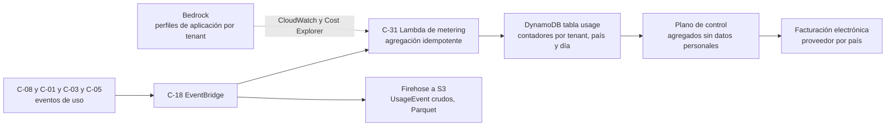

| C-xx | Servicio AWS | Función | Configuración clave del MVP | Alternativa considerada y por qué no | `sa-east-1` | `mx-central-1` | Driver de costo |
|---|---|---|---|---|---|---|---|
| C-31 | EventBridge + Lambda + DynamoDB + S3; facturación electrónica por proveedor externo `[VERIFICAR]` | Eventos de uso por tenant (conversaciones, minutos, piezas, tokens) para facturar y medir margen | Un `UsageEvent` idempotente (`event_id` determinista) por conversación, minuto de voz, pieza y llamada al modelo; los tokens salen de la respuesta del modelo, no de estimaciones; costo real por tenant con perfiles de aplicación de Bedrock y etiquetas de asignación de costos; agregados diarios hacia el plano de control (sin datos personales) | Medir solo desde la factura de AWS: sin granularidad por tenant | Sí† | Sí† | Eventos y almacenamiento (despreciable); **el proveedor de facturación electrónica por país es un costo externo** (`16 §3.10`) |

#### 2.3.10 Resumen del mapeo y componentes nuevos

- **Los 32 componentes C-01 a C-32 están mapeados** a servicios concretos. **C-22** queda pendiente de `[OD-04]` (WP05), pero la arquitectura es neutral y funciona con cualquiera de las opciones, salvo el agent workspace de Connect, que no existe en las celdas LatAm.
- **Se agregan dos componentes**, ambos del plano de confianza y necesarios para el aislamiento (sección 2.6):
  - **`C-NUEVO-TenantContext`**: servicio mínimo (Lambda + clave asimétrica de KMS) que emite y valida el **Context Token** (JWT de 5 minutos con `tenant_id`, `country_op_id`, `conversation_id`, `customer_ref`, `auth_level`, `trace_id`), publica su JWKS y ofrece la librería de *token vending machine* (asumir rol con etiquetas de sesión). Justificación: sin él, el aislamiento depende de que cada componente confíe en el que lo llama. Se podría considerar parte de C-11; se separa porque tiene su propio ciclo de seguridad y pruebas.
  - **`C-NUEVO-Directorio`**: tabla del plano de control con (`tenant_id`, `country_op_id`, `celda`, `región hogar`, `phone_number_id`, `waba_id`, `endpoint de modelo`, `estado`), y su caché en cada celda. Aparece como "Directorio de tenants" en `15 §6` pero no tenía ID.
- **No sobra ningún componente.** C-04 y C-27 son livianos pero cumplen un requisito del MVP (respaldo de notificaciones y ciclo de aprendizaje con Sora Core).
- **No se crea un componente para el limitador de presupuestos de tokens**: se implementa dentro de C-15 y su estado vive en C-24.

### 2.4 Estructura de cuentas y gobierno

**Principios:** (1) una cuenta por límite de blast radius y de cuotas (las cuotas de Bedrock, Lambda y AgentCore son **por cuenta y región** `[F18][F21][F23]`); (2) **una celda = una cuenta por entorno**, de modo que la opción *silo* sea "la misma celda con un solo tenant" y no un diseño distinto; (3) el plano de control global está en cuentas separadas y no contiene datos personales de usuarios finales; (4) sin usuarios IAM: acceso humano solo por IAM Identity Center.

#### 2.4.1 Organización, OUs y cuentas

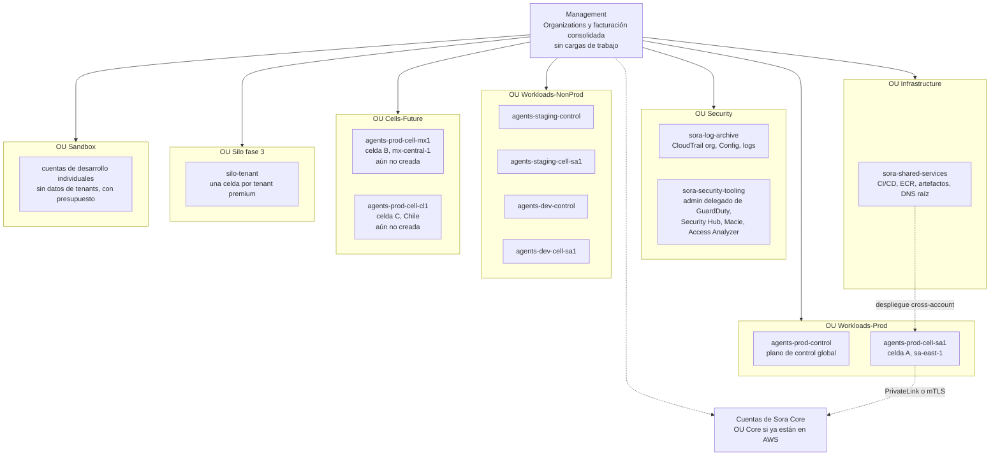

| Cuenta | Contenido | Regiones permitidas (SCP) |
|---|---|---|
| `Management` | Organizations, Control Tower, facturación consolidada, Identity Center. **Cero cargas de trabajo.** | `us-east-1` (región hogar de Control Tower e Identity Center) |
| `sora-log-archive` | CloudTrail organizacional (todas las regiones), Config, VPC Flow Logs agregados. Buckets con Object Lock en modo cumplimiento | `us-east-1`; réplica en `sa-east-1` `[LEGAL]` |
| `sora-security-tooling` | Administrador delegado de GuardDuty, Security Hub, Macie, Config, Access Analyzer | `us-east-1`, `sa-east-1` |
| `sora-shared-services` | CodePipeline, CodeBuild, repositorios ECR de origen, artefactos, DNS raíz (Route 53) | `us-east-1`, `sa-east-1` |
| `agents-{env}-control` | Cognito, directorio de tenants (`C-NUEVO-Directorio`), registro de configuración (C-32), agregados de metering (C-31), estático de la consola, ACM y WAF de CloudFront | `sa-east-1` (datos) y `us-east-1` (solo ACM, WAF de CloudFront y Route 53) |
| `agents-{env}-cell-sa1` | **Toda la celda A** (C-01 a C-30). En producción: el único lugar con datos personales de usuarios finales | `sa-east-1`; `us-east-1` y `us-west-2` **sin recursos con datos**, solo para llamadas a Bedrock (inferencia) y, si aplica, voz e imágenes |
| `agents-prod-cell-mx1` y `-cl1` | Celdas futuras (disparadores en 2.7.4) | `mx-central-1` o la región de Chile; se habilitan solo cuando exista la celda |
| `silo-<tenant>` (fase 3) | La misma celda desplegada con un solo tenant, creada con Account Factory | La que elija el tenant, dentro de la lista permitida |

**Control Tower:** región hogar `us-east-1` (la hogar no se puede cambiar después; allí existen ACM y WAF para CloudFront, y Identity Center cubre más integraciones). Regiones gobernadas al inicio: `us-east-1`, `sa-east-1` y `us-west-2`. `mx-central-1` es una región con *opt-in* `[F26]` y se habilita solo cuando se cree la celda B. Control Tower está en `sa-east-1` y `mx-central-1`† `[VERIFICAR]`. Las cuentas nuevas se crean con Account Factory; las personalizaciones por cuenta (líneas base de seguridad) se aplican con Customizations for Control Tower o AFT `[VERIFICAR cuál usa el equipo]`.

**Relación con las cuentas de Sora Core (`[PREGUNTA-ABIERTA]` P-01):** (a) si Sora Core ya corre en AWS, se agrega su cuenta al OU `Core` (o se mantiene en su organización actual) y se conecta con PrivateLink o VPC Lattice, compartiendo servicios con AWS RAM; **no se comparten roles IAM entre ambas**; (b) si corre en otra nube, C-20 usa TLS mutuo con IP fija (sección 2.5). En ambos casos Sora Core es una dependencia externa de la plataforma: su caída degrada la cobranza (sección 2.10), no la atención.

#### 2.4.2 SCPs clave

| # | SCP | Aplica a | Efecto |
|---|---|---|---|
| 1 | `DenyOutsideAllowedRegions` | Workloads, Cells | Niega todo fuera de `sa-east-1`, `us-east-1` y `us-west-2`, con la lista habitual de servicios globales exentos. Se exenta `bedrock:InvokeModel*`, `Converse*` y `ApplyGuardrail` de la condición de región porque la inferencia entre regiones evalúa las regiones destino: **si cualquier región destino está bloqueada, la llamada falla**; el perfil global requiere permitir `aws:RequestedRegion = unspecified` `[F6][F7]` |
| 2 | `RestrictBedrockModels` | Workloads, Cells | Permite invocar solo los modelos y perfiles aprobados (Claude Sonnet, Haiku y Opus 5.5; Titan Text Embeddings V2; Nova 2.5 Sonic solo en el bake-off; `stability.stable-image-core-v1:1` o equivalente confirmado en consola). **Exige además retención `none` del proveedor** (condición `bedrock:DataRetentionMode`, `[_GATE-1 §4.2 punto 6]`; los modelos que pidan `aws_review` quedan bloqueados para datos personales; hay que confirmar que Haiku, Sonnet y Opus 5.5 admiten `none` `[VERIFICAR]`). El resto, denegado con `NotResource` sobre los ARN de modelos y perfiles. Se valida con el simulador de políticas y el spike S3 `[VERIFICAR]` |
| 3 | `DenyBedrockLongTermApiKeys` | Workloads, Cells | Niega crear credenciales de servicio de larga duración para Bedrock (`iam:CreateServiceSpecificCredential` con `iam:ServiceSpecificCredentialServiceName = bedrock.amazonaws.com`) `[VERIFICAR el ID del servicio]`. Los ejemplos de AWS usan claves de API; el diseño usa solo SigV4 |
| 4 | `ProtectSecurityServices` | Todo salvo Management | Niega detener o borrar CloudTrail, Config, GuardDuty, Security Hub y los *aggregators*; niega `organizations:LeaveOrganization` |
| 5 | `DenyRootAndIamUsers` | Workloads, Cells | Niega el uso del usuario raíz (salvo *break-glass* en Management) y `iam:CreateUser` y `iam:CreateAccessKey` |
| 6 | `RequireEncryptionAndNoPublic` | Workloads, Cells | Niega `s3:PutObject` sin SSE-KMS en buckets de datos; fuerza S3 Block Public Access a nivel de cuenta |
| 7 | `ProtectTenantKeys` | Cells | Niega `kms:ScheduleKeyDeletion` y `kms:DisableKey` salvo para el rol de offboarding de tenants (flujo con aprobación doble) |
| 8 | `DataPerimeter` | Cells | Las políticas de recursos de buckets, colas y claves solo aceptan principales de la organización (`aws:PrincipalOrgID`) |
| 9 | `RegionOptInGuard` | Todo | Niega habilitar regiones *opt-in* (incluida `mx-central-1`) salvo por el rol de administrador de la organización |

Ejemplo ilustrativo del SCP 1 (se afina con el simulador antes de aplicarlo):

```json
{
  "Version": "2012-10-17",
  "Statement": [{
    "Sid": "DenyOutsideAllowedRegions",
    "Effect": "Deny",
    "NotAction": ["iam:*", "organizations:*", "sts:*", "route53:*", "cloudfront:*", "wafv2:*", "support:*",
                  "budgets:*", "ce:*", "health:*", "account:*", "shield:*",
                  "bedrock:InvokeModel", "bedrock:InvokeModelWithResponseStream",
                  "bedrock:Converse", "bedrock:ConverseStream", "bedrock:ApplyGuardrail"],
    "Resource": "*",
    "Condition": { "StringNotEquals": { "aws:RequestedRegion": ["sa-east-1", "us-east-1", "us-west-2"] } }
  }]
}
```

#### 2.4.3 Acceso humano y gobierno operativo

- **IAM Identity Center** con SCIM desde el IdP de Sora `[PREGUNTA-ABIERTA]`. Conjuntos de permisos: `PlatformAdmin`, `Developer`, `ReadOnly`, `SecurityAuditor`, `FinOps`, `BreakGlass`. MFA obligatorio; sesiones de 4 h; acceso a producción por elevación temporal con aprobación `[VERIFICAR herramienta]`. **Nadie de Sora ve datos de conversaciones por la consola de AWS**: se hace por la consola de Sora con auditoría (RI y WP06).
- **Etiquetado obligatorio** (política de etiquetas de la organización): `env`, `cell`, `tenant_id` (donde el recurso es de un tenant), `data_class`, `cost_center`, `owner`. Se usan para ABAC, para costos por tenant y para las políticas de AWS Backup.
- **Presupuestos y anomalías de costo** por cuenta y por perfil de inferencia de aplicación; alertas al 50, 80 y 100%.
- **AWS Backup** con política organizacional (sección 2.10). **Config** con paquetes de conformidad. **Access Analyzer** para accesos externos y no usados.

### 2.5 Red

#### 2.5.1 Diseño por celda y entorno

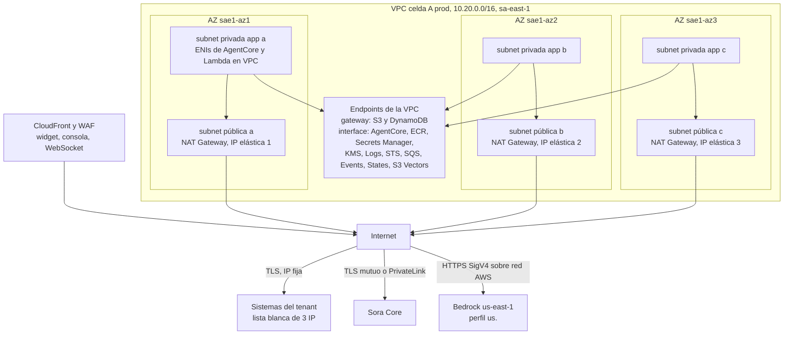

| Elemento | Diseño del MVP | Justificación y alternativa |
|---|---|---|
| **VPC por celda y entorno** | Plan de CIDR: control `10.10.0.0/16`, celda A prod `10.20.0.0/16`, staging `10.21.0.0/16`, dev `10.22.0.0/16`, celda B (futura) `10.30.0.0/16`, celda C `10.40.0.0/16`, **satélite de voz `10.50.0.0/16`** (antes coincidía con la celda C `[_GATE-1 §4.16]`). Sin solapamiento, para poder enlazar con Transit Gateway | CIDR sin solapes evita rediseñar al conectar celdas, tenants o Sora Core |
| **Subnets** | 3 AZ. Por AZ: pública `/24` (NAT), privada de aplicación `/22` (ENIs de AgentCore Runtime y Lambdas en VPC), privada de endpoints `/26`. AgentCore en modo VPC exige subnets en las AZ soportadas (en `sa-east-1`: sae1-az1, az2 y az3 `[F20]`) | Las ENIs de AgentCore son compartidas entre agentes con la misma subnet y grupo de seguridad y pueden persistir hasta 8 h tras borrar un agente `[F20]`: se reservan bloques amplios |
| **Lambdas fuera de la VPC** | Ingress, Router, metering y reglas no tocan sistemas del tenant: **fuera de la VPC** (sin cold start extra ni ENIs). Solo van en VPC los targets que llaman a tenants y a Sora Core, y el runtime de agentes | Reduce costo y límites de ENIs (3,000 por VPC `[F23]`) |
| **Gateway endpoints** | S3 y DynamoDB (sin costo) | Evitan cargos de NAT por tráfico de datos |
| **Interface endpoints (PrivateLink)** | AgentCore (runtime y Gateway), ECR (api y dkr; requeridos por AgentCore en VPC `[F20]`), Secrets Manager, KMS, CloudWatch Logs y Monitoring, STS, SQS, EventBridge, Step Functions, SNS, S3 Vectors `[F15]`, `bedrock-runtime` y `bedrock-agent-runtime` (para el fallback en región y la recuperación de KB) y, si existe, el de End User Messaging Social `[VERIFICAR]`. En dev, 2 AZ | Cada endpoint por 3 AZ cuesta aproximadamente 22 USD/mes + datos `[VERIFICAR]`; con unos 14 endpoints es un costo fijo que WP08 debe incluir (R-WP03-12) |
| **NAT con IP fija** | **Un NAT Gateway por AZ, cada uno con una IP elástica** (3 IP por celda y entorno prod). IP asignadas en el IaC con retención ante borrado. Los tenants permiten esas 3 IP (WP10) | Una sola AZ de NAT sería un punto único de falla. **Premium:** subnets, NAT e IP dedicadas por tenant (aprox. 33 USD/mes por NAT `[VERIFICAR]`) |
| **Control de egreso** | Grupos de seguridad con salida solo a 443; **Route 53 Resolver DNS Firewall** con lista de dominios permitidos (`bedrock-runtime.us-east-1.amazonaws.com`, dominios de tenants y PSP, `graph.facebook.com`, endpoints de AWS) `[VERIFICAR disponibilidad en sa-east-1]`; Flow Logs a S3. **AWS Network Firewall** como mejora en ESC-L si seguridad lo exige (costo alto por endpoint y hora) | DNS Firewall bloquea la exfiltración por nombre a bajo costo; no cubre conexiones directas por IP |
| **Ruta al modelo (ver 2.7.2)** | MVP: NAT → `bedrock-runtime.us-east-1.amazonaws.com` (TLS 1.2+ y SigV4). Mejora (ESC-L): VPC satélite en `us-east-1` con endpoint de `bedrock-runtime` y Transit Gateway entre regiones, para no salir a Internet. PrivateLink entre regiones para servicios de AWS: `[VERIFICAR]` (spike S10) | La opción de NAT es la más simple. La privada agrega costo de Transit Gateway y de endpoints |
| **Conectividad con tenants grandes** | (1) IP fija por NAT (por defecto); (2) VPN de sitio a sitio con Transit Gateway; (3) PrivateLink si el tenant publica un *endpoint service* en la misma región (entre regiones `[VERIFICAR]`); (4) TLS mutuo con certificados por tenant (ACM Private CA, Sí† en ambas regiones) | Se ofrece por plan (WP09) |
| **Entrada pública** | Solo CloudFront + WAF (consola, widget, WebSocket) y, si C-05 lo requiere, un API Gateway para webhooks de Meta Graph con verificación de firma. **WhatsApp no necesita endpoint público** (eventos por SNS) | Menor superficie de ataque |
| **DNS** | Zona pública en `sora-shared-services` (`<dominio-sora>` `[PREGUNTA-ABIERTA]`); delegación por entorno; `api.<celda>.<dominio>`, `chat.<dominio>`; zonas privadas por VPC; dominio propio del tenant para el widget con CloudFront y ACM en `us-east-1` | Opcional por tenant |
| **Red del satélite de voz** | VPC mínima en `us-east-1` (`10.50.0.0/16`) con el puente de voz; las herramientas se llaman por el Gateway de la celda | Solo si `[OD-01]` incluye voz |

### 2.6 Multi-tenancy y multi-país

#### 2.6.1 Modelo pool con camino a silo (`[ADR-06]`)

- **MVP: pool.** Una celda aloja N tenants con aislamiento lógico fuerte en cada capa (2.6.3) y cuotas por tenant (2.6.4).
- **Silo (fase 3):** la **misma celda desplegada con un solo tenant en una cuenta dedicada** (`silo-<tenant>`), creada con Account Factory y el mismo CDK. Aporta cuotas propias de Bedrock y de AgentCore, claves y red dedicadas. **BYOC** (despliegue en la cuenta del cliente) usa el mismo código con un rol entre cuentas administrado por el cliente. Para que esto sea posible desde el MVP, **ninguna parte del código puede asumir que hay varios tenants en la cuenta**: todo acceso a datos pasa por el contexto de tenant, también en silo.
- **Criterio de promoción a silo (propuesta):** requisito contractual de aislamiento físico, volumen que consuma más del 30% de la cuota de un modelo, o exigencia de residencia en una región distinta.

#### 2.6.2 Jerarquía tenant → operación de país y propagación del contexto

La jerarquía (`[S-07]`): `Tenant (1) → CountryOperation (1..N)`. Cada operación tiene su número de WhatsApp (WABA), región hogar, idioma, moneda, PSP e integraciones. El **tenant** es el límite de aislamiento contractual (claves, secretos, cuotas, facturación); la **operación de país** es el límite regulatorio (datos, KB, memoria, Gateway, políticas): un operador de la operación `CO` del tenant X no ve datos de la operación `MX` salvo que tenga permiso explícito.

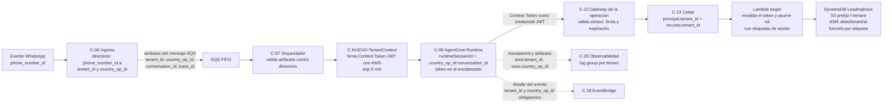

**Cómo viaja el contexto en cada salto** (todos los saltos llevan los mismos cuatro campos: `tenant_id`, `country_op_id`, `conversation_id`, `trace_id`):

| Salto | Mecanismo | Quién lo valida |
|---|---|---|
| Canal → Ingress | `phone_number_id` o ID de sesión web (JWT del widget con claims firmados) | C-06 contra el Directorio. Si no existe: descarte con alarma |
| Ingress → SQS | Atributos de mensaje + `MessageGroupId = {country_op_id}#{conversation_id}` | El orquestador compara los atributos con el Directorio (anti-suplantación) |
| Orquestador → AgentCore | Context Token en un encabezado de la invocación y `runtimeSessionId`. El agente recibe también un token de identidad de carga de AgentCore Identity | Agente y Gateway |
| Agente → Gateway | El Context Token como credencial JWT (el emisor Sora publica su JWKS). Claims → principal de Cedar `[VERIFICAR mapeo exacto de claims a atributos de Cedar en AgentCore Policy]` | Gateway (JWT) + Cedar (política) |
| Gateway → Lambda target | Argumentos de la herramienta + contexto. **La Lambda no confía en los argumentos**: revalida el token y asume un rol con etiquetas de sesión `tenant_id` y `country_op_id` (*token vending machine*) `[VERIFICAR cómo propaga el Gateway el contexto a targets Lambda; spike S1]` | Librería `sora-tenant-context` y IAM |
| Lambda → datos | Credenciales temporales con etiquetas: `dynamodb:LeadingKeys`, prefijos S3, `kms:ResourceAliases`, etiquetas de Secrets Manager | IAM, KMS, S3 |
| Evento (EventBridge) | `detail.tenant_id`, `detail.country_op_id` (esquema obligatorio); reglas por consumidor | Esquema en el productor; pruebas IT-10 |
| Trazas y logs | Atributos de span `sora.tenant_id` y `sora.country_op_id`; **log group por tenant**; sin PII en atributos | Redacción en origen; IT-09 |
| Workflows (Step Functions) | El contexto va en la entrada de la ejecución; cada Lambda del workflow reasume el rol | Ídem |
| Consola | JWT de Cognito con `custom:tenant_id`, `custom:ops` y `custom:role`; la API de la celda filtra por claims y **nunca** acepta `tenant_id` como parámetro del cliente | API de la celda; IT-12 |

#### 2.6.3 Aislamiento por capa

| Capa | Mecanismo concreto | Prueba |
|---|---|---|
| **DynamoDB** | Claves de partición con prefijo `{tenant_id}#{country_op_id}#...`; política del rol de sesión con `dynamodb:LeadingKeys` `ForAllValues:StringLike ${aws:PrincipalTag/tenant_id}#*`; sin permiso de `Scan`. **El cifrado de DynamoDB es por tabla, no por ítem**: para cumplir "una clave KMS por tenant" (`[ADR-06]`) **todo atributo clasificado como personal o financiero en cualquier tabla** (no solo mensajes, resúmenes y `wa_id`, sino también montos de promesas y planes, notas de gestiones, argumentos y resultados de herramientas, identidad de aprobadores y actores de auditoría; clasificación por tabla en 2.8.3) se cifra por campo con una clave de datos por tenant obtenida de KMS con contexto de cifrado `{tenant_id}` (AWS Database Encryption SDK o claves de datos de KMS, con caché de claves de datos) `[_GATE-1 §4.12]`. **Los atributos cifrados no sirven como clave de partición, ni como GSI ni como filtro**: la búsqueda por teléfono usa `wa_id_hmac` (HMAC con una clave por tenant; KMS `GenerateMac` `[VERIFICAR]`). El resto de campos (claves, estados, marcas de tiempo, referencias opacas) usa la CMK de la tabla. Esto **extiende el borrado criptográfico por tenant** (eliminar la CMK) a promesas, planes y gestiones | IT-01, IT-02, IT-04 |
| **S3** | Prefijos `t={tenant_id}/op={country_op_id}/...`; política del rol con `Resource: .../t=${aws:PrincipalTag/tenant_id}/*`; `ListBucket` con condición de prefijo; SSE-KMS por objeto con la clave `alias/tenant/{tenant_id}-data`; buckets separados por clase de dato (archivo, KB, cargas, activos) | IT-03, IT-04 |
| **KMS** | **2 CMK por tenant y celda** (`alias/tenant/{tenant_id}-data` para S3, DynamoDB por campo, Memory, S3 Vectors y logs; `alias/tenant/{tenant_id}-secrets` para Secrets Manager) y, en fase 2, una biométrica `[_GATE-1 §4.12]`; más 3 CMK por celda (clave asimétrica de firma de `policy_decision_id`, `audit-signing` y `org-logs`, que no son del tenant); permisos con `kms:ResourceAliases` ligado a la etiqueta del principal y con `kms:EncryptionContext:tenant_id`; rotación anual; borrado solo en el offboarding con SCP 7 | IT-04 |
| **Knowledge Bases / S3 Vectors** | **Una KB y un índice por operación de país** (aislamiento duro). Los filtros de metadatos **no** se usan para aislar, solo para tipo y vigencia. Razón: un filtro mal construido en el código de la consulta filtraría datos; un índice por operación obliga a un error de IAM. IAM por ARN de índice; CMK por índice `[VERIFICAR soporte]` | IT-06 |
| **AgentCore Memory** | Un recurso Memory por operación, con CMK del tenant `[VERIFICAR]`; namespaces `/t/{tenant_id}/c/{country_op_id}/u/{customer_ref}/`; el rol de sesión solo accede a su recurso | IT-07 |
| **AgentCore Gateway** | **Un Gateway por operación de país**: la lista de herramientas nunca incluye las de otro tenant; autorizador JWT que exige `tenant_id` y `country_op_id` coherentes con el Gateway; Cedar (`permit` solo si `principal.tenant_id == resource.tenant_id` y el nivel L cubre la herramienta); credenciales de salida por target (Identity o Secrets Manager) | IT-08 |
| **AgentCore Runtime** | Cada sesión en su propia microVM; la sesión se nombra con el `country_op_id`; el contenedor no tiene credenciales de datos propias: solo puede pedir un token al servicio de contexto | IT-13 |
| **Secrets Manager** | Un secreto por (tenant, sistema), cifrado con la CMK del tenant, ARN con prefijo `sora/{env}/{tenant_id}/...`; política con `aws:ResourceTag/tenant_id == aws:PrincipalTag/tenant_id` | IT-05 |
| **Logs y trazas** | Un *log group* por tenant y componente con su CMK y política de protección de datos (PII) `[VERIFICAR]`; el acceso de operadores a logs solo por la API de la consola; particionamiento por `tenant_id` en el lago (Lake Formation) | IT-09 |
| **EventBridge y SQS** | Esquema obligatorio; reglas por consumidor; colas con política de recursos limitada a principales de la organización; atributos verificados por el orquestador | IT-10, IT-11 |
| **Prompt caching** | El caché de Bedrock es por cuenta `[ADR-02]` y se acierta por prefijo idéntico: el prefijo de cada operación incluye sus políticas, así que no hay aciertos entre tenants distintos. **Regla:** ningún secreto ni dato de un tenant puede ir en un prefijo compartido por varios | IT-13 |
| **Consola** | Claims del JWT; el `tenant_id` nunca viene del cliente; RBAC por rol (`tenant-admin`, `cx`, `cobranza`, `marketing`, `compliance`, `sora-ops`); toda lectura de conversaciones se audita (`AuditEvent`) | IT-12 |

#### 2.6.4 Vecino ruidoso (*noisy neighbor*)

Las cuotas de Bedrock (tokens por minuto), AgentCore (sesiones, TPS), Lambda (concurrencia), Step Functions (`StartExecution`) y de la API de EUM son **compartidas por todos los tenants de la cuenta**. Por eso:

1. **Presupuestos por tenant en C-15:** cada operación tiene un presupuesto de TPM y RPM (token bucket en DynamoDB con contadores atómicos, o en memoria con reconciliación periódica). La suma de presupuestos no pasa del 80% de la cuota de la cuenta; el 20% restante es reserva de emergencia. Los excedentes se encolan o degradan, nunca desplazan a otro tenant.
2. **Clases de prioridad:** conversación interactiva > handoff > W-01 saliente > generación de contenido > evals y jueces en línea. Ante *throttling* (HTTP 429), se pausan primero las clases bajas.
3. **Concurrencia reservada de Lambda** por función crítica y límites por cola; límites de tasa por tenant en el API Gateway de la consola y del widget (planes de uso).
4. **Aislamiento de capacidad de Bedrock:** (a) las cuotas son por cuenta y región, así que un tenant grande se puede mover a una cuenta silo con cuota propia; (b) el nivel *Reserved* (capacidad dedicada) existe para Claude 5.5 pero **no está soportado en los modelos 5.5 hoy** `[F2][F3][F4]`; (c) **un perfil de inferencia de aplicación por tenant y agente** da atribución de costo, no aislamiento de cuota `[F2]`.
5. **Afinidad de cuenta:** el razonamiento preservado de Claude 5.5 está ligado a la cuenta AWS que lo generó `[F2]`. Si algún día se reparte tráfico entre cuentas de inferencia, **cada conversación queda fija a una cuenta** (clave de afinidad = `conversation_id`).
6. **Prueba de carga con un tenant abusivo** (IT-14) en staging antes de cada cambio de límites.

#### 2.6.5 Pruebas automáticas de aislamiento (bloquean el pipeline)

| ID | Prueba | Método | Cuándo |
|---|---|---|---|
| IT-01 | Lectura de DynamoDB entre tenants | Asumir el rol del tenant A y consultar con la clave del B: debe dar `AccessDenied`. Variantes con `BatchGetItem` y `Query` por GSI | PR (stack efímero) y nocturna |
| IT-02 | `Scan` y consultas sin prefijo | Debe estar denegado | PR |
| IT-03 | S3: salto de prefijo | `GetObject`, `ListBucket` y `..` hacia el prefijo del tenant B | PR |
| IT-04 | KMS | Desencriptar con el contexto de A el texto cifrado de B: falla. Intentar `Encrypt` con la clave de B: falla | PR |
| IT-05 | Secrets Manager | El rol de A no lee los secretos de B | PR |
| IT-06 | KB y vectores | **Cadena canario** única sembrada en la KB de B; consultar desde A y desde el agente de A: no debe aparecer. Acceso directo al índice de B denegado | Nocturna |
| IT-07 | AgentCore Memory | Eventos de A no se leen con credenciales de B ni con el *namespace* de B | Nocturna |
| IT-08 | Gateway | Llamar la herramienta de B con el token de A: denegado por Gateway, por Cedar y por la Lambda (cada capa se prueba por separado) | PR |
| IT-09 | Logs y trazas | La cadena canario de B no aparece en los logs, trazas ni respuestas de la API de la consola visibles para A | Nocturna |
| IT-10 | EventBridge | Una regla de A no recibe eventos de B | PR |
| IT-11 | SQS | Un mensaje con atributos inconsistentes con el Directorio va a la DLQ y dispara alarma | PR |
| IT-12 | API de la consola | Pruebas de referencias directas a objetos (IDOR): operador de A pide IDs de B; operador de `CO` pide recursos de `MX` del mismo tenant | PR |
| IT-13 | Contexto del modelo | Conversaciones concurrentes de A y B con canarios en prompts: ninguna respuesta incluye el canario ajeno; el prefijo cacheable no contiene datos de tenant compartidos | Nocturna |
| IT-14 | Vecino ruidoso | A genera 10× su presupuesto: el p90 de B no empeora más del 20% y A recibe límites, no B | Pre-release |
| IT-15 | Aislamiento por operación | Un rol de la operación `CO` no accede a datos de la operación `MX` del mismo tenant | PR |
| IT-16 | Políticas como código | `cdk-nag`/Checkov sobre las plantillas; simulador de IAM contra los SCP; verificación de que cada recurso con datos lleva etiqueta `tenant_id` y CMK | PR |

Las pruebas corren contra un **stack efímero por PR** (dev) con dos tenants sintéticos (A1, A2 y B1) y datos con canarios; solo IT-14 y la prueba completa nocturna corren en staging. **Una falla de IT-01 a IT-13 bloquea el despliegue.** WP06 agrega la prueba de penetración externa antes del go-live.

### 2.7 Regiones, celdas y residencia (`[OD-06]`)

#### 2.7.1 Matriz de disponibilidad de servicios por región

Fuentes y fecha: documentación oficial de AWS consultada el 2026-11-16 (`[F1]`, `[F2]` a `[F4]`, `[F8]` a `[F12]`, `[F15]`, `[F17]`, `[F22]` a `[F24]`) y la lista regional de servicios con fecha 2025-11-13 (`[F27]`, marcada †). La región de Chile se muestra solo donde hay evidencia: en acceso anticipado desde el 2026-11-11, con servicios básicos de cómputo, almacenamiento, red y bases de datos, y con "IA y ML, incluidos Bedrock y SageMaker AI" prometidos para el primer año de la región `[F28]`.

| Servicio | `sa-east-1` | `mx-central-1` | Chile | `us-east-1` | Nota |
|---|---|---|---|---|---|
| Bedrock · Claude 5.5 en región | **No** `[F2]` | **No** `[F2]` | No `[F28]` | **No** (solo perfiles) `[F2]` | Solo Opus 5.5 tiene inferencia en región, y únicamente en `eu-west-2` `[F4]` |
| Bedrock · Claude 5.5 perfil geográfico | **No** (no hay geografía de LatAm) | **No** | No | **Sí** (`us.`, destinos `us-east-1`, `us-east-2`, `us-west-2`) `[F2]` | Haiku 5.5 y Opus 5.5 tienen además `ca.`, `eu.`, `au.` y `jp.`; el de EE.UU. no cambia |
| Bedrock · Claude 5.5 perfil global | **Sí** `[F2]` | **Sí** `[F2]` | n/d | Sí `[F2]` | `global.anthropic.claude-sonnet-5-5` y equivalentes |
| AgentCore Runtime (microVMs) | **Sí** `[F1]` | **No** `[F1]` | No `[F28]` | Sí `[F1]` | El tipo *Instances* no está en `sa-east-1` `[F1]` |
| AgentCore Memory, Gateway, Identity, Policy, Evaluations, Observability | **Sí** (las seis) `[F1]` | **No** `[F1]` | No | Sí | Gateway, Identity, Policy, Evaluations y Observability figuran en todas las regiones de la tabla `[F1]`, **salvo `mx-central-1`, que no aparece** |
| AWS End User Messaging Social (WhatsApp) | **Sí** `[F8][F9]` | **Sí** `[F8][F9]` | n/d | Sí | 25 WABA por región `[F9]` |
| End User Messaging SMS | Sí `[F9]` | Sí `[F9]` | n/d | Sí | — |
| Amazon Connect | **No** `[F10]` | **No** `[F10]` | n/d | **Sí** `[F10]` | Campañas salientes desde `us-east-1` o `us-west-2` pueden llamar a números de EE.UU., México y Brasil `[F10]` |
| Amazon Nova 2.5 Sonic y Nova 2 Sonic (solo reto del bake-off) | **No** `[F11][F12]` | **No** | No | **Sí** (en región) `[F11][F12]` | Sin perfiles cross-region ni Guardrails. 20 sesiones concurrentes por cuenta y región |
| Transcribe streaming (motor de voz base) | Sí `[F35]` | Sí `[F35]` | n/d | Sí `[F35]` | 25 streams concurrentes y 25 TPS de inicio por defecto, ajustables `[F35]`; en el diseño se usa en `us-east-1`, junto a Connect |
| Generación de imágenes | **No** | **No** | No | Nova Canvas: **fin de vida el 2026-09-30** `[F13]`; Stable Image Core 1.0: solo `us-west-2` `[F14]` | Canon: composición determinista + Stable Image Core 1.0 en `us-west-2` para fondos `[_GATE-1 §4.7]` |
| Titan Text Embeddings V2 | **Sí** `[F17]` | **No** `[F17]` | n/d | Sí | Cohere Embed Multilingual: Sí en `sa-east-1` `[F17]` |
| Bedrock Knowledge Bases | Sí† (`bedrock-agent` listado `[F32]`) | n/d `[VERIFICAR]` | No | Sí | `bedrock-mantle` no admite KB ni Guardrails `[F2]` |
| S3 Vectors | **Sí** `[F15]` | **Sí** `[F15]` | n/d | Sí | PrivateLink soportado `[F15]` |
| Bedrock Guardrails (`ApplyGuardrail`) | Sí† `[VERIFICAR]` | n/d `[VERIFICAR]` | No | Sí | No exige el modelo `[F33]` |
| Step Functions | Sí† (150/s de `StartExecution` `[F24]`) | Sí† (idem) | n/d | Sí (300/s `[F24]`) | — |
| EventBridge (+ Scheduler) | Sí† | Sí† | n/d | Sí | Scheduler no aparece aparte en `[F27]` `[VERIFICAR]` |
| Lambda, SQS, SNS, DynamoDB, S3, KMS, Secrets Manager, CloudWatch, X-Ray, Config, CloudTrail, GuardDuty, Security Hub, Inspector, Firehose, Glue, Athena, AppConfig, Cognito, CloudFront, WAF, VPC, NAT, PrivateLink, Control Tower, IAM Identity Center | Sí† (Lambda además Sí `[F23]`) | Sí† (Lambda además Sí `[F23]`) | Núcleo según `[F28]`; resto n/d | Sí | Reconfirmar en consola (S0) |
| API Gateway | Sí `[F22]` (10,000 RPS) | Sí `[F22]` (**2,500 RPS**) | n/d | Sí (10,000 RPS) | `[F22]` |
| Amplify Hosting, AppSync | Sí† | **No†** | n/d | Sí | — |
| CodePipeline, CodeBuild | Sí† | **No†** | n/d | Sí | CI/CD se ejecuta en `sora-shared-services` |
| OpenSearch Serverless, Macie, QuickSight, Polly, Fargate | n/d `[VERIFICAR]` | n/d `[VERIFICAR]` | n/d | Sí | No aparecen por nombre en `[F27]`, que además está desactualizada |
| Transcribe | Sí† | Sí† | n/d | Sí | — |

**Conclusiones de la matriz:** (1) `sa-east-1` cubre todo lo que el MVP necesita para texto, excepto el acceso a Claude "en región" (que no existe en ningún lugar de LatAm); (2) `mx-central-1` bloquea la ADR-03 porque no hay AgentCore; (3) **voz e imágenes no existen en LatAm** y necesitan satélites en EE.UU. (con datos temporales en el de voz); (4) la región de Chile no es una opción antes de 2027 para nada que use IA.

#### 2.7.2 Modelos Claude 5.5: perfiles de inferencia y ruta de inferencia

| Dato | Valor (fuente `[F2][F3][F4][F6][F7]`, consulta 2026-11-16) |
|---|---|
| IDs | `anthropic.claude-sonnet-5-5` (lanzado 2026-09-28), `anthropic.claude-haiku-5-5` (2026-10-07), `anthropic.claude-opus-5-5` (2026-09-22) |
| Fin de vida | "No antes de" 2027-09-28, 2027-10-07 y 2027-09-22; período *legacy* de 6 meses. **Plan:** un ciclo de actualización de modelo de ≤ 12 meses |
| Contexto y salida | 1 M tokens de contexto; hasta 128 K de salida |
| Perfiles | Geográficos: `us.`, `eu.`, `au.` (Sonnet); `us.`, `ca.`, `eu.`, `au.`, `jp.` (Haiku); `us.`, `eu.`, `au.`, `jp.` (Opus). Global: `global.` en los tres. **No hay perfil de LatAm** |
| Orígenes del perfil `us.` | `us-east-1`, `us-east-2`, `us-west-1`, `us-west-2`, `ca-central-1`, `ca-west-1`. **Destinos desde `us-east-1`: `us-east-1`, `us-east-2` y `us-west-2`** |
| Desde `sa-east-1` o `mx-central-1` | Solo el perfil `global.` |
| Cuotas por defecto (TPM, por región, ajustables) | Sonnet 5.5: 6,000,000 · Haiku 5.5: 10,000,000 · Opus 5.5: 30,000,000 (cross-region y global). **RPM por defecto: n/d `[VERIFICAR]`** (el listado consultado solo mostraba RPM de modelos anteriores, por ejemplo 5,000 para Sonnet 4.6) `[F21]` |
| Prompt caching | Explícito, mínimo de 512 tokens por *checkpoint*, hasta 4 checkpoints por solicitud, TTL de 5 min o 1 h; **sin caché implícito** `[F2]`. Con el endpoint geográfico el caché es regional: S-25 (85%) es un **objetivo, con alerta bajo 60%**; no se reproducen conversaciones de producción en dev o staging con razonamiento (ligado a la cuenta) `[_GATE-1 §4.2 punto 10]` |
| Herramientas y razonamiento | `tool_choice` solo `auto` y `none`; razonamiento adaptativo; los bloques de razonamiento están ligados al modelo, al prefijo y **a la cuenta** `[F2]` |
| Niveles de servicio | **Solo *Standard***. Priority, Flex, Reserved y Batch: no soportados `[F2][F3][F4]` |
| API | `bedrock-runtime` (Messages, Converse, Invoke) y `bedrock-mantle` (solo Messages; sin Guardrails ni KB). **Se usa `bedrock-runtime`** `[F2]` |
| Precio | Facturado vía AWS Marketplace; la tabla de tarifas no pudo leerse. **La lectura de caché de Sonnet 5.5 baja 50% desde el 2026-10-07** `[F29]`. El global cuesta aprox. 10% menos que el geográfico `[F6]`; el precio se calcula según la región desde la que se llama `[F6]` |

**Tres rutas de inferencia posibles desde la celda `sa-east-1`:**

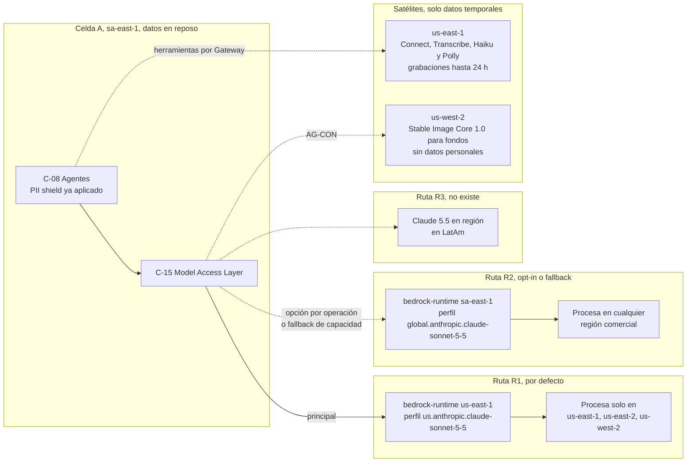

| Criterio | R1: `us.` desde `us-east-1` (**recomendada por defecto**) | R2: `global.` desde `sa-east-1` | R3: en región |
|---|---|---|---|
| Alcance del procesamiento | **Acotado a 3 regiones de EE.UU.** `[F7]` | Cualquier región comercial (opaco para el aviso de privacidad) `[F6]` | No existe para Claude 5.5 en LatAm |
| Narrativa legal | "Transferencia a EE.UU." documentable en DPA y aviso `[LEGAL]` | "Transferencia a cualquier país donde AWS opere" `[LEGAL]`; más difícil de justificar | n/a |
| Latencia | Salto adicional `sa-east-1` ↔ `us-east-1`: RTT de unos 120 ms por llamada (`[S-NUEVO-8]` (`S-G1-37`), `[VERIFICAR]`); con 2.0 a 2.5 llamadas por turno, +0.25 a +0.3 s | Sin salto de llamada, pero el enrutamiento global puede ir más lejos `[VERIFICAR]` | n/a |
| Costo | Estándar (sin el ~10% de ahorro del global) `[F6]` | ~10% menos `[F6]` | n/a |
| Cuota | La del `us-east-1` de la cuenta (6 M TPM de Sonnet por defecto) | La de `sa-east-1` de la cuenta (otra reserva independiente) | n/a |
| Requisitos de SCP | Permitir las tres regiones de destino para acciones de Bedrock | Permitir `aws:RequestedRegion = unspecified` `[F6]` | n/a |
| Rol en el diseño | **Ruta principal** | **Fallback de capacidad o disponibilidad** (otra reserva de cuota) y opción para operaciones cuyo `[LEGAL]` lo permita | — |

**Qué sale de la celda hacia el modelo:** el prompt del turno (historial reciente con alias en lugar de identificadores directos, resultados de herramientas con montos y fechas, fragmentos de la KB) y la respuesta. **No sale:** documento, teléfono, email, dirección, número de cuenta, datos de tarjeta, transcripción completa ni trazas. Los **embeddings se calculan en región** (Titan V2 en `sa-east-1`). Esto reduce la exposición pero **no elimina** que los datos sigan siendo personales (están seudonimizados): `[LEGAL]`. El PII shield puede afectar la naturalidad de la conversación (por ejemplo, saludar por el nombre): el saludo lo resuelve una plantilla fuera del modelo (WP04).

**Modelo de imágenes de AG-CON (propuesta post-Gate 1, `[_GATE-1 §4.7]`, no confirmada).** Nova Canvas dejó de existir el 2026-09-30 `[F13]` y no hay sustituto verificado en LatAm. Propuesta: (1) **camino base: composición determinista sobre plantillas de marca** (T-22 recibe `template_id`, texto y logos, y los renderiza por código, sin modelo generativo; corre en la celda); (2) **fondos o ilustraciones: Stable Image Core 1.0 en Bedrock `us-west-2`** (único lugar donde figura `[F14]`; ID `stability.stable-image-core-v1:1` según la ficha, el gate cita `...v1:0`: se confirma en la consola), invocado desde un satélite que **no recibe datos personales** (el brief no lleva PII; `ADV-IMG` de WP06 prohíbe personas reales, marcas de terceros, menores y testimonios inventados); (3) costo proxy de P-17, 0.04 a 0.08 USD por imagen `[VERIFICAR]`, con 2 imágenes por pieza: 200, 600 y 2,000 imágenes al mes, es decir, unos USD 12, 36 y 120; (4) T-22 pasa a *Should* y `us-west-2` queda gobernada en la estructura de cuentas (ya figura entre las tres regiones permitidas). Se agrega la ruta al SCP 2 (modelos aprobados) y a la matriz 2.7.1.

**Presupuesto de latencia (estimación, `[VERIFICAR]` en el spike S3 y en el piloto).** **Objetivo: p90 ≤ 6 s `[S-38]`. Umbral de alarma y de rollback automático: p90 > 8 s** (el valor que WP04 usa para revertir; es un umbral operativo, no un objetivo) `[_GATE-1 §2 #20, §4.2 punto 9]`:

| Tramo | Estimación (s) |
|---|---|
| Meta → EUM Social → SNS → Ingress → SQS FIFO | 0.3 |
| Orquestador (arranque, token de contexto) | 0.2 |
| Router (Haiku, incluye salto a `us-east-1`) | 0.8 (objetivo de S-38) |
| Arranque de microVM si es sesión nueva | 0.5 a 1.5 `[VERIFICAR]` |
| 2.0 llamadas a Sonnet por turno (2.0 s cada una, con salto) | 4.0 |
| Herramientas (1 llamada por turno, `[S-NUEVO-6]` (`S-G1-36`)) | 0.5 |
| Guardrails de entrada y salida | 0.3 |
| Envío de respuesta (EUM Social → Meta) | 0.3 |
| **Total** | **7.0 a 8.0 en el peor caso; 5.5 a 6.5 típico** (objetivo 6 s; alarma 8 s) |

**El objetivo de 6 s no se declara cumplido**: con la ruta R1 el peor caso suma 7 a 8 s, es decir, está en el umbral de alarma de 8 s; el piloto y el spike S3 deben demostrar el p90 real (WP07 mide). Mitigaciones de diseño: **Haiku 5.5 en la mitad de las conversaciones de ATC** (decisión al abrir, solo L0, ascenso de una vía, `[_GATE-1 §4.4]`; reemplaza al 60% de los turnos de S-31), `effort` bajo, caché de prefijo (S-25), `between_tools` para evitar razonamiento extendido `[ADR-02]`, microVM tibia (los mensajes de una conversación activa reutilizan la sesión durante 300 s) y envío del primer mensaje parcial cuando haya herramientas lentas. Es un riesgo (R-WP03-04) que el piloto debe medir.

#### 2.7.3 Modelo de celdas: validación y reparto de datos

El modelo de `15 §6` **se valida con cuatro ajustes**: (1) cada celda funciona sin el plano de control en caliente (estabilidad estática): cachea directorio y configuración con vigencia de 24 h y se degrada a "últimas versiones conocidas"; (2) la API de la consola es **por celda**, no global; (3) **la región hogar de una operación queda ligada a la región de su WABA** (un WABA se vincula a una región en End User Messaging Social, con un máximo de 25 por región `[F9]`; mover un WABA de región es un proyecto, no un cambio de configuración `[VERIFICAR]`); (4) los *satélites* (voz, imágenes, inferencia) no son celdas: no guardan datos de forma duradera ni tienen estado de negocio; el de voz retiene **datos temporales** (grabaciones y transcripciones hasta 24 h) mientras se copian a la celda `[_GATE-1 §4.5]`.

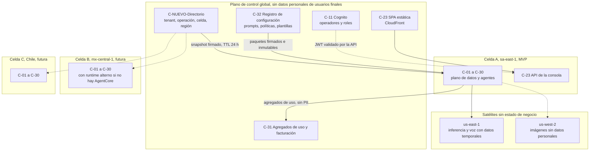

| Dato | Plano de control (global) | Celda (región hogar) | Cruza celda ↔ control |
|---|---|---|---|
| Tenant, operación, país, idioma, zona horaria, moneda, celda, `phone_number_id`, `waba_id` | Sí (directorio) | Copia en caché de solo lectura | Directorio → celda |
| Configuración de agentes, prompts, políticas, plantillas, reglas por país (versionadas) | Sí (C-32) | Caché de paquetes firmados | Control → celda |
| Usuarios y roles de operadores, SSO | Sí (Cognito) | No (solo valida JWT) | JWKS |
| Agregados de uso (contadores por tenant, país y día) y facturación | Sí | Origen | Celda → control (sin identificadores de usuario final) |
| Conversaciones, mensajes, memoria, KB, promesas, planes, gestiones, bitácora, grabaciones | **Nunca** | **Sí** | No cruza (salvo inferencia por 2.7.2) |
| Métricas operativas sin PII (latencias, errores, costos) | Opcional | Origen | Celda → control |
| Auditoría de acciones administrativas de la consola | Copia | Origen | Celda → control |

**Cómo se asigna la región hogar a una operación de país** (decisión en la incorporación, W-07; inmutable después del *go-live*):

1. **Requisito contractual o regulatorio del tenant** para esa operación (por ejemplo, "datos en México"): si existe una celda que lo cumple, se usa; si no, se abre una excepción con `[LEGAL]` o se espera a la celda.
2. **Mapeo por defecto de país → celda** (tabla en el directorio): MVP = `sa-east-1` para todos los países núcleo y `LATAM-OTROS` (con revisión legal caso por caso, `[S-04]`).
3. **Región del WABA** (queda ligada a la celda).
4. **Disponibilidad de servicios** de la celda (por ejemplo, sin AgentCore no se puede alojar la operación).

#### 2.7.4 Recomendación de la celda del MVP

**Opciones evaluadas.** Primero un filtro excluyente (ADR-08: los datos en reposo deben quedar en una región de LatAm) y luego una puntuación ponderada (1 a 5; los pesos son una propuesta de este WP).

| Criterio (peso) | A: `sa-east-1` + satélites | B: `mx-central-1` | C: `us-east-1` solo | D: A + B desde el inicio |
|---|---|---|---|---|
| **Filtro ADR-08** (datos en reposo en LatAm) | Cumple | Cumple | **No cumple** (solo con `[CAMBIO-ADR]` y visto bueno de `[LEGAL]`) | Cumple |
| Servicios críticos (25) | 4 (todo salvo voz e imágenes) | 1 (sin AgentCore, KB n/d, sin Connect) | 5 | 4 |
| Residencia (20) | 3 (BR en país; resto transfronterizo) | 3 (MX en país; resto transfronterizo) | 1 | 4 |
| Latencia a usuarios (10) | 4 | 3 | 3 | 4 |
| Cuotas y capacidad (10) | 3 (2,500 sesiones; SFN y API GW más bajos que `us-east-1`) | 2 (API GW 2,500 RPS) | 5 (5,000 sesiones) | 3 |
| Costo (10) | 3 (suele costar más que `us-east-1`, P-21 `[VERIFICAR]`) | 3 | 5 | 2 (dos celdas) |
| Complejidad y time-to-market (15) | 4 | 1 (runtime alterno sobre ECS) | 5 | 2 |
| Resiliencia (10) | 3 (región única) | 2 | 4 | 4 |
| **Puntuación ponderada** | **3.50** | **2.00** | (excluida; 3.90 si se levantara el filtro) | **3.40** |

**Recomendación (D-WP03-01): celda A en `sa-east-1`**, con satélites sin estado de negocio en `us-east-1` (inferencia y, si aplica, voz con datos temporales de hasta 24 h) y `us-west-2` (imágenes sin datos personales), y las celdas B y C preparadas en el diseño pero **no construidas**.

Por qué no D: duplica costo y esfuerzo antes de tener un solo cliente y no hay un tenant que lo exija hoy. Por qué no C: incumple la ADR-08 y concentra el riesgo legal en todos los países. **Plan Z:** si `[LEGAL]` determina que la residencia en LatAm no es obligatoria para el país del piloto, desplegar la misma celda en `us-east-1` es el camino más rápido y más barato (la abstracción de celda lo permite), pero requiere `[CAMBIO-ADR]` de `[ADR-08]`. No se propone todavía: depende de la respuesta a P-03.

**Plan de celdas y disparadores:**

| Celda | Región | Se construye cuando (cualquiera) | Prerrequisitos y esfuerzo |
|---|---|---|---|
| **A** | `sa-east-1` | MVP | Este documento |
| **B** | `mx-central-1` | (1) un tenant exige datos en México por contrato o regulación; (2) AgentCore llega a `mx-central-1`; (3) México supera el 30% del volumen | Habilitar la región *opt-in* `[F26]`; **runtime alterno sobre ECS Fargate** (Fargate n/d `[VERIFICAR]`) o AgentCore si ya existe; Verified Permissions en lugar de AgentCore Policy; ingesta de KB propia (C-14 plan B); subir el límite de 2,500 RPS de API Gateway `[F22]`. Esfuerzo estimado: 6 a 10 semanas de ingeniería `[S-NUEVO-9]` (`S-G1-38`); WP12 lo refina |
| **C** | Región de Chile | Disponibilidad general, Bedrock y AgentCore en la región, y un tenant chileno con exigencia de residencia | Hoy "No" para IA `[F28]`; revisar cada trimestre |
| **Satélite voz** | `us-east-1` | Fase 1.5 (semanas 17 a 28) si el escenario B y `[LEGAL]` lo permiten `[_GATE-1 §4.5]` | Connect + Transcribe + Haiku 5.5 + Polly en `us-east-1`; cuotas de voz Q-19 a Q-21 (2.9.3); Nova Sonic solo en el bake-off |
| **Silo** | La del tenant | Fase 3 | Account Factory + el mismo CDK |

La **división de una celda existente en dos** (por capacidad) no se prevé en el horizonte de ESC-E: 14 operaciones caben en una celda (2.9). Lo que limita es la cuota de Bedrock de la cuenta, no la infraestructura.

#### 2.7.5 Verificación pendiente y preguntas para WP06

**Spike S0 (antes del primer despliegue, 1 día):** confirmar en consola y con `aws ssm get-parameters-by-path --path /aws/service/global-infrastructure/regions/<región>/services` la disponibilidad real en `sa-east-1` de todos los servicios marcados † o `n/d`, la cuota de RPM de Claude 5.5, el precio vigente en Bedrock y el soporte de CMK en Memory y S3 Vectors. Quien lo ejecute deja el resultado en una tabla versionada.

**Matriz de residencia por país para la celda A** (las celdas de la derecha son preguntas, no afirmaciones; WP06 las resuelve):

| País | Datos en reposo | Inferencia LLM | Pregunta `[LEGAL]` para WP06 |
|---|---|---|---|
| BR | En el país (`sa-east-1`) | EE.UU. (`us.`) | ¿Qué mecanismo de la LGPD (cláusulas estándar, consentimiento u otro) cubre enviar datos seudonimizados a EE.UU.? ¿Cómo aplican las reglas del Banco Central a un tenant SCD o SEP? |
| MX | Brasil | EE.UU. | ¿Exige la LFPDPPP vigente aviso o consentimiento para transferencias a Brasil y a EE.UU.? ¿Qué exige CNBV sobre servicios en la nube para un tenant IFPE? |
| CO | Brasil | EE.UU. | ¿Cómo trata la Ley 1581 las transferencias a Brasil y a EE.UU.? ¿Aplican obligaciones de la SFC a un tenant vigilado? |
| PE | Brasil | EE.UU. | ¿Flujo transfronterizo bajo la Ley 29733? ¿Reglas de tercerización de la SBS para un tenant supervisado? |
| CL | Brasil | EE.UU. | ¿Cuándo entra en vigor la Ley 21.719 y qué cambia? ¿Reglas de la CMF sobre externalización? |
| AR | Brasil | EE.UU. | ¿Nivel de adecuación para Brasil y EE.UU. bajo la Ley 25.326? ¿Reglas del BCRA? |
| LATAM-OTROS | Brasil | EE.UU. | Revisión caso por caso |

**Preguntas transversales para `[LEGAL]`:** (a) ¿Es aceptable el perfil `us.` (3 regiones de EE.UU.) y no el `global.`? (b) ¿La seudonimización previa al modelo cambia el análisis? (c) El modelo de AWS indica que los prompts y respuestas pueden almacenarse en regiones *opt-in* para detección de abuso cuando se usa inferencia entre regiones `[F7]`: ¿acepta WP06 esa condición? Para `us.` las regiones destino no son *opt-in*, pero `[VERIFICAR]`. (d) ¿Se pueden copiar respaldos cifrados a otro país para DR (2.10)? (e) Las grabaciones de voz pasan por EE.UU. si se usa Connect en `us-east-1` (R-WP03-05).

### 2.8 Modelo de datos operativo

#### 2.8.1 Entidades y relaciones

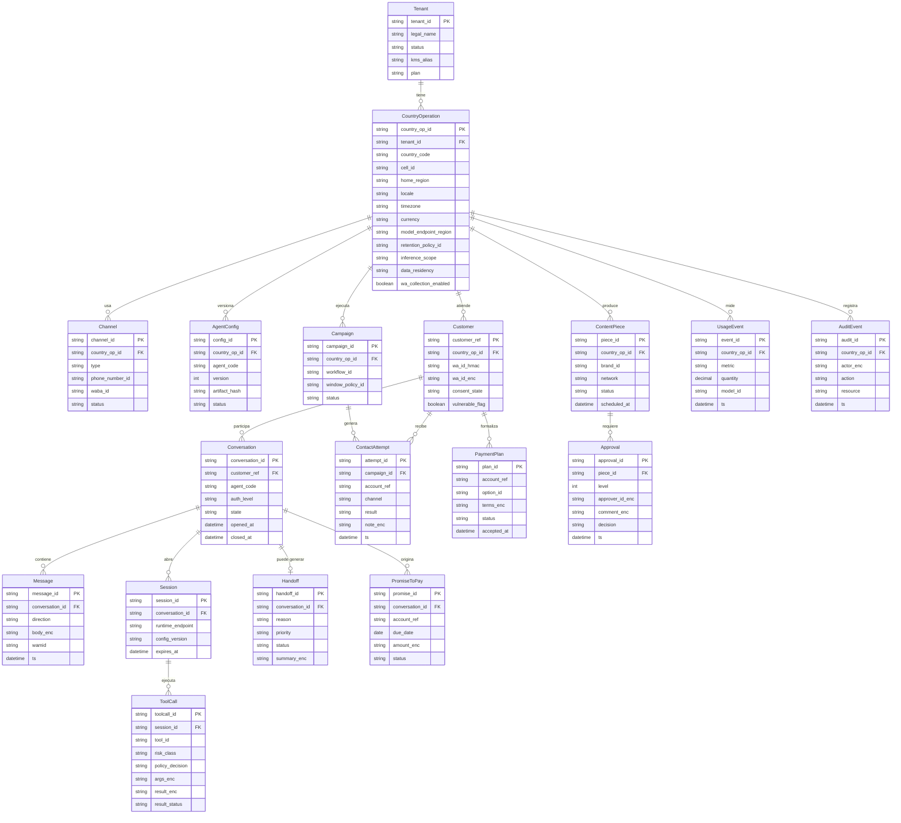

Los campos terminados en `_enc` son cifrados por campo con una clave de datos por tenant, en **todas** las tablas que tienen atributos personales o financieros (`conv`, `coll`, `content`, `ops`, `vault`; clasificación en 2.8.3). `due_date` (clave del GSI de promesas), `account_ref` y `customer_ref` quedan en claro por ser claves o referencias opacas. `account_ref` y `customer_ref` son referencias opacas que entrega el tenant; Sora no guarda el documento de identidad ni el saldo. Las entidades `Tenant`, `CountryOperation`, `Channel` y `AgentConfig` viven en el plano de control; el resto, en la celda. `Campaign` se define en el control y se instancia en la celda.

#### 2.8.2 Datos personales: qué se guarda y qué no (minimización)

| Dato | ¿Se guarda? | Dónde | Protección |
|---|---|---|---|
| Teléfono o `wa_id` | Sí, **cifrado por campo** y con un HMAC por tenant para buscarlo | C-24 (`conv`) | Clave de datos del tenant; el HMAC usa una clave distinta |
| Identificador del cliente (`customer_ref`) | Sí (opaco, lo entrega el tenant) | C-24 | — |
| Nombre, documento, fecha de nacimiento, dirección, email | **No** | Se consultan al core del tenant en cada turno (T-01, T-02) y no se persisten | PII shield: el modelo ve alias |
| Respuesta del usuario a la verificación L1 | **No**: solo el resultado (pasó o falló) y la hora | C-24 (`conv`, sesión) | — |
| Saldos y cuotas | **No** persistentes; aparecen en la transcripción solo cuando el agente los dijo | C-25 (transcripción) | Archivo cifrado con Object Lock |
| Promesas, planes, intentos de contacto (monto, fecha, canal, resultado) | Sí (registro de negocio y evidencia) | C-24 (`coll`) y bitácora en C-25 | Cifrado de tabla; bitácora inmutable |
| Texto de mensajes y resúmenes de handoff | Sí: 90 días en caliente y archivo hasta 5 años (`[S-39]`, `[LEGAL]`) | C-24 y C-25 | Cifrado por campo y por objeto |
| Grabaciones de voz | Sí: 2 años (`[S-39]`, `[LEGAL]`) | C-25 | Compartimento propio; copia desde el satélite |
| Datos de tarjeta | **Nunca** (PCI fuera de alcance) | — | El agente solo entrega links del PSP |
| Biometría y documentos (fase 2, AG-KYC) | No en el MVP | Bucket aislado reservado (`uploads`), Macie, CMK propia | Diseño de WP06 |
| Marca de vulnerabilidad | Solo un indicador (`vulnerable_flag`) sin detalle | C-24 | El detalle queda solo en la transcripción |
| Evidencia de opt-in y opt-out | Sí (fecha, canal, texto) | C-24 y C-25 | Inmutable |
| IP y agente de usuario del web chat | Solo un hash y la IP truncada | C-24 | — |
| Geolocalización | **No** | — | — |

#### 2.8.3 Tablas de DynamoDB (varias tablas, no una sola)

**Decisión (D-WP03-04): seis tablas por ciclo de vida**, en lugar de una tabla única. Razones: (1) cada grupo tiene **retención y TTL distintos** (90 días, 13 meses, indefinido); (2) **bóveda de PII con su propia clave, respaldo y permisos** (la tabla `vault`); (3) los *streams* para archivo solo se activan donde hacen falta; (4) menos riesgo de que un cambio de acceso afecte a todo; (5) el patrón de consulta es por clave, así que la ventaja de una tabla única (consultar entidades relacionadas en una sola llamada) pesa poco. **Costo:** más tablas que mantener, mitigado con constructos del IaC. Todas: modo *on-demand*, PITR de 35 días, protección contra borrado, cifrado con CMK y claves de partición con el prefijo `{tenant_id}#{country_op_id}#` (necesario para `dynamodb:LeadingKeys`). Ninguna consulta usa `Scan`.

| Tabla | Entidades | PK | SK | GSIs | TTL | Streams |
|---|---|---|---|---|---|---|
| `ingress` | Idempotencia de mensajes; caché de directorio | `DEDUP#{wamid}` · `ROUTE#{phone_number_id}` | `-` | — | 7 días (dedup) · 24 h (ruta) | No |
| `conv` | Conversation, Message, Session, ToolCall, Handoff | `{tenant}#{op}#C#{conversation_id}` | `META` · `M#{ts}#{id}` · `S#{session}` · `T#{ts}#{id}` · `H#{id}` | **GSI1** por cliente: PK `{tenant}#{op}#U#{customer_ref}` / SK `{last_activity}#{conv}` (atributos: estado y agente). **GSI2** por teléfono: PK `{tenant}#{op}#P#{wa_id_hmac}` / SK `{last_activity}`. **GSI3** handoffs abiertos: PK `{tenant}#{op}#HO#{status}` / SK `{priority}#{created}` | 90 días (mensajes, sesiones, llamadas) | Sí → Firehose → archivo S3 (antes del TTL) |
| `coll` | Campaign (instancia), ContactAttempt, PromiseToPay, PaymentPlan | `{tenant}#{op}#A#{account_ref}` · `{tenant}#{op}#CMP#{id}` | `CA#{ts}#{id}` · `PTP#{due_date}#{id}` · `PLAN#{id}` · `META` | **GSI1** promesas por vencer: PK `{tenant}#{op}#PTP#{due_date}` / SK `{account_ref}#{id}` | 13 meses (intentos y promesas); los planes, según la política del país | Sí → bitácora S3 (modo cumplimiento) |
| `content` | ContentPiece, Approval | `{tenant}#{op}#B#{brand_id}` | `CP#{piece_id}` · `AP#{piece_id}#{level}#{ts}` | **GSI1**: PK `{tenant}#{op}#CPS#{status}` / SK `{scheduled_at}` | 24 meses | Sí → archivo |
| `ops` | UsageEvent (contadores), presupuestos de tokens, índice de AuditEvent, sesiones de autenticación L1 y L2 | `{tenant}#{op}#USG#{yyyymm}` · `{tenant}#BUD#{model}` · `{tenant}#{op}#AUD#{yyyymmdd}` · `{tenant}#{op}#AUTH#{conversation}` | `{day}#{metric}#{shard}` · `{minute}` · `{ts}#{id}` · `LVL` | — | 10 min (presupuestos) · 30 min (autenticación, configurable) · 13 meses (índice de auditoría) | No |
| `vault` | Bóveda de tokenización de PII | `{tenant}#VAULT#{token}` | `-` | — | Configurable (hasta el cierre de la conversación + 30 días) | No |


**Cifrado de campo por tabla `[_GATE-1 §4.12]`.** Regla: todo atributo personal o financiero se cifra por campo con una clave de datos por tenant y contexto `{tenant_id}`; los atributos cifrados no son clave, GSI ni filtro. Clasificación propuesta (WP06 la confirma `[LEGAL]`):

| Tabla | En claro (claves, estados, tiempos, referencias opacas) | Cifrado por campo con la clave de datos del tenant |
|---|---|---|
| `ingress` | `wamid` (identificador del mensaje), `phone_number_id` del negocio, ruta de directorio | Ninguno (sin atributos personales). Si se guardara un `wa_id` del usuario, iría cifrado |
| `conv` | `conversation_id`, `customer_ref`, `agent_code`, `auth_level`, `state`, `direction`, `ts`, `wa_id_hmac` (clave de GSI2) | `wa_id_enc`, `body_enc` (mensajes), `summary_enc` (handoff), `args_enc` y `result_enc` (herramientas, que contienen montos y fechas), IP truncada del web chat |
| `coll` | `account_ref`, `due_date` (clave del GSI de promesas), `channel`, `status`, códigos de resultado, `plan_id`, `option_id` | `amount_enc` (promesas), `terms_enc` (calendario y condiciones del plan), `note_enc` (notas de gestiones y de disputas) |
| `content` | `brand_id`, `piece_id`, `network`, `status`, `scheduled_at`, nivel de aprobación | `approver_id_enc` y `comment_enc` (datos de operadores del tenant). El texto de las piezas es contenido de marca, no personal, mientras el brief no contenga datos de clientes |
| `ops` | Contadores de uso, presupuestos de tokens, `LVL` de autenticación, `customer_ref` | `actor_enc` y `resource_hint_enc` del índice de auditoría (el evento completo vive en S3) |
| `vault` | `{tenant}#VAULT#{token}` | El valor original de cada token (cifrado completo, con una CMK y permisos propios) |

Los límites de KMS que esto implica (≈235 solicitudes por segundo sin caché de claves de datos en ESC-E, 2.4% de la cuota de `sa-east-1`) están cuantificados en Q-17 (2.9.3).

Los contadores calientes (`USG`) usan *sharding* de sufijo (0 a 9) para evitar particiones calientes. Los eventos de uso crudos y los eventos de auditoría completos van a S3 vía Firehose; DynamoDB solo guarda agregados e índices para la consola. **Archivo antes de TTL:** el stream de `conv` y `coll` escribe en el archivo S3 todo lo que va a expirar; el TTL de DynamoDB puede tardar hasta 48 h en borrar, así que no se usa como control de retención legal.

#### 2.8.4 Layout de S3

| Bucket (por celda y entorno) | Contenido | Prefijo | Retención y bloqueo | Clase |
|---|---|---|---|---|
| `sora-{env}-{cell}-archive` | Transcripciones, bitácora de gestiones, auditoría, grabaciones | `t={tenant_id}/op={country_op_id}/type={transcript\|contact-log\|audit\|voice}/dt={YYYY-MM-DD}/` | Transcripciones: 5 años, Object Lock en modo gobierno. Bitácora de gestiones y auditoría: 5 años, **modo cumplimiento**. Grabaciones: 2 años, modo gobierno. **Todo por país** `[S-39][LEGAL]` | Standard → Standard-IA a los 30 días → Glacier Instant Retrieval a los 90 |
| `...-kb-source` | Documentos fuente de la base de conocimiento | `t=/op=/docs/{doc_id}/v={n}/` | Versionado; mientras la KB esté activa | Standard |
| `...-lake` | Parquet para Athena | `t=/op=/domain={conv\|cobranza\|content\|usage}/dt=` | Según política del país | Standard → IA |
| `...-content-assets` | Imágenes y piezas de AG-CON | `t=/op=/brand=/piece=` | 24 meses | Standard (detrás de CloudFront con OAC) |
| `...-uploads` (reservado, fase 2) | Documentos y selfies de AG-KYC | `t=/op=/session=` | Corta, con borrado automático | Standard (Macie, CMK propia) |
| `sora-{env}-{cell}-vec` (vector bucket) | Índices de S3 Vectors | Un índice por operación: `kb-{tenant}-{country_op}` | Mientras exista la operación | — |
| Plano de control: `...-config-registry`, `...-console-spa` | Paquetes versionados de configuración; estático de la consola | `{tenant}/{op}/{artifact_hash}/` | Versionado; sin datos personales | Standard |

**Derechos sobre datos (W-08):** el borrado por titular se hace por `customer_ref` (GSI1 de `conv` → conversaciones → objetos S3). **Conflicto conocido:** el modo cumplimiento de Object Lock impide borrar antes del vencimiento; por eso solo se usa para registros que no contienen contenido personal (bitácora de gestiones con IDs, auditoría). Las transcripciones usan modo gobierno, con un rol de borrado auditado. Si `[LEGAL]` determina que debe prevalecer el derecho de supresión sobre la retención, se ajusta por país. El **borrado criptográfico por tenant** (eliminar la CMK) es posible en el offboarding de un tenant, no por titular.

### 2.9 Escalabilidad y capacidad por escenario

#### 2.9.1 Supuestos y fórmulas (recalculados post-Gate 1)

La versión 1.0 de esta sección usaba S-20 a S-24 con todo el tráfico en Sonnet y un único pico de 10×. El gate pidió recalcular con la mezcla de modelos canónica y con una sola fórmula de pico `[_GATE-1 §4.4, §4.5, §4.18, §5 S-G1-23]`. Los valores del gate son "no confirmada": son la respuesta por defecto, no una decisión humana.

- **Volúmenes de `13-SUPUESTOS`:** `[S-09]`, `[S-10]` a `[S-14]`, `[S-15]` (voz) y `[S-19]` (handoff). **Forma de la conversación:** `[S-20]` a `[S-24]`, `[S-26]`, `[S-28]`, `[S-29]`, `[S-43]`, con los ajustes de `[_GATE-1 §4.4]`.
- **Dos factores de pico, cada uno con un solo uso `[_GATE-1 §5, S-G1-23]`:** (a) **×5 = `[S-36]` tal como está escrito** (pico horario 2.5× × día de pago 2×) para dimensionar el servicio, el SLO y la **voz**; (b) **×10 = ×5 con una ráfaga de ×2 (`[S-NUEVO-1]` → `S-G1-23`) solo para solicitar cuotas**, rotulado así. `pico/s = volumen mensual ÷ (30 × 86,400) × factor`. Voz: `minutos/mes ÷ 43,200 × 2.5 × 2`, que da **0.58, 4.6 y 28.9** llamadas simultáneas `[_GATE-1 §4.5]` (con ×10: 1.2, 9.3 y 57.9).
- **Conversaciones/mes** = `S-10 + S-14` (ATC + COB con LLM). **Mensajes entrantes** = `ATC × 4 + COB × 5`. **Mensajes salientes** = `ATC × 5 + COB × 6 + S-13`.
- **Mezcla de modelos canónica `[_GATE-1 §4.4]` (reemplaza S-31 y S-32; `S-G1-17`, `S-G1-12`, `S-G1-15`):** AG-ATC: **50% de las conversaciones en Haiku 5.5** (decisión al abrir, solo L0) y 50% en Sonnet 5.5, 8.0 llamadas por conversación (4 × 2.0), 8,000 tokens de entrada y 350 de salida; AG-COB: **`p_prev` = 40% en Haiku 5.5** y 60% en Sonnet 5.5, 12.5 llamadas por conversación (5 × 2.5), 9,500 de entrada y 400 de salida; AG-RTR: Haiku 5.5, 1 llamada por mensaje entrante (1,500 de entrada y **80** de salida); voz de AG-COB: Haiku 5.5, 12 llamadas por llamada de 3.5 min (6,500 y 150); jueces en el 10% de las conversaciones (8,000 y 500); **resúmenes de handoff con S-19 por escenario y 3,000 entradas y 400 salidas** `[_GATE-1 §5, S-G1-36]`; AG-CON: 4 llamadas de Sonnet por pieza (14,000 de entrada y 2,500 de salida en total) y juez en el 100% de las piezas. **Sin batch (P-06 = 0%)**.
- **Tokens de cuota (conservador, `S-G1-39`)** = `entradas totales (prefijo y variable, incluidas las lecturas de caché) + 5 × salidas`. **Sin lecturas de caché** = parte variable + 15% del prefijo (`S-25` = 85%). Si Bedrock no cuenta así a Claude 5.5, la necesidad real es menor `[VERIFICAR]`.
- **MicroVMs concurrentes** = `conversaciones/s × 600 s` (`S-G1-21`: ocupación de 600 s por conversación; sustituye a los 480 s y 3 sesiones de `[S-NUEVO-2]` (`S-G1-21`)); **sesiones nuevas/s** = conversaciones/s (con idle de 300 s). **Concurrencia del orquestador** = `mensajes entrantes/s × 8 s`.
- **Operación mayor** = 30% del volumen (`[S-NUEVO-3]` → `S-G1-36`; en ESC-P hay 1 operación). **Web chat** = 15% de las conversaciones de AG-ATC (`[S-NUEVO-5]` → `S-G1-11`).

#### 2.9.2 Capacidad por escenario

**Tabla A: dimensionamiento del servicio con el pico de `[S-36]` (×5).**

| Métrica | ESC-P | ESC-L | ESC-E | Límite o cuota (fuente) | ¿Holgura en ESC-E? |
|---|---|---|---|---|---|
| Conversaciones al mes (ATC + COB con LLM) | 16,000 | 96,000 | 480,000 | — | — |
| Mensajes entrantes al mes · por segundo en el pico | 70,000 · 0.14 | 420,000 · 0.81 | 2,100,000 · **4.05** | SQS FIFO y Lambda: sobrados. El gate cita **4.05 turnos/s** en ESC-E `[_GATE-1 §4.18]` | Sí |
| Mensajes salientes al mes · por segundo en el pico | 126,000 · 0.24 | 756,000 · 1.5 | 3,780,000 · **7.3** | — | — |
| Eventos de estado de entrega por segundo en el pico (3 por saliente, `S-G1-36`) | 0.7 | 4.4 | **21.9** | SNS → SQS estándar | Sí |
| Mensajes salientes por segundo, operación mayor | 0.07 | 0.44 | **2.2** | 80 mensajes/s por número por defecto `[F30]` | Sí (menos del 3%) |
| Plantillas por día en la operación mayor, **día de pago ×2** (usuarios únicos fuera de ventana, cota superior) | **2,667** | 4,800 | **24,000** | Meta por portafolio: 250 por 24 h al inicio; 2,000 tras verificar el negocio; luego 10 K, 100 K e ilimitado `[F31]`. **El tier de 10,000 es necesario desde ESC-P** `[_GATE-1 §4.18]` | **Condiciona el go-live**: plan de ascenso en Q-12 |
| Llamadas a herramientas por segundo en el pico (ATC 1.0 y COB 1.5 por turno, `S-G1-36`) | 0.2 | 1.0 | 4.9 | AgentCore Gateway: 200 TPS por gateway y por cuenta `[F18]` | Sí |
| **MicroVMs concurrentes de AgentCore** (conversaciones/s × 600 s) · sesiones nuevas por segundo | 19 · 0.03 | 111 · 0.19 | **556 · 0.93** | 2,500 sesiones activas en `sa-east-1` (5,000 en `us-east-1`); 25 TPS de sesiones nuevas; 1,000 TPS de datos `[F18]`. El gate cita 556 sesiones en ESC-E `[_GATE-1 §4.18]` | Sí (22% de la cuota) |
| Concurrencia del orquestador Lambda | 1 | 6 | 32 (unas 65 con las funciones auxiliares) | 1,000 por defecto; las cuentas nuevas empiezan con menos `[F23]` | Sí |
| Eventos de AgentCore Memory por segundo en el pico (2 por turno) | 0.3 | 1.6 | 8.1 | 200 TPS de `CreateEvent` `[F18]` | Sí |
| Unidades de escritura de DynamoDB por segundo en el pico (`S-G1-36`) | 4 | 22 | 108 | On-demand: 40,000 por tabla `[VERIFICAR]` | Sí |
| Ejecuciones de W-01 (Express) por día · inicio máximo si el lote diario se reparte en 15 min | 1,333 · 1.5/s | 8,000 · 8.9/s | 40,000 · 44/s | **Express: 6,000/s de `StartExecution` y transiciones sin límite** `[F24]` (W-01 es Express `[_GATE-1 §4.16]`); Standard (W-02, W-04, W-05): 800 de cubeta y 150/s `[F24]` | Sí |
| Evaluaciones de Guardrails por segundo en el pico (2 por turno, `[S-29]`) | 0.3 | 1.6 | 8.1 | n/d `[VERIFICAR]` | A confirmar |
| Consultas RAG por segundo en el pico | 0.05 | 0.2 | 1.1 | S3 Vectors: sin tope relevante `[F16]` | Sí |
| Conexiones WebSocket concurrentes (15% de ATC, 10 min) | 2 | 10 | 52 | 500 conexiones nuevas/s; 10 min de inactividad `[F22]` | Sí |
| **Llamadas de voz concurrentes (S-36 tal como está escrito)** | **0.58** | **4.6** | **28.9** | Connect: **10 llamadas activas por instancia** por defecto (ajustable); Transcribe: **25 streams** por defecto (ajustable) `[F36][F35]`. Nova Sonic (solo bake-off): 20 sesiones `[F12]` | **No en ESC-E** con los valores por defecto: Q-19 y Q-20 |
| Almacenamiento vectorial (5,000 chunks × 1,024 × 4 B por operación) | 20 MB | 82 MB | 287 MB | 2 mil millones de vectores por índice `[F16]` | Sí |

**Tabla B: dimensionamiento de cuotas de modelo (×10 = ×5 con ráfaga ×2, `S-G1-23`, solo para solicitar cuotas).**

| Métrica | ESC-P | ESC-L | ESC-E | Cuota por defecto (fuente) | ¿Holgura en ESC-E? |
|---|---|---|---|---|---|
| Llamadas a Sonnet 5.5 al mes · en el pico (RPM) | 85,400 · 20 | 511,200 · 118 | 2,554,000 · **591** | RPM por defecto: n/d `[VERIFICAR]` (Sonnet 4.6: 5,000 `[F21]`) | Probable; confirmar |
| **TPM de Sonnet 5.5 en el pico (conservador)** | 0.21 M | 1.26 M | **6.31 M** | **6 M por defecto**, ajustable `[F21]` | **Justo: 105% de la cuota; solicitar 8 M** (Q-04) |
| TPM de Sonnet 5.5 sin lecturas de caché | 0.12 M | 0.71 M | 3.53 M | ídem | Sí (59%) |
| Llamadas a Haiku 5.5 al mes · en el pico (RPM) | 161,542 · 37 | 1,000,722 · 232 | 5,163,142 · **1,195** | RPM n/d `[VERIFICAR]` | Probable |
| **TPM de Haiku 5.5 en el pico (conservador)** | 0.24 M | 1.48 M | **7.65 M** | **10 M por defecto** `[F21]` | Sí, pero al 77%: monitorear y pedir 15 M (Q-06) |
| MicroVMs concurrentes de AgentCore (×10) | 37 | 222 | 1,111 | 2,500 `[F18]` | Sí (44%) |
| Llamadas de voz concurrentes (×10, para cuotas de Connect y Transcribe) | 1.2 | 9.3 | 57.9 | ver Q-19 y Q-20 | No con los valores por defecto |
| Evaluaciones de Guardrails por segundo (×10) | 0.5 | 3.2 | 16.2 | n/d `[VERIFICAR]` | A confirmar |

**Qué cambió frente a la versión 1.0:** el pico de TPM de Sonnet en ESC-E bajó de **11.4 M** (todo el tráfico en Sonnet, 10×) a **6.3 M** (mezcla canónica, 10×); el gate había anticipado "con la mezcla propia llega a ~8.2 M" `[_GATE-1 §4.18]` (esa cifra mezclaba el 60% de turnos de S-31; el recálculo con la mezcla de §4.4 da 6.3 M); las microVMs en ESC-E pasaron de 889 a 556 (×5) o 1,111 (×10, con 600 s en lugar de 480 s); la voz de 57.9 a **28.9** llamadas con el pico de S-36 (57.9 queda como cifra ×10 para cuotas) `[_GATE-1 §4.5]`. Las llamadas a Haiku son más del doble porque ahora incluyen el 50% de ATC, la cobranza preventiva, el Router con 80 tokens de salida y la voz de AG-COB.

**Conclusiones de capacidad:** (1) una sola celda alcanza hasta ESC-E (14 operaciones); (2) los límites que de verdad aprietan son los **niveles de mensajería de Meta** (el tier de 10,000 es necesario ya en ESC-P), la **concurrencia de voz** (10 llamadas por instancia de Connect y 25 streams de Transcribe por defecto) y los **TPM de Sonnet y Haiku** en ESC-E con el pico de cuotas; (3) ni el cómputo (Lambda, AgentCore) ni los datos (DynamoDB, S3) son cuello de botella; (4) el costo sigue al uso (sección 2.1).

#### 2.9.3 Cuotas que hay que solicitar y calendario

Los plazos de AWS para aumentar cuotas varían: en Amazon Connect, de horas a 3 semanas y, para aumentos muy grandes, hasta meses `[F36]`. Se piden con anticipación. Sin plan de soporte de pago, las solicitudes de Bedrock pueden tardar más `[PREGUNTA-ABIERTA]` P-07.

| # | Cuota (servicio, cuenta y región) | Valor por defecto (fuente) | Valor a solicitar | Cuándo | Escenario que lo exige |
|---|---|---|---|---|---|
| Q-01 | Organización: número de cuentas | Bajo en organizaciones nuevas `[VERIFICAR]` | 30 | Día 1 | MVP (más de 12 cuentas) |
| Q-02 | Lambda: ejecuciones concurrentes (cuenta de celda de producción) | 1,000; reducido en cuentas nuevas `[F23]` | Confirmar 1,000 y luego 3,000 | Al crear la cuenta; 3,000 al inicio de ESC-L | ESC-P y ESC-L |
| Q-03 | EC2: direcciones IP elásticas por región | 5 `[VERIFICAR]` | 15 | Al crear la cuenta de producción | MVP (3 de NAT de prod, staging, dev, premium) |
| Q-04 | Bedrock: TPM de **Sonnet 5.5** con perfil `us.` desde `us-east-1` | 6,000,000 `[F21]` | **8,000,000** (recalculado; la versión 1.0 pedía 12 M) y RPM `[VERIFICAR]` | Pedir cuando el uso sostenido llegue al 60% (aprox. mes 8) | ESC-E (6.3 M ×10) |
| Q-05 | Bedrock: TPM de Sonnet 5.5 con perfil `global.` desde `sa-east-1` (fallback) | 6,000,000 `[F21]` | Mantener; verificar que esté activa | Al crear la cuenta | Resiliencia (ruta R2) |
| Q-06 | Bedrock: TPM de Haiku 5.5 y Opus 5.5 | 10 M y 30 M `[F21]` | Haiku: 15 M si el pico ×10 se confirma; Opus: sin cambio | Revisar al inicio de ESC-E | ESC-E (Haiku 7.65 M) |
| Q-07 | Bedrock Guardrails: solicitudes y unidades de texto por segundo | n/d `[VERIFICAR]` | Al menos 50 solicitudes/s | Al inicio de ESC-L | ESC-E (16/s con ×10) |
| Q-08 | AgentCore Runtime: sesiones activas en `sa-east-1` | 2,500 `[F18]` | Sin cambio (hasta 1,500 de uso); luego 5,000 | Revisar en ESC-L | ESC-E (556 a 1,111) |
| Q-09 | AgentCore Identity: proveedores de credenciales OAuth2 y de API key | 50 de cada tipo `[F18]` | 150 | Inicio de ESC-L | 10 tenants × 3 sistemas |
| Q-10 | AgentCore Memory: recursos por región | 150 `[F18]` | Sin cambio | — | Hasta 14 operaciones por entorno |
| Q-11 | End User Messaging Social: WABA por región | 25 `[F9]` | 50 | Inicio de ESC-L | Producción + números de prueba |
| Q-12 | Meta: verificación del negocio y escalado de nivel de mensajería por tenant | 250 usuarios únicos por 24 h al inicio `[F31]` | Verificar el negocio y pasar a 2,000 el día 1; subir a **10,000** en las semanas 2 y 3 con calidad alta; **no usar más del 80% del límite** `[_GATE-1 §4.18]` | **4 semanas antes del go-live de cada tenant** | ESC-P (2,667 contactos únicos por día en el pico) |
| Q-13 | Step Functions: `StartExecution` Standard en `sa-east-1` | 800 de cubeta y 150/s `[F24]` | Sin cambio: W-01 es Express (6,000/s) | — | Solo W-02, W-04 y W-05 usan Standard |
| Q-14 | Nova 2.5 Sonic: sesiones bidireccionales por cuenta y región | 20 `[F12]` | **Ya no necesaria** con el motor base (Connect + Transcribe + Haiku + Polly); el bake-off usa menos de 20 `[_GATE-1 §4.18]` | — | Solo el reto del bake-off |
| Q-15 | Amazon Connect: números de teléfono por instancia | 10 (ajustable) `[F36]` | Según los países del piloto (MX primero) y los DID por país `[VERIFICAR]` | Al decidir voz | Fase 1.5 |
| Q-16 | API Gateway `mx-central-1` (celda B): tasa de solicitudes | 2,500 RPS `[F22]` | 10,000 | Al construir la celda B | Celda B |
| Q-17 | **KMS: tasa de solicitudes de operaciones simétricas y asimétricas en `sa-east-1`** | **10,000/s compartidas** (simétricas); **1,000/s compartidas** (ECC y RSA); `us-east-1`: 100,000/s `[F37]` | **Sin aumento**; alarma al 60% y caché de claves de datos | Monitorear desde el piloto | ESC-E: unos 235 por segundo sin caché de claves de datos (2.4% de la cuota), unas 40 con caché; firma ECC unos 10 por segundo (1%). Cálculo abajo |
| Q-18 | Plan de soporte de AWS | — | Business o superior; Enterprise para ESC-L | MVP | Tiempo de respuesta de cuotas e incidentes |
| **Q-19** | **Amazon Connect: llamadas activas concurrentes por instancia y llamadas concurrentes de campañas salientes** | **10** llamadas activas; **0** llamadas concurrentes de campañas `[F36]` (ajustable) | **≥ 15** en ESC-L (4.6 con ×5, 9.3 con ×10) y **≥ 60** en ESC-E (28.9 con ×5, 57.9 con ×10); campañas salientes > 0 solo para MX y BR `[F10]` | Pedir 3 semanas antes del bake-off (los aumentos grandes tardan) | Fase 1.5 y ESC-L en adelante |
| **Q-20** | **Transcribe streaming: streams concurrentes y TPS de inicio, en `us-east-1`** | **25** streams concurrentes y **25** TPS `[F35]` (ajustable) | **100** streams (cubre 57.9 con ×10 más margen) | Antes de ESC-E | ESC-E (28.9 a 57.9) |
| **Q-21** | **Polly y Haiku para voz** | Polly: n/d `[VERIFICAR]`; Haiku: dentro de Q-06 | Confirmar las solicitudes concurrentes de Polly para 58 llamadas | Con el bake-off | ESC-E |

**Límites de KMS (Q-17), cuantificados.** Fuente de cuotas: `[F37]`; las cuotas son por cuenta y región, aplican también a las solicitudes que hacen otros servicios en nuestro nombre (S3, Secrets Manager, DynamoDB) y son ajustables. `sa-east-1` y `mx-central-1` no figuran entre las regiones con 20,000 o 100,000 por segundo, por lo que les corresponde el valor general de **10,000 por segundo** para operaciones simétricas (incluidas las de HMAC), **1,000 por segundo** para ECC y 1,000 para RSA. Demanda en ESC-E con el pico de cuotas (×10), cifrando por campo **todos los atributos personales y financieros de todas las tablas** `[_GATE-1 §4.12]`:

| Origen de las solicitudes a KMS | Fórmula | Sin caché de claves de datos | Con caché (Encryption SDK) |
|---|---|---|---|
| Cifrar al escribir (`GenerateDataKey`) | ítems/s (54.2) × 2 campos cifrados por ítem | 108/s | 10/s o menos (una clave de datos por tenant, reutilizada por 5 min o 1,000 mensajes) |
| Descifrar al leer historial (`Decrypt`) | turnos/s (8.1) × 10 mensajes leídos por turno | 81/s | 10/s o menos |
| `wa_id_hmac` (`GenerateMac`) | mensajes entrantes/s | 8/s | 8/s |
| Firma del Context Token y de `policy_decision_id` (ECC `Sign`) | turnos/s (8.1) + decisiones de política (unas 2/s) | 10/s (cuota ECC de 1,000/s) | 10/s |
| SSE-KMS de S3, Secrets Manager y servicios en nuestro nombre | archivo (unos 5/s con *bucket keys*), secretos (unos 10/s sin caché), otros | 25/s | 5/s |
| **Total simétrico** | | **unos 235/s (2.4% de 10,000)** | **unos 40/s (0.4%)** |

Con ×5 la demanda se divide por la mitad. **Conclusión:** KMS no limita hasta ESC-E; se recomienda el caché de claves de datos para bajar latencia y costo, y una alarma al 60% de la cuota. **Costos de KMS** `[_GATE-1 §4.12 punto 7]`: 2 CMK por tenant y celda (`datos` y `secretos`) más 3 por celda (firma de decisiones, auditoría, logs de organización): en ESC-E, con 10 tenants y 1 celda, unas **23 claves** en producción, más dev y staging; precio por clave y por solicitud `[VERIFICAR]` (referencia de WP03: unos 0.03 USD por 10,000 solicitudes). Las cuotas de recursos de KMS (claves y alias por región) no se leyeron `[VERIFICAR]`; 23 claves no deberían acercarse a ellas.

### 2.10 Resiliencia y continuidad

#### 2.10.1 Flujo principal con servicios AWS concretos y puntos de falla

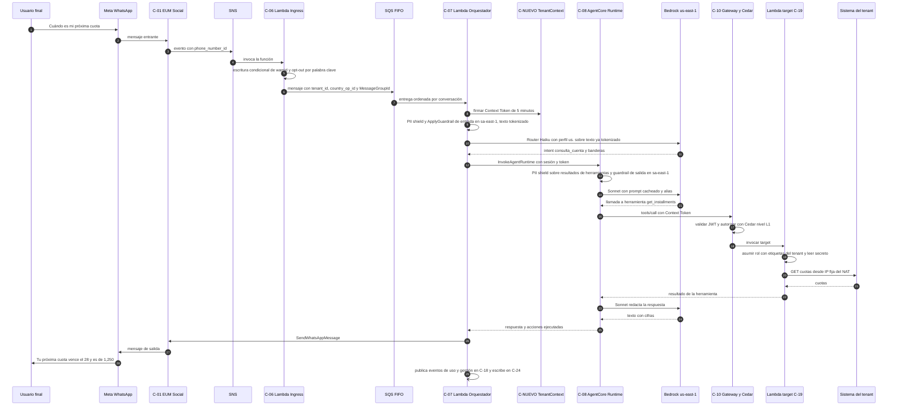

Puntos de falla y control (números de paso del diagrama): (4 a 7) si el mensaje no llega a la cola, la escritura condicional evita duplicados y la DLQ retiene lo que falle; (9) el PII shield tokeniza antes de cualquier llamada al modelo, incluido el Router; (10 y 11) si el Router falla, una regla determinista envía a AG-ATC o a handoff; (14 y 23) el *throttling* del modelo activa los reintentos y los fallbacks de 2.10.5; (16 a 22) cada herramienta tiene *timeout* y *circuit breaker*; (26) el envío usa reintentos con retroceso y DLQ.

#### 2.10.2 SLOs

| SLO | Objetivo | Fuente | Cómo se mide |
|---|---|---|---|
| Disponibilidad del servicio | **99.5% mensual** en MVP (unos 216 min de indisponibilidad al mes); 99.9% en ESC-E (aprox. 43 min); **la pérdida de una región queda excluida** `[_GATE-1 §4.13]` | `[S-37]` | Conversación sintética por operación cada minuto (de punta a punta, con número de prueba) y ratio de mensajes entrantes con respuesta (normal o degradada) |
| Primera respuesta por WhatsApp, p90 | **Objetivo ≤ 6 s**; **alarma y rollback automático a > 8 s** | `[S-38]`, `[_GATE-1 §2 #20]` | Diferencia entre el evento de entrada y el envío; ver el presupuesto de 2.7.2 (el peor caso estimado, 7 a 8 s, supera el objetivo) |
| Primer token en web chat, p90 | ≤ 1.5 s | `[S-38]` | Medición en el cliente del widget |
| Router, p90 | ≤ 0.8 s | `[S-38]` | Traza de C-07 |
| Voz, respuesta por turno, p90 | ≤ 1.5 s (meta de la fase 2); **≤ 2.0 s como criterio de salida de la fase 1.5** (relajación declarada) | `[S-38]`, `[_GATE-1 §4.5]` | Medición del puente de voz |
| Fugas entre tenants | 0 | `12 §9` | IT-01 a IT-15 y alarmas |

**Disponibilidad compuesta (ilustración, no SLAs verificados):** `A_total = Π A_i`. Si seis dependencias en serie (EUM Social, Lambda y colas, AgentCore, Bedrock, la API del tenant y DynamoDB) tuvieran cada una 99.9%, el producto sería `0.999^6 = 99.40%`, **por debajo del 99.5%**. De ahí el diseño: redundancia en la ruta del modelo (dos reservas de cuota: `us.` y `global.`, y Sonnet → Haiku), desacoplamiento por colas y modo "solo handoff", y estabilidad estática del plano de control. Los SLA vigentes de cada servicio deben revisarse `[VERIFICAR]`.

#### 2.10.3 RPO y RTO por componente

| Componente | Multi-AZ | Respaldo | RPO | RTO (pérdida de AZ) | RTO (corrupción o borrado lógico) |
|---|---|---|---|---|---|
| DynamoDB (C-24) | Sí (nativo) | PITR 35 días + AWS Backup diario en la región | **≤ 15 min** (PITR) `[_GATE-1 §4.13]` | 0 | ≤ 4 h (restauración a tabla nueva) |
| S3 (C-25, KB, lago) | Sí (nativo) | Versionado + Object Lock (archivo) | 0 | 0 | ≤ 1 h (restaurar versión) |
| S3 Vectors (C-14) | Sí `[VERIFICAR]` | Fuente en S3: **reindexar** desde `kb-source` | n/a (se reconstruye) | 0 | ≤ 4 h (W-06) |
| AgentCore Runtime, Gateway, Policy, Identity (C-08, C-10, C-11, C-13) | Gestionado `[VERIFICAR SLA]`; subnets en 3 AZ | IaC + imágenes en ECR | n/a (sin estado) | ≈ 0 | ≤ 1 h (redespliegue por IaC) |
| AgentCore Memory (C-09) | Gestionado | El contexto se puede reconstruir desde `conv` | Pérdida de contexto, no de datos | 0 | ≤ 1 h |
| Step Functions y Scheduler (C-16, C-17) | Gestionado | Definiciones en IaC; el estado de negocio vive en `coll` | 0 | 0 | ≤ 2 h; **conciliación** de promesas y contactos pendientes desde `coll` |
| Colas y eventos (SQS, SNS, EventBridge) | Sí | DLQ con retención de 14 días | Mensajes en vuelo: 0 con DLQ | 0 | ≤ 1 h (redrive) |
| KMS y Secrets Manager (C-11, C-30) | Sí | Borrado con espera de 30 días; copias de secretos solo si `[LEGAL]` permite otra región | 0 | 0 | ≤ 2 h (restaurar secreto); **la pérdida de una CMK es pérdida de datos** (SCP 7) |
| Registro de configuración y prompts (C-32) | Sí | S3 versionado + Git | 0 | 0 | ≤ 15 min (puntero a versión anterior) |
| **Celda completa (pérdida de la región `sa-east-1`)** | — | Ver 2.10.4 | **Sin copias fuera de la región: la historia se pierde hasta que la región vuelve.** Con copias cifradas autorizadas por `[LEGAL]`: ≤ 24 h (restauración diaria entre regiones) | **RTO ≤ 24 h** para reanudar el servicio en otra región (`us-east-1` sin WABA, o `mx-central-1` cuando exista la celda B) `[_GATE-1 §4.13]` (`S-G1-26`; antes `[S-NUEVO-13]`). **Excluida del SLO de 99.5%** | — |
| **Todos los componentes (valor único)** | — | — | **≤ 15 min** | **≤ 4 h** por componente (AZ, componente o corrupción) | Restauración de datos **trimestral** y ensayo de celda completa **semestral** `[_GATE-1 §4.13]` |

#### 2.10.4 Estrategia de DR: *backup and restore* con reaprovisionamiento de una celda vacía

Valores canónicos: **RPO ≤ 15 min; RTO ≤ 4 h por componente y ≤ 24 h si se pierde la celda completa** `[_GATE-1 §4.13]` (no son decisiones humanas confirmadas: son la respuesta por defecto del gate). El RTO de 8 h de la versión 1.0 **no estaba sustentado**: el WABA de una operación queda ligado a la región de su celda (no hay WhatsApp en `us-east-1` hasta volver a vincularlo `[VERIFICAR]`), `mx-central-1` no tiene AgentCore y construir la celda B toma de 6 a 10 semanas (`S-G1-38`). Se descartan *pilot light* y *warm standby* para el MVP. Justificación: (1) **residencia**: replicar datos personales a otra región es una transferencia que `[LEGAL]` aún no ha aprobado; (2) el SLO del MVP es 99.5%, con un cliente de diseño, y la pérdida total de una región de AWS es un evento raro; (3) **el estado de negocio crítico (saldos, promesas, planes) vive también en los sistemas del tenant** (T-08 y T-09 escriben en el core del tenant) y las campañas se pueden regenerar desde Sora Core, de modo que una celda vacía puede **reanudar el servicio** aun sin historial; (4) el costo de una celda en espera sería, como mínimo, el de los endpoints y NAT por hora.

Plan: (a) los respaldos de AWS Backup quedan en una *vault* de la misma región con *vault lock*; (b) el IaC (CDK) puede crear la celda en la región de DR autorizada (`us-east-1`, sin WABA, o `mx-central-1` cuando exista la celda B con runtime alterno; se pre-aprueba en el SCP y se mantiene como destino de ensayo) dentro del RTO de 24 h; los WABA se vuelven a vincular a la región de DR y el tráfico saliente de WhatsApp queda degradado hasta entonces (SMS de respaldo, C-04); (c) **solo si `[LEGAL]` autoriza** se copian a la región de DR los respaldos cifrados de la celda (con claves multi-región); (d) un **ensayo de DR semestral** con una celda vacía en staging mide el RTO real y una **restauración de datos trimestral** verifica los respaldos `[_GATE-1 §4.13]`. **Riesgo aceptado y registrado (R-WP03-10):** una caída de `sa-east-1` implica un servicio degradado hasta reaprovisionar (≤ 24 h) y queda **fuera del SLO**. Se re-evalúa al llegar a ESC-L (con la celda B como candidata a *warm standby* para tenants no regulados).

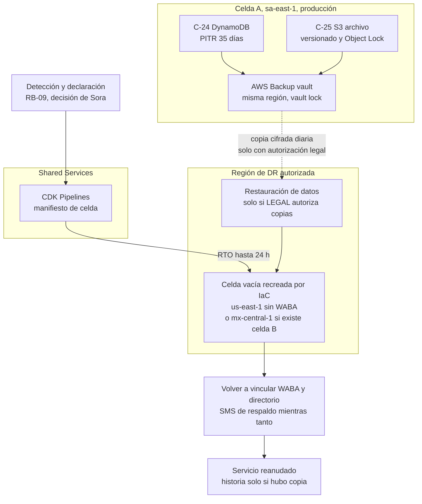

El diagrama resume 2.10.4: sin copias autorizadas, la celda de DR nace vacía y reanuda el servicio dentro del RTO de 24 h; con copias, se restauran los datos desde la copia cifrada. El RTO de 4 h aplica a fallas de AZ, de componente o de datos dentro de la región (PITR y AWS Backup en la misma región).

#### 2.10.5 Degradación elegante

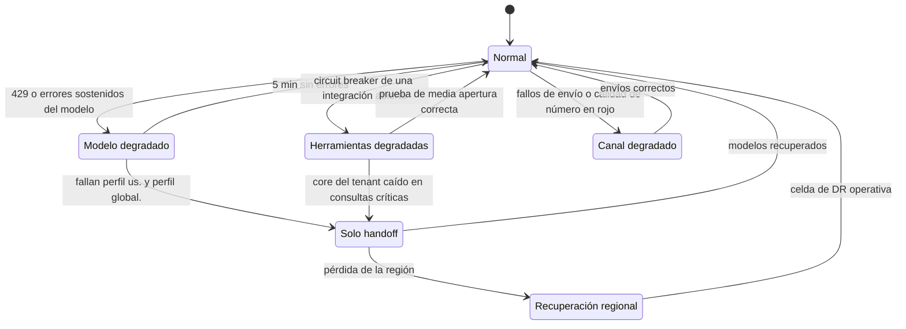

| Falla | Detección | Comportamiento hacia el usuario | Comportamiento del sistema | Recuperación |
|---|---|---|---|---|
| *Throttling* (HTTP 429) del modelo principal | Alarma de tasa de 429 | Sin cambio perceptible | Reintentos acotados con jitter; **Sonnet → Haiku** para turnos simples; luego ruta R2 (`global.`) con su propia reserva de cuota; se pausan evals y generación de contenido | Automática |
| Caída o degradación del modelo o de `us-east-1` | Circuit breaker del cliente de modelo | Posible demora | Ruta R2 desde `sa-east-1`; si fallan ambas, **modo solo handoff** con mensaje fijo ("Estoy teniendo problemas técnicos, una persona te contactará") | Automática |
| `stop_reason: refusal` | Respuesta del modelo | Mensaje de derivación | Reintento con el modelo de respaldo (Sonnet 5 admite el crédito de refusal `[F2]`); si falla, handoff | Automática |
| AgentCore Runtime con latencia alta o error | Timeout del orquestador (20 s) | Aviso de demora | Un reintento con una sesión nueva; si falla, handoff | Redespliegue por IaC (RB-07) |
| API del tenant caída o lenta | Circuit breaker por herramienta (abre al 50% de errores en 30 s) | El agente informa que no puede consultar y ofrece handoff o recontacto (T-17) | Las escrituras de bajo impacto (T-09, T-16) se guardan como `pendiente_de_sync` y se concilian (idempotentes); **las escrituras de alto impacto nunca se encolan en silencio** | Automática al cerrar el breaker |
| Sora Core (Collect) caído | Timeout de C-20 | Ninguno (la cobranza es saliente) | W-01 usa la última *next-best-action* en caché (≤ 24 h); si no hay, **solo recordatorios preventivos** con la política por defecto y pausa de la mora media; **nunca** se inventan ofertas (`[ADR-04]`) | Automática |
| Envío de WhatsApp falla | Código de error de EUM Social | Ninguno o demora | Reintentos con retroceso y DLQ; para avisos críticos con opt-in vigente, SMS de respaldo (C-04) | Redrive |
| Calidad del número en rojo o bloqueo (R-04) | Webhook de calidad y de límites de Meta | Ninguno | Pausa automática de campañas del número; número de respaldo | Manual con WP05 |
| Base de conocimiento no disponible | Error de T-13 | El agente solo responde con lo que sí sabe y ofrece una persona | FAQ estática en caché para las preguntas más frecuentes (WP04 define cuáles) | Reindexar (W-06) |
| Caída de la consola o de su API | Alarma | Ninguno (los usuarios finales no dependen de ella) | Handoffs urgentes por webhook o email al tenant | Redespliegue |
| Plano de control caído | Alarma | Ninguno | Las celdas siguen con el directorio y la configuración en caché (24 h); sin altas ni despliegues | Restaurar el control |
| Pérdida de una AZ | Health checks | Ninguno | Ya hay 3 AZ y un NAT por AZ | Automática |
| Pérdida de la región | Alarma externa y estado de AWS | Servicio degradado | Plan de 2.10.4 | RB-09 |

**Orden de *load shedding* ante saturación:** 1) evals y jueces en línea, 2) generación de contenido, 3) W-01 saliente de mora media, 4) W-01 preventiva, 5) conversaciones entrantes. Las urgencias (fraude, vulnerabilidad, opt-out) nunca se descartan.

#### 2.10.6 Runbooks mínimos (se entregan antes del piloto, con WP11)

| ID | Escenario | Severidad | Primeras acciones |
|---|---|---|---|
| RB-01 | Throttling o falta de cuota de Bedrock | Sev-2 | Activar la mezcla Haiku, pausar clases bajas, abrir aumento de cuota, mover tráfico a R2 |
| RB-02 | Falla de modelo o de región de inferencia | Sev-1 | Confirmar circuit breaker, ruta R2, comunicar a tenants, solo handoff si falla todo |
| RB-03 | Integración del tenant caída | Sev-2 | Verificar breaker, avisar al tenant, activar conciliación |
| RB-04 | Backlog de SQS o mensajes en DLQ | Sev-2 | Revisar consumidor, *redrive* seguro e idempotente |
| RB-05 | Calidad de WhatsApp en rojo | Sev-2 | Pausar campañas, revisar plantillas y opt-ins, número de respaldo |
| RB-06 | Sospecha de fuga entre tenants | **Sev-0** | Aislar el componente, preservar evidencia, notificar a Seguridad, Legal y al tenant según DPA `[LEGAL]` |
| RB-07 | Regresión de un agente en *canary* o en producción | Sev-2 | Mover el alias `canary` a la versión estable, congelar promociones |
| RB-08 | Pérdida de una AZ | Sev-3 | Verificar capacidad y NAT; sin acción si todo está en verde |
| RB-09 | Pérdida de región o DR | Sev-1 | Declarar DR, desplegar celda vacía, comunicar, restaurar datos solo con autorización legal |
| RB-10 | Credencial del tenant comprometida o rotación | Sev-2 | Revocar secreto, rotar, auditar usos |
| RB-11 | Costo anómalo por tenant (bucle de herramientas) | Sev-3 | Aplicar tope de turnos y presupuesto, revisar trazas |

### 2.11 Entornos, CI/CD y despliegue

#### 2.11.1 Entornos

| Entorno | Cuentas | Propósito | Datos | Modelos y canales |
|---|---|---|---|---|
| `dev` | `agents-dev-control`, `agents-dev-cell-sa1` (más cuentas individuales de sandbox) | Desarrollo y **stack efímero por PR** | Sintéticos con canarios; sin PII real | Modelos reales con cuota baja; números de prueba de Meta |
| `staging` | `agents-staging-control`, `agents-staging-cell-sa1` | Integración, evals, carga, ensayos de DR; **sandbox por tenant** | Sintéticos o del sandbox del tenant (`[S-40]`) | Idéntico a prod; WABA de prueba |
| `prod` | `agents-prod-control`, `agents-prod-cell-sa1` | Operación | Reales | Reales |
| **Sandbox por tenant** (`[S-40]`) | Lógico: una **operación de país `sandbox`** del tenant alojada en la celda de staging, con sus propios datos, claves y Gateway | Onboarding: el tenant prueba contra su API de sandbox antes de producción | Del sandbox del tenant | Número de prueba |

#### 2.11.2 Pipelines

```mermaid
flowchart LR
  A["Commit o PR"] --> B["G1 Estático<br/>lint, tipos, cdk-nag, secretos"]
  B --> C["G2 Pruebas unitarias<br/>y de contrato"]
  C --> D["Build<br/>CodeBuild, imagen a ECR<br/>escaneo y SBOM"]
  D --> E["Despliegue a dev<br/>stack efímero"]
  E --> F["G3 Aislamiento<br/>IT-01 a IT-16"]
  F --> G["G4 Evals offline<br/>C-29, umbrales de WP07"]
  G --> H["Despliegue a staging"]
  H --> I["G5 Regresión, carga<br/>y presupuesto de tokens"]
  I --> J{"G6 Aprobación<br/>de producción"}
  J -->|"aprobado"| K["Canary prod<br/>sandbox y tenant interno"]
  K --> L["Tenant de diseño 10 por ciento<br/>luego 50 y 100"]
  L --> M{"G7 Alarmas y SLO<br/>durante el canary"}
  M -->|"falla"| N["Rollback automático<br/>alias o versión de config"]
  M -->|"pasa"| O["Promoción completa"]
  G -->|"no cumple"| P["Bloqueo y reporte"]
  F -->|"no cumple"| P
```

| Pipeline | Qué despliega | Disparador | Gates | Estrategia de despliegue y rollback |
|---|---|---|---|---|
| **P1 Infraestructura** | Stacks de CDK por capa y por celda | PR a `main` en `infra/` | G1, `cdk diff` revisado, IT-16, simulación de SCP | CDK Pipelines por cuenta (dev → staging → prod); aprobación manual en prod; rollback automático de CloudFormation; protección de terminación en recursos con datos |
| **P2 Servicios** | Lambdas, targets, API de consola, SPA | PR en `services/` | G1, G2, G3, G5 | Alias de Lambda con despliegue gradual de CodeDeploy (10% cada 5 min con alarmas); SPA con invalidación de CloudFront |
| **P3 Agentes** | Imagen del agente → **versión inmutable** de AgentCore Runtime | PR en `agents/` o cambio de modelo | G1 a G5 (incluye **G4 evals**) | Endpoints `stable` y `canary` por agente; el enrutamiento por tenant y por porcentaje (hash de `conversation_id`) se define en el directorio y AppConfig; *rollback* = mover el alias (segundos) |
| **P4 Configuración y prompts (C-32)** | Paquetes versionados de prompts, políticas, plantillas, reglas por país | PR en `configs/` o cambio desde la consola | G1 (esquema), **G4 evals** (el cambio de prompt es un cambio de comportamiento), revisión de cumplimiento para reglas por país `[LEGAL]` | Paquete inmutable con hash; AppConfig con despliegue gradual por tenant, *feature flags* con contexto `tenant_id` y reversión por alarma; rollback = cambiar el puntero |
| **P5 Bases de conocimiento** | Documentos, índices y KBs | Cambio de contenido (W-06) | Validación de formato y de PII, evaluación de recuperación (WP07), prueba del canario IT-06 | Reindexación a un índice nuevo y cambio de alias; el anterior se retiene 7 días |

**Gates (resumen):** G3 bloquea ante cualquier falla de aislamiento; G4 aplica los **umbrales de WP07** (calidad, grounding, políticas, seguridad); G5 incluye una **regresión de costo** (tokens por conversación dentro de +10% del campeón, `[S-22]` a `[S-25]`); G7 usa alarmas de tasa de errores, de handoff, de violaciones de política (0 de severidad alta, `12 §9`), de latencia p90 y de costo por conversación. **Los cambios de modelo (por ejemplo, de Sonnet 5.5 a una versión nueva) siguen el mismo camino que un cambio de prompt.**

**Herramientas:** CDK Pipelines (CodePipeline y CodeBuild en `sora-shared-services`, `sa-east-1` Sí†; no existen en `mx-central-1`† pero no hace falta) alineado con la ADR-01. Si el equipo ya usa GitHub, se puede usar GitHub Actions con roles OIDC (sin claves estáticas) sin cambiar los gates `[PREGUNTA-ABIERTA]` P-06. Las evals corren en un entorno efímero para no tocar datos reales.

### 2.12 IaC

**Confirmación de `[ADR-09]`: AWS CDK en TypeScript.** Razones: (1) el equipo de consola ya usa TypeScript (`[ADR-10]`); (2) constructos reutilizables para el patrón *una operación = un conjunto de recursos* (clave, Gateway, KB, Memory, secretos, log group, roles); (3) CDK Pipelines integra el despliegue entre cuentas; (4) `cdk-nag` aplica reglas de seguridad como código. **Riesgo:** la cobertura de CloudFormation y CDK para los recursos más nuevos de AgentCore y de S3 Vectors puede ir por detrás `[VERIFICAR]`; mitigación: *custom resources* con el SDK de Python y pruebas de contrato. **Alternativa considerada: Terraform**: cobertura de proveedor a veces más rápida y portable, pero introduce un segundo lenguaje y no aporta a la estructura de celdas; se mantiene como plan B si el spike S2 detecta carencias bloqueantes.

**Estructura de repositorios** (monorepo `sora-agents-platform` más un repositorio de tenants):

| Ruta | Contenido |
|---|---|
| `infra/` | App de CDK. Stacks por capa: `foundation` (KMS, roles base, logging), `network`, `data`, `security`, `agents-platform` (Runtime, Gateway, Memory, Policy), `channels`, `workflows`, `console`, `observability`, `metering` |
| `infra/constructs/` | `CellFoundation`, `TenantKeys`, **`TenantOperation`** (por operación de país), `AgentRuntime`, `ChannelWhatsApp`, `WorkflowW01..W08`, `ConsoleApi`, `ControlPlane` |
| `cells/` | Un manifiesto por celda y entorno (`sa1-prod.yaml`): cuenta, región, IDs de AZ, CIDR, endpoints de modelo, cuotas conocidas, banderas |
| `services/` | Lambdas, targets del Gateway, API de consola (Python) |
| `agents/` | Código de los agentes y su librería común (`sora-tenant-context`, C-15) (Python) |
| `configs/` | Prompts, políticas Cedar, plantillas, reglas por país, catálogo de herramientas (versionados, con esquema) |
| `kb/` | Esquemas de ingesta y utilidades de W-06 |
| `console/` | SPA React (TypeScript) |
| `tests/isolation`, `tests/evals-harness`, `tests/load` | Pruebas IT-xx, harness de evals, carga |
| `sora-tenants` (repo aparte) | Un manifiesto YAML por tenant y operación (país, idioma, celda, límites, integraciones). **Sin secretos y sin PII.** El alta (W-07) abre un PR y el pipeline crea el `TenantOperation` |

**Configuración por celda y entorno:** el manifiesto de `cells/` alimenta el CDK; los valores se resuelven en tiempo de síntesis. Los parámetros entre stacks usan exports de CloudFormation o SSM. **Agregar una celda = agregar un manifiesto y un destino de pipeline**, sin tocar los constructos. **Convenciones:** `Sora-{env}-{cell}-{layer}` para stacks; etiquetas obligatorias de 2.4.3; *drift detection* nocturna con Config. **Secretos:** nunca en el repositorio ni en `cdk.context.json`; los pipelines usan roles temporales. **Bootstrap:** `cdk bootstrap` por cuenta y región, con la política de permisos mínima y confianza solo desde `sora-shared-services`.

### 2.13 Seguridad de la arquitectura (resumen)

| Control | Dónde vive | Cómo lo soporta la arquitectura | Detalle |
|---|---|---|---|
| Cifrado en tránsito | Todos los saltos | TLS 1.2 como mínimo (Bedrock lo exige y recomienda 1.3 `[F34]`); TLS mutuo hacia Sora Core | WP06 |
| Cifrado en reposo | DynamoDB, S3, Memory, S3 Vectors, Secrets, logs | CMK por tenant; cifrado de sobre por campo; SSE-KMS por objeto | WP06 |
| Gestión de claves | C-30 | Aliases `alias/tenant/{id}-data` y `-secrets`; rotación; SCP 7; separación de funciones (quien administra claves no las usa) | WP06 |
| Identidad humana | IAM Identity Center, Cognito | Sin usuarios IAM, MFA, elevación temporal, SSO de operadores con IdP del tenant | WP06, WP11 |
| Identidad de carga | AgentCore Identity, roles con etiquetas | Context Token, TVM, mínimo privilegio por herramienta | WP06 |
| Autorización de herramientas | C-10, C-13 | Gateway + Cedar + reglas deterministas (`[ADR-04]`) | WP04 |
| Red | C-30 | VPC privada, endpoints, SG, DNS Firewall, WAF y Shield, NAT con IP fija, sin endpoint público para WhatsApp | WP06 |
| Detección y respuesta | C-30, C-28 | GuardDuty, Security Hub, Config, Inspector, Access Analyzer, Macie `[VERIFICAR]`, CloudTrail organizacional, Flow Logs, runbooks RB-06 | WP06 |
| Auditoría inmutable | C-25 | Object Lock; `AuditEvent` y bitácora de gestiones | WP06 |
| Protección de datos | C-12, C-24 | PII shield, minimización (2.8.2), retención por país, borrado por titular (W-08) | WP06 |
| Seguridad de la IA | C-08, C-10, C-12, C-13 | Separación de instrucciones y datos, herramientas con mínimo privilegio, validación determinista, Guardrails, pruebas adversariales en G4 (R-02) | WP04, WP06, WP07 |
| Aislamiento entre tenants | Transversal | 2.6; IT-01 a IT-16 como gate | WP06 |
| Cadena de suministro | P1 a P3 | Imágenes mínimas, escaneo en ECR, SBOM, firma de artefactos `[VERIFICAR herramienta]`, dependencias fijadas y revisadas | WP06 |
| Privacidad con el proveedor de modelos | Bedrock | Los proveedores de modelos no acceden a los registros ni a los prompts, que quedan en cuentas operadas por Bedrock `[F34]` (apoya `[ADR-12]`; `[VERIFICAR]` términos vigentes) | WP06 |
| Respaldo y recuperación | AWS Backup, PITR | 2.10 | WP11 |

**Ganchos que WP06 debe poder usar (ya soportados):** borrado criptográfico por tenant (eliminar la CMK), exportación de evidencia por operación, retención configurable por país, flujo de derechos de titulares (W-08), separación de funciones y registro de todo acceso humano a datos de conversaciones.

## 3. Decisiones tomadas en este WP

| ID | Decisión | Opciones evaluadas | Elegida | Razón | Impacto en otros WPs |
|---|---|---|---|---|---|
| `[OD-06]` · D-WP03-01 | Región de la celda del MVP y plan de celdas | A `sa-east-1` + satélites; B `mx-central-1`; C `us-east-1` solo; D A + B desde el inicio (2.7.4) | **A: `sa-east-1`**, con satélites sin estado de negocio en `us-east-1` (inferencia, voz con datos temporales) y `us-west-2` (imágenes). Celdas B (México) y C (Chile) diseñadas, no construidas, con disparadores | Única región de LatAm con AgentCore, EUM Social, Bedrock y S3 Vectors a la vez; B no tiene AgentCore; Chile no tiene IA hasta 2027; C incumple la ADR-08 | WP06 (matriz de residencia, 2.7.5); WP05 (WABA ligado a la región); WP08 (costos de `sa-east-1`); WP12 (celda B como trabajo futuro) |
| D-WP03-02 | Ruta de inferencia de Claude 5.5 (alineada con `[_GATE-1 §4.2]`; PII shield también antes del Router) | R1 `us.` desde `us-east-1`; R2 `global.` desde `sa-east-1`; R3 en región (no existe) | **R1 por defecto; R2 como fallback de capacidad y opción por operación**; PII shield en la celda antes de salir | No hay perfil geográfico de LatAm; el de EE.UU. acota el destino a 3 regiones; el global ahorra ~10% pero es opaco legalmente | WP04 (librería C-15, alias); WP06 (`[LEGAL]` transferencias); WP08 (sin ahorro del 10%; cuota en `us-east-1`) |
| D-WP03-03 | Multi-tenancy del MVP | Pool con filtros en código; pool con ABAC y Context Token; silo desde el inicio | **Pool con Context Token firmado, TVM con etiquetas de sesión, Gateway por operación, cifrado de sobre con contexto del tenant en todos los atributos personales o financieros de todas las tablas (precisión de ADR-06, `[_GATE-1 §4.12]`) y 16 pruebas en CI** | Cumple fugas = 0 con defensa en profundidad y mantiene el costo variable; el silo es la misma celda (2.6.1) | WP04 (librería `sora-tenant-context`); WP06; WP07 (IT como gate) |
| D-WP03-04 | Diseño de DynamoDB | Tabla única; 6 tablas por ciclo de vida; tabla por tenant | **6 tablas** (`ingress`, `conv`, `coll`, `content`, `ops`, `vault`) | Retención y claves distintas; bóveda de PII aislada; consultas por clave | WP06 (retención); WP07 (analítica sobre el lago) |
| `[OD-02]` · D-WP03-05 | Vector store del RAG | S3 Vectors; OpenSearch Serverless; Aurora pgvector | **S3 Vectors**, un índice y una KB por operación; ingesta propia como plan B | Sin costo base fijo; 20 MB por operación; disponible en ambas regiones LatAm; aislamiento por ARN de índice | WP04 (herramienta T-13); WP08 (costo mínimo) |
| `[OD-07]` · D-WP03-06 | Stack de Sora Console | Next.js en Amplify; SPA en S3 + CloudFront + API Gateway; AppSync | **SPA React + CloudFront/S3; API HTTP + Lambda (Python) por celda; Cognito** | Encaja con celdas; sin dependencias ausentes en `mx-central-1`; costo bajo | WP02 (requisitos de consola); WP05 (inbox si se construye) |
| `[ADR-09]` · D-WP03-07 | Herramienta de IaC | CDK TypeScript; Terraform | **CDK TypeScript** (confirmado); Terraform como plan B | Mismo lenguaje que la consola; constructos por operación; CDK Pipelines | WP12 (estimación); WP11 |
| D-WP03-08 | Dónde viven voz e imágenes, con qué motor y en qué fase | En la celda; en satélites en EE.UU.; Nova Sonic S2S frente a Connect + Transcribe + Haiku + Polly | **Satélites en `us-east-1` (voz: fase 1.5, solo AG-COB saliente en MX, Connect + Transcribe + Haiku 5.5 + Polly; Nova Sonic solo como reto del bake-off) y `us-west-2` (fondos con Stable Image Core 1.0)**, con **datos temporales** (grabaciones hasta 24 h) en el de voz `[_GATE-1 §4.5, §4.7]` | Connect, Nova Sonic y los modelos de imágenes no existen en LatAm; Nova Sonic no soporta Guardrails; Nova Canvas llegó a fin de vida | WP05 (voz `[OD-01]`, imágenes `[OD-09]`); WP04 (AG-CON); WP06 (grabaciones) |
| D-WP03-09 | Estrategia de DR | *Backup and restore*; *pilot light*; *warm standby* | ***Backup and restore* con PITR en región + reaprovisionamiento de celda vacía**; copias a otro país solo con `[LEGAL]` | Residencia, SLO de 99.5% y estado de negocio también en el tenant | WP11 (ensayos de DR); WP06 |
| D-WP03-10 | Cuentas y gobierno | Una cuenta por entorno; cuenta por celda y entorno + control separado | **Cuenta por celda y entorno, control en cuentas aparte, Control Tower con región hogar `us-east-1`**, 9 SCPs | Cuotas por cuenta; silo = misma celda; guardrails organizacionales | WP11 (RI de cuentas y accesos); WP06 |
| D-WP03-11 | Egreso hacia los tenants | IP del servicio gestionado; NAT por AZ con IP fijas | **NAT por AZ con 3 IP fijas por celda y entorno**; targets Lambda en VPC; DNS Firewall | Los tenants hacen lista blanca de IP; el egreso del Gateway no es por nuestra NAT `[VERIFICAR]` | WP05 (conectores); WP10 (RC de IP y VPN) |
| D-WP03-12 | Control de capacidad | Cuotas compartidas sin control; presupuestos por tenant | **Presupuestos de tokens por tenant en C-15, clases de prioridad, afinidad de cuenta** | Cuotas de Bedrock y AgentCore son por cuenta | WP04, WP08, WP09 (límites en planes) |
| D-WP03-13 | Memoria del agente en el MVP | Memory de corto y largo plazo; solo corto plazo | **Solo corto plazo** hasta que WP06 confirme dónde corre la extracción de largo plazo `[VERIFICAR]` | Residencia y control de qué se almacena | WP04, WP06 |
| D-WP03-14 | Entrega de cambios | Despliegue total; *canary* por tenant con alias y AppConfig | ***Canary* por tenant y porcentaje**, rollback automático y 7 gates (2.11) | Cambios de prompt y modelo son cambios de comportamiento | WP07 (umbrales de G4) |
| **H-WP03-01** `[CAMBIO-ADR]` **(propuesto; el gate lo trata como reformulación de ADR-02 pendiente de confirmación humana, `[_GATE-1 §2 #3, §4.4]`)** | **ADR-02:** la nota "el procesamiento por lotes (batch) se usa para cargas no interactivas" no se puede cumplir con Sonnet 5.5, Haiku 5.5 y Opus 5.5 en Bedrock: solo el nivel *Standard* está soportado `[F2][F3][F4]`. Tampoco hay Flex, Priority ni Reserved | (a) Usar *Standard* para contenido y evals (más costo, sin P-06); (b) autorizar un modelo anterior con batch (por ejemplo, Sonnet 4.6 u Opus 5, que tienen cuotas de batch `[F21]`) solo para cargas offline; (c) usar la API de Anthropic directa para batch (contradice ADR-02 y ADR-12) | **Recomendado y adoptado por el gate como caso base: (a) con P-06 = 0% (`S-G1-15`); (b) queda como sensibilidad de upside con WP08 y WP04** | La ADR dice que el batch es un descuento esperado de 50% (P-06); con los modelos 5.5 no existe hoy | WP08 (no aplicar P-06), WP04 (AG-CON y evals), WP07 (costo de evals) |

## 4. Supuestos

### 4.1 Supuestos de 13-SUPUESTOS que usé

`[S-04]`, `[S-05]`, `[S-06]`, `[S-07]`, `[S-09]`, `[S-10]`, `[S-12]`, `[S-13]`, `[S-14]`, `[S-15]`, `[S-19]`, `[S-20]`, `[S-21]`, `[S-22]`, `[S-23]`, `[S-24]`, `[S-25]`, `[S-26]`, `[S-27]`, `[S-28]`, `[S-29]`, `[S-30]` a `[S-35]` (mezcla de modelos, reemplazada por `[_GATE-1 §4.4]`), `[S-36]`, `[S-37]`, `[S-38]`, `[S-39]`, `[S-40]`, `[S-42]`, `[S-43]`, `[S-44]`, `[S-45]`, `[S-61]`, `[S-65]`. Precios de referencia `[P-02]`, `[P-06]` a `[P-08]`, `[P-10]` a `[P-14]`, `[P-17]` a `[P-21]` (usados solo para señalar *drivers* o para contrastar con lo verificado). Tipos de cambio `[S-02]`: no se necesitan en este WP.

### 4.2 Supuestos nuevos propuestos

| ID | Supuesto | Valor | Justificación | Sensibilidad |
|---|---|---|---|---|
| S-NUEVO-1 → **S-G1-23** | Factor de ráfaga dentro de la hora pico, encima de `[S-36]` | 2×. **Ajustado por el gate:** ×5 (S-36 tal como está) para dimensionar servicio y voz; ×10 (con la ráfaga) **solo para solicitar cuotas** | Las plantillas salientes producen ráfagas de respuestas en minutos; `[S-36]` solo define el nivel horario | Alta (escala las cuotas de modelo) |
| S-NUEVO-2 → **S-G1-21** | Ocupación de una microVM de AgentCore por conversación, con `idleRuntimeSessionTimeout` de 300 s | **600 s** (unificado por el gate; antes 480 s y 3 sesiones nuevas); 0.5 vCPU × 32 s activos + 1 GB × 600 s | WhatsApp es asíncrono: el usuario responde con pausas; una microVM tibia evita el arranque | Media |
| S-NUEVO-3 → **S-G1-36** | Concentración de volumen en la operación mayor | 30% del total (100% en ESC-P) | Dimensiona el rendimiento por número de WhatsApp y los niveles de Meta | Media |
| S-NUEVO-4 → **S-G1-36** | Eventos de estado de entrega por mensaje saliente | 3 (enviado, entregado, leído) | Comportamiento típico de WhatsApp; dimensiona SNS y Lambda | Baja |
| S-NUEVO-5 → **S-G1-11** | Proporción de web chat dentro de las conversaciones de AG-ATC | **15%** (85% WhatsApp; unificado por el gate, antes 20%) | `[S-10]` mezcla canales y no los separa | Baja |
| S-NUEVO-6 → **S-G1-36** | Llamadas a herramientas por turno | ATC 1.0 · COB 1.5 (S-21 menos la llamada de redacción) | Dimensiona el Gateway y las integraciones | Media |
| S-NUEVO-7 → **S-G1-36** | Transiciones de estado por ejecución de W-01 | 12 | Dimensiona cuotas de Step Functions; WP04 lo ajusta | Baja |
| S-NUEVO-8 → **S-G1-37** | RTT entre `sa-east-1` y `us-east-1` | Unos 120 ms `[VERIFICAR]` | Dimensiona el salto de la ruta R1; se mide en el spike S3 | Alta (presupuesto de latencia) |
| S-NUEVO-9 → **S-G1-38** | Esfuerzo para construir la celda B (México) cuando se active | 6 a 10 semanas de ingeniería | Runtime alterno si no hay AgentCore, KB propia, Verified Permissions | Media |
| S-NUEVO-10 → **S-G1-39** | Cuenta de cuota de Bedrock en el cálculo conservador | Se cuentan todas las entradas (incluidas las lecturas de caché) y la salida pesa 5× | Si Bedrock no lo aplica a Claude 5.5, la cuota necesaria es menor; no pude verificarlo | Alta |
| S-NUEVO-11 → **S-G1-36** | Escrituras de DynamoDB por mensaje | 3 ítems (mensaje, llamada a herramienta o evento, índice) de 4 unidades cada uno | Dimensiona unidades de escritura | Baja |
| S-NUEVO-12 → **S-G1-36** | Resumen de handoff | **3,000** tokens de entrada y **400** de salida (Haiku; unificado por el gate con WP04, antes 2,000 y 300) | Complementa `[S-19]` y `[S-34]` | Baja |
| S-NUEVO-13 → **S-G1-26** `[_GATE-1 §5]` | Objetivos de DR del MVP (corregidos post-Gate 1) | **RPO ≤ 15 min; RTO ≤ 4 h por componente y ≤ 24 h si se pierde la celda completa**; restauración de datos trimestral y ensayo de celda completa semestral. Se retira el RTO de 8 h y el RPO de 5 min de DynamoDB | Coherentes con 99.5% y un cliente de diseño | Media |

## 5. Riesgos

| ID | Riesgo | Probabilidad (A/M/B) | Impacto (A/M/B) | Mitigación | Dueño sugerido |
|---|---|---|---|---|---|
| R-WP03-01 (refina R-07, R-16) | Claude 5.5 no tiene inferencia en región en LatAm: toda conversación implica transferencia internacional (EE.UU. o cualquier región con `global.`) y los datos siguen siendo personales aunque estén seudonimizados | A | A | Ruta R1 acotada, PII shield, minimización, aviso y DPA, análisis por país (2.7.5), plan Z con `[CAMBIO-ADR]` solo si `[LEGAL]` lo exige | WP06 / Legal |
| R-WP03-02 | Cuotas de tokens de Bedrock insuficientes o con *throttling*; RPM de Claude 5.5 desconocido | M | A | Solicitud anticipada (Q-04), mezcla Haiku, ruta R2 con otra reserva, presupuestos por tenant, afinidad de cuenta | Plataforma |
| R-WP03-03 | AgentCore es un servicio nuevo: cobertura de IaC, cuotas (2,500 sesiones en `sa-east-1`), ausencia en `mx-central-1` y en Chile | M | A | Spike S2; abstracción del runtime (contenedor Python portable); plan B en ECS Fargate | Plataforma |
| R-WP03-04 | El p90 de 6 s se excede por el salto a `us-east-1`, arranques de microVM y varios turnos de herramienta | M | A | Haiku en turnos simples, caché de prefijo, `effort` bajo, microVM tibia, medir en S3 y en el piloto | Plataforma / WP04 |
| R-WP03-05 | Voz solo es posible en EE.UU. (Connect): grabaciones y transcripciones temporales fuera de LatAm, campañas nativas solo a MX y BR, y concurrencia de 29 llamadas en ESC-E frente a 10 llamadas por instancia y 25 streams de Transcribe por defecto | A | M | Fase 1.5 con 1 país (MX) `[_GATE-1 §4.5]`; satélite con datos temporales hasta 24 h; copiar y borrar; cuotas Q-19 a Q-21; `[LEGAL]` | WP05 |
| R-WP03-06 | Nova Canvas ya no existe; Stable Image Core 1.0 está solo en `us-west-2`; calidad y derechos para marketing financiero sin validar | A | M | Camino base sin modelo generativo (composición determinista sobre plantillas, T-22 como *Should*); Stable Image Core 1.0 solo para fondos, sin PII y detrás de revisión humana y de cumplimiento (T-23, T-24) `[_GATE-1 §4.7]` | WP04 / WP05 |
| R-WP03-07 (refina R-03) | Falla de aislamiento entre tenants en una infraestructura compartida | B | Crítico | 2.6 completo, IT-01 a IT-16 como gate, pentest, RB-06 | WP06 / Plataforma |
| R-WP03-08 | Cuenta compartida: el caché, la cuota y el razonamiento ligado a la cuenta crean acoplamientos entre tenants y limitan el reparto en varias cuentas | M | M | Presupuestos por tenant, afinidad de cuenta por conversación, silo para tenants grandes | Plataforma |
| R-WP03-09 | La disponibilidad de servicios secundarios proviene de una lista de 2025-11-13 y puede ser errónea | M | M | Spike S0 antes del primer despliegue; revisión trimestral de la matriz | Plataforma |
| R-WP03-10 | Una caída total de `sa-east-1` deja el servicio degradado hasta reaprovisionar y sin historial si no hay copias autorizadas | B | A | 2.10.4; ensayo semestral; candidata de *warm standby* en la celda B al llegar a ESC-L | Plataforma |
| R-WP03-11 | Cobertura de CDK y CloudFormation de AgentCore y S3 Vectors incompleta | M | M | *Custom resources* con SDK; contratos de prueba; Terraform como plan B | Plataforma |
| R-WP03-12 | Costos fijos subestimados: NAT por AZ, unos 14 interface endpoints por VPC, Connect, CloudWatch y KMS | M | M | WP08 los incluye como "costo de plataforma"; dev con 2 AZ; revisar endpoints innecesarios | WP08 |
| R-WP03-13 | El calentamiento de niveles de mensajería de Meta (250 → 2,000 → 10 K) retrasa el go-live y limita las campañas | A | M | Verificar el negocio 4 semanas antes (Q-12); cada tenant con su propio portafolio y WABA | WP05 / WP10 |
| R-WP03-14 | Ubicación y conectividad de Sora Core desconocidas (C-20) | M | A | Responder P-01; dos modos de conexión; caché de la última *next-best-action* | Sora |
| R-WP03-15 | El *batch* de Claude 5.5 no existe (ADR-02): costo de evals y contenido mayor al presupuestado | A | M | H-WP03-01; WP08 sin P-06; modelo anterior con batch para offline | WP08 |
| R-WP03-16 | El Gateway de AgentCore no propaga el contexto de tenant a los targets, o no se puede mapear a Cedar como se supone | M | A | Spike S1; alternativa: *token vending machine* con token firmado dentro de los argumentos | Plataforma |

## 6. Preguntas abiertas

| # | Pregunta | Para quién (Sora / Cliente / Legal) | ¿Bloqueante? | Qué cambia según la respuesta |
|---|---|---|---|---|
| P-01 | ¿Dónde corre Sora Core (AWS, otra nube, local) y con qué región y conectividad? Valor por defecto del gate, **no confirmada**: una cuenta AWS de Sora Valley en `us-east-1` o `sa-east-1`; se asume mTLS con IP fija hasta responder `[_GATE-1 §2 #22]` | Sora | **Sí** | Modo de C-20 (PrivateLink, VPC Lattice o TLS mutuo con IP fija), estructura de cuentas, latencia de cobranza |
| P-02 | ¿Cuál es el país del piloto (`[OD-11]`) y el cliente de diseño exige residencia en su país (sobre todo México)? Valor por defecto del gate, **no confirmada**: MX, con CO como variación de costo y PE como alternativa regulatoria `[_GATE-1 §4.15]` | Sora / Cliente | **Sí** | Si hay exigencia de residencia fuera de Brasil: la celda B se adelanta (6 a 10 semanas más, `[S-NUEVO-9]` (`S-G1-38`)) |
| P-03 | ¿Es aceptable legalmente guardar datos en reposo en Brasil e inferir en EE.UU. (perfil `us.`, datos seudonimizados) para MX, CO, PE, CL y AR? ¿O se necesita otra opción? | Legal | **Sí** | Si no: celda local por país o plan Z (`[CAMBIO-ADR]` de ADR-08) |
| P-04 | ¿La voz entra al piloto (`[OD-01]`)? Valor por defecto del gate, **no confirmada**: fase 1.5, solo AG-COB saliente en MX `[_GATE-1 §4.5, §6]` | Sora | **Sí** (afecta el alcance de la infraestructura) | Si sí: satélite `us-east-1`, cuotas de Connect y Transcribe, tratamiento de grabaciones |
| P-05 | ¿Existe una organización de AWS y cuentas de Sora Valley? ¿Se parte de cero con Control Tower? | Sora | No | Migración o creación de cuentas (impacta el calendario de WP12) |
| P-06 | ¿Qué sistema de control de versiones y de CI usa el equipo (GitHub, GitLab, CodeCommit)? | Sora | No | CodePipeline o GitHub Actions con OIDC |
| P-07 | ¿Qué plan de soporte de AWS y qué gestor de cuenta habrá? | Sora | No | Plazos de las cuotas (Q-04, Q-19 a Q-21), acceso a niveles *Reserved* |
| P-08 | ¿Cuál es el IdP de Sora y el dominio base (`<dominio-sora>`)? | Sora | No | Identity Center, DNS, certificados |
| P-09 | ¿Se acepta la propuesta del gate para AG-CON: composición determinista sobre plantillas de marca y Stable Image Core 1.0 en `us-west-2` para fondos (T-22 pasa a *Should*)? Valor por defecto, **no confirmada** `[_GATE-1 §4.7]` | Sora (con WP04 y WP05) | No | Satélite de imágenes y SCP |
| P-10 | ¿Acepta Sora el riesgo de DR del MVP (RTO ≤ 24 h si se pierde la celda completa, fuera del SLO; sin historial si no hay copias autorizadas)? Valor por defecto del gate, **no confirmada** `[_GATE-1 §4.13]` | Sora | No | Costo de una celda en espera desde ESC-P |
| P-11 | ¿Planea Sora clientes en Chile con exigencia de residencia en 2027? | Sora | No | Calendario de la celda C |
| P-12 | ¿Cuántos tenants esperan IP fija dedicada, VPN o PrivateLink? | Cliente | No | NAT dedicado (costo) y diseño de red por plan |

## 7. Interfaces con otros WPs

| WP | Qué le entrego | Qué necesito de él |
|---|---|---|
| WP02 Producto | RNF derivables: SLO 99.5% y latencias con presupuesto (2.7.2, 2.10.2); estados degradados que el usuario verá (2.10.5); límites de la consola (RBAC, operación por país) | Requisitos de consola y de analítica que afecten a C-23 y C-26; prioridad de funciones degradables |
| WP04 Agentes | Contrato de ejecución: contenedores Python en AgentCore Runtime con sesión `{country_op_id}:{conversation_id}`; librería C-15 y `sora-tenant-context`; Context Token; sin `tool_choice` forzado; `ApplyGuardrail` en región; PII shield; sin batch en Claude 5.5; caché con 512 tokens mínimos y 4 checkpoints; razonamiento ligado a la cuenta; fallback Sonnet 5 | Framework (`[OD-03]`) compatible con AgentCore o un plan B en ECS; catálogo de herramientas con clases de riesgo; ciclos de vida de W-01 a W-08; modelo de imágenes de AG-CON; qué guarda Memory |
| WP05 Canales | Región de EUM Social y WABA ligado a la región; Connect y Nova Sonic **no** están en LatAm (satélite `us-east-1` con datos temporales; motor base Connect + Transcribe + Haiku + Polly, Nova Sonic solo en el bake-off; 20 sesiones); IP fijas y VPN por tenant; el agent workspace de Connect queda descartado en LatAm; presupuesto de latencia | Decisiones `[OD-01]`, `[OD-04]`, `[OD-05]`, `[OD-08]`, `[OD-09]`; límites de plantillas y niveles de Meta; conectores de pago por país |
| WP06 Seguridad y cumplimiento | Mapa de residencia por país y ruta de inferencia (2.7); layout de datos, minimización y retención (2.8); SCPs, claves, red y aislamiento (2.4 a 2.6); ganchos de borrado y auditoría | Matriz legal por país, decisión sobre `us.` y `global.`, retención y DPA, requisitos de Object Lock y de grabaciones |
| WP07 Observabilidad y evals | Ruta de trazas OTEL, logs por tenant, pipeline con G3 y G4, IT-01 a IT-16 | Umbrales de G4, métricas, diseño de evals, herramienta complementaria (si la hay) y uso de AgentCore Evaluations |
| WP08 Costos | *Drivers* por componente (2.3), capacidad por escenario (2.9.2), cuotas (2.9.3), ruta de inferencia sin el ahorro del global, **sin batch en Claude 5.5**, cambio de P-02 y P-08, costos fijos de NAT y endpoints | Modelo de costos por escenario con precios de Bedrock verificados; costo de `sa-east-1` frente a `us-east-1` (P-21) |
| WP09 Modelo comercial | Granularidad de metering por tenant y operación (C-31); límites de capacidad que deben reflejarse en los planes (voz concurrente, niveles de Meta) | Plan de empaquetado con requisitos de silo o IP dedicada |
| WP10 Requisitos del cliente | 3 IP fijas por celda y entorno; opciones de VPN y PrivateLink; sandbox por tenant; verificación del negocio con Meta 4 semanas antes | Requisitos RC que el cliente debe cumplir (API, IP, WABA) |
| WP11 Requisitos internos | Estructura de cuentas, Identity Center, runbooks RB-01 a RB-11, ensayo de DR, gestión de cuotas, plan de soporte, etiquetado y FinOps | RI de guardia 24/7 (`[S-41]`), proceso de acceso privilegiado, proveedor de facturación electrónica |
| WP12 Plan del MVP | Orden de construcción: cuentas y guardrails → red y celda base → aislamiento y CI → canales → agentes → workflows; spikes S0 a S10 (Anexo B); trabajo futuro de la celda B | Estimaciones y calendario (S-61) |
| WP13 Integración | Decisión de región y las aclaraciones sobre ADR para el reporte de consistencia | — |

## 8. Checklist de autoverificación

- [x] Todas las secciones obligatorias del encargo están presentes (2.1 a 2.13, en el mismo orden).
- [x] Criterios de aceptación del encargo:
  - [x] **Los 32 C-xx están mapeados** a servicios concretos (2.3.1 a 2.3.9); C-22 depende de `[OD-04]` y se justifica; se agregan 2 componentes nuevos justificados (2.3.10).
  - [x] **Cada servicio tiene su disponibilidad por región** verificada (con fuente y fecha) o marcada `[VERIFICAR]` (2.7.1, convención de la sección 1).
  - [x] **`[OD-02]`, `[OD-06]` y `[OD-07]` resueltas** con recomendación y trade-offs (2.3.3, 2.7.4, 2.3.6).
  - [x] **Capacidad y cuotas por escenario** (2.9.2 y 2.9.3).
  - [x] **Aislamiento multi-tenant especificado en cada capa y con pruebas** (2.6.3 y 2.6.5, IT-01 a IT-16).
  - [x] **Jerarquía tenant → operación de país** soportada de punta a punta (2.6.2, 2.8, 2.7.3).
  - [x] **≥ 10 diagramas**: hay 20 (contexto, contenedores, 9 por plano, cuentas, red, propagación del contexto, ruta de inferencia, celdas, secuencia, estados de degradación, pipeline y `erDiagram`).
  - [x] **No contradice las ADR sin `[CAMBIO-ADR]`**: la única fricción real (batch en ADR-02) se marca como `[CAMBIO-ADR]` propuesto (H-WP03-01); las demás son aclaraciones.
- [x] Todos los diagramas son Mermaid de los tipos permitidos y llevan IDs canónicos (revisados a mano; no se pudo renderizar en esta corrida: el revisor debe probarlos).
- [x] Toda cifra tiene fórmula o fuente; todo precio o dato sin fuente lleva `[VERIFICAR]`.
- [x] Todo punto regulatorio lleva `[LEGAL]`; no se afirma cumplimiento.
- [x] No se contradicen decisiones base sin `[CAMBIO-ADR]`.
- [x] Los supuestos nuevos están listados en 4.2 (S-NUEVO-1 a 13).
- [ ] **Pendientes declarados:** RPM por defecto de Claude 5.5, precios de Bedrock para Claude 5.5, cuotas de Guardrails, disponibilidad real de servicios marcados † o `n/d`, código de la región de Chile. Se cierran en el spike S0 (Anexo B).

## Anexo A · Fuentes

Todas consultadas el **2026-11-16**. Cuando una página de AWS se resumió con una herramienta de lectura (no se vio el HTML completo), el dato debe reconfirmarse en consola antes de construir.

| # | Fuente | URL |
|---|---|---|
| F1 | AgentCore: regiones soportadas por función | https://docs.aws.amazon.com/bedrock-agentcore/latest/devguide/agentcore-regions.html |
| F2 | Claude Sonnet 5.5 en Bedrock (tarjeta del modelo: IDs, perfiles, regiones, niveles de servicio) | https://docs.aws.amazon.com/bedrock/latest/userguide/model-card-anthropic-claude-sonnet-5-5.html |
| F3 | Claude Haiku 5.5 en Bedrock | https://docs.aws.amazon.com/bedrock/latest/userguide/model-card-anthropic-claude-haiku-5-5.html |
| F4 | Claude Opus 5.5 en Bedrock | https://docs.aws.amazon.com/bedrock/latest/userguide/model-card-anthropic-claude-opus-5-5.html |
| F5 | Bedrock: modelos de un vistazo (catálogo) | https://docs.aws.amazon.com/bedrock/latest/userguide/model-cards.html |
| F6 | Bedrock: inferencia entre regiones (geográfica y global, SCP, precio) | https://docs.aws.amazon.com/bedrock/latest/userguide/cross-region-inference.html |
| F7 | Bedrock: regiones y modelos con perfiles de inferencia | https://docs.aws.amazon.com/bedrock/latest/userguide/inference-profiles-support.html |
| F8 | AWS End User Messaging Social: qué es y disponibilidad regional | https://docs.aws.amazon.com/social-messaging/latest/userguide/what-is-service.html |
| F9 | End User Messaging: endpoints y cuotas (Referencia General) | https://docs.aws.amazon.com/general/latest/gr/end-user-messaging.html |
| F10 | Amazon Connect: disponibilidad por región y llamadas salientes | https://docs.aws.amazon.com/connect/latest/adminguide/regions.html |
| F11 | Amazon Nova 2 Sonic en Bedrock | https://docs.aws.amazon.com/bedrock/latest/userguide/model-card-amazon-nova-2-sonic.html |
| F12 | Amazon Nova 2.5 Sonic en Bedrock | https://docs.aws.amazon.com/bedrock/latest/userguide/model-card-amazon-nova-2-5-sonic.html |
| F13 | Amazon Nova Canvas (fin de vida 2026-09-30) | https://docs.aws.amazon.com/bedrock/latest/userguide/model-card-amazon-nova-canvas.html |
| F14 | Stability AI Stable Image Core 1.0 en Bedrock | https://docs.aws.amazon.com/bedrock/latest/userguide/model-card-stability-ai-stable-image-core-1-0.html |
| F15 | Amazon S3 Vectors: regiones y endpoints | https://docs.aws.amazon.com/AmazonS3/latest/userguide/s3-vectors-regions-quotas.html |
| F16 | Amazon S3 Vectors: límites | https://docs.aws.amazon.com/AmazonS3/latest/userguide/s3-vectors-limitations.html |
| F17 | Bedrock Knowledge Bases: modelos de embeddings y regiones | https://docs.aws.amazon.com/bedrock/latest/userguide/knowledge-base-supported.html |
| F18 | AgentCore: cuotas | https://docs.aws.amazon.com/bedrock-agentcore/latest/devguide/bedrock-agentcore-limits.html |
| F19 | AgentCore: precios | https://aws.amazon.com/bedrock/agentcore/pricing/ |
| F20 | AgentCore: configuración de VPC y AZ soportadas | https://docs.aws.amazon.com/bedrock-agentcore/latest/devguide/agentcore-vpc.html |
| F21 | Bedrock: cuotas (Referencia General; TPM de Claude 5.5) | https://docs.aws.amazon.com/general/latest/gr/bedrock.html |
| F22 | API Gateway: endpoints y cuotas | https://docs.aws.amazon.com/general/latest/gr/apigateway.html |
| F23 | Lambda: endpoints y cuotas | https://docs.aws.amazon.com/general/latest/gr/lambda-service.html |
| F24 | Step Functions: cuotas | https://docs.aws.amazon.com/step-functions/latest/dg/service-quotas.html |
| F25 | SQS FIFO: cuotas (la página consultada no mostró cifras de rendimiento) | https://docs.aws.amazon.com/AWSSimpleQueueService/latest/SQSDeveloperGuide/quotas-fifo.html |
| F26 | Regiones de AWS y *opt-in* (incluye `mx-central-1`) | https://docs.aws.amazon.com/global-infrastructure/latest/regions/aws-regions.html |
| F27 | Lista regional de servicios de AWS (JSON, versión **2025-11-13**) | https://api.regional-table.region-services.aws.a2z.com/index.json |
| F28 | Región de AWS en Chile: acceso anticipado, publicado 2026-11-11 | https://www.aboutamazon.com/news/aws/aws-south-america-chile-region-launch |
| F29 | Precios de Amazon Bedrock (Guardrails, Knowledge Bases, nota de caché de Sonnet 5.5; la tabla de Claude 5.5 no se pudo leer) | https://aws.amazon.com/bedrock/pricing/ |
| F30 | Meta: WhatsApp Cloud API, rendimiento y límite por par | https://developers.facebook.com/docs/whatsapp/cloud-api/overview/ |
| F31 | Meta: límites de mensajería por portafolio de negocio | https://developers.facebook.com/docs/whatsapp/messaging-limits/ |
| F32 | Bedrock: endpoints por región (Referencia General, sección de endpoints) | https://docs.aws.amazon.com/general/latest/gr/bedrock.html |
| F33 | Bedrock Guardrails: modelos y `ApplyGuardrail` | https://docs.aws.amazon.com/bedrock/latest/userguide/guardrails-supported.html |
| F34 | Bedrock: protección de datos | https://docs.aws.amazon.com/bedrock/latest/userguide/data-protection.html |
| F35 | Amazon Transcribe: endpoints (streaming en `sa-east-1`, `mx-central-1` y `us-east-1`) y cuotas (25 streams concurrentes y 25 TPS por defecto) | https://docs.aws.amazon.com/general/latest/gr/transcribe.html |
| F36 | Amazon Connect: cuotas de servicio (10 llamadas activas por instancia, 10 números, 0 llamadas concurrentes de campañas, plazos de aumento) | https://docs.aws.amazon.com/connect/latest/adminguide/amazon-connect-service-limits.html |
| F37 | AWS KMS: cuotas de solicitudes por segundo (10,000 simétricas generales, 100,000 en `us-east-1`, 1,000 ECC y RSA) | https://docs.aws.amazon.com/kms/latest/developerguide/requests-per-second.html |
| G1 | `03-entregables/_GATE-1.md` (valores canónicos "no confirmada" del revisor de gate, 2026-11-16), citado como `[_GATE-1 §x]` | archivo local |

## Anexo B · Spikes de arquitectura (primeras semanas)

| ID | Pregunta que cierra | Criterio de salida | Esfuerzo | Responsable |
|---|---|---|---|---|
| S0 | Disponibilidad real en `sa-east-1` de los servicios marcados † o `n/d`; RPM de Claude 5.5; precios de Bedrock; soporte de CMK en Memory y S3 Vectors; código de la región de Chile | Tabla versionada con evidencia; ajustes a 2.7.1 | 1 día | Plataforma |
| S1 | Propagación del Context Token por el Gateway; mapeo de claims a Cedar; contexto en targets Lambda | Prueba IT-08 en verde; o plan alterno (token en argumentos) | 3 días | Plataforma |
| S2 | AgentCore Runtime en `sa-east-1`: modo VPC y egreso por NAT con IP fija, arranque en frío (p50 y p90), `idleRuntimeSessionTimeout`, cobertura de CDK; plan B en ECS | Decisión confirmar AgentCore o activar el plan B | 4 días | Plataforma / WP04 |
| S3 | Ruta R1 frente a R2: latencia por llamada, aciertos de caché, TPM y RPM reales, SCP e IAM probados | Presupuesto de latencia real (2.7.2) y reglas de SCP validadas | 3 días | Plataforma / WP04 |
| S4 | KB con S3 Vectors en `sa-east-1`: latencia, filtros, CMK por índice, ingesta | p90 de recuperación; decisión KB gestionada o ingesta propia | 3 días | WP04 |
| S5 | Cifrado de sobre en DynamoDB con contexto del tenant y pruebas IT-01 a IT-05 | Pruebas en verde en el stack efímero | 3 días | Plataforma / WP06 |
| S6 | EUM Social: *embedded signup* de un WABA bajo el portafolio del tenant, eventos a SNS, límites | Mensaje de punta a punta en `sa-east-1` | 3 días | WP05 |
| S7 | Prompt caching y razonamiento ligado a la cuenta en el flujo real | Tasa de acierto frente a `[S-25]` | 2 días | WP04 |
| S8 | Voz: bake-off de 2 semanas entre Connect + Transcribe + Haiku 5.5 + Polly (base) y Nova 2.5 Sonic (reto) hacia números de MX y BR; calidad en es y pt-BR; latencia p90 ≤ 2.0 s `[_GATE-1 §4.5]`; cobertura de números y campañas por país | Informe de viabilidad de `[OD-01]` | 10 días | WP05 |
| S9 | AgentCore Memory: CMK y dónde se ejecuta la extracción de largo plazo | Decisión sobre largo plazo (D-WP03-13) | 2 días | WP06 |
| S10 | Conectividad privada entre `sa-east-1` y `us-east-1` hacia `bedrock-runtime` (PrivateLink entre regiones, peering o Transit Gateway) | Decisión de mantener NAT o pasar a ruta privada | 2 días | Plataforma |

## Registro de cambios post-Gate 1 (2026-11-16)

Parche dirigido pedido por el coordinador tras el cierre AMARILLO de `_GATE-1.md` (versión 1.0 → 1.1). Se aplicó con ediciones puntuales; no se regeneró el archivo. Las líneas son aproximadas (el archivo creció). Los valores del gate están **"no confirmada"**: no son decisiones humanas. Verificadas en esta pasada con documentación oficial: KMS (F37), Transcribe (F35) y Connect (F36), que el gate no cubría.

| # | Corrección pedida | Qué cambié | Sección o línea | Estado |
|---|---|---|---|---|
| 1 (a) | Mover el PII shield antes de la llamada del Router a `us.` (coherente con L17, L793 y §4.2) | Nodo **PII shield** (C-12) entre el orquestador y el Router en el diagrama de ingesta; paso nuevo en la secuencia (el Router recibe texto ya tokenizado) y renumeración de las notas de falla; filas de C-07 y de C-12; resumen ejecutivo y nota explícita de la corrección. Se añadieron Classic para es-xx y `off` con V-01 a V-11 para pt-BR y "no enviar texto a Guardrails en otra región" (§4.2 puntos 5 y 7) | 2.3.2 (L~235), 2.10.1 (L~1289), C-07 (L~245), C-12, resumen | Hecho |
| 2 (b) | Voz según §4.5: fase 1.5, solo AG-COB saliente en MX, Connect + Transcribe + Haiku 5.5 + Polly, Nova Sonic solo como reto; satélite con datos temporales (grabaciones hasta 24 h) | Reescritos el resumen, la fila C-03, el diagrama de canales, la matriz 2.7.1 (Transcribe añadido), el diagrama de la ruta de inferencia (satélites con "solo datos temporales"), 2.7.3, la fila "Satélite voz", D-WP03-08, R-WP03-05, P-04, el spike S8 (bake-off de 2 semanas), el SCP 2 y la interfaz con WP05. Se retiró "sin datos en reposo" | Resumen (L~18), C-03 (L~221), 2.7.2 (L~772), D-WP03-08 (L~1531) | Hecho. Matiz: el gate llama "Nova 2 Sonic" en WP05 y "2.5" en WP03 y WP04 al mismo modelo; se mantiene "2.5" y el nombre se confirma en consola (§4.5) |
| 3 (c) | RPO ≤ 15 min; RTO ≤ 4 h por componente y ≤ 24 h si se pierde la celda completa; retirar el RTO de 8 h y el RPO de 5 min de DynamoDB (§4.13) | Tabla 2.10.3 con RPO de 15 min en DynamoDB, fila de valores únicos y RTO de 24 h para la celda completa (pérdida regional **excluida del SLO**); 2.10.4 explica por qué el 8 h no estaba sustentado (WABA ligado a la región, sin AgentCore en `mx-central-1`); S-NUEVO-13 → S-G1-26; P-10; resumen; SLO | 2.10.2 a 2.10.4 (L~1327), resumen (L~22), 4.2 (L~1546) | Hecho |
| 4 (d) | Unificar el número de tablas en 6 | Diagrama de datos y fila de C-24 pasan de "5" a "6 tablas" (`ingress`, `conv`, `coll`, `content`, `ops`, `vault`) | 2.3.7 (L~366), C-24 (L~381) | Hecho |
| 5 (e) | Corregir el CIDR `10.40.0.0/16` duplicado | Satélite de voz a `10.50.0.0/16`; la celda C conserva `10.40.0.0/16` (§4.16) | 2.5 (L~596 y L~607) | Hecho |
| 6 (f) | Cifrar por campo, con claves de datos por tenant, todos los atributos personales de todas las tablas (§4.12); cuantificar KMS (Q-17) | Regla extendida a `conv`, `coll`, `content`, `ops` y `vault`, con tabla de clasificación por campo y campos `_enc` nuevos en el `erDiagram`; los atributos cifrados no son clave ni GSI; 2 CMK por tenant y celda más 3 por celda (unas 23 claves en ESC-E); borrado criptográfico ampliado. Q-17 cuantificado con las cuotas oficiales de KMS (10,000/s simétricas en `sa-east-1`, 1,000/s ECC) y la demanda: unas 235/s sin caché de claves y unas 40/s con caché | 2.6.3 (L~655), 2.8.3 (L~1136), 2.9.3 (L~1248; Q-17 L~1242) | Hecho, con una salvedad: `due_date` queda en claro por ser la clave del GSI de promesas; WP06 confirma la clasificación `[LEGAL]`. Las cuotas de recursos de KMS no se leyeron |
| 7 (g) | Recalcular la capacidad con la mezcla de §4.4 y la voz de §4.5 (0.58, 4.6 y 28.9) | 2.9 rehecha en dos tablas: A (×5, S-36 tal como está) y B (×10 solo para cuotas, `S-G1-23`). Mezcla: 50% de ATC en Haiku, `p_prev` 40%, RTR con 80 tokens, handoff de 3,000 y 400, sin batch. Voz: 0.58, 4.6 y 28.9. Resultado: Sonnet en ESC-E 6.3 M TPM (antes 11.4 M), Haiku 7.65 M, 556 microVMs (×5); Q-04 baja de 12 M a 8 M; Q-12 sube al tier de 10,000 con 2,667 contactos por día | 2.9.1 a 2.9.3 (L~1167), resumen (L~21) | Hecho. Conflicto menor: §4.18 aún dice "solicitar 12 M" y "~8.2 M con la mezcla propia"; el recálculo con la mezcla de §4.4 da 6.3 M y se pide 8 M |
| 8 (h) | Modelo de imagen de §4.7 y cuota de voz | Propuesta: composición determinista (T-22 como *Should*) + Stable Image Core 1.0 en `us-west-2` para fondos, sin PII, costo proxy de 12, 36 y 120 USD; P-09 y R-WP03-06 reformulados. Cuotas de voz nuevas: Q-19 (Connect: 10 llamadas por instancia por defecto), Q-20 (Transcribe: 25 streams) y Q-21 (Polly); Q-14 (Nova Sonic) deja de ser necesaria | 2.7.2 (L~798), 2.9.3 (L~1244) | Hecho. El ID del modelo: la ficha de AWS dice `...v1:1` y el gate `...v1:0`; se confirma en consola |
| 9 (i) | Añadir un diagrama de DR | `flowchart` con la celda A, el vault de AWS Backup en la región, el IaC, la celda de DR (sin WABA, o en `mx-central-1`), la restauración condicionada a `[LEGAL]` y la revinculación de WABA | 2.10.4 (L~1351) | Hecho |
| 10 (j) | Aclarar el presupuesto de latencia (7-8 s frente a 6 s; 8 s como umbral de alarma) | Objetivo p90 ≤ 6 s y alarma y rollback a > 8 s; se dice que **el objetivo no se declara cumplido**; tabla de SLO ajustada (incluida la voz ≤ 2.0 s en fase 1.5); mitigación con la mezcla canónica de Haiku | 2.7.2 (L~800), 2.10.2 | Hecho |
| 11 (k) | Aclarar AgentCore Runtime V1 frente a V2 | C-08: la plataforma es V2; la tarifa V2 de consumo (0.1276 y 0.0169 USD) es la canónica; V1 (0.0895 y 0.00945 USD, que es P-08) no aplica; se menciona la tarifa V2 con compromiso y los límites de V2 | C-08 (L~267) | Hecho |
| 12 | Citar la sección del gate y mapear S-NUEVO a S-G1 | Citas `[_GATE-1 §x]` donde cambió un valor; tabla 4.2 con el S-G1 junto a cada S-NUEVO (1→23, 2→21, 3/4/6/7/11/12→36, 5→11, 8→37, 9→38, 10→39, 13→26) y valores ajustados (600 s, 15% web, 3,000 y 400); las menciones en línea llevan el S-G1; fuente G1 en el anexo | 4.2 (L~1546), todo el documento, Anexo A | Hecho |
| 13 | Alinear con §4.3, §4.4, §4.13 y §4.16 | Precio de caché de Sonnet 5.5 (0.05); P-06 = 0%; C-13 en tres capas con `policy_decision_id`; C-16 Standard + Express (W-01 Express); C-17 decide el canal; C-22 bandeja propia + helpdesk; C-27 condicionado a LQ-01 y `training_use_allowed`; Memory solo de corto plazo con TTL de 30 días; trazas a 30 días; SCP con retención `none`; atributos de operación (`inference_scope`, `data_residency`, `wa_collection_enabled`) en el `erDiagram`; H-WP03-01 como reformulación de ADR-02 | Filas de C-07 a C-28, 2.4.2, 2.8.1, 3 (L~1538) | Hecho |
| 14 | Defaults del gate en las preguntas | P-01 (Sora Core en cuenta AWS de Sora, mTLS con IP fija), P-02 (MX), P-04 (voz fase 1.5), P-09 y P-10 muestran el valor por defecto como "no confirmada" | Sección 6 | Hecho |
| 15 | Faltantes del §1 fuera de las 11 correcciones | No aplicados: (1) precio de Claude 5.5 en Bedrock y RPM por defecto (la página consultada no los muestra; siguen `[VERIFICAR]`, spike S0); (2) disponibilidad regional tomada del JSON de 2025 (sigue marcada †; spike S0) | Secciones 1 y 2.7.1 | No aplicado: sin fuente oficial legible. El faltante (12) del §1 (Nova Sonic sin Guardrails) ya no aplica al motor base |

**Conflictos nuevos con el gate:** (i) el gate pide "solicitar 12 M" de TPM de Sonnet (§4.18), pero su propia instrucción de recalcular con la mezcla de §4.4 da 6.3 M (se pide 8 M); (ii) §4.2 y §4.16 piden Express para la cobranza, lo que cambia la versión 1.0 de WP03, y se adoptó; (iii) §4.13 dice bitácora en modo cumplimiento "solo ahí", pero la bitácora de gestiones de cobranza se dejó también en modo cumplimiento por `[S-39]`: WP06 debe aclarar si "bitácora" incluye las gestiones. Nada de lo anterior se presenta como decisión humana.
