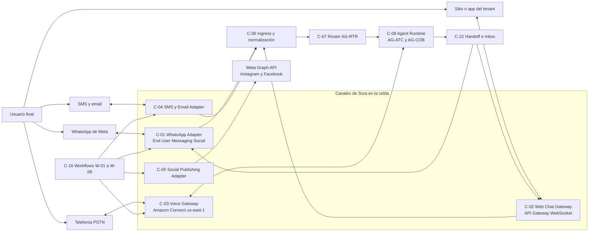
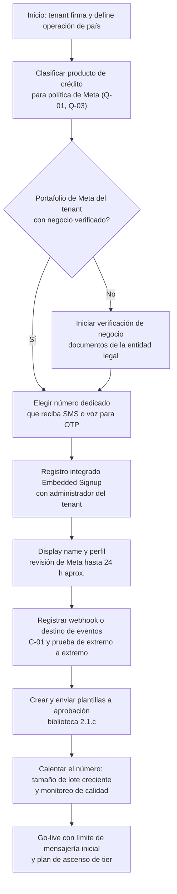
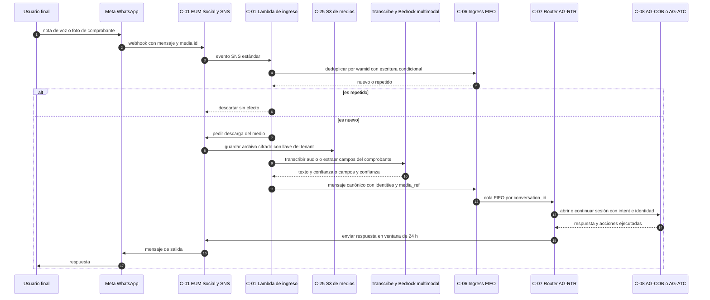
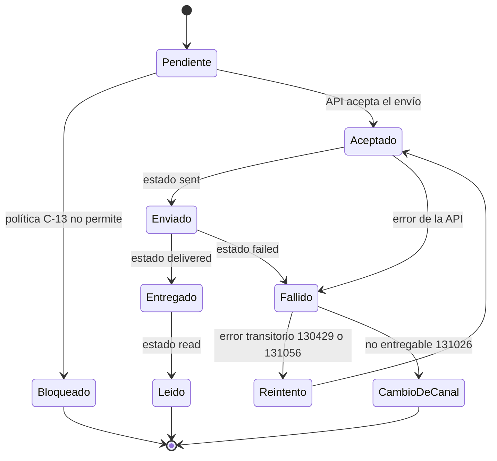
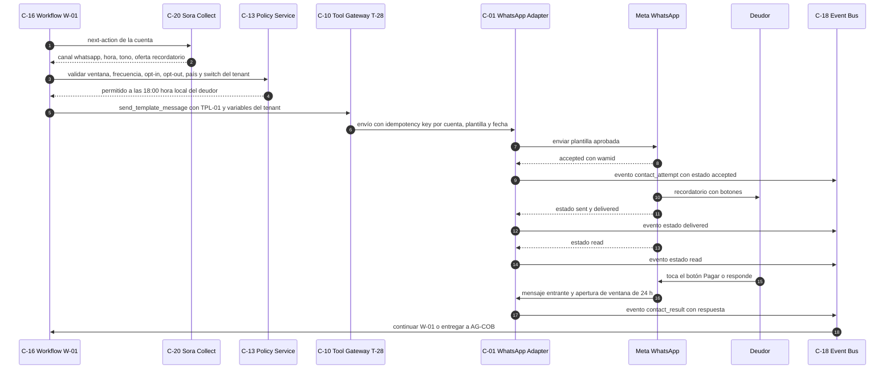
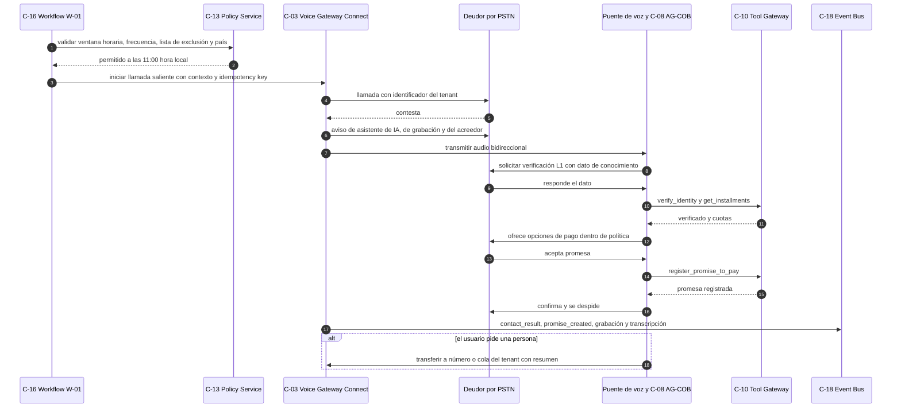
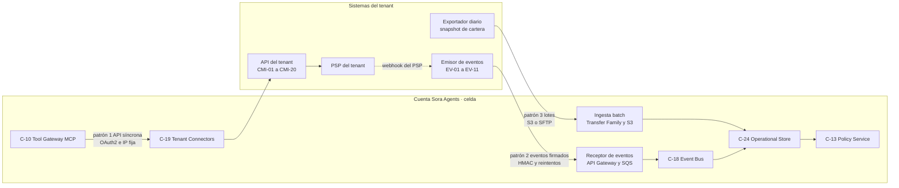
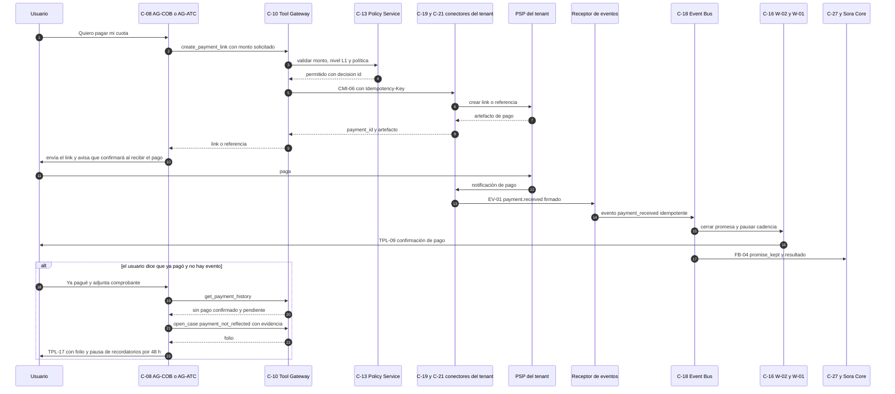
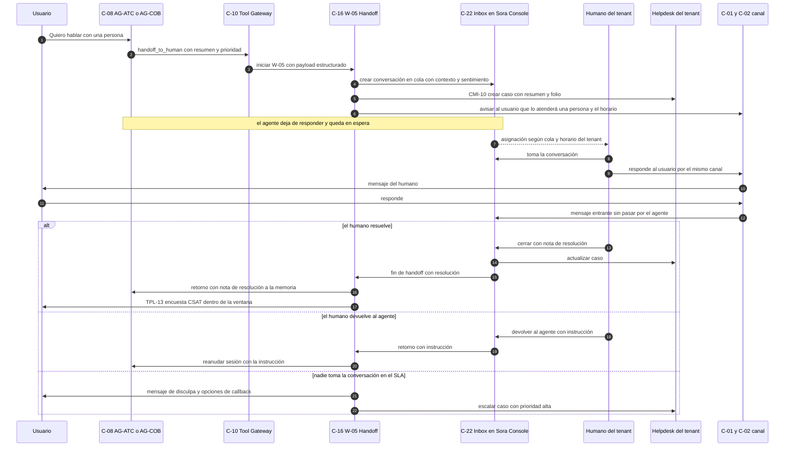
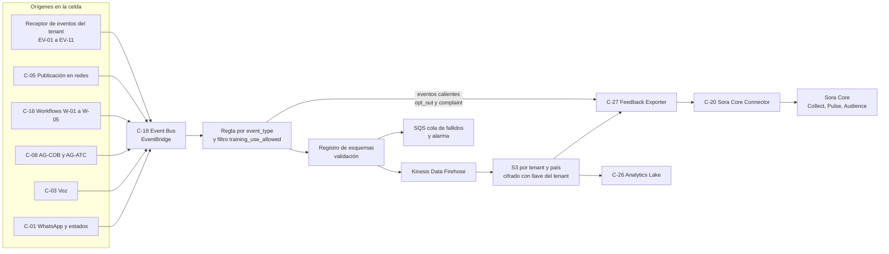

# WP05 · Canales e integraciones

| Campo | Valor |
|---|---|
| Encargo | `02-encargos/WP05-canales-e-integraciones.md` |
| Autor | Agente Claude Sonnet 5.5 · corrida 2026-11-16; parches post-Gate 1 (2026-11-16) y post-Gate 2 (2026-11-17) por un editor técnico |
| Versión | 1.2 (1.0 original; 1.1 = parche post-Gate 1; 1.2 = parche post-Gate 2) `[_GATE-2 §1.2]` |
| Insumos leídos | `README.md`; `00-orquestacion/01-CONVENCIONES.md`; `00-orquestacion/02-PLANTILLA-ENTREGABLE.md`; `01-contexto/10` a `17` (completos); `02-encargos/WP05-canales-e-integraciones.md`; `03-entregables/README.md` (sección "Decisiones humanas registradas"). **No existen** entregables previos de otros WP ni notas `_GATE-n.md` (WP05 es de la oleada 1) y la tabla de decisiones humanas está **vacía**; por eso no hay decisiones humanas que prevalezcan sobre este documento. **Esta observación describe la corrida original.** Los parches posteriores usan `_GATE-1.md` y `_GATE-2.md` (valores del gate "no confirmada") y, para los esquemas de herramientas, WP04 manda `[_GATE-2 §7]`. |
| Acceso web en esta corrida | **Sí.** Se consultó documentación oficial de Meta, AWS y Banco de la República (ver Anexo A, con URL y fecha 2026-11-16). Las tarifas por país de Meta **no se pudieron leer del rate card oficial** (es interactivo/CSV) y se tomaron de agregadores que coinciden entre sí; van marcadas `[VERIFICAR]`. |
| Estado | **Completo con pendientes**: (1) confirmación escrita de Meta sobre cobranza en WhatsApp (bloqueante, Q-01); (2) rate card oficial de Meta y tarifa de telefonía de Connect a móvil por país (`[VERIFICAR]`; el SMS ya usa el precio oficial de AWS `[_GATE-1 §4.1]` y la telefonía publicada es "no confirmada" `[_GATE-2 §4.1]`); (3) validación legal por país (`[LEGAL]`); (4) ubicación y conectividad de Sora Core (Q-05). |

---

## 0. Resumen ejecutivo

1. **Hallazgo crítico (bloquea el diseño de AG-COB por WhatsApp).** La *WhatsApp Business Messaging Policy* (actualizada el 23-sep-2026) lista como **prohibidos** "Payday loans, paycheck advances, peer-to-peer lending, **debt collection**, and bail bonds", y aclara que la prohibición aplica "irrespective of the global or local licenses, registrations, or other approvals" del negocio [F13]. Meta clasifica estas categorías como infracción `MISLEADING` [F15]. La política no dice si el recordatorio de un prestamista a sus propios clientes cuenta como "debt collection". **Hasta tener confirmación escrita de Meta (Q-01), no se debe asumir que WhatsApp es un canal garantizado de cobranza de mora.** Recomendación: diseñar AG-COB **agnóstico de canal** (WhatsApp conmutable por SMS, voz y email en C-17/W-01), tratar los canales de mora como `escenario A` (WhatsApp permitido) o `escenario B` (no permitido), y **adelantar la prioridad de voz y SMS**. Se propone un `[CAMBIO-ADR]` sobre `[ADR-07]` (sección 3). Es también `[RIESGO R-09]` elevado de M/A a **A/A**.
2. **`[OD-05]` Proveedor de WhatsApp: AWS End User Messaging Social para el MVP, detrás de un puerto de canal (C-01) intercambiable, y ruta paralela de Tech Provider de Meta (Cloud API directa) con un gatillo de migración en ESC-L.** Razón: el cargo de AWS es **USD 0.005 por mensaje saliente y USD 0.001 por entrante** [F7]; con los volúmenes de `13-SUPUESTOS` equivale a unos **USD 0.7 mil/mes en ESC-P, 4.1 mil en ESC-L y 20 mil en ESC-E**, que en Colombia es 5 a 7 veces el propio costo de Meta. Es aceptable en el piloto (rapidez y alineación con `[ADR-01]`/`[ADR-07]`) y deja de serlo después. La WABA siempre pertenece al tenant, de modo que cambiar de proveedor no implica perder el número.
3. **Los costos de WhatsApp cambiaron el 1-oct-2026 y `P-10` quedó desactualizado.** Los mensajes de servicio (respuestas libres en ventana de 24 h) y las plantillas utility dentro de la ventana, antes gratis, **ahora se cobran** (1,000 de servicio gratis por número y mes) [F1][F2]. Costo de canal con los volúmenes de `13-SUPUESTOS` (todo el volumen en un país, Meta más AWS): **ESC-L entre USD 4.8 mil (CO) y 26.6 mil (PE) por mes; ESC-E entre 24.6 mil (CO) y 135 mil (PE)** (sección 2.12). El costo depende más del país que de cualquier otra variable de canal.
4. **`[OD-01]` Voz: fase 1.5, no MVP; motor base Amazon Connect + Transcribe + Claude Haiku 5.5 + Polly, con Nova Sonic (speech-to-speech) solo como reto de un bake-off** (ajustado post-Gate 1 [_GATE-1 §4.5]: Nova Sonic no soporta Guardrails; la versión original de este WP proponía Nova 2 Sonic como motor principal). Hallazgos de disponibilidad: **Amazon Connect no está en `sa-east-1` ni en `mx-central-1`** (en LatAm solo se usa desde `us-east-1` o `us-west-2`) [F22]; las llamadas salientes están permitidas por defecto solo a EE. UU., Canadá, **México**, Puerto Rico y Reino Unido, y el resto requiere solicitud de allowlisting [F24]; las campañas salientes de Connect desde `us-east-1` solo cubren EE. UU., **México y Brasil** [F22]. Costo orientativo del pipeline con Haiku y telefonía de Connect publicada: **USD 0.076 a 0.11 por minuto como valor base** (MX 0.077; CO 0.091; AR 0.102; BR 0.108) y, como cota alta, con el sustituto de End User Messaging voz a móvil, 0.12 a 0.42 (2.3.c) `[_GATE-2 §4.1]` `[VERIFICAR]`. Primer país recomendado: **México** `[OD-01]` `[OD-11]` ([_GATE-1 §4.15] lo adopta como canon, no confirmada).
5. **`[OD-04]` Handoff: inbox propia mínima en Sora Console (C-22) como superficie de conversación, más sincronización de casos con el helpdesk del tenant (T-14)**; Zendesk primero, luego Freshdesk, Intercom y HubSpot. Evita que dos sistemas compitan por el mismo número de WhatsApp. El agent workspace de Connect solo aplica a voz.
6. **`[OD-08]` Pagos: el PSP del tenant genera el link, la referencia, el QR o la clave; Sora nunca toca datos de tarjeta.** Matriz por país en 2.7. Novedades relevantes: **Bre-B** (Colombia, operativo desde el 6-oct-2025, 24/7) [F33] y **Pix Automático** (Brasil, desde junio de 2025) [F34].
7. **`[OD-09]` Publicación: Meta Graph API directa para Instagram y Facebook en el MVP**, con el programador propio (EventBridge Scheduler) para Instagram, porque su API de publicación no documenta programación nativa [F29]. Se abre la revisión de la app de Meta (App Review y verificación de negocio) en la semana 1. Un agregador tipo Ayrshare se evalúa en la fase 2 para TikTok, LinkedIn y X.
8. **El Contrato Mínimo de Integración (CMI) tiene 20 endpoints (11 obligatorios en el MVP; 16 en la versión original, ampliado post-Gate 1 con T-30 a T-32 y un aviso opcional de T-17 [_GATE-1 §4.11]), 11 eventos del tenant hacia Sora, y un formato de batch diario de 5 archivos**, trazado a las herramientas T-xx que consumen el sistema del tenant (T-01 a T-09, T-14 a T-19 y T-30 a T-32; T-10 a T-13 y T-27 usan Sora Core y la base de conocimiento; T-17 va a C-17), con sandbox y suite de conformidad obligatorios (sección 2.6).
9. **Cambio de identidad en WhatsApp.** Desde 2026 los webhooks incluyen un identificador por portafolio (BSUID) y, cuando el usuario adopta un *username*, **el número de teléfono puede no venir** en el payload [F18]. Afecta a T-01 (`identify_customer`), al nivel L1 y a la deduplicación. Es un requisito de diseño de C-01 y del CMI (campo `channel_identities`).
10. **Políticas de IA de Meta (sección 4.7 de los términos, actualizados el 23-sep-2026):** prohíben a los "AI Providers" usar la plataforma cuando la IA es la funcionalidad principal puesta a disposición, a criterio exclusivo de Meta, y prohíben usar *Platform Data* para entrenar modelos salvo ajuste fino de uso exclusivo [F14]. Sora debe posicionarse como **proveedor de solución de atención de cada negocio** (el tenant es el negocio), y los eventos de retroalimentación a Sora Core **no deben contener texto de mensajes** (también cumple `[ADR-12]`). `[LEGAL]`
11. **Entregables incluidos:** biblioteca de **20 plantillas** (8 con versión pt-BR), 10 diagramas Mermaid, matrices por país de precios de WhatsApp, voz, SMS y medios de pago, contratos con Sora Core, 11 eventos de retroalimentación con esquema JSON, y una tabla de costos de canal para WP08.
12. **Preguntas bloqueantes:** Q-01 (política de Meta sobre cobranza), Q-02 (país del piloto, `[OD-11]`, condiciona voz, plantillas y números), Q-03 (tipo de producto de crédito del cliente de diseño: BNPL frente a microcrédito de corto plazo) y Q-05 (dónde corre Sora Core).

---

## 1. Alcance

**Cubre:**

- Canales: WhatsApp, web chat, voz, SMS y email, publicación en redes (Instagram y Facebook), y la política de proveedores de cada uno.
- Integración con los sistemas de cada tenant (patrones, Contrato Mínimo de Integración, autenticación, sandbox), con los PSP, con el helpdesk y con Sora Core, incluidos los eventos de retroalimentación (C-27).
- Decisiones `[OD-01]` (decisión final, con insumos de WP04 y WP08), `[OD-04]`, `[OD-05]`, `[OD-08]` y `[OD-09]`.
- Una tabla de costos de canal por escenario y país para WP08.

**No cubre (y quién lo cubre):**

| Tema | Lo cubre |
|---|---|
| Lógica interna de los agentes, prompts, estados de los workflows W-01 a W-08, esquema del payload de handoff | WP04 |
| Infraestructura general (red, cuentas, regiones, colas, bases de datos), vector store, consola | WP03 |
| Análisis legal detallado (protección de datos, cobranza, telemarketing, grabación, transferencias internacionales) | WP06. Aquí solo se señalan los puntos y se marcan `[LEGAL]` |
| Modelo de costos completo y unit economics | WP08. Aquí solo se entrega la tabla de costos de canal |
| Requisitos concretos que se le piden al cliente (RC-xx) y onboarding | WP10 (este WP entrega el CMI y los requisitos de canal) |
| Facturación electrónica y requisitos internos de Sora | WP11 |
| Precios a cliente final y empaquetado | WP09 |

**Convenciones de este documento.** Los precios en USD; la referencia local usa `[S-02]`. Las tarifas de Meta del 1-oct-2026 se citan como "rate card de referencia". Los números de campos y endpoints del CMI usan los prefijos `CMI-xx` (endpoints del tenant), `EV-xx` (eventos del tenant hacia Sora) y `FB-xx` (eventos de retroalimentación hacia Sora Core).

---

## 2. Contenido principal

### 2.0 Vista de conjunto de canales

| Canal | Componente | Servicio por defecto | Fase | Países | Estado de la decisión |
|---|---|---|---|---|---|
| WhatsApp | C-01 | AWS End User Messaging Social detrás de un puerto de canal; migración a Cloud API directa en ESC-L | MVP | Todos los núcleo; sujeto a la política de Meta para cobranza (2.1.g) | `[OD-05]` resuelta (2.1.a) |
| Web chat | C-02 | API Gateway WebSocket + Lambda; widget en CloudFront | MVP | Todos | `[ADR-07]` confirmada |
| Voz | C-03 | Amazon Connect (`us-east-1`) + Transcribe + Haiku 5.5 + Polly (Nova Sonic solo como reto de bake-off, [_GATE-1 §4.5]) | **Fase 1.5**, piloto en 1 país (MX) | MX, BR primero; CO, PE, CL y AR con allowlisting o requisitos | `[OD-01]` resuelta (2.3.e) |
| SMS | C-04 | AWS End User Messaging SMS | MVP (solo respaldo y OTP) | MX con ID de remitente; demás con código corto | Matriz en 2.4 |
| Email | C-04 | Amazon SES | MVP (solo transaccional) | Todos | 2.4 |
| Redes (Instagram y Facebook) | C-05 | Lambda + Meta Graph API directa | MVP | Todos | `[OD-09]` resuelta (2.5) |
| Handoff a humanos | C-22 | Inbox en Sora Console + sincronización de casos con el helpdesk del tenant | MVP | Todos | `[OD-04]` resuelta (2.8) |
| Pagos | C-21 | PSP del tenant vía CMI-06 | MVP | Todos | `[OD-08]` resuelta (2.7) |

**Diagrama 1 · Arquitectura de canales**



*Lectura:* los canales entrantes (WhatsApp, web chat, SMS y email) pasan por C-06 y el router antes del agente. **La voz va directo al runtime** (audio en tiempo real, sin cola FIFO) y vive en `us-east-1`, fuera de la celda de LatAm. Los contactos **salientes** nacen en los workflows (C-16), nunca en el LLM. El handoff comparte los mismos canales que el agente: un solo número por conversación. C-05 solo lo invoca W-04, con aprobación humana previa.

**Principio de proveedor intercambiable.** Cada adaptador implementa un puerto (`ChannelPort`) con operaciones y eventos normalizados, de modo que cambiar de proveedor (AWS EUM Social a Cloud API directa, un SMS a otro operador, Connect a otro motor de voz) es un cambio de configuración y de adaptador, sin tocar agentes ni workflows. Es lo que sostiene la mitigación de `[RIESGO R-09]`.

---

### 2.1 WhatsApp

#### 2.1.a Comparación de proveedores `[OD-05]`

**Opciones evaluadas:**

- **A. AWS End User Messaging Social** (EUM Social): servicio de AWS para WhatsApp Business Platform. La WABA vive en el portafolio de Meta del tenant y se vincula al servicio mediante un registro integrado (*embedded signup*) hecho desde la consola de AWS [F8][F9].
- **B. Cloud API de Meta directa**, con Sora como **Tech Provider** (app de Sora en Meta con permisos `whatsapp_business_management` y `whatsapp_business_messaging`, y *Embedded Signup* para cada tenant) [F16].
- **C. BSP o intermediarios**: Twilio, 360dialog, Gupshup, Infobip.

**Matriz de comparación** (datos oficiales salvo donde se indica):

| Criterio | A. AWS EUM Social | B. Cloud API directa (Sora Tech Provider) | C1. Twilio | C2. 360dialog / Gupshup / Infobip |
|---|---|---|---|---|
| Cargo del proveedor por mensaje | **USD 0.005 saliente; USD 0.001 entrante** [F7] | **0** (solo infraestructura propia) | USD 0.005 por mensaje entrante o saliente; USD 0.001 por mensaje fallido [F31] | 360dialog: sin recargo por mensaje, cuota fija por número (EUR 49 a 500/mes) o plan de partner (EUR 250 a 1,000/mes + EUR 15 a 49 por canal) [F32]. Gupshup e Infobip: no publicado en esta corrida, n/d `[VERIFICAR]` |
| Cargo de Meta | Pasa al costo; AWS lo factura en USD (convertido del rate card en INR de Meta) [F7] | El tenant paga a Meta con su método de pago, o Sora lo hace si es *Solution Partner* con línea de crédito [F16] | Pasa al costo | Pasa al costo |
| Quién paga a Meta | Sora (vía factura de AWS) y lo reexpide al tenant | **Tenant directo** (Tech Provider) o Sora (Solution Partner, requiere línea de crédito) | Sora | Sora o tenant, según plan |
| Onboarding de números por país | Registro integrado desde la consola AWS; exige credenciales de AWS y la persona con acceso de administrador a la cuenta de Meta del tenant [F9] | Registro integrado propio, **autoservicio dentro de Sora Console**; hasta 10 clientes por semana en una app nueva, 200 tras verificar negocio, app y acceso [F16] | Registro integrado de Twilio | Registro integrado del proveedor |
| Rol de Sora | Cliente de AWS; **no** es Tech Provider | **Tech Provider** (control del flujo y de los tokens) | Cliente de ISV | Cliente o partner |
| WhatsApp Flows y mensajes interactivos | Sí: plantillas, ubicación, interactivos y Flows con endpoints dinámicos (JSON 5.1 a 7.3; respuesta del endpoint en 10 s; sin migración de Flows entre WABA) [F8][F11] | Sí, con acceso inmediato a las funciones nuevas | Sí (depende de la versión del producto) | Sí (depende) |
| Webhooks | Eventos a un tema SNS **estándar** (no FIFO), a través de un destino de eventos por WABA [F9][F12]. Sin verificación de firma de Meta: la autenticidad la da SNS/IAM | Webhook propio: verificación `X-Hub-Signature-256` con el secreto de la app, control total del reintento y del orden | Webhook de Twilio | Webhook del proveedor |
| Medios | Se descargan a S3 mediante la API del servicio | Descarga directa con token (URL de vida corta) | Vía API | Vía API |
| Límites | Mismos de Meta (por portafolio del tenant [F17]); cuotas de AWS n/d `[VERIFICAR]` | Mismos de Meta | Mismos de Meta | Mismos de Meta |
| BSUID y *usernames* | `[VERIFICAR]` soporte en el servicio y fecha | Soporte inmediato (se implementa en C-01) [F18] | `[VERIFICAR]` | `[VERIFICAR]` |
| Soporte en LatAm | Cuenta de AWS y soporte de AWS; no hay soporte especializado de WhatsApp comunicado `[VERIFICAR]` | Canal de socios de Meta (Partner Manager y *Direct Support*) tras ser Tech Provider | Soporte comercial de Twilio | Variable; hay presencia regional `[VERIFICAR]` |
| Disponibilidad regional en AWS | **Sí en `sa-east-1` y en `mx-central-1`**, y en `us-east-1` [F8] | No aplica (corre en nuestras regiones) | No aplica | No aplica |
| Integración con la pila de Sora (IAM, SNS/EventBridge, IaC, Connect, facturación única) | **Alta**; incluye destino de eventos hacia una instancia de Connect [F9] | Media; se construye C-01 completo | Baja | Baja |
| Residencia de datos en reposo de Meta | Selector de región de almacenamiento local por número [F9] `[VERIFICAR]` regiones | Disponible (almacenamiento local de la Cloud API) `[VERIFICAR]` | `[VERIFICAR]` | `[VERIFICAR]` |
| Bloqueo del proveedor (*lock-in*) | **Bajo** a nivel de activos (WABA, número y plantillas son del tenant). Al desvincular hay que pedir a AWS que devuelva el control de la WABA: "At your request, we will transfer control of your WABA back to you in a reasonable and timely manner" [F9] | Muy bajo | Medio | Medio |
| Riesgo de políticas de IA de Meta | Igual para todos (sección 4.7 [F14]) | Igual, pero Sora responde directo ante Meta como Solution/Tech Provider | Igual | Igual |
| Esfuerzo de construcción para el piloto | **Bajo** (semanas) | Medio-alto: revisión de app, verificación de negocio de Sora, infraestructura de webhook, gestión de tokens `[S-NUEVO-6]`: 2 ingeniero-meses | Bajo | Bajo |

**Costo de la capa de proveedor** (fórmula: `cargo_proveedor/mes = mensajes salientes × tarifa_saliente + mensajes entrantes × tarifa_entrante`, sin Meta; volúmenes de la sección 2.12):

| Escenario | Salientes/mes | Entrantes/mes | A. AWS EUM Social | C1. Twilio | C2. 360dialog (plan Regular, 1 número por operación de país) | B. Directa |
|---|---|---|---|---|---|---|
| ESC-P (1 número) | 120,250 | 64,000 | **USD 665** | USD 921 | USD 54 | USD 0 + infraestructura |
| ESC-L (4 números) | 736,500 | 384,000 | **USD 4,066** | USD 5,602 | USD 216 | USD 0 + infraestructura |
| ESC-E (14 números) | 3,707,500 | 1,920,000 | **USD 20,458** | USD 28,138 | USD 755 (Regular) a 7,700 (Scale) | USD 0 + infraestructura |

Cálculos: AWS = 0.005 × salientes + 0.001 × entrantes; Twilio = 0.005 × (salientes + entrantes); 360dialog = números × EUR 49 × 1.10 (`[S-NUEVO-7]`, EUR/USD 1.10 `[VERIFICAR]`; plan Scale = EUR 500). Sin descuentos por volumen (no publicados).

**Recomendación (`D-WP05-01`):**

1. **MVP y piloto: opción A (AWS EUM Social)**, implementada **detrás de un puerto de canal** (`ChannelPort` en C-01: `send_template`, `send_message`, `send_interactive`, `mark_read`, `get_media`, y eventos normalizados `inbound`, `status`, `account_alert`). Razón: el cargo es USD 665/mes en ESC-P (menos que el costo de construir la opción B), mantiene a Sora en AWS (`[ADR-01]`, `[ADR-07]`), y permite cumplir el objetivo de ≤ 16 semanas `[S-61]`.
2. **En paralelo, desde la semana 1: iniciar el camino de Tech Provider** (crear la app en Meta, verificación del negocio de Sora, revisión de la app con acceso avanzado a los dos permisos), porque tarda semanas y porque Sora lo necesita igualmente si quiere ser **ISV** con registro integrado propio en Sora Console `[VERIFICAR plazos de Meta]`.
3. **Gatillo de migración a B (decisión del gate de ESC-L):** migrar cuando se cumpla cualquiera de estas condiciones: (a) el cargo de AWS supere **USD 3,000/mes** (se alcanza hacia el mes 4 con el crecimiento de ESC-L); (b) AWS EUM Social no soporte el BSUID, una función de Flows que se necesite o las llamadas por WhatsApp en la fecha requerida; (c) exista una restricción de residencia que EUM Social no pueda cumplir. **Retorno:** esfuerzo `[S-NUEVO-6]` = 2 ingeniero-meses × USD 7,000 `[S-51]` = **USD 14,000**; ahorro en ESC-L = USD 4,066 − USD 400 de operación adicional (`[S-NUEVO-6]`) ≈ USD 3,700/mes; **recuperación en unos 4 meses**.
4. **Quién paga a Meta** es una decisión comercial para WP09: con A, Sora paga a Meta vía AWS y lo reexpide al tenant con trazabilidad; con B (Tech Provider), el **tenant paga directo a Meta** y Sora no asume capital de trabajo ni riesgo de morosidad; con B y *Solution Partner* se habilita la reventa pero exige línea de crédito [F16]. `[PREGUNTA-ABIERTA]` Q-07.
5. **No se recomienda un BSP** (C) como opción principal: aporta poco frente a A y B, añade un tercero en la cadena de subencargados `[LEGAL]` y, en el caso de Twilio, tiene un cargo por mensaje igual al de AWS. 360dialog es el plan B de menor costo si Meta no aprueba pronto la app de Sora.

#### 2.1.b Onboarding de la WABA de cada operación de país

**Quién es dueño de qué (`D-WP05-02`):**

| Activo | Dueño | Razón |
|---|---|---|
| Portafolio de Meta (Business Manager) y verificación de negocio | **Tenant** (la entidad legal que contrata el servicio en ese país) | La verificación es de la persona jurídica; los límites de mensajería son por portafolio [F17] |
| WABA, número, *display name*, perfil de negocio, plantillas | **Tenant** | Con *Embedded Signup* los clientes son dueños de sus activos y tienen acceso completo al WhatsApp Manager; el socio no puede restringirlo [F16] |
| PIN de verificación en dos pasos del número | **Tenant** (custodia compartida: copia cifrada en Secrets Manager con KMS por tenant) | Permite migrar el número a otro proveedor sin depender de Sora |
| Acceso del integrador (token de sistema o vinculación a AWS) | **Sora**, revocable | Es lo que se corta al terminar el contrato |
| Plantillas de Sora (biblioteca base, 2.1.c) | **Sora** (licencia al tenant) | La copia aprobada vive en la WABA del tenant |
| Números de respaldo | **Tenant**, administrados por Sora | Ver R-04 |

Se **rechaza** una WABA única de Sora que aloje a varios tenants: mezcla calidad, límites y reputación entre clientes (rompe `[ADR-12]` en espíritu), y expone a Sora a ser clasificada como proveedor de IA que opera cuentas ajenas (4.7 [F14]).

**Estructura por tenant:** una **WABA por entidad legal y país**, con **un número por operación de país** `[S-07]`. Si un tenant multi-país usa la misma entidad legal verificada en varios países, puede compartir el portafolio, con números distintos por país (límites y calidad se miden por portafolio, así que un incidente en un país afecta a los demás; se prefieren portafolios separados cuando hay entidades distintas).

**Pasos del onboarding (W-07, subflujo WhatsApp):**



*Lectura:* la clasificación del producto para la política de Meta va **antes** de comprar números y de enviar plantillas, porque una prohibición afecta a todos los canales de WhatsApp del tenant. La verificación del negocio es el camino más lento y se inicia en paralelo al resto. El calentamiento del número evita los límites bajos iniciales de la tabla de tiers (250 y luego 2,000 contactos por 24 h) [F17].

**Requisitos prácticos** (`[VERIFICAR]` los plazos exactos en cada país):

- **Número:** dedicado, capaz de recibir un OTP por SMS o voz, que no esté activo en la app de WhatsApp Messenger o Business; si está, hay que eliminarlo antes o usar el modo de coexistencia con la app de WhatsApp Business, cuando aplique [F9][F16].
- ***Display name*:** debe coincidir con el nombre de la empresa o con una marca con asociación publicada en su sitio web; si Meta lo rechaza, el límite diario baja y puede desconectarse el número [F9].
- **Verificación de negocio:** necesaria para subir de 250 a 2,000 contactos por 24 h por la vía de verificación y para obtener el mejor techo de plantillas (6,000 por cuenta frente a 250 si no está verificado) [F17][F20].
- **Datos en reposo de Meta:** en EUM Social se elige una región de almacenamiento local por número [F9]. Se registra la elección por operación de país `[LEGAL]` `[VERIFICAR]` regiones disponibles.

**Fin de contrato y portabilidad:** la WABA y el número son del tenant, por lo que al terminar solo se revoca el acceso de Sora. Runbook: (1) congelar envíos salientes; (2) exportar conversaciones y consentimientos conforme al DPA `[LEGAL]`; (3) solicitar la devolución del control de la WABA a AWS (o revocar el token de sistema, en la opción B); (4) entregar el PIN; (5) borrar datos según la retención del país `[S-39]`. Plazo de AWS para devolver el control: n/d `[VERIFICAR]` (riesgo `R-WP05-06`).

#### 2.1.c Plantillas: categorías, aprobación, variables, idiomas y biblioteca

**Categorías** (definen precio y límites): *marketing* (promoción, ofertas), *utility* (mensajes transaccionales ligados a una cuenta o transacción concreta), *authentication* (códigos de un solo uso). Meta decide la categoría final y puede **recategorizar**; la revisión es automática y puede tardar hasta 24 h [F20]. Las plantillas con mala retroalimentación o baja lectura pueden **pausarse** y no se pueden enviar mientras estén pausadas; las inactivas durante 12 meses se archivan [F20]. Se pueden crear 100 por hora por cuenta de mensajería; el techo es 250 por cuenta sin verificar y 6,000 si el portafolio está verificado [F20].

**Variables:** parámetros nombrados (`{{nombre}}`, minúsculas y guiones bajos) en lugar de posicionales, para que el workflow no dependa del orden [F20]. **Todo valor sensible (montos, fechas, saldos) lo calcula una herramienta o el tenant, nunca el LLM** `[ADR-04]`: la plantilla se rellena en el workflow (T-28), no con texto libre del modelo.

**Idiomas** (códigos de Meta; `[VERIFICAR]` contra la lista oficial de idiomas): `es` (neutro), `es_MX`, `es_AR`, `es_CO`, `es_CL`, `es_PE` y `pt_BR`. Meta no traduce el texto: cada variante se envía a aprobación por separado [F20]. Regla: **una plantilla base en `es` y variantes locales solo cuando el uso difiera** (voseo en `es_AR`, términos como "cuota" frente a "mensualidad"). Las plantillas se versionan en C-32 como `tpl_<id>@v<n>_<idioma>`.

**Restricciones de diseño transversales:**

- **Identificación del acreedor y del asistente de IA** en todo mensaje de cobranza (nombre del tenant y "asistente virtual") `[ADR-13]` `[LEGAL]`.
- **Primer contacto a un número de dudosa titularidad**: plantilla neutra que **no menciona deuda ni montos** (TPL-18), hasta que el titular responda y verifique L1.
- **Opt-out visible**: botón "No más mensajes" (respuesta rápida) o la palabra clave de baja; se ejecuta de forma determinista [catálogo `12`, AG-RTR].
- **No se redactan eufemismos para evadir la política de Meta.** Las plantillas se escriben con claridad; la categoría se solicita según el uso real, y la viabilidad de las de mora depende de Q-01. Las marcadas `política: alta` **no se envían a aprobación** hasta tener la respuesta.

**Biblioteca de 20 plantillas** (texto base en español; "Sens." = sensibilidad frente a la política de Meta sobre cobranza: **B**aja, **M**edia, **A**lta). Todas llevan el nombre del tenant `{{tenant}}`. Las variables entre llaves las llena el workflow:

| ID | Uso (etapa o agente) | Categoría esperada | Idiomas | Sens. | Texto base (es) y botones |
|---|---|---|---|---|---|
| TPL-01 | Recordatorio preventivo D-5 (AG-COB, W-01) | Utility | es, pt_BR | B | "Hola {{nombre}}, soy el asistente virtual de {{tenant}}. Tu cuota {{n_cuota}} de {{monto}} vence el {{fecha}}. Botones: [Pagar ahora] [Hablar con una persona] [No más mensajes]" |
| TPL-02 | Recordatorio el día del vencimiento (D0) | Utility | es | B | "Hola {{nombre}}, hoy vence tu cuota de {{monto}} con {{tenant}}. Puedes pagar aquí: {{link}}. [Pagar] [Ya pagué] [Ayuda]" |
| TPL-03 | Aviso de atraso temprano D+1 a D+3 | Utility | es, pt_BR | **A** | "Hola {{nombre}}, no vemos reflejado el pago de tu cuota de {{monto}} que venció el {{fecha}}. Si ya pagaste, responde 'Ya pagué'. Si necesitas ayuda, puedes hablar con una persona. [Pagar] [Ya pagué] [Necesito ayuda]" |
| TPL-04 | Atraso D+7 a D+15: oferta de plan corto (la oferta la define el motor, C-13) | Utility | es | **A** | "Hola {{nombre}}, tenemos una opción para que regularices tu cuenta con {{tenant}} en pagos más cómodos. ¿Quieres ver las opciones? [Ver opciones] [No por ahora] [No más mensajes]" |
| TPL-05 | Mora media D+31 a D+60: invitación a regularizar | Utility | es | **A** | "Hola {{nombre}}, tu cuenta con {{tenant}} tiene {{dias}} días de atraso. Un asistente puede ayudarte a ver tus opciones de pago. [Ver opciones] [Hablar con una persona]" |
| TPL-06 | Confirmación de promesa de pago (W-02) | Utility | es, pt_BR | B | "Gracias, {{nombre}}. Registramos tu promesa de pago de {{monto}} para el {{fecha}}. Te recordaremos un día antes. [Cambiar fecha] [Cancelar]" |
| TPL-07 | Recordatorio de promesa (D-1) | Utility | es | M | "Hola {{nombre}}, mañana {{fecha}} es la fecha acordada para tu pago de {{monto}}. [Pagar ahora] [Reprogramar]" |
| TPL-08 | Promesa vencida: reprogramar | Utility | es | **A** | "Hola {{nombre}}, no vimos tu pago prometido para el {{fecha}}. ¿Quieres reprogramarlo? [Reprogramar] [Ya pagué] [Hablar con una persona]" |
| TPL-09 | Confirmación de pago recibido | Utility | es, pt_BR | B | "Recibimos tu pago de {{monto}} el {{fecha}}. Gracias, {{nombre}}. Tu saldo pendiente es {{saldo}}. [Ver mi cuenta]" |
| TPL-10 | Pago parcial aplicado | Utility | es | B | "Aplicamos tu pago parcial de {{monto}}. Pendiente de la cuota: {{pendiente}}, con vencimiento {{fecha}}. [Pagar el resto] [Ayuda]" |
| TPL-11 | Plan de pagos aceptado (W-03) | Utility | es | M | "Tu plan de pagos con {{tenant}} quedó registrado: {{n_cuotas}} cuotas de {{monto}}, la primera el {{fecha}}. Folio {{folio}}. [Ver detalle]" |
| TPL-12 | Código de verificación L2 (OTP) | Authentication | es, pt_BR | B | "{{codigo}} es tu código de verificación de {{tenant}}. No lo compartas con nadie. Botón: [Copiar código]. Expira en 10 minutos." (plantilla estándar de autenticación con botón de copiar código) |
| TPL-13 | Encuesta CSAT posterior a la conversación | Utility (riesgo de recategorización a marketing) | es, pt_BR | B | "Gracias por escribir a {{tenant}}. ¿Cómo calificas la atención de hoy? [Muy buena] [Regular] [Mala]" (también como Flow dentro de la ventana) |
| TPL-14 | Confirmación de baja (opt-out) fuera de ventana | Utility | es | B | "Listo, {{nombre}}. No te enviaremos más mensajes de {{tenant}} por WhatsApp. Si cambias de opinión, escribe 'Alta'." |
| TPL-15 | Reactivación de clientes (AG-CON + Sora Audience) | **Marketing** | es, pt_BR | B | "Hola {{nombre}}, en {{tenant}} tenemos una novedad para ti: {{beneficio}}. Condiciones y costo total del crédito en {{url}}. [Quiero saber más] [No más mensajes]" (la leyenda de costo total la fija T-23) |
| TPL-16 | Oferta de aumento de línea (Sora Pulse) | **Marketing** | es | B | "{{nombre}}, por tu buen historial en {{tenant}} podrías acceder a una línea mayor. Revisa condiciones aquí: {{url}}. [Ver oferta] [No me interesa]" |
| TPL-17 | Folio de caso y comprobante recibido | Utility | es | B | "Recibimos tu comprobante y abrimos el caso {{folio}}. Lo revisaremos y te escribiremos aquí. Mientras tanto no recibirás recordatorios de este pago." |
| TPL-18 | Verificación de titular (número de titularidad dudosa; **sin mencionar deuda**) | Utility | es, pt_BR | M | "Hola, soy el asistente virtual de {{tenant}}. ¿Hablo con {{nombre}}? [Sí, soy yo] [No soy esa persona] [No más mensajes]" |
| TPL-19 | Bienvenida y confirmación de opt-in | Utility | es | B | "Hola {{nombre}}, gracias por aceptar recibir mensajes de {{tenant}} por WhatsApp. Puedes escribir 'Baja' cuando quieras. Soy un asistente virtual y puedo conectarte con una persona." |
| TPL-20 | Aviso de contacto desde un nuevo canal o número (seguridad, T-19) | Utility | es | M | "Alerta de seguridad de {{tenant}}: detectamos un cambio en los datos de tu cuenta. Si no fuiste tú, responde 'No fui yo' o llama al {{telefono}}. [No fui yo] [Fui yo]" |

**Versiones pt-BR** (8 de las 20: TPL-01, 03, 06, 09, 12, 13, 15 y 18):

| ID | Texto en pt-BR |
|---|---|
| TPL-01 | "Olá, {{nome}}! Sou o assistente virtual da {{tenant}}. A parcela {{n_parcela}} de {{valor}} vence em {{data}}. [Pagar agora] [Falar com uma pessoa] [Não quero mais mensagens]" |
| TPL-03 | "Olá, {{nome}}! Não identificamos o pagamento da parcela de {{valor}} que venceu em {{data}}. Se você já pagou, responda 'Já paguei'. Se precisar de ajuda, fale com uma pessoa. [Pagar] [Já paguei] [Preciso de ajuda]" |
| TPL-06 | "Obrigado, {{nome}}. Registramos sua promessa de pagamento de {{valor}} para {{data}}. Vamos lembrar você um dia antes. [Alterar data] [Cancelar]" |
| TPL-09 | "Recebemos seu pagamento de {{valor}} em {{data}}. Obrigado, {{nome}}. Saldo pendente: {{saldo}}. [Ver minha conta]" |
| TPL-12 | "{{codigo}} é seu código de verificação da {{tenant}}. Não compartilhe com ninguém. [Copiar código]. Expira em 10 minutos." |
| TPL-13 | "Obrigado por falar com a {{tenant}}. Como você avalia o atendimento de hoje? [Muito bom] [Regular] [Ruim]" |
| TPL-15 | "Olá, {{nome}}! A {{tenant}} tem uma novidade para você: {{beneficio}}. Condições e Custo Efetivo Total em {{url}}. [Quero saber mais] [Não quero mais mensagens]" |
| TPL-18 | "Olá, sou o assistente virtual da {{tenant}}. Estou falando com {{nome}}? [Sim, sou eu] [Não sou essa pessoa] [Não quero mais mensagens]" |

**Variante con voseo (es_AR), ejemplo de TPL-01:** "Hola {{nombre}}, soy el asistente virtual de {{tenant}}. Tu cuota {{n_cuota}} de {{monto}} vence el {{fecha}}. Podés pagar acá: [Pagar ahora] [Hablar con una persona] [No quiero más mensajes]". Nota pt-BR: el "Custo Efetivo Total" (CET) es la leyenda equivalente a CAT/TCEA/CAE `[LEGAL]`.

**Mapa de uso:** TPL-01 a 11 y 14 los envía solo **W-01/W-02/W-03 vía T-28** (nunca el LLM; T-28 gana el parámetro `channel` y `purpose=marketing` con la ruta de plantillas de marketing y su opt-in propio, y sigue exclusiva de workflows [_GATE-1 §4.11]); TPL-12 la envía T-02; TPL-13 la envía W-05 al cerrar; TPL-15 y 16 los dispara AG-CON/Audience tras aprobación humana (T-24); TPL-17, 18, 19 y 20 las envían workflows de caso, verificación, opt-in y fraude.

**Tiempo de vida (TTL) de los mensajes:** las plantillas de autenticación tienen un TTL de 10 minutos; el resto, 30 días por defecto [F19].

#### 2.1.d Ventana de servicio de 24 h, opt-in y opt-out, calidad, límites y bloqueos

**Ventana de servicio.** Una ventana de 24 h se abre cuando el usuario escribe o llama y se renueva con cada mensaje suyo. Dentro de ella se puede enviar texto libre, medios e interactivos; fuera, **solo plantillas aprobadas**; y solo a usuarios que dieron opt-in [F19]. Reglas de implementación en C-01:

- C-01 guarda `last_user_message_at` por conversación y decide el tipo de envío. Si el LLM intenta responder con la ventana cerrada, el envío libre se **bloquea** y se convierte en un evento `window_closed`: el workflow envía una plantilla de reapertura (por ejemplo TPL-17 o TPL-02) o escala.
- El código de error de "re-engagement" de la API (131047) se maneja como respaldo del cálculo propio, que puede discrepar por relojes o mensajes tardíos `[VERIFICAR]`.
- **Ventana por punto de entrada gratuito** (anuncio de Click-to-WhatsApp): hasta 7 días con todos los mensajes sin cargo, salvo los de Meta Business Agent [F1]. Se registra el origen (`referral`) en el mensaje canónico para medir el costo.
- Los **cambios de precio del 1-oct-2026** hacen que las respuestas dentro de la ventana y las utility en ventana **tengan costo** [F1]. No existe ya el incentivo de "esperar a que el usuario responda para que sea gratis". En el diseño, la ventana sigue siendo necesaria por texto libre, pero **no por costo**.

**Opt-in** (obligatorio para mensajes iniciados por el negocio; el usuario debe saber que consiente recibir mensajes por WhatsApp y de qué negocio) [F10]. El **tenant es el responsable de obtenerlo**, y Sora lo exige y lo registra:

| Fuente de opt-in | Cómo se captura | Evidencia que guarda Sora (C-24) |
|---|---|---|
| Aceptación en la app o web del tenant (casilla específica de WhatsApp, separada de los términos generales) | CMI: `consents` en `CMI-01` y evento `EV-08 consent.changed` | `consent_id`, canal, fecha y hora UTC, fuente, versión del texto, hash del texto, país |
| El usuario escribe primero al número (inbound) | C-01 lo registra al recibir el primer mensaje | Mensaje original, `wamid`, fecha y hora; da alcance solo para ese tipo de conversación |
| Formulario de captación del tenant (QR, enlace `wa.me`, anuncio CTWA) | Texto prellenado con el aviso de consentimiento | `referral` del mensaje y texto de aviso |
| Opt-in por voz o en sucursal | El tenant lo carga como evento `EV-08` | Origen y evidencia que adjunta el tenant |

Un opt-in de WhatsApp **no es** automáticamente el consentimiento exigido por la ley de cobranza ni de datos de cada país; son capas distintas `[LEGAL]`.

**Opt-out.** Se ejecuta de forma **determinista** antes del LLM, en C-06/C-07 `[catálogo 12, AG-RTR regla 3]`: palabras clave (es: BAJA, STOP, CANCELAR, "no más", "no me escriban", "no quiero recibir"; pt-BR: PARAR, SAIR, "não quero mais", "me tire da lista", "não me perturbe") más el botón de las plantillas. Efectos: (1) T-16 registra la baja **por canal**; (2) C-17 la suma a la lista de exclusión; (3) se envía confirmación dentro de la ventana (o TPL-14 si ya cerró); (4) evento `opt_out` hacia Sora Core (FB-07) y `EV` hacia el tenant. Una baja de WhatsApp **no** da de baja automáticamente otros canales ni los avisos transaccionales obligatorios: eso lo define el tenant y la ley del país `[LEGAL]`. También se atienden las solicitudes hechas **fuera de WhatsApp** [F10].

**Calidad y límites por nivel (*tier*).** Los límites se aplican **por portafolio de negocio, no por número**: "shared by all business phone numbers within a portfolio" [F17].

| Elemento | Regla verificada [F17] | Implicación para Sora |
|---|---|---|
| Niveles | 250 → 2,000 → 10,000 → 100,000 → ilimitado (contactos únicos fuera de ventana en 24 h móviles) | Cada tenant tiene su propio portafolio, así que el límite de un tenant no consume el de otro |
| Subir a 2,000 | Verificar el negocio (por el tenant o por el socio), o enviar 2,000 mensajes entregados con plantillas de alta calidad a contactos únicos en 30 días | Verificación de negocio **antes** del go-live (ruta crítica del onboarding) |
| Escalado automático (más de 2,000) | Sube un nivel en 6 h si se usó al menos la mitad del límite en 7 días con alta calidad | Plan de calentamiento por cohortes |
| Consulta | Campo `whatsapp_business_manager_messaging_limit`; webhook `business_capability_update` | C-28 registra el límite vigente y alerta al 80% de uso |
| Denegación | Webhook de alertas de cuenta con la acción sugerida | Runbook de incidente de calidad |

**Dimensionamiento del nivel necesario** (contactos únicos por día fuera de ventana ≈ plantillas utility salientes por día, `[S-13]`/30; en días de pago ×2 `[S-36]`):

| Escenario | Plantillas por mes `[S-13]` | Promedio por día | Día de pago (×2) | Plantillas por tenant en ESC (`[S-09]`) | Nivel mínimo recomendado |
|---|---|---|---|---|---|
| ESC-P | 40,000 | 1,333 | 2,667 | 1 tenant: 2,667 en pico | **10,000** (2,000 no alcanza en días de pago) |
| ESC-L | 240,000 | 8,000 | 16,000 | 3 tenants: unos 5,333 por tenant en pico | **10,000** por portafolio |
| ESC-E | 1,200,000 | 40,000 | 80,000 | 10 tenants: unos 8,000 por tenant en pico (más si hay tenants grandes) | 10,000, y **100,000** para los tenants más grandes |

**Plan de ascenso:** verificación de negocio → 2,000 el día 1; semanas 2 y 3 del piloto, lotes que usen al menos el 50% del límite con alta calidad para subir a 10,000; el calendario de cohortes de W-01 se ajusta al nivel vigente y **nunca supera el 80% del límite**. El rendimiento (mensajes por segundo) no es una restricción: en ESC-E el pico es de unos 8 mensajes por segundo en total frente a decenas por número `[VERIFICAR]` (cálculo: 3.7 M salientes/mes ÷ 30 = 123,600 por día; la hora pico es 2.5 × el promedio horario `[S-36]` = 12,900 por hora = 3.6 por segundo; ×2 en día de pago = 7.2).

**Calidad, bloqueos y reportes.** Meta mide calidad por número a partir de bloqueos, reportes y lectura; las plantillas con baja calidad se pausan [F20]. Controles de Sora:

1. **Frecuencia conservadora** (C-13/C-17): tope de contactos por usuario y semana, por país (`[LEGAL]` fija el techo legal; el interno es menor).
2. **Monitoreo**: suscripción a los webhooks de actualización de cuenta y de calidad (`account_update`, `account_alerts`, calidad del número) [F15]; panel por número en C-28 con tasa de bloqueo, tasa de reporte, lectura por plantilla y límite vigente.
3. **Umbrales internos** (`[S-NUEVO-10]`): si la tasa de bloqueo + reporte de una cohorte supera **2%**, se pausa la cohorte; si la calidad pasa a "media", se reduce a la mitad el volumen; si pasa a "baja" o "marcado", se congela W-01 por ese número y se escala a un humano de Sora Ops. Son umbrales propuestos; Meta no publica un porcentaje fijo `[VERIFICAR]`.
4. **Número de respaldo** (R-04): un segundo número por operación de país, ya registrado y calentado, en espera (*warm standby*) para continuidad ante la caída de calidad o la desconexión del número principal. **No se usa para evadir un bloqueo** de política: ante una restricción por política se apela con Meta y se detiene el envío.
5. **Separación de intenciones (corregida post-Gate 1 [_GATE-1 §1 fila WP05, §4.6 punto 6, S-G1-03]).** La versión original recomendaba números distintos por función y a la vez costeaba "1 número por operación"; se resuelve con la **regla final de abajo**: el punto de entrada es **único por operación de país** (catálogo `12 §1`: "el usuario siempre entra por un solo punto por tenant y país"), y la separación de AG-COB en un número propio es **condicional**, porque no aísla el límite de mensajería ni el riesgo de aplicación de políticas (ambos son del portafolio, ver 2.1.d) y solo aísla la calificación de calidad por número.

**Regla final de números de WhatsApp por país y por función** (base de costeo = 1 por operación de país `[S-09]`; sensibilidades x2 y x3 [_GATE-1 §4.6 punto 6]):

| Caso | AG-RTR, AG-ATC y AG-COB (entrada y salida) | Número dedicado a AG-COB | Número de respaldo en espera | Total por operación de país |
|---|---|---|---|---|
| **MVP y ESC-P, todos los países** (MX, CO, BR, PE, CL, AR, LATAM-OTROS) | **1 número compartido** | No | No (se compra al alcanzar ESC-L o ante el primer incidente de calidad) | **1** (base) |
| **ESC-L y ESC-E, todos los países, escenario A o B** | 1 número compartido | No por defecto | **Sí** (1 por operación) | **2** (sensibilidad x2) |
| **Excepción: escenario A con mora por WhatsApp habilitada (`wa_collection_enabled=true`) y más de 20,000 plantillas utility de AG-COB por mes en esa operación de país** `[S-NUEVO-17]` | 1 número para ATC (y el router) | **Sí**: 1 número propio para recordatorios y mora | Sí | **3** (sensibilidad x3) |
| **Escenario B o B-estricto (`wa_collection_enabled=false`)** | 1 número (ATC y preventiva informativa, o solo ATC en B-estricto) | No existe número de cobranza | Según ESC | 1 o 2 |

Notas: (1) los países no cambian la regla; solo cambian el costo del número y el plazo de alta (a verificar con el tenant y Meta); (2) con dos números, la respuesta del usuario a un recordatorio llega al número que lo envió y el router (C-07) la entrega al mismo agente, sin duplicar conversaciones, con `conversation_id` único por usuario y operación de país; (3) el efecto del costo es pequeño: cada número adicional resta como máximo 1,000 mensajes de servicio gratis al mes en el cálculo (≈ USD 8.5 por número en MX con utility USD 0.0085) y agrega el cargo del proveedor si es un BSP de cuota fija (360dialog: EUR 49 a 99 por número y mes [F32]); AWS no cobra por número [F7].
6. **Apelaciones y violaciones**: se informan por correo y WhatsApp Manager; las apelaciones se hacen ante Meta [F10]. Runbook: revisar el motivo, congelar envíos relacionados, preparar evidencia (opt-in, contenido), apelar y comunicar al tenant en menos de 4 h hábiles.

#### 2.1.e Mensajes interactivos y WhatsApp Flows

**Tipos disponibles** [F19]: botones de respuesta (máximo 3), listas, botón con URL (CTA URL; evita mostrar enlaces crudos), solicitud de ubicación, Flows, llamada por voz, y medios (imagen, video, audio, documento, sticker).

| Caso de uso | Mecanismo | Razón y reglas |
|---|---|---|
| Elegir entre las opciones de plan de pagos (T-07) | **Lista** (hasta 10 filas) o Flow con endpoint dinámico | Las opciones las calcula C-13; el Flow las consulta con T-07 y devuelve solo esas. El endpoint responde en menos de 10 s [F11]. Confirmación final con **botones** ("Aceptar plan" / "Volver") antes de T-08 |
| Promesa de pago (fecha y monto dentro de política) | Flow con selector de fecha | El rango lo fija C-13; el Flow nunca muestra fechas fuera de él |
| Verificación L1 (dato de conocimiento) | Flow con campo de texto cifrado | Evita que el dato quede visible en el chat. Los datos viajan cifrados (clave RSA de 2048 bits) y **no se repiten en el resumen del Flow** `[VERIFICAR]` |
| Disputa de cargo no reconocido (T-19/T-14) | Flow estructurado (fecha, monto, comercio, descripción) | Datos completos y consistentes para el helpdesk |
| Encuesta CSAT | Botones (3 opciones) o Flow de 2 pantallas | Ver TPL-13 |
| Pago | **Botón CTA URL** con el link del PSP, o código Pix en Brasil | El link lo genera T-06. En Brasil existe además el mensaje de pedido con configuración de pago (Pix) `[VERIFICAR]` |
| Preferencias de contacto (horario, canal) | Lista y Flow | T-16 |
| Actualizar email o dirección (T-18) | Flow tras L2 | Validación de formato en el Flow, validación final en el tenant |

**Reglas:** (1) los datos de un Flow son datos personales: se tratan igual que un mensaje (retención, cifrado, minimización); (2) un Flow nunca pide datos de tarjeta; (3) la versión del JSON del Flow se fija en C-32 (EUM Social acepta 5.1, 6.0 a 6.3 y 7.0 a 7.3; se recomienda 7.3) [F11]; (4) los Flows **no se copian entre WABA** [F11], así que el onboarding debe volver a crearlos por operación de país (se automatiza con IaC en W-07); (5) Meta puede estrangular o bloquear Flows con endpoints poco saludables [F11]: SLO del endpoint de Flows de 99.9% y p95 por debajo de 3 s.

#### 2.1.f Webhooks: verificación, idempotencia, orden, reintentos, estados y medios

**Diseño por proveedor:**

| Aspecto | Opción A (AWS EUM Social) | Opción B (Cloud API directa) |
|---|---|---|
| Entrega | Evento publicado en un tema **SNS estándar** del destino de eventos de la WABA; FIFO no soportado [F9][F12]. SNS → Lambda de C-01 | HTTPS directo a API Gateway + Lambda de C-01 |
| Verificación | Autenticidad por IAM/SNS (firma de mensajes SNS, política del tema restringida a EUM Social) | **HMAC-SHA256 con el secreto de la app** sobre el cuerpo crudo, cabecera `X-Hub-Signature-256`, comparación en tiempo constante; reto GET `hub.verify_token` al registrar |
| Respuesta | n/a (SNS reintenta según su política) | HTTP 200 en pocos segundos; el trabajo pesado va a la cola |
| Reintentos | SNS con reintentos y DLQ en SQS; entrega "al menos una vez" | Meta reintenta los webhooks fallidos con espaciamiento creciente durante días `[VERIFICAR]` |

**Procesamiento común (C-01 → C-06):**

1. **Normalizar** el evento al **mensaje canónico** de C-06 (`tenant_id`, `country_op_id`, `channel=whatsapp`, `conversation_id`, `message_id=wamid`, `direction`, `type`, `text`, `media_ref`, `identities[]` como **arreglo** de `{type, value}` con `type` en `msisdn|bsuid|email|external_id|wa_username` [_GATE-1 §4.11], `timestamp`, `referral`).
2. **Idempotencia:** clave `wamid` (mensajes entrantes) y `wamid#status#timestamp` (estados) en la tabla de deduplicación de C-06 (DynamoDB, escritura condicional, TTL 7 días, más del plazo de reintento de Meta).
3. **Orden:** la cola FIFO usa como grupo la `conversation_id` (`[15]`). Entre eventos **no se confía en el orden de llegada**: los mensajes se ordenan por `timestamp` de Meta con una ventana de reordenamiento de 2 s, y los estados se aplican con una **máquina de estados monótona** (ver diagrama 9) que ignora retrocesos (por ejemplo `delivered` después de `read`).
4. **Medios y transcripción** (ver abajo), antes de entregar al router.
5. **Eventos de cuenta** (`account_update`, `account_alerts`, cambio de calidad o de límite, `business_capability_update`) se enrutan a C-28 y al canal de alertas de Sora Ops, no a las conversaciones.

**Identidad del usuario (BSUID).** Desde abril de 2026 llegan BSUID (`user_id`, por ejemplo `US.1349…`) en los webhooks; con *username*, `wa_id` y `from` **pueden faltar**; el teléfono solo viene si hubo mensajes en los últimos 30 días con ese número de negocio o está en la agenda del negocio; los cambios de número o de identificador llegan como mensajes `system` con `previous_user_id`; algunas plantillas de autenticación (un toque, cero toque y copiar código) **no aceptan BSUID** como destinatario [F18]. Consecuencias de diseño:

- El **mensaje canónico** guarda siempre `identities[]` (arreglo, una entrada por identificador conocido: `msisdn`, `bsuid`, `wa_username`) y **nunca asume** que existe el teléfono.
- **T-01 `identify_customer`** busca por `msisdn`, por `bsuid` o por identificador del tenant (CMI-01). Si llega un usuario con *username* sin teléfono: el agente **no lo identifica** hasta verificar L1 por un dato de conocimiento; tras verificar, se **vincula** el BSUID al cliente (CMI-16, vínculo de identidad) y se guarda en el tenant.
- Los envíos **iniciados por el negocio** siguen usando el teléfono que el tenant tiene en su core. Para OTP (TPL-12) se usa el teléfono, no el BSUID [F18].
- Suscribirse a `business_username_updates` si Sora administra nombres de usuario de negocio (no se prevé en el MVP).
- `[RIESGO R-13]` SIM swap: un cambio de `user_id` o de número es una **señal de riesgo** que degrada el nivel de autenticación del usuario y se propaga a C-13.
- AWS EUM Social: confirmar soporte de BSUID antes del piloto (`[VERIFICAR]`); si no, es gatillo de migración a la opción B (D-WP05-01).

**Estados del mensaje saliente:** `accepted` (aceptado por la API) → `sent` → `delivered` → `read`, o `failed`. Un estado `failed` lleva un código de error que C-01 traduce a una **acción** (tabla siguiente). Los códigos son de la documentación pública de Meta y deben confirmarse `[VERIFICAR]`:

| Error (Meta) | Significado | Acción de Sora |
|---|---|---|
| 131047 | Ventana de 24 h cerrada (re-engagement) | Reenviar como plantilla (si el workflow lo permite) o escalar |
| 131049 | Meta decide no entregar para mantener un ecosistema saludable (suele afectar plantillas de marketing) | No reintentar; sumar a un indicador de calidad; cambiar de canal si es crítico |
| 131026 | Mensaje no entregable (usuario sin WhatsApp, versión vieja, sin opt-in aceptado) | Marcar `whatsapp_unreachable` y pasar al siguiente canal de la cadencia |
| 131056 | Límite de pares (demasiados mensajes entre el mismo par) | Esperar y reintentar con espera exponencial |
| 130429 | Rendimiento (mensajes por segundo) excedido | Limitar la tasa y reintentar |
| 131062 | Destinatario BSUID no soportado para ese tipo de plantilla (p. ej. autenticación) [F18] | Reenviar al teléfono o usar SMS |
| 132000 a 132016 | Errores de plantilla (parámetros, pausada, deshabilitada) | Alerta a Sora Ops; no reintentar |

**Medios** (imágenes de comprobantes y notas de voz):

| Tipo | Límite de tamaño (referencia de Meta `[VERIFICAR]`) | Procesamiento |
|---|---|---|
| Imagen (JPEG, PNG) | 5 MB | Descarga a S3 `s3://sora-<celda>-media/<tenant_id>/<country_op_id>/<conv_id>/<wamid>` con SSE-KMS (llave del tenant, `[ADR-06]`); análisis antimalware (Amazon GuardDuty Malware Protection for S3) `[VERIFICAR]`; clasificación y extracción con un modelo multimodal de Bedrock (Haiku): `{monto, moneda, fecha, referencia, banco, confianza}`. Es **evidencia, no prueba de pago**: el pago solo se confirma con el evento del PSP o del tenant (`EV-01`) |
| Nota de voz (OGG/Opus) | 16 MB | **MVP: sin transcripción**; se archiva y el agente indica que no procesa notas de voz y ofrece texto o una persona (D-WP02-13) [_GATE-1 §5, S-G1-09]. **Desde la fase 1.5:** Amazon Transcribe en lote, español (`es-US` por defecto; variantes `[VERIFICAR]`) o `pt-BR`; vocabulario personalizado (nombres de bancos, "cuota", "folio"); si la confianza es menor a 0.6 el agente pide repetir o escribir |
| Documento (PDF) | 100 MB | Descarga, antimalware y texto por extracción; los PDF con contenido activo se rechazan |
| Video y sticker | n/a | Se descargan y se archivan; el agente indica que no puede procesarlos y ofrece una persona |

Todo el contenido del usuario es **no confiable** (R-02, inyección de instrucciones): el texto extraído de una imagen o audio entra al LLM **como dato**, entre delimitadores, nunca como instrucción. Si una imagen parece una tarjeta de pago o un documento de identidad fuera de flujo, se aplica **desenfoque y descarte**, se avisa al usuario que no la comparta y se registra un evento de seguridad (PCI fuera de alcance, sección 2.7). Retención de medios: `[S-39]` y `[LEGAL]` por país.

**Diagrama 2 · Secuencia del webhook de WhatsApp (entrante, con medios)**



*Lectura:* la deduplicación va antes de cualquier costo (descarga o transcripción). El medio se guarda cifrado con la llave del tenant antes de pasar por el modelo. El resultado de la extracción del comprobante es evidencia con una puntuación de confianza; no cierra el pago.

**Diagrama 9 · Estados de un mensaje saliente de WhatsApp**



*Lectura:* los estados solo avanzan (un `delivered` tardío no pisa a `read`). Los fallos transitorios reintentan con espera exponencial; los permanentes pasan al siguiente canal de la cadencia de W-01. Un mensaje bloqueado por política nunca llega a la API.

#### 2.1.g Políticas de Meta sobre IA y servicios financieros (2026) y su impacto en el modelo de Sora `[VERIFICAR]` `[LEGAL]`

Se leyeron los textos oficiales vigentes el 2026-11-16 (ver F13, F14, F15). Resultado:

| # | Política | Texto verificado | Impacto en Sora | Mitigación |
|---|---|---|---|---|
| P1 | **Servicios prohibidos** (Política de Mensajería de WhatsApp Business, actualizada 23-sep-2026) | "Payday loans, paycheck advances, peer-to-peer lending, debt collection, and bail bonds"; "apply irrespective of the global or local licenses, registrations, or other approvals your business may hold" [F13]. Meta los agrupa bajo la infracción `MISLEADING` [F15] | **Crítico.** AG-COB por WhatsApp es "debt collection" si se interpreta de forma amplia; un microcrédito de corto plazo puede asimilarse a "payday loan". La política no aclara el caso de **servicing de un prestamista a sus propios clientes** (recordatorios) | Ver el análisis de escenarios A y B más abajo. Confirmación escrita (Q-01). Clasificar cada tenant antes del onboarding (Q-03) |
| P2 | **AI Providers** (Términos de la Plataforma, §4.7, actualizado 23-sep-2026) | Prohíbe a los proveedores de IA acceder o usar la plataforma "directa o indirectamente" cuando la IA es "la funcionalidad principal (no incidental o auxiliar) que se pone a disposición"; Meta decide qué es principal "a su sola discreción" [F14]. Se puede mantener un proveedor de IA como *Solution Provider* con restricciones | Sora vende "agentes de IA como servicio": riesgo de ser clasificada como *AI Provider* aunque cada agente atienda a un negocio concreto | Posicionar a Sora como **proveedor de la solución de atención y servicing del tenant**, que es el negocio; agentes acotados al dominio del tenant (sin chat de propósito general, `topic deny` en C-12); evidencia contractual de que el tenant opera el canal; **consulta formal a Meta** (Q-01, Q-04) antes del piloto |
| P3 | **Datos de plataforma y modelos** (§4.7) | Si se usa un proveedor de IA como *Solution Provider*, no se permite que los datos de la plataforma (incluso anonimizados, agregados o derivados) se usen para **crear, entrenar o mejorar modelos de IA o aprendizaje automático**; sí el ajuste fino para uso exclusivo del negocio que no mejore otros modelos [F14] | El ciclo de retroalimentación a Sora Core (C-27) reentrena modelos con resultados de conversaciones de WhatsApp | (a) Los eventos FB-xx **no contienen texto de mensajes**, solo resultados estructurados; (b) cada modelo se entrena **por tenant** (`[ADR-12]`), que encaja con "uso exclusivo"; (c) nada se usa entre tenants; (d) `[LEGAL]` valida si los resultados estructurados son "datos derivados" de la plataforma |
| P4 | **Compartir datos con terceros** (§4.1(b)) | No se pueden compartir datos de la plataforma con terceros salvo *Solution Providers* [F14] | AWS, el proveedor de LLM (Bedrock) y los subencargados | Lista de subencargados en el DPA; Bedrock sin entrenamiento con prompts `[ADR-12]`; `[LEGAL]` |
| P5 | **Meta Business Agent** | Agente de IA de Meta, facturado a **USD 2.00 por millón de tokens, es decir, unos USD 0.04 a 0.05 por mensaje** (20,000 a 25,000 tokens) [F1] | Es un **competidor** y una **referencia de precio** para WP01 y WP09 | Ninguna técnica; informar a WP01/WP09 |
| P6 | **Opt-in, calidad y límites** | Ver 2.1.d [F10][F17] | Operativo | Ver 2.1.d |
| P7 | **Precios y cambios de política** | Cambios de precio avisados con antelación, p. ej. los del 1-oct-2026 [F1] | `[RIESGO R-09]` | Seguimiento mensual; precios de Meta en C-32 como tabla versionada, no en el código |

**Escenarios de canal para cobranza** (decisión `D-WP05-03`, para el Gate 1):

| | **Escenario A: Meta confirma que el servicing y recordatorios del prestamista a sus clientes están permitidos** | **Escenario B: Meta no lo permite, o lo permite solo antes del vencimiento** |
|---|---|---|
| WhatsApp en AG-COB | Recordatorios D-5 a D0, mora y promesas, como en el diseño base | **Solo** preventiva informativa (D-5 a D0) si Meta lo permite; **mora por WhatsApp solo si el usuario inicia la conversación** (esto también requiere confirmación) |
| Canal primario de mora D+1 en adelante | WhatsApp, con SMS y voz de respaldo | **SMS y voz** (fase 1.5 de voz se adelanta) y email |
| Efecto en costos (WP08) | Tabla 2.12 tal cual | Menos mensajes de WhatsApp; más SMS a precio oficial (USD 0.03 a 0.23 por SMS, 2.4) y voz (USD 0.076 a 0.108 por minuto con la telefonía base y hasta 0.42 con la cota alta, 2.3.c; `[_GATE-2 §4.1]`); **costeado en 2.12.e: B cuesta de 1.2 a 3.8 veces A**; cargos fijos de código corto (BR USD 330/mes; CL USD 253/mes [F7]) |
| Efecto en el producto | Sin cambios | La promesa "agentes de cobranza por WhatsApp y voz" de la landing cambia; WP01/WP09 revisan |

**Qué hace el diseño para no depender de la respuesta** (aplica a ambos): el canal de cada contacto lo decide **C-17 por política**, no el agente, y W-01 tiene una cadena de canales configurable por tenant y país; el envío por WhatsApp de plantillas marcadas `Sens.: A` se activa con un **interruptor por tenant** (`wa_collection_enabled`, en C-32), que por defecto está **apagado** hasta que el tenant tenga la clasificación y la confirmación de Meta.

#### 2.1.h Precios por país núcleo (Meta y proveedor) para WP08

**Modelo vigente** [F1][F2]: cobro **por mensaje entregado**; no se cobra por mensajes del usuario ni por mensajes no entregados; categorías de plantilla marketing, utility y authentication, más **servicio** (texto libre en ventana) que **se cobra desde el 1-oct-2026** con **1,000 mensajes gratis por número y mes** (sin acumulación); las utility dentro de la ventana también se cobran desde esa fecha; las **ventanas de punto de entrada gratuito** son gratis; los **descuentos por volumen** aplican solo a utility y authentication, por mercado y por categoría, y se agregan por portafolio [F1]. En los países núcleo, las tarifas de **authentication = utility = servicio**. La facturación de Meta se hace en moneda local para MXN (desde 1-ene-2026), COP, PEN, CLP y ARS (desde 1-abr-2026) y BRL (desde 1-jul-2026; las cuentas elegibles deben migrar antes del 30-jun-2027) [F2]; con AWS, Meta se factura en USD, convertido desde el rate card en INR de Meta [F7].

**Rate card de referencia en USD (vigente desde el 1-oct-2026)** `[VERIFICAR]`: no fue posible leer el rate card oficial (es una tabla interactiva y archivos CSV/PDF [F1]). Los valores salen de agregadores y **coinciden entre sí** en tres fuentes independientes (F3 en USD; F4 en INR con factor de conversión constante de unos 95.3 INR/USD, y F6 para los dos cambios del 1-oct), mientras que F5 muestra valores 12% a 15% mayores, que se descartan por no coincidir con las otras tres. Se proponen como valores canónicos en sustitución de `[P-10]` y `[P-11]` (`[S-NUEVO-3]` = `S-G1-01`; el gate los acepta como canon, "no confirmada" [_GATE-1 §4.6, §5]):

| País | Moneda de facturación Meta directa | Marketing | Utility | Authentication | Servicio (tras 1,000 gratis) | + Cargo AWS saliente (USD 0.005) → utility total | + AWS → marketing total | Cambios recientes [F2] |
|---|---|---|---|---|---|---|---|---|
| MX | MXN | 0.0397 | 0.0085 | 0.0085 | 0.0085 | **0.0135** | 0.0447 | Marketing +30% el 1-oct-2026 (0.0305 → 0.0397) [F6] |
| CO | COP | 0.0125 | 0.0008 | 0.0008 | 0.0008 | **0.0058** | 0.0175 | Utility y authentication subieron el 1-oct-2025 |
| BR | BRL (desde jul-2026) | 0.0625 | 0.0068 | 0.0068 | 0.0068 | **0.0118** | 0.0675 | Sin cambios; migración a BRL antes del 30-jun-2027 |
| PE | PEN | 0.0703 | 0.0300 | 0.0300 | 0.0300 | **0.0350** | 0.0753 | Utility y authentication +50% el 1-oct-2026 (0.0200 → 0.0300) [F6] |
| CL | CLP | 0.0889 | 0.0200 | 0.0200 | 0.0200 | **0.0250** | 0.0939 | Sin cambios |
| AR | ARS | 0.0618 | 0.0260 | 0.0260 | 0.0260 | **0.0310** | 0.0668 | Utility y authentication bajaron el 1-oct-2025 |
| LATAM-OTROS ("Resto de Latinoamérica": BO, CR, DO, EC, SV, GT, HT, HN, JM, NI, PA, PY, PR, UY, VE) | n/d | 0.0740 | 0.0113 | 0.0113 | 0.0113 | **0.0163** | 0.0790 | Sin cambios |

**Verificación post-Gate 1 (2026-11-16): se intentó leer el rate card oficial de Meta y se obtuvo una copia publicada por AWS, con resultado parcial.** AWS enlaza desde su página de precios el archivo `2026-10-usd-rates` (formato Excel, USD, columnas Marketing, Utility, Authentication, Authentication-International y Service) [F35]. Hallazgos: (1) **Servicio = Utility = Authentication en los siete mercados**, lo que **verifica para la ruta AWS la suposición de `S-G1-02`** (se mantiene `[VERIFICAR]` contra el rate card de Meta para la ruta directa, y la sensibilidad x0.5 y x1.5 del gate); (2) los **valores difieren del canon**: son **un 24.6% menores y de forma uniforme** (factor 0.754 en todos los países y categorías), lo que sugiere otra base de conversión de moneda o un corte de fecha distinto y **no se pudo resolver**. Valores del archivo de AWS (USD, marketing / utility = authentication = servicio): MX 0.0299 / 0.0064; CO 0.0094 / 0.0006; BR 0.0471 / 0.0051; PE 0.0530 / 0.0226; CL 0.0670 / 0.0151; AR 0.0466 / 0.0196; Resto de LatAm 0.0558 / 0.0085. **Se mantiene el canon del gate** para el costeo (es el valor conservador y es el que usan los demás WP), y se reporta la **sensibilidad** de la ruta AWS con el archivo oficial de AWS (costo total mensual de WhatsApp = Meta con el factor del archivo + cargo de AWS, en USD, ESC-P / ESC-L / ESC-E): MX 1,429 / 9,111 / 46,466; CO 737 / 4,641 / 23,574; BR 1,276 / 8,452 / 43,597; PE 3,363 / 21,096 / 107,071; CL 2,463 / 15,889 / 81,337; AR 3,004 / 18,836 / 95,592 (frente a 1,679 / 10,761 / 54,972 en MX con el canon, es decir, entre **4% (CO, donde domina el cargo de AWS) y 21% (PE) menos** en total en ESC-L). `[PREGUNTA-ABIERTA]` Q-13: confirmar con el equipo de cuenta de AWS cuál es la facturación real de Meta por AWS.

Unidad: USD por mensaje entregado. El cargo de AWS es USD 0.005 por mensaje saliente y USD 0.001 por entrante [F7]; **no** hay cargo de Meta por entrantes. **Conversión indicativa con `[S-02]`:** utility MX = 0.0085 × 18.5 = MXN 0.157; marketing CL = 0.0889 × 950 = CLP 84.5; utility BR = 0.0068 × 5.5 = BRL 0.037. Para ARS se cotiza solo en USD. Los precios **cambian trimestralmente** (el calendario de Meta avisa con antelación [F1]). Con la opción B (directa) se elimina la columna de AWS. Con 360dialog, el cargo de proveedor es la cuota fija por número (EUR 49 a 500/mes) [F32].

**Otros precios de WhatsApp para WP08** (`[VERIFICAR]` en el rate card): llamadas de WhatsApp (Calling API): llamadas iniciadas por el usuario **gratis**; las iniciadas por el negocio se cobran por pulsos de 6 segundos según el país y el volumen [F21]; AWS cobra USD 0.005 por minuto saliente y USD 0.001 entrante, por encima de Meta [F7]; no se leyó la tarifa por país de Meta. El **Marketing Messages API** (envío de marketing con mejor entrega, hasta 9% más según Meta [F8]) se evalúa para AG-CON y se acepta desde EUM Social con los términos de Meta.

#### 2.1.i Envío de una plantilla y su estado

**Diagrama 3 · Secuencia de envío de una plantilla (cobranza preventiva) y seguimiento de su estado**



*Lectura:* el LLM no participa en el envío de la plantilla; solo T-28 la dispara, tras C-13. La clave de idempotencia (`sha256(tenant|T-28|conversación|cuenta#plantilla#fecha)` en hexadecimal, formato determinista de [_GATE-1 §4.11]; en el diagrama se resume como "por cuenta, plantilla y fecha") evita duplicados ante reintentos del workflow. Cada cambio de estado es un evento en C-18 (alimenta el archivo, la analítica y `contact_attempt`/`contact_result` hacia Sora Core). Si llega `failed`, el workflow aplica la tabla de errores de 2.1.f.

---

### 2.2 Web chat

**Decisión de diseño (`D-WP05-04`):** widget embebible en **iframe aislado** cargado por un *loader* de un solo `<script>`, que habla con C-02 (API Gateway WebSocket + Lambda) `[ADR-07]`. Se prefiere el iframe frente a Shadow DOM porque aísla estilos, scripts y cookies del sitio del tenant, y se comunica con la página anfitriona por `postMessage` (contexto de página y apertura programática).

**Requisitos de canal propuestos para WP02** (WP02 los convierte en `RF-PLAT-nn`):

| ID | Requisito | Detalle |
|---|---|---|
| WCH-01 | Incrustación | `<script src="https://<cdn>/widget/v1/loader.js" data-tenant="<id>" data-op="<country_op_id>" async>`; versión mayor fija en la ruta, hash de integridad (SRI), CSP documentada para el sitio del tenant |
| WCH-02 | Autenticación L0 | Anónimo. El loader pide un **token de widget** a Sora tras validar el **origen** contra la lista de dominios del tenant; limitación de tasa por IP y por sesión y protección contra bots (AWS WAF con CAPTCHA/Bot Control `[VERIFICAR]` costo). L0 nunca confirma si la persona es cliente ni su deuda `[catálogo 12 §2]` |
| WCH-03 | Autenticación L1 y L2 | **Opción recomendada:** el backend del tenant crea la sesión servidor a servidor (`POST /v1/webchat/sessions`, OAuth2 client credentials) con `customer_ref`, `locale` y `auth_context` (`acr`, `amr`, `auth_time`), y entrega al navegador un **token de sesión de un solo uso** (JWT RS256, vigencia de 5 minutos, `jti`). **Opción alterna:** el tenant firma un JWT con su clave y publica un JWKS que Sora verifica. Equivalencia: sesión iniciada en la app del tenant = **L1 de canal**; si el tenant afirma `acr=strong` (por ejemplo MFA o biometría hace menos de 15 minutos) = **L2** (equivale a "confirmación dentro de la app del tenant" del catálogo `12`). Sin esa afirmación, el agente ejecuta él mismo la verificación L1/L2 (T-02) |
| WCH-04 | Streaming | Los tokens del LLM se envían por el WebSocket en fragmentos coalescidos de 40 a 80 ms; **primer token ≤ 1.5 s p90** `[S-38]`; indicador de escritura; el estado de las acciones ("Consultó tu cuenta", `[ADR-13]`) se muestra como etiquetas |
| WCH-05 | Reconexión | Reconexión con espera exponencial y *jitter*; el cliente envía `resume{session_id, last_event_id}` y el servidor reenvía los eventos perdidos desde un búfer corto (TTL 5 min). API Gateway WebSocket tiene límites de inactividad (10 min) y de duración de conexión (2 h) `[VERIFICAR]`: el cliente envía `ping` cada 5 min y renueva la conexión antes de las 2 h sin perder la sesión |
| WCH-06 | Accesibilidad | **WCAG 2.2 nivel AA**: navegación por teclado, región `aria-live="polite"` que anuncia al terminar cada oración (no por token), foco gestionado al abrir y cerrar, contraste ≥ 4.5:1, objetivos táctiles ≥ 24×24 px, reflujo a 200% de zoom, respeto de `prefers-reduced-motion`, aviso 2 minutos antes de expirar la sesión |
| WCH-07 | Marca | Tema por tenant y por operación de país: colores, tipografía, radios, logotipo, avatar, nombre del asistente, saludo, posición y lanzador. **No personalizables:** la leyenda "asistente de IA" y el acceso a "hablar con una persona" `[ADR-13]` |
| WCH-08 | i18n | Catálogos ICU por localización: `es-419`, `es-MX`, `es-CO`, `es-PE`, `es-CL`, `es-AR` (voseo) y `pt-BR`; formatos de fecha, número y moneda con `Intl`; la localización la fija la operación de país y puede sobreescribirse con la preferencia del usuario |
| WCH-09 | Archivos | Subida de imágenes y PDF (comprobantes) por URL prefirmada a S3, máximo 5 MB, tipos permitidos, antimalware; mismo procesamiento que los medios de WhatsApp (2.1.f) |
| WCH-10 | Transcripción | Al cerrar: envío por email con SES si hay consentimiento y correo conocido; descarga desde el widget; evento `conversation.closed` al tenant (webhook) con enlace temporal a la transcripción |
| WCH-11 | Seguridad | Sin PII en `localStorage`; cookies de sesión `SameSite` y `Secure`; CORS limitado a los orígenes del tenant; tokens atados a la sesión; el contenido del usuario es no confiable (R-02); registro de cada sesión con `tenant_id` y `country_op_id` `[ADR-06]` |
| WCH-12 | Escalamiento | Botón "Hablar con una persona" permanente; el handoff abre la conversación en la inbox de C-22 (2.8) |
| WCH-13 | Costo | API Gateway WebSocket cobra por mensaje y por minuto de conexión `[VERIFICAR]`; un streaming de 200 fragmentos por conversación en ESC-L (9,000 conversaciones web, `[S-NUEVO-9]`: 15% de `[S-10]`) son 1.8 M mensajes, cuyo costo es marginal frente al LLM |
| WCH-14 | Sesión iniciada desde un enlace de SMS (post-Gate 1, escenario B) | Sora crea la sesión con un token de un solo uso de 72 h, atado a `tenant_id`, `country_op_id`, `account_ref` y `conversation_id`, sin datos personales en la URL, en un dominio de marca del tenant; el chat parte en L0 y exige L1; detalle en 2.4.a |

**Fase 2 (SDK móvil):** SDK para iOS, Android y React Native con los mismos contratos (sesión servidor a servidor, `auth_context`), notificaciones push y **enlace profundo** para L2 dentro de la app del tenant. Fuera del MVP `[11 §7]`.

---

### 2.3 Voz `[OD-01]`

#### 2.3.a Amazon Connect: disponibilidad por país núcleo

**Disponibilidad regional (verificada [F22]).** **Amazon Connect no figura en `sa-east-1` ni en `mx-central-1`.** Está en `us-east-1`, `us-west-2`, `ca-central-1`, Europa, Asia-Pacífico y África. Para LatAm, el contact center se crea en `us-east-1` o `us-west-2`. Las campañas salientes de Connect y la función de voz agéntica tampoco están en `sa-east-1` ni `mx-central-1` [F22]. **Consecuencia para `[ADR-08]`:** la voz es el único canal que **queda fuera de la celda regional de LatAm**; audio, grabaciones y transcripciones se generan en `us-east-1` (transferencia internacional `[LEGAL]`, `[RIESGO R-16]`). Mitigación: replicar las grabaciones al bucket de la celda y borrar la copia de EE. UU. en menos de 24 h, cifradas con la llave del tenant `[VERIFICAR]`.

**Matriz de números por país** (Connect, instancia en `us-east-1`):

| País | Números locales (DID) y gratuitos | Requisito de identificación para pedir números [F23] | Portabilidad [F23] | Llamadas salientes por defecto [F24] | Campañas salientes de Connect (instancia en `us-east-1`) [F22] |
|---|---|---|---|---|---|
| MX | DID local; gratuito +52 800 | **Ninguno** | Sí (ventanas L-V; factura, LOA, ID de representante y registro local) | **Permitido por defecto** | **Sí** |
| CO | DID local; gratuito +57 800 | **Ninguno** | **No soportada** | No está en la lista por defecto: **solicitar allowlisting** a Soporte | **No** (solo US, MX, BR); usar la API de llamadas salientes con un marcador propio |
| BR | DID local y gratuito | **Presencia local: CNPJ y razón social local**; se tramita por Soporte con un proveedor local y acuerdo específico de país | Sí (con CNPJ; abrir ticket 5 días antes) | La lista por defecto no lo incluye, aunque las campañas desde `us-east-1` sí llaman a Brasil `[VERIFICAR]` | **Sí** |
| PE | DID local; gratuito +51 800 | **Ninguno** | Sí (L-V, factura, LOA, ID y registro) | Solicitar allowlisting | **No** |
| CL | DID local, gratuito y series 809/600 (comunicación masiva) | **Sí**: extracto del registro comercial (razón social y dirección en Chile) y RUT; las series masivas, además una declaración de uso | Sí (ventana nocturna; documentos) | Solicitar allowlisting | **No** |
| AR | DID local; gratuito +54 800; costo compartido +54 810 | **Ninguno** | Sí (ventanas L-V; factura, LOA, extracto de AFIP/CUIT, poder y DNI) | Solicitar allowlisting | **No** |

Los plazos de aprovisionamiento por país y la lista de países con salida nacional (la cobertura global se amplió en 2025) están en la guía de cobertura de telecomunicaciones de Connect, que debe consultarse antes del compromiso `[VERIFICAR]`.

**Reglas de cumplimiento que C-17 debe soportar antes de marcar** `[LEGAL]` (WP06 las verifica): ventanas horarias y días permitidos por país en la zona horaria del deudor `[S-06]`; frecuencia máxima; identificación del acreedor; listas de exclusión (REUS en MX, "Não Me Perturbe" en BR, "Gracias… No Insista" en PE, "No Llame" en AR); prefijo obligatorio para telemarketing en Brasil (se cita 0303) y otros prefijos o identificadores de llamada `[VERIFICAR]`; aviso de grabación al inicio; derecho de la persona a pedir un humano `[ADR-13]`.

#### 2.3.b Motor conversacional

| Opción | Cómo funciona | Latencia | Español regional y pt-BR | Costo por minuto (modelo) | Complejidad | Cumplimiento y control |
|---|---|---|---|---|---|---|
| **(a) Connect + Amazon Nova Sonic (speech-to-speech; "Nova 2 Sonic" en este WP, "Nova 2.5 Sonic" en WP03 y WP04: nombre a confirmar en la consola) · reto del bake-off, no motor base** [_GATE-1 §4.5] | Audio de Connect hacia un puente que usa la API bidireccional de Bedrock; las herramientas T-xx se invocan por llamada a funciones | Mejor esperada (una sola pasada; turnos naturales, interrupción y detección de fin de turno) [F26]; **no hay medición propia**: PoC | Nova 2 Sonic soporta **español y portugués** con detección y cambio automático de idioma, y robustez a acentos [F26]; las **variantes regionales no están especificadas** `[VERIFICAR]` (es-MX frente a es-AR, pt-BR frente a pt-PT) | USD 3.00 / 12.00 por millón de tokens de voz (entrada/salida) y 0.33 / 2.75 por millón de tokens de texto, según fuentes secundarias [F27] `[VERIFICAR]`. Estimación: **0.012 a 0.03 por minuto** (`[S-NUEVO-5]`) | Media-alta: puente de audio, límite de conexión de 8 minutos con renovación de sesión [F26], herramientas asíncronas | **Nova Sonic no soporta Guardrails** (WP04 F11; no se puede validar cada frase antes de hablar, como exige `[ADR-04]`) [_GATE-1 §4.5]; además 20 sesiones bidireccionales concurrentes por cuenta y región. Control de políticas por T-xx y C-13; el modelo es menos controlable que un LLM de texto para razonamiento largo; **no hay `tool_choice` forzado** en Claude (`[ADR-02]`), no aplica a Sonic. Disponibilidad: fuentes secundarias lo ubican en `us-east-1`, `us-west-2`, Estocolmo y Tokio, **no en `sa-east-1`** [F27] `[VERIFICAR]` |
| **(b) Connect + Transcribe + Claude Haiku 5.5 (Bedrock) + Polly · motor base** [_GATE-1 §4.5], con validadores por frase (V-01 a V-10 de WP04) antes de hablar | Transcripción en streaming, loop de agente con las mismas herramientas y síntesis | Mayor y más variable: STT final + primer token del LLM + primera síntesis; riesgo de superar 1.5 s `[S-38]` | Calidad de Claude en el texto; Transcribe y Polly en variantes regionales `[VERIFICAR]` (voces neuronales y generativas en es-MX y pt-BR) | Transcribe 0.024/min [P-15] + LLM Haiku 5.5 **0.0015/min** (cálculo abajo) + Polly 0.006/min = **≈ 0.032 por minuto** (versión original con Sonnet 5.5: 0.029 de LLM y 0.06 en total) | Media: reutiliza el runtime de texto (C-08) | **Mayor control** y misma lógica que chat; mejor trazabilidad de la transcripción |
| (c) Proveedor externo de voz IA integrado por SIP o Connect | Plataformas de voz IA de terceros | Variable | Variable (varios ofrecen voces regionales) | n/d `[VERIFICAR]` | Baja en integración, alta en dependencia | Un subencargado más y datos de voz fuera de AWS `[LEGAL]`; viola el espíritu de `[ADR-01]` salvo justificación con números |
| (d) Voz en fase 2 | No se hace en el MVP ni en la 1.5 | n/a | n/a | n/a | n/a | n/a |

Cálculo del LLM en la opción (b) por minuto, **con Claude Haiku 5.5** [_GATE-1 §4.5, precios de §4.3: entrada 0.10, salida 0.50, lectura de caché 0.01 y escritura de caché de 5 min 0.125 USD por millón, `[VERIFICAR]` en Bedrock]: `costo_llamada = [prefijo 4,000 × 0.85 × 0.01 + 4,000 × 0.15 × 0.125 + 2,500 × 0.10 + 150 × 0.50] / 1e6 = USD 0.000434` (parámetros de voz `[S-20]` a `[S-25]`); `por llamada de 3.5 min = 8 turnos × 1.5 llamadas × 0.000434 = USD 0.0052`; `por minuto = 0.0052 / 3.5 = USD 0.0015`. (Con Sonnet 5.5, la versión original de este WP daba USD 0.00834 por llamada LLM y 0.029 por minuto.) Costo de Nova 2 Sonic por llamada: `210 s × 25 tokens/s × 3.00/1e6 (entrada) + 84 s × 25 tokens/s × 12.00/1e6 (salida) = USD 0.041`, es decir, **0.012 por minuto**, con 25 tokens de voz por segundo y habla del agente del 40% de la llamada (`[S-NUEVO-5]`, `[VERIFICAR]`); se usa **0.02 por minuto** para incluir los tokens de texto del sistema y de las herramientas.

#### 2.3.c Telefonía, costos y restricciones por país

**Corrección post-Gate 1 (cambios (c) y (d)) [_GATE-1 §4.5, §1 fila WP05 faltantes 3 y 4]:** la versión original usaba las tarifas de voz de AWS End User Messaging como sustituto de la telefonía de Connect y el LLM de Sonnet 5.5; ahora el costo por minuto es el del **pipeline base con Haiku 5.5**: `costo_min = 0.038 (Connect, [F25]) + telefonía_saliente + 0.024 (Transcribe, [P-15]) + 0.006 (Polly) + 0.0015 (LLM Haiku 5.5)`, es decir, **`0.0695 + telefonía_saliente`**. La referencia `[P-13]` de `13-SUPUESTOS` (0.018) sigue obsoleta: la página oficial vigente indica **USD 0.038 por minuto de voz** más telefonía [F25].

**Telefonía real de Amazon Connect por país.** La página de precios de Connect no publica las tarifas de telefonía (remite a un apéndice que devuelve error 404 [F25]). Las únicas cifras oficiales encontradas son de **anuncios de reducción de precios de AWS** (regiones `us-east-1` y `us-west-2`), **con fechas de 2020 a 2023** y sin distinguir fijo de móvil: salida **MX USD 0.0075/min** (oct-2022) y **AR 0.0320** (oct-2022) [F36]; **PE 0.0067** y **CL 0.0090** (nov-2023) [F37]; **BR 0.0389** (2020, leído solo en el resumen de un buscador; `[VERIFICAR]`) [F38]; **CO 0.0217** (tarifa "combinada" publicada por AWS que cita `[_GATE-2 §4.1]`, sin fecha ni distinción de móvil; WP05 no la había hallado y usaba como sustituto la tarifa a móvil de End User Messaging voz, USD 0.095 [F7]). Todas son `[VERIFICAR]` en la cotización vigente de Connect; faltan el costo diario del número (DID), Contact Lens y el almacenamiento de grabaciones (n/d). Se presenta en paralelo el costo con el **sustituto de End User Messaging voz a móvil** (MX 0.051, CO 0.095, BR 0.207, PE 0.073, CL 0.123, AR 0.350 [F7]), que fue el del Gate 1 [_GATE-1 §4.5, S-G1-04] y ahora es la **cota alta**. **Uso en dos valores, uno por uso** `[_GATE-2 §4.1, S-G2-05]`: la telefonía publicada es el **valor base para costear** y la cota alta fija el **precio de lista de la voz**, hasta que la cuenta de AWS confirme la tarifa a móvil (N17); ambos son "no confirmada":

| País | **Valor base** `[_GATE-2 §4.1]`: telefonía saliente de Connect publicada (USD/min) y fecha | **Total por minuto con el valor base** (`0.0695 +` telefonía) | Por llamada de 3.5 min `[S-20]` | **Cota alta** `[_GATE-2 §4.1]`: sustituto EUM voz a móvil [F7] | Total por minuto con la cota alta (valores del Gate 1) | Por llamada de 3.5 min |
|---|---|---|---|---|---|---|
| MX | 0.0075 (oct-2022) | **0.0770** | 0.27 | 0.051 | 0.1205 | 0.42 |
| CO | 0.0217 (publicada por AWS; sin fecha, `[_GATE-2 §4.1]`) | **0.0912** | 0.32 | 0.095 | 0.1645 | 0.58 |
| BR | 0.0389 (2020) | **0.1084** | 0.38 | 0.207 | 0.2765 | 0.97 |
| PE | 0.0067 (nov-2023) | **0.0762** | 0.27 | 0.073 | 0.1425 | 0.50 |
| CL | 0.0090 (nov-2023) | **0.0785** | 0.27 | 0.123 | 0.1925 | 0.67 |
| AR | 0.0320 (oct-2022) | **0.1015** | 0.36 | 0.350 | 0.4195 | 1.47 |

**Costo mensual de voz** (`minutos [S-15] × costo_min`; ESC-P 5,000, ESC-L 40,000, ESC-E 250,000 minutos; USD):

| País | Con el valor base (telefonía de Connect publicada): ESC-P / ESC-L / ESC-E | Con la cota alta (sustituto del Gate 1): ESC-P / ESC-L / ESC-E |
|---|---|---|
| MX | 385 / 3,080 / 19,250 | 603 / 4,820 / 30,125 |
| CO | 456 / 3,648 / 22,800 | 823 / 6,580 / 41,125 |
| BR | 542 / 4,336 / 27,100 | 1,383 / 11,060 / 69,125 |
| PE | 381 / 3,048 / 19,050 | 713 / 5,700 / 35,625 |
| CL | 392 / 3,140 / 19,625 | 963 / 7,700 / 48,125 |
| AR | 508 / 4,060 / 25,375 | 2,098 / 16,780 / 104,875 |

Con el motor de speech-to-speech (reto del bake-off) la versión original estimaba 0.109 a 0.408 por minuto con 0.02 por minuto de modelo (`[S-G1-25]`, referencia del reto). Fórmula: `costo_voz/mes = minutos [S-15] × (0.0695 + telefonía_saliente)`; el costo del número (DID) por día, la analítica Contact Lens y el almacenamiento de grabaciones **no** están incluidos (n/d `[VERIFICAR]`). Comparación: una conversación de AG-COB por WhatsApp cuesta USD 0.04 a 0.22 en Meta más AWS (2.12.b); una llamada de 3.5 minutos cuesta USD 0.27 a 0.38 con el valor base (hasta 1.47 con la cota alta), es decir, **de 1.2 a 7.8 veces más** según el país con el valor base (CO 7.8 veces; PE 1.2 veces; con la cota alta, CO llegaba a 14 veces) `[_GATE-2 §4.1]`. Esto importa en el escenario B (2.1.g).

**Latencia (presupuesto por turno: p90 ≤ 2.0 s en la fase 1.5 `[_GATE-2 §1.2 fila WP05]`, `[S-NUEVO-11]`; la meta de 1.5 s de `[S-38]` queda para la fase 2; valores a validar en el PoC):** red y telefonía de ida y vuelta entre LatAm y `us-east-1`: 250 ms; detección de fin de turno: 200 ms; primer audio del modelo: 700 ms; margen: 350 ms. El desglose anterior suma 1.5 s (la meta de la fase 2); en la opción (b) se suman la transcripción final y la síntesis, que la fase 1.5 absorbe con su techo de 2.0 s (presupuesto típico del pipeline ≈ 1.6 s, 2.3.e), y el presupuesto sigue siendo ajustado `[RIESGO R-08]`. Mitigaciones: respuestas de relleno cortas, herramientas asíncronas, y respuestas pregrabadas para el saludo y el aviso de grabación.

#### 2.3.d Llamada saliente de cobranza

**Diagrama 4 · Secuencia de una llamada de voz saliente de cobranza (fase 1.5)**



*Lectura:* antes de marcar, C-13 valida ventana, frecuencia y exclusiones. El aviso de IA, de grabación y del acreedor es lo primero que oye la persona y **no lo genera el LLM** (audio fijo por país). Sin verificación L1 no se habla de la deuda; si contesta un tercero, se cierra sin revelar nada. La grabación y la transcripción se archivan en C-25 y los resultados van a Sora Core (FB-01, FB-02, FB-03).

**Operación de las campañas.** Dos mecanismos: (1) las **campañas salientes de Connect** (solo MX y BR desde `us-east-1`); (2) para el resto de países, un **marcador propio** en C-17/W-01 que llama a la API de llamada saliente de Connect con ritmo controlado (una llamada por cuenta y turno), con el *allowlisting* de países solicitado a Soporte (`[VERIFICAR]` plazos). Se prefiere el mecanismo (2) para todos, porque C-13 ya valida cada contacto y se evita duplicar reglas en la herramienta de campañas.

**Analítica y grabación:** Contact Lens (analítica posterior a la llamada, resúmenes con IA generativa, categorización) está en `us-east-1` y `us-west-2` [F22]; idiomas de análisis en español y portugués `[VERIFICAR]`. La grabación se activa por política del país `[LEGAL]`; retención `[S-39]` (2 años).

#### 2.3.e Decisión `[OD-01]` (`D-WP05-05`)

| Dimensión | Decisión |
|---|---|
| ¿Entra al MVP (fase 1)? | **No.** La voz agrega dependencias regionales (Connect solo en EE. UU.), restricciones de numeración y de salida, y no cabe en el objetivo de 16 semanas con calidad `[S-61]` |
| ¿Fase 1.5? | **Sí, como piloto acotado de AG-COB** (salida y entrada), con **fecha objetivo semanas 17 a 28**, en **un país**. **País recomendado: México** (números sin requisitos de identificación, salida permitida por defecto, campañas disponibles, tarifas de telefonía bajas). Segundo país: **Brasil** (campañas disponibles; exige CNPJ local y números por Soporte; telefonía a móvil cara) |
| Motor (**ajustado post-Gate 1** [_GATE-1 §4.5]; el original proponía Nova 2 Sonic como principal) | **Base: (b) Connect + Transcribe streaming + Claude Haiku 5.5 + Polly streaming**, con los validadores V-01 a V-10 sobre cada frase antes de hablar (Nova Sonic no soporta Guardrails, solo opera en `us-east-1`, `us-west-2`, `eu-north-1` y `ap-northeast-1`, y tiene 20 sesiones concurrentes por cuenta y región). **(a) Nova Sonic S2S queda como reto** en un **bake-off de 2 semanas en las semanas 17 a 20** (200 llamadas por motor y país: es-MX, es-CO, pt-BR); si gana en latencia y calidad y Guardrails se resuelve, se reevalúa en la fase 2. Valor "no confirmada" del gate |
| Criterios de salida del bake-off (`[S-NUEVO-11]` = `S-G1-24`, hipótesis; **relajados post-Gate 1**) | Latencia por turno p90 **≤ 2.0 s** en la fase 1.5 (relajación declarada de `[S-38]` = 1.5 s, que sigue siendo la meta de la fase 2; presupuesto típico del pipeline ≈ 1.6 s) [_GATE-1 §4.5]; tarea completada ≥ 80% en el conjunto de evaluación de voz (es-MX); error de transcripción de palabras ≤ 12% en audio de telefonía móvil; interrupción por el usuario (*barge-in*) funcionando; 0 violaciones de política de severidad alta; costo ≤ USD 0.15/min en MX |
| Gatillos para **adelantar** la voz | Escenario B de 2.1.g (Meta no permite mora por WhatsApp), o un tenant cuyo núcleo de cobranza sea telefónico: la voz sube a **MVP+** para México, **solo si además Legal levanta `COB-VOICE` y el audio puede salir de LatAm** [_GATE-1 §4.5] |
| Gatillos para **mover a fase 2** | Voz sin país con números y salida resueltos en el plazo; el bake-off no cumple latencia; `[LEGAL]` desaconseja transferir audio a EE. UU. para el país del piloto |
| Inbound | AG-ATC por voz queda en la fase 2; en la 1.5 solo se atiende el retorno de llamada de quien recibió un contacto de AG-COB |
| WhatsApp Calling API | **Vigilar** (llamadas iniciadas por el usuario sin costo de Meta [F21]; las iniciadas por el negocio exigen permiso); no entra en el piloto |
| Insumos para otros WP | WP04: diseño de AG-COB de voz (8 turnos, 3.5 min `[S-20]`); WP08: tabla 2.3.c y 2.12; WP06: transferencia de audio y grabación |

---

### 2.4 SMS y email

**Papel en el MVP:** respaldo de **notificaciones transaccionales** y **OTP de reserva** (cuando la plantilla de autenticación de WhatsApp no se entrega en 60 s o el BSUID no la admite [F18]); **no** es un canal conversacional hasta la fase 2 `[11 §7]`. En el escenario B de 2.1.g sube de prioridad (aviso de saldo y de vencimiento como en la demo de cobranza de la landing) y se le agrega un **camino conversacional** (2.4.a, post-Gate 1 [_GATE-1 §1 fila WP05 faltante 6]): el SMS lleva un enlace a un chat web de cobranza.

**SMS por país núcleo (AWS End User Messaging SMS [F28], `[VERIFICAR]` vigencia):**

| País | Código corto | Código largo | ID de remitente (*sender ID*) | SMS bidireccional (baja por respuesta) | Envío internacional | Aprovisionamiento y costo de número [F7] |
|---|---|---|---|---|---|---|
| MX | Sí | No | **Sí** | **Sí** | Sí | Código corto: n/d `[VERIFICAR]`; ID de remitente sin código |
| CO | Sí | No | No | **No** | Sí | n/d (pedir por Soporte); sin baja por respuesta: usar enlace o WhatsApp |
| BR | Sí | No | No | Sí | Sí | **USD 330 de alta y USD 330/mes**; 4 semanas |
| PE | Sí | No | No | Sí | Sí | n/d (pedir por Soporte) |
| CL | Sí | Sí | No | Sí | Sí | Código corto **USD 253 de alta y USD 253/mes**; **16 semanas**; código largo USD 21/mes (3 semanas) |
| AR | Sí | No | No | **No** | Sí | n/d (pedir por Soporte); sin baja por respuesta |

**Precio por SMS (obtenido post-Gate 1, 2026-11-16).** El archivo oficial de precios de SMS de AWS End User Messaging (CSV enlazado desde la página de precios [F7]; columnas país, operador, tipo de número y precio en USD; "All Networks / All number types", sin filas por operador en estos seis países) [F39] indica, **USD por SMS saliente**: **MX 0.10000; CO 0.05087; BR 0.03000; PE 0.23252; CL 0.05178; AR 0.09449**. El archivo no trae fecha ni distingue segmentos, y no publica un precio de SMS entrante; se asume **1 segmento por mensaje** `[S-NUEVO-16]` y `[VERIFICAR]` el cobro por segmentos y por entrantes. Estos precios **superan** a los de WhatsApp en casi todos los países (SMS MX 0.10 frente a utility MX 0.0135 con el cargo de AWS) y **PE (0.2325) excede el máximo de la cuadrícula hipotética de `S-G1-13` (0.10)**, que por tanto **no se usa** y queda solo como sensibilidad histórica [_GATE-1 §4.1, §5]. **Implicaciones:** (1) solo México admite ID de remitente alfanumérico; en el resto hay que usar código corto, con plazos largos (Chile hasta 16 semanas): **si el escenario B es posible, los códigos cortos se solicitan en la semana 1**; (2) CO y AR no admiten respuesta, por lo que el opt-out debe ofrecerse con una URL o un teléfono; (3) AWS advierte que los números de SMS se aprovisionan con **un solo operador por país** (punto único de falla) y recomienda canales redundantes [F28]: se usa WhatsApp, voz y email como respaldo y *phone pools* para rotar originadores.

**Email (C-04, Amazon SES):** estados de cuenta, avisos y transcripciones. Requisitos: dominio del tenant o subdominio delegado con **SPF, DKIM y DMARC**, reputación por tenant (conjuntos de configuración separados), manejo de rebotes y quejas y supresión global. Región: SES opera en `sa-east-1`; en `mx-central-1` `[VERIFICAR]`. Precio: unos USD 0.10 por 1,000 correos `[VERIFICAR]`. **Evolución a canal conversacional (fase 2):** email entrante por reglas de recepción de SES → S3 → SNS → C-06 con el hilo (`In-Reply-To`) como `conversation_id`; SMS bidireccional donde el país lo admite (MX, BR, CL, PE); mismas políticas de C-13.

#### 2.4.a Canal conversacional de mora en el escenario B (post-Gate 1) [_GATE-1 §4.1]

**Problema detectado por el gate:** en el escenario B (Meta no permite mora por WhatsApp) la versión original solo ofrecía SMS que notifican con link de pago y una voz de fase 1.5, es decir, **sin canal conversacional de mora** en el MVP. **Decisión `D-WP05-12` (propuesta, no confirmada):** la cadena de mora en B es la siguiente.

| Paso | Canal | ¿Conversacional? | ¿Usa LLM? | Países | Fase | Costo variable de canal |
|---|---|---|---|---|---|---|
| 1. Preventiva D-5 a D0 | WhatsApp con plantilla utility neutra (sujeta a Q-01) | Sí (ventana de 24 h) | Sí, en las respuestas | Todos | MVP | Meta + AWS (2.12.b con `p_prev`) |
| 2. Mora D+1 a D+90: aviso | **SMS corto neutro con enlace de marca del tenant a un chat web de cobranza** | Inicia el diálogo | No | Todos | MVP | Precio por SMS (arriba) |
| 3. Diálogo de mora | **Chat web (C-02) abierto desde el enlace** con token de un solo uso: AG-COB con verificación L1, promesa, link de pago y plan dentro de política | **Sí** | Sí (costo LLM en WP08; canal ≈ 0) | Todos | MVP | Marginal (2.2, WCH-13) |
| 4. Respuesta por SMS | SMS bidireccional con **palabras clave deterministas** (PAGAR, PLAN, PERSONA, BAJA y equivalentes en pt-BR) que devuelven el link de pago o abren el handoff, **sin LLM** | Mínima (menú) | No | MX, BR, CL, PE (CO y AR no admiten respuesta, 2.4) | MVP | SMS saliente de la respuesta |
| 5. Voz | AG-COB saliente y retorno de llamada (2.3) | Sí | Sí (Haiku) | MX primero | Fase 1.5 o MVP+ si Legal levanta `COB-VOICE` | 2.3.c |
| 6. Humano | Llamada o bandeja del tenant (T-15, T-17, C-22) | Sí | No | Todos | MVP | Del tenant |
| 7. Email | Estado de cuenta y recordatorio con enlace al chat web | No | No | Todos | MVP | Marginal |

**Requisitos nuevos para los otros WP:** (1) **`WCH-14`** (WP02 lo convierte en `RF-PLAT`): el chat web acepta una sesión creada por Sora (no por el tenant) a partir de un **token de un solo uso con vigencia de 72 h** (`[S-NUEVO-14]`, igual que un link de pago), atado a `tenant_id`, `country_op_id`, `account_ref` y `conversation_id`, **sin datos personales en la URL**, sobre un dominio de marca del tenant; el chat parte en **L0** y exige L1 antes de hablar de la deuda (el enlace no es un factor de verificación); (2) C-06 incorpora un **intérprete de palabras clave de SMS** en los idiomas de cada país; (3) **textos de SMS** neutros (primer contacto sin monto ni producto, `disclosure_level=minimal` [_GATE-1 §2 #18]) y de **hasta 70 caracteres**, o sin acentos si caben en 160, porque un acento fuera del alfabeto GSM-7 pasa el mensaje a codificación UCS-2 (70 caracteres por segmento) y multiplica el costo `[S-NUEVO-16]`. Ejemplo (es-MX): `{{tenant}}: tienes un aviso sobre tu cuenta. Revisalo aqui: {{url}} BAJA para salir`; (4) cada código corto o ID de remitente exige registro y, en algunos países, la **lista de URL permitidas** del enlace `[VERIFICAR]`; (5) C-13 aplica ventanas, frecuencia y exclusiones al SMS igual que a WhatsApp; (6) `[LEGAL]` valida el consentimiento para cobrar por SMS y la identificación del acreedor en el mensaje.

**Riesgos del camino:** enlaces en SMS se confunden con *phishing* (mitigación: dominio de marca del tenant, nombre del tenant al inicio, sin acortadores públicos, aviso previo en la app o en el contrato); la tasa de apertura es incierta (hipótesis de **25%** de enlaces abiertos como sensibilidad, `[S-NUEVO-15]`; el costeo base del gate la ignora); y, sin voz habilitada, la conversación sigue dependiendo de que el usuario abra el enlace. Si la apertura es baja, el gatillo de **voz a MVP+** de 2.3.e se vuelve más importante.

---

### 2.5 Publicación en redes `[OD-09]`

**Resumen de la Graph API verificada [F29][F30]:**

| Aspecto | Instagram | Facebook (páginas) |
|---|---|---|
| Cuenta requerida | Cuenta **profesional** vinculada a una página de Facebook; si la página exige autorización de publicación (PPA), se bloquea hasta completarla [F29] | Página administrada por el usuario que conecta |
| Permisos | Con Instagram Login: `instagram_business_basic` e `instagram_business_content_publish`. Con Facebook Login for Business: `instagram_basic` e `instagram_content_publish` más `pages_read_engagement` [F29]. Todos requieren **acceso estándar o avanzado** | `pages_manage_posts`, `pages_read_engagement`, `pages_manage_engagement`, `pages_read_user_engagement`; `publish_video` para video [F30] |
| Tipos de publicación | Imagen única (**solo JPEG**), video, **Reels** (`media_type=REELS`), **Stories**, **carruseles** de hasta 20 elementos [F29] | Texto, enlace, foto (`/photos`), video (guía aparte) [F30] |
| Flujo | Contenedor (`POST /{ig_id}/media`) con `image_url`/`video_url` **públicos** → `media_publish`; si no hay id, sondear el estado (cada minuto, máximo 5 min); los contenedores no publicados expiran en 24 h [F29] | `POST /{page_id}/feed` o `/photos` |
| Programación | **La documentación consultada no incluye un parámetro de programación**; las apps programan por su cuenta [F29] | **Nativa**: `published=false` y `scheduled_publish_time` entre 10 min y 30 días [F30] |
| Límite | **100 publicaciones por API en 24 h móviles** por cuenta (un carrusel cuenta como una); la sección de carruseles de la misma página dice 50: se toma **50** como tope prudente `[VERIFICAR]` [F29] | Límites generales de la API `[VERIFICAR]` |
| Métricas (*insights*) | Requieren permisos adicionales (p. ej. `instagram_manage_insights`) `[VERIFICAR]` | `read_insights` o equivalente `[VERIFICAR]` |
| Revisión de app (App Review) | Acceso avanzado exige revisión de Meta y, normalmente, verificación del negocio de la app `[VERIFICAR]`; la página consultada no la describe [F29] | Ídem; "Page Public Content Access" requiere aprobación si los usuarios no administran la página [F30] |
| Versión de la API | Ejemplos con v27.0; usar la versión vigente al desarrollar `[VERIFICAR]` | Ídem |

**Tokens por tenant:** conexión desde Sora Console (T-20 y C-23) con el flujo OAuth de Facebook Login for Business o Instagram Login; el token se guarda en Secrets Manager con la llave KMS del tenant `[ADR-06]`; los tokens de Instagram Login duran unos 60 días y se **refrescan** con un trabajo programado 7 días antes de vencer; ante un error de token inválido (190) la consola avisa al tenant y se pausa T-25 `[VERIFICAR]`. Permisos mínimos y solicitud solo de los que usa el MVP.

**Control de publicación (refuerza el riesgo de AG-CON, catálogo `12 §7.3`):** T-25 solo ejecuta si existe un **registro de aprobación** (`approval_id`, aprobadores, marca de tiempo) **y** el **hash SHA-256 del paquete aprobado** (texto, imagen y leyendas) coincide con lo que se va a enviar. El paquete aprobado se guarda en S3 con Object Lock (C-25). Si el contenido cambia tras la aprobación, la publicación se bloquea. Los medios se exponen a Meta con **URL firmadas de corta vida** (30 min) y se convierten a JPEG para Instagram.

**Programación:** un único programador propio (EventBridge Scheduler → W-04 → T-25) para ambas redes, con reintentos e idempotencia (`piece_id#network#fecha`); la programación nativa de Facebook queda como opción de resiliencia. **Cuota de uso:** AG-CON genera 100 a 1,000 piezas por mes `[S-16]` en 1 a 10 marcas: unas 3 a 33 por día en total, muy por debajo del tope por cuenta.

**Alternativas** (`[VERIFICAR]` precios y condiciones; no se consultaron en esta corrida):

| Opción | A favor | En contra | Uso |
|---|---|---|---|
| **Graph API directa (recomendada)** | Sin costo por publicación; control total de aprobación, hash y tokens por tenant; una sola revisión de app para IG y FB | Trabajo de mantenimiento ante cambios de la API; la revisión de la app puede demorar | **MVP** |
| Herramientas de gestión de redes con API (Buffer, Hootsuite, Sprout Social, Later, Metricool, Publer) | Calendario y analítica incluidos; sin revisión propia de Meta | Costo por cuenta y por usuario; el control de la aprobación y el hash queda en un tercero; dependencia y subencargado adicional `[LEGAL]` | No recomendado como base |
| API agregadora de redes (por ejemplo, Ayrshare) | Una integración para varias redes (TikTok, LinkedIn, X) | Costo por perfil; tercero con tokens de los tenants | **Evaluar en la fase 2** |

**Decisión `D-WP05-06`:** Graph API directa en el MVP (Instagram y Facebook). **Acción de la semana 1:** crear la app de Meta (compartida con el camino de Tech Provider de WhatsApp), iniciar la verificación del negocio de Sora y preparar el material de App Review (capturas de video del flujo por permiso); plazo de aprobación `[VERIFICAR]`, **ruta crítica del piloto de AG-CON**. TikTok, LinkedIn y X en la fase 2 `[11 §7]`. Fuera de alcance: anuncios pagados (cuentas de anuncios y categorías especiales de productos financieros) y gestión de comentarios y mensajes directos.

---

### 2.6 Integración con los sistemas del tenant

#### 2.6.a Patrones

| Patrón | Para qué | Cómo | Cuándo se usa | Fallo y degradación |
|---|---|---|---|---|
| **1. API síncrona** | Lo que el agente necesita **en el turno** (saldo, cuotas, link de pago, promesa, caso) | Herramientas T-xx expuestas por **C-10 (AgentCore Gateway, MCP)** hacia **C-19 (Tenant Connectors)**, que llama a los endpoints CMI del tenant | MVP, obligatorio para lectura y escritura | Tiempo máximo 3 s en lecturas y 5 s en escrituras, *circuit breaker* por tenant y herramienta; si falla, el agente **no inventa**: dice que no puede consultar y escala (catálogo `12 §5.3`, fallo de integración) |
| **2. Eventos del tenant → Sora** | Estado que cambia fuera de la conversación (pago recibido, cambio de DPD, desembolso, datos, consentimientos) | El tenant emite webhooks firmados a un receptor de Sora (API Gateway → SQS → C-18) | MVP, obligatorios `EV-01`, `EV-02`, `EV-03`, `EV-05`, `EV-07`, `EV-08` | Reintentos del tenant hasta 24 h; si el evento no llega, la **conciliación diaria** con el batch lo repara |
| **3. Lotes (batch)** | Plan B o complemento: snapshot diario de cartera | Archivos en S3 del tenant o SFTP (AWS Transfer Family), formato definido en 2.6.d | MVP como complemento; plan B para tenants sin API | **Modo degradado**: el agente solo lee, declara la antigüedad del dato ("al corte de ayer") y las escrituras pasan a casos manuales |

**Diagrama 5 · Patrones de integración con el tenant**



*Lectura:* el patrón 1 atiende al agente en tiempo real; el 2 mantiene el estado fresco entre conversaciones y el 3 reconcilia y sirve de plan B. El PSP notifica al tenant, y el tenant a Sora: **Sora no se integra con el PSP** (2.7). C-24 guarda la vista operativa que usa el motor de políticas C-13, con la fecha de cada dato.

#### 2.6.b Contrato Mínimo de Integración (CMI): endpoints del tenant

**Convenciones comunes (aplican a todos los endpoints):**

- **Base:** `https://<host-del-tenant>/sora/v1`. JSON UTF-8. Marcas de tiempo ISO 8601 en UTC; fechas `YYYY-MM-DD` en la zona horaria de la operación de país. **Montos como enteros en la unidad menor de la moneda** (`amount_minor`, por ejemplo centavos) más `currency` ISO 4217; nunca decimales binarios.
- **Identificadores opacos** (`customer_ref`, `account_ref`, hasta 64 caracteres) que **no contienen datos personales** (no usar documento ni teléfono).
- **Cabeceras:** `Authorization: Bearer <token>`; `X-Sora-Tenant`, `X-Sora-Country-Op`, `X-Request-Id` (se registra y se devuelve); `X-Sora-Auth-Level` (L0, L1 o L2, que informa el nivel de verificación del usuario en esa conversación); `Idempotency-Key` en todo `POST`, `PUT` y `PATCH`. **Formato acordado post-Gate 1 [_GATE-1 §4.11, §2 #16]: cadena determinista de hasta 64 caracteres, `sha256(tenant|tool|conversation|clave_natural)` en hexadecimal (64 caracteres), no UUID.** Justificación: es la que ya usa WP04 en el runtime; al ser **determinista**, un reintento del agente, de un workflow o de un conector produce la **misma clave sin guardar estado** previo (un UUID aleatorio exigiría guardarlo antes de reintentar), y la `clave_natural` (por ejemplo `cuenta#plantilla#fecha`, `cuenta#promesa#fecha`) liga la clave a la intención de negocio. La versión original de este WP usaba UUID. El tenant guarda la clave **24 h** y, ante repetición con el mismo cuerpo, devuelve la misma respuesta; con la misma clave y distinto cuerpo, responde 409 `conflict`. (Los `event_id` de eventos siguen siendo UUID v7: son identificadores de evento, no claves de idempotencia de solicitudes.)
- **Errores:** `application/problem+json` (RFC 9457) con `code` estable (`not_found`, `ambiguous_match`, `not_allowed`, `policy_rejected`, `conflict`, `rate_limited`, `unavailable`). 4xx no se reintenta; 429 y 5xx se reintentan con espera exponencial.
- **Rendimiento:** SLA p95 de lectura ≤ 800 ms y de escritura ≤ 2,000 ms (3,000 ms si interviene el PSP); disponibilidad ≥ 99.5% `[S-37]` en horario de operación; Sora limita su tasa a **20 solicitudes por segundo por operación de país** (ráfaga de 50).
- **Frescura:** todo `GET` devuelve `as_of` (UTC). Si el dato tiene más de 15 minutos de antigüedad, el agente lo dice.
- **Minimización:** el tenant devuelve **solo** los campos del contrato; documentos completos, fechas de nacimiento y datos de tarjeta **no se devuelven jamás**.
- **Notación de campos:** `campo (tipo, R|O)`; R = requerido, O = opcional.

**Tabla resumen del CMI (20 endpoints tras el parche post-Gate 1; 16 en la versión original):**

| ID | Método y ruta | T-xx que lo usa | Clase | Idempotencia | p95 | Obligatoriedad | Fase |
|---|---|---|---|---|---|---|---|
| CMI-01 | `POST /customers:lookup` | T-01 | R | n/a (lectura por `POST` para no poner datos personales en la URL) | 800 ms | **Obligatorio** | MVP |
| CMI-02 | `POST /customers/{customer_ref}/verification` | T-02 | Acción | Sí | 800 ms | **Obligatorio** | MVP |
| CMI-03 | `GET /customers/{customer_ref}/account-summary` | T-03 | R | n/a | 800 ms | **Obligatorio** | MVP |
| CMI-04 | `GET /accounts/{account_ref}/installments` | T-04 | R | n/a | 800 ms | **Obligatorio** | MVP |
| CMI-05 | `GET /accounts/{account_ref}/payments` | T-05 | R | n/a | 800 ms | **Obligatorio** | MVP |
| CMI-06 | `POST /payments/links` | T-06 | W-alto | **Sí (requerida)** | 3,000 ms | **Obligatorio** | MVP |
| CMI-07 | `GET /accounts/{account_ref}/payment-plan-options` | T-07 | R | n/a | 1,500 ms | Opcional (si no existe, C-13 calcula con las políticas del tenant cargadas en C-32) | MVP |
| CMI-08 | `POST /accounts/{account_ref}/payment-plans` | T-08 | W-alto | **Sí (requerida)** | 2,000 ms | **Condicional**: obligatorio si el tenant ofrece planes | MVP |
| CMI-09 | `POST /accounts/{account_ref}/promises` (y `GET`, `PATCH`) | T-09 | W-bajo | Sí | 2,000 ms | **Obligatorio** | MVP |
| CMI-10 | `POST /cases` (y `GET /cases/{case_id}`) | T-14 y sincronización de T-15 (el `GET` también sirve a T-31, ver CMI-18) | W-bajo | Sí | 2,000 ms | **Obligatorio** | MVP |
| CMI-11 | `PUT /customers/{customer_ref}/contact-preferences` | T-16 | W-bajo | Sí | 2,000 ms | **Obligatorio** | MVP |
| CMI-12 | `PATCH /customers/{customer_ref}/contact-data` | T-18 | W-alto | Sí | 2,000 ms | **Condicional**: si el tenant permite cambios de email o dirección por el agente | MVP (puede pasar a 1.5) |
| CMI-13 | `POST /customers/{customer_ref}/fraud-reports` | T-19 | W-alto | Sí | 2,000 ms | **Obligatorio** | MVP |
| CMI-14 | `GET /applications/{application_ref}/status` (con `policy_decision_id`) | T-03 (extensión) y T-12 (aporta el `decision_id` de Origin) | R | n/a | 800 ms | Opcional | MVP |
| CMI-15 | `GET /accounts/{account_ref}/statements?period=YYYY-MM` | T-03 (extensión, "estado de cuenta") y **T-32** (estado de cuenta) | R | n/a | 2,000 ms | Opcional | MVP |
| CMI-16 | `POST /customers/{customer_ref}/channel-identities` (y `DELETE`) | T-01 (vínculo de BSUID) | W-bajo | Sí | 800 ms | **Obligatorio** | MVP |
| CMI-17 | `POST /accounts/{account_ref}/collection-pauses` (y `DELETE /collection-pauses/{pause_id}`) | **T-30 `pause_collection`** | W-bajo | Sí | 2,000 ms | **Condicional**: obligatorio si el tenant tiene otros canales o despachos de cobranza propios que deban detenerse | MVP |
| CMI-18 | `GET /cases/{case_id}` y `GET /cases?folio=&customer_ref=` | **T-31 `get_case_status`** | R | n/a | 800 ms | **Condicional**: obligatorio si se implementa CMI-10 | MVP |
| CMI-19 | `GET /payments/{payment_id}/receipt` | **T-32 `send_statement`** (comprobante de pago; el estado de cuenta usa CMI-15) | R | n/a | 2,000 ms | Opcional | MVP |
| CMI-20 | `POST /customers/{customer_ref}/callbacks` | **T-17 `schedule_callback`** (solo aviso al tenant; el agendado y la ejecución son de **C-17**, no del tenant) | W-bajo | Sí | 2,000 ms | Opcional | MVP |

Conteo post-Gate 1: **20 endpoints: 11 obligatorios** (CMI-01 a 06, 09, 10, 11, 13 y 16), **4 condicionales** (CMI-08, 12, 17 y 18) y **5 opcionales** (CMI-07, 14, 15, 19 y 20). La versión original tenía 16 (11 obligatorios, 2 condicionales, 3 opcionales). **Sobre T-17:** el canon del gate dice que T-17 **no tiene endpoint del tenant y va a C-17** [_GATE-1 §4.11], mientras que el gate también pide "un endpoint para T-17" como faltante [_GATE-1 §1]; se resuelve con **trazabilidad explícita a C-17** y un **aviso opcional** al tenant (CMI-20), sin dependencia: si el tenant no lo implementa, T-17 funciona igual. Adicional: `GET /health` (estado y versión del contrato) en el sandbox y en producción. Los intents de `12 §5.1` "Línea", "Problemas" (cuota, devolución), "Formal" (derechos sobre datos) los cubren T-11, T-12, T-13 (que consultan a Sora Core y a la base de conocimiento) y T-14 (CMI-10).

**Especificación de campos (solicitud y respuesta):**

**CMI-01 · `POST /customers:lookup`** (T-01 `identify_customer`)
- *Solicitud:* `country_op_id` (string, R); `channel` (enum `whatsapp|web|voice|sms`, R); `identities` (**arreglo**, al menos 1, R; el mismo formato que el mensaje canónico [_GATE-1 §4.11]) de objetos `{type, value}` con `type` (enum `msisdn|bsuid|email|external_id|wa_username`, R) y `value` (string, R; teléfono en E.164); si hay varios, el tenant busca por todos y devuelve `match=ambiguous` si apuntan a clientes distintos.
- *Respuesta:* `customer_ref` (string, R, vacío si no hay coincidencia); `match` (enum `exact|ambiguous|none`, R; `ambiguous` = teléfono compartido por varias personas, el agente **no revela nada** y exige verificación); `status` (enum `active|closed|blocked`, R); `verification_methods` (array de enum `dob|doc_last4|last_payment_amount|app_deeplink|otp_sms|otp_whatsapp`, R; **solo nombres de métodos, nunca valores**); `language` (BCP 47, O); `timezone` (IANA, O); `first_name` (string, O; para plantillas); `consents` (array de `{channel, status(granted|revoked|unknown), effective_at, source}`, R); `flags` (objeto R) con `do_not_contact` (bool, R), `vulnerable` (bool, O), `deceased` (bool, O), `legal_hold` (bool, O), `disputed` (bool, O), `third_party_number_suspected` (bool, O); `as_of` (timestamp, R).

**CMI-02 · `POST /customers/{customer_ref}/verification`** (T-02 `verify_identity`)
- *Solicitud:* `action` (enum `verify_knowledge|send_otp|verify_otp`, R); `method` (enum de CMI-01, R); `answer` (string, R en `verify_knowledge`; viaja solo por TLS, **el tenant no lo registra**); `otp` (string, R en `verify_otp`); `channel` (enum, O en `send_otp`).
- *Respuesta:* `result` (enum `passed|failed|locked|not_supported`, R); `strength` (enum `L1|L2`, R, el nivel que el tenant certifica); `remaining_attempts` (int, R); `lock_until` (timestamp, O). Por defecto el **OTP de L2 lo emite y valida Sora** (plantilla TPL-12) y el tenant solo certifica los datos de conocimiento; el OTP gestionado por el tenant es opcional.

**CMI-03 · `GET /customers/{customer_ref}/account-summary`** (T-03)
- *Respuesta:* `currency` (string, R); `accounts` (array R) con `account_ref` (R), `product_type` (enum `bnpl|microloan|credit_line|other`, R), `status` (enum `current|past_due|restructured|paid_off|charged_off|in_legal`, R), `dpd` (int, R), `stage` (enum `preventive|early|mid|late`, R), `balance_total_minor` (int, R), `balance_overdue_minor` (int, R), `overdue_breakdown` (objeto O: `principal_minor`, `interest_minor`, `fees_minor`), `next_due_date` (fecha, R si hay cuota futura), `next_due_amount_minor` (int, R si hay cuota futura), `credit_limit_minor` y `available_minor` (int, O), `last_payment_date` y `last_payment_minor` (O), `pending_payments_minor` (int, O; pagos iniciados sin confirmar); `legal` (objeto O: `in_legal_collection` bool, `assigned_agency` string); `as_of` (timestamp, R).

**CMI-04 · `GET /accounts/{account_ref}/installments?status=due|overdue|paid|all&from=&to=&limit=&cursor=`** (T-04)
- *Respuesta:* `items` (array R): `installment_id` (R), `number` (int, R), `of_total` (int, R), `due_date` (fecha, R), `amount_minor` (R), `principal_minor`, `interest_minor`, `fees_minor` (O), `paid_minor` (R), `status` (enum `scheduled|due|overdue|paid|partial`, R), `days_past_due` (int, R); `next_cursor` (O); `as_of` (R).

**CMI-05 · `GET /accounts/{account_ref}/payments?from=&limit=&cursor=`** (T-05)
- *Respuesta:* `items`: `payment_id` (R), `paid_at` (timestamp, R), `amount_minor` (R), `currency` (R), `method` (enum `transfer|card|cash|wallet|other`, R), `status` (enum `pending|confirmed|reversed`, R), `reference` (string, O), `applied_installments` (array de ids, O); `as_of` (R). Incluye los pagos **`pending`** para resolver "ya pagué" sin reflejo.

**CMI-06 · `POST /payments/links`** (T-06 `create_payment_link`)
- *Solicitud:* `customer_ref` (R); `account_ref` (R); `amount_minor` (int, R; **ya validado por C-13**); `currency` (R); `purpose` (enum `installment|overdue|partial|payoff|plan_installment`, R); `installment_ids` (array, O); `preferred_method` (enum por país, O; p. ej. `pix`, `spei_reference`, `pse`, `bre_b`, `cash_reference`, `yape`, `card_link`); `expires_at` (timestamp, O); `conversation_id` (R, trazabilidad); `policy_decision_id` (R, id de la autorización de C-13, para auditoría del tenant).
- *Respuesta:* `payment_id` (R); `amount_minor` (R, el monto confirmado por el tenant); `psp` (string, R); `artifact` (objeto R): `type` (enum `link|reference|qr|key|pix_copy_paste`), `value` (string, R), `url` (O), `display_text` (O, texto listo para mostrar), `expires_at` (R); `methods_available` (array, O).
- *Regla:* el link **lo genera el PSP del tenant**; ni el request ni la respuesta incluyen datos de tarjeta.

**CMI-07 · `GET /accounts/{account_ref}/payment-plan-options`** (T-07, opcional)
- *Respuesta:* `options` (array R): `option_id` (R), `type` (enum `short_plan|restructure|extension|discount`, R), `installments` (int, R), `installment_amount_minor` (R), `first_due_date` (R), `total_minor` (R), `discount_minor` (O), `valid_until` (R), `required_level` (enum `L1|L2`, R); `as_of` (R). El LLM solo presenta estas opciones `[ADR-04]`.

**CMI-08 · `POST /accounts/{account_ref}/payment-plans`** (T-08)
- *Solicitud:* `option_id` (R); `customer_confirmation` (objeto R): `confirmed_at`, `channel`, `conversation_id`, `evidence_message_id`; `policy_decision_id` (R).
- *Respuesta:* `plan_id` (R); `status` (enum `active|pending_approval|rejected`, R; `pending_approval` si el monto exige aprobación humana, W-03); `folio` (R); `schedule` (array de `{due_date, amount_minor}`, R).

**CMI-09 · `POST /accounts/{account_ref}/promises`** (T-09; `GET ?status=open`; `PATCH` para cancelar)
- *Solicitud:* `promised_date` (fecha, R); `promised_amount_minor` (R); `channel` (R); `conversation_id` (R); `policy_decision_id` (R).
- *Respuesta:* `promise_id` (R); `status` (enum `registered|rejected`, R); `reason` (O). El cumplimiento lo determina el pago (`EV-01`).

**CMI-10 · `POST /cases`** (T-14; sincroniza T-15) y `GET /cases/{case_id}`
- *Solicitud:* `customer_ref` (O; **L0 permitido para quejas anónimas**); `case_type` (enum `clarification|complaint|dispute|fraud|data_rights|payment_not_reflected|harassment_complaint|other`, R); `priority` (enum `normal|high|urgent`, R); `summary` (string ≤ 2,000, R); `structured` (objeto, O; p. ej. cargo en disputa: fecha, monto, comercio); `handoff_context` (objeto O: `intent`, `auth_level`, `actions_taken[]`, `sentiment`, `language`); `attachments` (array de `{name, mime, url_firmada, sha256}`, O); `transcript_url` (URL firmada temporal, O); `channel` (R); `conversation_id` (R).
- *Respuesta:* `case_id` (R); `folio` (string, R; el que ve el usuario); `status` (R); `sla_due_at` (O). Los cambios posteriores llegan por `EV-06`.

**CMI-11 · `PUT /customers/{customer_ref}/contact-preferences`** (T-16)
- *Solicitud:* `channels` (mapa R: `whatsapp|sms|email|voice` → `{status(granted|revoked), reason, effective_at}`); `preferred_hours` (O: `from`, `to`, `tz`); `do_not_contact` (bool, O); `source` (R).
- *Respuesta:* `updated_at` (R). El estado es **bidireccional** con `EV-08`: Sora aplica la baja de inmediato y la lista de exclusión de C-17 es la que bloquea los envíos aunque el tenant tarde en confirmarla.

**CMI-12 · `PATCH /customers/{customer_ref}/contact-data`** (T-18; requiere `X-Sora-Auth-Level: L2`)
- *Solicitud:* `email` (string, O); `address` (objeto O: `line1`, `city`, `region`, `postal_code`, `country`). **El teléfono no se puede cambiar en el MVP** `[catálogo 12 T-18]`.
- *Respuesta:* `status` (enum `applied|pending_review`, R); `updated_at` (R). Dispara `EV-05` hacia Sora.

**CMI-13 · `POST /customers/{customer_ref}/fraud-reports`** (T-19)
- *Solicitud:* `report_type` (enum `unrecognized_charge|identity_theft|lost_device|account_takeover_suspected|sim_swap_suspected`, R; **mismos valores que `kind` de T-19 de WP04** `[_GATE-2 §4.9.4]`; el nombre del campo se conserva); `details` (string, O); `transaction_ref` (O); `request_block` (bool, R); `conversation_id` (R).
- *Respuesta:* `case_id` y `folio` (R); `block_status` (enum `requested|not_applicable|failed`, R; **alineado post-Gate 1 y post-Gate 2** [_GATE-1 §4.10] `[_GATE-2 §4.9.4]`, igual que T-19; `failed` = la solicitud de bloqueo no pudo registrarse; con L1, T-19 solo crea la **solicitud** de bloqueo que confirma una persona del tenant; el estado `applied` solo llega por el evento `EV-11` tras esa confirmación; la versión original usaba `blocked|pending|not_applicable`). Si falla, Sora reintenta y **escala con urgencia** a un humano en menos de 5 minutos.

**CMI-14 · `GET /applications/{application_ref}/status?policy_decision_id=<id>`** (opcional)
- *Solicitud (post-Gate 1 [_GATE-1 §4.11, §2 #17]):* `policy_decision_id` (string, **R**; el token de política firmado por C-13, igual que en CMI-06, 08 y 09, para que el tenant audite el acceso; el nivel L2 que exige T-12 viaja en `X-Sora-Auth-Level`).
- *Respuesta:* `status` (enum `received|in_review|approved|rejected|incomplete`, R); `decision_id` (string, **R si existe una decisión**; el identificador de la decisión de **Sora Origin** que T-12 usa en `GET /v1/origin/decisions/{decision_id}/reasons`); `missing_documents` (array de strings, O); `reason_codes` (array de códigos de razón **aprobados para mostrar al usuario**, O; la explicación detallada la da T-12 con Sora Origin); `updated_at` (R).

**CMI-15 · `GET /accounts/{account_ref}/statements?period=YYYY-MM`** (opcional)
- *Respuesta:* `statement_url` (URL firmada de corta vida, R), `format` (`pdf`), `period` (R), `generated_at` (R).

**CMI-16 · `POST /customers/{customer_ref}/channel-identities`** (vínculo de identidad, T-01)
- *Solicitud:* `type` (enum `msisdn|bsuid|wa_username`, R); `value` (string, R); `verified_level` (enum `L1|L2`, R); `verified_at` (R); `channel` (R). `DELETE` retira el vínculo (cambio de número o de BSUID, o desvinculación del cliente).
- *Respuesta:* `linked` (bool, R).

**CMI-17 · `POST /accounts/{account_ref}/collection-pauses`** (T-30 `pause_collection`; post-Gate 1 [_GATE-1 §4.11])
- *Solicitud:* `reason` (enum `dispute|harassment_complaint|vulnerability|payment_claimed_not_reflected`, R; **mismos valores que `reason` de T-30 de WP04**, se retira `legal` `[_GATE-2 §4.9.4]`); `duration_hours` (int, R; **72** por disputa, hostigamiento o vulnerabilidad hasta resolución humana; **48** por "ya pagué" sin reflejo, con tope de **5 días** [_GATE-1 §4.11, S-G1-33]); `case_id` (O); `conversation_id` (R); `policy_decision_id` (R). `DELETE /collection-pauses/{pause_id}` levanta la pausa.
- *Respuesta:* `pause_id` (R); `status` (enum `active|rejected`, R); `expires_at` (R). La pausa en **C-17** es inmediata y no depende de esta llamada; el endpoint sirve para que el tenant detenga sus **otros** canales o despachos. L0 es suficiente para disputa, hostigamiento y vulnerabilidad `[LEGAL]`.

**CMI-18 · `GET /cases/{case_id}`** y **`GET /cases?folio=<folio>&customer_ref=<ref>`** (T-31 `get_case_status`, L1)
- *Respuesta:* `case_id` y `folio` (R); `case_type` (R); `status` (enum `open|in_progress|resolved|rejected|closed`, R); `last_update_at` (R); `resolution_summary` (≤ 500 caracteres, O; texto apto para el usuario); `sla_due_at` (O); `as_of` (R). La búsqueda por `folio` exige `customer_ref` del mismo cliente para no filtrar casos ajenos.

**CMI-19 · `GET /payments/{payment_id}/receipt`** (T-32 `send_statement` para comprobantes, L1; el estado de cuenta usa CMI-15)
- *Respuesta:* `receipt_url` (URL firmada de corta vida, R), `format` (`pdf`), `payment_id` (R), `generated_at` (R). Sora envía el documento o el enlace por el canal de la conversación (T-32 es W-bajo e idempotente por `payment_id` y canal).

**CMI-20 · `POST /customers/{customer_ref}/callbacks`** (aviso opcional de T-17 `schedule_callback`; el agendado es de C-17)
- *Solicitud:* `scheduled_for` (timestamp, R), `window` (`{from, to, tz}`, R; dentro de la ventana permitida del país), `channel` (enum `voice|whatsapp|sms`, R), `reason` (O), `conversation_id` (R), `policy_decision_id` (R).
- *Respuesta:* `callback_id` (R), `acknowledged` (bool, R).

#### 2.6.c Eventos que el tenant debe emitir hacia Sora

**Sobre (envelope) común:** `event_id` (UUID v7, R), `event_type` (R), `schema_version` (R, p. ej. `1.0`), `occurred_at` (UTC, R), `tenant_id` (R), `country_op_id` (R), `account_ref` y `customer_ref` (según el evento), `sequence` (int creciente por cuenta, O, para ordenar), `data` (objeto, R).

**Entrega:** `POST https://events.<dominio-sora>/v1/tenants/{tenant_id}/events` con cabecera `X-Sora-Signature: t=<unix>,v1=<HMAC-SHA256(secreto, t + "." + cuerpo)>`; tolerancia de reloj de 5 minutos; respuesta 2xx en menos de 5 s; **reintentos con espera exponencial durante 24 h** (10 intentos), luego aviso al tenant; entrega **al menos una vez**, **idempotente por `event_id`**; orden por cuenta con `sequence` (el receptor reordena en una ventana corta); lotes de hasta 100 eventos en un arreglo. Alternativa: mTLS. El receptor responde rápido y encola en SQS; C-18 publica el evento de dominio.

| ID | `event_type` | Cuándo se emite | Campos clave de `data` | Lo consumen | Latencia máxima | Oblig. | Fase |
|---|---|---|---|---|---|---|---|
| EV-01 | `payment.received` | Pago confirmado (PSP, banco, sucursal) | `payment_id`, `account_ref`, `amount_minor`, `currency`, `paid_at`, `method`, `reference`, `applied_installments[]`, `balance_after_minor`, `dpd_after`, `source` | W-02 (cierra promesa), W-01 (pausa cadencia), T-05, FB-04 | **60 s** | **Obligatorio** | MVP |
| EV-02 | `payment.reversed` | Contracargo, reverso o error | `payment_id`, `reversed_at`, `reason` (`chargeback/reversal/error`), `amount_minor` | W-01 (reactiva), T-05 | 5 min | **Obligatorio** | MVP |
| EV-03 | `account.dpd_changed` | Cambia el DPD o el tramo | `account_ref`, `dpd_before`, `dpd_after`, `stage_before`, `stage_after`, `balance_overdue_minor`, `as_of` | C-17 (re-planifica), Sora Collect (T-10) | 15 min (o snapshot diario) | **Obligatorio** | MVP |
| EV-04 | `disbursement.created` | Se desembolsa un crédito | `account_ref`, `customer_ref`, `product_type`, `amount_minor`, `first_due_date`, `term_count` | AG-ATC (bienvenida), Sora Audience, Pulse | 1 h | Opcional | 1.5 |
| EV-05 | `customer.data_changed` | Cambia teléfono, email, dirección, nombre o documento | `customer_ref`, `fields_changed[]`, `phone_changed_at` (O) | C-13 (**degrada L1/L2 por 24 a 72 h** tras un cambio de teléfono, R-13), C-24 | 5 min | **Obligatorio** | MVP |
| EV-06 | `case.updated` | Cambia el estado de un caso | `case_id`, `folio`, `status` (`open/in_progress/resolved/rejected/closed`), `resolution_summary` (≤ 500), `resolved_at` | W-05 (retorno), "ya pagué", T-14 | 5 min | **Obligatorio** si hay integración de helpdesk | MVP |
| EV-07 | `account.status_changed` | Estado especial de la cuenta | `account_ref`, `status_before`, `status_after`, `reason` (`charged_off/legal/deceased/blocked_fraud/closed/restructured/reactivated`), `effective_at` | C-17 (**detiene cadencias**), C-13 | 5 min | **Obligatorio** | MVP |
| EV-08 | `consent.changed` | Opt-in u opt-out en el tenant | `customer_ref`, `channel`, `status`, `effective_at`, `source`, `evidence_ref` | C-17 (lista de exclusión), C-01 | 5 min | **Obligatorio** | MVP |
| EV-09 | `plan.activated` y `plan.cancelled` | Un plan queda activo o se cancela | `plan_id`, `account_ref`, `status`, `schedule[]` | W-03, W-01, FB-06 | 15 min | Condicional | MVP |
| EV-10 | `promise.updated` | El tenant gestiona promesas y las cambia | `promise_id`, `status` (`fulfilled/broken/cancelled`), `updated_at` | W-02, FB-04, FB-05 | 15 min | Opcional | MVP |
| EV-11 | `fraud_block.confirmed` | Confirma un bloqueo por fraude | `customer_ref`, `case_id`, `block_status`, `blocked_at` | AG-ATC, C-13 (suspende contactos de cobranza) | 5 min | Condicional | MVP |

**Receptor de Sora:** API Gateway con WAF → Lambda que verifica firma y fecha → SQS (estándar) → procesador idempotente (DynamoDB, escritura condicional por `event_id`, TTL 7 días) → C-18 y C-24. Los eventos con firma inválida se rechazan con 401 y se registran; los de esquema inválido se envían a una cola de cuarentena y se avisa al tenant.

#### 2.6.d Formato del archivo batch de cartera (plan B y conciliación)

**Entrega:** el tenant deposita archivos en un bucket S3 de Sora con prefijo `incoming/<tenant_id>/<country_op_id>/<AAAAMMDD>/` (rol IAM de escritura con acceso cruzado o credenciales de corta vida) **o** por SFTP (AWS Transfer Family con llave pública y lista de IP). Cifrado en tránsito (TLS o SSH) y en reposo (SSE-KMS con la llave del tenant `[ADR-06]`); PGP opcional.

**Calendario:** snapshot **completo diario** disponible antes de las **06:00 hora local** de la operación; archivo opcional de **deltas de pagos** cada 15 minutos para tenants sin eventos (`payments_delta_<AAAAMMDDThhmm>.csv`).

**Formato:** CSV (RFC 4180), UTF-8 sin BOM, separador coma, fin de línea `\n`, cabecera obligatoria, nulos como campo vacío, booleanos `true|false`, fechas `YYYY-MM-DD`, marcas de tiempo ISO 8601 UTC, montos en unidad menor sin separadores; comprimido `.csv.gz`; se admite Parquet previo acuerdo. Nombre: `<archivo>_<AAAAMMDD>T<hhmm>Z_v1.csv.gz`.

**Archivos del snapshot:**

| Archivo | Columnas (R = requerida) |
|---|---|
| `customers` | `customer_ref` (R), `first_name` (R), `msisdn_e164` (R), `email` (O), `language` (R), `timezone` (R), `status` (R: `active/closed/blocked`), `kf_dob_hmac` (O), `kf_doc_last4_hmac` (O), `do_not_contact` (R), `vulnerable` (O), `deceased` (O), `phone_changed_at` (O) |
| `accounts` | `account_ref` (R), `customer_ref` (R), `product_type` (R), `status` (R), `opened_at` (R), `currency` (R), `credit_limit_minor` (O), `balance_total_minor` (R), `balance_overdue_minor` (R), `dpd` (R), `stage` (R), `next_due_date` (O), `next_due_amount_minor` (O), `last_payment_date` (O), `last_payment_minor` (O), `in_legal` (R), `disputed` (R), `restructured` (R), `assigned_agency` (O), `as_of` (R) |
| `installments` | `installment_id` (R), `account_ref` (R), `number` (R), `of_total` (R), `due_date` (R), `amount_minor` (R), `principal_minor`, `interest_minor`, `fees_minor` (O), `paid_minor` (R), `status` (R), `days_past_due` (R) |
| `payments` | `payment_id` (R), `account_ref` (R), `paid_at` (R), `amount_minor` (R), `method` (R), `status` (R: `pending/confirmed/reversed`), `reference` (O). Ventana: últimos 90 días |
| `consents` | `customer_ref` (R), `channel` (R), `status` (R), `effective_at` (R), `source` (R), `text_version` (O) |

Los campos `kf_*_hmac` son el **HMAC-SHA256 con un secreto del tenant** del dato de conocimiento normalizado (fecha de nacimiento `AAAAMMDD`, últimos 4 dígitos del documento en mayúsculas), de modo que Sora **verifica L1 sin guardar el dato en claro** (minimización `[LEGAL]`).

**Manifiesto `_MANIFEST.json`** (último archivo depositado): `schema_version`, `snapshot_type` (`full|delta`), `as_of`, `generated_at`, y por archivo `name`, `rows`, `sha256`. **Validación de Sora:** esquema, conteo de filas, SHA-256, duplicados de clave, y **desviación de más de 20%** del conteo de cuentas frente al día anterior (alerta y, si es crítica, se conserva el snapshot anterior). Si falla, el archivo va a cuarentena y Sora escribe `ack/<AAAAMMDD>/_RECEIPT.json` con los errores. Un snapshot sin manifiesto no se procesa. **Reconciliación diaria:** Sora compara el snapshot con el estado derivado de los eventos y registra las diferencias; si la divergencia pasa de 1% de cuentas, avisa a Sora Ops y al tenant.

**Modo degradado con batch únicamente:**

| Herramienta | Con CMI completo | Con solo batch |
|---|---|---|
| T-03, T-04, T-05 (lectura) | Tiempo real | Desde el snapshot, con "al corte de <fecha>" |
| T-06 (link de pago) | CMI-06 | Requiere API del PSP del tenant; alternativa: referencia estática por cliente incluida en el snapshot (campo `static_payment_ref`, opcional) |
| T-08, T-09, T-14, T-16 (escrituras) | CMI-08, 09, 10, 11 | Sora registra y envía al tenant un archivo de salida (`outgoing/…`) cada 15 min, o crea un caso; **no hay confirmación inmediata**, y el agente lo dice |
| T-02 (verificación) | CMI-02 | Contra los `kf_*_hmac` del snapshot |

#### 2.6.e Autenticación, seguridad y sandbox

| Tema | Requisito |
|---|---|
| **Autenticación hacia el tenant** | **OAuth2 client credentials con `private_key_jwt`** (RFC 7523): Sora firma un JWT con su llave privada por tenant; tokens de 15 minutos; *scopes* `cmi.read`, `cmi.write`, `cmi.events`. **mTLS (RFC 8705)** como opción para tenants de nivel Scale. **API key + HMAC** solo en sandbox o tenants de bajo riesgo, previa aprobación de WP06 |
| **Secretos** | En Secrets Manager con llave KMS **por tenant** `[ADR-06]`, acceso solo por la identidad del conector del tenant (C-11, AgentCore Identity) |
| **Rotación** | Llaves de cliente cada **90 días** con **dos llaves activas** (`kid`) durante el traslape; secreto de firma de eventos cada 180 días con aceptación dual durante 7 días; rotación automática mediante Step Functions |
| **Lista de IP permitidas** | Sora publica las **IP elásticas de salida del NAT de la celda** (al menos 2 por zona de disponibilidad, C-19) y avisa de cambios con **30 días** de antelación; el tenant las permite en su firewall o WAF. Para los eventos entrantes a Sora, la firma HMAC es obligatoria y la lista de IP del tenant es opcional |
| **TLS** | TLS 1.2 o superior; certificados válidos; sin `http` |
| **Tamaños** | Carga útil máxima 1 MB; adjuntos por URL firmada, no en línea |
| **Sandbox del tenant (obligatorio)** | URL base de pruebas, credenciales y **al menos 200 clientes sintéticos por operación de país**, con casos límite: número equivocado, **teléfono compartido por dos clientes**, cliente vulnerable, cuenta en disputa, retención legal, pagos parciales, pago pendiente, fallecido, usuario solo con BSUID, cuenta cerrada, DPD en 0, 1, 30, 31, 90 y 91, y zonas horarias distintas |
| **Entregables de Sora para el tenant** | Especificación **OpenAPI 3.1** del CMI, colección Postman, servidor simulado (*mock*) para que el tenant desarrolle sin esperar a Sora, y guía de errores |
| **Suite de conformidad (`cmi-conformance`)** | Pruebas de contrato (esquema, idempotencia, errores, latencia a 5 solicitudes/s durante 10 minutos, casos límite) que W-07 ejecuta contra el sandbox. **Criterio de salida:** 100% de los endpoints obligatorios; p95 dentro del SLA; sin datos prohibidos en las respuestas. Sin informe de conformidad no hay *go-live* |
| **Puesta en marcha** | Modo sombra (el agente sugiere y una persona envía) 1 a 2 semanas → 10% del tráfico → 100%, con **grupo de control (*holdout*) de AG-COB** `[S-67]`. Detalle en WP04 y WP10 |

#### 2.6.f Adaptadores para cores y plataformas comunes en LatAm

No se verificó en esta corrida qué cores usan las fintechs objetivo; muchas tienen **core propio** (por eso el CMI es genérico). Listado de **hipótesis por conocimiento general**, a validar con los clientes `[VERIFICAR]`:

| Categoría | Plataformas frecuentes (hipótesis) | Estrategia de adaptador |
|---|---|---|
| Core de crédito | Mambu, Pismo (plataforma de crédito y tarjetas fuerte en Brasil), Temenos, Oracle FLEXCUBE, Nucleus FinnOne, Cobis, cores propios | **MVP: sin adaptadores preconstruidos.** Un **kit de adaptador** (plantilla Lambda con mapeo declarativo a CMI) que el FDE configura por tenant. Priorizar un adaptador a pedido por el primer cliente de diseño; **Mambu** es el primer candidato por su API REST abierta y presencia en microfinanzas |
| Helpdesk | Zendesk, Freshdesk, Intercom, HubSpot, Salesforce Service Cloud, Kustomer | Conector de **casos** (2.8). Primero Zendesk |
| CRM | Salesforce, HubSpot, Zoho | Fase 2 salvo que el cliente lo exija |
| PSP y agregadores | Mercado Pago, dLocal, EBANX, PayU, Stripe, Adyen, y PSPs locales (2.7) | Integración **del tenant** (no de Sora); CMI-06 abstrae al PSP |
| Mensajería ya existente | Herramientas de atención por WhatsApp que el tenant ya use | Se **desconectan** del número antes del *go-live*: un número de WhatsApp solo puede apuntar a un destino de webhook a la vez `[VERIFICAR coexistencia]` |

---

### 2.7 Pagos `[OD-08]`

**Decisión `D-WP05-07`:** el **PSP del tenant** genera el link, la referencia, el QR o la clave de pago, mediante CMI-06 (T-06). **Sora no se integra con PSPs propios ni toca datos de tarjeta; PCI DSS queda fuera de alcance.** Los conectores propios por país se descartan en el MVP (cobertura lenta, alcance PCI y aumento de subencargados); pueden evaluarse en la fase 3 para tenants sin PSP.

**Controles para mantener PCI fuera de alcance (`R-WP05-05`):** (1) el agente nunca pide número de tarjeta, CVV ni PIN; (2) el filtro de información sensible de **Bedrock Guardrails** (C-12) bloquea y **redacta** los números de tarjeta en la entrada, antes de guardar la conversación y de enviarla al modelo; (3) los Flows y el web chat no tienen campos de tarjeta; (4) las imágenes con apariencia de tarjeta se descartan (2.1.f); (5) los links apuntan a páginas alojadas por el PSP.

**Matriz por país núcleo** (medios y PSPs frecuentes por **conocimiento general**; todo `[VERIFICAR]` con el cliente y el PSP; los datos de Bre-B y Pix Automático salen de fuentes oficiales o de prensa [F33][F34]):

| País | Medios relevantes | PSPs comunes (hipótesis) | Artefacto que devuelve CMI-06 | Confirmación típica |
|---|---|---|---|---|
| **MX** | **SPEI** (transferencia inmediata, 24/7), **CoDi/DiMo** (cobro por QR o alias de teléfono), efectivo en tiendas (referencia, p. ej. OXXO), tarjeta | Conekta, OpenPay, Mercado Pago, Stripe, Clip, STP | Referencia o **CLABE** por cliente, QR, link, referencia de efectivo | SPEI y CoDi: segundos; efectivo: minutos a 48 h según el aliado |
| **CO** | **PSE** (débito bancario con redirección), **Bre-B** (pagos inmediatos con llaves; operativo desde el **6-oct-2025**, 24/7; más de 100 millones de llaves) [F33], Nequi y Daviplata (billeteras), efectivo (Efecty, Baloto), tarjeta | Wompi, PayU, ePayco, Mercado Pago, Bold | Link PSE, **llave de Bre-B**, referencia de efectivo, link de tarjeta | PSE y Bre-B: segundos a minutos; efectivo: de horas a 1 día |
| **BR** | **Pix** (QR y "copia e cola", dinâmico, 24/7), **Pix Automático** (cobro recurrente autorizado; disponible desde junio de 2025) [F34], boleto bancário, cartão | Pagar.me, Mercado Pago, Asaas, iugu, EBANX, Stripe, Adyen | **Código Pix copia e cola** o QR; boleto (código de barras y PDF); link | Pix: segundos; boleto: de 1 a 3 días hábiles |
| **PE** | **Yape**, **Plin** (billeteras interoperables), **PagoEfectivo** (código CIP en agentes), transferencias interbancarias, tarjeta | Niubiz, Culqi, Izipay, PayU | Código CIP, QR, link | Yape y Plin: segundos; CIP: de minutos a 1 día |
| **CL** | Transferencia bancaria, **Webpay** (Transbank), **Khipu**, Flow, Fintoc (pago por transferencia), efectivo (Servipag y similares) | Transbank, Khipu, Flow, Fintoc, Mercado Pago | Link, datos de transferencia con referencia, link de efectivo | Transferencia con Khipu o Fintoc: segundos; efectivo: al día siguiente |
| **AR** | Transferencia (CBU/CVU y alias), **QR interoperable**, **Mercado Pago**, DEBIN, efectivo (Rapipago, Pago Fácil), tarjeta | Mercado Pago, Pagos360, Decidir/Prisma, Ualá Bis | QR, link de Mercado Pago, alias o CVU con referencia, cupón de efectivo | Transferencia y QR: segundos; efectivo: mismo día o siguiente |
| LATAM-OTROS | Revisión caso por caso; en general tarjeta, transferencia y efectivo local | Agregadores regionales | A definir en el onboarding | A definir |

**Aspectos a tener presentes:** (1) el **monto** del link lo valida C-13 (T-06 es W-alto) antes de llamar al PSP; (2) un link tiene **vencimiento** (por defecto 72 h, configurable por país y tipo de medio) y se registra con `payment_id`; (3) **efectivo y boleto** tardan en conciliar, por lo que la cadencia no debe insistir mientras el pago esté `pending`; (4) las referencias persistentes (CLABE, alias, llave) requieren que el tenant asocie el pago a la cuenta correcta sin ambigüedad; (5) **Pix Automático** y los débitos recurrentes de Bre-B pueden evitar la mora en cuotas recurrentes: oportunidad de producto para WP02 y WP09 (fuera del MVP).

#### 2.7.a Conciliación

**Diagrama 6 · Secuencia de pago y conciliación**



*Lectura:* el monto del link lo valida C-13, no el LLM. El cierre de la promesa y la pausa de la cadencia nacen del evento `EV-01` del tenant, **no** del dicho del usuario ni de la lectura del comprobante. El caso "ya pagué" sin reflejo abre un caso con la evidencia, pausa los recordatorios por un tiempo acotado y espera la resolución (`EV-06` o `EV-01`).

**Reglas de conciliación:**

| Caso | Tratamiento |
|---|---|
| Pago recibido (`EV-01`) | W-02 cierra la promesa como cumplida si el monto y la fecha cumplen; W-01 detiene la cadencia de ese tramo; confirmación con TPL-09; se emite FB-04 si había promesa |
| Pago parcial | TPL-10; la promesa pasa a **parcial** (no "cumplida"); C-13 recalcula las opciones; la cadencia continúa con el saldo restante |
| **"Ya pagué" sin reflejo** | (1) T-05 consulta pagos **confirmados y pendientes** (CMI-05); (2) si hay uno `pending`, se informa y se espera; (3) si no hay nada, el agente pide el **comprobante** (imagen o PDF), lo analiza como **evidencia** (2.1.f) y abre un caso `payment_not_reflected` (T-14); (4) **pausa de recordatorios de ese pago por 48 h** (configurable, tope de 5 días, `[S-NUEVO-12]`); (5) al llegar `EV-06` o `EV-01`, W-01 se reanuda; si pasa el tope sin respuesta, escala a un humano del tenant |
| Pago duplicado o mayor al saldo | El tenant resuelve (devolución o aplicación a la siguiente cuota); Sora solo informa el estado y abre el caso |
| Pago por medio o referencia equivocados | Caso al tenant con la evidencia; no se afirma nada sobre la recuperación del dinero |
| Reverso (`EV-02`) | Se reabre la cuenta para la cadencia; se informa al usuario con tono neutral y sin acusaciones |
| Pago de un tercero | Se acepta y se registra; el agente no revela información de la cuenta a quien paga si no es el titular |
| Latencia de conciliación del tenant | El batch diario y `EV-03` reconcilian; la divergencia mayor al 1% genera una alerta (2.6.d) |

---

### 2.8 Handoff a humanos `[OD-04]`

**Opciones evaluadas:**

| Criterio | A. Helpdesk del tenant (Zendesk, Freshdesk, HubSpot, Intercom, Salesforce) | B. Inbox propia en Sora Console (C-22) | C. Agent workspace de Amazon Connect |
|---|---|---|---|
| Lo que ya usan las fintechs objetivo | **Alto**: muchas usan un helpdesk para casos; **menos** tienen un helpdesk conectado a WhatsApp | No existe en el cliente; es una herramienta nueva para sus agentes | Bajo: solo si ya usan Connect `[PREGUNTA-ABIERTA]` Q-08 |
| Quién responde por WhatsApp | El humano responde **dentro del helpdesk**, que debe ser el dueño del canal; **entra en conflicto** con el agente de Sora, que también necesita enviar y recibir por el mismo número (un número apunta a un solo destino de webhook) | **Sora** (un solo dueño del canal): el humano responde en la inbox y el mensaje sale por C-01 | Connect (sin integración inmediata con el agente de Sora) `[VERIFICAR]` |
| Costo de construcción | Por helpdesk, 2 semanas de integración de casos (1 ingeniero) `[S-NUEVO-13]`; un puente de conversación (relé) es más complejo | 3 a 5 semanas de frontend y backend `[S-NUEVO-13]` | Bajo si el tenant lo usa; costo del agent workspace por usuario `[VERIFICAR]` |
| Experiencia del agente humano | La mejor (su herramienta de siempre) para los **casos formales** | Aceptable si es mínima: cola, contexto, responder, devolver | Buena, para voz |
| Contexto y trazabilidad | Depende de la integración | **Total** (misma plataforma de Sora, bitácora única C-25) | Parcial |
| Servicio de voz | No | No (la voz se transfiere por telefonía) | **Sí** |

**Decisión `D-WP05-08`:**

1. **MVP: inbox propia mínima en Sora Console (C-22) como superficie de conversación** para el handoff de WhatsApp y web chat (cola por tenant y operación de país, tomar y asignar, ver el resumen estructurado y la transcripción, responder, devolver al agente y cerrar), **más sincronización de casos con el helpdesk del tenant (CMI-10 y `EV-06`)** para el trabajo formal (quejas, disputas, derechos ARCO). El **humano responde al usuario en la inbox de Sora** y los datos del caso viven también en el helpdesk del tenant.
2. **Conectores de helpdesk (casos, unidireccionales más estado):** Zendesk en el MVP si el cliente de diseño lo usa; Freshdesk, Intercom y HubSpot en la fase 1.5; Salesforce en la fase 2 (`[S-NUEVO-13]`).
3. **Voz (fase 1.5):** transferencia por telefonía a la **cola o número del tenant** con el resumen leído al agente o enviado por mensaje; el agent workspace de Connect solo para tenants que ya usen Connect.
4. **Fase 2:** puente de conversación en el helpdesk (por ejemplo, un canal personalizado de Zendesk) para que los equipos que vivan allí respondan sin entrar a Sora Console, cuando se resuelva el conflicto de dueño del canal.

**Diagrama 7 · Secuencia de handoff y retorno al agente**



*Lectura:* durante el handoff, **un solo dueño por conversación**: el router (C-07) envía los mensajes a la inbox y no al agente. El retorno ocurre por tres vías: cierre por el humano, devolución explícita al agente, o vencimiento del SLA de toma. En el retorno, la nota de resolución entra a la **memoria** del agente (C-09) para que no repita preguntas. **Horario y SLA** de la cola los define el tenant; el **SLA de toma por defecto es el del gate** [_GATE-1 §4.13, S-G1-27, "no confirmada"]: **P1 ≤ 5 min** (fraude, robo, cargo no reconocido con indicios, amenaza, crisis), **P2 ≤ 15 min** (pide persona, enojo sostenido, 2 malentendidos, disputa, vulnerabilidad), **P3 ≤ 1 h hábil** (queja formal regulatoria, hostigamiento, derechos de datos) y **P4 ≤ 4 h hábiles** (falla de herramienta, presupuesto agotado, conflicto de KB); la versión original usaba 15 minutos para todo; fuera de horario, el aviso informa cuándo atenderán y se crea un caso con prioridad). **Urgencias** (fraude, amenaza, crisis personal) saltan la cola: prioridad `urgent`, alerta al supervisor del tenant y respuesta de máxima prioridad. El esquema del resumen lo define WP04.

**Dimensionamiento del handoff** (`[S-19]`; fórmula: `handoffs/mes = ATC × tasa_ATC + COB × tasa_COB`, con `[S-10]` y `[S-14]`):

| Escenario | Handoffs de AG-ATC | Handoffs de AG-COB | Total por mes | Por día (÷ 30) | Mensajes de humano por conversación (supuesto: 6) |
|---|---|---|---|---|---|
| ESC-P | 15% × 10,000 = 1,500 | 20% × 6,000 = 1,200 | **2,700** | 90 | 16,200 al mes |
| ESC-L | 12% × 60,000 = 7,200 | 18% × 36,000 = 6,480 | **13,680** | 456 | 82,000 al mes |
| ESC-E | 10% × 300,000 = 30,000 | 15% × 180,000 = 27,000 | **57,000** | 1,900 | 342,000 al mes |

Los mensajes de los humanos por la inbox salen por C-01 con el mismo costo de servicio de 2.12 (ya incluido en `SVC` solo para el agente; los del humano agregan `6 × tarifa` por handoff, que WP08 debe sumar). La capacidad de agentes humanos es del tenant (`[S-68]` da la referencia de costo por agente).

---

### 2.9 Integración con Sora Core

#### 2.9.a Conectividad entre la cuenta de Sora Agents y la de Sora Core (C-20)

La arquitectura de Sora Core (nube, región y cuenta) **no está definida en el paquete** (Forge es agnóstico de nube; los modelos de riesgo de Sora podrían ejecutarse en AWS u otra nube) `[PREGUNTA-ABIERTA]` Q-05. Opciones, por orden de preferencia:

| Opción | Cuándo | Seguridad | Latencia y costo |
|---|---|---|---|
| **1. AWS PrivateLink** (servicio de punto de enlace de VPC) entre la cuenta de Sora Core y la de Sora Agents, con autenticación mTLS o OAuth2 | Core en AWS (misma región o con interconexión entre regiones) | Sin salida a internet; aislamiento por tenant en la capa de aplicación | Baja latencia; costo por punto de enlace y por GB |
| **2. mTLS sobre internet con IP fijas** (API Gateway con dominio privado o WAF) | Core fuera de AWS o en otra cuenta sin PrivateLink | Certificados por cliente, lista de IP, WAF | Latencia de internet; sin costo de enlace |
| **3. VPN de sitio a sitio o Direct Connect** | Core en un centro de datos propio | Cifrado y enlace dedicado | Mayor costo y plazo; no para el MVP |

**Requisitos comunes:** autenticación OAuth2 client credentials por servicio (no por tenant) y **`tenant_id` y `country_op_id` obligatorios en cada solicitud y evento** `[ADR-06]`; los modelos de cada tenant son **por tenant** `[ADR-12]`; SLA de latencia de `next-action` individual p95 ≤ 300 ms y de `evaluations`, `reasons` y `segments` p95 ≤ 800 ms (Sora Core debe confirmarlos, `[PREGUNTA-ABIERTA]` Q-05); un *circuit breaker* devuelve la **acción por defecto del tenant** (cadencia estándar sin personalización) si Collect no responde, y lo registra; cada respuesta lleva `model_version` y `trace_id` para auditoría.

#### 2.9.b Contratos que consumen los agentes

Parten de los endpoints de la landing (`10 §4`) y agregan los campos que los agentes necesitan. Los campos marcados con `+` son **adiciones** a lo que muestra la landing. Se proponen como contrato `v1` para que el equipo de Sora Core los valide.

**Sora Collect · `POST /v1/collect/next-action`** (T-10, usada por W-01 y por AG-COB)
- *Solicitud:* `tenant_id` (R)+, `country_op_id` (R)+, `account_ref` (R)+, `as_of` (timestamp, R)+, `context` (objeto R)+ con `dpd`, `stage`, `balance_overdue_minor`, `currency`, `contacts_last_30d[]` (`channel`, `at`, `result`), `open_promises[]`, `consents` (por canal), `suppressions` (opt-outs y exclusiones activas), `local_time`, `timezone`, `language`, `vulnerable` (bool), `payment_history_summary` (aciertos y atrasos recientes).
- *Respuesta:* `channel` (enum `whatsapp|sms|voice|email|none`, R), `send_at` (timestamp UTC, R), `tone` (enum `amable|directo|empatico|neutral|formal|firme_respetuoso`, R), `offer` (objeto R: `type` enum `reminder|short_plan|restructure|none`; `params_ref` opcional, **la oferta concreta la calcula C-13, no Collect**)+, `pay_probability` (0 a 1, R), `profile` (etiqueta de segmento de la demo: "olvida las fechas", "ingreso irregular", "evita el contacto", O)+, `strategy_id` y `model_version` (R)+, `valid_until` (R)+, `holdout` (bool, R)+ (**el grupo de control no se contacta**, para medir el uplift `[S-67]`), `experiment_group` (O)+, `reasons[]` (códigos, O)+, `trace_id` (R)+.
- *Regla:* C-13 puede **vetar** la acción (ventana, frecuencia, exclusiones); el veto se devuelve a Collect como `contact_attempt` con resultado `blocked_by_policy` (FB-01) para que el modelo aprenda las restricciones.
- *Variante por lote:* `POST /v1/collect/next-action:batch` (hasta 1,000 cuentas, respuesta asíncrona por S3 o `job_id`) para el plan diario de W-01 (más barato que una llamada por cuenta).

**Sora Pulse · `POST /v1/pulse/evaluations`** (T-11, AG-ATC, "¿me pueden aumentar la línea?")
- *Solicitud:* `tenant_id`, `country_op_id`, `account_ref`, `as_of`, `requested_by` (`customer|system`)+.
- *Respuesta:* `action` (enum `increase|maintain|decrease|none`, R), `new_line_minor` y `currency` (O), `eligible_for_offer` (bool, R)+, `customer_safe_reason_codes[]` (R)+ (**solo códigos aprobados para mostrar al usuario**; la explicación interna no se expone), `valid_until` (R)+, `experiment_group` (O), `model_version` (R)+, `trace_id` (R)+. El agente **no promete un aumento**: informa la elegibilidad y dirige al flujo del tenant.

**Sora Origin · `GET /v1/origin/decisions/{decision_id}/reasons?lang=es-MX`** (T-12, AG-ATC, requiere L2)
- *Respuesta:* `decision` (`approved|rejected|manual_review`, R), `decided_at` (R), `reasons[]` (R): `code`, `text` (en el idioma pedido, **aprobado por Legal y por el tenant**), `category` (enum `income|credit_history|identity|fraud_signal|policy`), `actionable_advice` (O); `adverse_action_notice_required` (bool, R)+ (algunos países exigen informar el motivo `[LEGAL]`); `model_version` (R)+. **Restricción:** nunca se exponen los valores del score ni las señales de fraude (`fraud_signal` se traduce a un texto neutro aprobado). El `decision_id` lo trae el tenant o `CMI-14`.

**Sora Audience · `POST /v1/audience/segments`** (T-27, AG-CON)
- *Solicitud:* `tenant_id`, `country_op_id`, `campaign_objective` (enum `activation|reactivation|cross_sell|limit_increase`)+, `max_audience_size` (O)+.
- *Respuesta:* `segments[]` (R): `segment_id`, `label` (`persuadibles|compradores_seguros|casos_perdidos|no_molestar`), `size` (int), `recommended_incentive` (objeto O: `type`, `value`, `currency`), `channel_hint` (O), `suppress` (bool; **"no molestar" no se contacta**), `model_version` (R)+; `audience_export_ref` (R)+ (la lista de clientes **no viaja por este endpoint**: se entrega como archivo en S3 al módulo de campañas, con `customer_ref` y no con datos personales).

#### 2.9.c Eventos de retroalimentación hacia Sora Core (C-27)

**Objetivo:** devolver a Sora Core cada gestión y su resultado para reentrenar Collect, Pulse y Audience **por tenant** `[ADR-12]`. **Principios:** (1) **sin texto de mensajes ni de transcripciones**: solo resultados estructurados y códigos (minimización y cumplimiento de la sección 4.7 de Meta, 2.1.g); (2) **identificadores seudónimos**: `account_ref` es un token HMAC por tenant, no el id real si el tenant lo prefiere; (3) montos en unidad menor y moneda; (4) cada evento lleva `training_use_allowed` (bool, del contrato con el tenant) y Sora Core **debe ignorar** los eventos con `false`; (5) particionado por tenant y país en S3.

**Sobre común:**

```json
{
  "event_id": "018f9a3c-7e2b-7c1a-9d3e-4f5a6b7c8d9e",
  "event_type": "contact_result",
  "schema_version": "1.0",
  "occurred_at": "2026-11-16T18:04:12Z",
  "tenant_id": "ten_acme",
  "country_op_id": "ten_acme#MX",
  "account_ref": "acc_9f3b2c",
  "conversation_id": "conv_01HZX",
  "agent": { "id": "AG-COB", "version": "cob-2026.11.3" },
  "channel": "whatsapp",
  "trace_id": "4bf92f3577b34da6a3ce929d0e0e4736",
  "training_use_allowed": true,
  "payload": {}
}
```

**Catálogo de eventos** (el `payload` de cada uno, con los campos requeridos R):

| ID | `event_type` | Se emite cuando | `payload` (campos) | Frecuencia y latencia | Garantía |
|---|---|---|---|---|---|
| FB-01 | `contact_attempt` | Se intenta un contacto (envío de plantilla, llamada, SMS) o se bloquea por política | `attempt_id` (R), `next_action_ref` (id de la acción de Collect, R), `channel` (R), `template_id` (O), `scheduled_at` (R), `sent_at` (O), `delivery_status` (enum `accepted/sent/delivered/read/failed/blocked_by_policy`, R), `failure_code` (O), `local_time_window_ok` (bool, R), `holdout` (bool, R) | Por intento; **≤ 5 min** | Al menos una vez |
| FB-02 | `contact_result` | Termina un contacto con respuesta o sin ella | `attempt_id` (R), `outcome` (enum `no_response/replied/paid/promise/plan_accepted/opt_out/complaint/wrong_number/third_party/dispute/handoff`, R), `response_latency_s` (O), `turns` (int, O), `intent_codes[]` (O), `sentiment_band` (enum `neg/neu/pos`, O), `handoff` (bool, R), `contained` (bool, R) | Al cerrar la conversación o a las 72 h sin respuesta; **≤ 15 min** | Al menos una vez |
| FB-03 | `promise_created` | T-09 registra una promesa | `promise_id` (R), `promised_date` (R), `promised_amount_minor` (R), `currency` (R), `dpd_at_creation` (R), `offer_type` (O), `attempt_id` (R) | Por evento; ≤ 5 min | Al menos una vez |
| FB-04 | `promise_kept` | `EV-01` cumple una promesa | `promise_id` (R), `paid_amount_minor` (R), `paid_at` (R), `days_early_late` (int, R), `partial` (bool, R) | Por evento; ≤ 15 min | Al menos una vez |
| FB-05 | `promise_broken` | Vence la promesa sin pago suficiente | `promise_id` (R), `due_date` (R), `shortfall_minor` (R), `reminders_sent` (int, O) | Por evento; ≤ 1 h tras el vencimiento | Al menos una vez |
| FB-06 | `payment_plan_accepted` | T-08 formaliza un plan | `plan_id` (R), `plan_type` (enum de CMI-07, R), `installments` (R), `installment_amount_minor` (R), `total_minor` (R), `discount_minor` (O), `dpd_at_acceptance` (R), `approved_by` (`policy/human`, R) | Por evento; ≤ 5 min | Al menos una vez |
| FB-07 | `opt_out` | El usuario se da de baja de un canal | `channel` (R), `scope` (enum `channel/all`, R), `trigger` (enum `keyword/button/request/complaint`, R), `after_attempt_id` (O) | Por evento; **≤ 1 min** (los opt-out son críticos) | Al menos una vez, con alerta si falla |
| FB-08 | `complaint` | T-14 registra una queja (incluida por hostigamiento) | `case_id` (R), `complaint_type` (enum `harassment/wrong_amount/wrong_person/frequency/tone/other`, R), `severity` (R), `after_attempt_id` (O), `regulatory` (bool, R) | Por evento; ≤ 5 min | Al menos una vez |
| FB-09 | `csat` | Se recibe la calificación de la encuesta | `score` (int 1 a 5, R), `scale` (R), `comment_category` (enum opcional; **sin texto libre**) | Por evento; ≤ 1 h | Al menos una vez |
| FB-10 | `content_published` | T-25 publica una pieza | `piece_id` (R), `network` (`instagram/facebook`, R), `format` (`image/carousel/reel/story/text`, R), `published_at` (R), `segment_id` (O, de Sora Audience), `campaign_id` (O), `approved` (bool, R), `copy_variant_id` (O) | Por evento; ≤ 15 min | Al menos una vez |
| FB-11 | `content_performance` | Se leen métricas (T-26) | `piece_id` (R), `window` (`24h/7d/30d`, R), `reach` (R), `engagement` (R), `clicks` (O), `conversions` (O), `measured_at` (R) | Agregado diario; ≤ 24 h | Al menos una vez |

**Ejemplo de `payload` (FB-03 `promise_created`):**

```json
{
  "promise_id": "prm_44a1",
  "promised_date": "2026-11-20",
  "promised_amount_minor": 125000,
  "currency": "MXN",
  "dpd_at_creation": 4,
  "offer_type": "short_plan",
  "attempt_id": "att_7be2"
}
```

**Transporte y garantías.** C-18 (EventBridge) → regla por `event_type` → **Kinesis Data Firehose** → S3 (`feedback/<tenant_id>/<country_op_id>/<event_type>/dt=<AAAA-MM-DD>/`, JSON Lines comprimido, cifrado con la llave del tenant) → entrega a Sora Core por el conector C-20 (`POST /v1/feedback/events:batch`, hasta 500 eventos, o lectura del S3 por Sora Core). **Eventos calientes** (`opt_out`, `complaint`, `contact_attempt` bloqueado) además por flujo casi en tiempo real. Entrega **al menos una vez**; **deduplicación por `event_id`** en Sora Core; **orden** por `occurred_at` y, dentro de una cuenta, por `sequence`; **reintentos** con espera exponencial y cola de mensajes fallidos (SQS) con alarma; **reproducción** desde S3 ante cualquier corrección; **registro de esquemas** versionado (EventBridge Schema Registry o Glue) y compatibilidad hacia atrás (campos nuevos opcionales).

**Anonimización y minimización.** Sin nombres, teléfonos, documentos, emails ni texto; `account_ref` seudónimo (HMAC con secreto del tenant guardado en Secrets Manager y fuera del alcance de Sora Core); fechas y montos sí (necesarios para el modelo); **retención** en el lago de datos según `[S-39]` y el contrato; el tenant puede pedir el **borrado** de sus eventos (derechos ARCO y fin de contrato) mediante W-08. `[LEGAL]` valida si los eventos seudonimizados siguen siendo datos personales en cada país y su relación con la sección 4.7 de Meta.

**Diagrama 8 · Flujo de eventos de retroalimentación a Sora Core**



*Lectura:* los eventos nacen en los canales, agentes y workflows, y entran al bus. Un filtro descarta lo que el contrato no autoriza para entrenamiento y valida contra el esquema; lo inválido va a la cola de fallidos. El resto se guarda en S3 por tenant y llega a Sora Core por el conector. Los eventos críticos de baja y queja usan una vía rápida. El mismo S3 alimenta la analítica (C-26) para WP07 y WP08.

---

### 2.10 Matriz de integraciones

| # | Sistema | Propósito | Patrón | Autenticación | Dirección | Fase | Responsable | Riesgo |
|---|---|---|---|---|---|---|---|---|
| 1 | Meta WhatsApp vía AWS EUM Social (C-01) | Mensajería de atención y cobranza | Eventos SNS y API de envío | IAM + WABA vinculada | Bidireccional | MVP | Sora | Política de Meta (R-09, 2.1.g); costo por mensaje |
| 2 | Meta Cloud API directa (Tech Provider) | Reemplazo del anterior en ESC-L | Webhook y API | Token de sistema + HMAC | Bidireccional | 1.5 (preparación desde la semana 1) | Sora | Revisión de la app de Meta |
| 3 | Widget web chat (C-02) | Atención en el sitio o app del tenant | WebSocket | Token de sesión (JWT) servidor a servidor | Bidireccional | MVP | Sora (widget) y tenant (incrustación y sesión) | Integración de sesión L1/L2 del tenant |
| 4 | Amazon Connect (C-03) | Voz | PSTN, KVS y API | IAM | Bidireccional | 1.5 | Sora | Región solo en EE. UU.; salida por país (2.3) |
| 5 | Amazon Nova 2 Sonic o Transcribe + Bedrock + Polly | Motor conversacional de voz | Streaming | IAM | Bidireccional | 1.5 | Sora | Latencia y variantes regionales (R-08) |
| 6 | AWS End User Messaging SMS (C-04) | Respaldo de notificaciones y OTP | API de envío | IAM | Saliente (bidireccional fase 2) | MVP | Sora | Códigos cortos con plazos largos; operador único por país |
| 7 | Amazon SES (C-04) | Email transaccional | API de envío | IAM | Saliente | MVP | Sora (infraestructura) y tenant (DNS: SPF, DKIM, DMARC) | Entregabilidad |
| 8 | Meta Graph API: Instagram y Facebook (C-05) | Publicación y métricas de AG-CON | API REST | OAuth del tenant, tokens en Secrets Manager | Saliente y lectura | MVP | Sora | App Review; tokens vencidos; límites |
| 9 | API CMI del tenant (C-19) | Herramientas T-01 a T-09, T-14 a T-19 y T-30 a T-32 (T-17 con aviso opcional) | API síncrona | OAuth2 `private_key_jwt` o mTLS; IP fija | Saliente (Sora → tenant) | MVP | Tenant (expone) y Sora (consume) | Calidad de las APIs (R-11) |
| 10 | Eventos del tenant (receptor) | EV-01 a EV-11 | Webhook firmado | HMAC-SHA256 | Entrante | MVP | Tenant (emite) y Sora (recibe) | Retrasos o pérdida de eventos; reconciliación por batch |
| 11 | Batch de cartera (S3 o SFTP) | Snapshot diario y plan B | Lotes | IAM de acceso cruzado o llave SFTP | Entrante | MVP | Tenant | Calidad de datos |
| 12 | PSP del tenant (vía CMI-06; C-21) | Links, referencias y confirmación | API del tenant | La del tenant | Indirecta | MVP | Tenant | Cobertura por país y medio |
| 13 | Helpdesk del tenant (Zendesk primero) | Casos formales | API y webhooks de estado | OAuth o token del helpdesk | Bidireccional | MVP (uno) y 1.5 (resto) | Tenant (cuenta) y Sora (conector) | Cuentas y permisos |
| 14 | Inbox de Sora Console (C-22) | Conversación con humanos | Interna | Cognito | Interna | MVP | Sora | Esfuerzo de construcción |
| 15 | Sora Core: Collect, Pulse, Origin, Audience (C-20) | Decisiones para los agentes | API síncrona y por lotes | OAuth2 + mTLS; PrivateLink | Saliente | MVP | Sora (equipos de Core y de Agents) | Ubicación y SLA de Core (Q-05) |
| 16 | Sora Core Feedback (C-27) | Reentrenamiento | Eventos y lotes (Firehose y S3) | IAM y OAuth2 | Saliente | MVP | Sora | Cláusula 4.7 de Meta; `[LEGAL]` |
| 17 | Meta Business Manager y verificación | Onboarding de WABA y apps | Consola y API de Meta | Cuenta de Meta del tenant | Manual y API | MVP | Tenant (verificación) y Sora (apoyo) | Plazos de verificación |
| 18 | Listas de exclusión y registros públicos (REUS, "Não Me Perturbe", etc.) | Cumplimiento de contacto | Consulta o carga periódica | Variable | Entrante | MVP o 1.5 | Sora y tenant `[LEGAL]` | Acceso y formato por país |
| 19 | Proveedor de facturación electrónica (C-31) | Facturar al cliente | API | Del proveedor | Saliente | 1.5 | Sora | Fuera de alcance de WP05 (WP11) |
| 20 | Agregador de redes (Ayrshare u otro) | TikTok, LinkedIn, X | API | OAuth del tenant | Saliente | 2 | Sora | Costo y dependencia |

---

### 2.11 Índice de diagramas

| # | Diagrama | Dónde |
|---|---|---|
| 1 | Arquitectura de canales | 2.0 (antes de 2.1) |
| 2 | Secuencia del webhook de WhatsApp entrante con medios | 2.1.f |
| 3 | Secuencia de envío de una plantilla y su estado | 2.1.i |
| 4 | Secuencia de una llamada de voz saliente de cobranza | 2.3.d |
| 5 | Patrones de integración con el tenant | 2.6.a |
| 6 | Secuencia de pago y conciliación | 2.7.a |
| 7 | Secuencia de handoff y retorno | 2.8 |
| 8 | Flujo de eventos de retroalimentación a Sora Core | 2.9.c |
| 9 | Estados de un mensaje saliente de WhatsApp (adicional) | 2.1.f |
| 10 | Onboarding de la WABA (adicional) | 2.1.b |

---

### 2.12 Tabla de costos de canal para WP08

**Alcance:** costos **variables de canal** (Meta, proveedor de WhatsApp, voz, transcripción de notas de voz). **No incluye** LLM, RAG, guardrails, AgentCore ni CloudWatch (WP08). Los precios salen de 2.1.h y 2.3.c; los volúmenes, de `13-SUPUESTOS` y de los supuestos nuevos de 4.2.

#### 2.12.a Volúmenes de mensajes de WhatsApp por escenario

Fórmulas (volumen mensual):

- `U` (plantillas utility salientes sin LLM, AG-COB) = `[S-13]`.
- `A` (plantillas de autenticación, OTP de L2) = `0.10 × S-10 × 0.85 + 0.15 × S-14` `[S-NUEVO-1]`, `[S-NUEVO-9]`.
- `SVC` (mensajes de servicio en ventana, respuestas del agente) = `5 × 0.85 × S-10 + 6 × S-14`. Los 5 y 6 salen de `[S-43]`: ATC tiene unos 9 mensajes (4 del usuario y 5 del agente); COB unos 11 (5 y 6).
- `MKT` (plantillas de marketing de AG-CON y Audience) = 0, 15,000 y 100,000 `[S-NUEVO-2]`.
- Salientes = `U + A + SVC + MKT`. Entrantes = `4 × 0.85 × S-10 + 5 × S-14`.
- `Meta_UT = (U + A + SVC − 1,000 × números) × tarifa_utility_país`; `Meta_MKT = MKT × tarifa_marketing_país`.
- `AWS = salientes × 0.005 + entrantes × 0.001` (opción A; con la opción B es 0).

| Variable | ESC-P | ESC-L | ESC-E |
|---|---|---|---|
| ATC conversaciones por WhatsApp (`0.85 × S-10`) | 8,500 | 51,000 | 255,000 |
| `U` plantillas utility `[S-13]` | 40,000 | 240,000 | 1,200,000 |
| `A` plantillas de autenticación | 1,750 | 10,500 | 52,500 |
| `SVC` mensajes de servicio | 78,500 | 471,000 | 2,355,000 |
| `U + A + SVC` (utility, authentication y servicio) | 120,250 | 721,500 | 3,607,500 |
| `MKT` marketing | 0 | 15,000 | 100,000 |
| **Salientes** | **120,250** | **736,500** | **3,707,500** |
| **Entrantes** | **64,000** | **384,000** | **1,920,000** |
| Números de WhatsApp: base de **1 por operación de país** `[S-09]` (`S-G1-03` [_GATE-1 §4.6 punto 6]; la versión original lo atribuía por error a `[S-NUEVO-4]`, que es el de notas de voz); sensibilidad x2 (con respaldo) y x3 (con número de cobranza), regla en 2.1.d | 1 | 4 | 14 |

#### 2.12.b Costo mensual de WhatsApp por país y escenario (USD, todo el volumen en ese país)

Cada celda: **Meta** / **AWS** / **total**. AWS (opción A) es igual en todos los países: **665** (ESC-P), **4,066** (ESC-L), **20,458** (ESC-E). Sin descuentos por volumen de Meta (no verificados). Para una mezcla de países, WP08 pondera por la participación de cada uno (`[S-09]`: ESC-L con 2 a 3 países hispanohablantes; ESC-E con ≥ 5 países y Brasil con ~25% del volumen).

| País | ESC-P Meta / total | ESC-L Meta / total | ESC-E Meta / total | Costo de canal por mensaje saliente (ESC-L) |
|---|---|---|---|---|
| MX | 1,014 / **1,679** | 6,694 / **10,761** | 34,515 / **54,972** | 0.0146 |
| CO | 95 / **761** | 762 / **4,828** | 4,125 / **24,582** | 0.0066 |
| BR | 811 / **1,476** | 5,816 / **9,883** | 30,686 / **51,143** | 0.0134 |
| PE | 3,578 / **4,243** | 22,580 / **26,646** | 114,835 / **135,292** | 0.0362 |
| CL | 2,385 / **3,050** | 15,684 / **19,750** | 80,760 / **101,218** | 0.0268 |
| AR (referencia en USD) | 3,100 / **3,766** | 19,582 / **23,648** | 99,611 / **120,068** | 0.0321 |
| LATAM-OTROS | 1,348 / **2,013** | 9,218 / **13,284** | 48,007 / **68,464** | 0.0180 |

Ejemplo de cálculo (MX, ESC-L): `Meta_UT = (721,500 − 4,000) × 0.0085 = USD 6,099`; `Meta_MKT = 15,000 × 0.0397 = USD 596`; `Meta = 6,695` (redondeo en la tabla); `AWS = 736,500 × 0.005 + 384,000 × 0.001 = USD 4,066`; `total = USD 10,761`.

**Lecturas para WP08:** (1) **el país pesa más que el escenario**: el mismo volumen cuesta 5 veces más en PE (USD 26.6 mil en ESC-L) que en CO (USD 4.8 mil); (2) en **CO** el cargo de AWS es **5 a 7 veces** el cargo de Meta (la tarifa utility es USD 0.0008); en PE es el 18%; (3) **ordenar los países de menor a mayor costo de canal** informa `[OD-11]` y el margen `[S-65]`; (4) con la opción B o 360dialog la columna AWS desaparece y el costo baja a la columna Meta más infraestructura.

**Costo de canal por conversación de WhatsApp** (solo mensajes de la conversación; no incluye las plantillas salientes ni el LLM): `ATC = (5 + 0.1) × (tarifa_utility + 0.005) + 4 × 0.001`; `COB con LLM = (6 + 0.15) × (tarifa_utility + 0.005) + 5 × 0.001`.

| País | AG-ATC (USD/conversación) | AG-COB con LLM (USD/conversación) | Plantilla utility saliente (Meta + AWS) |
|---|---|---|---|
| MX | 0.073 | 0.088 | 0.0135 |
| CO | 0.034 | 0.041 | 0.0058 |
| BR | 0.064 | 0.078 | 0.0118 |
| PE | 0.183 | 0.220 | 0.0350 |
| CL | 0.132 | 0.159 | 0.0250 |
| AR | 0.162 | 0.196 | 0.0310 |
| LATAM-OTROS | 0.087 | 0.105 | 0.0163 |

#### 2.12.c Impacto del cambio de precios del 1-oct-2026 (solo Meta, USD por mes)

Régimen anterior (hasta el 30-sep-2026): servicio y utility en ventana **gratis**; solo se pagaban `U + A` y marketing. Régimen vigente: se suma `SVC` (y las utility en ventana). Diferencia = `SVC × tarifa_utility` (menos 1,000 gratis por número).

| País | ESC-P | ESC-L | ESC-E |
|---|---|---|---|
| MX | +659 | +3,970 | +19,898 |
| CO | +62 | +374 | +1,873 |
| BR | +527 | +3,176 | +15,919 |
| PE | +2,325 | +14,010 | +70,230 |
| CL | +1,550 | +9,340 | +46,820 |
| AR | +2,015 | +12,142 | +60,866 |

`[P-10]` de `13-SUPUESTOS` establece que las respuestas de servicio y las utility en ventana no tienen cargo: **ya no es válido** desde el 1-oct-2026 [F1][F2]. Propuesta de reemplazo: `[S-NUEVO-3]`.

#### 2.12.d Otros costos de canal

| Concepto | Unidad | Valor | ESC-P | ESC-L | ESC-E | Fuente y estado |
|---|---|---|---|---|---|---|
| Transcripción de notas de voz de WhatsApp | USD por minuto | 0.024 `[P-15]` | **MVP: USD 0** (sin transcripción, D-WP02-13 [_GATE-1 §5, S-G1-09]); desde la fase 1.5: USD 26 | desde la fase 1.5: USD 154 | desde la fase 1.5: USD 768 | Fórmula: `entrantes × 5% × 20 s ÷ 60 × 0.024` `[S-NUEVO-4]` = `S-G1-09`; `[VERIFICAR]` modo en lote |
| Extracción de comprobantes (modelo multimodal) | USD por imagen | ≈ 0.0003 (1,600 tokens de entrada × 0.10 + 300 de salida × 0.50 por millón, Haiku `[P-04]`) | < USD 1 | ≈ USD 1 | ≈ USD 5 | `[S-NUEVO-8]`: 10% de las conversaciones COB traen un comprobante; `[VERIFICAR]` tokens de visión |
| Web chat (API Gateway WebSocket) | USD por millón de mensajes | ≈ 1.00 + minutos de conexión | < USD 1 | ≈ USD 2 | ≈ USD 10 | `[VERIFICAR]`; marginal |
| Voz (si se habilita; pipeline con Haiku, post-Gate 1) | USD por minuto | 0.076 a 0.108 con la telefonía base; hasta 0.42 con la cota alta (2.3.c; `[_GATE-2 §4.1]`) | USD 381 a 542 (hasta 2,098) | USD 3,048 a 4,336 (hasta 16,780) | USD 19,050 a 27,100 (hasta 104,875) | `[S-15]`; telefonía publicada con fechas de 2020 a 2023 `[VERIFICAR]` |
| Código corto SMS | USD por mes | BR 330 + 330 de alta; CL 253 + 253 de alta | por país | por país | por país | [F7]; resto de países n/d; entra al escenario B de BR y CL (2.12.e) |
| SMS por mensaje saliente | USD | MX 0.10000; CO 0.05087; BR 0.03000; PE 0.23252; CL 0.05178; AR 0.09449 | según 2.12.e | según 2.12.e | según 2.12.e | [F39], obtenido post-Gate 1; 1 segmento por SMS `[S-NUEVO-16]`; `[VERIFICAR]` segmentos y entrantes |
| Email (SES) | USD por 1,000 | ≈ 0.10 | marginal | marginal | marginal | `[VERIFICAR]` |
| Publicación en redes (Graph API) | USD | 0 | 0 | 0 | 0 | Sin cargo por la API; ver 2.5 |
| Infraestructura de la opción B (webhooks y tokens) | USD por mes | ≈ 400 | n/a | 400 | 400 | `[S-NUEVO-6]` |

**Qué debe validar WP08:** (1) el rate card oficial de Meta por país (`[VERIFICAR]`; ver la discrepancia del archivo de AWS en 2.1.h); (2) si se aplican descuentos por volumen de utility y authentication (reducen el costo en ESC-L y ESC-E); (3) segmentos y entrantes de SMS (el precio saliente ya está, 2.4); (4) telefonía vigente de Connect por país y costo de DID; (5) el escenario B, ya costeado abajo.

#### 2.12.e Costeo de los escenarios A y B de cobranza (post-Gate 1) [_GATE-1 §4.1]

Todos los valores del gate son "no confirmada" y no son decisiones humanas. **A** = Meta confirma (WhatsApp para todo AG-COB; es el costo de 2.12.b). **B (caso base)** = WhatsApp solo para ATC, respuestas dentro de la ventana y preventiva informativa D-5 a D0; la mora (D+1 a D+90) va por **SMS con enlace, más voz**. **B-estricto** = ningún mensaje de cobranza por WhatsApp (ni preventivo): toda la cobranza por SMS y voz. Como en 2.12.b, **todo el volumen cae en un solo país**; WP08 pondera por país.

**Parámetros** (todos `S-G1` y `S-NUEVO` en 4.2): `p_prev` = **40%** de las plantillas S-13 y de las conversaciones S-14 de AG-COB son preventivas y siguen por WhatsApp en B (sensibilidad 25% y 60%) [_GATE-1 §4.1, S-G1-13]; el 60% restante migra a **SMS** (una por plantilla S-13); la **voz** de mora son los minutos de `[S-15]` (x1; sensibilidad x3); precio por SMS = el **oficial** de 2.4 (**la cuadrícula hipotética 0.02/0.05/0.10 de `S-G1-13` no se usa**); voz = `0.0695 + telefonía de Connect publicada` por minuto (2.3.c; CO con el sustituto, BR con la cifra de 2020); cargos fijos de código corto: BR USD 330 al mes y CL USD 253 al mes **por operación de país** (la alta única de 330 y 253 no se incluye) [F7]; MX, CO, PE y AR sin cargo fijo conocido (n/d).

**Fórmulas** (con `atcW = 0.85 × S-10` y `cobW = p_prev × S-14`):
- `U_B = p_prev × S-13`; `A_B = 0.10 × atcW + 0.15 × cobW`; `SVC_B = 5 × atcW + 6 × cobW`; `UT_B = U_B + A_B + SVC_B`.
- `Meta_B = (UT_B − 1,000 × números) × tarifa_utility + MKT × tarifa_marketing`; `AWS_WA = (UT_B + MKT) × 0.005 + (4 × atcW + 5 × cobW) × 0.001`.
- `SMS_B = (1 − p_prev) × S-13 × precio_SMS_país`; `Voz_B = S-15 × costo_min_país`; `Fijo = cargo_código_corto × números`.
- `Total_B = Meta_B + AWS_WA + SMS_B + Voz_B + Fijo`. En **B-estricto**, `p_prev = 0` y `SMS = S-13 × precio_SMS_país`.

**Desglose del escenario B (caso base), ESC-L, USD por mes** (`S-13` = 240,000; `S-14` = 36,000; `S-15` = 40,000 min; 4 números; MX: `SMS_B = 0.6 × 240,000 × 0.10 = 14,400`):

| País | Meta (WhatsApp) | AWS EUM Social | SMS de mora | Voz | Códigos cortos | **Total B** |
|---|---|---|---|---|---|---|
| MX | 4,341 | 2,574 | 14,400 | 3,080 | 0 | **24,395** |
| CO | 540 | 2,574 | 7,325 | 6,580 | 0 | **17,020** |
| BR | 3,934 | 2,574 | 4,320 | 4,336 | 1,320 | **16,484** |
| PE | 14,274 | 2,574 | 33,483 | 3,048 | 0 | **53,379** |
| CL | 10,147 | 2,574 | 7,456 | 3,140 | 1,012 | **24,329** |
| AR | 12,384 | 2,574 | 13,607 | 4,060 | 0 | **32,625** |

**Comparación A / B (base) / B-estricto, USD por mes** (WhatsApp + SMS + voz + fijos; en A solo WhatsApp, sin voz):

| País | ESC-P (A / B / B-estricto) | ESC-L (A / B / B-estricto) | ESC-E (A / B / B-estricto) |
|---|---|---|---|
| MX | 1,679 / 3,823 / 4,996 | 10,761 / 24,395 / 31,432 | 54,972 / 126,996 / 162,178 |
| CO | 761 / 2,518 / 3,142 | 4,828 / 17,020 / 20,761 | 24,582 / 93,765 / 112,471 |
| BR | 1,476 / 2,506 / 2,611 | 9,883 / 16,484 / 17,114 | 51,143 / 87,590 / 90,741 |
| PE | 4,243 / 8,571 / 11,203 | 26,646 / 53,379 / 69,170 | 135,292 / 272,770 / 351,722 |
| CL | 3,050 / 3,767 / 3,814 | 19,750 / 24,329 / 24,614 | 101,218 / 126,521 / 127,946 |
| AR | 3,766 / 5,093 / 5,639 | 23,648 / 32,625 / 35,903 | 120,068 / 170,026 / 186,414 |

**Lectura para WP08, WP09 y WP12:** (1) **B cuesta de 1.2 a 3.8 veces A** (ESC-L: CL 1.2; BR 1.7; PE 2.0; MX 2.3; CO 3.5), porque el **SMS** a precio oficial es de 2 a 9 veces más caro que una plantilla utility de WhatsApp con el cargo de AWS (CL 2.1; BR 2.5; AR 3.0; PE 6.6; MX 7.4; CO 8.8; por ejemplo MX 0.10 frente a 0.0135) y domina el escenario B: en MX ESC-L son USD 14,400 de 24,395; (2) **el país cambia el orden**: con B, BR es el más barato en ESC-L (16.5 mil) y PE el más caro (53.4 mil) por su SMS de 0.2325; con A, CO era el más barato (4.8 mil); (3) en B, la **voz** de CO pesa USD 6,580 porque esta tabla la costea con la cota alta (0.095 de telefonía); con el valor base de `[_GATE-2 §4.1]` (0.0217) serían USD 3,648 y el total B de CO en ESC-L bajaría de 17,020 a 14,088 (las demás celdas de 2.12.d y 2.12.e no se recostearon); (4) el costeo **no incluye** el costo LLM de las conversaciones de mora por chat web (2.4.a, `[S-NUEVO-15]`) ni el de la voz fuera del canal (WP08), ni los segmentos adicionales de SMS ni los SMS entrantes (n/d).

**Sensibilidades (ESC-L, USD por mes):**

| País | B sin voz habilitada (mora solo por SMS y humano) | B con voz x1 (base) | B con voz x3 |
|---|---|---|---|
| MX | 21,315 | 24,395 | 30,555 |
| CO | 10,440 | 17,020 | 30,180 |
| BR | 12,148 | 16,484 | 25,156 |
| PE | 50,331 | 53,379 | 59,475 |
| CL | 21,189 | 24,329 | 30,609 |
| AR | 28,565 | 32,625 | 40,745 |

`p_prev` (B base con voz x1, ESC-L; MX / CO / PE): **25%**: 27,034 / 18,423 / 59,301; **40% (base)**: 24,395 / 17,020 / 53,379; **60%**: 20,877 / 15,149 / 45,484. Plantillas de cobranza que Meta clasifique como **marketing** en lugar de utility multiplican su costo por 2.3 a 15.6 (MX 4.7, CO 15.6, BR 9.2, PE 2.3, CL 4.4, AR 2.4) [_GATE-1 §4.1, citando WP01]: WP08 la incluye como sensibilidad en A y B (no se recalcula aquí). La ruta AWS con el archivo oficial de AWS (2.1.h) reduce solo la parte de Meta. **Advertencia de producto** (para WP09 y WP13): en B la promesa de la landing "agentes de cobranza por WhatsApp y voz" (`10 §4`) cambia [_GATE-1 §4.1].

---

## 3. Decisiones tomadas en este WP

| ID | Decisión | Opciones evaluadas | Elegida | Razón | Impacto en otros WPs |
|---|---|---|---|---|---|
| `[OD-05]` / D-WP05-01 | Proveedor de WhatsApp | AWS EUM Social; Cloud API directa (Tech Provider); BSP (Twilio, 360dialog, Gupshup, Infobip) | **AWS EUM Social en el MVP detrás de `ChannelPort`; camino de Tech Provider en paralelo; gatillo de migración a Cloud API directa en ESC-L (cargo de AWS > USD 3,000/mes, BSUID o Flows faltantes, o residencia)** | Menor esfuerzo y alineación con `[ADR-01]`/`[ADR-07]` en el piloto (USD 665/mes de cargo); el cargo se vuelve material en ESC-L (USD 4,066/mes) y la recuperación de migrar es de unos 4 meses (2.1.a) | WP03 (C-01, SNS, IaC), WP08 (cargo de AWS y gatillo), WP09 (quién paga a Meta), WP11 (cuenta de Meta de Sora) |
| D-WP05-02 | Propiedad de WABA y número | WABA de Sora para todos; WABA por tenant | **WABA y número del tenant, en su portafolio verificado; una WABA por entidad legal y país; un número por operación de país; Sora con acceso revocable** | Portabilidad, aislamiento de calidad y límites, y mejor posición ante la cláusula de proveedores de IA (2.1.b) | WP10 (requisitos al cliente: portafolio y verificación), WP06 (DPA), WP03 (secretos) |
| D-WP05-03 | Cobranza por WhatsApp frente a la política de Meta | Asumir WhatsApp como canal garantizado; condicionarlo | **Condicionado a la confirmación de Meta (Q-01); AG-COB agnóstico de canal; escenarios A y B; interruptor `wa_collection_enabled` por tenant apagado por defecto; SMS y voz priorizados en el escenario B** | La política oficial prohíbe "debt collection" sin importar licencias (2.1.g) | WP04 (W-01 con cadena de canales), WP08 (escenario B), WP09, WP12, WP01 (benchmark: la promesa de la landing), WP06 |
| `[CAMBIO-ADR]` sobre `[ADR-07]` | **Propuesta, no vigente; sigue PENDIENTE DE DECISIÓN HUMANA** (el gate la lista como "Pendiente" y propone aceptarla, pero no es una decisión humana registrada [_GATE-1 §3]): (a) añadir a ADR-07 el puerto de canal y el gatillo de migración de proveedor de WhatsApp; (b) declarar que WhatsApp es canal primario de **atención y servicing**, y que para **cobranza de mora** es **condicional** a la política de Meta, con SMS y voz como alternativas de primera clase | Mantener ADR-07 tal cual | Pedir cambio | Evidencia oficial: política de Meta de 23-sep-2026 [F13]; el cargo de AWS por mensaje (USD 0.005) es material desde ESC-L | WP03, WP04, WP08, WP12, WP13 |
| `[CAMBIO-ADR]` sobre `[ADR-08]` | **Propuesta, no vigente; sigue PENDIENTE DE DECISIÓN HUMANA** (el gate propone aceptarla junto con las precisiones de WP03 y WP06, sin ser decisión humana [_GATE-1 §3]): documentar una **excepción de residencia para la voz** (Connect solo en `us-east-1`/`us-west-2` para LatAm) con replicación de grabaciones a la celda y borrado de la copia de EE. UU. | Voz dentro de la celda | Excepción acotada | Connect no está en `sa-east-1` ni en `mx-central-1` [F22] | WP03 (`[OD-06]`), WP06 (transferencias `[LEGAL]`) |
| D-WP05-04 | Web chat | Iframe; Shadow DOM; SDK | **Iframe aislado + loader de un `<script>`; sesión servidor a servidor para L1/L2** | Aislamiento del sitio del tenant y seguridad de los tokens | WP02 (RF-PLAT), WP03 (C-02), WP06 |
| `[OD-01]` / D-WP05-05 | Voz | (a) Connect + Nova 2 Sonic; (b) Connect + Transcribe + LLM + Polly; (c) proveedor externo; (d) fase 2 | **No al MVP; fase 1.5 piloto de AG-COB en 1 país (MX recomendado); motor base (b) Connect + Transcribe + Haiku 5.5 + Polly, con (a) Nova Sonic solo como reto de un bake-off de 2 semanas y salida de la fase 1.5 con latencia p90 ≤ 2.0 s (ajustado post-Gate 1 [_GATE-1 §4.5]; el original elegía (a) como principal); se adelanta a MVP+ solo si Meta no permite mora por WhatsApp, Legal levanta `COB-VOICE` y el audio puede salir de LatAm** | Disponibilidad solo en EE. UU., numeración y salida por país, latencia aún sin medir; Nova Sonic sin Guardrails; costo 0.076 a 0.165 USD/min con telefonía de Connect publicada (hasta 0.42 con el sustituto del gate) | WP04 (AG-COB voz), WP08 (2.3.c), WP06, WP12 (cronograma), WP03 |
| `[OD-09]` / D-WP05-06 | Publicación en redes | Graph API directa; herramientas de gestión; agregador | **Graph API directa para IG y FB; programador propio; control de aprobación con hash; agregador a evaluar en la fase 2** | Sin costo por publicación, control de aprobación y tokens, una sola revisión de app | WP04 (AG-CON, T-25), WP12 (ruta crítica de App Review), WP06 |
| `[OD-08]` / D-WP05-07 | Pagos | PSP del tenant; conectores propios | **PSP del tenant vía CMI-06; sin conectores propios en el MVP; PCI fuera de alcance con controles (2.7)** | Alcance de PCI nulo, menor tiempo de integración | WP06 (PCI), WP10 (requisitos de PSP), WP12 |
| `[OD-04]` / D-WP05-08 | Handoff | Helpdesk del tenant; inbox propia; workspace de Connect | **Inbox propia mínima (C-22) como superficie de conversación + sincronización de casos con el helpdesk del tenant (Zendesk primero)** | Un solo dueño del número de WhatsApp; sin dependencia del helpdesk del cliente | WP02 (consola), WP03 (C-22/C-23), WP04 (W-05), WP12 (3 a 5 semanas de construcción) |
| D-WP05-09 | Contrato Mínimo de Integración | API completa; solo batch | **CMI de 20 endpoints (11 obligatorios; ampliado de 16 con T-30 a T-32 y T-17 [_GATE-1 §4.11]), 11 eventos y batch como plan B; sandbox y suite de conformidad obligatorios** | Cubre T-01 a T-09, T-14 a T-19 y T-30 a T-32; reduce `[RIESGO R-11]` | WP10 (RC-xx), WP04 (herramientas), WP12 |
| D-WP05-10 | Retroalimentación a Sora Core | Con texto de mensajes; solo resultados | **Solo resultados estructurados y seudónimos, sin texto; `training_use_allowed` por tenant** | Cumple `[ADR-12]`, minimiza datos y reduce el riesgo de la cláusula 4.7 de Meta | WP06, WP07, Sora Core |
| D-WP05-11 | Cambios de `13-SUPUESTOS` | Mantener `[P-10]`, `[P-12]`, `[P-13]`; reemplazar | **Proponer `[S-NUEVO-3]` (tarifas de Meta de referencia del 1-oct-2026 y cargo de AWS de 0.005 saliente y 0.001 entrante) en lugar de `[P-10]`, `[P-11]` y `[P-12]`; `[P-13]` pasa de 0.018 a 0.038 USD/min** | Fuentes oficiales y agregadores consistentes (2.1.h, 2.3.c) | Revisor de gate, WP08 |
| D-WP05-12 | Canal conversacional de mora en el escenario B (post-Gate 1) | Solo SMS de aviso y voz en 1.5; SMS con enlace a chat web de cobranza más SMS por palabras clave y voz | **SMS neutro con enlace de un solo uso a un chat web de cobranza (WCH-14), SMS bidireccional por palabras clave donde exista, voz en la fase 1.5 o MVP+** | El escenario B no tenía canal conversacional en el MVP [_GATE-1 §1] | WP02 (WCH-14), WP04 (W-01 con cadena de canales), WP08 (2.12.e), WP12 |
| D-WP05-13 | Regla final de números de WhatsApp (post-Gate 1) | 1 por operación; separados por función | **1 número compartido por operación de país en el MVP y ESC-P; +1 de respaldo en ESC-L y ESC-E; +1 propio de AG-COB solo en el escenario A con más de 20,000 plantillas utility de AG-COB por mes en esa operación** | Resuelve la contradicción entre 2.1.d y 2.12.a [_GATE-1 §1; S-G1-03] | WP08 (sensibilidades x2 y x3), WP03 (números y secretos) |

---

## 4. Supuestos

### 4.1 Supuestos de 13-SUPUESTOS que usaste

`[S-02]` (tipos de cambio indicativos en 2.1.h), `[S-03]`, `[S-04]` (países núcleo), `[S-05]` (país del piloto por decidir), `[S-06]` (zonas horarias en ventanas de contacto), `[S-07]` (tenant y operación de país), `[S-09]` (operaciones por escenario), `[S-10]`, `[S-12]`, `[S-13]`, `[S-14]`, `[S-15]` (minutos de voz), `[S-16]` (piezas de AG-CON), `[S-19]` (tasa de handoff: unos 2,700, 13,700 y 57,000 handoffs por mes en ESC-P, ESC-L y ESC-E; `0.15 × 10,000 + 0.20 × 6,000`, `0.12 × 60,000 + 0.18 × 36,000` y `0.10 × 300,000 + 0.15 × 180,000`), `[S-20]` a `[S-25]` (forma de la conversación de voz y cálculo del LLM), `[S-36]` (picos), `[S-37]` y `[S-38]` (disponibilidad y latencias), `[S-39]` (retención), `[S-43]` (mensajes por conversación), `[S-45]` (time-to-live de un tenant), `[S-51]` (costo de ingeniería), `[S-61]` (≤ 16 semanas), `[S-65]` y `[S-67]` (margen y *holdout*), y los precios `[P-01]` a `[P-04]`, `[P-10]` a `[P-13]` y `[P-15]`. Valores que **no** se usaron como están: `[P-10]`, `[P-11]`, `[P-12]` y `[P-13]` (reemplazados por `[S-NUEVO-3]` por evidencia oficial).

### 4.2 Supuestos nuevos propuestos

| ID | Supuesto | Valor | Justificación | Sensibilidad |
|---|---|---|---|---|
| S-NUEVO-1 (= S-G1-08) | Plantillas de autenticación (OTP de L2) por conversación | 10% de las conversaciones de AG-ATC y 15% de las de AG-COB con LLM generan 1 plantilla de autenticación | L2 se exige para planes, reestructuras y datos (catálogo `12 §2`); COB tiene más trámites de L2 | Baja (≤ 1.5% del costo de canal) |
| S-NUEVO-2 (= S-G1-07) | Plantillas de marketing de WhatsApp por mes (AG-CON y Audience) | 0 (ESC-P), 15,000 (ESC-L), 100,000 (ESC-E) | No hay cifra en `13-SUPUESTOS`; el piloto no incluye campañas; el resto es un orden de magnitud acorde a las piezas de `[S-16]` | **Alta** en PE, CL, AR y MX, donde marketing cuesta 4 a 8 veces la utility |
| S-NUEVO-3 (= S-G1-01 y S-G1-02) | Tarifas de Meta de referencia (rate card en USD del 1-oct-2026) y cargo de AWS EUM Social | Tabla de 2.1.h; AWS 0.005 saliente y 0.001 entrante | Tres fuentes secundarias coinciden (F3, F4, F6) y la oficial de AWS (F7); el rate card de Meta no se pudo leer `[VERIFICAR]` | **Alta** |
| S-NUEVO-4 (= S-G1-09) | Notas de voz entrantes en WhatsApp | 5% de los mensajes entrantes, de 20 s en promedio | Costumbre de uso en LatAm; sin dato propio | Baja |
| S-NUEVO-5 (= S-G1-25) | Costo de modelo en voz speech-to-speech | 25 tokens de voz por segundo de audio; el agente habla el 40% de la llamada; modelo = USD 0.02/min con margen | Estimación para precios secundarios de Nova 2 Sonic (USD 3 y 12 por millón de tokens de voz) | Media |
| S-NUEVO-6 (= S-G1-05) | Esfuerzo y costo de operar la opción B (Cloud API directa) | 2 ingeniero-meses de construcción (USD 14,000 con `[S-51]`) y USD 400/mes de infraestructura y operación | Webhooks, tokens, registro integrado y revisión de app | Media |
| S-NUEVO-7 (= S-G1-06) | Tipo de cambio EUR/USD para los planes de 360dialog | 1.10 | Indicativo `[VERIFICAR]` | Baja |
| S-NUEVO-8 (= S-G1-10) | Comprobantes de pago en imagen | 10% de las conversaciones de AG-COB con LLM incluyen una imagen | Volumen de "ya pagué" | Baja |
| S-NUEVO-9 (= S-G1-11) | Reparto de las conversaciones de AG-ATC entre canales | 85% WhatsApp y 15% web chat | `[S-10]` no distingue canal; WhatsApp es el canal dominante (`[S-01]`) | Media |
| S-NUEVO-10 (= S-G1-14) | Umbrales internos de calidad de WhatsApp | Pausar una cohorte si bloqueos + reportes > 2%; reducir a la mitad si la calidad es "media"; congelar si es "baja" | Prudencia; Meta no publica un porcentaje | Media |
| S-NUEVO-11 (= S-G1-24) | Criterios de salida del bake-off de voz | p90 de latencia por turno **≤ 2.0 s en la fase 1.5** (era 1.5 s; relajación del gate [_GATE-1 §4.5, S-G1-24]; la meta de 1.5 s `[S-38]` sigue para la fase 2); tarea completada ≥ 80%; error de palabras ≤ 12%; costo ≤ 0.15 USD/min en MX | Hipótesis para el PoC | Media |
| S-NUEVO-12 (= S-G1-33) | Pausa por "ya pagué" sin reflejo | 48 h por defecto, tope de 5 días | Equilibrio entre no hostigar y no pausar la cobranza de más | Media |
| S-NUEVO-13 (= S-G1-38) | Esfuerzo de construcción de la inbox y de conectores de helpdesk | Inbox: 3 a 5 semanas de frontend y backend; cada conector de helpdesk: 2 semanas de 1 ingeniero | Experiencia general; WP12 afina | Media |
| S-NUEVO-14 (= S-G1-33 y S-G1-27) | Parámetros operativos por defecto | SLA de toma de handoff **P1 ≤ 5 min, P2 ≤ 15 min, P3 ≤ 1 h hábil, P4 ≤ 4 h hábiles** (valores del gate, antes 15 min para todo [_GATE-1 §4.13, S-G1-27]); vencimiento de links de pago 72 h; reintentos de eventos del tenant durante 24 h; sesión L1/L2 de 30 min `[catálogo 12]` | Valores iniciales configurables por tenant | Baja |
| S-NUEVO-15 (post-Gate 1, sin canon en el gate) | Apertura del enlace de SMS al chat web de cobranza en el escenario B | 25% de los SMS de mora (sensibilidad; no entra al costeo base del gate) | Sin dato; determina cuánta mora por chat web (con LLM) existe en B | **Alta** |
| S-NUEVO-16 (post-Gate 1, sin canon en el gate) | Segmentos por SMS | 1 segmento por mensaje; textos de hasta 70 caracteres (o sin acentos si caben en 160) | El CSV de AWS no distingue segmentos; un acento fuera de GSM-7 pasa a UCS-2 | Media |
| S-NUEVO-17 (post-Gate 1, sin canon en el gate) | Umbral para un número de WhatsApp propio de AG-COB | Más de 20,000 plantillas utility de AG-COB por mes en la operación de país, solo en el escenario A | Orden de magnitud para aislar la calidad del número de cobranza del de atención; Meta no publica un umbral | Media |

**Nota sobre los IDs del gate:** `S-G1-xx` son los valores canónicos propuestos por el revisor de gate [_GATE-1 §5]; todos son **"no confirmada"** y **no son decisiones humanas** hasta que el equipo las registre en `03-entregables/README.md`. Donde el gate cambió el valor del WP original (S-NUEVO-11, S-NUEVO-14 y la nota de voz de S-NUEVO-4), arriba se indica el valor nuevo y su sección.

---

## 5. Riesgos

Los riesgos semilla `R-04`, `R-08`, `R-09`, `R-11`, `R-13` y `R-16` se **mantienen**; `R-09` se eleva de M/A a **A/A**.

| ID | Riesgo | Prob. | Impacto | Mitigación | Dueño sugerido |
|---|---|---|---|---|---|
| R-WP05-01 | Meta considera la cobranza (o el microcrédito de corto plazo) un servicio prohibido y **restringe o cierra la WABA del tenant**, afectando también la atención | A | Crítico | Q-01 antes del piloto; clasificación del producto en el onboarding; interruptor `wa_collection_enabled`; AG-COB agnóstico de canal; SMS y voz priorizados; no evadir la política | Producto y Legal (Sora) |
| R-WP05-02 | Meta clasifica a Sora como "AI Provider" (cláusula 4.7) | M | A | Posicionamiento como proveedor de solución del tenant; agentes acotados al dominio; consulta formal (Q-04); contratos que ubiquen al tenant como negocio | Dirección y Legal |
| R-WP05-03 | Sobrecosto de canal: el cobro de servicio y utility en ventana (desde el 1-oct-2026) y el cargo de AWS erosionan el margen `[S-65]`, sobre todo en PE, CL y AR | A | M | Tabla 2.12; gatillo de migración (D-WP05-01); orden de países por costo; descuentos por volumen; precios de canal con ajuste en el contrato (WP09) | WP08 y WP09 |
| R-WP05-04 | Datos de WhatsApp (contenido o derivados) se usan para entrenar Sora Core y violan la cláusula 4.7 | M | A | FB-xx sin texto; modelos por tenant; `training_use_allowed`; `[LEGAL]` | WP06 y Sora Core |
| R-WP05-05 | El usuario envía datos de tarjeta en el chat y se amplía el alcance de PCI | M | M | Redacción en Guardrails antes de guardar; descarte de imágenes de tarjetas; avisos al usuario; sin campos de tarjeta | WP06 |
| R-WP05-06 | La devolución del control de la WABA por AWS al terminar el contrato es lenta (bloqueo del proveedor) | B | M | Runbook de salida; confirmar plazo con AWS; opción B como ruta | WP03 y Soporte |
| R-WP05-07 | El BSUID y los *usernames* rompen la identificación por teléfono (T-01, L1) o la entrega de OTP | M | A | `identities[]` en el mensaje canónico; CMI-16; verificación L1 sin teléfono; confirmar soporte de AWS | WP04 y WP03 |
| R-WP05-08 | La revisión de la app de Meta (WhatsApp Tech Provider y Graph API) se demora y bloquea el piloto de AG-CON o la migración | M | M | Iniciar en la semana 1; material de revisión preparado; AWS EUM Social y 360dialog como alternativas | WP12 |
| R-WP05-09 | Tokens de Instagram o Facebook expiran o se revocan y se pierde la capacidad de publicar | M | M | Renovación automática, alertas en la consola, T-25 pausable | WP04 |
| R-WP05-10 | Los códigos cortos de SMS (hasta 16 semanas en CL; 4 en BR) y el operador único por país retrasan o dejan sin respaldo el canal alterno | M | M | Pedirlos en la semana 1 si el escenario B es posible; phone pools; voz y email como respaldo | WP12 |
| R-WP05-11 | Se revela la deuda a un tercero por teléfono compartido, reciclado o equivocado | M | A | TPL-18 neutra; `match=ambiguous`; verificación L1 antes de hablar de la cuenta; `EV-05` degrada niveles | WP04 y WP06 |
| R-WP05-12 | Se pierde un evento `EV-01` y la cadencia sigue tras un pago | M | A | Reintentos 24 h; reconciliación por batch; `pending` en CMI-05; "ya pagué" abre un caso | WP04 |
| R-WP05-13 | Las tarifas se toman de fuentes secundarias y difieren de las oficiales | A | M | `[VERIFICAR]`; WP08 descarga el rate card oficial; parametrizar en C-32 | WP08 |
| R-WP05-14 | El audio de voz se transfiere a EE. UU. sin base legal en el país del piloto | M | A | Replicar y borrar; `[LEGAL]` antes del piloto; elegir país por Q-10 | WP06 |
| R-WP05-15 | Documentación de AWS EUM Social incompleta o desactualizada (por ejemplo, los Flows con intercambio de datos aparecen como "próximos" en algunas páginas y documentados en otras) | M | B | Prueba de concepto de Flows en la semana 2; la opción B como alternativa | WP03 |

---

## 6. Preguntas abiertas

| # | Pregunta | Para quién | ¿Bloqueante? | Qué cambia según la respuesta |
|---|---|---|---|---|
| Q-01 | ¿Meta permite a un prestamista enviar recordatorios y mensajes de mora a sus propios clientes por WhatsApp, o lo considera "debt collection" o "payday loan"? Pedir confirmación **por escrito** al Partner Manager, a *Direct Support* y al equipo de cuenta de AWS | Sora (con Meta/AWS) y Legal | **Sí** | Escenario A (WhatsApp para mora) o B (SMS y voz), el calendario de voz, WP08 y el mensaje comercial de la landing |
| Q-02 | `[OD-11]` ¿Cuál es el país del primer piloto? | Sora | **Sí** | Voz (MX o BR), números y plantillas por país, costo de canal (CO es el más barato; PE el más caro), requisitos legales |
| Q-03 | ¿El cliente de diseño ofrece BNPL con cuotas o microcrédito de corto plazo (¿tipo "adelanto de nómina"?)? ¿Con qué plazos y tasas? | Cliente | **Sí** | Riesgo de clasificación de Meta y elección del cliente de diseño |
| Q-04 | ¿Meta considera a Sora un "AI Provider" (4.7) si opera agentes a nombre de cada negocio? ¿Cuál es el camino de Tech Provider o de Solution Provider recomendado? | Sora (con Meta) y Legal | No para el diseño; **sí para el go-live** | Estructura contractual y de cuentas de Meta; migración a la opción B |
| Q-05 | ¿Dónde corre Sora Core (nube, región, cuenta) y cuáles son los SLA de `next-action`, `evaluations`, `reasons` y `segments`? | Sora | **Sí** | Opción de conectividad de C-20, latencias, plan de contingencia |
| Q-06 | ¿Qué core, helpdesk, CRM y PSP usa el cliente de diseño, y qué APIs ofrece? ¿Tiene sandbox? | Cliente | No | Adaptadores del MVP, esfuerzo de integración |
| Q-07 | ¿Quién paga a Meta: Sora (y lo reexpide) o el tenant directamente? | Sora (WP09) | No | Opción A frente a B de WhatsApp, capital de trabajo, modelo de precios |
| Q-08 | ¿Algún tenant objetivo ya usa Amazon Connect o un helpdesk con canal de WhatsApp propio? | Cliente | No | Handoff en voz y posible conflicto de dueño del número |
| Q-09 | ¿AWS EUM Social soporta BSUID y *usernames*, y desde cuándo? ¿Plazo de devolución de una WABA? | Sora (AWS) | No (se verifica en la semana 1) | Gatillo de migración |
| Q-10 | ¿Es lícito grabar y transferir audio de llamadas a `us-east-1` en el país del piloto y con qué aviso? | Legal | **Sí para la voz** | País del piloto de voz, replicación y retención |
| Q-11 | ¿Qué consentimiento exige la ley de cobranza y de datos de cada país para contactar por WhatsApp, SMS y voz, además del opt-in de Meta? | Legal | No | Texto de opt-in y registro de evidencia |
| Q-12 | ¿Existen listas de "no llamar" y de telemarketing aplicables a llamadas de cobranza en cada país (REUS, "Não Me Perturbe", prefijos obligatorios)? | Legal | No (sí para voz) | Integración de listas en C-17 |
| Q-13 | Tarifas oficiales pendientes (post-Gate 1): (a) **¿cuál es la facturación real de Meta por AWS?** El archivo de AWS es 24.6% menor que los agregadores y que el canon del gate (2.1.h); (b) rate card de Meta para la ruta directa; (c) telefonía vigente de Connect por país y costo de DID (las cifras publicadas son de 2020 a 2023); (d) segmentos y SMS entrantes. El precio de SMS saliente ya está (2.4) | Sora (WP08) y equipo de cuenta de AWS | No | Cifras de 2.12; el costo de la parte Meta de A y B baja hasta 21% si vale el archivo de AWS |

---

## 7. Interfaces con otros WPs

| WP | Qué le entrego | Qué necesito de él |
|---|---|---|
| WP01 | Hallazgo de la política de Meta sobre cobranza; Meta Business Agent como referencia de precio (USD 2 por millón de tokens, unos 0.04 a 0.05 por mensaje); cambios de precios de WhatsApp | Cómo cobran y a qué canales aplican los competidores; confirmación de la propuesta de valor "cobranza por WhatsApp y voz" |
| WP02 | Requisitos de canal web (`WCH-01` a `WCH-13`) para convertir en `RF-PLAT`; requisitos de la inbox; casos de uso de pagos y handoff | Lista final de intents y priorización; diseño de la inbox en Sora Console |
| WP03 | C-01 a C-05, C-19 a C-22 y C-27: servicios y quotas (EUM Social, SNS, Connect en `us-east-1`, SES, Transfer Family, Firehose); IPs de salida de la celda; excepción de voz de `[ADR-08]`; `[OD-06]` con la disponibilidad de EUM Social en `sa-east-1` y `mx-central-1` | Región de la celda; red (NAT con IP fija, PrivateLink); cola FIFO y deduplicación de C-06; identidad y secretos |
| WP04 | Contratos de herramientas (CMI de 20 endpoints; enums de CMI-13 y CMI-17 y `channel` de CMI-20 alineados con T-19, T-30 y T-17 de WP04 `[_GATE-2 §4.9.3, §4.9.4]`), plantillas (TPL-01 a 20), reglas de ventana y de opt-out, cadena de canales de W-01, payload de handoff (campos de contexto), eventos de retroalimentación, límites del `ChannelPort` | Diseño de W-01 a W-08 (en particular W-01, W-02, W-05), esquema del resumen de handoff, prompts de voz, políticas de C-13 |
| WP06 | Puntos `[LEGAL]`: política de Meta (P1 a P4), consentimientos y opt-in, grabación y transferencia de audio, listas de exclusión, PCI, DPA y subencargados (AWS, Meta, Connect, Transcribe, helpdesk), seudonimización de eventos | Matriz de cumplimiento por país; ventanas y frecuencias de contacto; reglas de retención |
| WP07 | Eventos y estados de mensajes para trazas; métricas de calidad de WhatsApp; conjuntos de evaluación de voz y bake-off | Estrategia de evals y de observabilidad; indicadores de calidad por canal |
| WP08 | Tabla de costos de canal (2.12), tarifas por país (2.1.h), costo de voz con telefonía base y cota alta (2.3.c; `[_GATE-2 §4.1]`), SMS al precio oficial por país (2.4), escenario B, supuestos nuevos, gatillo de migración de proveedor | Mezcla de países por escenario; verificación del rate card oficial; modelo de costos completo |
| WP09 | Estructura de costos de canal por país y quién paga a Meta; Meta Business Agent como referencia de precio; costo diferencial por país | Modelo de precio y política de reventa o traslado del costo de mensajería |
| WP10 | CMI completo (20 endpoints: 11 obligatorios, 4 condicionales y 5 opcionales `[_GATE-2 §4.9.3]`; eventos; batch), sandbox, suite de conformidad, requisitos de WhatsApp (portafolio de Meta, verificación, número dedicado, opt-in, PSP, DNS de email) | Requisitos hacia el cliente (RC-xx) y el proceso de onboarding |
| WP11 | Cuentas y accesos de Sora en Meta (app, verificación del negocio, Tech Provider), números de prueba, contratos con AWS y proveedores de SMS y voz | Operación interna y soporte; facturación del servicio |
| WP12 | Ruta crítica: verificación de negocio y App Review de Meta, códigos cortos de SMS, números de Connect, sandbox del cliente; esfuerzos (S-NUEVO-6, S-NUEVO-13) | Cronograma y capacidad |
| WP13 | Decisiones `[OD-01]`, `[OD-04]`, `[OD-05]`, `[OD-08]`, `[OD-09]`; los dos `[CAMBIO-ADR]`; los índices de diagramas; el CMI de 20 endpoints y la jerarquía del gate (WP04 manda en los esquemas de herramientas) `[_GATE-2 §7]` | Revisión de consistencia |

---

## 8. Checklist de autoverificación

- [x] Todas las secciones obligatorias del encargo están presentes (2.1 WhatsApp, 2.2 web chat, 2.3 voz, 2.4 SMS y email, 2.5 redes, 2.6 integración con el tenant, 2.7 pagos, 2.8 handoff, 2.9 Sora Core, 2.10 matriz; más 2.0, 2.11 y 2.12).
- [x] Criterios de aceptación del encargo:
  - [x] `[OD-01]`, `[OD-04]`, `[OD-05]`, `[OD-08]` y `[OD-09]` resueltas con recomendación y trade-offs (D-WP05-05, 08, 01, 07 y 06; secciones 2.3.e, 2.8, 2.1.a, 2.7 y 2.5).
  - [x] CMI completo: 20 endpoints (16 originales y 4 post-Gate 1), 11 eventos y batch de 5 archivos, con campos y trazabilidad a T-xx (2.6.b a 2.6.d).
  - [x] 20 plantillas (≥ 15), 8 con versión pt-BR (≥ 5), con categoría (2.1.c).
  - [x] Matrices por país de precios de WhatsApp (2.1.h), números de voz (2.3.a, 2.3.c) y medios de pago (2.7); además SMS (2.4).
  - [x] Contratos con Sora Core y 11 eventos de retroalimentación con esquema (2.9.b, 2.9.c).
  - [x] 10 diagramas (≥ 8), listados en 2.11.
  - [x] Tabla de costos de canal para WP08 (2.12).
- [x] Todos los diagramas son Mermaid de los tipos permitidos (`flowchart`, `sequenceDiagram`, `stateDiagram-v2`), con IDs `C-xx`, `AG-xx`, `W-xx` y sin `end`, `graph` ni `subgraph` como id de nodo; revisados manualmente (no se ejecutó un renderizador).
- [x] Toda cifra tiene fórmula o fuente; todo precio sin fuente oficial lleva `[VERIFICAR]` (tarifas de Meta por país, SMS, telefonía de Connect, SES, Nova 2 Sonic).
- [x] Todo punto regulatorio lleva `[LEGAL]` (consentimiento, grabación, transferencias, cobranza, listas de exclusión, políticas de Meta).
- [x] No se contradicen decisiones base sin `[CAMBIO-ADR]` (dos propuestas: ADR-07 y ADR-08; ninguna se aplica como vigente).
- [x] Los supuestos nuevos están listados en 4.2 (`S-NUEVO-1` a `S-NUEVO-14`).
- [ ] **Pendientes declarados:** rate card de Meta confirmado (Q-13; se leyó una copia de AWS que difiere del canon), confirmación de Meta (Q-01), telefonía vigente de Connect por país (Q-13), validación `[LEGAL]` por país y la ubicación de Sora Core (Q-05). Precio de SMS: **resuelto post-Gate 1** (2.4, [F39]).
- [ ] **Los dos `[CAMBIO-ADR]` (ADR-07 y ADR-08) siguen pendientes de decisión humana**; el gate propone aceptarlos pero no los registra como decididos [_GATE-1 §3].

---

## Anexo A · Fuentes

Todas consultadas el **2026-11-16**. Las marcadas "(secundaria)" no son oficiales y se usan solo con `[VERIFICAR]`.

- [F1] Meta for Developers, "Pricing on the WhatsApp Business Platform". https://developers.facebook.com/docs/whatsapp/pricing y https://developers.facebook.com/documentation/business-messaging/whatsapp/pricing.md
- [F2] WhatsApp Business, "Platform pricing" (Latinoamérica). https://whatsappbusiness.com/es-la/products/platform-pricing/
- [F3] Whapi, "WhatsApp API Pricing 2026: Per-Message Rates by Country" (secundaria; rate card en USD vigente desde 1-oct-2026). https://usewhapi.com/whatsapp-api-pricing/
- [F4] Gupshup, "WhatsApp & RCS Pricing Rates" (secundaria; INR; actualizado 13-oct-2026). https://www.gupshup.ai/rate-card
- [F5] Gallabox, "WhatsApp Rate Card" (secundaria; valores 12% a 15% mayores, descartados). https://docs.gallabox.com/pricing-and-billing/whatsapp-pricing/rate-card
- [F6] YCloud, "WhatsApp API Message Pricing Update effective October 1, 2026" (secundaria). https://www.ycloud.com/blog/whatsapp-api-message-pricing-update-effective-october-1-2026
- [F7] AWS, "AWS End User Messaging pricing" (WhatsApp, SMS y voz). https://aws.amazon.com/end-user-messaging/pricing/
- [F8] AWS, "What is AWS End User Messaging Social?" (incluye regiones). https://docs.aws.amazon.com/social-messaging/latest/userguide/what-is-service.html
- [F9] AWS, "Getting started with AWS End User Messaging Social". https://docs.aws.amazon.com/social-messaging/latest/userguide/getting-started-whatsapp.html
- [F10] AWS, "Best practices for AWS End User Messaging Social". https://docs.aws.amazon.com/social-messaging/latest/userguide/whatsapp-best-practices.html
- [F11] AWS, "Flows: limitations and considerations". https://docs.aws.amazon.com/social-messaging/latest/userguide/managing-flows-limitations.html
- [F12] AWS, "Responding to a message in AWS End User Messaging Social". https://docs.aws.amazon.com/social-messaging/latest/userguide/whatsapp-receive-message.html
- [F13] WhatsApp Business Messaging Policy (última actualización: 23-sep-2026). https://whatsappbusiness.com/policy/
- [F14] Meta Terms for WhatsApp Business Platform, §4.7 "AI Providers" (última actualización: 23-sep-2026). https://www.facebook.com/legal/Meta-Terms-for-WhatsApp-Business-Platform
- [F15] Meta for Developers, "Policy enforcement and violations". https://developers.facebook.com/documentation/business-messaging/whatsapp/policy-enforcement-violations
- [F16] Meta for Developers, "Embedded Signup overview". https://developers.facebook.com/documentation/business-messaging/whatsapp/embedded-signup/overview
- [F17] Meta for Developers, "Messaging limits". https://developers.facebook.com/documentation/business-messaging/whatsapp/messaging-limits
- [F18] Meta for Developers, "Business-scoped user IDs and usernames". https://developers.facebook.com/documentation/business-messaging/whatsapp/business-scoped-user-ids
- [F19] Meta for Developers, "Send messages". https://developers.facebook.com/documentation/business-messaging/whatsapp/messages/send-messages
- [F20] Meta for Developers, "Templates overview". https://developers.facebook.com/documentation/business-messaging/whatsapp/templates/overview
- [F21] Meta for Developers, "WhatsApp Business Calling API pricing". https://developers.facebook.com/documentation/business-messaging/whatsapp/calling/pricing/
- [F22] AWS, "Availability of Amazon Connect features by Region". https://docs.aws.amazon.com/connect/latest/adminguide/regions.html
- [F23] AWS, "Region requirements for ordering and porting phone numbers in Amazon Connect". https://docs.aws.amazon.com/connect/latest/adminguide/phone-number-requirements.html
- [F24] AWS, "Countries that call centers using Amazon Connect can call by default". https://docs.aws.amazon.com/connect/latest/adminguide/country-code-allow-list.html
- [F25] AWS, "Amazon Connect pricing". https://aws.amazon.com/connect/pricing/
- [F26] AWS, "Speech-to-Speech (Amazon Nova 2 Sonic)". https://docs.aws.amazon.com/nova/latest/nova2-userguide/using-conversational-speech.html
- [F27] Precios y regiones de Nova 2 Sonic (secundarias): https://cloudprice.net/models/amazon-nova-2-sonic y https://anotherwrapper.com/llm-pricing/nova-2-sonic
- [F28] AWS, "Supported countries and regions for SMS messaging". https://docs.aws.amazon.com/sms-voice/latest/userguide/phone-numbers-sms-by-country.html
- [F29] Meta for Developers, "Instagram Platform: content publishing". https://developers.facebook.com/docs/instagram-platform/content-publishing/
- [F30] Meta for Developers, "Pages API: posts". https://developers.facebook.com/docs/pages-api/posts/
- [F31] Twilio, "WhatsApp pricing". https://www.twilio.com/en-us/whatsapp/pricing
- [F32] 360dialog, "Pricing". https://360dialog.com/pricing
- [F33] Banco de la República de Colombia, "Bre-B (pagos inmediatos)". https://www.banrep.gov.co/es/bre-b
- [F34] Banco Central do Brasil, lanzamiento de Pix Automático (16-jun-2025), vía prensa (secundaria): https://teletime.com.br/04/06/2025/pix-automatico-para-pagamentos-recorrentes-fica-disponivel-dia-16/ y https://www.mattosfilho.com.br/unico/bcb-divulga-pix-automatico/
- [F35] AWS, archivo de tarifas de Meta de WhatsApp publicado en la página de precios de End User Messaging (`2026-10-usd-rates`, Excel; secundaria respecto de Meta, oficial respecto de AWS), consultado 2026-11-16. https://d1.awsstatic.com/onedam/marketing-channels/website/aws/en_US/business-applications/approved/documents/2026-10-usd-rates.12c5e2244978e162c3431f0dee6a2c09acfa91b9.csv
- [F36] AWS, "Amazon Connect reduces telephony pricing across LATAM and Europe" (6-oct-2022; MX y AR). https://aws.amazon.com/about-aws/whats-new/2022/10/amazon-connect-reduces-telephony-pricing-across-latam-europe
- [F37] AWS, "Amazon Connect reduces telephony pricing across South America" (10-nov-2023; PE y CL). https://aws.amazon.com/about-aws/whats-new/2023/11/amazon-connect-reduces-telephony-pricing-south-america
- [F38] AWS, "Amazon Connect reduces 10 Latin America telephony rates" (dic-2020; BR 0.0389 leído solo en el resumen de un buscador, `[VERIFICAR]`). https://aws.amazon.com/about-aws/whats-new/2020/12/amazon-connect-reduces-10-latin-america-telephony-rates
- [F39] AWS, "End-User-Messaging-SMS-Prices" (CSV oficial de precios de SMS por país, USD, sin fecha), consultado 2026-11-16. https://d1.awsstatic.com/onedam/marketing-channels/website/aws/en_US/business-applications/approved/documents/End-User-Messaging-SMS-Prices.ebc340b4d416d90832dd59629c4792b0deb6f8bc.csv

---

## Registro de cambios post-Gate 1 (2026-11-16)

Parche dirigido pedido por el coordinador tras el cierre del gate en Amarillo [_GATE-1 §1 fila WP05, §2 #16 y #17, §4.1, §4.3, §4.5, §4.6, §4.11, §4.15, §5, §7]. Se hicieron ediciones puntuales; no se regeneró el archivo. Los valores del gate son **"no confirmada"** y no son decisiones humanas. Se usó la carpeta temporal `.../scratchpad/wp05-parche/`.

| # | Corrección pedida | Qué cambié | Sección o línea | Estado |
|---|---|---|---|---|
| (a) | Costear los escenarios A y B (base) de cobranza con el precio oficial de SMS, o con la cuadrícula de `S-G1-13` | Obtuve el **precio oficial de SMS** (CSV de AWS: MX 0.10; CO 0.05087; BR 0.03; PE 0.23252; CL 0.05178; AR 0.09449 USD por SMS) y costeé A, B (base) y B-estricto en ESC-P, ESC-L y ESC-E, con desglose, sensibilidades de voz y `p_prev`; la cuadrícula hipotética no se usó (PE la supera). | 2.4 (precio), 2.12.d, nueva 2.12.e | **Hecho** (con `[VERIFICAR]`: segmentos y SMS entrantes) |
| (b) | Definir el canal conversacional de mora en el escenario B | Nueva cadena: SMS neutro con enlace de un solo uso a un chat web de cobranza (WCH-14), SMS por palabras clave donde hay respuesta, voz y humano; requisitos, textos y riesgos; decisión D-WP05-12. | 2.4.a, 2.2 (WCH-14), 3 (D-WP05-12) | **Hecho** como propuesta; la apertura del enlace (25%) es hipótesis sin costeo LLM |
| (c) | Connect 0.038 USD/min más telefonía real en lugar de EUM voz | Costo por minuto `0.0695 + telefonía de Connect publicada`; cifras de anuncios oficiales de AWS (MX 0.0075, AR 0.0320, PE 0.0067, CL 0.0090, BR 0.0389; CO sin cifra, se usa el sustituto EUM 0.095); el sustituto del gate queda como cota alta. | 2.3.c, 2.12.d, resumen 4 | **Parcial**: las cifras son de 2020 a 2023, sin distinguir móvil, y falta la de CO y el costo de DID; la página y el apéndice de precios de Connect no las publican (404) |
| (d) | LLM de voz en Haiku 5.5 y mencionar que Nova Sonic no soporta Guardrails | LLM Haiku: 0.000434 USD por llamada LLM y 0.0015 por minuto; motor base pasa a Connect + Transcribe + Haiku + Polly; Nova Sonic queda como reto; criterio de latencia de la fase 1.5 pasa a ≤ 2.0 s; aviso de que no soporta Guardrails y de sus regiones y cuota de sesiones. | 2.3.b, 2.3.e, 3 (D-WP05-05), 4.2 (S-NUEVO-11), resumen 4, 2.0 | **Hecho** |
| (e1) | `policy_decision_id` en CMI-14 | CMI-14 recibe `policy_decision_id` (R) y devuelve `decision_id` de Origin. | 2.6.b (CMI-14) | **Hecho** |
| (e2) | `identities` como arreglo en ambos lugares | Mensaje canónico (2.1.f) y solicitud de CMI-01 usan `identities[]`; se agrega `wa_username` al enum. | 2.1.f, 2.6.b (CMI-01) | **Hecho** |
| (e3) | Un endpoint para T-17 | El canon del gate dice que T-17 no tiene endpoint del tenant (C-17) y el §1 pide uno: se dejó trazabilidad explícita a C-17 y un aviso opcional CMI-20. | 2.6.b (tabla y CMI-20) | **Parcial / conflicto con el gate**: endpoint opcional, no obligatorio, por el canon de §4.11 |
| (e4) | `Idempotency-Key` con un solo formato | Se elige `sha256(tenant\|tool\|conversation\|clave_natural)` en hexadecimal (64 caracteres), no UUID, con justificación (determinista, sin estado previo, el de WP04); `event_id` sigue UUID v7. | 2.6.b (convenciones), diagrama 3 | **Hecho** |
| (e5) | Alinear `block_status` de CMI-13 y SLA de handoff con el gate (no pedido explícitamente; salen de §2 #10 y §4.13) | CMI-13 usa `requested\|not_applicable` y `applied` solo por EV-11; SLA de toma P1 5 min, P2 15 min, P3 1 h hábil, P4 4 h hábiles. | 2.6.b (CMI-13), 2.8, 4.2 (S-NUEVO-14) | **Hecho** |
| (f) | Endpoints de T-30, T-31 y T-32 | CMI-17 (pausa de cobranza), CMI-18 (estado de caso por folio) y CMI-19 (comprobante; el estado de cuenta usa CMI-15); el CMI pasa de 16 a 20 endpoints (11 obligatorios, 4 condicionales, 5 opcionales); T-28 con `channel` y `purpose=marketing`. | 2.6.b, 2.1.c, 2.10, 3 (D-WP05-09), 8, resumen 8 | **Hecho** |
| (g) | Resolver la contradicción de números de WhatsApp | Regla final por caso y función: 1 número compartido en MVP y ESC-P; +1 de respaldo en ESC-L y ESC-E; +1 propio de AG-COB solo en el escenario A con más de 20,000 plantillas utility de AG-COB al mes; sensibilidades x2 y x3; se corrigió la atribución a `S-NUEVO-4`. | 2.1.d (puntos 4 y 5), 2.12.a, 3 (D-WP05-13), 4.2 (S-NUEVO-17) | **Hecho**; el umbral de 20,000 es supuesto propio (S-NUEVO-17) |
| (h) | Leer el rate card oficial de Meta, o marcar el servicio como supuesto igual a utility | Se leyó la copia publicada por AWS: servicio = utility = authentication (verifica `S-G1-02` para la ruta AWS) pero con valores 24.6% menores que el canon; el canon del gate se mantiene y se agregó la sensibilidad. | 2.1.h, 2.12, Q-13, Anexo A (F35) | **Parcial**: no se leyó el rate card de Meta mismo; la discrepancia con los agregadores no se resolvió |
| (i) | Dejar explícito que los dos `[CAMBIO-ADR]` siguen pendientes | Cada fila dice "PENDIENTE DE DECISIÓN HUMANA" y se agregó un ítem al checklist. | 3, 8 | **Hecho** |
| 4 | Citar la sección del gate y los S-G1 junto a cada S-NUEVO | Cada S-NUEVO-1 a 14 lleva su `S-G1-xx`; se agregan S-NUEVO-15 a 17 sin canon; nota de que son "no confirmada". | 4.2 | **Hecho** |
| extra | Aplicar otros valores canónicos que tocan WP05 | Notas de voz sin transcripción en el MVP (`S-G1-09`); nombre de Nova Sonic a confirmar; Zendesk y T-28 como en §4.11; piloto MX [_GATE-1 §4.15]; fuentes F35 a F39. | 2.1.f, 2.12.d, 2.3.b, Anexo A | **Hecho** |
| no aplicado | Actualizar las referencias previas al Gate 1 que no se pidieron (por ejemplo, la tabla de interfaces de la sección 7, el resumen de 2.0 sobre `p_prev`) | Sin cambios; la sección 7 sigue válida salvo que "CMI completo" ahora son 20 endpoints. | 7 | **No aplicado**: fuera del alcance pedido; no hay contradicción material |

## Registro de cambios post-Gate 2 (2026-11-17)

Parche corto pedido por el revisor de gate [_GATE-2 §1.2 fila WP05, §2 #7 y #26, §4.1, §4.9 y §7 (fila WP05)], aplicado con un script de reemplazo con aserciones (cada cadena debía aparecer exactamente una vez; respaldo en `.../scratchpad/wp04-wp05-parche2/WP05.bak.md`); el resto del documento no se tocó. **Los valores del gate están "no confirmada": no son decisiones humanas registradas.** WP04 manda en los esquemas de herramientas [_GATE-2 §7].

| # | Corrección | Qué cambié | Sección o línea | Estado |
|---|---|---|---|---|
| 1 | Enums de CMI-13 alineados con T-19 de WP04 [_GATE-2 §2 #26, §4.9.4] | `report_type` pasa a `unrecognized_charge\|identity_theft\|lost_device\|account_takeover_suspected\|sim_swap_suspected` (antes `lost_or_stolen` y `account_takeover`); `block_status` pasa a `requested\|not_applicable\|failed` (se añade `failed`). | 2.6.b, CMI-13 (L893-L894) | Hecho. **Lectura conservadora:** el gate dice "`report_type` = `kind`"; conservé el nombre del campo `report_type` y alineé sus valores con `kind`, para no romper el contrato. El significado de `failed` ("la solicitud no pudo registrarse") lo deduje de T-19 y de la regla de reintento; WP04 no lo define con más detalle |
| 2 | Enums de CMI-17 alineados con T-30 [_GATE-2 §4.9.4] | `reason` pasa a `dispute\|harassment_complaint\|vulnerability\|payment_claimed_not_reflected` (antes `payment_claimed` y `legal`). | 2.6.b, CMI-17 (L908) | Hecho. Se retira `legal` porque T-30 no lo tiene; si un tenant necesita una pausa por orden legal, hay que añadirlo a T-30 (decisión de WP04, no de este parche) |
| 3 | Cabecera [_GATE-2 §1.2] | Versión 1.0 a 1.2; autor con los parches; "Insumos leídos" aclara que "no existen notas `_GATE-n`" describe la corrida original; "Estado": el SMS ya no figura como pendiente (precio oficial) y la telefonía queda "no confirmada". | Cabecera (L5-L10) | Hecho. La numeración 1.1 (post-Gate 1) y 1.2 es mía: el archivo no llevaba versión intermedia |
| 4 | Interfaces, sección 7 [_GATE-2 §1.2, §4.9.3] | Filas WP04 (CMI de 20 endpoints y enums alineados), WP08 (voz con base y cota alta; SMS oficial), WP10 (20 endpoints: 11 / 4 / 5) y WP13 (jerarquía del gate). | 7 | Hecho |
| 5 | Latencia de voz de la fase 1.5 = 2.0 s [_GATE-2 §1.2] | El presupuesto por turno pasa a p90 ≤ 2.0 s en la fase 1.5 (1.5 s queda como meta de la fase 2, `[S-38]`); se aclara que el desglose de 1.5 s corresponde a la fase 2 y que la 1.5 absorbe transcripción y síntesis. | 2.3.c, "Latencia" (L629) | Hecho. No toqué la latencia del primer token del chat web (WCH-04, 1.5 s), que es otra cosa |
| 6 | Telefonía con valor base y cota alta [_GATE-2 §2 #7, §4.1, S-G2-05] | Valor base (costear) = telefonía publicada, con la de CO del gate (0.0217, antes sustituida por 0.095); cota alta (precio de lista) = sustituto EUM voz a móvil. Se recalculan CO (0.0912 por minuto; 0.32 por llamada; 456 / 3,648 / 22,800 al mes), los rangos (0.076 a 0.108 por minuto; 381 a 542, 3,048 a 4,336 y 19,050 a 27,100) y la comparación con WhatsApp (1.2 a 7.8 veces). | 2.3.c (tablas y texto), resumen 4 (L19), 2.1.g (L476), 2.12.d (L1421) y nota (3) de 2.12.e | **Parcial.** (i) El resto de 2.12.d y 2.12.e sigue costeando CO con la cota alta (voz 6,580 en ESC-L): lo declaré en la nota (3) y no recosteé B, B-estricto ni las razones A/B (3.5 para CO). (ii) La parte fija por minuto sigue en 0.0695 (Transcribe a 0.024); el gate usa Transcribe a 0.010 y da 0.0644 a 0.0958 por minuto en §4.2, así que mis totales quedan ≈ 0.013 por encima del canon: WP13 debe usar §4.2 y WP08. (iii) La telefonía de móvil sigue sin confirmar (N17) |
