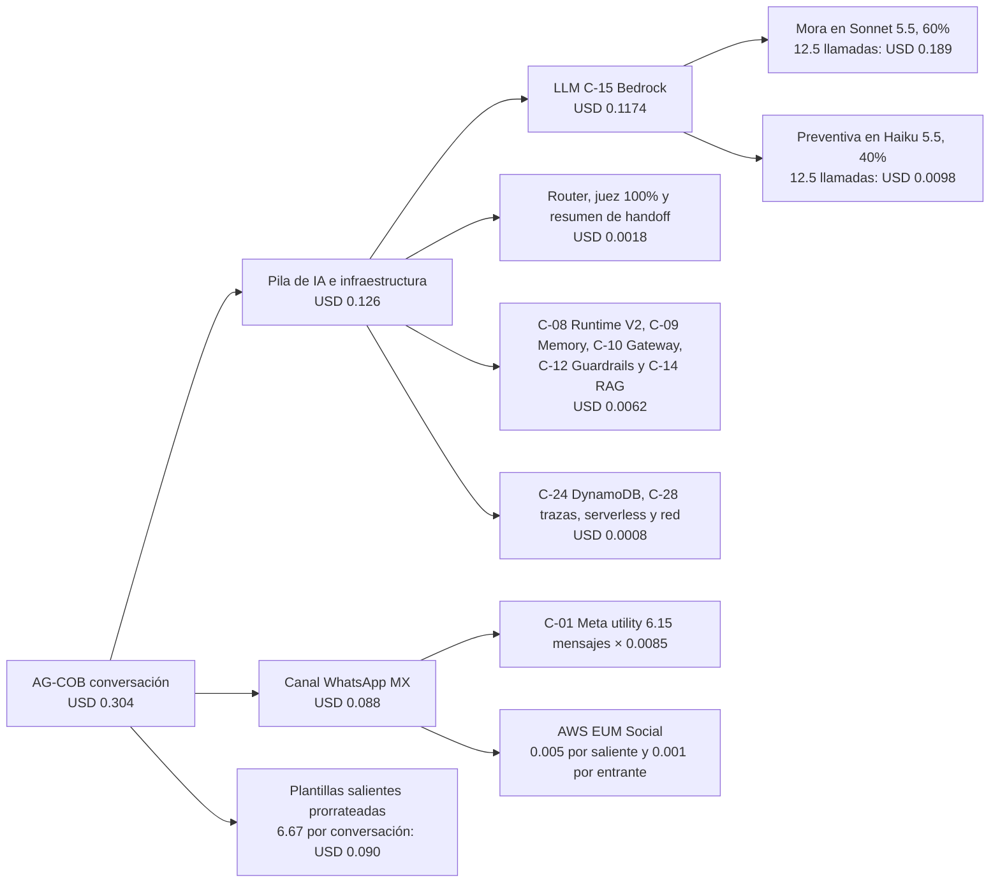
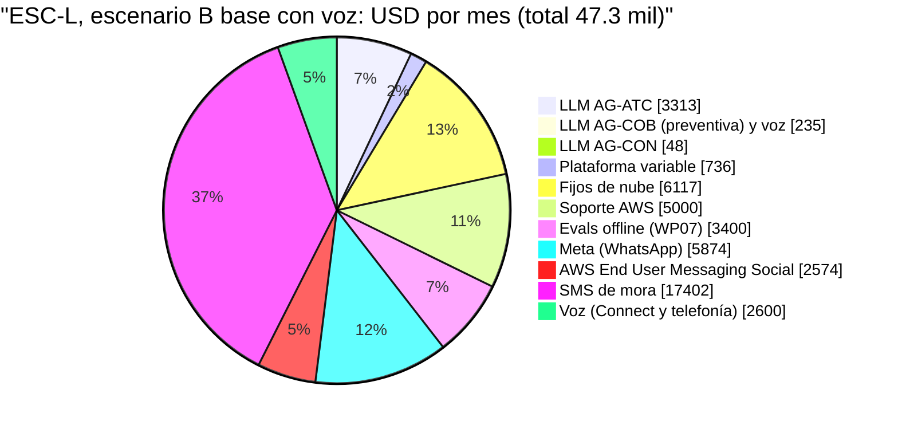

# WP08 · Costos de infraestructura y unit economics

| Campo | Valor |
|---|---|
| Encargo | 02-encargos/WP08-costos-y-unit-economics.md |
| Autor | Agente Claude Sonnet 5.5 · corrida 2026-11-16 y 2026-11-17 |
| Versión | 1.0 |
| Insumos leídos | `README.md`; `00-orquestacion/01-CONVENCIONES.md` y `02-PLANTILLA-ENTREGABLE.md`; `01-contexto/10` a `17` (completos); `02-encargos/WP08-costos-y-unit-economics.md`; `03-entregables/_GATE-1.md` (completo; §4, §5 y §7 como verdad de la oleada); `03-entregables/README.md` (sin decisiones humanas registradas: rigen los valores por defecto del gate, "no confirmada"); de WP01 a WP06: §0 y los apartados de costos, volúmenes y capacidad (WP03 2.3, 2.5, 2.8, 2.9; WP04 2.3.11 a 2.3.14; WP05 2.1.h, 2.3, 2.4, 2.12 y el registro de cambios post-Gate 1); y los avisos del orquestador sobre WP07 (costo de calidad), WP11 (soporte y costo de servir) y los parches de WP03 y WP05 |
| Acceso web en esta corrida | Sí. Fuentes oficiales leídas el 2026-11-16 y 2026-11-17: **AWS Price List Bulk API** (publicación del 2026-09-11 al 2026-11-16 según el servicio), páginas oficiales de precios de AWS, **rate card oficial de Meta (USD, vigente desde el 2026-10-01)**, CSV oficial de AWS End User Messaging SMS y documentación de Anthropic sobre Bedrock. El detalle y los pendientes están en el Anexo A. |
| Estado | Completo con pendientes (ver §6): quedan en `[VERIFICAR]` el precio de Bedrock por lotes para Claude 5.5, la tarifa de voz de Connect por tipo de destino, el costo de Kinesis Video Streams y Contact Lens, y los costos de seguridad por uso |

## 0. Resumen ejecutivo

- **Costo mensual (cloud y canal, sin personas), escenario B base con voz:** **USD 9.6 mil en ESC-P, 47.3 mil en ESC-L y 168 mil en ESC-E**, es decir, USD 15.8 mil por tenant en ESC-L y 0.49 por conversación (todo incluido). Con **A** (Meta confirma): 7.9 / 36.1 / 128 mil (sin voz). **B-estricto**: 10.8 / 55.4 / 193.8 mil. B cuesta **1.3 veces A** en total y **2.1 veces en canal** (§2.4).
- **Costo por conversación (pila sin canal, mezcla base, `us.`):** **AG-ATC USD 0.062** (techo 0.15; todo-Sonnet 0.112; económica 0.043) y **AG-COB USD 0.126** (techo 0.25; mora en Sonnet 0.198; preventiva en Haiku 0.019). Con el canal de MX, ATC suma 0.073 de WhatsApp (0.135 en total) y una conversación de COB con sus plantillas cuesta 0.304; en PE el canal es 3 veces la pila. La pieza de AG-CON cuesta 0.24 (techo 0.40) y el minuto de voz 0.064 a 0.096 (§2.2 y §2.5).
- **El canal, no el LLM, domina el costo.** En ESC-L (B) el **SMS de mora es el 37%** (USD 17.4 mil; el precio oficial va de 0.03 en BR a 0.23 en PE), Meta y AWS el 18%, lo fijo y el soporte el 23%, los evals el 7% y **el LLM de conversación solo el 7.6%**. El país mueve el total más que cualquier otra variable de infraestructura: con el 100% del volumen de ESC-L en PE el total es 71.9 mil frente a 32.3 mil en CO (2.2 veces) (§2.5).
- **Verificación de precios (hoja oficial de AWS y de Meta):** el rate card de Meta de octubre de 2026 coincide con el canon del gate; pero **el endpoint `us.` cuesta 1.10 × el global (no es el precio base)**, **la lectura de caché de Sonnet 5.5 es 0.10 global y 0.11 en `us.`, no 0.05**, **Transcribe cuesta 0.010 (no 0.024)**, la telefonía publicada de Connect es mucho menor que el sustituto del gate, y en `sa-east-1` **el NAT y los endpoints cuestan 2.1 veces** lo supuesto (la red de producción es USD 858 al mes y, con staging y dev, USD 1,737). No hay SKU de lotes para Claude 5.5 (`P-06` = 0%). Seis conflictos con el gate, declarados en §3 (ninguno es `[CAMBIO-ADR]`).
- **Comprobación de orden de magnitud del gate** (LLM de conversación): recalculado con los precios del gate sale **1.15 / 6.84 / 34.1 mil** (±5% de 1.2 / 6.9 / 34 mil); con los precios verificados, **1.28 / 7.65 / 38.2 mil (+7% a +12%)**. En B base el LLM queda ~48% por debajo del gate, porque 60% de la cobranza deja de ser conversación con LLM (§2.4.4).
- **Costos fijos y compartidos:** **USD 5.1 / 14.5 / 27.2 mil al mes** (con soporte y evals offline), 4 a 8 veces el LLM en ESC-P; la plataforma no tiene costo fijo por tenant (≈ USD 35 por operación). El costo de nube del build (16 semanas) es **≈ USD 16 mil** (§2.3 y §2.8).
- **Márgenes frente a S-65 (solo cloud y canal; precios de WP01 como hipótesis):** el bloque **ATC + plataforma** da 72% a 76% en ESC-L y 81% en ESC-E con la hipótesis "medio" (cumple 65% y 75%), pero **no con "bajo"** (44% a 62%). Por tenant (ESC-L): 79%, 77% y 67%; por país (ESC-E): CO 86%, BR y MX 82%, CL 75%, AR 74% y PE 73%. **COB y CON no tienen precio:** para llegar a S-65 deben aportar USD 85 mil al mes en ESC-L (B), es decir, **USD 0.34 por contacto saliente** (0.22 con A). **Incluyendo el costo de servir en personas de WP11, el margen es negativo (−75% en ESC-L)** (§2.4.6).
- **Palancas:** en B el LLM pesa poco, así que las palancas de modelo (caché incremental −31% a −37% por conversación, Haiku, effort) ahorran 4.6% del total de ESC-L en B y 14% en A. Las grandes son de canal: **que Meta confirme A (−USD 11.2 mil, −24%)**, salir de End User Messaging Social hacia Meta directa (−2.2 mil neto) y reducir contactos por SMS (−1.7 mil por cada 10%) (§2.7).
- **Sensibilidad principal (ESC-L, B):** precio por SMS (rango 37% del total; a 2 segmentos el total sube a 64.7 mil), turnos por conversación (20%), `p_prev` (15%) y precio de Meta (12%); `us.` frente a `global.` solo 0.7%, y la lectura de caché 0.05 frente a 0.10, 0.4% (§2.6).
- **Decisiones y entregas:** el modelo y el CSV (1,615 filas, reconciliados con las tablas) usan precios verificados `us.`, B base con voz ×1, LLM conservador y `P-06` = 0% (el −50% de lotes solo como sensibilidad). **Preguntas bloqueantes para WP09:** B1 (Meta), definición del margen S-65 (con o sin personas) y precio de la cobranza por contacto (§6).

## 1. Alcance

**Cubre:** la hoja de precios verificada; el costo variable por unidad (conversación de AG-ATC y de AG-COB, plantilla saliente, minuto de voz, pieza de AG-CON); los costos fijos por entorno y celda; el costo mensual por escenario (ESC-P, ESC-L y ESC-E) con las tres lecturas de cobranza (A, B base y B-estricto), con voz y sin voz; la variación por país; la sensibilidad; las palancas; el costo de nube durante el build; los controles de costo; y el resumen que consume WP09. Entrega además `03-entregables/WP08-modelo-costos.csv` con los insumos y las fórmulas.

**No cubre:** precios al cliente (WP09); costo del equipo humano, del onboarding y del costo de servir en personas (WP11 y WP12; aquí solo se citan); costos legales y de certificaciones (`S-G1-42`, sin fuente); el costo de la celda B en `mx-central-1` (no se activa en el caso base; ver §2.3); el costo de Sora Core.

## 2. Contenido principal

### 2.1 Hoja de precios verificada

**Método.** Descargué la **AWS Price List Bulk API** (fuente oficial de precios de AWS, con fecha de publicación por servicio) y filtré por región y dimensión con Python; leí las páginas oficiales de precios de AWS donde la lista no alcanza; y descargué el **rate card oficial de Meta** (el archivo "Tarifas en USD" enlazado desde `developers.facebook.com/docs/whatsapp/pricing`, hoja "List rates", "effective October 1, 2026"). Estado: **V** = leído en fuente oficial en esta corrida; **V-sec** = leído en un agregador que reproduce el precio de AWS; **G** = valor del gate sin verificar; **[VERIFICAR]** = no confirmado. Región por defecto de la celda: `sa-east-1`; la inferencia y la voz salen a `us-east-1` (§4.2 y §4.5 del gate). Fuentes numeradas en el Anexo A.

#### a) Bedrock: modelos Claude 5.5 (USD por millón de tokens)

| Modelo y endpoint | Entrada | Salida | Lectura de caché | Escritura 5 min | Escritura 1 h | Fuente y estado |
|---|---|---|---|---|---|---|
| Sonnet 5.5 · global (`global.`) | 2.00 | 10.00 | **0.10** | 2.50 | 4.00 | [F1] Price List `AmazonBedrockFoundationModels`, 2026-11-09. **V** |
| Sonnet 5.5 · geográfico `us.` (regional) | **2.20** | **11.00** | **0.11** | **2.75** | **4.40** | [F1] SKU "Standard" no global en `us-east-1`, `us-east-2` y `us-west-2`. **V** |
| Haiku 5.5 (≤ 100 K tokens) · global | 0.10 | 0.50 | 0.01 | 0.125 | 0.20 | [F1] **V** |
| Haiku 5.5 (≤ 100 K tokens) · `us.` | **0.11** | **0.55** | **0.011** | **0.1375** | **0.22** | [F1] **V** |
| Haiku 5.5 (> 100 K tokens) · global / `us.` | 0.50 / 0.55 | 2.50 / 2.75 | 0.05 / 0.055 | 0.625 / 0.6875 | 1.00 / 1.10 | [F1] **V** (no se usa: los prompts son ≤ 100 K) |
| Opus 5.5 · global | 4.00 | 20.00 | 0.20 | 5.00 | 8.00 | [F1] **V** |
| Opus 5.5 · `us.` | **4.40** | **22.00** | **0.22** | **5.50** | **8.80** | [F1] **V** |
| Batch, Flex, Priority y Reserved para Claude 5.5 | n/d | n/d | n/d | n/d | n/d | [F1] **no existe ningún SKU de lotes** para los tres modelos 5.5. [F2] dice que Bedrock ofrece batch "a 50% menos" para "modelos seleccionados" sin listar cuáles. **[VERIFICAR]**: se mantiene `P-06` = 0% (`S-G1-15`) |
| `sa-east-1` y `mx-central-1` | solo SKU "Global" | | | | | [F1]: en estas regiones solo existen precios `global.`; no hay endpoint en región ni geográfico de LatAm. Confirma `_GATE-1` §4.2 |

**Tres hallazgos que contradicen el canon del gate (detalle en §3, `D-WP08-01` a `D-WP08-03`):**

1. **El endpoint `us.` cuesta 1.10 veces el global**, no igual a él. [F1] lo confirma en las tres familias y [F4] lo dice por escrito ("Regional endpoints include a 10 percent pricing premium over global endpoints"). El gate toma `P-01` a `P-05` (que son el precio global) como precio de `us.` y trata `global.` como "10% más barato". Con los precios oficiales, **`us.` es 10% más caro que `P-01..P-05` y `global.` es igual a `P-01..P-05`**.
2. **La lectura de caché de Sonnet 5.5 es 0.10 en el endpoint global, no 0.05.** [F3] dice que la lectura de caché de Sonnet 5.5 y Opus 5.5 vale **0.05 × la entrada base** (2.00 × 0.05 = **0.10**) y [F1] lista 0.10 (global) y 0.11 (`us.`). El aviso de [F2] ("desde el 7-oct-2026 la lectura de caché de Sonnet 5.5 baja 50%") se interpreta como el paso de 0.20 (0.1 × entrada) a 0.10 (inferencia mía: [F2] no da el precio previo; [F3] y [F1] solo muestran el vigente). `P-02` = 0.10 **ya era** el precio rebajado; el 0.05 de `S-G1-16` habría aplicado la rebaja dos veces. El impacto es pequeño (≈ +1.8% por llamada de ATC), pero el valor 0.05 no existe en ninguna fuente oficial.
3. **Escritura de caché 1.25× y 2× se confirman** (2.50 y 4.00 en global) y el modo 5 min es el correcto para tráfico de día (`_GATE-1` §4.4).

#### b) Bedrock AgentCore, Guardrails, Knowledge Bases y otros de IA

| Servicio y dimensión | Precio | Región | Fuente y estado |
|---|---|---|---|
| AgentCore Runtime V2 · vCPU activa | 0.1276 USD/vCPU-h | `sa-east-1` y `us-east-1` (igual) | [F5] y [F1] `AmazonBedrockAgentCore` 2026-11-13. **V**. V1 = 0.0895 y 0.00945 (no aplica) |
| AgentCore Runtime V2 · memoria | 0.0169 USD/GB-h | ídem | **V**. Facturación por segundo; memoria inactiva se libera a los 120 s [F5] |
| AgentCore Runtime · *committed baseline* V2 | 0.0997 y 0.0132 | ídem | [F5]: "launching by October 2026": **no disponible hoy** `[VERIFICAR]`; ahorro posible de 22% en cómputo |
| AgentCore Memory (corto plazo) | ingestión 1.00 USD/GB; recuperación 0.20 USD/GB; almacenamiento 0.10 USD/GB-mes; **0.00 por evento** | `sa-east-1` | **V**. Cada evento se factura con mínimo de 12 KB y máximo de 64 KB [F5] |
| AgentCore Memory (largo plazo, apagada por defecto) | almacenamiento 0.00075 por memoria-mes (propia: 0.00025); recuperación 0.0005 | `sa-east-1` | **V**; no se usa (`§4.13` del gate) |
| AgentCore Gateway | 0.005 USD por 1,000 invocaciones; 0.025 por 1,000 búsquedas; 0.02 por 100 herramientas indexadas al mes; 0.006 USD/GB hacia VPC del cliente | `sa-east-1` | **V** [F5] |
| AgentCore Policy | 0.000025 USD por autorización; generación en lenguaje natural 130 USD por millón de tokens | `sa-east-1` | **V** |
| AgentCore Identity | 0.010 USD por 1,000 solicitudes de token a recursos que no son de AWS; sin cargo vía Runtime o Gateway | n/a | **V** [F5] (no figura en la Price List) |
| AgentCore Observability | se factura como CloudWatch | n/a | **V** [F5] |
| AgentCore Evaluations (integradas) | 0.0024 USD por 1,000 tokens de entrada y 0.012 por 1,000 de salida; personalizadas 1.50 por 1,000 evaluaciones; por lotes −25% | `sa-east-1` | **V** [F5] y [F1]. **No se usan** en el caso base (WP07 recomienda juez propio con Haiku 5.5) |
| Guardrails | 0.15 por 1,000 *text units* (filtros de contenido y temas denegados); 0.10 (PII de pago y *grounding*); regex y listas de palabras gratis; Classic y Standard al mismo precio | `us-east-1` (igual en la celda) | **V** [F2] y [F1] `AmazonBedrock`. El gate usa 3 políticas × 0.15 (conservador) |
| Knowledge Bases | recuperación 0.001 USD por consulta; almacenamiento administrado 5.00 USD/GB-mes | `sa-east-1` | **V** [F1] `AmazonKnowledgeBase` 2026-10-26 |
| S3 Vectors | almacenamiento 0.11 USD/GB-mes; escritura 0.35 USD/GB; solicitudes ≈ 0.000097; bytes devueltos 0.01 USD/GB | `sa-east-1` | **V** [F1] `AmazonS3` 2026-11-16 |
| Stable Image Core 1.0 | **0.04 USD por imagen** (`us-west-2` y también SKU en `us-east-1`) | `us-west-2` | **V** [F1] `AmazonBedrockFoundationModels` ("SI-Core-V1"). Cota baja del proxy 0.04 a 0.08; el SKU en `us-east-1` puede permitir un satélite único con la voz `[VERIFICAR]` |
| Nova Sonic 2.5 (S2S, solo reto del bake-off) | voz entrada 3.00 y salida 12.00 USD por millón de tokens; texto entrada 0.33 y salida 2.75 | `us-east-1` | **V** [F1] `AmazonBedrock`; `~0.02 USD/min` de WP05 con 25 tokens/s se mantiene |

#### c) Canal: WhatsApp (Meta), SMS y voz

**Rate card de Meta (USD por mensaje entregado, vigente desde el 2026-10-01).** Leído del archivo oficial [F6]: **coincide al centavo con el canon de `_GATE-1` §4.6** en los seis países, y confirma que **servicio = utility = authentication** en todos.

| País | Marketing | Utility | Authentication | Servicio (tras 1,000 gratis por número y mes) | SMS (USD por mensaje) | Telefonía de Connect saliente (USD/min) |
|---|---|---|---|---|---|---|
| MX | 0.0397 | 0.0085 | 0.0085 | 0.0085 | **0.10000** | 0.0075 |
| CO | 0.0125 | 0.0008 | 0.0008 | 0.0008 | **0.05087** | 0.0217 |
| BR | 0.0625 | 0.0068 | 0.0068 | 0.0068 | **0.03000** | 0.0389 |
| PE | 0.0703 | 0.0300 | 0.0300 | 0.0300 | **0.23252** | 0.0067 |
| CL | 0.0889 | 0.0200 | 0.0200 | 0.0200 | **0.05178** | 0.0090 |
| AR | 0.0618 | 0.0260 | 0.0260 | 0.0260 | **0.09449** | 0.0320 |
| Resto de Latinoamérica / Otros | 0.0740 / 0.0604 | 0.0113 / 0.0077 | igual a utility | igual a utility | 0.03 a 0.37 (CSV) | n/a |

Fuentes: Meta [F6] (hoja "List rates"); SMS: CSV oficial de AWS End User Messaging [F7], "All Networks, All number types"; telefonía: Price List `ContactCenterTelecomm` (servicio de AMCS vendido por AWS) en `us-east-1`, 2026-09-15 [F1]. Estado: Meta **V**; SMS **V** (y coincide con el parche de WP05); telefonía **V**, pero el apéndice de AWS la describe como tarifa **combinada** de fijo, móvil y destinos caros [F8], por lo que el costo real por destino móvil `[VERIFICAR]`: la alternativa del gate (tarifa a móvil de End User Messaging voz: MX 0.051, CO 0.095, BR 0.207, PE 0.073, CL 0.123, AR 0.350) queda como sensibilidad.

**Nota sobre una copia con tarifas menores.** WP05 (parche post-Gate 1) leyó una copia del rate card publicada por AWS con valores 24.6% menores que el canon y mantuvo el canon del gate. El archivo oficial de Meta [F6] coincide con el canon, no con esa copia; **el −24.6% se conserva solo como sensibilidad** (§2.6: −USD 1.4 mil en ESC-L, B).

**Descuentos por volumen de Meta** (hoja "Volume tiers" [F6]): solo para utility y authentication, por portafolio. La tarifa de lista llega hasta 1 M mensajes por mes en MX, 250 mil en BR y 100 mil en CO, PE, CL y AR; por encima baja 5% (AR: 0.0247 de 100 mil a 1 M). **No se modelan** (el gate lo excluye): el efecto máximo en ESC-E es −5% sobre la parte utility de CO, PE, CL y AR.

| Concepto | Precio | Fuente y estado |
|---|---|---|
| AWS End User Messaging Social (WhatsApp): cargo de AWS | 0.005 USD por mensaje saliente; 0.001 por entrante | [F7] **V** |
| WhatsApp Calling (llamadas del negocio) | AWS 0.005 USD/min saliente y 0.001 entrante, más la tarifa de Meta por país (no leída) | [F7] **V** parcial; no se usa (la voz va por Connect) |
| SMS: cargos fijos de código corto | BR 330 de alta y 330/mes (4 semanas); CL 253 de alta y 253/mes (16 semanas); CL código largo 21/mes | [F7] **V** (resto de países: pedir por Soporte `[VERIFICAR]`) |
| Amazon Connect: minuto de voz | **0.038 USD/min** más telefonía | [F8] **V**. La Price List aún lista el SKU clásico de 0.018 ("End customer minutes") y el de "AI voice minutes" 0.038; se usa 0.038 (gate) y 0.018 queda como sensibilidad |
| Connect: DID por día | MX 0.27; CO 0.0037; PE, CL y AR 0.50; BR no listado (proxy 0.50 `[VERIFICAR]`) | [F1] `ContactCenterTelecomm` **V** |
| Transcribe streaming (estándar) | **0.010 USD/min** (0.0001667 USD/s); batch 0.006 | [F1] `transcribe` 2026-09-11 y [F9]. **V**. `P-15` = 0.024 está obsoleto |
| Polly | Neural 16 USD por millón de caracteres; generative 30; long-form 100; estándar 4 | [F9] y [F1] `AmazonPolly` 2026-10-22. **V** |
| Connect: Kinesis Video Streams para el audio, Contact Lens, grabaciones | n/d | **[VERIFICAR]**: no están en el modelo; ver §2.2 |

#### d) Infraestructura general y soporte

| Servicio y dimensión | Precio | Región | Fuente y estado |
|---|---|---|---|
| NAT Gateway | **0.093 USD/h** (67.9 USD/mes) y 0.093 USD/GB | `sa-east-1` | [F1] `AmazonEC2` (lista regional) 2026-11-14. **V**. El gate usó ~33 USD/mes (precio de `us-east-1`: 0.045 `[VERIFICAR]`) |
| Interface endpoint (PrivateLink) | **0.021 USD/h por endpoint y AZ** (15.3 USD/mes; 46 USD/mes con 3 AZ) y 0.01 USD/GB | `sa-east-1` | [F1] `AmazonVPC` 2026-11-05. **V**. En `us-east-1`: 0.01 USD/h. El gate usó ~22 USD/mes por endpoint |
| IPv4 pública | 0.005 USD/h | `sa-east-1` | **V** |
| Transferencia entre regiones `sa-east-1` a `us-east-1` | 0.138 USD/GB | `sa-east-1` | [F1] `AWSDataTransfer` **V**; aplica a cada llamada a Bedrock en `us-east-1` desde la celda (el gate no la contó) |
| Step Functions Standard | 0.0000375 USD por transición (`us-east-1`: 0.000025) | `sa-east-1` | [F1] `AmazonStates` 2026-11-04 **V** |
| Step Functions Express | 0.000001 USD por solicitud + 0.00001667 USD por GB-s | `sa-east-1` | **V** |
| DynamoDB on-demand | escritura 0.9375 y lectura 0.1875 USD por millón; almacenamiento 0.375 USD/GB-mes (25 GB gratis); PITR 0.30 USD/GB-mes | `sa-east-1` | [F1] `AmazonDynamoDB` 2026-11-11 **V** |
| CloudWatch Logs | ingestión **0.90 USD/GB**; almacenamiento 0.0408 USD/GB-mes; consultas Insights 0.009 USD/GB; métrica personalizada 0.30 USD/mes (primeras 10,000) | `sa-east-1` (`us-east-1`: 0.50 y 0.03) | [F1] `AmazonCloudWatch` 2026-11-16 **V**. `P-20` = 0.50 es el precio de `us-east-1` |
| KMS | 1.00 USD por clave y mes; 0.03 USD por 10,000 solicitudes | ambas | [F1] `awskms` 2026-11-08 **V** |
| Secrets Manager | 0.40 USD por secreto y mes; 0.05 por 10,000 llamadas | `sa-east-1` | **V** |
| Lambda | 0.0000166667 USD/GB-s; 0.0000002 por solicitud | `sa-east-1` | **V** |
| SQS FIFO / estándar | 0.50 / 0.40 USD por millón de solicitudes | `sa-east-1` | **V** |
| EventBridge Scheduler | 0 por los primeros 14 M; 1.70 por millón | `sa-east-1` | **V** |
| API Gateway (WebSocket) | 1.55 USD por millón de mensajes | `sa-east-1` | **V** |
| WAF | 5 USD por Web ACL y mes; 1 USD por regla | `sa-east-1` | [F1] `awswaf` **V** |
| Shield Advanced | 3,000 USD/mes (la primera suscripción de la organización; las adicionales 0) | global | [F1] `AWSShield` **V** |
| Macie | 0.0225 USD por 100 K objetos; Macie **sí existe en `sa-east-1`** (WP03 lo marcó n/d) | `sa-east-1` | [F1] `AmazonMacie` **V** |
| GuardDuty | 1.75 USD/GB los primeros 500 GB de flujos y DNS; 0.00000176 por evento de datos S3 | `sa-east-1` | **V** |
| AWS Network Firewall | 0.395 USD por endpoint y hora (288 USD/mes por endpoint) | `sa-east-1` | **V**; no está en el caso base (mejora opcional) |
| S3 Standard | 0.0405 USD/GB-mes (primeros 50 TB) | `sa-east-1` | [F1] `AmazonS3` 2026-11-16 **V** |
| **Soporte de AWS** | **Business Support+**: 9% de los primeros 10 mil USD de uso, 7% hasta 80 mil, 5% hasta 250 mil, 3% después, mínimo 29 USD por cuenta. **Enterprise**: 10% hasta 150 mil, 7% hasta 500 mil, 5% hasta 1 M, 3% después, **mínimo 5,000 USD/mes**. **Unified Operations**: mínimo 50,000 | global | [F10] **V**. La Price List aún lista el plan Business anterior (10/7/5/3%, mínimo 100). El aviso de WP11 sobre la discontinuación de Developer, Business y Enterprise On-Ramp el 2027-01-01 **no se pudo confirmar** en [F10] `[VERIFICAR]` |

#### e) Diferencias de precio por región

| Servicio | `us-east-1` | `sa-east-1` | `mx-central-1` | Efecto |
|---|---|---|---|---|
| Claude 5.5 | global y `us.` | solo `global.` (mismo precio que global de `us-east-1`) | solo `global.` | La ruta `us.` solo existe llamando a `us-east-1`; costo adicional de red (NAT y transferencia) en la celda |
| NAT Gateway | 0.045 USD/h | **0.093 (2.1×)** | n/d | +100% en red de la celda |
| Interface endpoint | 0.01 USD/h | **0.021 (2.1×)** | n/d | La red fija de la celda cuesta el doble que el supuesto del gate |
| CloudWatch Logs (ingestión) | 0.50 | **0.90 (1.8×)** | n/d | Telemetría |
| DynamoDB escritura / lectura (millón) | 0.625 / 0.125 | **0.9375 / 0.1875 (1.5×)** | n/d | Marginal |
| Step Functions Standard | 0.000025 | **0.0000375 (1.5×)** | n/d | W-01 |
| AgentCore Runtime V2, Gateway, Policy, Memory | igual | igual | **no existe AgentCore** `[F1][F5]` | Sin diferencia en `sa-east-1`; `mx-central-1` bloqueada |
| Connect, Transcribe, Polly | base de la hoja | no existen Connect ni Transcribe streaming de LatAm (voz en satélite) | n/d | Voz en `us-east-1` |

#### f) Reemplazo de los precios de referencia `P-xx`

| ID | Valor de `13-SUPUESTOS` | Valor verificado | Cambio |
|---|---|---|---|
| P-01 | Sonnet 5.5 2.00 / 10.00 | global igual; **`us.` 2.20 / 11.00** | `us.` +10% |
| P-02 | lectura de caché Sonnet 0.10 | global **0.10**; `us.` **0.11** (el gate usó 0.05) | confirmado; el canon 0.05 queda como sensibilidad inferior |
| P-03 | escritura 1.25× (5 min) y 2× (1 h) | confirmado | = |
| P-04 | Haiku 5.5 0.10 / 0.50 | global igual; `us.` 0.11 / 0.55 | `us.` +10% |
| P-05 | Opus 5.5 4.00 / 20.00 / 0.20 | global igual; `us.` 4.40 / 22.00 / 0.22 | `us.` +10% |
| P-06 | batch −50% | sin SKU para Claude 5.5 | 0% (gate) `[VERIFICAR]` |
| P-07 | `us.` o global ~10% de diferencia | **`us.` = 1.10 × global** (confirmado) | el sentido de la diferencia se invierte respecto al canon |
| P-08 | AgentCore 0.0895 y 0.00945 | V2: **0.1276 y 0.0169** | ya corregido por el gate |
| P-09 | AgentCore resto n/d | ver tabla b) | verificado |
| P-10, P-11 | WhatsApp: rangos | tabla c) (rate card oficial) | verificado |
| P-12 | AWS 0.005 por mensaje | 0.005 saliente y 0.001 entrante | confirmado |
| P-13 | Connect 0.018 | **0.038** más telefonía (la Price List lista ambos) | el gate usó 0.038 |
| P-14 | Nova Sonic n/d | voz 3.00 / 12.00 USD por millón de tokens | verificado (reto del bake-off) |
| P-15 | Transcribe 0.024 | **0.010** USD/min | −58% |
| P-16 | Polly neural 16 | 16 (generative 30) | confirmado |
| P-17 | imagen 0.04 a 0.08 | Stable Image Core **0.04** | cota baja |
| P-18 | Guardrails 0.15 | 0.15 (contenido, temas); 0.10 (PII de pago y *grounding*) | confirmado |
| P-19 | vector store | S3 Vectors 0.11 USD/GB-mes; sin mínimo fijo | verificado |
| P-20 | CloudWatch 0.50 | **0.90** en `sa-east-1` | +80% |
| P-21 | `sa-east-1` más caro | NAT y endpoints 2.1×, CloudWatch 1.8×, DynamoDB 1.5× | cuantificado |

### 2.2 Modelo de costo por unidad

**Convenciones de esta sección.** Todo en USD. El **caso base** de precios es el **verificado con endpoint `us.`** (§2.1: 1.10 × global); el **canon del gate** se reproduce aparte para conciliar con la comprobación de orden de magnitud (§2.4.4). Volúmenes, mezcla y forma de la conversación son los del gate (`S-20` a `S-29`, `_GATE-1` §4.4): llamadas por conversación `S-20 × S-21` (ATC 8.0; COB 12.5; voz 12), salidas `S-24` (350, 400, 150), acierto de caché 85%, `p_prev` = 40%, 50% de las conversaciones de ATC en Haiku, juez en el 10% de ATC y, por WP07, en el **100% de COB**. "Pila" = LLM + router + juez + resumen de handoff + Runtime + Memory + Gateway/Policy + Guardrails + RAG + DynamoDB + telemetría + serverless + red hacia `us-east-1`, **sin canal** (definición de los techos, `_GATE-1` §4.8). Las tasas de handoff son las de ESC-L (ATC 12%, COB 18%).

**Fórmulas.**

```
costo_llamada = [ P·h·r + P·(1−h)·w + V·i + S·o ] / 10^6                        (13 §H)
  P prefijo cacheable, h acierto, r lectura, w escritura 5 min, V variable, i entrada, S salida, o precio de salida
costo_conversación_LLM = llamadas × costo_llamada     (ATC 8.0; COB 12.5; voz 12; CON 3 por pieza)
Runtime   = 0.5 vCPU × (4 s × llamadas / 3,600) × 0.1276 + 1 GB × (600 s / 3,600) × 0.0169          (S-G1-21)
Memory    = (2 eventos × turnos × 12 KB) × 1.00 USD/GB + (turnos × 24 KB) × 0.20 USD/GB
Gateway   = herramientas × (2 × 0.000005 + 0.000025 de Policy)    (ATC 1.0 y COB 1.5 herramientas por turno)
Guardrails= 3 políticas × 0.7 text units × turnos × 0.15 / 1,000                                   (S-G1-22; pt-BR: apagado)
RAG       = consultas × 0.001  (ATC 1.5; COB 0.5)
Telemetría= turnos × 44 KB × 0.90 USD/GB                                                         (S-44, sa-east-1)
Red       = (llamadas LLM + llamadas del router) × 43 KB × (0.093 NAT + 0.138 entre regiones) USD/GB   (S-NUEVO-4)
```

#### 2.2.a Costo por llamada de LLM (insumos y resultado)

| Llamada (prefijo cacheable / variable / salida; acierto 85%) | Canon del gate | Verificado `us.` (base) | Verificado `global.` |
|---|---|---|---|
| ATC en Sonnet 5.5 (5,000 / 3,000 / 350) | 0.01159 | 0.01298 | 0.01180 |
| ATC en Haiku 5.5 | 0.00061 | 0.00067 | 0.00061 |
| COB en Sonnet 5.5 (6,000 / 3,500 / 400) | 0.01350 | 0.01514 | 0.01376 |
| COB en Haiku 5.5 | 0.00071 | 0.00078 | 0.00071 |
| Voz en Haiku 5.5 (4,000 / 2,500 / 150) | 0.00043 | 0.00048 | 0.00043 |
| CON en Sonnet 5.5 (8,000 / 6,000 / 2,500; acierto 50%) | 0.04720 | 0.05214 | 0.04740 |
| Router Haiku 5.5 por mensaje (1,100 / 400 / 80; acierto 95%) | 0.00010 | 0.00011 | 0.00010 |
Ejemplo (ATC en Sonnet 5.5, `us.`): `(5,000 × 0.85 × 0.11) + (5,000 × 0.15 × 2.75) + (3,000 × 2.20) + (350 × 11.00) = 467.5 + 2,062.5 + 6,600 + 3,850 = 12,980` ÷ 10⁶ = **USD 0.01298**. Con el canon del gate: `212.5 + 1,875 + 6,000 + 3,500 = 11,587.5` ÷ 10⁶ = 0.01159 (la diferencia es +12%: 10% del endpoint `us.` y 1.7 puntos de la lectura de caché).

#### 2.2.b Conversación de AG-ATC (chat)

`Costo ATC = Σ componentes` (tabla); el LLM de la conversación es `sh × 8.0 × c_Haiku + (1 − sh) × 8.0 × c_Sonnet` con `sh` = 0 (todo-Sonnet), 0.5 (base del gate) y 0.7 (económica, `S-NUEVO-1`).

| Componente (USD por conversación) | Todo-Sonnet | Base (50% Haiku) | Económica (70% Haiku) | Base · canon del gate |
|---|---|---|---|---|
| LLM de la conversación (mezcla) | 0.10384 | 0.05461 | 0.03492 | 0.04880 |
| Router (Haiku) | 0.00043 | 0.00043 | 0.00043 | 0.00039 |
| Juez en línea | 0.00012 | 0.00012 | 0.00012 | 0.00011 |
| Resumen de handoff (prorrateado) | 0.00007 | 0.00007 | 0.00007 | 0.00006 |
| AgentCore Runtime V2 | 0.00338 | 0.00338 | 0.00338 | 0.00338 |
| AgentCore Memory | 0.00012 | 0.00012 | 0.00012 | 0.00012 |
| Gateway, Policy e Identity | 0.00015 | 0.00015 | 0.00015 | 0.00015 |
| Guardrails | 0.00126 | 0.00126 | 0.00126 | 0.00126 |
| RAG (Knowledge Bases) | 0.00150 | 0.00150 | 0.00150 | 0.00150 |
| DynamoDB | 0.00011 | 0.00011 | 0.00011 | 0.00011 |
| CloudWatch (trazas) | 0.00016 | 0.00016 | 0.00016 | 0.00016 |
| Lambda, SQS, EventBridge | 0.00027 | 0.00027 | 0.00027 | 0.00027 |
| Red `sa-east-1` a `us-east-1` | 0.00012 | 0.00012 | 0.00012 | 0.00012 |
| **Pila de IA e infraestructura sin canal** | **0.1115** | **0.0623** | **0.0426** | **0.0564** |

**Lectura.** El LLM es el 89% de la pila en la mezcla base (USD 0.055 de 0.062); el Runtime V2 pesa 5% (0.0034) y los Guardrails 2%. **La mezcla base cuesta 44% menos que todo-Sonnet** (0.062 frente a 0.112) y la económica 32% menos que la base. La pila cumple el techo de USD 0.15 en las tres mezclas.

#### 2.2.c Conversación de AG-COB (chat)

Etapa preventiva (D-5 a D0) en Haiku; mora en Sonnet; `p_prev` = 40% (`S-G1-12`). El costo de canal de la conversación y las **plantillas salientes prorrateadas** (`S-13 ÷ S-14` = 6.67 plantillas por conversación) se suman por país en 2.2.g.

| Componente (USD por conversación) | Todo-Sonnet | Base (`p_prev` 40% en Haiku) | Económica (70% Haiku) | Solo preventiva (Haiku) | Solo mora (Sonnet) | Base · canon del gate |
|---|---|---|---|---|---|---|
| LLM de la conversación (mezcla) | 0.18920 | 0.11744 | 0.06363 | 0.00981 | 0.18920 | 0.10486 |
| Router (Haiku) | 0.00054 | 0.00054 | 0.00054 | 0.00054 | 0.00054 | 0.00049 |
| Juez en línea | 0.00115 | 0.00115 | 0.00115 | 0.00115 | 0.00115 | 0.00105 |
| Resumen de handoff (prorrateado) | 0.00010 | 0.00010 | 0.00010 | 0.00010 | 0.00010 | 0.00009 |
| AgentCore Runtime V2 | 0.00370 | 0.00370 | 0.00370 | 0.00370 | 0.00370 | 0.00370 |
| AgentCore Memory | 0.00014 | 0.00014 | 0.00014 | 0.00014 | 0.00014 | 0.00014 |
| Gateway, Policy e Identity | 0.00027 | 0.00027 | 0.00027 | 0.00027 | 0.00027 | 0.00027 |
| Guardrails | 0.00157 | 0.00157 | 0.00157 | 0.00157 | 0.00157 | 0.00157 |
| RAG (Knowledge Bases) | 0.00050 | 0.00050 | 0.00050 | 0.00050 | 0.00050 | 0.00050 |
| DynamoDB | 0.00013 | 0.00013 | 0.00013 | 0.00013 | 0.00013 | 0.00013 |
| CloudWatch (trazas) | 0.00020 | 0.00020 | 0.00020 | 0.00020 | 0.00020 | 0.00020 |
| Lambda, SQS, EventBridge | 0.00033 | 0.00033 | 0.00033 | 0.00033 | 0.00033 | 0.00033 |
| Red `sa-east-1` a `us-east-1` | 0.00017 | 0.00017 | 0.00017 | 0.00017 | 0.00017 | 0.00017 |
| **Pila de IA e infraestructura sin canal** | **0.1980** | **0.1263** | **0.0724** | **0.0186** | **0.1980** | **0.1135** |

**Lectura.** Una conversación de mora en Sonnet cuesta USD 0.198 de pila, **10.6 veces** una preventiva en Haiku (0.019). Con la mezcla base la pila es 0.126, **por debajo del techo de USD 0.25**; la mora pura (0.198) también cumple. Incluir el juez de cumplimiento al 100% (WP07) agrega USD 0.0012 por conversación.

**Diagrama 2.2-A · Árbol de costo de una conversación de AG-COB por WhatsApp (escenario A, MX, mezcla base, USD)**



La conversación de COB cuesta USD 0.304 en MX: el 41% es pila de IA, el 29% canal y el 30% plantillas que la anteceden. El LLM es el 93% de la pila y la mora en Sonnet explica casi todo el LLM (0.113 de 0.117). Sin las plantillas ni el canal, la mora pura cuesta 0.198 y la preventiva 0.019. En B, las plantillas y la mora salen de esta conversación y se reemplazan por SMS y voz (2.2.e y 2.2.f).

#### 2.2.d Casos de forma de la conversación y caché incremental

Casos pedidos por el gate (§4.4 y §7). USD por conversación, pila sin canal, mezcla base, precios verificados `us.`.

| Caso | AG-ATC | AG-COB | Diferencia frente al base (ATC / COB) |
|---|---|---|---|
| Base (S-20 × S-21, salidas S-24, 85% de caché) | 0.0623 | 0.1263 | +0% / +0% |
| Diseño (6.8 y 10.0 llamadas; salidas 250 y 300) | 0.0501 | 0.0957 | -20% / -24% |
| Calibrado con trazas de WP04 (COB ≈ 0.05 en precios del gate) | 0.0408 | 0.0623 | -34% / -51% |
| Caché incremental del historial (nota de S-23) | 0.0430 | 0.0797 | -31% / -37% |
| Acierto de caché 60% | 0.0761 | 0.1569 | +22% / +24% |
| Acierto de caché 95% | 0.0567 | 0.1140 | -9% / -10% |
| Todo-Sonnet (referencia del paquete) | 0.1115 | 0.1980 | +79% / +57% |
| Mezcla económica (ATC 70% y COB 70% en Haiku) | 0.0426 | 0.0724 | -32% / -43% |
| Lectura de caché de Sonnet 0.05 (en lugar de 0.11) | 0.0613 | 0.1240 | -1.6% / -1.8% |
| Lectura de caché de Sonnet 0.22 (en lugar de 0.11) | 0.0642 | 0.1305 | +3.0% / +3.3% |
| Precios del gate (`us.` = P-01..P-05, lectura 0.05) | 0.0564 | 0.1135 | -9.4% / -10.1% |
| Endpoint `global.` (verificado) | 0.0573 | 0.1154 | -8.1% / -8.6% |

**Cómo se modeló el caché incremental del historial** (nota de `S-23`, `S-NUEVO-3`). La parte variable de la llamada `k` es `V_k = B + x·k`, con `B` = 400 tokens del bloque C de contexto y `x` el contenido nuevo por llamada, calibrado para que el promedio sea `S-23` (3,000 en ATC con 8 llamadas: `x = 578`; 3,500 en COB con 12.5 llamadas: `x = 459`). Con un punto de corte explícito al final del último mensaje, solo se **escribe** el contenido nuevo (`B + N·x` = 5,022 tokens, 21% del total variable en ATC; 14% en COB, a 1.25× la entrada) y el historial anterior se **lee** del caché (79% y 86%, a 0.05 a 0.1 de la entrada). Resultado: **una conversación de ATC en Sonnet baja de USD 0.104 a 0.067 (−36%) y en Haiku de 0.0054 a 0.0036; una de COB en Sonnet de 0.189 a 0.114 (−40%)**. En Bedrock `bedrock-runtime` **no** se admite el caché automático de nivel superior (`cache_control` en la solicitud) y hay que usar puntos de corte explícitos [F4]: el "BP3" de `_GATE-1` §4.4 debe implementarse como un punto de corte manual sobre el último mensaje (cuenta como uno de los 4 permitidos). Por conservador, el caso base **no** lo incluye y se presenta como palanca (§2.7).

**Calibrado con trazas (COB).** La traza de WP04 (8 llamadas, 4 turnos: 16,860 tokens de entrada no cacheados, 49,120 leídos y 1,144 de salida) cuesta `16,860 × 2.00 + 49,120 × 0.05 + 1,144 × 10.00 = 47,616` ÷ 10⁶ = **USD 0.0476 en precios del gate**, que WP04 redondea a 0.05. La brecha de ~3.5× frente al canónico (0.17) no es un error: la traza usa una parte variable de ~2,100 tokens (frente a 3,500), una salida de ~143 (frente a 400) y ya incluye el historial leído de caché. El gate lo pidió como caso aparte; aquí sale **−51% (COB) y −34% (ATC)** frente a la base y es la **cota inferior**. El caso base se mantiene en la cota conservadora hasta que el piloto mida `usage.metered`.

#### 2.2.e Plantilla saliente sin LLM (preventiva) y SMS de mora

`Costo plantilla WhatsApp = tarifa utility del país + 0.005 (AWS) + 12 transiciones × 0.0000375 (W-01 en Step Functions Standard) + 3 invocaciones serverless × 0.00003`. En MX: 0.0085 + 0.005 + 0.00045 + 0.00009 = **USD 0.0140**. El SMS de mora cuesta `precio oficial + 0.00045 + 0.00009`: en MX **USD 0.1005**. Cociente SMS / plantilla utility en la tabla de 2.2.g.

#### 2.2.f Minuto de voz de AG-COB (Connect + Transcribe + Haiku + Polly, motor canónico del gate)

`Costo por minuto = 0.038 (Connect) + telefonía saliente del país + 0.010 (Transcribe) + 0.0054 (Polly: 40% del minuto habla el agente × 840 caracteres × 16 USD/M) + LLM (12 llamadas × 0.00048 ÷ 3.5 min) + runtime, guardrails y red`. No incluye el DID por día (MX 0.27, CO 0.0037, resto 0.50), Kinesis Video Streams, Contact Lens ni el almacenamiento de grabaciones (`[VERIFICAR]`).

| País | Connect | Telefonía saliente | Transcribe | Polly | LLM Haiku | Runtime, guardrails y red | **Total pipeline B** | Por llamada de 3.5 min | Alternativa S2S (Nova Sonic 0.02) | Con telefonía de móvil del gate | Gate (§4.5) |
|---|---|---|---|---|---|---|---|---|---|---|---|
| MX | 0.038 | 0.0075 | 0.010 | 0.0054 | 0.0017 | 0.0018 | **0.0644** | 0.225 | 0.0673 | 0.1079 | 0.1205 |
| CO | 0.038 | 0.0217 | 0.010 | 0.0054 | 0.0017 | 0.0018 | **0.0786** | 0.275 | 0.0815 | 0.1519 | 0.1645 |
| BR | 0.038 | 0.0389 | 0.010 | 0.0054 | 0.0017 | 0.0018 | **0.0958** | 0.335 | 0.0987 | 0.2639 | 0.2765 |
| PE | 0.038 | 0.0067 | 0.010 | 0.0054 | 0.0017 | 0.0018 | **0.0636** | 0.223 | 0.0665 | 0.1299 | 0.1425 |
| CL | 0.038 | 0.0090 | 0.010 | 0.0054 | 0.0017 | 0.0018 | **0.0659** | 0.231 | 0.0688 | 0.1799 | 0.1925 |
| AR | 0.038 | 0.0320 | 0.010 | 0.0054 | 0.0017 | 0.0018 | **0.0889** | 0.311 | 0.0918 | 0.4069 | 0.4195 |

**Lectura.** **El minuto de voz cuesta de 47% a 71% menos que el estimado del gate** (MX 0.064 frente a 0.1205) por dos hallazgos oficiales: la telefonía publicada de Connect es de 0.0067 a 0.039 USD/min (tarifa combinada), no de 0.051 a 0.350 (móvil de End User Messaging), y Transcribe cuesta 0.010 y no 0.024. Si la telefonía a móvil se facturara al precio del gate, el minuto vuelve a 0.108 a 0.407 (penúltima columna). **El S2S de Nova Sonic cuesta lo mismo que el pipeline** (+0.003): el costo no decide el motor; lo deciden latencia, Guardrails y residencia (`_GATE-1` §4.5). El criterio de salida de la fase 1.5 (≤ USD 0.15 por minuto en MX) se cumple con holgura (0.064). **Una llamada de 3.5 minutos cuesta USD 0.22 a 0.34, es decir, entre 0.6 y 1.7 veces una conversación de COB por WhatsApp con pila y canal (0.17 a 0.35, sin plantillas)**, y no de 2 a 14 veces como estimaba WP05 (que la comparaba solo contra el canal y con la telefonía de móvil).

#### 2.2.g Costo por conversación con canal, por país (precios oficiales de Meta y de SMS)

`ATC por conversación de WhatsApp = (5 + 0.1) × (utility + 0.005) + 4 × 0.001` (5 respuestas de servicio, 0.1 plantilla de OTP, 4 entrantes; la tarifa de servicio es igual a utility); `COB = (6 + 0.15) × (utility + 0.005) + 5 × 0.001`; plantillas prorrateadas = `6.67 × (utility + 0.005)`. Coincide con WP05 §2.12.b.

| País | ATC por conv. de WhatsApp: pila + canal = total | ATC promedio (85% WhatsApp, 15% web) | COB por conv. con LLM (A): pila + canal + plantillas prorrateadas = total | Plantilla utility saliente (Meta + AWS) | SMS de mora (oficial) | Cociente SMS / plantilla |
|---|---|---|---|---|---|---|
| MX | 0.0623 + 0.0729 = **0.1351** | 0.1242 | 0.1263 + 0.0880 + 0.0900 = **0.3043** | 0.0135 | 0.1000 | 7.4× |
| CO | 0.0623 + 0.0336 = **0.0959** | 0.0908 | 0.1263 + 0.0407 + 0.0387 = **0.2056** | 0.0058 | 0.0509 | 8.8× |
| BR | 0.0623 + 0.0642 = **0.1265** | 0.1168 | 0.1263 + 0.0776 + 0.0787 = **0.2825** | 0.0118 | 0.0300 | 2.5× |
| PE | 0.0623 + 0.1825 = **0.2448** | 0.2174 | 0.1263 + 0.2203 + 0.2333 = **0.5798** | 0.0350 | 0.2325 | 6.6× |
| CL | 0.0623 + 0.1315 = **0.1938** | 0.1741 | 0.1263 + 0.1588 + 0.1667 = **0.4517** | 0.0250 | 0.0518 | 2.1× |
| AR | 0.0623 + 0.1621 = **0.2244** | 0.2001 | 0.1263 + 0.1957 + 0.2067 = **0.5286** | 0.0310 | 0.0945 | 3.0× |

**Lectura.** (1) **El canal pesa más que la pila de IA en todos los países salvo CO**: en MX una conversación de ATC cuesta 0.062 de pila y 0.073 de WhatsApp; en PE el canal es 3 veces la pila. (2) **El SMS de mora es de 2.1 a 8.8 veces una plantilla de WhatsApp**: es lo que encarece el escenario B. (3) En CL y BR el SMS es relativamente barato (2.1× y 2.5×), pero tienen cargos fijos de código corto (§2.3).

#### 2.2.h Pieza de AG-CON (copy + imágenes + revisión + publicación)

`Pieza = 3 llamadas Sonnet × 0.0521 + 2 imágenes × 0.04 + juez 0.0012 + runtime/guardrails/RAG/telemetría/red/W-04 0.0036` (la publicación en Instagram y Facebook por Graph API no tiene cargo de API [F6 de WP05]). Se mantiene el supuesto del gate de 3 llamadas Sonnet y 2 imágenes generadas por pieza; el **plan editorial mensual** con Opus 5.5 cuesta `8,000 × 5.50 (escritura) + 20,000 × 4.40 + 6,000 × 22.00` ÷ 10⁶ = **USD 0.26 por marca y mes** (despreciable).

| Componente | Base (`us.`) | Con `global.` |
|---|---|---|
| 3 llamadas de Sonnet 5.5 (plan, copy, autocrítica) | 0.1564 | 0.1422 |
| 2 imágenes con Stable Image Core a 0.04 (S-17/S-16 = 2) | 0.0800 | 0.0800 |
| Juez al 100% de las piezas (Haiku) | 0.0012 | 0.0010 |
| Runtime, guardrails, RAG, telemetría, red y W-04 | 0.0036 | 0.0036 |
| **Pieza interactiva (Standard)** | **0.2412** | **0.2269** |
| Sensibilidad P-06 = −50% sobre las llamadas (solo informativa, no entra a márgenes) | 0.1630 | 0.1558 |

**Lectura.** La pieza cuesta **USD 0.24** (techo 0.40): las imágenes son 33% del costo. Si el copy exige las 4 a 6 llamadas reales que advierte el gate (3 más la sub-llamada de T-21), la pieza sube a **0.29 a 0.40**, y llega al techo con 6; con composición determinista y solo 30% de imágenes generativas baja a **0.19**. **No hay "pieza en lotes"**: Bedrock no ofrece lotes para Claude 5.5 (§2.1.a); la fila de −50% es solo informativa y no entra a ningún margen (`P-06` = 0%, `S-G1-15`).

### 2.3 Costos fijos de la plataforma

Costo mensual base, independiente del volumen, de una celda en `sa-east-1` con producción (3 AZ, 3 NAT con IP fija, 14 *interface endpoints*), staging (2 AZ) y dev (2 AZ) más el satélite de voz de `us-east-1` (de ESC-P si hay voz). Precios de §2.1.d. Los entornos de dev y staging **no** se apagan en el caso base; la palanca está en §2.7.

| Concepto (USD por mes) | Entorno | Qué escala | ESC-P | ESC-L | ESC-E |
|---|---|---|---|---|---|
| NAT Gateway prod (3 AZ) horas | prod | fijo por celda y entorno | 204 | 204 | 204 |
| IPv4 publica de NAT (3 EIP) horas | prod | fijo por celda y entorno | 11 | 11 | 11 |
| Interface endpoints prod (14 x 3 AZ) horas | prod | fijo por celda y entorno | 644 | 644 | 644 |
| NAT Gateway staging (1) horas | staging | fijo por celda y entorno | 68 | 68 | 68 |
| Interface endpoints staging (14 x 2 AZ) horas | staging | fijo por celda y entorno | 429 | 429 | 429 |
| NAT Gateway dev (1) horas | dev | fijo por celda y entorno | 68 | 68 | 68 |
| Interface endpoints dev (10 x 2 AZ) horas | dev | fijo por celda y entorno | 307 | 307 | 307 |
| IPv4 publica staging y dev (2 EIP) horas | staging y dev | fijo por celda y entorno | 7 | 7 | 7 |
| WAF prod: 2 Web ACL + 10 reglas | organización y prod | por tenant / por organización | 20 | 20 | 20 |
| KMS claves CMK (prod + staging + dev) | organización y prod | por tenant / por organización | 15 | 19 | 33 |
| Secrets Manager (6 por operacion + 30 base) | organización y prod | por tenant / por organización | 14 | 22 | 46 |
| Linea base de seguridad (GuardDuty, Config, Security Hub, Inspector, CloudTrail datos, Macie) | organización y prod | por tenant / por organización | 400 | 700 | 1,500 |
| CloudWatch metricas personalizadas (WP07) | todos | por operación de país | 30 | 120 | 420 |
| CloudWatch alarmas y dashboards | todos | por operación de país | 60 | 120 | 250 |
| CI/CD, ECR, AppConfig, Route 53, CloudFront consola | todos | compartido | 150 | 250 | 500 |
| Satelite voz us-east-1: NAT (1) horas | satélite `us-east-1` | por satélite | 33 | 33 | 33 |
| Satelite voz us-east-1: endpoints (6 x 2 AZ) horas | satélite `us-east-1` | por satélite | 88 | 88 | 88 |
| Shield Advanced (1 suscripcion de la organizacion) | organización y prod | por tenant / por organización | 0 | 3,000 | 3,000 |
| S3 archivo acumulado (GB promedio) | todos | por volumen retenido | 0 | 1 | 7 |
| DynamoDB almacenamiento + PITR (GB) | todos | por volumen retenido | 1 | 8 | 38 |
| S3 Vectors almacenamiento (GB) | todos | por volumen retenido | 0 | 0 | 0 |
| **Subtotal fijo de nube (sin soporte ni evals)** | | | **2,549** | **6,117** | **7,671** |
| Evals offline (WP07) | | | 1,800 | 3,400 | 6,800 |
| Soporte de AWS (B base: ESC-P Business Support+; ESC-L y ESC-E Enterprise) | | % del uso | 739 | 5,000 | 12,697 |
| **Total fijo y compartido (sin personas)** | | | **5,087** | **14,517** | **27,169** |

**Qué dice la tabla.**

1. **La red fija de producción cuesta USD 858 al mes, 2.1 veces el ~407 que suponía el gate** (3 NAT × 67.9 + 3 IPv4 + 14 endpoints × 3 AZ × 15.3), y con staging (501) y dev (378) suma **USD 1,737**, 4.3 veces el estimado del gate, que solo contó producción con precios de `us-east-1` (NAT 33 y endpoint 22). La causa es regional: en `sa-east-1` el NAT y el endpoint cuestan 2.1 veces. Es la partida fija mayor de ESC-P.
2. **En ESC-P lo fijo (USD 5.1 mil con soporte y evals) pesa de 4 a 8 veces el LLM de conversación (1.3 mil en A; 0.6 mil en B).** En ESC-L son 14.5 mil (1.9 a 4.0 veces el LLM: 7.7 mil en A; 3.6 mil en B) y en ESC-E 27 mil (0.7 a 1.5 veces: 38 mil en A; 18 mil en B). El hecho de fondo es que la plataforma **no tiene costo fijo por tenant**: AgentCore, Gateway, Policy, Memory, Step Functions, DynamoDB y S3 Vectors son de pago por uso. Lo que sí sube con cada tenant u operación es pequeño: KMS (2 USD por tenant), secretos (2.4 USD por operación), 100 series de métricas (30 USD por operación) y la base de conocimiento (centavos): **≈ USD 35 por operación de país y mes**, más el soporte proporcional.
3. **Lo que se comparte entre tenants:** red, WAF, línea base de seguridad, CI/CD, consola, satélites, Shield Advanced y el soporte. **Lo que escala por tenant:** claves KMS, secretos y métricas. **Lo que escala por volumen:** todo lo demás (§2.4).
4. **Shield Advanced (USD 3,000)** entra desde ESC-L por el gate (`_GATE-1` §4.16 y WP11) y es 21% de lo fijo en ESC-L. Con un compromiso de 12 meses; la primera suscripción cubre toda la organización. **Network Firewall** (288 USD por endpoint y mes, ~865 con 3 AZ) no está en el caso base: es una mejora opcional de WP03.
5. **Línea base de seguridad (USD 400, 700 y 1,500)** es una **estimación mía** (`S-NUEVO-8`): GuardDuty cobra por GB de flujos y DNS (1.75 USD/GB los primeros 500 GB en `sa-east-1`), Macie está disponible en `sa-east-1` (WP03 la marcó n/d), y Security Hub, Config e Inspector dependen del número de cuentas (30 en la cuota inicial) `[VERIFICAR]`. WP06 y WP03 no cuantificaron costos de seguridad; esta es la partida de mayor incertidumbre de lo fijo.
6. **No incluye** (`§1`): costo de la celda B en `mx-central-1` (con precios de `sa-east-1` como proxy, solo la red y la línea base serían USD 1.2 a 1.6 mil al mes, y AgentCore no existe allí `[VERIFICAR]`), certificaciones, pentest, legal, ni las personas de WP11.
7. **Soporte de AWS.** Se calcula sobre el uso de AWS de cada escenario, **sin** el cargo de Meta que AWS reexpide (lo marca `[VERIFICAR]` WP11): ESC-P con **Business Support+** (9% de los primeros 10 mil USD, mínimo 29 por cuenta) y ESC-L y ESC-E con **Enterprise** (10% hasta 150 mil, mínimo 5,000), como pide `_GATE-1` Q-18. En ESC-L el mínimo de 5,000 domina; si el 10% también se aplicara al cargo de Meta reexpedido, el soporte sube en ≈ USD 590 en ESC-L y ≈ USD 2,900 en ESC-E (B base; 4,300 en A). WP11 estima ~15 mil en ESC-E: es del orden de la suma del caso base (12.7 mil) y esta sensibilidad (15.6 mil).

### 2.4 Costo total por escenario

#### 2.4.1 Insumos del escenario

- **Volúmenes:** `S-09` a `S-19` sin cambios (ESC-P: 10,000 ATC, 6,000 COB con LLM, 40,000 plantillas, 5,000 minutos; ESC-L: 60,000 / 36,000 / 240,000 / 40,000; ESC-E: 300,000 / 180,000 / 1,200,000 / 250,000). Contenido: 100, 300 y 1,000 piezas; 200, 600 y 2,000 imágenes. Marketing por WhatsApp: 0, 15,000 y 100,000 plantillas (`S-G1-07`). OTP: 10% de las conversaciones de ATC por WhatsApp y 15% de COB (`S-G1-08`).
- **Reparto por país** (`S-09` y `_GATE-1` §4.15; el gate pide ponderar, pero no da pesos: `S-NUEVO-2`): **ESC-P** 100% MX. **ESC-L** (3 tenants, 4 operaciones con el mismo volumen): MX 50% (2 operaciones), CO 25%, PE 25%; los tenants son T1 (MX y CO, 50% del volumen), T2 (MX, 25%) y T3 (PE, 25%). **ESC-E** (10 tenants, 14 operaciones): BR 25% (3 operaciones), MX 30% (4), CO 20% (3), PE 10% (2), CL 10% (1), AR 5% (1). Números de WhatsApp = una por operación (`S-G1-03`). El caso de "todo el volumen en un país" está en §2.5.
- **Cobranza:** A (WhatsApp para todo AG-COB; voz solo si se activa), **B base** (`p_prev` = 40% por WhatsApp; el 60% restante de las plantillas S-13 va por **SMS** de 1 segmento; voz `S-15` × 1; conversaciones con LLM solo las preventivas más las llamadas) y **B-estricto** (todo SMS y voz). Variante **B + WCH-14** = la mora conversa por chat web con LLM (D-WP05-12): sale de la lectura del gate (las respuestas a SMS no usan LLM) y se presenta aparte.
- **Precios:** §2.1. LLM en `us.` salvo indicación. Todo en Standard (`P-06` = 0%).

#### 2.4.2 Total mensual por escenario, lectura de cobranza y voz (USD por mes)

"Pila sin canal" = LLM de conversación + plataforma variable + fijos de nube + soporte + evals offline (`§2.3`); "canal" = Meta + AWS End User Messaging Social + SMS + voz (Connect, telefonía, Transcribe, Polly, DID) + códigos cortos. Las **personas** (QA humana de WP07, costo de servir de WP11) **no** están sumadas (§2.4.6).

**ESC-P** (tenants 1, operaciones 1; ATC 10,000, COB con LLM en A 6,000, plantillas 40,000, minutos de voz 5,000)

| Lectura de cobranza | LLM de conversación | Plataforma variable | Fijos, soporte y evals | **Pila sin canal** | WhatsApp (Meta + AWS) | SMS | Voz y códigos cortos | **Canal** | **Total mensual** |
|---|---|---|---|---|---|---|---|---|---|
| A (Meta confirma), sin voz | 1,284 | 139 | 4,797 | **6,220** | 1,679 | 0 | 0 | **1,679** | **7,898** |
| A, con voz (S-15 ×1) | 1,292 | 149 | 4,958 | **6,399** | 1,679 | 0 | 312 | **1,991** | **8,390** |
| **B (base), con voz (S-15 ×1)** | 605 | 124 | 5,087 | **5,815** | 1,038 | 2,400 | 312 | **3,750** | **9,566** |
| B, sin voz (mora solo SMS y humano) | 596 | 114 | 4,926 | **5,636** | 1,038 | 2,400 | 0 | **3,438** | **9,074** |
| B, con voz ×3 | 622 | 143 | 5,145 | **5,910** | 1,038 | 2,400 | 921 | **4,359** | **10,269** |
| B + chat web de mora con LLM (WCH-14, WP05) | 1,292 | 149 | 5,151 | **6,592** | 1,038 | 2,400 | 312 | **3,750** | **10,343** |
| B-estricto, con voz | 577 | 107 | 5,212 | **5,896** | 611 | 4,000 | 312 | **4,923** | **10,819** |

**ESC-L** (tenants 3, operaciones 4; ATC 60,000, COB con LLM en A 36,000, plantillas 240,000, minutos de voz 40,000)

| Lectura de cobranza | LLM de conversación | Plataforma variable | Fijos, soporte y evals | **Pila sin canal** | WhatsApp (Meta + AWS) | SMS | Voz y códigos cortos | **Canal** | **Total mensual** |
|---|---|---|---|---|---|---|---|---|---|
| A (Meta confirma), sin voz | 7,654 | 810 | 14,396 | **22,860** | 13,249 | 0 | 0 | **13,249** | **36,109** |
| A, con voz (S-15 ×1) | 7,722 | 887 | 14,517 | **23,126** | 13,249 | 0 | 2,600 | **15,849** | **38,975** |
| **B (base), con voz (S-15 ×1)** | 3,596 | 736 | 14,517 | **18,849** | 8,448 | 17,402 | 2,600 | **28,451** | **47,299** |
| B, sin voz (mora solo SMS y humano) | 3,528 | 658 | 14,396 | **18,583** | 8,448 | 17,402 | 0 | **25,850** | **44,433** |
| B, con voz ×3 | 3,732 | 891 | 14,517 | **19,139** | 8,448 | 17,402 | 7,738 | **33,589** | **52,728** |
| B + chat web de mora con LLM (WCH-14, WP05) | 7,722 | 887 | 14,517 | **23,126** | 8,448 | 17,402 | 2,600 | **28,451** | **51,576** |
| B-estricto, con voz | 3,429 | 634 | 14,517 | **18,580** | 5,248 | 29,003 | 2,600 | **36,852** | **55,432** |

**ESC-E** (tenants 10, operaciones 14; ATC 300,000, COB con LLM en A 180,000, plantillas 1,200,000, minutos de voz 250,000)

| Lectura de cobranza | LLM de conversación | Plataforma variable | Fijos, soporte y evals | **Pila sin canal** | WhatsApp (Meta + AWS) | SMS | Voz y códigos cortos | **Canal** | **Total mensual** |
|---|---|---|---|---|---|---|---|---|---|
| A (Meta confirma), sin voz | 38,182 | 4,007 | 22,051 | **64,240** | 63,836 | 0 | 0 | **63,836** | **128,075** |
| A, con voz (S-15 ×1) | 38,605 | 4,492 | 24,109 | **67,206** | 63,836 | 0 | 18,353 | **82,189** | **149,395** |
| **B (base), con voz (S-15 ×1)** | 17,980 | 3,733 | 27,169 | **48,882** | 41,550 | 58,197 | 19,596 | **119,342** | **168,224** |
| B, sin voz (mora solo SMS y humano) | 17,557 | 3,248 | 25,110 | **45,915** | 41,550 | 58,197 | 1,243 | **100,989** | **146,905** |
| B, con voz ×3 | 18,827 | 4,703 | 30,537 | **54,066** | 41,550 | 58,197 | 56,026 | **155,773** | **209,839** |
| B + chat web de mora con LLM (WCH-14, WP05) | 38,605 | 4,492 | 29,307 | **72,404** | 41,550 | 58,197 | 19,596 | **119,342** | **191,746** |
| B-estricto, con voz | 17,146 | 3,227 | 30,133 | **50,507** | 26,693 | 96,994 | 19,596 | **143,283** | **193,789** |

**Lectura.**

1. **Costo base (B con voz): USD 9.6 mil (ESC-P), 47.3 mil (ESC-L) y 168 mil (ESC-E) al mes.** En ESC-L son 15.8 mil por tenant y 11.8 mil por operación de país.
2. **B cuesta 1.3 veces A en total y 2.1 veces en canal.** En ESC-L el canal pasa de 13.2 a 28.5 mil mientras la pila baja de 22.9 a 18.8 mil (la mora sale del LLM). El SMS oficial es el 37% del costo de ESC-L en B. B-estricto suma otros 8 mil.
3. **El LLM de conversación es poca cosa en B:** 7.6% del total en ESC-L (3.6 mil de 47.3 mil); en A es 21%. Lo que más pesa en B es el SMS (37%), lo fijo y el soporte (23%), Meta y AWS (18%) y la calidad (7%).
4. **La voz en B vale poco por el lado del costo** (USD 2.6 mil en ESC-L y 19.6 mil en ESC-E, de las cuales 1.2 mil son el código corto de BR y CL), pero sube a 7.7 y 56 mil con voz ×3. Sin voz, B ahorra 2.9 mil (ESC-L) y 21 mil (ESC-E).
5. **Contrastado con WP05:** el canal de cobranza en B cuesta **1.2 a 2.8 veces el de A** por país (WP05: 1.2 a 3.8): coincide en MX, BR, PE, CL y AR; en CO es menor (2.8 frente a 3.5) porque con la telefonía publicada de Connect la voz de CO cuesta 0.0786 y no 0.153 por minuto (§2.2.f). El SMS de PE (0.2325) hace que PE sea el país más caro en B (52.8 mil con el 100% del volumen en ESC-L) y CO el más barato (13.4 mil), seguido de BR (15.9 mil).
6. **El chat web de mora con LLM (WCH-14) suma USD 4.3 mil en ESC-L y 23.5 mil en ESC-E** al costo de B (el LLM de 21,600 y 108,000 conversaciones de mora en Sonnet): si se adopta, B + WCH-14 queda a 1.09 veces el costo de B y a 1.3 a 1.4 veces el de A en ESC-L.

#### 2.4.3 Por tenant, por conversación y distribución en ESC-L

| Escenario (B base, con voz) | Total mensual | Por tenant | Por operación de país | Por conversación (S-10 + S-14)¹ | Pila sin canal por conversación | Canal por conversación |
|---|---|---|---|---|---|---|
| ESC-P | 9,566 | 9,566 | 9,566 | 0.598 | 0.363 | 0.234 |
| ESC-L | 47,299 | 15,766 | 11,825 | 0.493 | 0.196 | 0.296 |
| ESC-E | 168,224 | 16,822 | 12,016 | 0.350 | 0.102 | 0.249 |

¹ Cociente simple del total mensual entre las conversaciones S-10 + S-14 (incluye lo fijo y el canal de mora por SMS y voz, que no son conversaciones con LLM); es un indicador de orden de magnitud, no una unidad facturable.

**Diagrama 2.4-A · Distribución del costo mensual de ESC-L (B base, con voz)**


El 37% del costo de ESC-L es SMS de mora (USD 17.4 mil); le siguen lo fijo de nube (12.9%) y Meta (12.4%) y el soporte (10.6%). La suma de los tres rubros de LLM de conversación es de 7.6%. Si Meta confirma el escenario A (WhatsApp para todo), el SMS desaparece y el LLM sube a 21%, pero Meta y AWS suben a 37%.

#### 2.4.4 Comprobación de orden de magnitud del gate (LLM de conversación)

`_GATE-1` §4.4: ESC-P ~USD 1.2 mil, ESC-L ~6.9 mil, ESC-E ~34 mil al mes (10,000 / 60,000 / 300,000 conversaciones de ATC × 0.050; 6,000 / 36,000 / 180,000 de COB × 0.1057; 100 / 300 / 1,000 piezas × 0.26). Se compara con la lectura **A** (todas las conversaciones de COB con LLM), que es la que mide el gate.

| Escenario | Gate | Canon del gate recalculado por WP08 | Verificado (`us.`) | Desviación verificado frente al gate | B base (verificado) | Desviación de B frente al gate |
|---|---|---|---|---|---|---|
| ESC-P | 1,200 | 1,147 (−4.4%) | 1,284 | **+7.0%** | 605 | **−49.6%** |
| ESC-L | 6,900 | 6,838 (−0.9%) | 7,654 | **+10.9%** | 3,596 | **−47.9%** |
| ESC-E | 34,000 | 34,111 (+0.3%) | 38,182 | **+12.3%** | 17,980 | **−47.1%** |

**Explicación de las desviaciones.**

1. **Replicación con el canon del gate: dentro de ±5%.** WP08 reproduce el cálculo con los mismos precios y parámetros (ATC 0.0493; COB 0.1065; pieza 0.226 con 2 imágenes a 0.04, frente a 0.26 del gate con imágenes a 0.06). Las diferencias menores: + juez de cumplimiento al 100% en COB (+0.0011 por conversación, WP07), + resumen de handoff (0.0001 a 0.0002), + router por mensaje de COB (5 llamadas), − imágenes a 0.04 en lugar de 0.06 (−0.04 por pieza).
2. **Con precios verificados, +7% a +12% frente al gate**, por debajo del umbral de 30%. Causas: **+10% del endpoint `us.`** (1.10 × global, solo sobre tokens), **la lectura de caché de Sonnet** (0.11 en lugar de 0.05: ≈ +1.7% por llamada) y el juez de COB al 100%; las imágenes más baratas restan poco. La diferencia entre +7% (ESC-P) y +12% (ESC-E) viene sobre todo del redondeo del gate (1.2 mil frente a 1,147 recalculado).
3. **El escenario B base queda ~48% por debajo del gate (más del 30%) y es deliberado**, no un error. El gate mide el LLM con todas las conversaciones de COB por WhatsApp (S-14) a 0.1057. En B solo el 40% (preventivo, `p_prev`) sigue como conversación con LLM y en Haiku (USD 0.0116 por conversación, 9 veces menos que una de mora en Sonnet); el 60% restante migra a SMS (sin LLM) y a voz (0.0059 por llamada de 3.5 minutos). Es el efecto esperado de `_GATE-1` §4.1; la variante B + WCH-14 (la mora conversa por chat web con LLM) restablece el LLM al nivel de A (7,722 en ESC-L).
4. **Los casos de forma de la conversación** (diseño −20% a −24%; calibrado con trazas −34% a −51%; caché incremental −31% a −37%) se presentan en §2.2.d y **no** entran al caso base ni a los márgenes (el gate pide conservador).

#### 2.4.5 Costo de pila sin canal frente a los techos (RNF-26 a RNF-28, `_GATE-1` §4.8)

El techo es el costo de la **pila de IA e infraestructura sin canal** (LLM, RAG, guardrails, runtime, memoria, juez; aquí además gateway, telemetría y red por conversación; no incluye lo fijo). El **canal por país va aparte** (§2.2.g).

| Unidad | Techo | Base (`us.`, mezcla base) | Todo-Sonnet | Peor caso (todo-Sonnet y acierto de caché 60%) | ¿Cumple? |
|---|---|---|---|---|---|
| Conversación de AG-ATC | 0.15 | **0.062** | 0.112 | 0.138 | Sí en los tres |
| Conversación de AG-COB, mezcla base | 0.25 | **0.126** | 0.198 | 0.248 | Sí; el peor caso queda en el techo |
| Conversación de COB en mora (Sonnet puro) | 0.25 | 0.198 | 0.198 | 0.248 | Sí, con 1% de holgura en el peor caso |
| Pieza de AG-CON (3 llamadas, 2 imágenes) | 0.40 | **0.241** | n/a | 0.398 con 6 llamadas por pieza | Sí; con 6 llamadas llega al techo |

**Conclusión:** los tres techos se cumplen en el caso base con 40% a 60% de holgura. **Dos alertas para WP07:** (a) una conversación de mora en Sonnet con acierto de caché de 60% roza el techo de COB (0.2475); la alerta de acierto < 60% de WP04/WP07 protege el techo; (b) la pieza de contenido con las 6 llamadas que advierte el gate llega al techo de 0.40. **Propuesta para WP02:** añadir el RNF de canal que pidió el gate; con los precios oficiales el canal por conversación de ATC va de USD 0.034 (CO) a 0.183 (PE) y el de COB de 0.041 a 0.220 (§2.2.g): un techo de USD 0.20 (ATC) y 0.25 (COB) por conversación **sin plantillas** cubre los seis países y señala a PE como el caso límite.

#### 2.4.6 Márgenes frente a S-65, por tenant y por país

**Qué se mide y qué no.** WP01 fijó hipótesis de precio solo para dos líneas: **plataforma USD 1,000 a 3,000 por operación de país y mes** y **ATC USD 0.50 a 1.50 por resolución** (`S-G1-43`; "medio" = 2,000 y 1.00); **no hay precio de COB ni de CON** (el gate prohíbe la comisión sobre recuperación hasta cerrar B8). Por eso se reportan tres cifras: (1) el **margen del bloque ATC + plataforma** (ingreso de WP01 frente al costo directo de ATC más su parte de lo fijo, el soporte y los evals, prorrateados por costo directo); (2) el **margen total si COB y CON no generan ingreso** (cota inferior); y (3) el **ingreso adicional mínimo de COB y CON** para que el total llegue al objetivo S-65 (≥ 65% en ESC-L y ≥ 75% en ESC-E; ESC-P no tiene objetivo). Resoluciones = conversaciones de ATC × RES-A (60%, 70% y 75%, `_GATE-1` §4.8); `margen = (ingreso − costo) ÷ ingreso`. **Solo cloud y canal: el margen que incluye personas está al final.**

**Margen del bloque ATC + plataforma, por hipótesis de precio y lectura de cobranza (ingreso mensual → margen):**

| Escenario | Cobranza | Hipótesis bajo (USD 1,000 y 0.50) | Hipótesis medio (2,000 y 1.00) | Hipótesis alto (3,000 y 1.50) | Objetivo S-65 |
|---|---|---|---|---|---|
| ESC-P | A | 4,000 → **21%** | 8,000 → **60%** | 12,000 → **74%** | n/a (piloto) |
| ESC-P | B | 4,000 → **34%** | 8,000 → **67%** | 12,000 → **78%** | n/a (piloto) |
| ESC-L | A | 25,000 → **44%** | 50,000 → **72%** | 75,000 → **81%** | ≥ 65% |
| ESC-L | B | 25,000 → **52%** | 50,000 → **76%** | 75,000 → **84%** | ≥ 65% |
| ESC-E | A | 126,500 → **62%** | 253,000 → **81%** | 379,500 → **87%** | ≥ 75% |
| ESC-E | B | 126,500 → **62%** | 253,000 → **81%** | 379,500 → **87%** | ≥ 75% |

**Por país y operación (escenario B base, hipótesis "medio"):**

**ESC-P, escenario B (base), precios hipótesis 'medio' (plataforma USD 2,000 por operación; USD 1.00 por resolución)**

| País | Operaciones | Ingreso mensual | Costo ATC + parte de lo compartido | **Margen ATC + plataforma** | Costo COB | Costo CON | Margen total sin ingreso de COB ni CON | Ingreso adicional mínimo de COB y CON para el objetivo |
|---|---|---|---|---|---|---|---|---|
| MX | 1 | 8,000 | 2,653 | **67%** | 6,861 | 52 | -20% | 19,331 |
| **Total** | 1 | **8,000** | 2,653 | **67%** | 6,861 | 52 | -20% | 19,331 |

**ESC-L, escenario B (base), precios hipótesis 'medio' (plataforma USD 2,000 por operación; USD 1.00 por resolución)**

| País | Operaciones | Ingreso mensual | Costo ATC + parte de lo compartido | **Margen ATC + plataforma** | Costo COB | Costo CON | Margen total sin ingreso de COB ni CON | Ingreso adicional mínimo de COB y CON para el objetivo |
|---|---|---|---|---|---|---|---|---|
| MX | 2 | 25,000 | 5,650 | **77%** | 15,102 | 564 | 15% | 35,902 |
| CO | 1 | 12,500 | 2,475 | **80%** | 5,445 | 152 | 35% | 10,565 |
| PE | 1 | 12,500 | 4,090 | **67%** | 13,444 | 377 | -43% | 38,674 |
| **Total** | 4 | **50,000** | 12,215 | **76%** | 33,991 | 1,093 | 5% | 85,141 |

**ESC-E, escenario B (base), precios hipótesis 'medio' (plataforma USD 2,000 por operación; USD 1.00 por resolución)**

| País | Operaciones | Ingreso mensual | Costo ATC + parte de lo compartido | **Margen ATC + plataforma** | Costo COB | Costo CON | Margen total sin ingreso de COB ni CON | Ingreso adicional mínimo de COB y CON para el objetivo |
|---|---|---|---|---|---|---|---|---|
| BR | 3 | 62,250 | 11,033 | **82%** | 19,759 | 2,202 | 47% | 69,724 |
| MX | 4 | 75,500 | 13,275 | **82%** | 36,634 | 1,680 | 32% | 130,852 |
| CO | 3 | 51,000 | 7,039 | **86%** | 16,505 | 515 | 53% | 45,234 |
| PE | 2 | 26,500 | 7,132 | **73%** | 23,792 | 850 | -20% | 100,596 |
| CL | 1 | 24,500 | 6,210 | **75%** | 9,703 | 1,146 | 30% | 43,736 |
| AR | 1 | 13,250 | 3,435 | **74%** | 6,920 | 396 | 19% | 29,754 |
| **Total** | 14 | **253,000** | 48,123 | **81%** | 113,312 | 6,789 | 34% | 419,897 |

**Lectura.**

1. **El bloque ATC + plataforma cumple S-65 con la hipótesis "medio" y "alto" en ESC-L y ESC-E, pero no con "bajo"** (ESC-L 44% a 52% frente a 65%; ESC-E 62% frente a 75%). Con "medio" el margen es 72% a 76% en ESC-L y 81% en ESC-E. Es un piso de precio: **la plataforma a USD 1,000 por operación y la resolución a USD 0.50 no alcanzan el objetivo**.
2. **Por tenant (ESC-L, B):** T1 (MX y CO) 79%; T2 (MX) 77%; T3 (PE) 67%. En ESC-E el tenant promedio (10 tenants) factura USD 25.3 mil y su bloque ATC + plataforma deja 81%. **Por país (ESC-E):** CO 86%, BR y MX 82%, CL 75%, AR 74% y PE 73%: **PE (73%) y AR (74%) quedan justo por debajo del objetivo de 75%** porque su WhatsApp cuesta 0.03 por mensaje; en ESC-L, PE (67%) apenas pasa 65%.
3. **COB y CON no se pagan solos.** Con la hipótesis "medio" y **sin ingreso de COB ni CON**, el margen total es 5% en ESC-L y 34% en ESC-E (B); **PE queda en −43% (ESC-L) y −20% (ESC-E)** por el SMS de 0.2325. Para llegar al objetivo hace falta **ingreso adicional de COB y CON de USD 85 mil al mes en ESC-L (B) y 420 mil en ESC-E**; en A, 53 mil y 259 mil.
4. **Precio mínimo de la cobranza para sostener S-65** (insumo de WP09; con hipótesis "medio" de plataforma y ATC): **por contacto saliente** (plantilla, SMS o llamada) **USD 0.22 en ESC-L y 0.22 en ESC-E con A, y USD 0.34 y 0.33 con B**; por cuenta en gestión al mes, USD 1.77 y 1.73 (A) y 2.84 y 2.80 (B). Con la hipótesis "bajo" suben a 0.33 (A) y 0.44 (B) por contacto; con "alto" bajan a 0.12 (A) y 0.24 (B). **El escenario B obliga a cobrar entre 50% y 55% más por contacto que A** para el mismo margen.
5. **Lo que no está en estas cifras (personas):** (a) **QA humana** de WP07: 1.0, 2.5 y 7.6 FTE (≈ USD 4.5, 11.3 y 34 mil por mes a `S-56`); la parte cloud de calidad (evals offline) **sí** está en lo fijo. (b) **Costo de servir** de WP11: ≈ USD 10,100 por operación de país y mes en ESC-L (40,400 con 4 operaciones), frente a un ingreso de 25 a 75 mil de las hipótesis de WP01. **Incluyendo el costo de servir, el margen del total en ESC-L con la hipótesis "medio" es de −75%** (50,000 − 47,299 − 40,400), y aun el bloque ATC + plataforma queda en −5% (12.2 mil + 40.4 mil frente a 50 mil). Esto es un hallazgo para WP09: **el margen bruto de plataforma (cloud y canal) cumple S-65; el margen que incluye el costo de servir en personas no, con las hipótesis de precio de WP01**. No se duplica el presupuesto de equipo, que es de WP11 y WP12.

### 2.5 Variación por país

WhatsApp y voz son los diferenciales (la pila de IA es igual en todos los países: `us.`, mismo modelo y mismos precios). La primera tabla pone **todo el volumen de ESC-L en un solo país** (4 operaciones y 4 números) y muestra canal y total mensual; la segunda, las unidades que consume WP09.

#### 2.5.a Costo mensual con el 100% del volumen en cada país (USD)

| País | ESC-L A: canal / total | ESC-L B (base): canal / total | ESC-L B-estricto: canal / total | ESC-P (1 operación) B: canal / total | Orden de costo en B (1 = más barato) |
|---|---|---|---|---|---|
| MX | 10,761 / **33,620** | 23,783 / **42,631** | 30,819 / **49,400** | 3,750 / **9,566** | 4 |
| CO | 4,828 / **27,688** | 13,443 / **32,292** | 17,184 / **35,764** | 2,071 / **7,786** | 1 |
| BR | 9,883 / **32,743** | 15,899 / **34,748** | 16,530 / **35,110** | 2,440 / **8,149** | 2 |
| PE | 26,646 / **49,506** | 52,795 / **71,880** | 68,585 / **89,508** | 8,506 / **14,580** | 6 |
| CL | 19,750 / **42,610** | 23,744 / **42,593** | 24,029 / **42,610** | 3,701 / **9,437** | 3 |
| AR | 23,648 / **46,508** | 32,040 / **50,889** | 35,318 / **53,898** | 5,027 / **10,842** | 5 |
#### 2.5.b Unidades por país (precios oficiales; mezcla base; `us.`)

| País | ATC por conversación (promedio 85% WhatsApp) | Por resolución autónoma ESC-P (RES-A 60%) | ESC-L (70%) | ESC-E (75%) | Por minuto de voz (pipeline B) | Plantilla utility | SMS | COB (A) por conversación con plantillas |
|---|---|---|---|---|---|---|---|---|
| MX | 0.1242 | 0.207 | 0.177 | 0.166 | 0.0644 | 0.0135 | 0.1000 | 0.3043 |
| CO | 0.0908 | 0.151 | 0.130 | 0.121 | 0.0786 | 0.0058 | 0.0509 | 0.2056 |
| BR | 0.1168 | 0.195 | 0.167 | 0.156 | 0.0958 | 0.0118 | 0.0300 | 0.2825 |
| PE | 0.2174 | 0.362 | 0.311 | 0.290 | 0.0636 | 0.0350 | 0.2325 | 0.5798 |
| CL | 0.1741 | 0.290 | 0.249 | 0.232 | 0.0659 | 0.0250 | 0.0518 | 0.4517 |
| AR | 0.2001 | 0.333 | 0.286 | 0.267 | 0.0889 | 0.0310 | 0.0945 | 0.5286 |
**Lectura.**

1. **El país mueve el total más que cualquier otra variable de infraestructura:** con A en ESC-L, PE cuesta 49.5 mil frente a 27.7 mil de CO (1.8 veces); con B, 71.9 mil frente a 32.3 mil (2.2 veces). La pila de IA, lo fijo y el soporte son iguales en todos (22.9 mil con A en ESC-L); toda la diferencia es canal.
2. **Orden de costo en B (menor a mayor): CO, BR, CL, MX, AR, PE.** Con A: CO, BR, MX, CL, AR, PE. MX baja del puesto 3 al 4 en B porque su SMS (0.10) es el más caro después del de PE; CL sube del 4 al 3 porque su SMS (0.052) es de los baratos, y BR conserva el segundo lugar con el SMS más barato (0.03) pese al código corto de USD 330 al mes.
3. **El costo por resolución autónoma de ATC va de USD 0.13 (CO) a 0.31 (PE) en ESC-L** (RES-A 70%) y de 0.12 a 0.29 en ESC-E. Frente a la hipótesis de precio de WP01 de **USD 0.50 por resolución**, el margen variable de ATC es 74% en CO y 38% en PE: **a USD 0.50 PE, CL y AR no alcanzan el 65% con solo el costo variable**; a USD 1.00 todos lo superan (PE 69%).
4. **Brasil (pt-BR):** Guardrails queda apagado en la celda (`_GATE-1` §4.2) y lo reemplaza el validador V-11 con juez Haiku: ahorra 0.0013 por conversación de Guardrails y agrega ≈ 0.0003 del juez; el efecto neto es despreciable y no se modeló aparte. La voz de BR es la más cara de los seis países (0.096 por minuto: telefonía 0.0389 más Connect 0.038) y su SMS es el más barato (0.03).
5. **Países fuera de los seis:** `LATAM-OTROS` queda sin cobranza saliente hasta revisión legal (`_GATE-1` §4.14); para ATC usaría la tarifa "Resto de Latinoamérica" (utility 0.0113; marketing 0.0740), con costo de canal por conversación de ATC ≈ 0.087.

### 2.6 Análisis de sensibilidad

Cada variable se mueve a −50% y +50% (o a un rango razonable) manteniendo las demás en el base. Métrica: **total mensual de ESC-L** (cloud y canal, sin personas). Primero, el caso **B base con voz (USD 47,299)**, donde manda el canal; después el caso **A** (USD 36,109, sin voz), donde pesa más el LLM; y por último el efecto sobre el costo unitario de las conversaciones.

#### 2.6.a Tornado de ESC-L en B base (ordenado por rango)

| # | Variable | Bajo | Total mensual | Alto | Total mensual | Rango | Rango / base |
|---|---|---|---|---|---|---|---|
| 1 | Precio por SMS | -50% | 38,598 | +50% (1.5 segmentos) | 56,000 | 17,402 | 36.8% |
| 2 | Turnos por conversacion (incluye mensajes de canal) | -50% | 42,526 | +50% | 52,072 | 9,546 | 20.2% |
| 3 | p_prev (preventiva por WhatsApp en B) | 60% | 43,233 | 25% | 50,349 | 7,116 | 15.0% |
| 4 | Precio Meta por pais | -50% | 44,362 | +50% | 50,236 | 5,874 | 12.4% |
| 5 | Mezcla de modelos | economica (70% Haiku) | 46,118 | todo-Sonnet | 50,253 | 4,135 | 8.7% |
| 6 | Tarifa de servicio Meta (S-G1-02) | x0.5 | 45,283 | x1.5 | 49,315 | 4,032 | 8.5% |
| 7 | Tokens por llamada (prefijo, variable y salida) | -50% | 45,558 | +50% | 49,041 | 3,483 | 7.4% |
| 8 | Llamadas LLM por turno | -50% | 45,558 | +50% | 49,041 | 3,483 | 7.4% |
| 9 | Utility de cobranza clasificada como marketing | base | 47,299 | marketing | 50,045 | 2,746 | 5.8% |
| 10 | Minutos de voz de mora (S-15) | x0.5 | 45,942 | x1.5 | 48,657 | 2,715 | 5.7% |
| 11 | Telefonia de voz | Connect publicada (base) | 47,299 | sustituto EUM movil (WP05) | 49,565 | 2,266 | 4.8% |
| 12 | Tarifa Meta de WP05 (copia AWS, -24.6%) | -24.6% | 45,854 | canon | 47,299 | 1,445 | 3.1% |
| 13 | Forma de la conversación (casos del gate) | calibrado con trazas | 45,940 | base | 47,299 | 1,359 | 2.9% |
| 14 | Caché incremental del historial | con caché incremental | 46,061 | base | 47,299 | 1,238 | 2.6% |
| 15 | Acierto de cache del prefijo | 95% | 46,947 | 60% | 48,181 | 1,234 | 2.6% |
| 16 | Precio de voz de Connect | 0.018 (clasico) | 46,499 | 0.038 (base) | 47,299 | 800 | 1.7% |
| 17 | Forma de la conversación: caso de diseño (6.8 y 10.0 llamadas) | diseño | 46,527 | base | 47,299 | 772 | 1.6% |
| 18 | Ruta de inferencia | global. (-9%) | 46,972 | us. base | 47,299 | 327 | 0.7% |
| 19 | Lectura de cache Sonnet 5.5 | 0.055 (gate 0.05 x1.1) | 47,243 | 0.22 (tarifa previa a oct-2026 en us.) | 47,412 | 169 | 0.4% |
| 20 | Numeros de WhatsApp por operacion | x1 | 47,299 | x3 | 47,204 | 96 | 0.2% |
| 21 | Tasa de evaluacion en linea | -50% | 47,287 | x2 | 47,324 | 37 | 0.1% |
#### 2.6.b Tornado de ESC-L en A (primeras 9 variables)

| # | Variable | Bajo | Total mensual | Alto | Total mensual | Rango | Rango / base |
|---|---|---|---|---|---|---|---|
| 1 | Turnos por conversacion (incluye mensajes de canal) | -50% | 28,173 | +50% | 44,045 | 15,872 | 44.0% |
| 2 | Precio Meta por pais | -50% | 31,517 | +50% | 40,700 | 9,182 | 25.4% |
| 3 | Mezcla de modelos | economica (70% Haiku) | 32,990 | todo-Sonnet | 41,646 | 8,656 | 24.0% |
| 4 | Tokens por llamada (prefijo, variable y salida) | -50% | 32,356 | +50% | 39,861 | 7,505 | 20.8% |
| 5 | Llamadas LLM por turno | -50% | 32,356 | +50% | 39,861 | 7,505 | 20.8% |
| 6 | Utility de cobranza clasificada como marketing | base | 36,109 | marketing | 42,973 | 6,864 | 19.0% |
| 7 | Tarifa de servicio Meta (S-G1-02) | x0.5 | 33,318 | x1.5 | 38,899 | 5,581 | 15.5% |
| 8 | Forma de la conversación (casos del gate) | calibrado con trazas | 32,521 | base | 36,109 | 3,587 | 9.9% |
| 9 | Caché incremental del historial | con caché incremental | 33,273 | base | 36,109 | 2,835 | 7.9% |
#### 2.6.c Efecto sobre el costo unitario (pila sin canal, USD por conversación: ATC / COB con mezcla base)

| Variable | Bajo | ATC / COB | Alto | ATC / COB | Rango sobre el base (ATC / COB) |
|---|---|---|---|---|---|
| Tokens por llamada (prefijo, variable y salida) | −50% | 0.0350 / 0.0675 | +50% | 0.0896 / 0.1850 | 88% / 93% |
| Llamadas LLM por turno | −50% | 0.0350 / 0.0675 | +50% | 0.0896 / 0.1850 | 88% / 93% |
| Turnos por conversación | −50% | 0.0350 / 0.0675 | +50% | 0.0896 / 0.1850 | 88% / 93% |
| Mezcla de modelos | económica | 0.0426 / 0.0724 | todo-Sonnet | 0.1115 / 0.1980 | 111% / 99% |
| Acierto de caché | 95% | 0.0567 / 0.1140 | 60% | 0.0761 / 0.1569 | 31% / 34% |
| Lectura de caché de Sonnet | 0.05 (gate) | 0.0613 / 0.1240 | 0.22 | 0.0642 / 0.1305 | 5% / 5% |
| Ruta de inferencia | `global.` | 0.0573 / 0.1154 | `us.` base | 0.0623 / 0.1263 | 8% / 9% |
| Tasa de evaluación en línea (juez) | −50% | 0.0622 / 0.1257 | ×2 | 0.0624 / 0.1274 | 0% / 1% |
| Caché incremental del historial | con caché incremental | 0.0430 / 0.0797 | base | 0.0623 / 0.1263 | 31% / 37% |

(Tokens, llamadas y turnos mueven el costo del LLM de forma lineal, por lo que producen el mismo rango; en el caso de los turnos, además cambian los mensajes de canal.)

**Lectura.**

1. **En B (base) el precio del SMS es la variable que más mueve el total** (rango 37%): con el precio oficial por mensaje y un mensaje de 1 segmento; si el aviso con enlace pasa a **2 segmentos** (más de 160 caracteres, o 70 con acentos en UCS-2) el costo del SMS se duplica y el total de ESC-L sube de 47.3 a 64.7 mil. Hay que fijar la plantilla de SMS en un solo segmento y sin tildes (`S-NUEVO-6`). Le siguen turnos por conversación (20%), `p_prev` (15%) y el precio de Meta (12%).
2. **En A manda la forma de la conversación:** turnos (44%), precio de Meta (25%), mezcla de modelos (24%) y tokens (21%). La **clasificación de las plantillas de cobranza como marketing** suma 19% (6.9 mil) en A y 5.8% en B (porque solo el 40% de las plantillas sigue en WhatsApp): MX ×4.7, CO ×15.6, BR ×9.2, PE ×2.3, CL ×4.4 y AR ×2.4 sobre el costo de la plantilla (`_GATE-1` §4.1).
3. **Las decisiones de modelo pesan poco en B** (mezcla 8.7%, ruta de inferencia 0.7%, lectura de caché de Sonnet 0.4%) **pero son la palanca de A y del costo unitario del LLM**: pasar de todo-Sonnet a la mezcla económica ahorra 32% a 43% por conversación, y el acierto de caché de 60% encarece 31% a 34% la conversación (alerta de WP04 y WP07).
4. **Menores de 3% cada una:** acierto de caché (2.6%), caché incremental (2.6%), voz de Connect a 0.018 (1.7%), la ruta `global.` (0.7%), la lectura de caché de Sonnet (0.4%), números de WhatsApp (0.2%) y la tasa del juez en línea (0.1%).
5. **Contraste con los dos puntos que pidió el gate:** la tarifa de Meta de WP05 (−24.6%) como sensibilidad ahorra 3.1% en B (1.4 mil); la **lectura de caché 0.05 frente a 0.10** es irrelevante (±0.4%); `us.` frente a `global.` ahorra 0.7% en B y 8% a 9% por conversación de LLM.

### 2.7 Palancas de optimización

Ahorro estimado en **ESC-L**, en el escenario **B base** (el del gate) y, donde cambia, en A, **ordenado por ahorro por día de esfuerzo** (el esfuerzo en días de ingeniería es una estimación mía: `S-NUEVO-12`). Cada ahorro se calcula moviendo solo esa palanca en el modelo.

| # | Palanca | Ahorro mensual en ESC-L, B base (USD) | % del total B | Ahorro mensual en ESC-L, A (USD) | Esfuerzo (S/M/L) | Días ing. | Ahorro por día de esfuerzo (B) | Nota y riesgo |
|---|---|---|---|---|---|---|---|---|
| 1 | Caché incremental del historial (punto de corte explícito sobre el último mensaje) | 1,238 | 2.6% | 2,835 | S | 3 | 413 | Cambio en `sora_agent_core`; verificar con `cache_read_input_tokens` |
| 2 | `global.` para AG-CON y evals anonimizados (−9%) | 313 | 0.7% | 313 | S | 1 | 313 | Permitido por `_GATE-1` §4.2.4; sin datos personales |
| 3 | Dev y staging: mitad de los endpoints, un solo NAT compartido y apagado nocturno | 436 | 0.9% | 436 | S | 2 | 218 | Pierde paridad con producción en pruebas de red; mitigar con pruebas de humo |
| 4 | Esfuerzo (`effort`) bajo en chat y tope de salida (−30% de tokens de salida) | 303 | 0.6% | 659 | S | 2 | 151 | Sonnet 5.5 `between_tools` y effort bajo; medir en evals de WP07 |
| 5 | Ruteo a Haiku 5.5 (mezcla económica: 70% de ATC y de COB) | 1,182 | 2.5% | 3,119 | M | 10 | 118 | Requiere eval de calidad por intent (WP07) y ascenso de una vía |
| 6 | Cadencia de mora más corta: −10% de contactos por SMS (COB-FREQ y siguiente mejor acción de Sora Collect) | 1,740 | 3.7% | 0 | M | 15 | 116 | Tiene efecto sobre la recuperación (S-67); medir contra el holdout |
| 7 | AgentCore Runtime *committed baseline* (0.0997 y 0.0132, −22%) cuando esté disponible | 56 | 0.1% | 74 | S | 1 | 56 | No disponible hoy `[VERIFICAR]`; exige compromiso |
| 8 | Cloud API de Meta directa o 360dialog en lugar de End User Messaging Social (elimina el cargo de 0.005 y 0.001; suma ≈ USD 400/mes de infraestructura propia, `S-G1-05`) | 2,174 | 4.6% | 3,666 | L | 40 | 54 | 2 ingeniero-meses (≈ USD 14 mil, `S-G1-05`); gatillo de WP05: cargo AWS > 3 mil/mes |
| 9 | Recorte y compactación del historial y de resultados de herramientas (−25% de tokens variables) | 433 | 0.9% | 953 | M | 8 | 54 | Resúmenes de sesión y campos mínimos en T-03..T-05; riesgo de perder contexto |
| 10 | Step Functions Express en lugar de Standard para W-01 (evaluación por cuenta) | 112 | 0.2% | 107 | S | 3 | 37 | La espera humana sigue en Standard (W-03, W-04, W-05) |
| 11 | Deduplicación de consultas RAG (−30%) | 29 | 0.1% | 32 | S | 3 | 10 | Caché de resultados por intent y operación |
| 12 | Lifecycle de S3 (Standard-IA a los 30 días, Glacier a los 90) y muestreo de trazas | 5 | 0.0% | 5 | S | 1 | 5 | Despreciable en ESC-L (lo retenido pesa < 20 GB); WP07 no muestrea trazas (< 0.7 mil/mes) |
| 13 | Plantilla de SMS de un segmento (sin tildes): evita el doble cargo de SMS | 0 | 0.0% | 0 | S | 1 | 0 | No ahorra frente al base (que ya supone 1 segmento) pero evita +17.4 mil si se pasa a 2 segmentos |
| – | Procesamiento por lotes (−50% en AG-CON y en evals offline) **[solo sensibilidad: P-06 = 0%, no entra a márgenes]** | 1,724 | 3.6% | 1,724 | n/a | n/a | n/a | Bedrock no lista SKU de lotes para Claude 5.5 `[VERIFICAR]`; solo con un modelo anterior |
| – | Soporte: Business Support+ en lugar de Enterprise en ESC-L **[informativa: no recomendada]** | 2,250 | 4.8% | 3,265 | n/a | n/a | n/a | Contradice `_GATE-1` Q-18 y WP11; el cálculo usa 9% sobre el uso: riesgo en tiempos de respuesta de cuotas e incidentes |
**Lectura.**

1. **En B el LLM es el 7.6% del total, así que las palancas de modelo ahorran poco en pesos** (caché incremental USD 1.2 mil, Haiku 1.2 mil, effort bajo 0.3 mil). **Combinadas** (caché incremental + mezcla económica + salidas −30%) bajan el total de ESC-L en B un **4.6%** (47.3 a 45.1 mil), pero en **A un 14%** (36.1 a 31.0 mil) y en **ESC-E con A un 22%** (128 a 100 mil). Son palancas que se pagan solas cuando Meta confirma el escenario A o cuando se adopta WCH-14.
2. **Las palancas más grandes de B no son de nube sino de canal y de producto:** (a) que **Meta confirme A** (cobranza por WhatsApp) ahorra **USD 11.2 mil al mes (24% del total)** en ESC-L; (b) **bajar 10% los contactos de mora por SMS** con una cadencia más inteligente de Sora Collect ahorra USD 1.7 mil; (c) **salir de End User Messaging Social hacia la Cloud API de Meta o un BSP** ahorra USD 2.2 mil netos al mes en B y 3.7 mil en A, con un costo único de ≈ USD 14 mil: se paga en 6 meses en B (gatillo de `S-G1-05`: cargo de AWS > 3 mil al mes, que en B se cruza en ESC-L: 2.6 mil, y en ESC-E: 13 mil).
3. **Savings Plans y capacidad reservada no aplican hoy:** el cómputo es AgentCore Runtime (consumo), Lambda y Step Functions; el *committed baseline* de AgentCore no está disponible (ahorra 22% de una partida de USD 0.3 mil) y Bedrock no ofrece Reserved para Claude 5.5 (`§2.1.a`). **Batch** (−50% en AG-CON y evals offline) valdría USD 1.7 mil, pero **no está disponible y no entra a los márgenes** (`S-G1-15`).
4. **Muy baratas y que conviene hacer ya** (< 3 días): caché incremental, `global.` para AG-CON y evals anonimizados, dev y staging más livianos, Express en W-01, effort bajo. **Las que requieren evals de calidad antes**: ruteo a Haiku, recorte del historial.
5. **No son palancas aunque aparezcan en la lista de la plantilla:** *plantillas utility dentro de la ventana de servicio* (una utility dentro de la ventana se cobra desde el 2026-10-01: `_GATE-1` §4.6), *lifecycle de S3* (USD 5), *deduplicación de RAG* (USD 29) y *muestreo de trazas* (WP07 lo descarta). El soporte Business+ en lugar de Enterprise ahorraría USD 2.3 mil, pero contradice el gate (Q-18) y WP11; se muestra solo como referencia.

### 2.8 Costo de la nube durante el build

Para WP12. Ventana de 16 semanas (≈ 4 meses, `S-61`) con el supuesto de que **dev existe desde el mes 1, staging desde el mes 2 y la celda de producción desde el mes 4** (pentest, pruebas de carga y piloto en la semana 16) y que el satélite de voz se levanta en la semana 17 (fase 1.5), por lo que no está en estos 4 meses. Los tokens de desarrollo y de evals se estiman con las conversaciones de prueba (equivalentes a ATC y COB al costo base) y la cadencia de evals de WP07 (`S-NUEVO-6` de WP07: ESC-P = 4 gates completos y 6 parciales por mes, USD 290 por gate completo).

| Mes del build | Entornos activos | Red fija (NAT y endpoints) | Conversaciones de prueba | Tokens de desarrollo | Evals offline (WP07) | Plataforma y seguridad base | Soporte (Business+) | **Total mensual (USD)** |
|---|---|---|---|---|---|---|---|---|
| M1 (semanas 1 a 4) | dev | 378 | 1,500 | 141 | 0 | 250 | 87 | **857** |
| M2 (semanas 5 a 8) | dev, staging | 879 | 6,000 | 566 | 614 | 460 | 227 | **2,745** |
| M3 (semanas 9 a 12) | dev, staging | 879 | 15,000 | 1,414 | 1,338 | 460 | 368 | **4,459** |
| M4 (semanas 13 a 16) | dev, staging, producción | 1,737 | 30,000 | 2,829 | 1,772 | 1,010 | 661 | **8,009** |
| **Total de las 16 semanas** | | | | | | | | **≈ 16.1 mil** |

Fórmulas: `red = Σ entornos activos (NAT × 0.093 × 730 + endpoints × AZ × 0.021 × 730 + IPv4)`; `tokens = conversaciones de prueba × 0.094` (costo de pila de una conversación ATC o COB promedio con las tasas de handoff de ESC-P); `evals = gates completos × 290 + parciales × 72 + 180 de prueba de humo` (WP07); soporte = 9% del uso, mínimo de 29 por cuenta × 3 cuentas. Conversaciones de prueba: `S-NUEVO-13` (1,500; 6,000; 15,000; 30,000 al mes; M4 incluye pruebas de carga y de aceptación del cliente de diseño).

**Lectura.** (1) El costo de nube del build es **≈ USD 16 mil**, es decir, **22% del presupuesto no-cloud de build de WP11 (73.7 mil)** y 0.34 veces un solo mes de ESC-L; no es una partida que decida el presupuesto. (2) La mitad se concentra en el **mes 4**, cuando se levanta producción (red 858) y se hacen pruebas de carga (30,000 conversaciones ≈ USD 2.8 mil de tokens). (3) **Ahorro:** si dev y staging usan la mitad de los endpoints y se apagan fuera de horario (§2.7), el build baja ≈ USD 1.5 mil. (4) **No incluye** el bake-off de voz de las semanas 17 a 20 (200 llamadas por motor y país × 3 países × 3.5 min × 0.064 a 0.096 por minuto ≈ USD 0.4 mil, más el satélite 121/mes), ni el pentest, ni las personas.

### 2.9 Controles de costo

| Control | Diseño | Umbral por defecto | Dueño |
|---|---|---|---|
| **Presupuestos de AWS (AWS Budgets)** | Un presupuesto por cuenta y entorno, más uno de la organización, con alertas al 50%, 80% y 100% del costo previsto y al 100% del costo **pronosticado** | Prod: 1.15 × la tabla 2.4.2 del escenario vigente; dev y staging: 1.5 × 2.8 | FinOps de Sora (WP11) |
| **Detección de anomalías** | AWS Cost Anomaly Detection por servicio y por etiqueta `tenant_id` | Alerta con desvío > USD 100 y > 30% sobre la línea base diaria; página al guardia si Bedrock, SMS o voz superan 2× el día anterior | SRE |
| **Etiquetado** | `tenant_id`, `country_op_id`, `agent`, `env`, `component` (C-xx) en todos los recursos y en los **perfiles de inferencia de aplicación** de Bedrock (uno por tenant y agente, `_GATE-1` §4.2); etiquetas de asignación de costos activadas en la organización | 100% de los recursos con las 5 etiquetas; SCP que rechaza crear recursos sin ellas | Plataforma |
| **Límites por tenant** | Cuotas en `ops` (WP03 2.6.4): conversaciones por mes, tokens por día, mensajes por usuario (20 por minuto y 300 por día), plantillas por día (nivel de Meta), minutos de voz y SMS por mes; el exceso degrada a respuesta fija y handoff | Contratado × 1.2 como tope duro; aviso al 80% | Producto y Sora Ops |
| **Presupuesto por conversación** | `max_cost_usd` ATC 0.50, COB 0.80, pieza 1.00 (WP04, `S-G1-20`), calculado con la **tabla de precios versionada** (`price_table_version` de WP07, no en el código); al 80% resumen, al 100% cierre y handoff `reason_code=budget` | Alerta si el costo promedio por conversación excede el techo del §4.8 (0.15 ATC, 0.25 COB, 0.40 pieza) o sube +40% frente a la versión previa (rollback automático de WP07) | Equipo de agentes |
| **Alarmas de caché** | `cache_read_input_tokens` y `cache_creation_input_tokens` por modelo y operación | Acierto < 60% (ATC +22% y COB +24% de costo, §2.2.d); en la tabla de precios, cualquier cambio de la lectura de caché dispara conciliación | WP07 |
| **Control del canal** | Contador por número de WhatsApp de mensajes de servicio gratuitos (1,000 al mes) y por categoría; contador de SMS por país y de **segmentos por mensaje**; alarma si el cociente SMS ÷ plantillas excede el planeado | SMS con 2 segmentos en > 5% del volumen (cada 10 puntos cuestan ≈ USD 1.7 mil en ESC-L); utility reclasificada como marketing por Meta en > 1% de las plantillas | Sora Ops y WP05 |
| **Conciliación mensual** | Costo medido (CUR, perfiles de aplicación, EVT-28 `usage.metered`, facturas de Meta y proveedor) frente a estimado por conversación | Desvío > 10% en cualquier país o agente: investigar; > 20%: corregir la tabla de precios | FinOps |
| **Revisión del soporte** | Mínimo de 5,000 USD de Enterprise (ESC-L); % sobre el uso, incluidos SMS y voz; consultar si los cargos reexpedidos de Meta cuentan | Revisión trimestral con el equipo de cuenta de AWS | Finanzas |

#### Asignación de costos compartidos a tenants (método para el margen por tenant)

1. **Costo directo** de cada operación de país: LLM, plataforma variable, canal y voz medidos por `tenant_id` y `country_op_id` (perfiles de aplicación de Bedrock, EVT-28, facturas de Meta, SMS y Connect).
2. **Compartidos fijos** (red, WAF, seguridad, CI/CD, consola, satélites, Shield Advanced): se reparten **por participación en el volumen** (conversaciones ATC + COB con LLM + contactos salientes + minutos × 3.5) de cada operación; la ponderación por volumen es lo que usan las tablas de §2.4.6.
3. **Por operación** se asigna directo lo que escala por operación (claves KMS, secretos, series de métricas: ≈ USD 35 por operación y mes) y los **cargos fijos de código corto** (BR 330 y CL 253 al mes por operación).
4. **Soporte de AWS** y **evals offline**: por participación en el costo directo (el soporte es un porcentaje del uso).
5. **Calidad (QA humana) y costo de servir (personas)**: no se asignan aquí; los fija WP11 y se muestran aparte (§2.4.6).

### 2.10 Resumen para WP09

Todo en USD, **solo cloud y canal** (sin personas: QA humana de WP07, costo de servir y onboarding de WP11), precios verificados con endpoint `us.`, `P-06` = 0%. "Económica" = mezcla del 70% en Haiku para ATC y COB (`S-NUEVO-1`), pieza con `global.` y 30% de imágenes generativas. **WP09 debe usar la columna "base" para márgenes**; la económica es un objetivo alcanzable con evals de calidad, no un costo asegurado.

#### 2.10.a Costo variable por unidad, por país (ESC-L; el ATC por resolución también para ESC-P y ESC-E)

| País | ATC por conversación: base / económica | ATC por resolución ESC-P / ESC-L / ESC-E (base) | Precio mínimo por resolución para 65% de margen variable (ESC-L, base) | COB (A) por conversación con plantillas: base / económica | Plantilla utility | SMS | Minuto de voz | Pieza AG-CON: base / económica |
|---|---|---|---|---|---|---|---|---|
| MX | 0.124 / 0.105 | 0.207 / 0.177 / 0.166 | 0.51 | 0.304 / 0.250 | 0.0135 | 0.1000 | 0.0644 | 0.241 / 0.171 |
| CO | 0.091 / 0.071 | 0.151 / 0.130 / 0.121 | 0.37 | 0.206 / 0.152 | 0.0058 | 0.0509 | 0.0786 | 0.241 / 0.171 |
| BR | 0.117 / 0.097 | 0.195 / 0.167 / 0.156 | 0.48 | 0.282 / 0.229 | 0.0118 | 0.0300 | 0.0958 | 0.241 / 0.171 |
| PE | 0.217 / 0.198 | 0.362 / 0.311 / 0.290 | 0.89 | 0.580 / 0.526 | 0.0350 | 0.2325 | 0.0636 | 0.241 / 0.171 |
| CL | 0.174 / 0.154 | 0.290 / 0.249 / 0.232 | 0.71 | 0.452 / 0.398 | 0.0250 | 0.0518 | 0.0659 | 0.241 / 0.171 |
| AR | 0.200 / 0.180 | 0.333 / 0.286 / 0.267 | 0.82 | 0.529 / 0.475 | 0.0310 | 0.0945 | 0.0889 | 0.241 / 0.171 |
#### 2.10.b Costo variable por unidad, por escenario (promedio ponderado por país de §2.4.1)

| Escenario (reparto de países de §2.4.1) | ATC por conversación: base / económica | ATC por resolución (base) | COB (A) por conversación con plantillas: base / económica | Plantilla utility saliente | SMS | Minuto de voz | Pieza: base / económica |
|---|---|---|---|---|---|---|---|
| ESC-P | 0.124 / 0.105 | 0.207 (RES-A 60%) | 0.304 / 0.250 | 0.0135 | 0.1000 | 0.0644 | 0.241 / 0.171 |
| ESC-L | 0.139 / 0.119 | 0.199 (RES-A 70%) | 0.349 / 0.295 | 0.0169 | 0.1208 | 0.0677 | 0.241 / 0.171 |
| ESC-E | 0.134 / 0.114 | 0.178 (RES-A 75%) | 0.333 / 0.279 | 0.0157 | 0.0808 | 0.0764 | 0.241 / 0.171 |
#### 2.10.c Costos fijos y totales por escenario (USD por mes)

| Escenario | Fijo de nube | Soporte AWS | Evals offline (WP07) | **Total fijo y compartido** | Costo variable total A (sin voz) | Costo variable total B (base, con voz) | Costo variable total B-estricto | Costo total mensual A / B / B-estricto |
|---|---|---|---|---|---|---|---|---|
| ESC-P | 2,549 | 739 | 1,800 | **5,087** | 3,102 | 4,479 | 5,607 | 7,898 / **9,566** / 10,819 |
| ESC-L | 6,117 | 5,000 | 3,400 | **14,517** | 21,712 | 32,783 | 40,915 | 36,109 / **47,299** / 55,432 |
| ESC-E | 7,671 | 12,697 | 6,800 | **27,169** | 106,024 | 141,055 | 163,656 | 128,075 / **168,224** / 193,789 |
**Qué debe tomar WP09 de esta sección.**

1. **Unidades facturables:** *por conversación de ATC* (0.09 a 0.22 USD según el país, promedio ESC-L 0.139); *por resolución* (RES-A de 60%, 70% y 75%): **0.12 a 0.36 USD**; *por minuto de voz*: **0.064 a 0.096**; *por pieza*: **0.24** (0.17 económica); *por contacto saliente*: 0.006 a 0.035 por plantilla de WhatsApp y 0.03 a 0.23 por SMS. **COB no tiene unidad de resolución** (`_GATE-1` §4.8): se factura por contacto, minuto o plataforma.
2. **Piso de precio por resolución de ATC** para un margen variable de 65% (con costo de pila y canal): CO 0.37, BR 0.48, MX 0.51, CL 0.71, AR 0.82 y PE 0.89 USD en ESC-L. La hipótesis de WP01 (USD 0.50 a 1.50) **cubre ese piso en CO y BR desde el extremo bajo (0.50), en MX a partir de 0.51, pero no en CL, AR ni PE**; ahí debe ser ≥ 0.75 a 0.90 o cobrarse por país.
3. **Plataforma:** el costo fijo es **USD 5.1, 14.5 y 27.2 mil al mes** (ESC-P, ESC-L, ESC-E). Repartido entre las operaciones es **USD 5.1, 3.6 y 1.9 mil por operación y mes**, frente a la hipótesis de plataforma de USD 1,000 a 3,000 de WP01: **la cuota de plataforma por sí sola no cubre lo fijo** en ESC-P ni en ESC-L; cubre lo fijo en ESC-E solo con USD 2,000 o más.
4. **Escenario B:** el costo de cobranza por contacto es mayor: **fijar el precio de COB como mínimo en USD 0.34 por contacto (B) o 0.22 (A)** para sostener S-65 en ESC-L/E con la hipótesis "medio" (§2.4.6), y advertir en la propuesta comercial que la promesa de la landing "agentes de cobranza por WhatsApp y voz" cambia (`_GATE-1` §4.1).
5. **El costo variable de ESC-E por conversación baja con la escala** (0.134 de ATC frente a 0.139 en ESC-L) **solo por el reparto de países** (BR al 25% con SMS barato) y la tasa de handoff; no hay economías de escala en la pila (todo es pago por uso).

#### Archivo CSV (`WP08-modelo-costos.csv`)

Formato largo, UTF-8, 16 columnas y 1,615 filas. Las 11 columnas del encargo (`escenario, agente, unidad, concepto, servicio, driver, cantidad_mensual, precio_unitario_usd, fuente_precio, costo_mensual_usd, notas`) más `cobranza` (`A`, `A+voz`, `B` = base, `B-sinvoz`, `Best` = B-estricto), `perfil_pais`, `tipo`, `precio_set` y `formula`. **`tipo = costo`** (1,460 filas): `costo_mensual_usd = cantidad_mensual × precio_unitario_usd`; para cada `escenario` y `cobranza`, la suma de las filas con `perfil_pais` en {`MIX`, `MX`, `CO`, `BR`, `PE`, `CL`, `AR`} reproduce el total de §2.4.2 (diferencias < 0.01 USD). `MIX` marca las filas no geográficas y el código de país marca las filas de canal del reparto de `S-NUEVO-2`; las filas con `perfil_pais` = `XX (100%)` (ESC-L) son el canal con todo el volumen en ese país (§2.5.a) y **no se suman** al total. **`tipo = unitario`** (48 filas, cantidad = 1): costos por unidad de §2.2 y §2.10, con `precio_set` `VUS` (verificado `us.`, base), `G` (canon del gate) y `VGL` (global). **`tipo = insumo`** (107 filas): volúmenes de `S-10` a `S-17`, parámetros de forma de la conversación, precios de LLM por conjunto, de canal por país y de plataforma. Para recalcular en una hoja: cambiar `cantidad_mensual` o `precio_unitario_usd` y sumar `costo_mensual_usd` por `escenario` y `cobranza`; los precios de LLM por conversación (columna `precio_unitario_usd` de las filas de LLM) dependen de la fórmula de `13 §H` documentada en la columna `formula`.

## 3. Decisiones tomadas en este WP

| ID | Decisión | Opciones evaluadas | Elegida | Razón | Impacto en otros WPs |
|---|---|---|---|---|---|
| D-WP08-01 | Precio de referencia de Claude 5.5 para el costeo (conflicto con `_GATE-1` §4.3, nota c) | (a) canon del gate: `P-01..P-05` como precio de `us.`; (b) precios oficiales: `us.` = 1.10 × global | **(b), con el canon del gate recalculado como columna de conciliación** | La Price List de AWS [F1] y la documentación de Anthropic [F4] confirman +10% en endpoints regionales; el gate pide precio "del endpoint geográfico" y confirmar o declarar la diferencia. Sigo la intención del gate con el valor verificado. **No es un `[CAMBIO-ADR]`** (ADR-02 y ADR-08 no fijan precios) | WP03, WP04, WP07 y WP09: usar la tabla de §2.1.a (`price_table_version`); el LLM sube +10% frente al canon; `global.` pasa a ser **igual** a `P-01..P-05`, no "10% más barato" |
| D-WP08-02 | Lectura de caché de Sonnet 5.5 (conflicto con `S-G1-16`) | 0.05 (gate); 0.10 global / 0.11 `us.` (oficial); 0.22 (tarifa previa) | **0.11 en `us.` (0.10 global)**; 0.05 y 0.22 como sensibilidad (±3%) | [F1] y [F3] (0.05 × la entrada base = 0.10); el gate parece haber aplicado la baja de 50% sobre un valor ya rebajado | WP03 y WP04 actualizan sus fórmulas; WP07 su tabla de precios; impacto +1.8% por llamada |
| D-WP08-03 | Voz: telefonía, Transcribe y SMS oficiales (afecta `_GATE-1` §4.5 y `S-G1-13`) | Gate: EUM voz móvil (0.051 a 0.350) + Transcribe 0.024; SMS por cuadrícula | **Connect publicada (0.0067 a 0.039), Transcribe 0.010 y SMS oficial** (con el gate y WP05 como sensibilidad) | Price List de `ContactCenterTelecomm` y `transcribe` [F1]; CSV oficial de SMS [F7]; coincide con la nota del orquestador sobre el parche de WP05 | WP05, WP09: el minuto de voz es 0.064 a 0.096 y no 0.12 a 0.42 `[VERIFICAR]` destinos móviles |
| D-WP08-04 | Caso base de costeo y de márgenes | Gate: B con LLM conservador; A y B-estricto como variantes | **B con voz ×1, `p_prev` 40%, LLM conservador (sin caché incremental, sin batch), `us.` y precios verificados** | Es el canon del gate; los casos de diseño, calibrado, caché incremental y batch se presentan como sensibilidad, nunca dentro de márgenes | WP09, WP12 |
| D-WP08-05 | Reparto por país de ESC-L y ESC-E (el gate pide ponderar sin dar pesos) | Un país promedio; pesos explícitos | **Pesos explícitos (`S-NUEVO-2`)** y tabla de "todo el volumen en un país" | El país es la variable que más mueve el canal (§2.5) | WP09: precio por país |
| D-WP08-06 | Evals en la infraestructura fija | AgentCore Evaluations integrado (~USD 7,900/mes en ESC-E); harness propio con juez Haiku 5.5 (~63) | **Harness propio** (cuenta como parte de los evals offline de WP07: 1.8 / 3.4 / 6.8 mil) | Recomendación de WP07 y aviso del orquestador; el integrado queda como alternativa | WP07, WP03 |
| D-WP08-07 | Orquestación de W-01 | Step Functions Standard (12 transiciones); Express | **Standard en el caso base** (consistente con WP03) y Express como palanca (USD 112/mes en ESC-L) | Conservador; el gate pide modelar por transición | WP04 |
| D-WP08-08 | Presentación del margen S-65 | Un solo margen; separar plataforma de personas | **Margen del bloque ATC + plataforma, margen total sin ingreso de COB y CON, ingreso mínimo de COB y CON, y margen con costo de servir (WP11) por separado** | Solo ATC y plataforma tienen hipótesis de precio (`S-G1-43`); el gate prohíbe la comisión sobre recuperación; el orquestador pide separar cloud de personas | WP09, WP11 |
| D-WP08-09 | Soporte de AWS | Business+; Enterprise; Unified Operations | **Business Support+ en ESC-P y Enterprise desde ESC-L**, calculado sobre el uso de AWS sin el cargo de Meta; sensibilidad con Meta incluido | `_GATE-1` Q-18 y WP11; [F10] | WP11 |
| D-WP08-10 | Palancas que se recomienda adoptar desde el piloto | Todas las de §2.7 | **Caché incremental con punto de corte explícito, `global.` para AG-CON y evals anonimizados, dev y staging livianos, Express en W-01 y effort bajo**; ruteo a Haiku y recorte del historial tras evals | Ahorro por día de esfuerzo; sin riesgo regulatorio | WP04, WP07, WP12 |

**Conflictos con `_GATE-1` (se declaran; no se actúa como si estuvieran cambiados en el gate):** (1) §4.3 nota (c) y §4.2.4: `us.` no es el precio base de referencia sino 1.10 × `P-01..P-05`, y `global.` no es −10%; (2) `S-G1-16`: lectura de caché de Sonnet 5.5 de 0.05; (3) §4.5: Transcribe 0.024 y telefonía de EUM como sustituto; (4) §4.3: NAT ~33 USD/mes y endpoints ~22 USD/mes (precios de `us-east-1`; en `sa-east-1` son 67.9 y 46); (5) §4.4: BP3 como "caché automático de solicitud" no existe en `bedrock-runtime` [F4]; (6) `S-G1-13`: la cuadrícula de SMS se sustituye por el precio oficial (el orquestador lo confirmó). **Ninguno es un `[CAMBIO-ADR]`.**

## 4. Supuestos

### 4.1 Supuestos de 13-SUPUESTOS y del gate que usé

`S-01`, `S-02` (solo para referencias; precios en USD), `S-04`, `S-05` (MX como piloto, `_GATE-1` §4.15), `S-06`, `S-08`, `S-09`, `S-10` a `S-19`, `S-20` a `S-25` (ATC 4 turnos × 2.0; COB 5 × 2.5; voz 8 turnos × 1.5; prefijos 5,000 / 6,000 / 4,000 / 8,000; variable 3,000 / 3,500 / 2,500 / 6,000; salidas 350 / 400 / 150 / 2,500; acierto 85% y 50%), `S-26` (con 1,100 de prefijo y 80 de salida, `_GATE-1` §4.4), `S-27` a `S-29`, `S-30` a `S-35` (con el reemplazo de `S-31` y `S-32` del gate), `S-36` (para las horas pico, no se necesitó), `S-39`, `S-42` a `S-45`, `S-56` (QA a USD 4,500 por FTE, vía WP07), `S-61`, `S-65`, `S-66` (RES-A por escenario, `S-G1-30`). `P-01` a `P-05` (reemplazados por los verificados), `P-06` = 0%, `P-08`, `P-10` a `P-20` (verificados o sustituidos, §2.1.f).

De `_GATE-1` §5: `S-G1-01` a `S-G1-03`, `S-G1-05`, `S-G1-07`, `S-G1-08`, `S-G1-11` (ATC 85% WhatsApp), `S-G1-12` (`p_prev`), `S-G1-13` (sustituido por el precio oficial), `S-G1-15` (P-06 = 0%), `S-G1-16` (sustituido, D-WP08-02), `S-G1-17` a `S-G1-22`, `S-G1-30`, `S-G1-31`, `S-G1-34`, `S-G1-36`, `S-G1-43` (hipótesis de precio, solo para márgenes). De WP07: `S-NUEVO-6` (cadencia y costo de evals), 100% de juez de cumplimiento en COB y la parte cloud de calidad; de WP11: costo de servir y mínimos de soporte (solo citados); de WP05: `S-NUEVO-16` (SMS de 1 segmento).

### 4.2 Supuestos nuevos propuestos

| ID | Supuesto | Valor | Justificación | Sensibilidad |
|---|---|---|---|---|
| S-NUEVO-1 | Mezcla económica de modelos | 70% de las conversaciones de ATC y 70% de COB en Haiku 5.5 (ATC L0 más FAQs; COB preventiva y mora temprana D+1 a D+30) | El gate pide una variante económica; 70% es el límite superior plausible con ascenso de una vía | Media |
| S-NUEVO-2 | Reparto por país | ESC-P: MX 100%. ESC-L: MX 50% (2 operaciones), CO 25%, PE 25%. ESC-E: BR 25% (3 operaciones), MX 30% (4), CO 20% (3), PE 10% (2), CL 10% (1), AR 5% (1). Tenants de ESC-L: T1 = MX + CO (50%), T2 = MX (25%), T3 = PE (25%) | `S-09` no da pesos; se mantiene BR ≈ 25% en ESC-E; PE en ESC-L es el caso caro (conservador) | **Alta**: con el volumen de ESC-L en B, el total va de −32% (todo CO) a +52% (todo PE) frente al reparto base |
| S-NUEVO-3 | Caché incremental del historial | Variable de la llamada `k` = `B + x·k`, `B` = 400 tokens; la parte "fresca" es 21% (ATC) y 14% (COB) del variable; escritura 5 min a 1.25× | Nota de `S-23`; calibrado para que el promedio sea `S-23` | Media |
| S-NUEVO-4 | Bytes por llamada LLM y red | 43 KB (solicitud más respuesta) por llamada; NAT 0.093 USD/GB y transferencia entre regiones 0.138 USD/GB | 8,000 tokens de entrada × ~4 caracteres × 1.3 de JSON; precios oficiales | Baja (0.0002 por conversación) |
| S-NUEVO-5 | Calibrado de ATC con trazas | Variable 1,800 y salida 126 (factores 0.6 y 0.36 de la traza de COB) | WP04 no trae traza de ATC | Media |
| S-NUEVO-6 | SMS | 1 segmento por mensaje, texto sin tildes; sin SMS entrantes; un SMS por plantilla de mora (S-13 × (1 − `p_prev`)) | WP05 `S-NUEVO-16`; con 2 segmentos el SMS duplica su costo | **Alta** (±17.4 mil en ESC-L) |
| S-NUEVO-7 | Parámetros de plataforma por conversación | Runtime: 4 s activos por llamada LLM y 600 s de sesión (voz 300 s); Memory: 2 eventos por turno a 12 KB mínimo y 1 recuperación de 24 KB por turno; Gateway: 2 invocaciones por herramienta (lista e invoca) más 1 autorización; W-01: 12 transiciones en Standard por contacto saliente; serverless 0.00003 por mensaje | Derivados de `S-G1-21`, `S-G1-36` y los precios de §2.1 | Baja |
| S-NUEVO-8 | Línea base de seguridad (GuardDuty, Config, Security Hub, Inspector, CloudTrail de datos, Macie) | USD 400 / 700 / 1,500 por mes en ESC-P / ESC-L / ESC-E | Sin cuantificación en WP03 ni WP06; estimado por número de cuentas y volumen de flujos `[VERIFICAR]` | **Media-alta** en ESC-P |
| S-NUEVO-9 | Alarmas y tableros de CloudWatch | USD 60 / 120 / 250 por mes | 35 alarmas ALR de WP07 a 0.135 más tableros | Baja |
| S-NUEVO-10 | CI/CD, ECR, AppConfig, Route 53 y CloudFront de la consola | USD 150 / 250 / 500 por mes | Sin precios por uso detallados | Baja |
| S-NUEVO-11 | Datos retenidos | Archivo S3: 0.4 / 2.9 / 14.5 GB por mes con 3, 12 y 24 meses acumulados (promedio a la mitad); DynamoDB: 90 días de mensajes de 4 KB | WP03 §2.8 (2.9 GB por mes en ESC-L); `S-39` | Baja |
| S-NUEVO-12 | Esfuerzo de las palancas | Días de ingeniería de §2.7 (1 a 40) | Juicio del analista; WP12 los ajusta | Media |
| S-NUEVO-13 | Conversaciones de prueba durante el build | 1,500 / 6,000 / 15,000 / 30,000 por mes (M1 a M4) al costo de pila de una conversación promedio | Dev, evals, pruebas de carga y aceptación | Media |
| S-NUEVO-14 | Base del soporte de AWS | Uso de AWS sin el cargo de Meta que AWS reexpide; ESC-P Business Support+, ESC-L y ESC-E Enterprise | WP11 marca el +10% sobre Meta como `[VERIFICAR]` | Media (±0.6 a 2.9 mil) |
| S-NUEVO-15 | Voz: factores de costo no oficiales | Polly: el agente habla el 40% del minuto a 840 caracteres por minuto de habla, voz neural a 16 USD/M; Connect a 0.038 por minuto (no el SKU clásico de 0.018); DID de BR a 0.50 por día (no listado); 1 DID por operación con voz | Sustituye lo que no está en la lista oficial | Baja |

## 5. Riesgos

| ID | Riesgo | Probabilidad (A/M/B) | Impacto (A/M/B) | Mitigación | Dueño sugerido |
|---|---|---|---|---|---|
| R-WP08-01 | **El SMS domina el costo de B** (37% de ESC-L) y se duplica si el mensaje pasa a 2 segmentos o si se agregan SMS entrantes | M | A | Plantilla de 1 segmento sin tildes; alarma de segmentos (§2.9); renegociar o evaluar un agregador local; reducir contactos con Sora Collect | WP05 y Sora Ops |
| R-WP08-02 | Meta reclasifica las plantillas de cobranza como marketing (×2.3 a ×15.6) o confirma la prohibición también para preventivas (B-estricto) | M | A | Plantillas neutras utility; seguimiento de la clasificación (§2.9); `wa_collection_enabled` apagado; consulta a Meta en la semana 1 (B1) | WP05 y Legal |
| R-WP08-03 | **Los precios de Bedrock cambian** (la baja de caché del 7-oct-2026 muestra la dinámica; no hay batch; la tarifa `us.` depende del endpoint) | M | M | `price_table_version`; conciliación mensual con perfiles de aplicación; sensibilidades de §2.6 | WP07 y FinOps |
| R-WP08-04 | **La telefonía de Connect "combinada" no cubre móviles**: si el destino móvil se factura como en End User Messaging, la voz sube 1.7 a 4.6 veces (0.108 a 0.407 por minuto) | M | M | Pedir el apéndice de precios por destino o una cotización de AWS antes del bake-off; medir en las 200 llamadas por país | WP05 |
| R-WP08-05 | **Lo fijo de ESC-P es 4 a 8 veces el LLM** (USD 5.1 mil frente a 0.6 a 1.3 mil): el piloto no cubre su infraestructura con la hipótesis de plataforma de WP01 | A | M | Dev y staging livianos (−USD 0.4 mil/mes); posponer Shield Advanced a ESC-L; cuota de plataforma ≥ USD 3,000 en el piloto o piloto subsidiado explícito | WP09 y WP12 |
| R-WP08-06 | **El margen que incluye el costo de servir en personas es negativo** (−75% en ESC-L con las hipótesis de WP01 y sin ingreso de COB; WP11) | A | A | Subir la cuota de plataforma, cobrar COB por contacto (≥ USD 0.22 a 0.34) y automatizar el onboarding (WP11) | WP09 |
| R-WP08-07 | Acierto de caché < 60% con inferencia `us.` o cambios de prompt que invalidan el prefijo (+22% a +24% por conversación) | M | M | Reglas de WP04 2.3.12; alerta ALR de WP07; TTL de 1 h donde convenga | WP04 y WP07 |
| R-WP08-08 | Subestimación de la línea base de seguridad, de Kinesis Video Streams, Contact Lens y de las grabaciones de voz (no están o son estimadas) | M | M | Medir en el spike S0 y en el piloto; etiquetar por componente | WP03 y WP06 |
| R-WP08-09 | Cambios trimestrales de las tarifas de Meta y descuentos por volumen no modelados (±5%) | M | B | Rate card versionado en C-32; revisar cada trimestre | WP05 |
| R-WP08-10 | Concentración del costo en PE, CL y AR en ESC-E (canal 2 a 3 veces el de CO) | M | M | Precio por país; tope de plantillas de marketing; preferir BR y CO en la expansión (orden de §2.5) | WP09 |
| R-WP08-11 | El soporte de AWS aplica su porcentaje al cargo de Meta reexpedido (+0.6 mil en ESC-L, +2.9 mil en ESC-E) y los planes Developer, Business y Enterprise On-Ramp se discontinúan | M | B | Consultar al equipo de cuenta de AWS; Meta directa (palanca de §2.7) | Finanzas |
| R-WP08-12 | Volatilidad del ARS y de otras monedas de facturación de Meta (AR, BR y otras se factura en moneda local desde 2026) | M | B | Cotizar en USD; revisar tipo de cambio mensual (`S-02`) | Finanzas |

## 6. Preguntas abiertas

| # | Pregunta | Para quién (Sora / Cliente / Legal) | ¿Bloqueante? | Qué cambia según la respuesta |
|---|---|---|---|---|
| 1 | **B1 (Meta y la cobranza por WhatsApp).** ¿Meta confirma por escrito que el servicing y los recordatorios de un prestamista a sus clientes están permitidos? **Respuesta por defecto: no confirmada; costear B.** | Sora / Legal / Meta | **Sí, para WP09** | Si confirma: A (−USD 11.2 mil por mes, −24%, en ESC-L; el SMS desaparece del caso base). Si prohíbe también la preventiva: B-estricto (+8.1 mil en ESC-L) |
| 2 | ¿Se aceptan los **precios verificados** (`us.` = 1.10 × global; lectura de caché de Sonnet 0.11; Transcribe 0.010; telefonía de Connect publicada) como base de costeo en lugar del canon del gate? **Respuesta por defecto: sí.** | Sora | No | Si se mantiene el canon: el LLM baja 9% a 10% por conversación y la voz sube a 0.11 a 0.41 USD/min (≈ +5% del total de ESC-L en B) |
| 3 | **Definición del margen S-65:** ¿es margen bruto de plataforma (cloud y canal) o incluye el costo de servir en personas de WP11? **Respuesta por defecto: bruto de plataforma, con el margen incluyendo personas reportado aparte.** | Sora | **Sí, para WP09** | Con las hipótesis de WP01, el margen incluyendo personas es negativo en ESC-L (−75%): cambiaría el precio mínimo de plataforma y de COB |
| 4 | ¿Cuál es el **precio de la cobranza** (por contacto, minuto o plataforma) mientras no se cierre B8 (comisión sobre recuperación)? **Respuesta por defecto: por contacto, mínimo USD 0.34 en B (0.22 en A).** | Sora / Legal | **Sí, para WP09** | Ver §2.4.6 y §2.10 |
| 5 | **Telefonía de Connect por destino móvil:** ¿el apéndice de AWS (tarifa combinada) aplica a móviles en MX, CO, BR, PE, CL y AR? **Respuesta por defecto: sí (combinada).** Pedir cotización al equipo de cuenta de AWS antes del bake-off. | Sora (cuenta AWS) | No | Si no: la voz sube a 0.11 a 0.41 USD/min (+2.3 mil en ESC-L y +28 mil en ESC-E, 17% del total) |
| 6 | ¿Un mensaje de SMS por plantilla de mora (1 segmento sin tildes) y sin SMS entrantes es compatible con el contenido legal y el enlace de pago? **Respuesta por defecto: sí.** | Sora / Cliente / Legal | No | Con 2 segmentos: +USD 17.4 mil en ESC-L (B) |
| 7 | ¿Se activa la voz de la fase 1.5 (B con voz ×1)? **Respuesta por defecto: se costea con voz; sin voz B ahorra 2.9 mil (ESC-L).** | Sora / Legal (`COB-VOICE`) | No | `_GATE-1` §4.5 |
| 8 | ¿Los **cargos reexpedidos de Meta** cuentan para el porcentaje del soporte de AWS? ¿Cuándo se discontinúan los planes Developer, Business y Enterprise On-Ramp? **Respuesta por defecto: no cuentan; Enterprise desde ESC-L.** | Sora (cuenta AWS) | No | +0.6 mil (ESC-L) a +2.9 mil (ESC-E) |
| 9 | ¿Aprueba AWS un **precio de lotes** para Claude 5.5 y cuál es la fecha de la baja de caché del 7-oct-2026? (cierra `N12` del gate) **Respuesta por defecto: sin lotes.** | Sora (cuenta AWS) | No | −USD 1.7 mil en ESC-L (solo AG-CON y evals) |
| 10 | ¿Se acepta el reparto por país de ESC-L y ESC-E de `S-NUEVO-2`? **Respuesta por defecto: sí.** | Sora | No | ±30% del canal |
| 11 | ¿Se acepta reducir dev y staging (mitad de endpoints, un NAT compartido, apagado nocturno)? **Respuesta por defecto: sí.** | Sora | No | −USD 0.4 mil por mes |
| 12 | ¿Se adopta Shield Advanced desde ESC-L (USD 3,000/mes, 12 meses) o se pospone al ESC-E? **Respuesta por defecto: desde ESC-L (gate).** | Sora / WP06 | No | −3 mil en ESC-L si se pospone |

## 7. Interfaces con otros WPs

| WP | Qué le entrego | Qué necesito de él |
|---|---|---|
| WP09 | **§2.10**: costo variable por conversación, por resolución (RES-A de 60/70/75%), por minuto y por pieza, por país y escenario (base y económico); costos fijos por escenario; piso de precio por resolución (CO 0.37 a PE 0.89); precio mínimo de la cobranza por contacto (0.22 a 0.34); márgenes S-65 por tenant y por país (§2.4.6); el hecho de que el margen incluyendo personas es negativo con las hipótesis de WP01; sensibilidades de SMS, Meta y país; y `WP08-modelo-costos.csv` | Decisión de modelo de precio (`OD-10`); respuesta a B1 y B8; definición de S-65 (Q3); precio de COB |
| WP12 | Costo de nube del build (§2.8: ≈ USD 16.1 mil en 16 semanas) y de ESC-P a ESC-E; palancas con esfuerzo en días (§2.7); costos que **no** están en el modelo (§1 y §6) | Esfuerzo real de las palancas; calendario de código corto y de la celda B |
| WP11 | Soporte de AWS por escenario (§2.3); controles de costo y tags (§2.9); método de asignación de compartidos; costo cloud por operación de país (USD 11.8 mil en ESC-L, B) para el margen con personas | Costo de servir, onboarding y presupuesto no-cloud (se citan, no se duplican); confirmación del plan de soporte |
| WP07 | Tabla de precios verificada para `price_table_version` (§2.1.a); techos de costo con el resultado de §2.4.5; alerta de acierto de caché < 60% (+22% a +24%); costo de calidad cloud (evals offline) incluido en lo fijo | Cadencia real de evals; costo del juez de COB al 100% medido en producción; mantener el harness propio |
| WP05 | Costos de canal ponderados por país (§2.4), con SMS oficial, voz con telefonía publicada de Connect y la comparación B/A (1.2 a 2.8 veces frente a 1.2 a 3.8 de WP05); alerta sobre SMS de 2 segmentos y sobre la pregunta 5 (telefonía móvil) | Cotización de telefonía por destino móvil; costo de Kinesis Video Streams, Contact Lens y grabaciones; confirmación de WCH-14 y de su costo LLM |
| WP03 | Costos de red de `sa-east-1` (NAT 0.093 y endpoint 0.021 por hora, 2.1 veces los supuestos), transferencia entre regiones 0.138 USD/GB, CloudWatch 0.90, Macie disponible en `sa-east-1`, Stable Image Core con SKU en `us-east-1`; no hay efecto del cambio de cuota de TPM (8 M frente a 12 M) sobre el costo variable | Confirmar el número de endpoints (14) y de AZ de dev y staging; costo de la celda B; ruta privada a `us-east-1` desde ESC-L (Transit Gateway, 0.09 USD/h y 0.02 USD/GB) |
| WP04 | Precio verificado de `us.` y lectura de caché 0.11; fórmula de **caché incremental** con punto de corte explícito (BP3 no es automático en `bedrock-runtime`); W-01 en Standard (12 transiciones) y Express como palanca; mezcla económica | Parámetros reales de `usage.metered`; confirmar BP3 manual y el número de llamadas por pieza de AG-CON (4 a 6) |
| WP02 | Propuesta de RNF de canal por conversación (ATC ≤ 0.20 y COB ≤ 0.25 sin plantillas) y el hecho de que los techos 0.15 / 0.25 / 0.40 se cumplen en el caso base | Meta de RES-A por escenario y ajuste de KPI-02 |
| WP06 | Costos de seguridad en el modelo (línea base `S-NUEVO-8`) y Shield Advanced (USD 3,000) | Cuantificar seguridad y cumplimiento (`S-G1-42`); Network Firewall (opcional) |
| WP10 | Código corto BR (330/mes) y CL (253/mes) y cargos de voz por operación, para el cuestionario del cliente | Número de operaciones por país del cliente de diseño |
| WP13 | Corrección de `P-02`, `P-07`, `P-13`, `P-15`, `P-20` y `P-21`, y los 6 conflictos con el gate (§3) para el reporte de consistencia | Aplicar el reemplazo de `P-xx` (§2.1.f) |

## 8. Checklist de autoverificación

- [x] Todas las secciones obligatorias del encargo están presentes: 2.1 hoja de precios, 2.2 costo por unidad, 2.3 costos fijos, 2.4 costo total por escenario, 2.5 variación por país, 2.6 sensibilidad, 2.7 palancas, 2.8 nube del build, 2.9 controles, 2.10 resumen para WP09, y el CSV.
- [x] **Criterios de aceptación del encargo:**
  - [x] *Cada precio con URL y fecha, o `[VERIFICAR]` justificado:* §2.1 y Anexo A; los pendientes están rotulados (lotes de Bedrock, telefonía móvil de Connect, Kinesis Video Streams, Contact Lens, línea base de seguridad y DID de BR).
  - [x] *Costo por unidad para las 5 unidades con fórmula visible y mezcla base y económica:* §2.2.b a 2.2.h y §2.10.
  - [x] *Costos fijos por entorno y celda:* §2.3 (prod, staging, dev y satélite).
  - [x] *Totales por escenario con voz y sin voz, por tenant y por conversación:* §2.4.2 y 2.4.3.
  - [x] *Variación por país núcleo:* §2.5.
  - [x] *Sensibilidad tipo tornado:* §2.6.
  - [x] *Palancas cuantificadas:* §2.7.
  - [x] *CSV generado y consistente con las tablas:* `WP08-modelo-costos.csv` (1,615 filas; la suma de las filas de costo por escenario y cobranza reproduce el total de §2.4.2 con diferencias < 0.01 USD).
  - [x] *Usa los valores canónicos del gate; desviaciones declaradas:* §3 (6 conflictos) y §2.1.
- [x] Requisitos específicos de `_GATE-1` §7: escenarios A, B (base) y B-estricto; MX base y variación por país ponderada (S-09); sensibilidades de país, A/B, modelo, caché, lectura 0.05 frente a 0.10, `us.` frente a `global.` y utility como marketing; batch solo como sensibilidad (P-06 = 0%); pila sin canal frente a techos con el canal por país aparte; márgenes S-65 por tenant y país; explicación de toda desviación > 30% (B base, §2.4.4); entrega para WP09.
- [x] Diagramas Mermaid (pie de ESC-L y árbol de costo de AG-COB): ids sin espacios ni guiones, etiquetas entre comillas dobles, saltos con `<br/>`, sin `&`, sin `end` ni `graph` como id; ninguno supera 12 nodos.
- [x] Toda cifra tiene fórmula, insumos y unidades (§2.2) o fuente (§2.1); todo precio sin fuente lleva `[VERIFICAR]`.
- [x] Sin afirmaciones de cumplimiento legal; los puntos regulatorios (voz, SMS, Meta) remiten a Legal.
- [x] No se contradicen decisiones base sin marcar (§3: 6 conflictos con el gate; ninguno es `[CAMBIO-ADR]`).
- [x] Los supuestos nuevos están listados en 4.2 (`S-NUEVO-1` a `S-NUEVO-15`).
- [x] **Checklist Q1–Q8:** Q1 completo; Q2 trazable (IDs C-xx, AG-xx, W-01, `S-G1-xx`); Q3 consistente con el gate salvo los 6 conflictos declarados; Q4 verificable (Anexo A); Q5 accionable (cada sección termina en una decisión, una palanca o una pregunta); Q6 visual (2 diagramas Mermaid); Q7 honesto (límites del modelo y pendientes en §1, §5 y §6); Q8 integrable (§7).

## Anexo A · Fuentes

Todas consultadas el **2026-11-16** salvo indicación. Los archivos descargados (Price List y rate card) están en la carpeta de trabajo del agente y no forman parte del paquete.

- **[F1]** AWS Price List Bulk API, `https://pricing.us-east-1.amazonaws.com/offers/v1.0/aws/index.json` (publicación 2026-11-16) y por servicio (`/offers/v1.0/aws/<oferta>/current/index.json`), fechas de publicación: `AmazonBedrockFoundationModels` 2026-11-09 (Claude 5.5, Stable Image Core); `AmazonBedrock` 2026-11-11 (Nova Sonic, Guardrails); `AmazonBedrockAgentCore` 2026-11-13; `AmazonConnect` 2026-09-11; `ContactCenterTelecomm` 2026-09-15; `transcribe` 2026-09-11; `AmazonPolly` 2026-10-22; `AmazonKnowledgeBase` 2026-10-26; `awskms` 2026-11-08; `AmazonVPC` 2026-11-05; `AmazonEC2` (lista `sa-east-1`, NAT) 2026-11-14; `AWSDataTransfer`; `AmazonStates` 2026-11-04; `AmazonDynamoDB` 2026-11-11; `AmazonCloudWatch` 2026-11-16; `AmazonS3` 2026-11-16; `AWSShield` 2026-09-16; `awswaf` 2026-09-14; `AmazonMacie` 2026-09-11; `AmazonGuardDuty` 2026-10-30; `AWSSecretsManager` 2026-11-11; `AWSLambda` 2026-11-11; `AWSQueueService` 2026-11-11; `AWSEvents` 2026-11-08; `AmazonApiGateway` 2026-11-12; `AWSNetworkFirewall` 2026-09-11; `AWSSupportBusiness` y `AWSSupportEnterprise` 2026-10-12 (planes anteriores).
- **[F2]** Amazon Bedrock pricing, `https://aws.amazon.com/bedrock/pricing/` (la tabla de Anthropic no se pudo extraer; se leyó la nota "desde el 7 de octubre de 2026 la lectura de caché de Claude Sonnet 5.5 baja 50%", Guardrails, Knowledge Bases y la mención de batch para "modelos seleccionados").
- **[F3]** Anthropic, "Pricing", `https://platform.claude.com/docs/en/about-claude/pricing` (Sonnet 5.5: entrada 2, escritura 2.50 y 4, lectura 0.10 = 0.05 × la entrada, salida 10; Haiku 5.5; Opus 5.5; endpoints regionales con 10% de recargo sobre los globales).
- **[F4]** Anthropic, "Claude on Amazon Bedrock (bedrock-runtime)", `https://platform.claude.com/docs/en/build-with-claude/claude-on-amazon-bedrock-legacy` (prefijos `global.`, `us.`; recargo de 10%; sin caché automático de nivel superior).
- **[F5]** Amazon Bedrock AgentCore pricing, `https://aws.amazon.com/bedrock/agentcore/pricing/` (Runtime, Memory, Gateway, Policy, Identity, Observability, Evaluations).
- **[F6]** Meta, "WhatsApp Business Platform pricing", `https://developers.facebook.com/docs/whatsapp/pricing/` y archivo oficial de tarifas en USD ("Cost per message in USD on the WhatsApp Business Platform, effective October 1, 2026", hojas "List rates" y "Volume tiers"), descargado desde los enlaces de esa página.
- **[F7]** AWS End User Messaging pricing, `https://aws.amazon.com/end-user-messaging/pricing/` y CSV oficial de SMS `https://d1.awsstatic.com/onedam/marketing-channels/website/aws/en_US/business-applications/approved/documents/End-User-Messaging-SMS-Prices.ebc340b4d416d90832dd59629c4792b0deb6f8bc.csv`.
- **[F8]** Amazon Connect pricing, `https://aws.amazon.com/connect/pricing/` (0.038 USD por minuto de voz) y apéndice `https://aws.amazon.com/products/connect/customer/pricing/appendix/` (tarifas de telefonía combinadas; el detalle por país se leyó de la Price List [F1]).
- **[F9]** Amazon Transcribe pricing, `https://aws.amazon.com/transcribe/pricing/` (streaming 0.01 USD/min); Amazon Polly pricing, `https://aws.amazon.com/polly/pricing/`.
- **[F10]** AWS Support pricing, `https://aws.amazon.com/premiumsupport/pricing/` (Business Support+, Enterprise Support, Unified Operations).
- **[F11]** Para insumos internos del paquete: `_GATE-1.md` §4, §5 y §7; WP03 2.3, 2.5, 2.8, 2.9; WP04 2.3.11 a 2.3.14; WP05 2.1.h, 2.3, 2.4, 2.12 y registro post-Gate 1; WP07 §2.2.3 y 2.10; WP11 (soporte y costo de servir, vía el aviso del orquestador).

**Pendientes `[VERIFICAR]` de esta corrida:** precio de lotes de Bedrock para Claude 5.5 (no hay SKU); el aviso de discontinuación de planes de soporte (no confirmado en [F10]); telefonía de Connect para destinos móviles (tarifa combinada); DID de BR; Kinesis Video Streams, Contact Lens y almacenamiento de grabaciones de voz; tarifa de NAT de `us-east-1` del satélite (0.045, no descargada); disponibilidad de Stable Image Core en `us-east-1`; costos de seguridad por uso; regla de soporte sobre los cargos de Meta reexpedidos.
