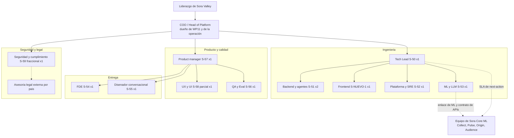
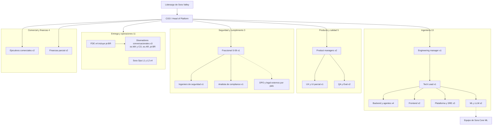
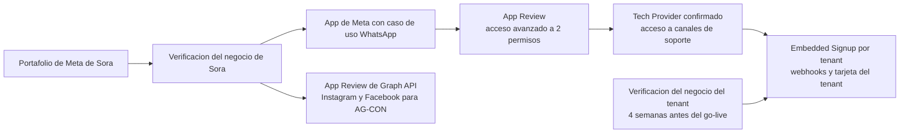
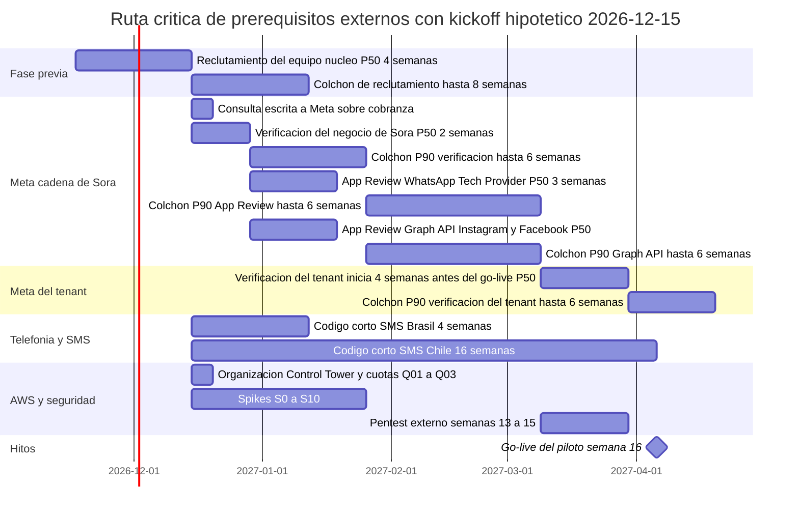
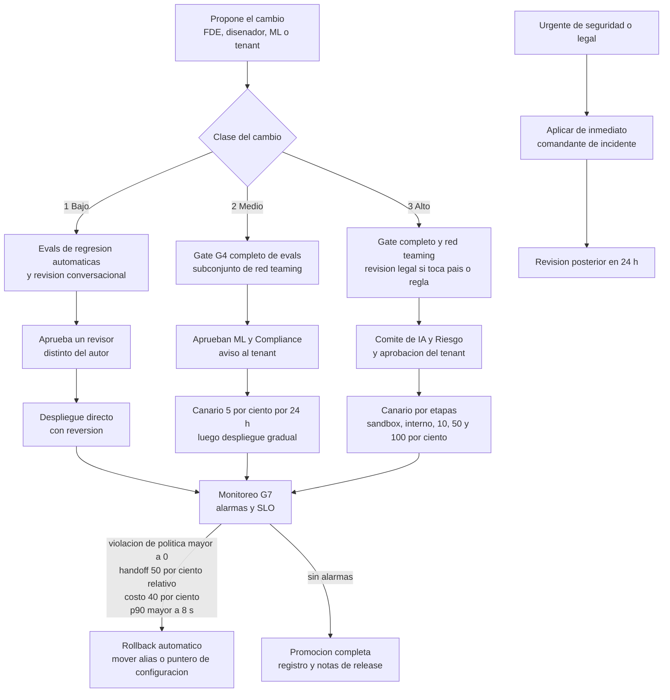
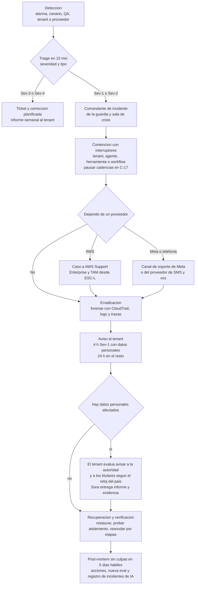
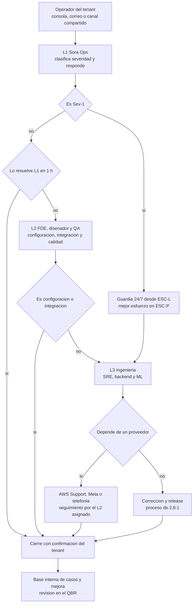

# WP11 · Requisitos internos de Sora Valley (equipo, cuentas, proveedores, operación)

| Campo | Valor |
|---|---|
| Encargo | 02-encargos/WP11-requisitos-internos.md |
| Autor | Agente Claude Sonnet 5.5 · corrida 2026-11-16 |
| Versión | 1.0 |
| Insumos leídos | `README.md`; `00-orquestacion/01-CONVENCIONES.md`; `00-orquestacion/02-PLANTILLA-ENTREGABLE.md`; `01-contexto/10` a `17` (completos; `12` leído por secciones); `02-encargos/WP11-requisitos-internos.md`; `03-entregables/_GATE-1.md` (completo); `03-entregables/README.md` (sección "Decisiones humanas registradas": vacía). Entregables previos por secciones: WP03 (§0, §2.4 cuentas y SCP, §2.9 cuotas Q-01..Q-18, §2.10 runbooks RB-01..RB-11, §2.11 pipelines y gates G1-G7, §2.12 IaC, §6, §7, Anexo B spikes); WP06 (§0, §2.4 roles y DPA, §2.5 CTL-01..CTL-31, §2.12 LQ-01..LQ-26, §2.13 certificaciones, §2.14 incidentes, §2.15 gobierno de IA, §6); WP05 (§0, §2.1 WhatsApp y Tech Provider, §2.3 voz, §2.4 SMS, §2.5 Graph API, S-NUEVO); WP04 (índice, OD-03, spikes, gates de evals); WP01 (§0, §2.5 modelo operativo y costo de onboarding); WP02 (§2.1 personas, §2.7 consola y matriz RBAC). No leí completos los entregables de oleada 1 (110-280 KB cada uno). |
| Decisiones humanas registradas | Ninguna. Rigen los valores por defecto de `_GATE-1` §4 y §6.1, todos **"no confirmada"**; se arrastran con esa etiqueta. |
| Acceso web en esta corrida | Sí (2026-11-16). Páginas oficiales leídas: precios y planes de AWS Support, guía de planes de AWS Support, requisitos de Tech Provider de Meta, App Review de Meta, Partner-Led Support, Activate. Para facturación electrónica, certificaciones y tiempos de Meta solo obtuve fuentes secundarias: todo eso va con `[VERIFICAR]`. |
| Estado | Completo con pendientes: (1) costos de herramientas SaaS, seguros, entidades locales, EOR y proveedores de facturación electrónica son hipótesis de lista sin fuente oficial (`[S-NUEVO-10]`, `[S-NUEVO-12]`); (2) todo punto fiscal, de facturación y de DPO por país es una pista de investigación `[LEGAL]` `[VERIFICAR]`; (3) tiempos de verificación de Meta sin cifra oficial; (4) la factura de AWS por escenario es un proxy hasta que WP08 la cierre. |

## 0. Resumen ejecutivo

- **72 requisitos internos (RI-01..RI-72) en las 9 categorías mínimas**, cada uno con costo y dueño (§2.1). **40 bloquean sin condición** el build o el piloto y **11 bloquean con condición** (RI-07, 08, 15, 26, 28, 35, 36, 37, 42, 64 y 70: guardia de mejor esfuerzo, Brasil, AG-CON, SMS en el escenario B, cuotas, México y países nuevos); los otros 21 no bloquean (RI-25 solo bloquea la migración a la Cloud API) `[_GATE-2 §1.1]`. Todo se calcula con el país piloto **MX** y el **escenario B** de Meta, ambos "no confirmada" (`_GATE-1` §4.15 y §4.1).
- **Equipo mínimo del MVP: 12 personas, USD 74,000 al mes cargados** (S-50..S-59 más un frontend, `S-NUEVO-1`). Escala a 14 personas y 80,000 en ESC-P, **23 y 130,000 en ESC-L** y **36 y 205,500 en ESC-E** (unos 2.5 M al año). El build indicativo es ~276 mil USD, ~332 mil con la contingencia S-60 (§2.2.3). La estimación de personas la cierra WP12. S-61 corre desde el kickoff; el reclutamiento (4 a 8 semanas) es una fase previa y el calendario total es de **20 a 24 semanas** desde la aprobación `[_GATE-2 §4.7]`.
- **El costo de onboarding de WP01 (USD 11,000) es solo un piso.** El costo interno completo de una operación de país nueva es **USD 21,125** (12,675 con plantillas maduras en ESC-E) al sumar ML, QA, PM, seguridad y backend (`S-G1-38`, §2.2.4).
- **Alerta económica para WP09 y WP12:** el costo de servir de las personas es ~**10,100 USD por operación y mes en ESC-L** (4,700 en ESC-E), frente a 6.3 a 18.8 mil USD de ingreso con las hipótesis de precio de WP01, antes de LLM, canal e infraestructura. El −75% de margen sin ingreso de COB ni CON no es un fallo de S-65: S-65 es el **margen bruto de plataforma** (sin personas) y el margen de contribución sale ≈ 30% en ESC-L si COB y CON facturan lo que S-65 exige (≈ 85 mil al mes) `[_GATE-2 §4.5, S-G2-18, S-G2-19]`.
- **Hallazgo sobre AWS (precios y mínimos de la página oficial):** los planes cambiaron. Hoy existen **Business Support+** (mínimo USD 29 por cuenta; 9%, 7%, 5% y 3% por tramos) y **Enterprise Support** (mínimo USD 5,000; 10% hasta 150 k); Developer, Business y Enterprise On-Ramp se discontinuarían el 2027-01-01 **`[VERIFICAR]`** (fecha de una guía no reabierta que WP08 no confirmó; la recomendación no depende de ella). Recomendación: Business Support+ en el build y ESC-P, **Enterprise desde ESC-L** (USD 5,000 al mes) y 12,697 en ESC-E (costo canónico de WP08 sobre el uso real, sin el cargo de Meta `[_GATE-2 §4.8]`); en ESC-E el soporte pesa ~27% del gasto no-cloud mensual. Si el cargo de Meta que AWS reexpide cuenta para el porcentaje, suma solo +0.6 mil en ESC-L y +2.9 mil en ESC-E (B) `[VERIFICAR]`.
- **Meta: la semana 1 decide la ruta crítica.** Consulta escrita de cobranza (por 3 vías), verificación del negocio de Sora, App de Tech Provider y App Review de Graph API. Meta no publica plazos; con fuentes secundarias planifico P50 de 2 a 3 semanas y P90 de 6. **El objetivo de onboarding de S-45 (≤ 4 semanas) no tiene margen** si la verificación del tenant debe terminar 4 semanas antes del go-live; el código corto de SMS de Chile (16 semanas) empata con las 16 semanas del piloto.
- **Legal por país (matrices de §2.5):** modelo de entidad **híbrido** (Sora factura en USD desde su entidad actual y abre entidad local por gatillo; Brasil antes del primer contrato; México en ESC-L). Opiniones legales de USD 6,000 a 15,000 por país `[VERIFICAR]`; las bloqueantes de México son LQ-01, 02, 07, 19 y 20. Respuesta por defecto sobre la agencia de cobranza (B8): no es despacho y no hay comisión de éxito hasta tener opinión. Facturación electrónica de los 6 países identificada, **sin verificar en texto oficial**.
- **Procesos y SLAs:** release de prompts y configuraciones por clases 1-3 con canario y rollback; incidentes con relojes de WP06; soporte L1-L3 con 13 a 15 h de cobertura (2 personas de Ops en ESC-L); guardia en mejor esfuerzo en ESC-P y 24/7 para Sev-1 desde ESC-L; restauración trimestral y ensayo de DR semestral. SLA: **99.5% hasta ESC-L y 99.9% solo desde ESC-E**, créditos de 10, 25 y 50% solo desde la guardia 24/7 formal (ESC-L) y Starter etiquetado como desvío comercial `[_GATE-2 §4.8]`.
- **Presupuesto no-cloud (sin personas):** build **USD 73.7 mil** (con 20% de contingencia), ESC-P 44.0 mil (3 meses), ESC-L 311 mil (9 meses) y ESC-E 683 mil (12 meses); en ESC-E el soporte de AWS (WP08) es el 22% del total (§2.10).
- **Decisiones y preguntas:** 12 decisiones `D-WP11` y 18 supuestos `S-NUEVO` (los de más sensibilidad: `S-NUEVO-6`, `-7`, `-8`, `-9` y `-12`; `-11` fue rechazado por el gate, `S-G2-53`). Las preguntas bloqueantes propias son la entidad que firma (N5), la aprobación del equipo de 12, el responsable de privacidad, la ubicación de Sora Core (B7) y las retenciones fiscales por país; todas tienen respuesta por defecto en §6. Ningún `[CAMBIO-ADR]`.

## 1. Alcance

**Cubre:** todo lo que Sora Valley necesita tener o hacer internamente para construir, vender y operar Sora Agents Platform en LatAm multi-país (MX, CO, BR, PE, CL, AR): personas y roles, cuentas y prerequisitos con AWS, prerequisitos con Meta y de telefonía, legal y corporativo por país (con matrices), facturación electrónica, seguridad y certificaciones, herramientas, procesos operativos, SLAs que Sora ofrecerá y presupuesto no-cloud por escenario. Es dueño del catálogo `RI-nn`.

**No cubre (y quién lo cubre):**

| Tema | WP |
|---|---|
| Requisitos hacia el cliente (`RC-nn`), onboarding del lado del tenant | WP10 |
| Costos de nube, canal y unit economics (aquí solo se usa un proxy de la factura de AWS para calcular el soporte) | WP08 |
| Plan de construcción, backlog, calendario y presupuesto de personas (aquí solo la estructura del equipo y un costo mensual indicativo) | WP12 |
| Precios y paquetes comerciales (aquí solo los SLAs y su vínculo con los planes) | WP09 |
| Análisis legal de fondo por país (aquí solo qué opinión pedir, cuándo y cuánto presupuestar) | WP06 |

**Valores canónicos que gobiernan este WP (todos "no confirmada", `_GATE-1`):** país del piloto MX (§4.15, B4); escenario B de Meta (§4.1, B1); RPO ≤ 15 min, RTO ≤ 4 h (componente) y ≤ 24 h (celda), restauración trimestral y ensayo de DR semestral (§4.13, B6); SLA de toma de handoff P1 5 min, P2 15 min, P3 1 h hábil, P4 4 h hábiles (§4.13); servicios AWS por componente (§4.16); cuotas Q-01..Q-18 de WP03 con las correcciones de §4.18; consulta a Meta, App Review y verificación del negocio de Sora en la semana 1 (§4.1, §7); el costo de onboarding de WP01 es un **piso** (§5 S-G1-38, §7).

## 2. Contenido principal

### 2.1 Catálogo de requisitos internos (RI-nn)

Convenciones: **Cuándo** = *antes del build* (semana 0 a 2), *durante el build* (semanas 1 a 16), *antes del piloto* (go-live, semana 16 `[S-61]`), *en escala* (ESC-L o ESC-E). **Costo** en USD; "mes" = costo mensual cargado; los rangos sin fuente oficial llevan `[VERIFICAR]`. **Dueño** es un rol, no una persona (el gate no inventa nombres, N5). "Equipo" significa costo ya incluido en §2.2.3. **Bloquea** = Sí si sin ese requisito no se puede iniciar el build o el piloto (o la función indicada).

#### Organización y talento

| ID | Categoría | Requisito | Detalle | Cuándo | Costo estimado | Dueño | Bloquea |
|---|---|---|---|---|---|---|---|
| RI-01 | Organización y talento | Equipo núcleo del MVP en asiento | 12 personas (§2.2.2). `[S-61]` (≤ 16 semanas) corre **desde el kickoff con el equipo núcleo en asiento**; el reclutamiento de 4 a 8 semanas es una **fase previa (fase −1)** y el calendario total es de **20 a 24 semanas desde la aprobación del equipo** `[S-NUEVO-9]` `[_GATE-2 §4.7, S-G2-43]` | Antes del build | 74,000/mes (§2.2.3) | COO / Head of Platform | Sí |
| RI-02 | Organización y talento | Esquema de contratación del equipo distribuido | Contratista, EOR o entidad local por país; riesgo laboral y de establecimiento permanente `[LEGAL]`; plataforma de contratación | Antes del build | ~49 por persona y mes (contratista) `[VERIFICAR]` = 588/mes en el build | COO + Legal externo | Sí |
| RI-03 | Organización y talento | Tech Lead / Arquitecto nombrado (`[S-50]`) | Dueño de los `[CAMBIO-ADR]` aceptados en el gate, del spike S0..S10 y del Comité de IA y Riesgo | Antes del build | 9,000/mes (equipo) | COO | Sí |
| RI-04 | Organización y talento | Dupla FDE + diseñador conversacional (`[S-54]`, `[S-55]`) | Capacidad de onboarding y operación. El piso de USD 11,000 por onboarding es solo esta dupla (`S-G1-38`); el costo completo es USD 21,125 (§2.2.4) | Antes del build (1 dupla); ESC-L 2; ESC-E 4 FDE y 3 diseñadores | 11,000/mes (equipo) | Líder de FDE | Sí |
| RI-05 | Organización y talento | Ingeniero ML/LLM y QA/Eval (`[S-53]`, `[S-56]`) | Gate G4 de evals, casos de oro, jueces, red teaming de LLM | Durante el build | 12,000/mes (equipo) | Tech Lead | Sí |
| RI-06 | Organización y talento | Sora Ops L1-L2 | Triage, monitoreo, status page, primera respuesta; 15 h de cobertura L-V (§2.8.3) `[S-NUEVO-2]` | Antes del piloto (1); ESC-L 2; ESC-E 4 | 3,500/mes c/u (equipo) | COO | No (el FDE lo cubre en el piloto) |
| RI-07 | Organización y talento | Guardia (on-call) | ESC-P: mejor esfuerzo, rotación semanal de 4 personas; ESC-L: 24/7 para Sev-1 (`[S-41]`), rotación 1:6; ESC-E: primaria y secundaria | Antes del piloto; formal en ESC-L | 550/mes ESC-P; 1,100 ESC-L; 2,200 ESC-E `[S-NUEVO-13]` | Líder de plataforma/SRE | Sí (mejor esfuerzo) |
| RI-08 | Organización y talento | Capacidad en portugués (pt-BR) | Diseñador conversacional nativo, FDE lusófono y revisión legal de Brasil `[RIESGO R-14]` | Antes del primer tenant BR (ESC-E) | Equipo (4,500 + 6,500/mes) | PM | Sí (solo BR) |
| RI-09 | Organización y talento | Responsable de privacidad (DPO) nombrado | Contacto en DPA y en la pregunta 19 del cuestionario; nombre pendiente (N5). Interno fraccional en el piloto; externo desde ESC-L | Antes del piloto | 0 en el piloto (`[S-59]`); 1,500/mes ESC-L; 2,500/mes ESC-E `[S-NUEVO-12]` | Seguridad y cumplimiento | Sí |
| RI-10 | Organización y talento | Interfaz con el equipo de Sora Core | Dueño de las APIs T-10, T-11, T-12, T-27 y de C-27; SLA p95 300/800 ms; RACI en §2.2.6 (B7) | Antes del build | Equipo (`[S-53]`) | Tech Lead + líder de Sora Core | Sí |
| RI-11 | Organización y talento | Capacitación y verificación de antecedentes | CTL-29: seguridad, privacidad, IA responsable, cobranza por país; acuerdos de confidencialidad | Antes del piloto | Incluido en la herramienta de cumplimiento (RI-45) | Seguridad y cumplimiento | Sí |

#### AWS

| ID | Categoría | Requisito | Detalle | Cuándo | Costo estimado | Dueño | Bloquea |
|---|---|---|---|---|---|---|---|
| RI-12 | AWS | Organización, Control Tower e Identity Center | Región hogar `us-east-1`; regiones gobernadas `us-east-1`, `sa-east-1`, `us-west-2`; 9 SCPs; cuota de cuentas Q-01 = 30 | Antes del build (semana 1) | Sin cargo de servicio (WP08 para el resto) | SRE | Sí |
| RI-13 | AWS | Cuentas y líneas base | 10 cuentas iniciales: Management, log-archive, security-tooling, shared-services y `agents-{dev,staging,prod}-{control,cell-sa1}`; más sandbox individuales con presupuesto | Antes del build | Sin cargo | SRE | Sí |
| RI-14 | AWS | Plan de soporte de AWS | **Business Support+** (mínimo USD 29/mes por cuenta; 9% hasta 10 k, 7% de 10 k a 80 k, 5% de 80 k a 250 k, 3% arriba) desde el build; **Enterprise Support** (mínimo 5,000; 10% hasta 150 k) desde ESC-L. Developer, Business y Enterprise On-Ramp se discontinuarían el 2027-01-01 `[VERIFICAR]` `[F1][F2]` | Durante el build | 200/mes build; 739 ESC-P; 5,000 ESC-L; 12,697 ESC-E (WP08, `[_GATE-2 §4.8]`; §2.3.3) | COO | No |
| RI-15 | AWS | Calendario de cuotas Q-01..Q-18 | Solicitudes con fecha y dueño (§2.3.4) | Durante el build | 0 | SRE | Sí (Q-01, 02, 03, 12) |
| RI-16 | AWS | Acceso a modelos de Bedrock y SCP de modelos | Sonnet 5.5, Haiku 5.5, Opus 5.5, Titan Text Embeddings V2, Stable Image Core (`us-west-2`); perfil `us.` desde `us-east-1`; retención `none`; confirmar con los spikes S0 y S3 | Antes del build | 0 | Tech Lead + SRE | Sí |
| RI-17 | AWS | Relación con el account team de AWS | Gerente de cuenta y arquitecto de soluciones; contacto de producto de AgentCore y de End User Messaging Social; canal para B1, cuotas y créditos | Antes del build | 0 | COO | No |
| RI-18 | AWS | Programas de créditos y de socio | Activate (Founders 1,000 a 5,000; Portfolio hasta 200,000 vía proveedor afiliado) `[F4]`; GenAI Accelerator (hasta 1 M; la ventana 2026 cerró el 2026-07-10) `[F6]`; ISV Accelerate (FTR + producto GA en Marketplace + ACE) `[F5]` | Durante el build; ISV en ESC-L | Ingreso (créditos); FTR y Marketplace: ~10-15 días-persona `[VERIFICAR]` | COO + Comercial | No |
| RI-19 | AWS | FinOps y etiquetado | Etiquetas `env`, `cell`, `tenant_id`, `data_class`, `cost_center`, `owner`; presupuestos y anomalías al 50, 80 y 100%; perfiles de inferencia de aplicación por tenant y agente | Durante el build | 0 | SRE + Finanzas | No |
| RI-20 | AWS | DR: restauración trimestral y ensayo semestral | RPO ≤ 15 min; RTO ≤ 4 h y ≤ 24 h (`_GATE-1` §4.13); primera restauración antes del piloto | Antes del piloto | 8 y 16 días-persona al año (§2.8.8) `[S-NUEVO-17]` | SRE | Sí |
| RI-21 | AWS | Runbooks RB-01..RB-11 con dueño y game days | Cada runbook con dueño, disparador y prueba; 3 game days antes del piloto | Antes del piloto | ~11 días-persona | SRE | Sí |
| RI-22 | AWS | Spikes de arquitectura S0..S10 | 31 días-persona (1+3+4+3+3+3+3+2+5+2+2, WP03 Anexo B) | Durante el build (semanas 1 a 6) | Equipo | Tech Lead | Sí |

#### Meta y canales

| ID | Categoría | Requisito | Detalle | Cuándo | Costo estimado | Dueño | Bloquea |
|---|---|---|---|---|---|---|---|
| RI-23 | Meta y canales | Consulta escrita a Meta sobre cobranza y servicing | Política del 2026-09-23 (WP05 F13). Tres vías en paralelo: account team de AWS (EUM Social), Meta Business Support y el canal de soporte de Tech Provider cuando esté confirmado. Guardar la respuesta como evidencia (B1) | Semana 1 | 0 | COO + Legal | Sí |
| RI-24 | Meta y canales | Portafolio de Meta de Sora y verificación del negocio | Es requisito previo de App Review `[F7]` | Semana 1 | 0 | COO | Sí |
| RI-25 | Meta y canales | App de Meta y Tech Provider (WhatsApp) | Acceso avanzado a `whatsapp_business_messaging` y `whatsapp_business_management`; 2 videos; webhooks; Embedded Signup; el tenant agrega su tarjeta a la plataforma `[F7]` | Semana 1 a 8 | ~10 días-persona | Tech Lead + FDE | No en el piloto (EUM Social); Sí para el gatillo de migración |
| RI-26 | Meta y canales | App Review de Graph API (Instagram y Facebook) | Permisos de publicación y de páginas; video por permiso; ruta crítica de AG-CON (OD-09) | Semana 1 | ~5 días-persona | Tech Lead | Sí (solo AG-CON) |
| RI-27 | Meta y canales | Puerto de canal y proveedor de WhatsApp | AWS End User Messaging Social detrás de `ChannelPort`; 360dialog como plan B (contrato marco latente); gatillo de migración USD 3,000/mes de cargo AWS (`S-G1-05`) | Durante el build | Cargo AWS 0.005 saliente y 0.001 entrante (WP08) | Tech Lead | Sí |
| RI-28 | Meta y canales | Números, SMS y telefonía por país | Número dedicado del tenant para la WABA; SMS (escenario B): MX ID de remitente, BR código corto (4 semanas; 330 de alta y 330/mes), CL (16 semanas; 253 y 253/mes), CO, PE y AR código corto n/d `[VERIFICAR]`; DID de Connect en fase 1.5 | Semana 1 (si B) | Cargos fijos BR y CL en el escenario B (WP08) | FDE + PM | Sí (BR y CL en B) |
| RI-29 | Meta y canales | Voz fase 1.5 | Satélite `us-east-1`, Connect, allowlist de llamadas salientes, bake-off de 2 semanas (semanas 17 a 20), `COB-VOICE` levantado por Legal | Después del piloto | WP08 | Tech Lead + Legal | No |
| RI-30 | Meta y canales | Vigilancia de la política de Meta y del rate card | Revisión trimestral y alertas; Partner Manager si hay | Antes del piloto | 0 | Seguridad y cumplimiento + PM | No |

#### Legal y corporativo por país

| ID | Categoría | Requisito | Detalle | Cuándo | Costo estimado | Dueño | Bloquea |
|---|---|---|---|---|---|---|---|
| RI-31 | Legal y corporativo | Entidad contratante de Sora y firmante del DPA | Qué entidad, en qué jurisdicción y con qué domicilio fiscal contrata y factura (N5, WP06 pregunta 4) | Antes del build | n/d | CEO / COO + Legal | Sí |
| RI-32 | Legal y corporativo | Estrategia fiscal y de facturación por país | §2.5.3: facturación transfronteriza en USD o entidad local; retenciones; cláusula de gross-up | Antes del piloto | 500 a 1,500/mes de asesor contable `[S-NUEVO-12]` | Finanzas + Legal | Sí |
| RI-33 | Legal y corporativo | Plantillas contractuales | MSA, DPA, SLA, AUP, orden de servicio y anexo de outsourcing (WP06 §2.4.3) | Antes del piloto | 8,000 a 20,000 `[VERIFICAR]` | Legal externo | Sí |
| RI-34 | Legal y corporativo | Opinión legal de México | LQ-01, LQ-02, LQ-07, LQ-19, LQ-20 (más LQ-14 si el tenant es supervisado) | Antes del piloto | 6,000 a 15,000 (`S-G1-42`) `[VERIFICAR]` | Legal + Seguridad y cumplimiento | Sí |
| RI-35 | Legal y corporativo | Respuesta al registro como agencia de cobranza (B8) | LQ-02 (REDECO), LQ-03 (CO), LQ-04 (BR). Por defecto: no es despacho y no hay comisión sobre recuperación hasta tener opinión | Antes del piloto | Incluido en RI-34 | Legal | Sí (MX) |
| RI-36 | Legal y corporativo | Opiniones legales de CO, PE, AR y CL | Bloqueantes por país (§2.5.2) | En escala, antes de cada país | 6,000 a 15,000 c/u `[VERIFICAR]` | Legal | Sí (por país) |
| RI-37 | Legal y corporativo | Opinión legal de Brasil y entidad brasileña | LQ-04 y LQ-05; entidad Ltda. por NFS-e y retenciones | En escala (ESC-E) | Opinión 6,000 a 15,000; entidad 8,000 a 15,000 de alta y 12,000 a 25,000/año `[S-NUEVO-12]` `[VERIFICAR]` | Legal + Finanzas | Sí (BR) |
| RI-38 | Legal y corporativo | Entidad local de México | Solo si se cumple el gatillo de §2.5.3 | En escala (ESC-L) | 5,000 a 10,000 de alta y ~1,000/mes `[S-NUEVO-12]` `[VERIFICAR]` | Finanzas | No |
| RI-39 | Legal y corporativo | Registro de subencargados y aviso de 30 días | AWS, Meta, telefonía y SMS, proveedor de facturación, plataforma de contratación; publicado en la consola (WP06 §2.4.2) | Antes del piloto | 0 | Seguridad y cumplimiento | Sí |
| RI-40 | Legal y corporativo | Contratos con proveedores críticos | Términos de AWS y DPA, WhatsApp Business Solution Terms, SMS y voz, facturación electrónica | Antes del piloto | 0 | Legal | Sí |
| RI-41 | Legal y corporativo | Seguros: ciberseguro y responsabilidad profesional (E&O) | Muchos contratos B2B los piden antes de firmar | Desde la semana ~12 del build, antes del go-live `[_GATE-2 §4.7]` | 8,000 a 30,000/año `[S-NUEVO-12]` `[VERIFICAR]` | Finanzas | No |
| RI-42 | Legal y corporativo | Representante local y registros de datos por país | Posibles: representante en Chile, RNBD en Colombia, banco de datos en Perú, registro ante la AAIP `[LEGAL]` | En escala, por país | Dentro de cada opinión | Legal | Sí (por país) |

#### Seguridad y certificaciones

| ID | Categoría | Requisito | Detalle | Cuándo | Costo estimado | Dueño | Bloquea |
|---|---|---|---|---|---|---|---|
| RI-43 | Seguridad y certificaciones | Programa de seguridad mínimo | ~20 políticas (seguridad, acceso, cambios, incidentes, proveedores, retención, IA), inventario de riesgos y de proveedores, BCP y DR | Antes del piloto | Dentro de RI-45 | Seguridad y cumplimiento | Sí |
| RI-44 | Seguridad y certificaciones | Controles CTL-01..CTL-29 con evidencia | Los de fase MVP de WP06 §2.5; CTL-30 en fase 1.5 y CTL-31 en fase 2 | Antes del piloto | Equipo | Tech Lead + SRE | Sí |
| RI-45 | Seguridad y certificaciones | Plataforma de automatización de cumplimiento | Tipo Vanta o Drata `[VERIFICAR]`; 15,000/año en el build, 20,000 en ESC-L, 25,000 en ESC-E `[S-NUEVO-10]` | Durante el build | 1,250/mes | Seguridad y cumplimiento | No |
| RI-46 | Seguridad y certificaciones | Pentest externo y red teaming de LLM | Pentest en M3-M4 y anual; red teaming en cada versión mayor (CTL-22) | Antes del piloto | 8,000 a 25,000 por pentest (WP06) | Seguridad y cumplimiento + Tech Lead | Sí |
| RI-47 | Seguridad y certificaciones | SOC 2 Type I y Type II | Type I en M6-M7; observación de ~6 meses; Type II en M13-M14 | En escala | 10,000 a 25,000 y 15,000 a 40,000 (WP06) `[VERIFICAR]` | Seguridad y cumplimiento | No |
| RI-48 | Seguridad y certificaciones | ISO/IEC 27001 | M9 a M15; certificado hacia M12-M15 | En escala | 15,000 a 40,000 + 8,000 a 15,000/año de vigilancia `[VERIFICAR]` | Seguridad y cumplimiento | No |
| RI-49 | Seguridad y certificaciones | Comité de IA y Riesgo, maker-checker y clases de cambio 1-3 | Reunión cada 2 semanas; nadie aprueba su propio cambio | Antes del piloto | 0 | Tech Lead + Seguridad y cumplimiento | Sí |
| RI-50 | Seguridad y certificaciones | Acceso JIT y break-glass (CAP-25) | Ticket, segunda aprobación, duración limitada, sesión grabada, aviso visible al tenant; revisión trimestral de accesos | Antes del piloto | 0 | SRE + Seguridad y cumplimiento | Sí |

#### Herramientas

| ID | Categoría | Requisito | Detalle | Cuándo | Costo estimado | Dueño | Bloquea |
|---|---|---|---|---|---|---|---|
| RI-51 | Herramientas | Repositorios, CI/CD y análisis (SAST, SCA, secretos) | CodePipeline y CodeBuild o GitHub Actions con OIDC (P-06 de WP03) | Antes del build | 60 por usuario y mes (paquete de desarrollo) `[S-NUEVO-10]` | Tech Lead | Sí |
| RI-52 | Herramientas | Gestión de proyectos, documentación y comunicación | Incluye canal compartido por tenant | Antes del build | Incluido en RI-51 | PM | No |
| RI-53 | Herramientas | Guardia y status page | PagerDuty u otro; **no elegir Opsgenie** (sin ventas desde 2025-06-04 y soporte hasta 2027-04-05) `[F8]` | Antes del piloto | 25 por usuario en la rotación + 79 de status page `[VERIFICAR]` | SRE | Sí |
| RI-54 | Herramientas | Helpdesk (tickets de tenants) y CRM comercial | Tickets con SLA; CRM de Agents | Piloto (helpdesk); ESC-L (CRM) | 55 por agente; 50 por usuario `[VERIFICAR]` | PM + Comercial | No |
| RI-55 | Herramientas | Harness propio de evals (C-29) sobre la ruta C-15 y AgentCore Observability | Jueces Haiku propios (8 semanas-persona de WP07; ≈ USD 0.1 mil/mes de infraestructura, ya en WP08). **AgentCore Evaluations integrado no se usa sobre producción** (≈ 25× el costo; residencia `[VERIFICAR]`). Langfuse, Braintrust o Arize solo con un gatillo de WP07 `[_GATE-2 §4.4 punto 4]` | Durante el build | 0 en licencias | Tech Lead | No |
| RI-56 | Herramientas | Gestor de secretos del equipo, IdP/SSO y MDM | MFA resistente a phishing (CTL-01) | Antes del build | 25 por usuario | SRE | Sí |

#### Procesos operativos

| ID | Categoría | Requisito | Detalle | Cuándo | Costo estimado | Dueño | Bloquea |
|---|---|---|---|---|---|---|---|
| RI-57 | Procesos operativos | Proceso de release de prompts y configuraciones | §2.8.1 | Antes del piloto | 0 | Tech Lead + QA | Sí |
| RI-58 | Procesos operativos | Proceso de gestión de incidentes y guardia | §2.8.2 | Antes del piloto | 0 | SRE | Sí |
| RI-59 | Procesos operativos | Soporte L1-L3 y SLAs por plan | §2.8.3 y §2.9 | Antes del piloto | 0 | PM | Sí |
| RI-60 | Procesos operativos | Onboarding interno de tenants | W-07; dupla FDE y diseñador; complemento de WP10 (§2.8.4) | Antes del piloto | 21,125 por operación de país (§2.2.4) | Líder de FDE | Sí |
| RI-61 | Procesos operativos | Revisión trimestral (QBR) por tenant | §2.8.5 | 90 días tras el go-live | 0 | FDE + PM | No |
| RI-62 | Procesos operativos | Vigilancia regulatoria y de políticas de Meta | §2.8.6 | Antes del piloto | Dentro del retainer legal | Seguridad y cumplimiento | Sí |
| RI-63 | Procesos operativos | FinOps mensual por tenant | §2.8.7 | Antes del piloto | 0 | SRE + Finanzas | No |

#### Finanzas y facturación

| ID | Categoría | Requisito | Detalle | Cuándo | Costo estimado | Dueño | Bloquea |
|---|---|---|---|---|---|---|---|
| RI-64 | Finanzas y facturación | Facturación electrónica por país y proveedor | CFDI, DIAN, NFS-e, SUNAT, SII, ARCA (§2.5.3). Proveedor de Sora por país con entidad local `[VERIFICAR]` | Según el país | n/d; hipótesis de presupuesto 100 a 400/mes `[S-NUEVO-12]` | Finanzas | Sí (por país con entidad) |
| RI-65 | Finanzas y facturación | Metering a facturación (C-31) | `usage.metered` (EVT-28); retención de datos de facturación 7 años | Antes del piloto | 0 | Tech Lead + Finanzas | Sí |
| RI-66 | Finanzas y facturación | Cobros y tesorería | Cuenta multimoneda en USD, términos de pago, política de tipo de cambio `[S-02]`; ARS solo cotizado en USD | Antes del piloto | n/d | Finanzas | Sí |
| RI-67 | Finanzas y facturación | Impuestos y retenciones por país en los contratos | Cláusula de gross-up, certificados de retención, tratados `[LEGAL]` | Antes del piloto | Dentro de RI-32 | Finanzas + Legal | Sí |

#### Comercial

| ID | Categoría | Requisito | Detalle | Cuándo | Costo estimado | Dueño | Bloquea |
|---|---|---|---|---|---|---|---|
| RI-68 | Comercial | Cliente de diseño BNPL de cuotas | Con helpdesk (Zendesk si es posible), PSP, core con API y opt-in vigente (LQ-19); no microcrédito tipo adelanto de nómina (B1, B4) | Antes del build | n/d | Comercial + COO | Sí |
| RI-69 | Comercial | Paquete comercial y material de venta | Planes Agents Starter, Growth y Scale con los SLAs de §2.9; cuestionario de seguridad de 20 preguntas (WP06 §2.13.2); DPA | Antes del piloto | AE 5,000/mes desde ESC-L `[S-NUEVO-4]` | Comercial + PM | No |
| RI-70 | Comercial | Mensaje comercial ajustado al escenario B | La promesa "agentes de cobranza por WhatsApp y voz" (`10 §4`) cambia si B1 se resuelve como B | Antes del piloto | 0 | Comercial | Sí (si B) |
| RI-71 | Comercial | Acuerdo contractual de holdout | 10% de las cuentas de AG-COB, 6 semanas (N6); sin él no se mide `[S-67]` | Antes del piloto | 0 | PM + ML | No |
| RI-72 | Comercial | Co-sell y AWS Marketplace | ISV Accelerate (RI-18) | En escala | n/d | Comercial | No |

**Conteo:** 72 RI (organización y talento 11, AWS 11, Meta y canales 8, legal y corporativo 12, seguridad y certificaciones 8, herramientas 6, procesos operativos 7, finanzas y facturación 4, comercial 5). **Bloquean sin condición (40, columna "Sí"):** RI-01, 02, 03, 04, 05, 09, 10, 11, 12, 13, 16, 20, 21, 22, 23, 24, 27, 31, 32, 33, 34, 39, 40, 43, 44, 46, 49, 50, 51, 53, 56, 57, 58, 59, 60, 62, 65, 66, 67 y 68. **Bloquean con condición (11):** RI-07 (mejor esfuerzo), 08 (solo BR), 15 (Q-01, 02, 03 y 12), 26 (solo AG-CON), 28 (BR y CL en B), 35 (MX), 36 (por país), 37 (BR), 42 (por país), 64 (por país con entidad) y 70 (si B). **No bloquean (21):** RI-06, 14, 17, 18, 19, 25 (solo bloquea la migración a la Cloud API), 29, 30, 38, 41, 45, 47, 48, 52, 54, 55, 61, 63, 69, 71 y 72. Corregido tras el recuento de `[_GATE-2 §1.1]` (la versión anterior decía 44 y 8).

### 2.2 Organización y roles

#### 2.2.1 Roles, responsabilidades y modo de contratación

Los costos de `[S-50]` a `[S-59]` son mensuales **cargados**, de talento senior distribuido en LatAm. Para los roles que `13-SUPUESTOS` no cubre uso la tarifa del rol más cercano y lo declaro como `[S-NUEVO-n]`. Se toma el valor listado de `[S-58]` y `[S-59]` como el costo mensual del rol tal como está (parcial o fraccional), no como un tiempo completo prorrateado `[S-NUEVO-18]`.

| Rol | ID y USD/mes | Responsabilidades | Perfil y seniority | Dedicación | Contratar o tercerizar |
|---|---|---|---|---|---|
| Tech Lead / Arquitecto | `[S-50]` 9,000 | Arquitectura (ADR y `[CAMBIO-ADR]`), spikes S0..S10, calidad técnica, Comité de IA y Riesgo, interfaz técnica con Sora Core | Staff o senior; AWS serverless, agentes con LLM, multi-tenancy | Tiempo completo | Contratar (decisiones de fondo) |
| Ingeniero senior backend y de agentes | `[S-51]` 7,000 | Runtime de agentes (Python), C-06 a C-24, conectores C-19 a C-21, workflows W-01 a W-08 | Senior; Python, Step Functions, Strands | Tiempo completo | Contratar (propiedad intelectual central) |
| Ingeniero frontend / full-stack | `[S-NUEVO-1]` 7,000 (tarifa de `[S-51]`) | Sora Console (SPA React), bandeja de handoff (3 a 5 semanas, `S-G1-38`), widget de web chat | Semi-senior a senior; React y TypeScript | Tiempo completo | Contratar; contratista aceptable al inicio |
| Ingeniero de plataforma / DevOps / SRE | `[S-52]` 7,000 | Cuentas, red, CDK y 5 pipelines con gates G1-G7, cuotas, runbooks RB-01..RB-11, DR, guardia, FinOps | Senior; AWS, CDK, observabilidad | Tiempo completo | Contratar (guardia) |
| Ingeniero ML / LLM | `[S-53]` 7,500 | Evals (G4), RAG, prompts, jueces, casos de oro, red teaming de LLM, enlace con Sora Core | Senior; evaluación de LLM | Tiempo completo | Contratar |
| FDE / Solutions engineer | `[S-54]` 6,500 | Onboarding de tenants, integración (CMI y sandbox), configuración con plantillas, operación inicial, QBR | Semi-senior a senior; integraciones y producto | Tiempo completo | Contratar; un FDE lusófono antes de Brasil |
| Diseñador conversacional | `[S-55]` 4,500 | Personas, guiones, plantillas de WhatsApp, variantes locales (es-MX, es-CO, es-AR con voseo, pt-BR), evals de calidad lingüística `[RIESGO R-14]` | Semi-senior; nativo de la variante | Tiempo completo | Contratar uno por variante; para pt-BR un contratista nativo al inicio |
| QA / Eval engineer | `[S-56]` 4,500 | Casos de oro, suites de aislamiento IT-01..IT-16, regresión, revisión del 5% de AG-ATC y del 5% (piloto) de AG-COB | Semi-senior | Tiempo completo | Contratar |
| Product manager | `[S-57]` 6,500 | Backlog, alcance MoSCoW (110 ítems de WP02), soporte L1-L3, QBR, relación con el tenant de diseño | Senior | Tiempo completo | Contratar |
| Diseñador UX/UI | `[S-58]` 4,500 | Consola (6 wireframes de WP02), widget, Studio | Semi-senior | Parcial | Tercerizar (freelance o estudio) |
| Seguridad y cumplimiento | `[S-59]` 3,000 + presupuesto legal | Programa de seguridad, CTL, evidencia, relojes de incidentes, DPO interno designado, vigilancia regulatoria | Senior fraccional (tipo vCISO) | Fraccional | Tercerizar; designar un responsable interno |
| Asesoría legal por país | Presupuesto (§2.10) | Opiniones LQ-xx, DPA, contratos, entidades, registros | Despachos locales | Por proyecto y retainer | Tercerizar |
| Sora Ops L1-L2 | `[S-NUEVO-2]` 3,500 | Triage de tickets, status, primera respuesta, monitoreo de calidad del número de WhatsApp | Junior a semi-senior; bilingüe es/pt en ESC-E | Tiempo completo | Contratar; BPO parcial solo si la cobertura lo exige |
| Finanzas y facturación | `[S-NUEVO-3]` 2,500 | Facturación, cobros, retenciones, FinOps con SRE, conciliación de metering | Contador o analista financiero | Parcial | Tercerizar (contador externo) al inicio |
| Ejecutivo comercial de Agents | `[S-NUEVO-4]` 5,000 | Venta, material, paquetes (WP09), co-sell | Senior | Tiempo completo | Contratar solo si Sora Valley no tiene equipo comercial que lo absorba |
| Analista de compliance | `[S-NUEVO-5]` 4,500 | Registro de subencargados, QBR de cumplimiento, vigilancia regulatoria, solicitudes de derechos (W-08) | Semi-senior | Tiempo completo desde ESC-L | Contratar |
| Ingeniero de seguridad | `[S-NUEVO-5]` 7,000 (tarifa de `[S-52]`) | CTL técnicos, pentest, JIT, detección | Senior | Tiempo completo desde ESC-E | Contratar |
| Engineering manager | `[S-NUEVO-5]` 9,000 (tarifa de `[S-50]`) | Gente, capacidad y cadencia de ingeniería cuando pasan de 12 ingenieros | Senior | Tiempo completo desde ESC-E | Contratar |
| DPO externo | Presupuesto (§2.10) | Punto de contacto de privacidad ante tenants y autoridades | Abogado de datos | Fraccional desde ESC-L | Tercerizar |

#### 2.2.2 Equipo por fase

"MVP" es el equipo del build (semanas 0 a 16). ESC-P son los 3 primeros meses tras el go-live, ESC-L los meses 4 a 12 y ESC-E el año 2 (`[S-08]`). Las cantidades de ESC-L y ESC-E salen de las reglas de capacidad de §2.2.4 y de la cobertura de §2.8.3.

| Rol | MVP | ESC-P | ESC-L | ESC-E | Cuándo entra el incremento |
|---|---|---|---|---|---|
| Tech Lead / Arquitecto | 1 | 1 | 1 | 1 | — |
| Engineering manager | 0 | 0 | 0 | 1 | Año 2 |
| Backend y agentes | 2 | 2 | 3 | 4 | +1 al firmar el 2.º tenant; +1 al abrir Brasil |
| Frontend / full-stack | 1 | 1 | 1 | 2 | Al activar helpdesk adicionales y Studio |
| Plataforma / SRE | 1 | 1 | 2 | 3 | +1 al formalizar la guardia 24/7 (ESC-L); +1 con la celda B o el satélite de voz |
| ML / LLM | 1 | 1 | 2 | 2 | +1 al firmar el 2.º tenant (evals y sets por país de WP07: 49 + 6.6 semanas-persona); voz y pt-BR llegan en ESC-E `[_GATE-2 §4.4]` |
| FDE | 1 | 1 | 2 | 4 | +1 al empezar onboardings en paralelo (mes 3) |
| Diseñador conversacional | 1 | 1 | 2 | 3 | +1 con el 2.º país; +1 pt-BR |
| QA / Eval | 1 | 1 | 2 | 2 | +1 con la 2.ª variante local |
| Product manager | 1 | 1 | 1 | 2 | +1 en el año 2 |
| UX/UI (parcial) | 1 | 1 | 1 | 1 | — |
| Seguridad y cumplimiento (fraccional) | 1 | 1 | 1 | 1 | — |
| Ingeniero de seguridad | 0 | 0 | 0 | 1 | Año 2 |
| Analista de compliance | 0 | 0 | 1 | 1 | Inicio de ESC-L |
| Sora Ops L1-L2 | 0 | 1 | 2 | 4 | 1 en el go-live; 2 en ESC-L |
| Finanzas (parcial) | 0 | 1 | 1 | 2 | Go-live |
| Ejecutivo comercial | 0 | 0 | 1 | 2 | Inicio de ESC-L |
| **Personas** | **12** | **14** | **23** | **36** | |

#### 2.2.3 Costo mensual del equipo

Fórmula: `costo mensual = suma (personas del rol × USD/mes del rol)`. Las tarifas son las de §2.2.1.

| Fase | Cálculo | USD/mes | Nota |
|---|---|---|---|
| MVP (build) | 9,000 + 2×7,000 + 7,000 + 7,000 + 7,500 + 6,500 + 4,500 + 4,500 + 6,500 + 4,500 + 3,000 | **74,000** | 12 personas. Es el **equipo mínimo** para el piloto de 16 semanas |
| ESC-P | MVP + Ops 3,500 + Finanzas 2,500 | **80,000** | 14 personas |
| ESC-L | 9,000 + 3×7,000 + 7,000 + 2×7,000 + 2×7,500 + 2×6,500 + 2×4,500 + 2×4,500 + 6,500 + 4,500 + 3,000 + 4,500 + 2×3,500 + 2,500 + 5,000 | **130,000** | 23 personas |
| ESC-E | 2×9,000 + 4×7,000 + 2×7,000 + 3×7,000 + 2×7,500 + 4×6,500 + 3×4,500 + 2×4,500 + 2×6,500 + 4,500 + 3,000 + 7,000 + 4,500 + 4×3,500 + 2×2,500 + 2×5,000 | **205,500** | 36 personas; unos 2.47 M USD al año |

Costo indicativo del build (lo cierra WP12): `74,000 USD/mes × 16 semanas ÷ (30/7) semanas por mes ≈ 276 mil USD`; con la contingencia `[S-60]` de 20% ≈ **332 mil USD**.

**Costo de servir** (la parte del equipo que S-65 debe cargar al margen de operación): `FDE + Ops + analista de compliance + 50% de (diseñador conversacional + QA + SRE)` `[S-NUEVO-7]`. ESC-P 18,000/mes (1 operación: 18,000 por operación); ESC-L 40,500 (4 operaciones: **10,125 por operación y mes**); ESC-E 66,250 (14 operaciones: **4,732 por operación y mes**). Contraste con las hipótesis de precio de WP01 (`S-G1-43`: plataforma USD 1,000 a 3,000 por operación y mes; ATC USD 0.50 a 1.50 por resolución): en ESC-L una operación promedio genera `15,000 conversaciones de ATC × 70% de RES-A × 0.50 a 1.50 ≈ 5.3 a 15.8 mil USD` más 1 a 3 mil de plataforma, es decir 6.3 a 18.8 mil USD frente a 10.1 mil de costo de servir de personas, **antes** de LLM, canal e infraestructura. **Es una alerta para WP09 y WP12**, reencuadrada por el gate `[_GATE-2 §4.5, S-G2-18, S-G2-19]`: S-65 es el **margen bruto de plataforma** (nube, canal, soporte de AWS y evals offline, **sin personas**); el −75% de margen que sale sin ingreso de COB ni CON refleja la **ausencia de precio de COB y CON**, no un fallo de S-65. El **margen de contribución** se reporta aparte con el **costo de servir ampliado** = costo de servir de arriba + la QA humana de WP07 en lo que excede la QA/Eval ya imputada (incremental 2,250 / 6,750 / 29,700) = **20,250 / 47,250 / 95,950 al mes** (20,250 / 11,813 / 6,854 por operación); objetivo del gate (hipótesis): ≥ 0% en ESC-L. El onboarding es un costo único aparte y no se suma al costo de servir.

#### 2.2.4 Modelo FDE y costo de onboarding

**El costo de onboarding de WP01 (USD 11,000) es un piso, no el costo total** (`_GATE-1` §5 S-G1-38 y §7). Solo cubre la dupla FDE + diseñador conversacional durante un mes (`S-54 + S-55 = 6,500 + 4,500`). El costo interno completo de una operación de país nueva suma el ML/eval, QA, PM, seguridad y legal, y soporte de ingeniería para conectores `[S-NUEVO-6]`:

| Componente | Cálculo (USD/mes del rol × meses) | USD |
|---|---|---|
| FDE | 6,500 × 1.0 | 6,500 |
| Diseñador conversacional | 4,500 × 1.0 | 4,500 |
| **Piso de WP01** | | **11,000** |
| Ingeniero ML/LLM (evals, KB, jueces) | 7,500 × 0.5 | 3,750 |
| QA / Eval (casos de oro, aislamiento del tenant, pruebas del CMI) | 4,500 × 0.5 | 2,250 |
| Product manager | 6,500 × 0.25 | 1,625 |
| Seguridad y cumplimiento (DPA, subencargados, revisión) | 3,000 × 0.25 | 750 |
| Ingeniería backend (conectores, conformidad del CMI) | 7,000 × 0.25 | 1,750 |
| **Costo interno completo por operación de país nueva (ESC-L)** | | **21,125** |
| ESC-E con plantillas maduras (`× 60%`) | 21,125 × 0.6 | 12,675 |

El costo completo es 1.9 veces el piso. Amortizado en 12 meses son `21,125 ÷ 12 = 1,760 USD/mes` por operación (frente a los 917 de WP01). **Costos externos únicos que no están en la tabla:** opinión legal del país nuevo (6,000 a 15,000, solo la primera operación del país), código corto de SMS en el escenario B (BR 330 de alta; CL 253 de alta) y la revisión contractual del DPA del tenant `[VERIFICAR]`. Un helpdesk distinto de Zendesk suma 2 semanas de un ingeniero (`S-G1-38`) y la migración a la Cloud API directa suma 2 ingeniero-meses = 14,000 USD (`S-G1-05`).

**Reglas de capacidad** `[S-NUEVO-7]` (valen para dimensionar la tabla de §2.2.2):

| Regla | Valor | Derivación |
|---|---|---|
| Onboarding en paralelo | Una dupla FDE + diseñador cierra **1 operación de país por mes** en ESC-L (objetivo `[S-45]` ≤ 4 semanas) y 2 por mes en ESC-E (≤ 2 semanas con plantillas) | Un onboarding ocupa a la dupla el 100% del mes |
| Carga de operación estable | **0.25 FDE por operación de país** (un FDE atiende 4 operaciones), y un diseñador conversacional cada 4 a 5 operaciones | Supuesto de trabajo; se mide en el piloto |
| FDE necesarios | ESC-L: `4 × 0.25 + 3 onboardings nuevos ÷ 9 meses = 1.0 + 0.33 = 1.33` → **2** (cobertura de vacaciones). ESC-E: `14 × 0.25 + 10 operaciones nuevas × 0.5 mes ÷ 12 = 3.5 + 0.42 = 3.9` → **4**. La unidad es la **operación de país**, no el tenant; equivale a ≈ **1.5 tenants por FDE en ESC-L (3 ÷ 2) y ≈ 2.5 en ESC-E (10 ÷ 4)** `[_GATE-2 §4.7, S-G2-41]` | Fórmulas anteriores |
| Sin doble conteo | El onboarding (21,125 por operación nueva; 12,675 con plantillas maduras) es un costo **único aparte**: las horas de FDE ya imputadas al onboarding se excluyen del costo de servir de ese período `[_GATE-2 §4.5]` | |
| Equipo local frente a centralizado | **Centralizado en LatAm** con zona horaria UTC-6 a UTC-3 (solapamiento total con los 6 países núcleo), español neutro y variantes por diseñador; **sin empleados locales por país** (evita establecimiento permanente y costo de entidad, `[LEGAL]`); presencia local = asesor legal externo y viajes de QBR (`[S-NUEVO-15]`) | |
| Idiomas | es en todos; **pt-BR**: un diseñador nativo y un FDE lusófono antes del primer contrato brasileño (ESC-E, ~25% del volumen); revisión legal en Brasil | `[ADR-14]`, `[RIESGO R-14]` |

#### 2.2.5 Organigramas

**Diagrama 1 · Organigrama del MVP (12 personas, USD 74,000/mes)**

El MVP tiene una línea de ingeniería bajo el Tech Lead, una de producto y entrega bajo el PM y una de seguridad que reporta al COO para mantener independencia frente a ingeniería. El FDE y el diseñador conversacional ya existen en el build porque configuran las plantillas del cliente de diseño. La relación con Sora Core es de enlace, no jerárquica.

**Diagrama 2 · Organigrama en ESC-E (36 personas, USD 205,500/mes)**

En ESC-E aparece un engineering manager para que el Tech Lead siga siendo arquitecto, y Entrega y Operaciones se separa de Producto porque pasa de 2 a 11 personas. Seguridad sigue reportando al COO. La guardia (SRE más 3 backend y ML) no es un equipo aparte: es una rotación de las líneas de Ingeniería (§2.8.2).

#### 2.2.6 Relación con el equipo de Sora Core (ML)

Sora Core es una **dependencia externa de la plataforma** (WP03 §2.4.1): su caída degrada la cobranza, no la atención. Ubicación y SLA por confirmar (B7); por defecto, una cuenta AWS de Sora Valley en `us-east-1` o `sa-east-1`, PrivateLink si es posible o mTLS con IP fija.

| Tema | Sora Core (ML) | Sora Agents Platform | Compartido |
|---|---|---|---|
| Modelos y decisiones (Collect, Pulse, Origin, Audience) | **Responsable**: entrena, versiona, monitorea y define umbrales y ofertas | Consume; nunca recalcula (`[ADR-04]`) | Versionado del contrato de las APIs T-10, T-11, T-12, T-27 |
| SLA de las APIs | **Responsable**: `next-action` p95 ≤ 300 ms; `evaluations`, `reasons`, `segments` p95 ≤ 800 ms (B7) | Degradación controlada (WP03 §2.10); alerta propia | Pruebas de contrato en CI |
| Motor de políticas por país (C-13) | Informa límites de oferta | **Responsable**: ventanas, frecuencias y montos máximos, deterministas | Revisión conjunta de reglas que usan señales de Core (clase 3, §2.8.1) |
| Retroalimentación (C-27) | **Responsable**: consume eventos y reentrena **por tenant** (`[ADR-12]`) | Emite eventos sin texto, con `training_use_allowed`; solo con LQ-01 resuelta | Esquema de eventos (EV y FB de WP05) |
| Holdout y uplift (`[S-67]`) | Mide la recuperación incremental | Ejecuta el grupo de control del 10% | Diseño estadístico y ventana de 6 semanas |
| Evals | Dataset de decisiones | Evals de conversación y de políticas | Casos de oro que dependen de ofertas |
| Incidentes | Guardia propia de modelos | Guardia propia de la plataforma | Sala de incidente conjunta si `next-action` falla (RB-03 análogo) |
| Enlace | Un líder de Core con la agenda de cambios de modelo | El ingeniero ML/LLM (`[S-53]`) y el Tech Lead | Reunión quincenal; cambio de contrato con 30 días de aviso |

### 2.3 Prerequisitos con AWS

#### 2.3.1 Organización, cuentas y gobierno (de WP03 §2.4, sin cambios)

| Elemento | Requisito interno | RI | Plazo |
|---|---|---|---|
| Organización y Control Tower | Región hogar `us-east-1`; regiones gobernadas `us-east-1`, `sa-east-1`, `us-west-2`; `mx-central-1` es región con opt-in y se habilita solo con la celda B | RI-12 | Semana 1 |
| Cuentas | 4 de plataforma (Management, `sora-log-archive`, `sora-security-tooling`, `sora-shared-services`) y 6 de carga (`agents-{dev,staging,prod}-control` y `-cell-sa1`); las cuentas de Sora Core se agregan al OU Core si ya están en AWS (B7) | RI-13 | Semana 1 a 2 |
| Acceso humano | IAM Identity Center con SCIM desde el IdP de Sora (`[PREGUNTA-ABIERTA]` P-08 de WP03); conjuntos de permisos `PlatformAdmin`, `Developer`, `ReadOnly`, `SecurityAuditor`, `FinOps`, `BreakGlass`; sin usuarios IAM; sesiones de 4 h; elevación temporal con aprobación | RI-12, RI-50, RI-56 | Semana 1 |
| 9 SCPs | `DenyOutsideAllowedRegions`, `RestrictBedrockModels`, `DenyBedrockLongTermApiKeys`, `ProtectSecurityServices`, `DenyRootAndIamUsers`, `RequireEncryptionAndNoPublic`, `ProtectTenantKeys`, `DataPerimeter`, `RegionOptInGuard`; se prueban con el simulador antes de aplicarse | RI-12 | Semanas 1 a 3 |
| Pipelines | CDK Pipelines con 5 pipelines (P1 a P5) y gates G1 a G7; roles OIDC sin llaves estáticas | RI-51 | Semanas 2 a 4 |
| Etiquetado, presupuestos y anomalías | Obligatorio desde la primera cuenta; alertas 50, 80 y 100% | RI-19 | Semana 1 |

#### 2.3.2 Bedrock: acceso a modelos y cuotas de inferencia

- **Modelos autorizados por SCP:** Claude Sonnet 5.5, Haiku 5.5 y Opus 5.5 (IDs `anthropic.claude-sonnet-5-5`, `anthropic.claude-haiku-5-5`, `anthropic.claude-opus-5-5`, `_GATE-1` §4.3, a confirmar en la consola), Titan Text Embeddings V2, el modelo de imágenes de `us-west-2` (Stable Image Core) y Claude Sonnet 5 solo como destino del crédito de fallback. Los modelos que exigen `aws_review` quedan bloqueados para datos personales (`_GATE-1` §4.2.6).
- **Ruta de inferencia:** llamada de aplicación a `bedrock-runtime` en `us-east-1` con perfil `us.` por defecto; `global.` solo como respaldo desde `sa-east-1` y por operación con aprobación legal (`_GATE-1` §4.2). Esto exige que la cuenta de la celda tenga cuota **activa** en las dos rutas desde el primer día (Q-04 y Q-05).
- **Hecho a verificar en la semana 1 (spike S0):** las cuentas nuevas pueden recibir cuotas efectivas menores que las documentadas (WP03 ya lo advierte para Lambda). No encontré una fuente oficial que fije un plazo de aprobación para aumentos de TPM de Bedrock `[VERIFICAR]`; planifico con `[S-NUEVO-8]`.

#### 2.3.3 Plan de soporte de AWS: recomendación y costo

**Hallazgo:** los planes de AWS cambiaron. Las páginas oficiales de precios y de planes listan hoy Basic, **Business Support+**, **Enterprise Support** y Unified Operations `[F1][F3]`. La guía de usuario `[F2]` (URL con extensión `.md`, no reabierta) anuncia que Developer y Business se discontinúan y que Enterprise On-Ramp migra a Enterprise Support, con fecha **2027-01-01 `[VERIFICAR]`**: WP08 no pudo confirmarla y la Price List aún lista el plan Business anterior (10/7/5/3%, mínimo 100) `[_GATE-2 §4.8]`. **La recomendación no depende de la fecha.** Por eso la frase "Business o Enterprise On-Ramp" del encargo y de la cuota Q-18 de WP03 debe leerse como **Business Support+** y **Enterprise Support**. Consulta del 2026-11-16.

| Plan | Mínimo mensual | Tramos (porcentaje de los cargos mensuales de AWS) | Respuesta ante producción caída | Otros beneficios relevantes | Fuente |
|---|---|---|---|---|---|
| Business Support+ | USD 29 por cuenta | 9% hasta 10 k; 7% de 10 k a 80 k; 5% de 80 k a 250 k; 3% por encima | < 1 h (producción caída); < 30 min (sistema crítico de negocio caído) | Asistencia con IA; 24/7 por teléfono, web y chat; Trusted Advisor completo; créditos de DevOps Agent equivalentes al 30% del cargo | `[F1][F2][F3]` |
| Enterprise Support | USD 5,000 (antes 15,000) | 10% hasta 150 k; 7% de 150 k a 500 k; 5% de 500 k a 1 M; 3% por encima | < 15 min (sistema crítico) | TAM designado, AWS Security Incident Response sin costo adicional, revisiones de negocio, Countdown; créditos de DevOps Agent del 75% | `[F1][F2][F3]` |
| Unified Operations | USD 50,000 | 10% hasta 1 M | < 5 min | Fuera de alcance de Sora | `[F1][F3]` |

Las respuestas son objetivos de mejor esfuerzo según AWS, no garantías `[F3]`. Queda `[VERIFICAR]` si el plan se contrata **por cuenta** (el mínimo de USD 29 se publica "por cuenta") o cubre las cuentas de la organización con facturación consolidada.

**Recomendación (`D-WP11-02`):** **Business Support+ en las cuentas de producción y staging desde el build** (acelera casos de cuotas de Bedrock y AgentCore, y da cobertura 24/7 durante el piloto) y **Enterprise Support desde el inicio de ESC-L** (coherente con Q-18 de WP03 y `_GATE-1` §4.18, y con el compromiso de guardia 24/7 en Sev-1 y SLO de 99.5%). Ofrece TAM, 15 minutos y Security Incident Response. Alternativa a evaluar: **AWS Partner-Led Support**, ofrecido por socios certificados de AWS, sin precio público `[F9]`.

Costo mensual (fórmula: `max(mínimo, suma de tramos × factura mensual de AWS)`). El proxy de factura de WP11 (`S-NUEVO-11`) **se rechaza** `[_GATE-2 §5, S-G2-53]`: el costo canónico es el de WP08 sobre el uso real de AWS, sin el cargo de Meta reexpedido `[_GATE-2 §4.8, S-G2-14]`. Las columnas de Business Support+ y Enterprise muestran mi cálculo previo solo como referencia:

| Escenario | Factura de AWS (proxy previo) | Business Support+ | Enterprise Support | Plan recomendado | USD/mes canónico |
|---|---|---|---|---|---|
| Build | 2,000 | 0.09 × 2,000 = 180 | 5,000 (mínimo) | Business Support+ | **200** (WP08 usa 87 con 3 cuentas; 180 a 200 según la base) |
| ESC-P | 5,000 | 0.09 × 5,000 = **450** | 5,000 | Business Support+ | **739** (WP08) |
| ESC-L | 25,000 | 0.09 × 10,000 + 0.07 × 15,000 = **1,950** | max(5,000; 2,500) = **5,000** | Enterprise Support | **5,000** |
| ESC-E | 150,000 | 900 + 0.07 × 70,000 + 0.05 × 70,000 = **9,300** | 0.10 × 150,000 = **15,000** | Enterprise Support | **12,697** (WP08) |

**Hallazgo de costo:** con Enterprise Support el soporte pesa ~27% de la partida mensual no-cloud en ESC-E (12,697 de 47,593, §2.10). End User Messaging Social **reexpide el cargo de Meta en la factura de AWS** (WP05 §0 punto 2) y queda `[VERIFICAR]` si AWS lo incluye en la base del porcentaje. **Corrección `[_GATE-2 §4.8, S-G2-14]`:** mi estimación inicial de "~10 mil USD al mes" estaba sobrestimada: el tramo de 150 mil a 500 mil es 7%, no 10%, y el proxy de 150 mil ya podía incluir canal. Con las cifras de WP08, si el cargo de Meta cuenta para el porcentaje el efecto es **+0.6 mil en ESC-L (B), +2.9 mil en ESC-E (B) y +4.3 mil en ESC-E (A)**. El gatillo de migración a la Cloud API directa (USD 3,000/mes de cargo AWS, `S-G1-05`) puede sumar ese ahorro, pero no lo justifica por sí solo. El mínimo de USD 29 por cuenta con unas 30 cuentas serían ≈ 870/mes si se contratara en todas (`[VERIFICAR]` si es por cuenta u organización): por eso el plan se contrata solo en producción y staging.

#### 2.3.4 Calendario de cuotas Q-01..Q-18

Los valores y las fuentes salen de WP03 §2.9.3, corregidos por `_GATE-1` §4.18. "Plazo de planificación" es una hipótesis mía (`[S-NUEVO-8]`): no hay cifra oficial.

| # | Cuota | Valor a solicitar | Cuándo pedirla | Plazo de planificación | Dueño | Observación |
|---|---|---|---|---|---|---|
| Q-01 | Cuentas de la organización | 30 | Día 1 | 1 a 5 días hábiles | SRE | Bloquea RI-13 |
| Q-02 | Lambda concurrentes (celda prod) | Confirmar 1,000; 3,000 al inicio de ESC-L | Al crear la cuenta de producción | 1 a 5 días hábiles | SRE | Las cuentas nuevas pueden partir más bajo |
| Q-03 | IP elásticas por región | 15 | Al crear la cuenta de producción | 1 a 5 días hábiles | SRE | 3 de NAT en prod más staging, dev y premium |
| Q-04 | TPM de Sonnet 5.5 (`us.`, `us-east-1`) | **8 M** (RPM `[VERIFICAR]`); **12 M como contingencia** si el acierto de caché baja de 60% o la mezcla sube a Sonnet | Verificar el valor efectivo en la semana 1; solicitar los 8 M cuando el uso sostenido llegue al 60% de la cuota (**ESC-L**, no ESC-E, que es el año 2) o antes si el valor efectivo es menor que 6 M | 1 a 2 semanas (hipótesis) | SRE + Tech Lead | WP03 v1.1 recalculó 6.31 M de pico con la mezcla de `_GATE-1` §4.4 (105% de la cuota por defecto de 6 M) `[_GATE-2 §4.9, S-G2-51]`; los 8.2 M del gate solo salen con la mezcla vieja |
| Q-05 | TPM de Sonnet 5.5 (`global.`, `sa-east-1`) | Mantener 6 M; verificar que esté activa | Al crear la cuenta | 1 a 5 días hábiles | SRE | Ruta de respaldo R2 |
| Q-06 | TPM de Haiku 5.5 y Opus 5.5 | Sin cambio (10 M y 30 M) | — | — | SRE | Máximo 4.3 M en ESC-E |
| Q-07 | Guardrails: solicitudes por segundo | ≥ 50 | Inicio de ESC-L | 1 a 2 semanas | SRE | ESC-E necesita 16/s |
| Q-08 | AgentCore: sesiones activas (`sa-east-1`) | Sin cambio (2,500); luego 5,000 | Revisar en ESC-L | 1 a 2 semanas | SRE | 889 microVMs en ESC-E |
| Q-09 | AgentCore Identity: proveedores de credenciales | 150 | Inicio de ESC-L | 1 a 2 semanas | SRE | 10 tenants × 3 sistemas |
| Q-10 | AgentCore Memory: recursos por región | Sin cambio (150) | — | — | SRE | 14 operaciones en ESC-E |
| Q-11 | End User Messaging Social: WABA por región | 50 | Inicio de ESC-L | 1 a 2 semanas | SRE | Por defecto 25 |
| Q-12 | Meta: verificación del negocio y niveles de mensajería | 2,000 (tras verificar) y luego 10,000 | **4 semanas antes del go-live de cada tenant** | Verificación: ver §2.4.1; ascenso: semanas 2 a 3 | FDE | ESC-P necesita 10,000 (pico de 2,667 contactos únicos al día); nunca más del 80% del límite |
| Q-13 | Step Functions `StartExecution` | 300/s | Solo si se comprimen las ventanas de W-01 | 1 a 2 semanas | SRE | ESC-E |
| Q-14 | Nova Sonic: sesiones bidireccionales | **Ya no es necesaria** (`_GATE-1` §4.18, pipeline B) | — | — | — | Solo si el bake-off elige speech-to-speech |
| Q-15 | Connect: llamadas simultáneas, números y campañas salientes | Según la concurrencia canónica 0.58 / 4.6 / 28.9 (con factor de ráfaga ×2 solo para pedir) | Al decidir voz (bake-off, semanas 17 a 20) | 2 a 4 semanas (hipótesis) | SRE + FDE | Salida permitida por defecto a MX; el resto exige allowlist |
| Q-16 | API Gateway `mx-central-1` | 10,000 RPS | Solo al construir la celda B | 1 a 2 semanas | SRE | 6 a 10 semanas de esfuerzo |
| Q-17 | KMS: tasa de operaciones simétricas | Monitorear; usar caché de claves de datos | Antes de ESC-L | — | SRE | Lo cuantifica WP03 |
| Q-18 | Plan de soporte | Business Support+ (build); Enterprise Support (ESC-L) | Build; inicio de ESC-L | Inmediato | COO | §2.3.3 |

**Cuotas nuevas del gate `[_GATE-2 §4.9]`:** Q-19 (Connect: ≥ 15 llamadas simultáneas en ESC-L y ≥ 60 en ESC-E; campañas salientes solo MX y BR; pedirla 3 semanas antes del bake-off), Q-20 (Transcribe: de 25 a 100 streams) y Q-21 (Polly: n/d). Q-17 (KMS) no necesita aumento.

#### 2.3.5 Programas de AWS aplicables

Consulta del 2026-11-16. Las páginas oficiales de AWS dan los montos máximos; las condiciones por empresa son `[VERIFICAR]` con el account team.

| Programa | Qué ofrece | Requisitos | Aplicabilidad a Sora | Acción |
|---|---|---|---|---|
| **AWS Activate** | Founders: USD 1,000 en créditos, hasta 5,000 para algunas startups; Portfolio: hasta USD 200,000 para startups con un proveedor de Activate afiliado; más créditos para startups de IA mediante el gerente de cuenta `[F4]` | Founders: ser nuevo en Activate, sitio web, fundada en los últimos 10 años; Portfolio: afiliación con un proveedor (incubadora, aceleradora o inversionista) y Organization ID | Posible si Sora Valley o su línea califica como startup `[PREGUNTA-ABIERTA]`; los créditos sobre Bedrock reducen el costo del piloto | RI-18: pedir al account team |
| **Generative AI Accelerator** | Hasta USD 1 M en créditos, sin capital, programa de ~8 semanas; ventana 2026 del 10-jun al 10-jul-2026 (ya cerrada) `[F6]` | Startup temprana; fuente secundaria | La ventana ya pasó; esperar la siguiente edición `[VERIFICAR]` | Seguir el anuncio de AWS |
| **ISV Accelerate** | Co-sell con ventas de AWS, beneficios en Marketplace | Pasar el Foundational Technical Review (FTR, validez 2 años), tener un producto en disponibilidad general en AWS Marketplace, participar en ACE, cuenta Payee Central; la fuente secundaria dice que el ingreso es por invitación `[F5]` | Aplica en ESC-L (producto en GA y 3 clientes); acelera la venta multi-país | RI-18, RI-72 |
| **AWS Marketplace** (listado SaaS) | Canal de compra y facturación para tenants con compromiso de gasto en AWS | Cuenta de vendedor, información fiscal, cuenta bancaria; FTR no es requisito para listar pero sí para beneficios `[F5]` | Posible en ESC-L; ver implicaciones de facturación electrónica (RI-64) | RI-72 |
| **Partner-Led Support** | Soporte entregado por un socio certificado `[F9]` | Ser cliente de un socio | Alternativa a Enterprise Support en ESC-L | Cotizar con un socio |

#### 2.3.6 Relación con el account team

1. **Semana 0:** pedir gerente de cuenta y arquitecto de soluciones asignados, y un contacto de producto de AgentCore, de End User Messaging Social y de Bedrock.
2. **Semana 1:** tres preguntas por escrito: (a) valores efectivos de cuota de Claude 5.5 en la cuenta nueva y plazo para aumentarlos (Q-04); (b) cómo se encaja el cargo de Meta en la base del plan de soporte (§2.3.3); (c) el canal con Meta para la consulta de cobranza (RI-23).
3. **Mensual:** revisión de cuotas y de próximos lanzamientos (disponibilidad de AgentCore en `mx-central-1`, Bedrock en la región de Chile) que dispararían la celda B o C.
4. **Con Enterprise Support (ESC-L):** TAM designado con revisión mensual de costos y de resiliencia.

### 2.4 Prerequisitos con Meta y canales

#### 2.4.1 Cadena de verificaciones y tiempos

Fuentes: documentación oficial de Meta para Tech Providers y App Review `[F7][F10]`; los tiempos son de fuentes secundarias `[F11]`. **La documentación oficial no declara plazos.**

| Paso | Qué exige Meta `[F7][F10]` | Tiempo reportado `[F11]` | Plan de Sora (`[S-NUEVO-8]`) | Dueño | RI |
|---|---|---|---|---|---|
| Verificación del negocio de Sora | Razón social, dirección, teléfono, correo, sitio web, documentos de la empresa si no se encuentra; **debe terminar antes de App Review** | De minutos a 1 o 2 días hábiles en muchos casos; hasta 10 a 14 días hábiles en otros | P50 2 semanas; P90 6 semanas con reintentos de documentos | COO | RI-24 |
| App Review de WhatsApp (Tech Provider) | Configuración básica (ícono, política de privacidad, categoría); **2 videos** (mensaje enviado desde la app y recibido en el cliente; creación de una plantilla); acceso avanzado a `whatsapp_business_messaging` y `whatsapp_business_management` | Verificación de Tech Provider ~5 días hábiles según una guía; foros reportan ~14 días hábiles | P50 3 semanas desde la verificación; P90 6 semanas | Tech Lead + FDE | RI-25 |
| App Review de Graph API (Instagram y Facebook) | Permisos de publicación en Instagram y de páginas en Facebook; video por permiso; Meta prueba la app y rechaza **todo el envío** si no puede acceder a ella | n/d | P50 3 semanas; P90 6 semanas; ruta crítica de AG-CON | Tech Lead | RI-26 |
| Verificación del negocio del tenant | Entidad legal del tenant, en su portafolio; condiciona el nivel de 2,000 contactos | Igual que el de Sora | **Iniciarla ≥ 4 semanas antes del go-live** (fase 0; `_GATE-1` §4.13 precisado por `[_GATE-2 §4.6]`) | FDE | RI-60 |
| Onboarding por tenant | Embedded Signup; el cliente es dueño de sus activos; el cliente agrega su tarjeta a la plataforma | Display name hasta ~24 h (WP05) | 1 a 2 semanas con el tenant listo | FDE | RI-60 |

**Ruta de Sora en cadena `[_GATE-2 §4.6]`:** verificación (P50 2 / P90 6 semanas) y luego App Review de WhatsApp (P50 3 / P90 6) = **P50 5 y P90 12 semanas** desde la semana 1; de las 16 de S-61 deja 4 de holgura con P90 y ninguna si AG-CON depende de Graph API.

**Qué desbloquea ser Tech Provider confirmado:** acceso a todos los canales de soporte de Meta `[F7]`. Por eso la consulta de cobranza (RI-23) no espera: se envía el día 1 por tres vías (account team de AWS para End User Messaging Social, Meta Business Support y, cuando exista, el soporte de Tech Provider).

**Ruta de proveedor (`[OD-05]`, `_GATE-1` §3):** AWS End User Messaging Social detrás de `ChannelPort` en el MVP; la ruta de Tech Provider corre en paralelo desde la semana 1 aunque el piloto no la use, porque se necesita para el gatillo de migración (cargo AWS > USD 3,000/mes, hacia el mes 4, `S-G1-05`) y para el Embedded Signup propio; 360dialog es el plan B. La WABA, el número y las plantillas son del tenant; Sora conserva acceso revocable. La plataforma **no** usa una WABA única de Sora para varios tenants (WP05 D-WP05-02).

#### 2.4.2 Números y telefonía por país

Fuente: WP05 §2.1.b, §2.3 y §2.4 (consulta de oleada 1); todo `[VERIFICAR]` en la consola de AWS durante el spike S6 y S8.

| País | Número de WhatsApp (del tenant) | SMS (AWS End User Messaging SMS) | Voz saliente (Connect en `us-east-1`, fase 1.5) |
|---|---|---|---|
| MX | Número dedicado que reciba SMS o voz para el OTP; no activo en WhatsApp Messenger | ID de remitente alfanumérico y código corto; bidireccional; sin cargo de alta conocido | Salida permitida por defecto; campañas nativas de Connect disponibles (MX, BR y EE. UU.) |
| CO | Ídem | Solo código corto; **sin baja por respuesta**: ofrecer enlace o WhatsApp; precio n/d | Requiere solicitud de allowlist; sin campañas nativas |
| BR | Ídem | Código corto: **USD 330 de alta y USD 330/mes; 4 semanas**; bidireccional | Requiere allowlist; campañas nativas disponibles; prefijos de cobranza de ANATEL `[LEGAL]` |
| PE | Ídem | Solo código corto; precio n/d | Allowlist |
| CL | Ídem | Código corto: **USD 253 de alta y USD 253/mes; 16 semanas**; código largo USD 21/mes (3 semanas) | Allowlist |
| AR | Ídem | Solo código corto; **sin baja por respuesta**; precio n/d | Allowlist |

**Implicación de calendario:** en el escenario B (caso base) el SMS es el canal de mora. Si el primer país con SMS fuera BR o CL, el código corto se pide la semana 1 (CL tardaría 16 semanas, igual que el calendario completo de `[S-61]`). Con MX como piloto el ID de remitente evita ese plazo. Los números de telefonía de voz (DID) por país pueden exigir documentación local `[VERIFICAR]`.

#### 2.4.3 Ruta crítica de prerequisitos externos

El kickoff del diagrama es **hipotético** (2026-12-15 si el equipo se aprobara el 2026-11-17 y el reclutamiento durara 4 semanas; con 8 semanas el kickoff sería el 2027-01-12 y el go-live el 2027-05-04). **No es un calendario** `[_GATE-2 §4.7, S-G2-43]`: el gate rechaza la fecha 2026-12-07 de la versión anterior (`S-G2-49`). S-61 corre desde el kickoff; el reclutamiento es la fase previa y el total es de 20 a 24 semanas.

El diagrama dibuja ahora la cadena de Sora en P50 y en P90: verificación y App Review suman 5 semanas en P50 y 12 en P90 (hasta 2027-03-09), de las 16 disponibles. La verificación del tenant **se inicia** 4 semanas antes del go-live y con P90 termina 2 semanas después de él `[_GATE-2 §4.6]`. El código corto de Chile (16 semanas) llega justo al go-live y el pentest de las semanas 13 a 15 deja poco margen para remediar críticos en 72 h (WP12 lo adelanta o acepta el desfase).

### 2.5 Legal y corporativo

> **Aviso.** Todo lo de esta sección es un mapa de decisiones y de preguntas, no asesoría legal ni fiscal. Cada fila lleva `[LEGAL]` y, salvo que diga lo contrario, `[VERIFICAR]`. Las tasas de impuestos no se citan porque no se verificaron en fuente oficial.

#### 2.5.1 Entidad legal desde la que factura Sora

Hoy no se sabe qué entidad de Sora Valley firmaría y facturaría ni dónde está domiciliada (N5; WP06 pregunta 4, bloqueante). Se evalúan tres modelos:

| Opción | Cómo funciona | A favor | En contra |
|---|---|---|---|
| **A. Entidad única existente factura desde el exterior, en USD** | Un solo contrato y factura por tenant; el tenant paga por transferencia internacional | Rápida (sin constituir sociedades); precios en USD (`[S-02]`, mitiga `[RIESGO R-18]`); un DPA | El tenant puede estar obligado a retener impuestos al pagar a un proveedor extranjero y a emitir documentos propios (§2.5.3); sin factura local no hay crédito fiscal en algunos países; fricción cambiaria en AR y BR |
| **B. Entidad local en cada país** | Una sociedad por país que contrata, factura con la facturación electrónica local y emplea | Factura local deducible; menos retención en la fuente; presencia ante reguladores | Costo y tiempo por país (§2.10), contabilidad, impuestos y representantes locales; riesgo laboral si hay empleados |
| **C. Híbrida (recomendada)** | Entidad existente factura transfronteriza al inicio; entidad local solo donde se cumpla un gatillo | Costo proporcional al volumen; decisión con datos del piloto | Requiere cláusula de gross-up y gobierno de gatillos |

**Decisión `D-WP11-03` (recomendación, no confirmada):** modelo C. **Gatillos para abrir una entidad local en un país:** (1) el tenant exige factura electrónica local deducible y no acepta el modelo transfronterizo; (2) la retención en la fuente supera el nivel que el precio pueda absorber con gross-up; (3) un regulador o la opinión legal exige presencia o representante local; (4) hay dos o más tenants en el país; (5) se contratan empleados locales. **Brasil:** entidad local (Ltda.) **antes del primer contrato brasileño** (RI-37), por la NFS-e, las retenciones de importación de servicios y el cambio. **México:** piloto transfronterizo y decisión en ESC-L (RI-38). **Establecimiento permanente:** los FDE y otros contratistas no deben tener facultades de firmar contratos por Sora ni trabajar desde las oficinas del tenant de forma habitual en un país sin entidad `[LEGAL]`.

#### 2.5.2 Matriz por país (1): entidad, regulador de datos, DPO o representante

`[LEGAL]` en todas las filas. La columna "Plazo de incidente" es la de WP06 §2.14.3 (nivel S o P, es decir, secundaria o pista). "Figura de protección de datos" es una pista de investigación: qué figura podría exigir la norma al responsable (el tenant) o a Sora como encargado; el rol de Sora es probablemente el de encargado (`WP06 §2.4.1`).

| País | Norma de datos y autoridad (de `16` y WP06) | Figura de protección de datos y registros `[VERIFICAR]` | Plazo de incidente (indicativo) | Posible representante local de Sora | Estado de la norma |
|---|---|---|---|---|---|
| MX | LFPDPPP (2025); Secretaría Anticorrupción y Buen Gobierno tras la extinción del INAI | El responsable designa a una persona o departamento de datos personales; aviso de privacidad (integral, simplificado y corto) | "De inmediato" si hay afectación significativa; artículo exacto pendiente | No identificado | Reglamento por confirmar (LQ-07) |
| CO | Ley 1581 de 2012 y Ley 1266 de 2008; SIC | Área o persona para atender titulares; Registro Nacional de Bases de Datos (RNBD) según el tamaño del responsable; Ley 2300 de 2023 sobre cobranza | 15 días hábiles (SIC, RNBD) | No identificado; la SIC aplica la norma a tratamientos con efectos en el país | Vigente (LQ-06) |
| BR | LGPD (Ley 13.709/2018); ANPD | *Encarregado* (DPO) del controlador; relatório de impacto (RIPD); cláusulas estándar de la ANPD (Res. CD/ANPD 19/2024) para transferencias | 3 días hábiles con complemento en 20 | No obligatorio de forma expresa `[VERIFICAR]`; entidad local recomendada por otras razones (§2.5.1) | Vigente (LQ-05) |
| PE | Ley 29733 y DS 016-2024-JUS; ANPD (MINJUSDH) | Registro de bancos de datos y posible oficial de datos (LQ-08) | 48 horas (fuente única, tratar como indicativo) | No identificado | Reglamento nuevo con obligaciones graduales |
| CL | Ley 19.628 y Ley 21.719 (Agencia de Protección de Datos, aún sin instalar) | Delegado de protección de datos y posible **representante en Chile** para responsables no establecidos (pista no verificada) | Sin dilación indebida (sin verificar); Ley 21.663 con alerta temprana | Posible; depende de la fecha de vigencia | **Vigencia incierta: 1-dic-2026 o 15-oct-2027** (LQ-09) |
| AR | Ley 25.326; AAIP | Inscripción de bases de datos ante la AAIP; sin DPO obligatorio hoy (reforma en discusión) | Sin plazo numérico verificado | No identificado | Reforma pendiente (LQ-10) |
| LATAM-OTROS | Caso por caso | Caso por caso | Caso por caso | Caso por caso | Sin cobranza saliente hasta revisión legal (`_GATE-1` §4.14) |

**Recomendación de DPO (`D-WP11-04`):** (1) **piloto:** el responsable de seguridad y cumplimiento (`[S-59]`) es el punto de contacto de privacidad y se publica en el DPA y en el cuestionario (pregunta 19); (2) **ESC-L:** un **DPO externo fraccional** con alcance de grupo (1,500/mes) y un contacto por país en el despacho local; (3) **Brasil:** designar *encarregado* o equivalente desde el primer contrato (recomendación, no obligación verificada); (4) **Chile:** decidir sobre representante cuando se confirme la fecha de vigencia. El nombre queda pendiente (N5).

#### 2.5.3 Matriz por país (2): facturación electrónica e impuestos

**Facturación electrónica obligatoria.** Consulta del 2026-11-16. Las fuentes oficiales de cada administración fiscal no se pudieron leer en su totalidad; lo que sigue es lo que arrojaron las búsquedas, con fuente secundaria en casi todos los casos. **Ningún dato de esta tabla está verificado en el texto oficial de la norma.**

| País | Sistema y autoridad | Qué se encontró | Qué implica para Sora | Estado |
|---|---|---|---|---|
| MX | **CFDI 4.0**; SAT; emisión vía un Proveedor Autorizado de Certificación (PAC) | El pago a residentes en el extranjero puede generar un **CFDI de retenciones** que emite el pagador mexicano; los servicios prestados íntegramente fuera de México pueden no generar retención `[F13]`; un blog cita el art. 5-A de la LIVA para servicios digitales (retención del IVA por el receptor) | Con entidad extranjera: sin CFDI de Sora; el tenant puede deber retenciones. Con entidad mexicana: Sora emite CFDI con un PAC | S (secundaria) `[VERIFICAR]` |
| CO | **Factura electrónica de venta** validada por la DIAN; Resolución 000165 de 2023 (anexo técnico 1.9 y documentos equivalentes) | Incluye el **documento soporte en adquisiciones a no obligados a facturar**, que emite el comprador `[F12]` | Con proveedor extranjero, el tenant colombiano probablemente emite documento soporte; con entidad colombiana, Sora factura con un proveedor tecnológico habilitado | S `[VERIFICAR]` |
| BR | **NFS-e padrão nacional** (Portal Nacional; municipios adheridos usan solo el emisor nacional); NF-e solo para bienes | Obligatoriedad escalonada: la Resolución CGSN 191/2026 llevaría la obligación de las ME y EPP del Simples al 2026-11-01 (la 189/2026 la fijaba en 2026-09-01); más de 1,400 municipios adheridos hasta agosto de 2025 `[F17]` | Con entidad brasileña, emisión de NFS-e por cada servicio. Con proveedor extranjero, el tomador tiene obligaciones de importación de servicios `[VERIFICAR]` y la reforma tributaria (IBS y CBS) cambia el cuadro de forma gradual `[VERIFICAR]` | S; fechas inconsistentes entre fuentes |
| PE | **Comprobantes de pago electrónicos** (SEE); SUNAT; emisores electrónicos designados por resolución | Resoluciones de 2026 (000075-2026/SUNAT, con vigencia desde 2026-06-01 según una nota de la SUNAT) cambian cuándo se designa a un emisor electrónico `[F14]` | Con entidad peruana, comprobante electrónico vía OSE o PSE | S; cronograma cambiante |
| CL | **Documento Tributario Electrónico (DTE)**; SII | Factura electrónica obligatoria para contribuyentes desde 2018 o 2021 según la fuente; el SII tiene una vía de **factura de exportación de servicios**; para servicios prestados desde el extranjero afectos a IVA, el receptor en Chile emite **factura de compra** (Oficio N° 2941 de diciembre de 2020, fuente secundaria) `[F15]` | Con entidad chilena, DTE gratuito del SII o proveedor; sin entidad, el tenant emite factura de compra | S `[VERIFICAR]` |
| AR | **Comprobantes electrónicos** de ARCA (ex AFIP); Factura "E" para exportación de servicios | La RG 5893/2026 amplía la obligación a más sujetos, con vigencia general 2026-11-01 según una fuente secundaria; la RG 5827/2026 flexibiliza la Factura "E" en exportaciones sin venta `[F16]` | Sin entidad local, Sora factura en USD como exportador desde el exterior y el tenant asume retenciones e IVA; las restricciones cambiarias del BCRA para pagos al exterior son un riesgo `[VERIFICAR]` | S `[VERIFICAR]` |
| LATAM-OTROS | Caso por caso | — | Sin entidad local | n/d |

**Impuestos en pagos transfronterizos (pistas, sin tasas verificadas).** Si Sora factura desde el exterior, el tenant es normalmente el agente de retención: puede retener impuesto sobre la renta de no residentes y pagar o retener IVA (o su equivalente) por el servicio recibido desde el exterior. Pistas por país a validar con asesor fiscal `[LEGAL]` `[VERIFICAR]`:

| País | Pistas |
|---|---|
| MX | Retención de ISR a residentes en el extranjero según la fuente de riqueza del servicio; IVA por servicios digitales o por actividades aprovechadas en México; posible CFDI de retenciones |
| CO | Retención en la fuente por pagos al exterior; IVA por servicios prestados desde el exterior con retención por el receptor; documento soporte |
| BR | Impuesto de renta retenido en la fuente, CIDE, PIS y COFINS sobre importación de servicios, ISS y IOF en el cambio (a confirmar cuáles aplican a software o servicios gestionados) |
| PE | Retención por servicios prestados por no domiciliados e IGV por servicios utilizados en el país |
| CL | IVA con factura de compra (Oficio 2941) e impuesto adicional por pagos al exterior |
| AR | Retenciones de impuesto a las ganancias e IVA por servicios del exterior; acceso al mercado de cambios para pagar en USD |

**Consecuencias de diseño para el contrato y el precio:** (1) **cláusula de gross-up** (el precio neto de retenciones es el acordado) o precio en moneda local con entidad local; (2) obligación del tenant de entregar **certificados de retención**; (3) revisión de **tratados para evitar la doble tributación** con el país de la entidad de Sora; (4) el **certificado de residencia fiscal** de Sora; (5) precios en USD y, para AR, **solo USD** (`[S-02]`); (6) la cobranza de facturas del exterior en AR y BR puede demorar por el cambio. Responsable: Finanzas con el asesor fiscal (RI-32, RI-64, RI-66, RI-67).

#### 2.5.4 Matriz por país (3): regulador del tenant, opiniones legales y entidad recomendada

La columna de regulador sale de `16 §2`. Las preguntas legales (LQ-xx) son las bloqueantes por país de WP06 §2.12. El presupuesto por opinión es el de `S-G1-42`: USD 6,000 a 15,000, **sin fuente verificada** `[VERIFICAR]`; uso el punto medio de 10,500 solo para presupuestar `[S-NUEVO-12]`.

| País | Regulador del tenant y de cobranza | Preguntas legales bloqueantes (WP06) | Cuándo | Entidad local recomendada | Gatillo adicional |
|---|---|---|---|---|---|
| **MX** (piloto, no confirmada) | CNBV (Ley Fintech, IFPE, SOFOM E.R.); CONDUSEF (SOFOM E.N.R., REDECO, REUS); PROFECO (REPEP) | LQ-01 (solo C-27), **LQ-02** (REDECO), LQ-07, LQ-19, LQ-20; LQ-14 si el tenant es supervisado | Antes del piloto | Piloto: ninguna; decisión en ESC-L | Dos o más tenants mexicanos; exigencia de CFDI |
| **CO** | SFC (vigiladas); SIC (no vigiladas y datos); Ley 2300 de 2023 | LQ-01, **LQ-03**, LQ-06, LQ-19, LQ-20, **LQ-22** | Antes de CO (ESC-L) | Ninguna al inicio | Si LQ-03 dice que Sora es gestor de cobranza |
| **BR** | Banco Central (SCD, SEP); ANPD; Procon; ANATEL | LQ-01, **LQ-04**, **LQ-05**, LQ-19, LQ-20 | Antes del primer contrato BR (ESC-E) | **Ltda. antes del primer contrato** | Siempre |
| **PE** | SBS (supervisadas); INDECOPI (cobranza y "Gracias… No Insista"); ANPD | LQ-01, **LQ-08**, LQ-19, LQ-20 | Antes de PE | Ninguna al inicio | Tenants supervisados por la SBS (LQ-14) |
| **CL** | CMF; SERNAC; Ley Fintec 21.521; Agencia de Protección de Datos | LQ-01, **LQ-09**, LQ-19, LQ-20, LQ-26 | Antes de CL | Ninguna al inicio | Representante exigido por la Ley 21.719 |
| **AR** | BCRA (proveedores no financieros de crédito); AAIP; Defensa del Consumidor | LQ-01, **LQ-10**, LQ-19, LQ-20 | Antes de AR | Ninguna; USD | Imposibilidad de cobrar en USD |
| **LATAM-OTROS** | Caso por caso | Opinión específica | Antes de cualquier operación | No | — |

**Opiniones previstas por escenario:** build (México) 1; ESC-L 2 más (el siguiente país hispanohablante y uno adicional según S-09: 2 a 3 países); ESC-E 3 más (Brasil y 2 más), según `[S-09]`. LQ-11 (aviso de IA), LQ-12 (grabación), LQ-13 (responsabilidad), LQ-15 y LQ-18 (retención y publicidad) son P1 y se cubren en la opinión inicial y en el retainer. LQ-20 (política de WhatsApp para Sora como Tech Provider) bloquea en todos los países y se resuelve con RI-23.

#### 2.5.5 Plantillas contractuales

Presupuesto: 8,000 a 20,000 para el paquete inicial (`[S-NUEVO-12]`, sin fuente) con un despacho que conozca contratos de software con datos personales; las variantes por país entran en cada opinión.

| Documento | Contenido mínimo |
|---|---|
| **MSA** | Objeto, planes, plazos, precios en USD, gross-up (§2.5.3), propiedad intelectual (la de Sora y la del tenant), **prohibición de usar datos del tenant para otros tenants** (`[ADR-12]`) y autorización limitada para el ciclo hacia Sora Core (LQ-01), responsabilidad y su tope (LQ-13), ley aplicable por operación de país |
| **DPA** | Las 20 cláusulas de WP06 §2.4.3: instrucciones, subencargados con **aviso de 30 días** y derecho de objeción, transferencias (Brasil para datos en reposo, EE. UU. para inferencia con datos tokenizados), incidentes (≤ 4 h al tenant para Sev-1 con datos personales; ≤ 24 h en el resto, `S-G1-40`), derechos de titulares (aviso ≤ 24 h y ejecución ≤ 3 días hábiles), devolución y borrado, anexo de outsourcing para tenants supervisados |
| **SLA** | §2.9 |
| **AUP (uso aceptable)** | Prohíbe usos que Sora no puede dar: decisiones de crédito por el LLM, presión a clientes vulnerables, contacto a terceros, publicidad sin leyendas; cobranza solo dentro de las ventanas por país (`COB-WIN`); obligación de opt-in vigente (LQ-19); clasificación del producto de crédito ante la política de Meta (BNPL de cuotas, no adelanto de nómina) |
| **Orden de servicio** | Plan, operaciones de país, canales (WhatsApp, SMS, voz), volúmenes, precio de plataforma y de uso, holdout del 10% por 6 semanas (N6), `wa_collection_enabled` apagado hasta tener la respuesta de Meta, fecha de go-live, contacto 24/7 para P1 del tenant |
| **Anexo de outsourcing** | Solo tenants supervisados: acceso del regulador, plan de continuidad y salida, localización del procesamiento, notificación de incidentes (LQ-14) |

#### 2.5.6 Registro como agencia de cobranza (pregunta crítica de WP06, B8)

**Respuesta por defecto del gate (no confirmada):** Sora **no** actúa como despacho o agencia de cobranza; ejecuta instrucciones del tenant (cláusula 14 del DPA de WP06) y **no cobra comisión sobre lo recuperado** hasta tener la opinión legal (LQ-02) (`_GATE-1` §6.1 B8). Medidas internas para sostener esa posición `[LEGAL]`:

1. **El acreedor es el tenant en cada mensaje:** las plantillas y el aviso de voz identifican al acreedor y no a Sora como cobrador (`COB-ID`).
2. **Sora nunca toca el dinero:** el pago se hace por link o referencia del PSP del tenant (`[OD-08]`); no hay cuenta de Sora en el flujo.
3. **Las políticas y las ofertas las fija el tenant** y Sora Core las recomienda; el LLM no decide (`[ADR-04]`).
4. **Contrato:** cláusula de no-despacho y la AUP.
5. **Opiniones previas al go-live de cada país:** MX (LQ-02, REDECO), CO (LQ-03, Ley 2300), BR (LQ-04). Si la respuesta es "sí aplica": inscripción de Sora antes del go-live en el país afectado y WP09 revisa la comisión por éxito.
6. **Registro de la respuesta** con fecha y alcance en el expediente legal (RI-35).

#### 2.5.7 Seguros

Ciberseguro y responsabilidad profesional (E&O): muchos contratos B2B con fintechs los piden antes de firmar. Orden de magnitud para presupuestar: USD 8,000 a 30,000 al año según límites (`[S-NUEVO-12]`, **sin fuente verificada** `[VERIFICAR]` con un corredor). Se presupuesta 12,000/año (1,000/mes) **desde la semana ~12 del build** (se contratan antes del piloto: ≈ 933 en el build) `[_GATE-2 §4.7]`, 24,000/año en ESC-L y 42,000/año en ESC-E por límites mayores. Condiciones a pedir: cobertura de errores de IA, de interrupción del negocio y de responsabilidad por contenido publicado (AG-CON); revisar exclusiones por "cobranza" y por multas regulatorias (LQ-13, LQ-24).

### 2.6 Seguridad y certificaciones

#### 2.6.1 Programa de seguridad mínimo antes del piloto

El programa traduce a trabajo interno los controles de WP06 §2.5 (CTL-01..CTL-31). **Regla de WP06 que se mantiene:** no afirmar ante un cliente un control hasta que exista y tenga evidencia. Los plazos cuentan desde el kickoff.

| Bloque | Qué debe existir antes del go-live | Control de WP06 | Dueño | RI | Semana límite |
|---|---|---|---|---|---|
| Políticas escritas (~20) | Seguridad de la información, control de acceso, cambios, incidentes, proveedores, retención y borrado, uso de IA, continuidad y DR, desarrollo seguro, clasificación de datos, criptografía, dispositivos y trabajo remoto, privacidad, vulnerabilidades, registro y auditoría, solicitudes de titulares, escalamiento al tenant, gobierno de IA, uso aceptable interno | CTL-29 y todo el programa | Seguridad y cumplimiento | RI-43 | 12 |
| Gestión de accesos | SSO con MFA resistente a phishing, sin usuarios IAM locales, sin credenciales de larga duración, JIT y break-glass con aviso al tenant, revisión trimestral | CTL-01 a CTL-04 | SRE | RI-50, RI-56 | 8 |
| Gestión de vendors | Registro de subencargados (AWS, Meta, telefonía y SMS, facturación, plataforma de contratación, herramienta de cumplimiento), evaluación de cada uno, aviso de 30 días | WP06 §2.4.2 | Seguridad y cumplimiento | RI-39, RI-40 | 12 |
| Capacitación y personal | Capacitación inicial en seguridad, privacidad, IA y cobranza por país; acuerdos de confidencialidad; verificación de antecedentes donde la ley lo permita | CTL-29 | Seguridad y cumplimiento | RI-11 | 6 |
| Seguridad técnica | CTL-05 a CTL-28 de fase MVP, con evidencia automática | CTL-05..CTL-28 | Tech Lead, SRE | RI-44 | 14 |
| Pruebas | Pentest externo (consola, web chat, APIs, aislamiento entre tenants) y red teaming de LLM; pruebas IT-01..IT-16 en el pipeline (G3) | CTL-22, CTL-24 | Seguridad y cumplimiento, QA | RI-46 | 13 a 15 (M3-M4); deja poco margen para remediar críticos en 72 h: WP12 lo adelanta o acepta el desfase `[_GATE-2 §4.7]` |
| Respuesta a incidentes | Severidades, relojes, interruptores por tenant y agente, simulacro previo al go-live | WP06 §2.14 | SRE | RI-58 | 14 |
| Continuidad | Primera restauración de datos con evidencia y runbooks RB-01..RB-11 | CTL-23 | SRE | RI-20, RI-21 | 14 |
| Gobierno de IA | Comité de IA y Riesgo constituido, clases de cambio, maker-checker, registro de incidentes de IA | WP06 §2.15 | Tech Lead | RI-49 | 10 |
| Riesgos | Registro de riesgos (R-01 a R-18 y los R-WP11) revisado en el Comité | — | Seguridad y cumplimiento | RI-43 | 12 |

**Qué se entrega a un tenant en el piloto (sin certificaciones):** cuestionario de 20 preguntas con las respuestas de WP06 §2.13.2 cuyo estado de evidencia ya sea real, resumen ejecutivo del pentest, DPA, lista de subencargados, informes de AWS disponibles en AWS Artifact (cubren la infraestructura, no la aplicación; su alcance por región es `[VERIFICAR]`) y el compromiso de calendario de SOC 2.

#### 2.6.2 Roadmap de certificaciones y costos

Costos de WP06 §2.13.1 (órdenes de magnitud sin fuente verificada; `S-G1-42` pide rango, no cifra) contrastados con fuentes web de proveedores `[F18]`, que **coinciden en el orden de magnitud** pero son vendedores de auditoría o de plataformas. No incluyen el tiempo interno ni las alzas de renovación (`[F18]` reporta que las renovaciones de plataformas suelen subir 30% a 50%).

| Hito | Mes desde el kickoff (escenario) | Costo WP06 (USD) | Contraste web `[F18]` | Presupuesto (punto medio) |
|---|---|---|---|---|
| Plataforma de cumplimiento (Vanta, Drata u otra) | M0 en adelante | 8,000 a 20,000 al año | Vanta desde ~10,000/año; Drata ~7,500 en un plan multi-marco, con implementación de 2,000 a 25,000 | 15,000/año (build y ESC-P); 20,000 (ESC-L); 25,000 (ESC-E) |
| Pentest externo previo al piloto | M3-M4 (build) | 8,000 a 25,000 | n/d | 16,500 |
| Evaluación de brechas (SOC 2 e ISO) | M4-M6 | Incluida en el auditor | n/d | 0 |
| **SOC 2 Type I** | M6-M7 (ESC-P) | 10,000 a 25,000 | 7,000 a 25,000 (Drata: 7,500 a 15,000 en pymes) | 17,500 |
| Observación SOC 2 Type II | M7-M13 | n/a | — | — |
| **SOC 2 Type II** | M13-M14 (ESC-L) | 15,000 a 40,000 | 12,000 a 45,000 | 27,500 |
| **ISO/IEC 27001** | M9-M15 (ESC-L) | 15,000 a 40,000, más 8,000 a 15,000/año de vigilancia | 15,000 a 40,000+ | 27,500; vigilancia 11,500/año (ESC-E) |
| Pentest anual y red teaming de LLM | M16 en adelante | 8,000 a 25,000 por pentest | n/d | 16,500 y 5,000 de red teaming (ESC-L); 20,000 y 10,000 (ESC-E) |
| Opcionales (ESC-E) | M18+ | ISO 27701, ISO 42001, ISO 27017 y 27018: `[VERIFICAR]` | n/d | No presupuestado |

**Costo del primer año** (hasta M12): `herramienta 8,000 a 20,000 + pentest 8,000 a 25,000 + SOC 2 Type I 10,000 a 25,000 + ISO 27001 15,000 a 40,000 = 41,000 a 110,000`, el rango de WP06; con los puntos medios es 75,000. Para presupuestar por escenario se reparte según la tabla (§2.10).

#### 2.6.3 Gobierno operativo de seguridad

| Mecanismo | Definición | Cadencia |
|---|---|---|
| Comité de IA y Riesgo | Tech Lead, seguridad y cumplimiento, producto, líder de ML y FDE; enlace legal bajo demanda; decide los cambios de clase 3, revisa incidentes de IA y el registro de riesgos | Cada 2 semanas y ante cada cambio de clase 3 |
| Maker-checker | Nadie aprueba su propio cambio; lo imponen los permisos de C-23 y C-32 (matriz RBAC de WP02 §2.7.3) | Siempre |
| Acceso JIT (CAP-25) | Solo por ticket con motivo, segunda aprobación y aprobación del tenant (rol `A` de la fila 28 de RBAC), duración limitada y sesión grabada; el tenant lo ve en su consola | Revisión trimestral de accesos |
| Red teaming de LLM | Antes de cada versión mayor y ante cambio de modelo o de perfil de inferencia | Por release mayor |
| Registro de subencargados | Publicado en la consola, con aviso de 30 días antes de añadir uno | Continuo |
| Relojes de incidentes | Reconocimiento en 15 min (Sev-1); aviso al tenant ≤ 4 h en Sev-1 con datos personales, ≤ 24 h en el resto; actualización cada 4 h; post-mortem ≤ 5 días hábiles | Por incidente |
| Revisión humana de conversaciones | 100% con bandera y 5% aleatorio de AG-COB en el piloto (2% después); 5% de AG-ATC y 100% de los escalamientos; 100% de AG-CON | Continuo; semanal para los modos de falla |

### 2.7 Herramientas internas

**Decisiones de herramientas (`D-WP11-05`):** (1) control de versiones y CI/CD (pregunta P-06 de WP03): **recomendación GitHub con roles OIDC hacia AWS** y CodePipeline para el despliegue entre cuentas, sin cambiar los gates G1-G7; (2) **no adoptar Opsgenie** para guardia: Atlassian dejó de venderlo el 2025-06-04 y termina su soporte el 2027-04-05 `[F8]`; usar PagerDuty u otra herramienta; (3) helpdesk con SLA y canal compartido por tenant (Slack Connect o equivalente); (4) para evals, **C-29 = harness propio sobre la ruta C-15 más AgentCore Observability y CloudWatch (C-28)**: AgentCore Evaluations integrado no se usa sobre producción y no hay licencia de evals complementaria salvo gatillo de Langfuse de WP07 `[_GATE-2 §4.4 punto 4]`; (5) herramienta de cumplimiento desde el build porque genera la evidencia de SOC 2.

Los precios son **referencias de lista de memoria sin verificar** (`[S-NUEVO-10]` `[VERIFICAR]`), salvo el rango de plataformas de cumplimiento (`[F18]`, secundaria). Se usan para presupuestar, no son cotizaciones.

| Línea | Herramienta recomendada (alternativas) | Cálculo | Build | ESC-P | ESC-L | ESC-E |
|---|---|---|---|---|---|---|
| Desarrollo y colaboración: repos, SAST/SCA, proyectos, documentación | GitHub con seguridad avanzada; Linear o Jira; Notion o Confluence | 60 × personas (12 / 14 / 23 / 36) | 720 | 840 | 1,380 | 2,160 |
| Identidad, MDM y secretos del equipo | IdP con MFA WebAuthn (Google Workspace, Okta o JumpCloud); gestor de secretos | 25 × personas | 300 | 350 | 575 | 900 |
| Guardia | PagerDuty (alternativas: incident.io, Better Stack) | 25 × integrantes de la rotación (0 / 5 / 8 / 12) | 0 | 125 | 200 | 300 |
| Status page | Statuspage, Instatus u otra | Cargo fijo 79 | 0 | 79 | 79 | 79 |
| Helpdesk (tickets de tenants) | Zendesk, Freshdesk o Plain | 55 × agentes (0 / 3 / 6 / 12) | 0 | 165 | 330 | 660 |
| CRM comercial | HubSpot u otro | 50 × usuarios (0 / 1 / 3 / 5) | 0 | 50 | 150 | 250 |
| Evals y observabilidad complementaria | Ninguna: harness propio (C-29); Langfuse, Braintrust o Arize solo con gatillo de WP07 | Fila eliminada `[_GATE-2 §4.7]` | 0 | 0 | 0 | 0 |
| Plataforma de cumplimiento | Vanta, Drata u otra | 15,000 ÷ 12; 15,000 ÷ 12; 20,000 ÷ 12; 25,000 ÷ 12 | 1,250 | 1,250 | 1,667 | 2,083 |
| Contratación del equipo distribuido | Plataforma de contratistas o EOR (Deel, Remote u otra) | 49 × personas (contratista) | 588 | 686 | 1,127 | 1,764 |
| Números y dispositivos de prueba por país | Números virtuales, SIM y teléfonos de prueba (WhatsApp y SMS) | Placeholder | 150 | 300 | 600 | 1,500 |
| **Total herramientas (USD/mes)** | | | **3,008** | **3,845** | **6,108** | **9,696** |

Con EOR en lugar de contratistas, el cargo por persona sería mucho mayor `[VERIFICAR]`; S-50..S-59 ya son "costo cargado", así que solo se suma la tarifa de plataforma.

### 2.8 Procesos operativos

Cada proceso se ancla en un artefacto de oleada 1 para no duplicar: pipelines P1 a P5 y gates G1-G7 (WP03 §2.11), runbooks RB-01..RB-11 (WP03 §2.10), clases de cambio e incidentes (WP06 §2.14 y §2.15) y RBAC (WP02 §2.7.3).

#### 2.8.1 Release de prompts y configuraciones

**Reglas.** (1) Un cambio de prompt, política, plantilla, regla por país o modelo es un **cambio de comportamiento** y recorre el pipeline P4 (WP03): esquema (G1), evals offline (G4), regresión y presupuesto de tokens (G5), canario y alarmas (G7). (2) Los cambios de modelo o de perfil de inferencia siguen el mismo camino. (3) **Maker-checker** impuesto por C-23 y C-32. (4) Los **parámetros legales de un país** (ventanas, frecuencias, leyendas, `country_pack`) son clase 3 y requieren visto bueno legal, porque un error genera infracciones masivas (`R-WP04-10`). (5) **Calendario de cambios** `[D-WP11-07]`: no se promueve en días de pago (quincena y fin de mes, donde el volumen es 2×, `[S-36]`), ni los viernes después de las 15:00 hora del tenant, ni en feriados del país, salvo cambios urgentes. (6) Cada release lleva notas para el tenant y queda en el registro de auditoría con hash y `release_id`.

| Clase | Quién propone | Revisión | Aprobación | Despliegue | Rollback |
|---|---|---|---|---|---|
| 1 · Bajo (documentos de la KB, redacción) | FDE, diseñador conversacional | Evals de regresión automáticas; revisión conversacional por alguien distinto del autor | Revisor de Sora; el tenant aprueba lo de marca | Directo con reversión | Cambiar el puntero de versión |
| 2 · Medio (prompt de sistema, razonamiento, intents nuevos, cadencias no regulatorias) | FDE, ML, diseñador | G4 completo y subconjunto de red teaming | Ingeniero ML y Compliance; aviso al tenant | **Canario 5% por 24 h** y luego gradual | Mover el alias de AgentCore (segundos) |
| 3 · Alto (modelo o perfil, herramienta W-alto, reglas de C-13, nuevo país o canal) | ML, Tech Lead, Compliance | G4 completo, red teaming completo, **revisión legal** si toca reglas o un país | **Comité de IA y Riesgo y aprobación del tenant** | Canario por etapas: sandbox, tenant interno, 10%, 50%, 100% | Alias o puntero; congelar promociones |
| Urgente (parche legal o de seguridad, apagar una cadencia) | Comandante de incidente | Revisión posterior en ≤ 24 h | Comandante de incidente | Inmediato | Interruptor por tenant, agente, herramienta o workflow (C-32) |

**Diagrama 3 · Proceso de release de prompts y configuraciones**

El diagrama muestra los tres caminos por clase de cambio, con aprobadores distintos del autor, y un único punto de monitoreo con las alarmas de rollback automático de WP04 y `_GATE-1` §7 (violación de política mayor que 0, handoff +50% relativo, costo por conversación +40%, p90 mayor que 8 s como umbral de alarma, no como objetivo). El camino urgente queda fuera del flujo normal y se revisa en 24 h.

#### 2.8.2 Gestión de incidentes y guardia

**Severidades y relojes** (WP06 §2.14.1, sin cambios): Sev-1 reconocimiento en 15 min, aviso inicial al tenant ≤ 4 h (con datos personales) o ≤ 24 h, actualización cada 4 h, post-mortem ≤ 5 días hábiles; Sev-2 1 h, ≤ 24 h, cada 24 h, ≤ 10 días hábiles; Sev-3 1 día hábil, informe semanal; Sev-4 5 días hábiles. **Armonización necesaria:** WP03 usa "Sev-0" para la sospecha de fuga entre tenants (RB-06); se unifica a **Sev-1** (WP06 AI-7) `[D-WP11-06]`.

**Guardia** (`[S-41]`, WP06 pregunta 12, `S-G1-26`):

| Escenario | Cobertura | Rotación | Compensación |
|---|---|---|---|
| ESC-P | **Mejor esfuerzo** 24/7 para Sev-1 con teléfono de escalamiento al tenant; objetivo interno de reconocimiento en 1 h fuera de horario y 15 min en horario | Semanal entre 4 personas (Tech Lead, 2 backend, SRE) | 550/mes (`[S-NUEVO-13]`) |
| ESC-L | **24/7 para Sev-1** con reconocimiento en 15 min | 1 en 6 semanas entre SRE (2), backend (3) y Tech Lead | 250 por semana de guardia ≈ 1,100/mes |
| ESC-E | 24/7 con primaria y secundaria | 1 en 8 entre SRE (3), backend (4) y ML (1) | ≈ 2,200/mes |

La atención de los **handoffs P1-P4** (P1 ≤ 5 min, P2 ≤ 15 min, P3 ≤ 1 h hábil, P4 ≤ 4 h hábiles, `_GATE-1` §4.13) la hacen las personas del **tenant** en su horario; Sora entrega la alerta y mide el SLA, y el 24/7 humano de P1 depende del tenant (B6). Sora Ops solo cubre la plataforma.

**Mapa de runbooks** (WP03 §2.10.5; severidad unificada):

| Runbook | Severidad | Dueño principal | Escala a |
|---|---|---|---|
| RB-01 Throttling o falta de cuota de Bedrock | Sev-2 | SRE | Account team y soporte de AWS |
| RB-02 Falla de modelo o de región de inferencia | Sev-1 | SRE | Soporte de AWS; handoff si falla todo |
| RB-03 Integración del tenant caída | Sev-2 | FDE | Contacto del tenant |
| RB-04 Backlog de SQS o DLQ | Sev-2 | Backend | SRE |
| RB-05 Calidad de WhatsApp en rojo | Sev-2 | FDE + Ops | Meta (soporte); `wa_collection_enabled` |
| RB-06 Sospecha de fuga entre tenants | Sev-1 (antes Sev-0) | Seguridad y cumplimiento | Legal y tenants afectados |
| RB-07 Regresión de un agente | Sev-2 | ML + QA | Tech Lead |
| RB-08 Pérdida de una AZ | Sev-3 | SRE | — |
| RB-09 Pérdida de región o DR | Sev-1 | SRE | COO y Legal (copias a otro país) |
| RB-10 Credencial del tenant comprometida | Sev-2 | SRE + FDE | Seguridad y cumplimiento |
| RB-11 Costo anómalo por tenant | Sev-3 | SRE + FinOps | Tech Lead |

**Diagrama 4 · Proceso de gestión de incidentes**

El diagrama sigue el runbook de WP06 §2.14.2 y agrega la decisión por proveedor (AWS, Meta o telefonía), el cuello real en un servicio construido sobre terceros. La notificación a autoridades es del tenant como responsable; el reloj más corto conocido (Perú, 48 h, indicativo) fija el aviso de Sora en ≤ 4 h.

#### 2.8.3 Soporte al cliente: niveles L1 a L3

El soporte atiende a los **operadores del tenant** (consola, configuración, integraciones, calidad). Al usuario final del tenant lo atienden los agentes de IA y las personas del tenant: no es soporte de Sora.

| Nivel | Quién | Alcance | Escala cuando |
|---|---|---|---|
| **L1** | Sora Ops | Recibe el ticket (correo, consola o canal compartido), clasifica la severidad, resuelve preguntas de uso y errores conocidos, revisa el status y la calidad del número de WhatsApp | No resuelve en 1 h (Sev-2) o es Sev-1 |
| **L2** | FDE, diseñador conversacional y QA | Configuración (persona, intents, plantillas, KB, políticas), integración (CMI, sandbox), análisis de conversaciones con JIT, comportamiento del agente | Requiere cambio de código, de plataforma o de modelo |
| **L3** | Ingeniería (SRE, backend, ML) | Defectos de plataforma, incidentes, cuotas, aislamiento, evals; releases correctivos | Depende de AWS, Meta o telefonía |
| **Proveedores** | AWS Support, Meta, SMS y voz | Según §2.3.3 y §2.4.1 | — |

**Horario y zonas horarias** (`[S-41]`, `[S-06]`): L-V 8:00 a 20:00 en la zona horaria de **cada tenant**. Los 6 países núcleo cubren UTC-6 a UTC-3: la ventana combinada es de 13 h (MX, CO y PE: 13:00 a 02:00 UTC) a 15 h (con BR o AR: 11:00 a 02:00 UTC). Eso exige **al menos 2 personas de Ops en turnos solapados** desde ESC-L (`15 h ÷ 8 h = 1.9`) y 4 en ESC-E con 14 operaciones `[S-NUEVO-2]`. Fuera de horario: solo Sev-1 por la guardia (ESC-L en adelante) o mejor esfuerzo (ESC-P).

**Diagrama 5 · Proceso de soporte L1 a L3**

El diagrama separa el soporte horario (L1 a L3) de la guardia, que entra directo a L3 en Sev-1. L2 conserva la propiedad del ticket frente a los proveedores, para que el tenant tenga un solo interlocutor.

#### 2.8.4 Onboarding de tenants (interno, complemento de WP10)

El onboarding es el workflow **W-07** (alta de tenant y de operación de país) con un PR al repositorio `sora-tenants` que crea el `TenantOperation` por CDK (WP03 §2.12). Objetivo `[S-45]`: ≤ 4 semanas (ESC-L) y ≤ 2 semanas (ESC-E).

| Semana | Actividad interna | Dueño | Salida |
|---|---|---|---|
| 0 (firma) | Kickoff, DPA firmado, PR de `sora-tenants`, solicitud de verificación del negocio del tenant en Meta, evidencia de opt-in, asignar dupla FDE y diseñador | FDE + PM | Contrato, DPA, tenant creado en el directorio |
| 1 | Sandbox del tenant (≥ 200 clientes sintéticos), allowlist de las 3 IP elásticas del NAT, CMI y suite de conformidad, ingesta de la KB (W-06) | FDE + Backend | CMI-conformance iniciada |
| 2 | Configuración de agentes desde la plantilla, plantillas neutras de WhatsApp a aprobación, parámetros de política por país con revisión de Compliance | FDE + diseñador + Compliance | Configuración v1 |
| 3 | Evals G4 con los escenarios Must de WP02, aislamiento (IT), UAT con el tenant, canario con tenant interno | QA + ML | Gate de evals aprobado |
| 4 | Go-live al 10%, 50% y 100%; el límite de mensajería de Meta sube de forma gradual; hypercare de 2 semanas | FDE + SRE + Ops | Operación en producción |
| 12 (90 días) | Primer QBR | FDE + PM | Informe y plan |

**Alerta de calendario `[_GATE-2 §4.6, S-G2-34]`:** la verificación del negocio del tenant en Meta se **inicia** ≥ 4 semanas antes del go-live (no se exige completa 4 semanas antes); con P50 de 2 a 3 semanas y P90 de 6, con P90 el go-live se corre ≥ 2 semanas. S-45 se reformula: ESC-L ≤ 4 semanas **desde la firma con la fase 0 cerrada** (verificación de Meta y código corto iniciados antes de la firma, con carta de intención; BR ≥ 4 y CL ≥ 16 semanas), **ESC-P 6 semanas** y **ESC-E 2 semanas solo con tenant ya verificado** (meta, no promesa; SMS por ID de remitente en MX o sin SMS). Sin fase 0 el go-live es a las 8 semanas. Restricción para WP10 y WP12 `[RIESGO R-WP11-04]`.

#### 2.8.5 Revisión periódica de calidad y cumplimiento (QBR)

Trimestral, por tenant y por operación de país, con el equipo del tenant (admin, operaciones de cobranza y compliance). Dueño: FDE con el PM; participa el analista de compliance desde ESC-L.

| Bloque | Contenido y fuente |
|---|---|
| Resultados | Resolución autónoma de AG-ATC (RES-A) frente a 60 / 70 / 75% (`S-G1-30`), contención, handoff por causa, CSAT (≥ 80% con ≥ 20% de respuesta, `S-G1-34`), reaperturas ≤ 8% |
| Cobranza | Recuperación frente al holdout del 10% (`[S-67]`), promesas cumplidas, quejas por cada 10,000 contactos, contactos fuera de ventana (objetivo 0), opt-outs |
| Calidad | Muestra revisada (5% de AG-ATC; 5% o 2% de AG-COB), casos de oro nuevos, errores por variante local (es-MX, es-CO, es-AR, pt-BR) |
| Cumplimiento | Reglas por país vigentes (`country_pack`), cambios regulatorios aplicados (§2.8.6), subencargados y avisos, solicitudes de titulares (W-08), incidentes y post-mortems |
| Canal | Calidad del número de WhatsApp, clasificación de plantillas por Meta (utility frente a marketing), estado de `wa_collection_enabled`, SMS (entrega y opt-out) |
| Costo y margen | Costo por conversación, por resolución, por minuto y por pieza frente a los techos de `_GATE-1` §4.8 (ATC 0.15, COB 0.25, pieza 0.40, sin canal); canal por país aparte |
| Hoja de ruta | Cambios clase 2 y 3 propuestos, riesgos, capacidad, expansión a otro país |
| Salidas | Acta, acciones con dueño y plazo, actualización del plan del tenant |

#### 2.8.6 Vigilancia regulatoria y de políticas de Meta

**Dueño:** seguridad y cumplimiento (`[S-59]`; analista de compliance desde ESC-L), con los despachos locales. **Flujo:** monitoreo, triage (≤ 5 días hábiles), análisis de impacto sobre `country_pack`, plantillas y DPA, cambio de clase 3 (§2.8.1) con revisión legal, canario y aviso al tenant. Cadencia: alertas semanales; revisión mensual en el Comité de IA y Riesgo; revisión trimestral con cada despacho y con el rate card y la política de Meta.

| Fuente a vigilar | Qué | Ítem abierto hoy |
|---|---|---|
| Política y términos de Meta (WhatsApp Business Messaging Policy y Solution Terms) y anuncios de precios | Cambios de política de IA, cobranza, categorías y tarifas | Política del 2026-09-23 sobre cobranza (B1); cambio de precios del 2026-10-01 |
| Diarios oficiales y autoridades por país | Datos personales, cobranza, publicidad, outsourcing | Chile: vigencia de la Ley 21.719 el 2026-12-01 o el 2027-10-15 (LQ-09); México: reglamento de la LFPDPPP (LQ-07); Perú: DS 016-2024-JUS (LQ-08); Argentina: reforma de la ley de datos |
| Administraciones fiscales | Facturación electrónica y retenciones | Brasil: NFS-e nacional y reforma tributaria; Argentina: RG 5893/2026; Perú: resoluciones de SUNAT de 2026 |
| AWS | Cambios de servicios, planes y regiones | Discontinuación de planes de soporte (fecha 2027-01-01 `[VERIFICAR]`); AgentCore en `mx-central-1`; Bedrock en Chile |
| Proveedores de modelos | Fin de vida | Sonnet 5.5 no antes del 2027-09-28; Haiku 5.5 2027-10-07; Opus 5.5 2027-09-22; Sonnet 5 2027-06-30 (`_GATE-1` §4.3) |

#### 2.8.7 Gestión de costos (FinOps) mensual por tenant

Dueño: SRE con Finanzas. Insumos: etiquetas `tenant_id`, perfiles de inferencia de aplicación, `usage.metered` (EVT-28), cargos de Meta, SMS y voz por país.

| Día hábil | Actividad | Salida |
|---|---|---|
| 1 a 3 | Cerrar la factura de AWS y asignar costos por tenant, país y agente con etiquetas y perfiles de inferencia | Costo por tenant |
| 3 a 5 | Costo por conversación, resolución, minuto y pieza frente a los techos sin canal (ATC 0.15, COB 0.25, pieza 0.40); acierto de caché (alerta bajo 60%: +25% de costo por llamada de ATC); canal por país aparte | Tablero de unit economics |
| 5 a 7 | Margen por tenant y por país frente a `[S-65]` (≥ 65% en ESC-L; ≥ 75% en ESC-E); costo del soporte de AWS y su base (§2.3.3) | Informe al COO y al PM |
| Trimestre | Recalibrar el modelo de WP08 con datos reales; revisar el gatillo de migración de WhatsApp (USD 3,000/mes) y el plan de soporte | Decisiones de optimización |

Alertas inmediatas: costo por conversación sobre el techo (RB-11) y presupuestos por tenant al 80% y 100%.

#### 2.8.8 Continuidad: restauración trimestral y ensayo de DR semestral

| Prueba | Frecuencia | Alcance | Criterio de éxito | Esfuerzo (`[S-NUEVO-17]`) |
|---|---|---|---|---|
| Restauración de datos | **Trimestral** (la primera antes del piloto) | PITR de DynamoDB (35 días), versiones de S3, bóveda de AWS Backup, en cuenta de staging | **RPO ≤ 15 min**; **RTO ≤ 4 h** para componente o corrupción | 2 días-persona por prueba (8 al año) |
| Ensayo de celda completa | **Semestral** | Reaprovisionar una celda vacía en `us-east-1` (sin WABA) y reanudar con datos restaurados solo si Legal autoriza copias a otro país | **RTO ≤ 24 h** para pérdida de la celda (excluida del SLO de 99.5%) | 8 días-persona por ensayo (16 al año) y ~300 USD de nube por ensayo (hipótesis) |
| Game days de runbooks | 3 antes del piloto; luego trimestral | Al menos RB-02, RB-05 y RB-06 | Reconocimiento y contención dentro del reloj | 1 día-persona por game day |

Evidencia: acta firmada por SRE y por seguridad y cumplimiento, guardada como evidencia de SOC 2.

### 2.9 SLAs que Sora ofrecerá

**Base canónica** (`_GATE-1` §4.13, "no confirmada"): SLO de **99.5% mensual en el MVP** (`0.5% × 30 × 24 × 60 = 216 min` de indisponibilidad) y **99.9% en ESC-E** (`0.1% × 43,200 = 43.2 min`) `[S-37]`; RPO ≤ 15 min; RTO ≤ 4 h para falla de AZ, componente o corrupción y ≤ 24 h para pérdida completa de la celda, que **queda excluida del SLO**; reconocimiento Sev-1 en 15 min (WP06). Los planes son los de la hipótesis de `11 §6` (Agents Starter, Growth y Scale); **WP09 decide el empaquetado y el precio**, aquí solo se fija qué puede prometer Sora sin romper lo que construyen WP03 y WP06.

| Parámetro | Agents Starter | Agents Growth | Agents Scale |
|---|---|---|---|
| Disponibilidad mensual de la plataforma | 99.5% como objetivo, **sin créditos** | 99.5%; **créditos solo desde que exista guardia 24/7 formal (ESC-L)** | 99.5% hasta ESC-L; **99.9% con créditos desde ESC-E** |
| Horario de soporte | L-V 8:00-20:00 en la zona del tenant (`[S-41]`), por ticket | Ídem, más canal compartido | Ídem, más FDE nombrado y revisión mensual |
| Reconocimiento Sev-1 | 1 h, mejor esfuerzo (ESC-P): **desvío comercial frente a WP06 (15 min)** `[_GATE-2 §4.8]` | 15 min, 24/7 desde ESC-L | 15 min, 24/7 desde ESC-L, con sala de crisis |
| Reconocimiento Sev-2 | 4 h hábiles: **desvío comercial** frente a WP06 (1 h) | 1 h | 1 h |
| Reconocimiento Sev-3 y Sev-4 | 2 y 5 días hábiles: **desvío comercial** frente a WP06 (1 día hábil en Sev-3) | 1 y 5 días hábiles | 1 y 5 días hábiles |
| Aviso de incidente al tenant | ≤ 4 h (Sev-1 con datos personales); ≤ 24 h en el resto (DPA, `S-G1-40`) | Ídem | Ídem |
| Actualizaciones y post-mortem (Sev-1) | Cada 4 h; ≤ 5 días hábiles | Ídem | Ídem |
| RPO / RTO | ≤ 15 min / ≤ 4 h (componente) y ≤ 24 h (celda, excluida del SLO) | Ídem | Ídem |
| Alerta de handoff humano | Sora entrega la alerta y mide P1 ≤ 5 min, P2 ≤ 15 min, P3 ≤ 1 h hábil, P4 ≤ 4 h hábiles; **la toma es del tenant** (B6) | Ídem | Ídem |
| Revisión de servicio (QBR) | Trimestral | Trimestral | Mensual y trimestral |
| Latencia (p90) | Objetivo medido y reportado, **sin crédito**: respuesta por WhatsApp ≤ 6 s, primer token web ≤ 1.5 s, router ≤ 0.8 s (`[S-38]`); WP03 reconoce 7 a 8 s en el peor caso | Ídem | Ídem; voz ≤ 2.0 s en fase 1.5 |

**Créditos por incumplimiento** `[S-NUEVO-14]` (propuesta para WP09): sobre la cuota mensual de plataforma de la operación afectada: disponibilidad por debajo del objetivo y a no más de 0.5 puntos, **10%**; entre ese umbral y 95%, **25%**; por debajo de 95%, **50%** (tope). Se solicitan en 30 días y son el único remedio por indisponibilidad. **No hay créditos en Starter ni mientras no exista guardia 24/7 formal (ESC-L)** `[_GATE-2 §4.8, S-G2-47]`. La columna de Starter se mantiene solo con la etiqueta de desvío comercial frente a los relojes de WP06 (Sev-1 15 min, Sev-2 1 h, Sev-3 1 día hábil).

**Medición:** disponibilidad = porcentaje de ventanas de 5 minutos en las que C-06 acepta mensajes y el runtime responde sin error ni timeout (20 s en el orquestador, WP03) medido por C-28; el informe mensual se entrega con el QBR o la factura.

**Exclusiones** (alineadas con WP03 §2.10): pérdida de una región de AWS (RTO de 24 h); fallas de Meta, WhatsApp, operadores de SMS y voz; sistemas del tenant y su integración (RB-03); mantenimiento programado con 5 días de aviso, fuera de días de pago y de hasta 4 h al mes (**las 4 h exceden el presupuesto de error de 216 min del 99.5%**: se declara `[_GATE-2 §4.8]`); fuerza mayor; uso fuera de la AUP; funciones apagadas a propósito (`wa_collection_enabled`); límites de mensajería de Meta del portafolio del tenant.

**Limitaciones que deben quedar escritas:** (1) **Sora no puede prometer 99.9% antes de ESC-E**: depende de multi-AZ serverless sin celda en espera (el RTO de 24 h no sostiene una promesa mayor); (2) la disponibilidad compuesta depende de SLAs de AWS y de Meta que no verifiqué (Meta no publica un SLA) `[VERIFICAR]` `[RIESGO R-WP11-06]`; (3) 24/7 humano para P1 es del tenant; (4) la latencia de 6 s es objetivo, no compromiso (`_GATE-1` §2 #20).

### 2.10 Presupuesto interno no-cloud

**Qué incluye:** herramientas (§2.7), legal y corporativo, certificaciones y pruebas, seguros, soporte de AWS y operación (guardia, viajes, facturación). **Qué no incluye:** las personas (§2.2.3; las cuenta WP12), la nube y el canal (WP08), comisiones bancarias y de cambio, reclutamiento y equipos, impuestos que paguen el tenant o Sora sobre ingresos (§2.5.3) ni costos de SMS y voz por uso. Los períodos son los de `[S-08]` (`[S-NUEVO-16]`): **Build** = 16 semanas `[S-61]` = 3.73 meses; **ESC-P** = 3 meses; **ESC-L** = 9 meses; **ESC-E** = 12 meses.

**Costos mensuales (USD/mes)**

| Línea | Cálculo o fuente | Build | ESC-P | ESC-L | ESC-E |
|---|---|---|---|---|---|
| Herramientas (incluye cumplimiento y contratación; sin evals complementarias) | §2.7 | 3,008 | 3,845 | 6,108 | 9,696 |
| Retainer legal general (contratos y consultas) | `[S-NUEVO-12]` | 1,500 | 1,500 | 3,000 | 5,000 |
| DPO externo fraccional | §2.5.2 | 0 | 0 | 1,500 | 2,500 |
| Asesor contable y fiscal transfronterizo | `[S-NUEVO-12]` | 500 | 800 | 1,500 | 3,000 |
| Entidades locales: administración (MX en ESC-L; MX y BR en ESC-E) | `[S-NUEVO-12]` | 0 | 0 | 1,000 | 3,000 |
| Seguros (ciberseguro y E&O; en el build se cargan como único desde la semana ~12) | §2.5.7 | 0 | 1,000 | 2,000 | 3,500 |
| Soporte de AWS (WP08, `[_GATE-2 §4.8]`) | §2.3.3 | 200 | 739 | 5,000 | 12,697 |
| Guardia | §2.8.2 | 0 | 550 | 1,100 | 2,200 |
| Viajes y QBR presenciales | 1,200 × operaciones ÷ 3 meses (1 / 4 / 14) `[S-NUEVO-15]` | 0 | 400 | 1,600 | 5,600 |
| Facturación electrónica con proveedores locales | `[S-NUEVO-12]` `[VERIFICAR]` | 0 | 0 | 100 | 400 |
| **Total mensual** | | **5,208** | **8,834** | **22,908** | **47,593** |

**Costos únicos del período (USD)**

| Concepto | Build | ESC-P | ESC-L | ESC-E |
|---|---|---|---|---|
| Opiniones legales por país (punto medio 10,500; 1 / 0 / 2 / 3) | 10,500 | 0 | 21,000 | 31,500 |
| Plantillas contractuales (punto medio 14,000) | 14,000 | 0 | 0 | 0 |
| Alta de entidad local (MX en ESC-L 7,500; BR en ESC-E 11,500) | 0 | 0 | 7,500 | 11,500 |
| Seguros del build desde la semana ~12 (1,000 × 4 ÷ 4.29 semanas por mes) `[_GATE-2 §4.7]` | 933 | 0 | 0 | 0 |
| Pentest externo (punto medio 16,500; ESC-E 20,000) | 16,500 | 0 | 16,500 | 20,000 |
| Red teaming de LLM externo | 0 | 0 | 5,000 | 10,000 |
| SOC 2 Type I / Type II (renovación en ESC-E) | 0 | 17,500 | 27,500 | 27,500 |
| ISO 27001 (certificación en ESC-L; vigilancia en ESC-E) | 0 | 0 | 27,500 | 11,500 |
| **Total de únicos** | **41,933** | **17,500** | **105,000** | **112,000** |

**Resumen por categoría y total del período (USD)**

| Categoría | Build (3.73 meses) | ESC-P (3) | ESC-L (9) | ESC-E (12) |
|---|---|---|---|---|
| Herramientas | 11,229 | 11,535 | 54,972 | 116,352 |
| Legal y corporativo (retainer, DPO, contable, entidades, opiniones, plantillas, altas) | 31,967 | 6,900 | 91,500 | 205,000 |
| Certificaciones y pruebas (pentest, red teaming, SOC 2, ISO) | 16,500 | 17,500 | 76,500 | 69,000 |
| Seguros | 933 | 3,000 | 18,000 | 42,000 |
| Soporte de AWS | 747 | 2,217 | 45,000 | 152,364 |
| Operación (guardia, viajes, facturación) | 0 | 2,850 | 25,200 | 98,400 |
| **Subtotal** | **61,376** | **44,002** | **311,172** | **683,116** |
| Contingencia `[S-60]` 20% (solo sobre el build) | 12,275 | — | — | — |
| **Total del período** | **73,651** | **44,002** | **311,172** | **683,116** |
| Equivalente mensual | 19,700 | 14,700 | 34,600 | 56,900 |

**Referencia de personas más no-cloud (USD/mes):** Build 74,000 + 19,700 = **93,700**; ESC-P 80,000 + 14,700 = **94,700**; ESC-L 130,000 + 34,600 = **164,600**; ESC-E 205,500 + 56,900 = **262,400**. Todo el costo de nube y canal es de WP08.

**Ajustes de `[_GATE-2 §4.7]` ya aplicados a estas tablas:** (1) se **elimina** la fila de evals complementarias (harness propio, §2.7): −0.9 mil en el build, −1.5 mil en ESC-P, −9 mil en ESC-L y −30 mil en ESC-E; (2) el soporte de AWS pasa al costo de WP08 (739 en ESC-P y 12,697 en ESC-E); (3) se añaden **seguros desde la semana ~12 del build** (933), porque se contratan antes del piloto; (4) la QA humana incremental de `[_GATE-2 §4.5]` es costo de servir (personas, §2.2.3), no de este presupuesto; (5) la contingencia de la tabla cubre solo el no-cloud: **WP12 aplica S-60 una sola vez** sobre equipo + nube + no-cloud del build (≈ USD 354 mil sin contingencia y ≈ 424 mil con ella, antes de reclutamiento y equipos, que quedan fuera de WP11).

**Sensibilidades principales** (para WP08, WP09 y WP12):

| Variable | Efecto |
|---|---|
| Plan de soporte en ESC-L: Business Support+ en lugar de Enterprise | Ahorra 2,250/mes (3,300 en el escenario A) `[_GATE-2 §4.8]`, pero sin TAM ni respuesta de 15 min (incompatible con la guardia 24/7; no se recomienda) |
| El cargo de Meta de End User Messaging Social sí cuenta en la base del soporte (§2.3.3) | +0.6 mil/mes en ESC-L y +2.9 mil en ESC-E (B) (+4.3 mil en A) `[_GATE-2 §4.8]`; la migración a la Cloud API directa lo quita |
| Opiniones legales en los extremos del rango (6,000 y 15,000) | ESC-E: 3 opiniones 18,000 a 45,000 (frente a 31,500); build: 6,000 a 15,000 |
| Certificaciones en los extremos de WP06 (41,000 a 110,000 el primer año) | −34,000 a +35,000 frente al punto medio de 75,000 |
| Entidad local MX no se abre en ESC-L | −7,500 de alta y −9,000 de administración en el período |
| Herramientas de lista con descuentos o con precios de lista 30% mayores | ESC-L ±1,800/mes; ESC-E ±2,900/mes |
| Contratación por EOR en lugar de contratistas | La tarifa por persona sube de unas decenas a cientos de dólares `[VERIFICAR]` |

## 3. Decisiones tomadas en este WP

Ninguna es un `[CAMBIO-ADR]`. Todas son recomendaciones sujetas a confirmación humana ("no confirmada") salvo que se indique otra cosa.

| ID | Decisión | Opciones evaluadas | Elegida | Razón | Impacto en otros WPs |
|---|---|---|---|---|---|
| D-WP11-01 | Equipo del MVP y su escalado | Equipo mínimo de 8 a 9 personas; equipo de 12; equipo de 15 o más | **12 personas, USD 74,000/mes**; 14, 23 y 36 en ESC-P, ESC-L y ESC-E (§2.2.2) | Cubre las líneas de WP03 a WP06 sin duplicar roles; menos de 12 deja sin dueño a evals, consola o guardia | WP12 (estimación y S-61), WP08 |
| D-WP11-02 | Plan de soporte de AWS | Basic; Business Support+; Enterprise Support; Partner-Led Support | **Business Support+ en el build y ESC-P; Enterprise Support desde ESC-L**; cotizar Partner-Led | Los planes Developer, Business y Enterprise On-Ramp se discontinuarían el 2027-01-01 `[VERIFICAR]` `[F2]` `[_GATE-2 §4.8]`; Enterprise da TAM y 15 min `[F2][F3]` | WP08 (partida de soporte), WP03 (Q-18) |
| D-WP11-03 | Entidad desde la que factura Sora | A: única transfronteriza; B: local por país; C: híbrida con gatillos | **C (híbrida)**; Brasil con entidad antes del primer contrato; México en ESC-L si se cumple el gatillo | Costo proporcional al volumen; `[LEGAL]` | WP09 (gross-up y precios en USD), WP10 |
| D-WP11-04 | Figura de protección de datos | Interno fraccional; DPO externo; DPO por país | Interno fraccional en el piloto; **DPO externo desde ESC-L**; encarregado desde el primer contrato de BR; decisión sobre representante en CL tras la fecha de vigencia | N5 no está resuelta; el rol de Sora es probablemente de encargado | WP06, WP10 |
| D-WP11-05 | Herramientas | GitHub o GitLab; PagerDuty u Opsgenie; evals: AgentCore Evaluations, harness propio o complemento | GitHub con OIDC; **PagerDuty u otro, no Opsgenie** `[F8]`; **C-29 = harness propio + AgentCore Observability**, sin licencia de evals `[_GATE-2 §4.4]` | Opsgenie termina soporte el 2027-04-05; ADR-11 | WP03 (P-06), WP07 |
| D-WP11-06 | Escala de severidad | Sev-0 a Sev-3 (WP03) o Sev-1 a Sev-4 (WP06) | **Sev-1 a Sev-4**; RB-06 pasa a Sev-1 | Relojes de WP06 y del DPA | WP03, WP06, WP07 |
| D-WP11-07 | Ventanas de cambio | Libre; calendario restringido | **No promover en días de pago, viernes tarde ni feriados** (salvo urgentes) | Días de pago duplican el volumen `[S-36]` | WP07, WP04 |
| D-WP11-08 | Rutas con Meta | Solo EUM Social; Tech Provider en paralelo | **Tech Provider, App Review y verificación del negocio de Sora desde la semana 1**, con la consulta de cobranza por 3 vías | `_GATE-1` §4.1 y §7; ruta crítica de AG-CON | WP05, WP12 |
| D-WP11-09 | Costo de onboarding | Piso de WP01 (11,000); costo completo | **Costo completo 21,125 por operación de país nueva (12,675 en ESC-E)**; el piso es solo un componente | `_GATE-1` S-G1-38 | WP09, WP12 |
| D-WP11-10 | SLA por plan | 99.9% desde el inicio; 99.5% y 99.9% por fases | **99.5% hasta ESC-L; 99.9% desde ESC-E en Scale**; créditos 10 / 25 / 50% sin créditos hasta tener guardia 24/7 formal; Starter etiquetado como desvío frente a WP06 `[_GATE-2 §4.8]` | `[S-37]`; RTO de 24 h de celda | WP09 |
| D-WP11-11 | Guardia | 24/7 desde el piloto; mejor esfuerzo en ESC-P | **Mejor esfuerzo en ESC-P (rotación de 4); 24/7 formal desde ESC-L** | WP06 pregunta 12; `[S-41]` | WP12, WP06 |
| D-WP11-12 | Lectura de Q-18 de WP03 | "Business u Enterprise On-Ramp" | **Business Support+ y Enterprise Support** | On-Ramp discontinuado | WP03 |

## 4. Supuestos

### 4.1 Supuestos de 13-SUPUESTOS y del gate que usé

`[S-02]`, `[S-04]`, `[S-05]` (resuelto a MX por `_GATE-1` §4.15), `[S-06]`, `[S-07]`, `[S-08]`, `[S-09]`, `[S-10]`, `[S-36]`, `[S-37]`, `[S-38]`, `[S-40]`, `[S-41]`, `[S-45]`, `[S-50]` a `[S-59]`, `[S-60]`, `[S-61]`, `[S-65]`, `[S-67]`. Del gate: `S-G1-05`, `S-G1-26`, `S-G1-27`, `S-G1-28`, `S-G1-30`, `S-G1-34`, `S-G1-38` (el piso de onboarding), `S-G1-40`, `S-G1-41`, `S-G1-42` (costos de cumplimiento "no cifra"), `S-G1-43`. Se cita `S-G1-xx` y no los `S-NUEVO` de oleada 1, como pide `_GATE-1` §7.

### 4.2 Supuestos nuevos propuestos

Cada `S-NUEVO` lleva al lado su `S-G2-xx` canónico `[_GATE-2 §5]`; a partir de aquí se cita el `S-G2-xx`. Los valores del gate siguen siendo "no confirmada". `S-NUEVO-1` a `-5` y `-18` se consolidan en `S-G2-39` (el gate pide dividir `S-NUEVO-5`; el ML = 2 de ESC-L queda con el disparador de §2.2.2). `S-NUEVO-11` se rechaza y `S-NUEVO-16` solo vale para el diagrama.

| ID | Supuesto | Valor | Justificación | Sensibilidad |
|---|---|---|---|---|
| S-NUEVO-1 (`S-G2-39`) | Rol de ingeniero frontend / full-stack para la consola | 1 en el MVP, 1 en ESC-P y ESC-L, 2 en ESC-E; 7,000 USD/mes (tarifa de `[S-51]`) | `13 §F` no lista el rol y la consola (React), la bandeja (3 a 5 semanas) y el web chat no caben en backend | Media |
| S-NUEVO-2 (`S-G2-39`) | Sora Ops L1-L2: costo y dimensionamiento | 3,500 USD/mes; mínimo 2 personas por la ventana de 13 a 15 h (`15 ÷ 8 = 1.9`) en ESC-L y 4 en ESC-E | No listado en `13 §F`; cobertura L-V `[S-41]` | Media |
| S-NUEVO-3 (`S-G2-39`) | Finanzas y facturación parcial | 2,500 USD/mes, 1 en ESC-P y ESC-L, 2 en ESC-E | Facturación, retenciones, cobros y FinOps | Baja |
| S-NUEVO-4 (`S-G2-39`) | Ejecutivo comercial dedicado a Agents | 5,000 USD/mes desde ESC-L (1) y 2 en ESC-E; solo si Sora Valley no lo absorbe | Categoría "comercial" del encargo | Media |
| S-NUEVO-5 (`S-G2-39`) | Roles de apoyo | Engineering manager 9,000 (tarifa de `[S-50]`), ingeniero de seguridad 7,000 (`[S-52]`), analista de compliance 4,500 | Escala del equipo en ESC-L y ESC-E | Media |
| S-NUEVO-6 (`S-G2-40`) | Composición del costo completo de onboarding | 11,000 + ML 0.5 mes + QA 0.5 + PM 0.25 + seguridad y cumplimiento 0.25 + backend 0.25 = **21,125**; ESC-E con plantillas × 0.6 = 12,675 | `_GATE-1` S-G1-38 y §7 piden el costo completo, no el piso | **Alta** |
| S-NUEVO-7 (`S-G2-41`) | Reglas de capacidad del equipo | 0.25 FDE por operación de país; 1 diseñador cada 4 a 5 operaciones; 1 onboarding por mes por dupla (ESC-L); costo de servir = FDE + Ops + compliance + 50% de (diseñador + QA + SRE) | Dimensiona §2.2.2 y §2.2.3; se mide en el piloto | **Alta** |
| S-NUEVO-8 (`S-G2-42`) | Plazos de planificación de terceros | Verificación de Meta: P50 2 semanas, P90 6; App Review: P50 3, P90 6; cuotas ajustables de AWS 1 a 5 días hábiles; las que revisa el equipo de producto 1 a 2 semanas; voz 2 a 4 semanas | La documentación oficial no da plazos; fuentes secundarias `[F11]` | **Alta** |
| S-NUEVO-9 (`S-G2-43`) | Reclutamiento | Contratar 12 personas toma 4 a 8 semanas; `[S-61]` = 16 semanas desde el kickoff con el equipo en asiento; el reclutamiento es la fase −1 y el calendario total es de 20 a 24 semanas desde la aprobación | Si no, las 16 semanas no se pueden cumplir | **Alta** |
| S-NUEVO-10 (`S-G2-44`) | Tarifas de herramientas | Paquete de desarrollo 60 por usuario; identidad y MDM 25; guardia 25 por integrante; status page 79; helpdesk 55 por agente; CRM 50; cumplimiento 15,000 / 20,000 / 25,000 al año; plataforma de contratistas 49 por persona | Precios de lista de memoria, sin verificar `[VERIFICAR]` | Media |
| S-NUEVO-11 (`S-G2-53` **rechazado**) | Factura mensual de AWS como proxy del soporte | Build 2,000; ESC-P 5,000; ESC-L 25,000; ESC-E 150,000 | Orden de magnitud con LLM de `_GATE-1` §4.4 más canal y fijos; WP08 lo reemplaza | **Alta** (`S-G2-53`: **rechazado**, sustituido por el uso real de WP08) |
| S-NUEVO-12 (`S-G2-45`) | Costos legales, de seguros, de entidades y de facturación | Opinión por país 10,500 (punto medio de `S-G1-42`); plantillas 14,000; retainer 1,500 / 1,500 / 3,000 / 5,000; DPO 1,500 y 2,500; contable 500 / 800 / 1,500 / 3,000; entidad MX 7,500 más 1,000/mes y BR 11,500 más ~2,000/mes; seguros 12,000 / 12,000 / 24,000 / 42,000 al año; facturación 100 y 400 al mes | Sin fuente verificada `[VERIFICAR]` con despachos y corredores | **Alta** |
| S-NUEVO-13 (`S-G2-46`) | Compensación de guardia | 250 USD por semana de guardia; ESC-P al 50% | Costo de retención; rotación 1:6 | Baja |
| S-NUEVO-14 (`S-G2-47`) | Créditos por incumplimiento de SLA | 10 / 25 / 50% de la cuota mensual de plataforma, sin créditos en Starter | Propuesta para WP09; sin créditos en Starter ni antes de ESC-L (`S-G2-47`) | Media |
| S-NUEVO-15 (`S-G2-48`) | Viajes y números de prueba | 1,200 USD por operación y trimestre de viajes de QBR y onboarding; números y dispositivos de prueba por país 150 a 1,500 al mes | Sin dato | Baja |
| S-NUEVO-16 (`S-G2-49` rechazado como calendario) | Calendario ilustrativo y períodos | Kickoff hipotético 2026-12-15 (equipo aprobado el 2026-11-17 más 4 semanas de reclutamiento) solo para el diagrama, que el gate rechaza como calendario (`S-G2-49`); meses: build M0-M3.7, ESC-P M4-M7, ESC-L M7-M16, ESC-E M16-M28 | Para repartir el costo de certificaciones | Baja |
| S-NUEVO-17 (`S-G2-50`) | Esfuerzo de continuidad | Restauración 2 días-persona por prueba (4 al año); ensayo de celda 8 días-persona (2 al año) y ~300 USD de nube; game day 1 día-persona | Sin dato | Baja |
| S-NUEVO-18 (`S-G2-39`) | Lectura de S-58 y S-59 | Se usa el valor listado (4,500 y 3,000) como costo mensual del rol tal como es (parcial y fraccional), no prorrateado | `13 §F` no lo aclara | Media |

### 4.3 Valores canónicos de `_GATE-2` adoptados en este parche (todos "no confirmada")

| ID del gate | Valor | Dónde se aplica |
|---|---|---|
| `S-G2-14` | Base del soporte AWS = uso sin el cargo de Meta; Business Support+ en ESC-P y Enterprise desde ESC-L; el "+10 mil" de WP11 se descarta | §2.3.3, §2.10, R-WP11-07 |
| `S-G2-18` y `S-G2-19` | S-65 = margen bruto de plataforma (sin personas); costo de servir ampliado 20,250 / 47,250 / 95,950 | §2.2.3, R-WP11-05 |
| `S-G2-34` | S-45 reformulado: verificación de Meta se inicia ≥ 4 semanas antes; fase 0; ESC-L ≤ 4 semanas con fase 0, ESC-P 6, ESC-E 2 con tenant verificado | §2.8.4, §2.4.1 |
| `S-G2-43` | S-61 = 16 semanas desde el kickoff; reclutamiento fase −1; total 20 a 24 semanas | RI-01, §2.4.3 |
| `S-G2-47` | Sin créditos de SLA en Starter ni antes de la guardia 24/7 formal | §2.9 |
| `S-G2-51` | Q-04: pedir 8 M TPM de Sonnet 5.5; 12 M de contingencia | §2.3.4 |

## 5. Riesgos

| ID | Riesgo | Prob. | Impacto | Mitigación | Dueño sugerido |
|---|---|---|---|---|---|
| R-WP11-01 | Contratar el equipo de 12 toma más que el calendario: `[S-61]` de 16 semanas no se cumple | A | A | Empezar el reclutamiento ya; contratistas; ordenar las contrataciones (Tech Lead, SRE y backend primero); tratar el reclutamiento como fase −1 fuera de S-61 (calendario total 20 a 24 semanas, `S-NUEVO-9`, `[_GATE-2 §4.7]`) | COO |
| R-WP11-02 | Meta confirma que la cobranza (incluso preventiva) está prohibida o no responde (`R-09`, `R-WP05-01`) | M | A | Consulta por 3 vías el día 1; escenario B como base; `wa_collection_enabled` apagado; el primer cliente es BNPL de cuotas | COO + Legal |
| R-WP11-03 | La verificación del negocio o el App Review de Meta pasan el P90 de 6 semanas | M | M | Empezar en la semana 1; EUM Social y 360dialog como alternativas; plan de documentos completos | Tech Lead |
| R-WP11-04 | El objetivo de onboarding `[S-45]` no tiene margen (verificación de Meta ≥ 4 semanas antes del go-live; códigos cortos BR 4 y CL 16 semanas) | A | M | Exigir tenant verificado y MX o sin SMS en ESC-E; pedir códigos cortos en la firma; WP10 y WP12 ajustan el compromiso | FDE + PM |
| R-WP11-05 | **La economía de personas no cierra con las hipótesis de precio**: costo de servir de 10,125 USD por operación y mes en ESC-L frente a 6.3 a 18.8 mil de ingreso (`S-G1-43`) antes de LLM y canal; el gate lo reencuadra como ausencia de precio de COB y CON (`[_GATE-2 §4.5]`) | A | A | WP09 contrasta precios; bajar la carga de FDE a 0.15 con plantillas; automatizar L1; revisar el modelo de Ops | COO + PM |
| R-WP11-06 | El SLA compuesto de 99.5% depende de AWS y de Meta sin SLA verificado; una caída de región (RTO 24 h) rompe la promesa | M | A | Exclusiones contractuales; 99.9% solo desde ESC-E; Enterprise Support y TAM; celda B | SRE + Legal |
| R-WP11-07 | El costo del soporte de AWS crece con el consumo e incluye el cargo reexpedido de Meta (+0.6 mil en ESC-L y +2.9 mil en ESC-E según WP08 `[_GATE-2 §4.8]`; la cifra inicial de ~10 mil estaba sobrestimada) | M | M | Migrar a la Cloud API directa; cotizar Partner-Led Support; confirmar la base con AWS | COO + Finanzas |
| R-WP11-08 | Retenciones en la fuente y riesgo de establecimiento permanente por FDE o contratistas en países sin entidad | M | A | Gross-up, certificados de retención, sin facultades de firma, entidad por gatillo, asesor fiscal | Finanzas + Legal |
| R-WP11-09 | Facturación electrónica mal entendida por país (normas cambiantes en 2026: NFS-e, RG 5893/2026, SUNAT) | M | M | Asesor local por país antes del primer contrato; proveedor de facturación por país; vigilancia (§2.8.6) | Finanzas |
| R-WP11-10 | La opinión legal de MX es lenta o concluye que Sora es despacho de cobranza (REDECO) (`R-12`) | M | A | Contratar el despacho el día 1; si aplica, registro antes del go-live y sin comisión de éxito | Legal |
| R-WP11-11 | La vigencia de la Ley 21.719 en Chile cambia (2026-12-01 o 2027-10-15) y se adelanta o se pospone la adecuación | M | M | Vigilancia semanal; diseñar al estándar nuevo; no abrir CL antes de la opinión | Seguridad y cumplimiento |
| R-WP11-12 | La guardia de mejor esfuerzo en ESC-P no responde a tiempo a un Sev-1 con datos personales, y la rotación de 4 quema al equipo | M | A | Teléfono de escalamiento, compensación, segundo SRE al inicio de ESC-L | SRE |
| R-WP11-13 | Dependencia de personas clave (Tech Lead, SRE, ML) | M | A | Documentación, runbooks, pares en cada línea, rotación de guardia | COO |
| R-WP11-14 | Sin un FDE y diseñador lusófonos, la calidad en pt-BR cae al activar Brasil (`R-14`) | M | M | Contratar antes del primer contrato; evals con V-11; revisión legal local | PM |
| R-WP11-15 | Los costos de cumplimiento (certificaciones, opiniones, seguros) son mayores a los rangos sin fuente (`R-17`) | A | M | Cotizar con auditores y despachos antes de ESC-L; rangos de §2.10 como sensibilidad | Seguridad y cumplimiento |

## 6. Preguntas abiertas

Siguen vigentes B1 a B8 de `_GATE-1` §6.1 con sus respuestas por defecto. Las de abajo son propias de WP11.

| # | Pregunta | Para quién | ¿Bloqueante? | Qué cambia según la respuesta (y respuesta por defecto) |
|---|---|---|---|---|
| 1 | ¿Qué entidad legal de Sora Valley firma el MSA y el DPA, factura y dónde está domiciliada? (N5) | Sora / Legal | **Sí** | Define retenciones, facturación y aplicabilidad territorial. **Por defecto:** la entidad existente de Sora Valley factura en USD desde el exterior y no se abre entidad local en MX antes de ESC-L |
| 2 | ¿Se aprueba el equipo núcleo de 12 personas (USD 74,000/mes) y empezar a contratar ya? | Sora | **Sí** | Sin contratación no hay kickoff (`S-NUEVO-9`). **Por defecto:** sí, con 20% de contingencia en el build |
| 3 | ¿Quién es el responsable interno de privacidad (DPO) y de seguridad y cumplimiento? (N5, `[S-59]`) | Sora | **Sí** | Contacto en el DPA y el cuestionario. **Por defecto:** el responsable fraccional de seguridad y cumplimiento hasta nombrar un DPO externo en ESC-L |
| 4 | ¿Sora Core corre en `us-east-1` o `sa-east-1` y con qué SLA? (B7) | Sora | **Sí** | Define PrivateLink frente a mTLS y los SLAs de §2.2.6. **Por defecto:** el del gate |
| 5 | ¿Existe una organización de AWS y cuentas actuales? (P-05 de WP03) | Sora | No | **Por defecto:** se parte de cero con Control Tower |
| 6 | ¿Sora Valley califica para créditos de AWS Activate y tiene un proveedor afiliado? | Sora | No | Podría bajar el costo del piloto. **Por defecto:** se pide al account team, sin contar créditos |
| 7 | ¿Hay equipo comercial y CRM en Sora Valley que absorban el rol de ejecutivo de Agents? | Sora | No | Quita 5,000 a 10,000 USD/mes. **Por defecto:** se incluye desde ESC-L |
| 8 | ¿Contratistas o EOR para el equipo? | Sora / Legal | No | Cambia el costo por persona y el riesgo laboral. **Por defecto:** contratistas con asesoría laboral `[LEGAL]` |
| 9 | ¿Qué IdP y qué control de versiones usa Sora? (P-06 y P-08 de WP03) | Sora | No | Define Identity Center y CI/CD. **Por defecto:** Google Workspace y GitHub con OIDC |
| 10 | ¿Sora Valley ya tiene ciberseguro o E&O? | Sora | No | **Por defecto:** no; se contratan antes del piloto |
| 11 | ¿Se acepta no prometer 99.9% antes de ESC-E y los créditos de 10 / 25 / 50%? | Sora (WP09 valida) | No | **Por defecto:** sí |
| 12 | ¿Se aprueba Enterprise Support desde ESC-L (5,000 USD/mes como mínimo)? | Sora | No | **Por defecto:** sí; Partner-Led Support como alternativa |
| 13 | ¿Qué retenciones e impuestos indirectos aplican a cada tenant por país y cómo se reparten (gross-up)? | Legal / Finanzas | **Sí** para el piloto | **Por defecto:** opinión fiscal de MX antes del piloto y cláusula de gross-up |
| 14 | ¿Sora acepta abrir una entidad en Brasil antes del primer contrato brasileño? | Sora / Legal | No (ESC-E) | **Por defecto:** sí |

## 7. Interfaces con otros WPs

| WP | Qué le entrego | Qué necesito de él |
|---|---|---|
| WP01 | Contraste del piso de onboarding (11,000) con el costo completo (21,125) y del costo de servir con las hipótesis de precio | Modelo operativo de Wonderful y ranking de países |
| WP02 | Roles internos que usan la consola (FDE, Ops, Admin Sora), JIT y kill switch: procesos de §2.8 | Matriz RBAC y eventos de uso |
| WP03 | Calendario de cuotas Q-01..Q-18 con dueños, plan de soporte (Business Support+ y Enterprise), mapa de runbooks con severidad unificada | Confirmar Q-18 con los nombres vigentes de plan, respuesta sobre la base del soporte (cargo de Meta) y spikes S0..S10 |
| WP04 | Proceso de release de prompts y configuraciones, clases de cambio y calendario de promoción | Umbrales de rollback, `release_id`, gates G4 |
| WP05 | Rutas con Meta y calendario crítico, requisitos de SMS y voz por país, consulta de cobranza | Respuesta de Meta, tiempos de App Review y precios de SMS |
| WP06 | Estructura de DPO, comité, JIT, certificaciones y preguntas legales por país a contratar | Opiniones LQ-xx, DPA y los CTL con evidencia |
| WP07 | Cadencia del QBR, guardia, soporte L1-L3 y alertas de FinOps | Métricas y alertas operativas; herramienta de evals |
| WP08 | Presupuesto no-cloud por escenario y la base de la factura de AWS que usa el soporte | Factura de AWS por escenario para recalcular el soporte; costos de SMS y voz |
| WP09 | SLAs, créditos, costo completo de onboarding, costo de servir por operación y alerta de que el precio de plataforma no lo cubre | Modelo de precio, empaquetado por plan y condiciones de gross-up |
| WP10 | Calendario interno de onboarding, dueños y semanas críticas (Meta, SMS) | Requisitos RC que el tenant debe cumplir en las semanas 0 a 4 |
| WP12 | Equipo por fase con personas y costo mensual (74,000 / 80,000 / 130,000 / 205,500), contingencia de 20%, 31 días-persona de spikes, reclutamiento como ruta crítica | Estimación y calendario contra `[S-61]` |
| WP13 | Catálogo RI-01..RI-72, `D-WP11-xx`, `S-NUEVO` y la advertencia sobre los planes de AWS | Revisión de consistencia |

## 8. Checklist de autoverificación

- [x] Todas las secciones obligatorias del encargo están presentes: 2.1 catálogo RI, 2.2 organización y roles, 2.3 AWS, 2.4 Meta y canales, 2.5 legal y corporativo, 2.6 seguridad y certificaciones, 2.7 herramientas, 2.8 procesos, 2.9 SLAs, 2.10 presupuesto no-cloud.
- [x] **≥ 40 RI-xx en todas las categorías, con costo y dueño:** 72 RI en las 9 categorías mínimas (§2.1).
- [x] **Equipo por fase con personas por rol:** §2.2.2 (12, 14, 23 y 36) y §2.2.3 con el costo mensual.
- [x] **Prerequisitos con AWS y Meta con tiempos:** §2.3.4 (cuotas con plazo), §2.3.3 (soporte), §2.4.1 y §2.4.3 (Meta, App Review, SMS), con plazos marcados `[S-NUEVO-8]` y `[VERIFICAR]` donde no hay fuente oficial.
- [x] **Legal, corporativo y facturación por país identificados con `[LEGAL]`:** §2.5.2 a §2.5.4 (entidad, DPO o representante, regulador, opiniones y facturación electrónica de los 6 países).
- [x] **Procesos operativos definidos y diagramados:** §2.8.1 a §2.8.8; 3 críticos con diagrama (release, incidentes, soporte).
- [x] **Presupuesto no-cloud por escenario:** §2.10 (build, ESC-P, ESC-L y ESC-E).
- [x] Diagramas obligatorios: organigrama MVP y ESC-E (Diagramas 1 y 2), release de prompts (3), incidentes (4) y soporte L1-L3 (5); más el flujo de verificaciones de Meta y el diagrama de Gantt de ruta crítica. Todos son `flowchart` o `gantt` en Mermaid con comillas, ` ` e ids sin guiones ni acentos (`01-CONVENCIONES §6`).
- [x] Toda cifra tiene fórmula o fuente; todo precio sin fuente lleva `[VERIFICAR]` o `[S-NUEVO-n]`.
- [x] Todo punto regulatorio, fiscal y de facturación lleva `[LEGAL]`.
- [x] No se contradicen decisiones base: ningún `[CAMBIO-ADR]`.
- [x] Valores del gate usados: §4.13 (RPO, RTO, restauración trimestral, ensayo semestral, guardia, SLA de handoff), §4.16 (servicios por componente en RI-13, RI-27), §4.18 (cuotas, con Q-14 retirada), §4.1 y §7 (consulta a Meta, App Review y verificación del negocio en la semana 1), §7 (costo de onboarding como piso).
- [x] Los supuestos nuevos están listados en 4.2 (`S-NUEVO-1` a `S-NUEVO-18`).
- [x] **Checklist Q1-Q8:** Q1 completo; Q2 trazable (RI-nn, C-xx, CTL, Q-xx, RB-xx); Q3 consistente (números de `13`, del gate y `S-NUEVO`); Q4 verificable (fuentes `[F1]`..`[F18]` y marcadores); Q5 accionable (cada sección termina en RI, decisión o pregunta); Q6 visual (7 diagramas); Q7 honesto (pendientes y riesgos explícitos, sin afirmar cumplimiento); Q8 integrable (§7).
- [ ] No verificado: que los diagramas rendericen en un motor Mermaid (no se ejecutó un renderizador; solo revisión manual de sintaxis).

## Anexo A · Fuentes

Consultadas el **2026-11-16**. "Oficial" = página del proveedor o del organismo; "secundaria" = blog, agregador o proveedor comercial. Lo que dependa solo de una secundaria queda `[VERIFICAR]`.

| ID | Fuente | URL | Tipo |
|---|---|---|---|
| F1 | AWS Support, precios de los planes (Business Support+, Enterprise Support, Unified Operations) | https://aws.amazon.com/premiumsupport/pricing/ | Oficial |
| F2 | AWS Support, guía de usuario: planes y avisos de fin de soporte (Developer, Business y Enterprise On-Ramp se discontinuarían el 2027-01-01, `[VERIFICAR]`: guía no reabierta, WP08 no la confirmó) | https://docs.aws.amazon.com/awssupport/latest/user/aws-support-plans.md | Oficial |
| F3 | AWS, comparación de planes y tiempos de respuesta | https://aws.amazon.com/premiumsupport/plans/ | Oficial |
| F4 | AWS Activate: créditos (Founders y Portfolio) | https://aws.amazon.com/aws-startups/learn/everything-you-need-to-know-about-aws-activate-credits/ | Oficial |
| F5 | AWS ISV Accelerate y Foundational Technical Review (requisitos adicionales de una guía de Clazar) | https://aws.amazon.com/partners/programs/isv-accelerate/ ; https://aws.amazon.com/partners/technical-baseline-review/ ; https://help.clazar.io/articles/8525930522-aws-isv-accelerate-program-guide | Oficial y secundaria |
| F6 | AWS Generative AI Accelerator 2026 (ventana y créditos) | https://startupintros.com/resources/aws-generative-ai-accelerator-2026 | Secundaria |
| F7 | Meta for Developers, requisitos para ser Tech Provider de WhatsApp | https://developers.facebook.com/docs/whatsapp/solution-providers/get-started-for-tech-providers | Oficial |
| F8 | Atlassian Opsgenie: fin de ventas (2025-06-04) y de soporte (2027-04-05) | https://www.adaptavist.com/blog/atlassian-opsgenie-availability-changes-effective-june-4-2025 ; https://www.atlassian.com/blog/announcements/evolution-of-it-operations | Secundaria y oficial (sin fechas exactas en la oficial) |
| F9 | AWS Partner-Led Support | https://aws.amazon.com/premiumsupport/partner-led-support/ | Oficial |
| F10 | Meta for Developers, App Review | https://developers.facebook.com/docs/resp-plat-initiatives/individual-processes/app-review | Oficial |
| F11 | Tiempos de verificación del negocio y de Tech Provider (guías y foros) | https://help.eazybe.com/en/articles/12847205-facebook-meta-business-verification-guide ; https://help.chakrahq.com/chat/faqs/how-long-does-the-whatsapp-business-api-verification-process-take | Secundaria |
| F12 | DIAN, Resolución 000165 de 2023 (facturación electrónica) | https://sovos.com/es/cambios-regulatorios/iva/colombia-dian-publico-en-el-diario-oficial-la-resolucion-000165/ | Secundaria |
| F13 | SAT, preguntas frecuentes sobre CFDI de retenciones | https://www.sat.gob.mx/minisitio/PlataformasTecnologicas/documentos/PreguntasFrecuentes_sobre_CFDI_Retenciones_Complemento.pdf | Oficial (leído solo mediante resumen de búsqueda) |
| F14 | SUNAT, resoluciones de superintendencia de 2026 sobre emisores electrónicos | https://www.sunat.gob.pe/legislacion/superin/2026/000075-2026.pdf | Oficial (no abierto; citado por resumen de búsqueda) |
| F15 | SII Chile, exportadores de servicios y jurisprudencia | https://www.sii.cl/destacados/exportador_servicios/ ; https://www.sii.cl/pagina/jurisprudencia/adminis/2015/ventas/ja1145.htm | Oficial (leído solo mediante resumen de búsqueda) |
| F16 | ARCA, RG 5893/2026 (resumen) | https://www.consejosalta.org.ar/wp-content/uploads/ARCA-5893.pdf | Secundaria |
| F17 | NFS-e padrão nacional y plazos del Simples Nacional | https://simplifique.contmatic.com.br/blogs/nfse-nacional-obrigatoria-setembro-2026 | Secundaria |
| F18 | Costos de SOC 2, ISO 27001 y plataformas de cumplimiento | https://drata.com/blog/soc-2-audit-cost ; https://underdefense.com/blog/vanta-pricing/ ; https://blog.getagency.com/articles/how-much-does-soc-2-compliance-cost-2026 | Secundaria (proveedores) |

Entregables internos citados: `03-entregables/_GATE-1.md`, WP01 a WP06 (secciones indicadas en los metadatos).

## Registro de cambios post-Gate 2 (2026-11-17)

Parche menor pedido por `_GATE-2` §1.1 (fila WP11), §2 (#20, #21, #23, #29, #30, #31), §4.4 punto 4, §4.5, §4.7, §4.8, §4.9, §5 y §7. Valores adoptados del gate: "no confirmada". No se regeneró el archivo; se editaron secciones puntuales.

| # | Corrección | Qué cambié | Sección o línea | Estado |
|---|---|---|---|---|
| 1 | Fecha 2027-01-01 de AWS Support con `[VERIFICAR]` | Marqué la fecha como `[VERIFICAR]` (guía F2 no reabierta; WP08 no la confirmó; la Price List aún lista el plan Business anterior) y aclaré que la recomendación no depende de ella; "hallazgo con fuente oficial" pasa a precios y mínimos de página oficial | §0 (bullet de AWS), RI-14, §2.3.3, §2.8.6, D-WP11-02, F2 | Hecho `[_GATE-2 §4.8]` |
| 2 | "+10 mil por Meta" en el soporte | Retiré la cifra: el tramo de 150 a 500 mil es 7%; el efecto con WP08 es +0.6 mil (ESC-L) y +2.9 mil (ESC-E, B; +4.3 mil en A) `[VERIFICAR]`. El costo canónico es el de WP08 (739 / 5,000 / 12,697); `S-NUEVO-11` rechazado (`S-G2-53`); aclaré el mínimo de 29 por cuenta | §0, §2.3.3 (tabla y hallazgo de costo), §2.10 (tablas y sensibilidades), R-WP11-07, S-NUEVO-11 | Hecho `[_GATE-2 §4.8, S-G2-14]` |
| 3 | S-61 desde el kickoff; reclutamiento como fase previa | S-61 corre desde el kickoff con el equipo en asiento; el reclutamiento de 4 a 8 semanas es la fase −1; calendario total de 20 a 24 semanas; el kickoff de 2026-12-07 deja de usarse (hipotético 2026-12-15 a 2027-01-12) | RI-01, §0 (equipo), §2.4.3, S-NUEVO-9 y -16, R-WP11-01 | Hecho `[_GATE-2 §4.7, S-G2-43, S-G2-49]` |
| 4 | Recuento de requisitos bloqueantes | De "44 + 8" a **40 sin condición, 11 con condición y 21 que no bloquean**, con las listas de RI | §0, final de §2.1 | Hecho `[_GATE-2 §1.1]` |
| 5 | Gantt con P90 | Gantt nuevo: reclutamiento (fase previa), cadena de Sora en P50 y P90 (5 y 12 semanas), App Review de WhatsApp y de Graph API con colchón, verificación del tenant que se inicia 4 semanas antes del go-live, SMS BR y CL, pentest y go-live; alerta de calendario reescrita con S-45 reformulado y la cadena de Sora | §2.4.1, §2.4.3, §2.8.4, §0 (bullet de Meta) | Hecho `[_GATE-2 §4.6, S-G2-34]` |
| 6 | Q-04 a 8 M TPM | Pedir 8 M con 12 M de contingencia (caché < 60% o mezcla en Sonnet); el disparador es el 60% de uso sostenido en ESC-L, no en ESC-E; añadí Q-19 a Q-21 | §2.3.4 | Hecho `[_GATE-2 §4.9, S-G2-51]` |
| 7 | SLA de Starter | Sev-1 1 h, Sev-2 4 h y Sev-3 2 días quedan etiquetados como desvío comercial frente a WP06 (15 min, 1 h, 1 día hábil); sin créditos en Starter ni antes de la guardia 24/7 formal (Growth con créditos desde ESC-L); declarado que las 4 h de mantenimiento exceden el presupuesto de error de 216 min | §0, §2.9, D-WP11-10, S-NUEVO-14 | Hecho `[_GATE-2 §4.8, S-G2-47]` |
| 8 | C-29 con harness propio | AgentCore Evaluations integrado no se usa sobre producción; C-29 = harness propio sobre la ruta C-15 más AgentCore Observability; eliminé la fila de evals complementarias (−0.9 / −1.5 / −9 / −30 mil) y recalculé herramientas (3,008 / 3,845 / 6,108 / 9,696) y los totales de §2.10 | RI-55, §2.7 (decisión 4 y tabla), D-WP11-05, §2.10 | Hecho `[_GATE-2 §4.4 punto 4, §4.7]` |
| 9 | "Tenants por FDE" | La unidad es la operación de país: ESC-E usa 10 operaciones nuevas (3.9 → 4 FDE); equivale a ≈ 1.5 tenants por FDE en ESC-L y ≈ 2.5 en ESC-E; regla de no duplicar onboarding y costo de servir; ML = 2 en ESC-L con disparador | §2.2.2, §2.2.4 | Hecho `[_GATE-2 §4.7, S-G2-41]` |
| 10 | Seguros | Se contratan desde la semana ~12 del build (≈ 933 en el build); antes figuraban en 0 | RI-41, §2.5.7, §2.10 | Hecho `[_GATE-2 §4.7]` |
| 11 | Costo de servir ampliado y S-65 (extra) | Reencuadré el aviso: S-65 es margen bruto sin personas; costo de servir ampliado 20,250 / 47,250 / 95,950; margen de contribución aparte | §0, §2.2.3, R-WP11-05 | Hecho `[_GATE-2 §4.5, S-G2-18, S-G2-19]` |
| 12 | IDs canónicos y citas (extra) | Cada `S-NUEVO` lleva su `S-G2-xx`; nueva §4.3 con valores del gate adoptados; pentest de las semanas 13 a 15 con nota de margen | §4.2, §4.3, §2.6.1 | Hecho `[_GATE-2 §5]` |
| 13 | Render de Mermaid (pendiente heredado) | El gantt nuevo se revisó a mano; sigue sin ejecutarse un renderizador | §2.4.3 | Pendiente |
